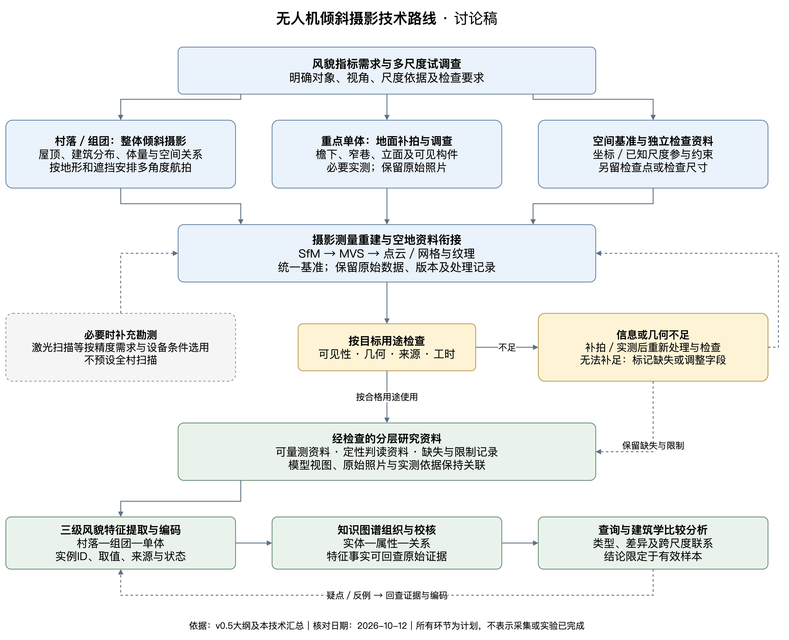

# 三维建模技术方案调研汇总与后续技术路线

> 2026-10-12按用户确认的汇报方案归档，供实施细节备查。当前入口见[汇报简版](../../三维建模技术方案调研汇总与后续技术路线.md)。

本稿按2026-10-12用户指定的“无人机倾斜摄影”汇总，研究定位依据[当前v0.5大纲](../2026-10-15-六章结构更新/景宁畲族传统民居风貌特征提取与知识图谱构建研究v0.5.md)。技术选择与试采设计为讨论建议；尚未完成现场采集、模型重建或精度验证，不替代正式调查方案。

**建议采用“无人机整体倾斜摄影—重点部位地面补拍与必要实测—摄影测量重建—分用途质量检查—三级风貌特征提取”的路线。** 村落与组团共用整体模型，单体按目标字段补充资料；三维模型作为观察与量测的资料来源，特征记录再通过实例编号与原始证据进入知识图谱。

## 一、技术方法及其作用

无人机倾斜摄影通过多个方向的重叠影像记录建筑屋面、立面及其空间环境。摄影测量重建通常先估计相机姿态和稀疏结构，再恢复较稠密的表面几何，形成点云、网格及纹理模型。[COLMAP官方教程](https://colmap.github.io/tutorial.html)提供了这一流程的技术说明。[T1]

| 术语 | 本稿采用的含义 |
| --- | --- |
| 倾斜摄影 | 影像采集方式；单镜头分航线多角度拍摄与多镜头系统均需按实际设备说明 |
| 空地互补 | 航拍记录整体、屋面及上部立面，地面多视角照片补充檐下、窄巷和单体细部 |
| SfM（运动恢复结构） | 从重叠影像估计相机姿态与稀疏三维结构 |
| MVS（多视图立体） | 利用多视图关系恢复稠密表面几何 |
| 正射视图 | 满足明确投影、尺度及质量要求的派生影像；普通模型截图仍按截图记录 |
| 控制与检查 | 控制点或已知尺度参与模型约束；另设未参与约束的检查点／检查尺寸评估误差 |

SfM与MVS描述处理环节，具体软件可以整合这些步骤。无人机影像能够覆盖的外表面，不等于建筑内部、被遮挡构造和历史原貌均已记录。

## 二、已有调研提供了什么依据

| 调研资料 | 方法与原文位置 | 本研究可借鉴内容 | 迁移边界 |
| --- | --- | --- | --- |
| 李益壮等，2026，《基于无人机倾斜摄影测量技术的古建筑三维建模与保护研究》 | 山东某寺庙；印刷17—19页：分区、像控、五镜头航摄、影像处理、重建及独立检查点 | 按遮挡条件分区；控制与检查分开；点云清理时保护建筑边缘 | 原文航高80m、航向／旁向重叠80%／70%为案例参数。精度表与正文有差异，不转化为本项目精度承诺。[S1] |
| 汤茗喆，2021，《基于数字信息模型的传统村落建筑风貌保护更新方法研究——以尚志市镇北村为例》 | 印刷42—50页：无人机与地面影像采集、空地连接及分块重建；51—59页：模型检查与构件区分 | 与本课题较接近的村落尺度空地影像路径；从模型整理构件与特征信息 | 借鉴补采与信息组织，不照搬航摄参数、精度、DGCNN训练或完整BIM族库任务；本轮沿用已有重点章节阅读卡。[S2] |
| 余学飞，2020，《多源数字化勘测技术在北京通州燃灯塔中的应用研究》 | 印刷17—27页相关段落：地面扫描、低空摄影、统一坐标及精度检查 | 按部位需求选择资料；控制空间基准；区分扫描、配准和检查精度 | 原案例含地面激光扫描、局部手持扫描及全站仪控制；不据其结果推定普通无人机影像具有同等精度。[S3] |

三项资料分别提供倾斜摄影基本流程、村落空地影像互补、较强控制条件下的多源质量管理经验。它们支持技术路线的设计，但景宁山地村落中的可见性、几何质量与实际工时仍需试采。原文核查范围及数值疑点见[方法核查记录](../../01_sources/2026-10-12-三维建模方法核查记录.md)。

## 三、对本课题的方案取舍

| 方案 | 主要用途 | 关键局限 | 建议定位 |
| --- | --- | --- | --- |
| 单一无人机倾斜摄影 | 村落建筑分布、屋顶群体、组团体量及整体关系 | 窄巷、檐下、植被遮挡及近地面构件可能缺失；局部量测能力需单独检查 | 整体资料采集与试采比较的基础方案 |
| 无人机＋地面多视角摄影＋必要实测 | 保留整体空间关系，补充重点单体立面和构件，并检查目标尺寸 | 空地影像连接、拍摄距离差异、细部修正增加工时；补拍资料未必全部可融合 | **建议主路线**；地面照片即使未成功融合，也可单独作为特征证据 |
| 无人机＋激光扫描等补充勘测 | 对明确需要更可靠几何记录、且具备设备条件的重点部位深化 | 设备、控制测量、配准与数据处理要求更高 | 条件选项；先判断必要性与可获得性 |

这一取舍依据v0.5的研究任务与资料需求，是本项目的方案判断，不是上述论文已经证明的技术排名。正式采集范围、重点单体和软件由试调查结果及实际资源确定。

## 四、后续技术路线

[可编辑图源](无人机倾斜摄影技术路线.drawio)。图示为拟开展流程；按本稿同步维护，反馈调整时覆盖同名图源与PNG。

### 1. 从风貌指标确定采集需求

先列出拟观察的屋顶、街巷、组团排列、立面分段、门窗及檐部等字段，并区分定性判读与数值量测。对每项记录所需视角、可见部位、尺度依据及可接受误差；需要的精度由分析任务决定。已有候选指标在试调查后精简，不预设32项全部可采。

### 2. 按三级尺度安排空地采集

| 尺度 | 拟采资料 | 重点检查 |
| --- | --- | --- |
| 村落整体 | 整体多角度航拍、边界及建筑身份核查、可获得的空间基准 | 山地相对航高变化、屋面与街巷覆盖、传统民居和其他建筑的身份区分 |
| 建筑组团 | 沿用整体航拍，补拍院落、街巷连续界面及相邻建筑衔接 | 划界理由、组成单体、邻接关系、朝向及高差；关系须可返回具体建筑 |
| 建筑单体及构件 | 重点立面与细部的地面多视角照片、局部实测、现场记录 | 檐下、墙角、门窗、台基和材料部位的可见性；内部构架只据可进入调查或可靠图纸记录 |

采集前记录设备、焦距、影像尺寸、航线、拍摄距离、预计覆盖与空间基准。航高、重叠度和影像数量按地形与目标细节设计，文献参数只作试采参考。照片须清晰、具有多视角重叠，并保留原始影像与拍摄时点。[T1]

### 3. 完成重建并保留处理依据

流程按“原始影像核查 → 相机姿态与稀疏结构解算 → 空地连接与尺度／坐标约束 → 稠密几何重建 → 点云清理与网格纹理 → 分区检查”组织。空地影像可尝试联合解算；若分别重建，合并须说明共同基准、连接依据与配准检查，不能靠目视拼接认定准确。

保留原始数据、处理工程、软件版本、参数、尺度转换和失败部位。增强色彩、去噪、平滑、补洞及人工修模均记录操作；材料与色彩判读回查原始照片。为展示补出的不可见表面单独标明，不作为实测几何。

实施软件可从现有授权与硬件支持的成熟工具中选择：DJI Terra、Metashape Professional或COLMAP等作为候选。[DJI Terra官方资料](https://enterprise.dji.com/dji-terra)及[Metashape Professional官方功能说明](https://www.agisoft.com/features/professional-edition/)可用于核对输出与控制功能。[T2—T3] 本稿未选定软件；同一软件内不同重建模式的结果也要分别验证。

### 4. 按用途检查资料质量

| 检查项目 | 拟执行的检查 | 后续处理 |
| --- | --- | --- |
| 可见性与完整性 | 按目标部位检查是否缺面、遮挡、模糊或纹理错配；保留原图对照 | 支持清晰可见的定性字段；不足部位补拍或标记未观察 |
| 尺度与几何 | 用未参与尺度约束／平差的检查尺寸或检查点，与模型结果比较；记录单位、方向、位置、误差及检查覆盖 | 只有满足该指标预定要求的结果进入数值分析；局部合格不推广到整栋或整村 |
| 证据追溯 | 核对村落、组团、单体、构件编号和照片／实测／模型版本的对应 | 来源不明的特征暂不转为确认事实 |
| 工作量 | 分开记录采集、处理、修正、特征判读的人工时间与机器运行时间 | 据此确定正式范围及重点单体深化数量 |

控制点与检查点的用途须分开；这也与[Metashape控制点和检查点官方说明](https://agisoft.freshdesk.com/support/solutions/articles/31000154132-control-and-check-points-for-aerial-surveys)一致。[T4] 配准残差、重投影误差和模型对实测的误差分别记录，不能相互替代。

未达到几何要求的模型仍可用于已核实的形态观察；可见性也不足时，回到现场照片、实测或文献。无法补足的字段标记缺失，或调整相应分析任务。

### 5. 形成研究资料并进入图谱

拟形成村落与组团的空间定位图、重点单体视图、点云／网格、局部实测记录，以及质量与缺失清单。每条特征按“实例ID—特征代码—取值—来源ID—判读状态”记录，关联照片、模型部位或实测依据，再进入实体—属性—关系组织及查询比较。分析发现歧义时，返回证据或编码复核。

三维表面重建与知识图谱中的语义建模为两个环节。年代、族群身份、营造工艺及历史变迁由文献、访谈和现场记录支持，不能由外观模型自动推定。

## 五、先做什么试采

在一个可进入的候选村落中，选择具有明确组成建筑的组团／街巷片段及重点单体，试验三级资料能否衔接。具体对象由用户选择；这一组织建议不预定正式样本量。

以同一轮无人机影像建立基础模型，再对同一对象增加地面补拍及必要实测，比较补充方案的实际收益。重点记录：

1. 目标部位的可见性、缺失和可判读字段是否改善。
2. 未参与约束的检查尺寸／检查点误差是否满足对应分析需要。
3. 空地融合失败、边缘变形与人工修正发生在哪些部位。
4. 每增加一项有效特征所需的采集、处理及修正工时。

先明确误差计算口径、检查位置及目标字段，再处理和比较。若补充方案有效且工作量可承担，按同一规则扩大采集；若仅局部有效，维持整体航拍并对少量重点部位深化；若无法支持某项数值指标，改用实测或保留定性记录。尚未实施试采，不填写预期精度或虚构结果。

## 六、可用于导师汇报的技术路线说明

本研究拟采用无人机倾斜摄影与地面补充调查相结合的方式，构建服务于村落整体、建筑组团和建筑单体风貌分析的数字化资料。首先依据待提取的风貌特征确定采集视角与量测需求，通过整体航拍记录建筑分布、屋顶及组团空间关系，并对重点单体的檐下、立面和构件进行地面补拍与必要实测。随后采用成熟摄影测量工具进行三维重建，统一空间基准，并利用独立检查点或检查尺寸评估模型的几何可靠性。根据检查结果区分可用于量测、可用于定性判读和需要补证的资料，提取多尺度风貌特征，建立实例、取值与原始证据的关联，支持知识图谱构建及比较分析。通过小规模试采评估信息完整性、几何质量与实际工时，再确定正式采集范围和建模深度。

## 七、来源、证据状态与待确定事项

- **[S1、S3]** Zotero“三维建模”集合两篇原文，书目、原文路径、阅读覆盖与检查记录见[方法核查记录](../../01_sources/2026-10-12-三维建模方法核查记录.md)。
- **[S2]** [汤茗喆重点章节阅读卡](../../文献库/2021-汤茗喆-数字信息模型与传统村落风貌保护更新.md)：本轮复用该卡及其页码索引，未重新逐页阅读原论文；卡中的旧章节迁移建议按v0.5重新判断。
- **研究任务依据**：当前v0.5大纲§1.5—1.6、§2.4—2.5及§3.1—3.3。本稿聚焦其资料采集与质量控制，不修改现行目录或研究范围。
- **[T1—T4]** 官方技术说明于2026-10-12核对；用于说明处理流程和工具功能，不证明本项目已经可重建或达到某项精度。
- **已支持的判断**：相关文献存在空地互补、分项检查及数据到特征组织的操作先例。
- **本项目的方案判断**：优先试验无人机＋地面补拍与必要实测，以目标字段决定模型深度。
- **待确定**：可采对象、无人机与相机、空间基准取得方式、独立检查条件、软件授权及硬件、指标误差要求、正式规模。均在试调查中核实。
