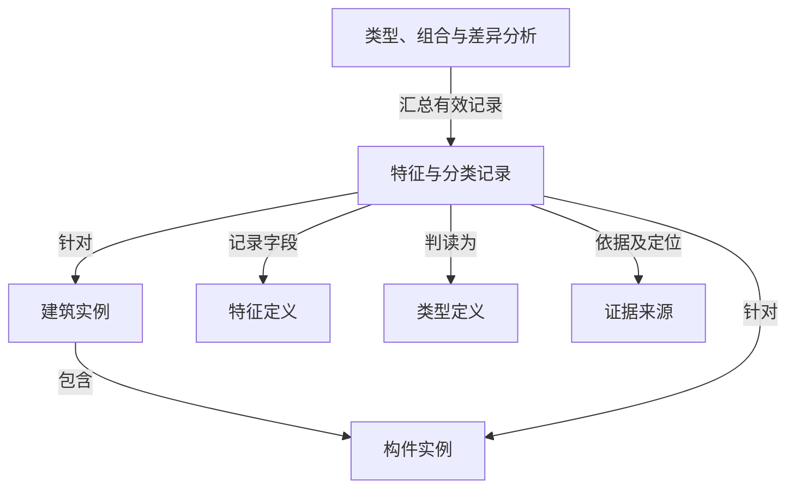

# 建筑风貌知识图谱基础框架

## 一、定位与当前状态

本框架把[[科研方案-导师反馈调整版#4.7 图谱的修订与最终形式|图谱组织框架]]落实为可以查看和填充的数据结构，支持建筑、构件、特征、类型和证据的相互关联。它属于组织框架与展示原型，尚未完成真实建筑录入、试采验证、类型归纳或组合规律分析。

当前展示使用三个虚构建筑和虚构取值，统一标记为演示数据。没有使用景宁候选对象名称或新增正式对象编号；演示照片与模型只有定位字段，没有真实媒体文件。候选字段和分类名称仍需按实际对象研究、试采与建筑学复核修订。

[打开交互展示](outputs/建筑风貌知识图谱基础框架/index.html) · [结构定义](outputs/建筑风貌知识图谱基础框架/schema.json) · [演示数据](outputs/建筑风貌知识图谱基础框架/demo-data.json) · [空白录入模板](outputs/建筑风貌知识图谱基础框架/录入模板.json)

双击展示页面即可离线打开；同目录文件应一起保留。页面可以导入符合本框架的JSON数据，也可以导出当前数据。导入只检查结构与引用，不证明量测、分类或来源内容真实。

## 二、展示形式

### 2.1 框架总览

展示六类信息及其连接方式，用于认识什么信息应保存在哪里。点击类别可看含义、候选字段或类型规则。

总览中的“类型定义”指可被多个实例引用的规则，“对象实例”指某栋建筑及其某个构件；两者分别维护。整体建筑类型尚未制定，不能直接由屋顶或窗型替代。

### 2.2 实例关系与记录详情

先选一栋建筑，查看所属构件；进一步选屋顶、山墙或窗，展开其特征记录、分类规则和来源。保持当前对象附近的少量关系可读。

点击记录查看取值、单位、获取方法、日期、观察与复核状态以及证据定位。每条取值分别关联来源；量测、现场观察、文献记载与文化解释不能只用同一条来源说明代替。

点击来源可查看文件地址和定位字段。当前演示来源显示“待关联真实文件”；不会生成照片、假模型或虚构采集时间。后续真实图片可在详情中查看，三维资料先以模型文件、版本及构件部位索引关联；三维场景渲染与自动定位尚未实现。

### 2.3 类型比较表

按建筑优先并列屋顶形式、坡度、窗形式、窗宽和可见表面材料，并补充当前数据中其他已有记录的字段。点击单元格查看参与表达的全部记录。多个构件、多个来源或不同调查时点可能具有不同取值，界面保留其对应记录。

演示民居乙的坡度是“未观察”，取值为null；演示民居丙的两条屋顶判读相互冲突，均为“有分歧”。两种情况不会转换成0或自动选择其中一个结果。

比较表用于并置资料，当前不自动计算真实样本频次、统计显著性、参数标准或文化成因。分析结果列表为空。

## 三、六类信息与关系

| 类别 | 主要内容 | 当前保存位置 |
| --- | --- | --- |
| 对象实例 | 位置背景、建筑、构件实例；组成关系和具体部位 | places、buildings、components |
| 特征定义 | 字段含义、适用对象、取值方式、单位与版本 | feature_definitions |
| 特征与分类记录 | 特定对象的观察、量测、分类、关系或解释，以及证据与状态 | records |
| 类型定义 | 类型尺度、名称、判别规则、版本与候选状态 | type_definitions |
| 证据来源 | 影像、模型、点云、量测、调查、文献及定位 | sources；定位在记录的evidence中 |
| 分析结果 | 类型频次、参数分布、组合、差异、有效范围与反例 | analyses；本版未填充 |

建筑与构件的组成关系、建筑与位置的关系按对象字段形成；记录与对象、特征、类型和来源的关系由其引用形成。具体位置与组合关系可另保存在relations中，并引用证据记录。当前没有加入未经观察的空间关系。

基础关系包括“位于、包含、针对、记录字段、判读为、依据、汇总、位置或组合关系”。schema.json列明各自的起止对象与含义。该文件是本项目的候选结构定义，不声称为完整行业本体或正式JSON Schema标准实现。

## 四、特征与类型的候选范围

### 4.1 首轮候选字段

| 内容 | 字段 | 观察边界 |
| --- | --- | --- |
| 建筑整体 | 可见层数、构件排列与组合 | 不凭门窗推断内部平面和梁架 |
| 屋顶 | 形式、坡度、出檐 | 区分主屋面与附属屋面，量测需明确端点与剖面 |
| 山墙 | 形式、可见构造 | 依据可见轮廓，不外推隐蔽构造 |
| 门窗 | 窗形式、窗宽、窗高 | 窗洞与窗框边界定义须统一；门字段可按需扩充 |
| 表面与细部 | 材料、当前色彩、装饰、可见构造 | 外饰面不等于承重结构，显示色不等于历史原色 |
| 组合 | 排列、相对位置与有依据的关系 | 记录实例组合，跨样本规律留待分析 |

首版共有13个候选字段；展示实例只填其中部分。双坡、四坡、矩形窗和直线轮廓山墙是用于试用结构的候选类型，不是景宁地方分类结论。规则保存版本，后续保留变体、混合类型和反例。改变取值边界或类型判别条件时，应新增定义编号及版本，保留旧定义和引用，避免覆盖已有记录的判别依据。

### 4.2 每条记录的最低内容

记录编号、对象编号、特征编号、记录类别、取值或类型编号、单位、观察日期、获取方法、观察状态、复核状态、证据来源与具体定位、备注。

- 数值、文本和类型编号分别保存；没有取值时用null，不用0填缺失。
- 观察状态为“已观察、确认不存在、未观察、无法判断”。“确认不存在”需要明确检查范围及证据。
- 复核状态为“待复核、已复核、有分歧”，与是否观察分开。
- 同一对象、同一字段可以存在多条记录，以保留重复量测、调查时点与资料分歧；不会仅因字段相同而覆盖。
- 修订可以用supersedes_record_id和revision_reason关联旧记录与理由。本版保留全部记录，尚未实现按历史版本自动确定采信值。
- 观察日期与文献所指历史时期分开；年代、族群和文化解释必须有对应资料。

### 4.3 证据如何定位

照片记录文件与构件区域；模型记录文件、版本、部位和量测端点；文献记录PDF、页码、图号及对应对象；现场调查记录调查日期、方法和记录位置。证据定位挂在具体记录上。

例如，“这扇窗是矩形窗”“窗宽为某实测值”“表面材料为木材”“某装饰具有某种寓意”应分别保存记录，允许使用不同来源。照片与三维模型不能单独证明最后一种文化解释。

## 五、后续怎样填真实资料

1. 复制空白录入模板，保留原模板。按实际对象核查确定的编号填写建筑和构件，不用演示编号代替。
2. 添加实际照片、模型、量测、现场记录或文献来源；记录真实地址、版本与时点。
3. 按所选候选字段录入取值，补方法、单位、证据定位与未知原因。暂定类型保留候选状态。
4. 导入展示页面，核查构件所属建筑、字段尺度、单位、引用与来源是否正确。导入错误会拒绝载入，日期或实际证据文件未补齐等情况列为待补信息。
5. 对资料充分的1—3栋试采对象进行人工核查，修改不适用的字段与分类规则。首轮试用不支持地域性结论。
6. 随实例提取填充初步图谱，按有效记录进行类型、组合与差异分析，再反馈修订。新增分析结果需说明范围、方法、对象和记录、有效与缺失数量及反例。

研究数据模式不能混入标记为演示的对象或来源；页面可以加载空白研究数据，明确显示尚未录入建筑。当前浏览器导入的资料只保存在本次页面内，刷新会重新载入演示数据；需要保留时使用“导出当前数据”。本版不提供服务器保存或多用户协作。

## 六、文献依据与迁移限制

| 文献 | 本版借鉴 | 原文定位与限制 |
| --- | --- | --- |
| 申程程《皖北乡村建筑风貌特征识别及优化策略》 | 要素拆解、材料色彩与构件变体的表达 | 印刷页31—33、65—67；地域内容不移植为景宁特征。原PDF封面2024年5月与文件名2025不同，书目待核准 |
| 汤茗喆《基于数字信息模型的传统村落建筑风貌保护更新方法研究——以尚志市镇北村为例》 | 结构树、类型树、几何参数、组合及实例编码 | 印刷页25—30、60—77；原PDF封面及答辩页2021年12月，Zotero日期2024。分割不直接替代类型判读，BIM族库和数值结果不直接照搬 |
| 郭锐、齐文娟、陈勇《基于多源数据融合与知识图谱的历史建筑数字化保护方法研究》 | 建筑、构件、属性和多源资料关联 | 印刷页18—19；其三页文章未展开完整本体和可复现实现，设备精度及效率结果不直接作为本研究目标 |

原始资料继续以Zotero附件为准：[申程程PDF](</Users/wangyuelin/Zotero/storage/EY3G5K4V/申程程 - 2025 - 皖北乡村建筑风貌特征识别及优化策略.pdf>)、[汤茗喆PDF](</Users/wangyuelin/Zotero/storage/GSZYPRIQ/汤茗喆 - 2024 - 基于数字信息模型的传统村落建筑风貌保护更新方法研究 ——以尚志市镇北村为例.pdf>)、[郭锐等PDF](</Users/wangyuelin/Zotero/storage/H4N4454A/郭锐 等 - 2026 - 基于多源数据融合与知识图谱的历史建筑数字化保护方法研究.pdf>)。

六类信息及逐项证据记录是本次综合设计，不表述为三篇文献已经共同完成或验证的系统。来源追溯亦可参考[W3C PROV-O](https://www.w3.org/TR/prov-o/)，本版没有实施完整PROV本体映射。

## 七、范围与研究路径图衔接

本原型位于现有方案“组织框架先行、基础提取与初步图谱同步、分析反馈修订”的环节。尚未接入点云自动分割、真实三维场景、自动统计推理或保护决策平台。

现有研究对象、研究主线、输入、阶段成果和质量检查没有因本次搭建改变。[研究路径图](研究路径图.png)与[可编辑图源](研究路径图.drawio)保持原入口；后续若框架试用导致方案相关内容调整，再按[AGENTS.md](AGENTS.md)同次同步图源和PNG。

验证记录只证明页面与数据结构的检查范围，不证明建筑学分类、量测精度或研究方法已经成立。后续真实资料及规则变化时，应重新核对受影响记录和显示。

## 八、本次展示核对

2026-10-08在本地浏览器中检查了关系展开、记录详情、未知与分歧表达、空白研究数据、扩展字段、建筑自身记录、空间关系方向、分析依据、错误导入及导出一致性。演示数据和空白模板通过结构检查；三个视图在320—1440像素宽度下没有整页横向溢出，比较表在自身区域内横向滚动。

已目视检查框架总览、实例详情、类型比较和窄屏显示。[总览预览](outputs/建筑风貌知识图谱基础框架/展示预览.png) · [实例关系预览](outputs/建筑风貌知识图谱基础框架/实例关系预览.png) · [类型比较预览](outputs/建筑风貌知识图谱基础框架/类型比较预览.png) · [核对范围与文件快照](outputs/建筑风貌知识图谱基础框架/核对记录.json)

这些检查覆盖当前页面与数据文件，不包含真实采集、模型精度检验或类型判别有效性验证。
