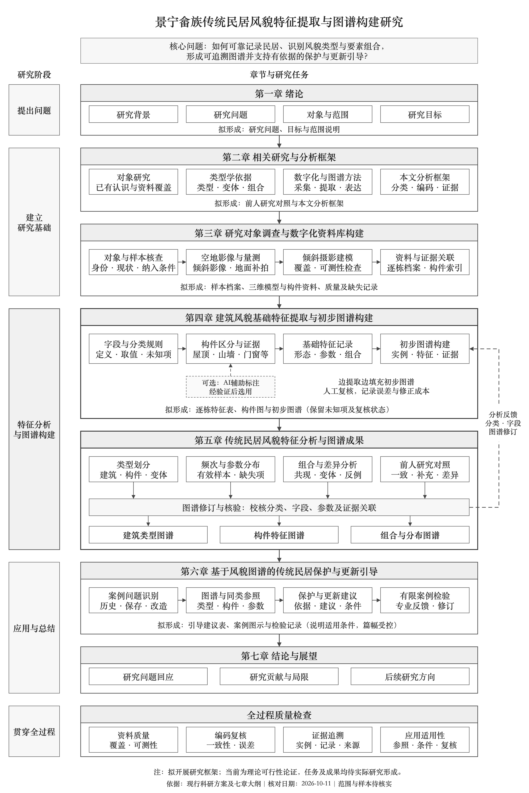

# 景宁畲族传统民居风貌特征提取与图谱构建研究

> **目录与逐节论证概要，供导师审阅及后续研究写作使用。** 沿用既定七章、题目与范围原则；当前处于理论可行性阶段。本文说明每节的中心问题、展开顺序和在全篇中的作用，计划性章节据此安排取证与分析，尚未形成的结果不预填。

**全篇中心问题：** 在明确样本范围内，怎样可靠认识景宁畲族传统民居的类型及要素组合，并形成有证据支持、可以核查和使用的风貌图谱？

**论证链：** 对象为什么值得研究 → 前人提供哪些认识与方法 → 建立怎样的对象证据 → 形成怎样的可比较特征 → 解释类型、组合与变体 → 用图谱表达并检查有限应用。

**概要写法：** 各节采用用户确认的连贯段落式观点概要，将具体观点、论证关系及关键待补方向融入叙述，资料入口另列。章概要用2—3句话，二级概要用1—2句话统领；三级小节通常约150—250字，资料不足可更短，丰富部分上限300字。资料表保留供回查，不要求各节同样饱满，尚未形成的研究结果不预填。

**资料与研究状态：** 对象价值、前人认识及方法先例已有文献和图文支撑；正式村落与样本、现场资料、提取质量、类型统计、最终图谱及案例检验尚待形成。研究缺口和新增贡献需通过前人对照及真实结果判断。具体未完成证据按章集中列于文末。

**术语约定：**

| 术语 | 本稿中的固定含义 |
| --- | --- |
| 建筑风貌特征 | 实例的形态、参数、材料及组合；文化解释单独注明依据 |
| 建筑类型／构件类型 | 按明确规则归纳的不同层级类别，保留变体与混合实例 |
| 初步图谱 | 随实例提取填充的比较资料，保留暂定及未知状态 |
| 最终图谱 | 经分析、反馈修订和核验后表达建筑学认识的成果 |
| 建筑学图谱／计算机知识图谱 | 前者表达分类、图示及关系，后者指实体关系的信息实现；本文不预设完整平台开发 |

## 目录

- [[#摘要|摘要]]
- [[#Abstract|Abstract]]
- [[#第一章 绪论|第一章 绪论]]
    - [[#1.1 研究背景|1.1 研究背景]]
        - [[#1.1.1 传统民居记录、保护与风貌认知的现实需求|1.1.1 传统民居记录、保护与风貌认知的现实需求]]
        - [[#1.1.2 景宁畲族传统民居的研究基础与待解决问题|1.1.2 景宁畲族传统民居的研究基础与待解决问题]]
        - [[#1.1.3 数字化采集与智能图像处理的研究条件|1.1.3 数字化采集与智能图像处理的研究条件]]
    - [[#1.2 研究问题与研究目标|1.2 研究问题与研究目标]]
        - [[#1.2.1 核心问题：如何形成可靠的建筑风貌特征认识与图谱|1.2.1 核心问题：如何形成可靠的建筑风貌特征认识与图谱]]
        - [[#1.2.2 子问题：样本证据、类型特征、方法可靠性与图谱应用|1.2.2 子问题：样本证据、类型特征、方法可靠性与图谱应用]]
        - [[#1.2.3 研究目标与预期成果|1.2.3 研究目标与预期成果]]
    - [[#1.3 研究对象与范围|1.3 研究对象与范围]]
        - [[#1.3.1 传统民居与景宁畲族研究对象的界定|1.3.1 传统民居与景宁畲族研究对象的界定]]
        - [[#1.3.2 地域边界、样本框架与代表性|1.3.2 地域边界、样本框架与代表性]]
        - [[#1.3.3 建筑单体、可见构件与背景信息的研究尺度|1.3.3 建筑单体、可见构件与背景信息的研究尺度]]
        - [[#1.3.4 研究结论与后续应用的边界|1.3.4 研究结论与后续应用的边界]]
    - [[#1.4 核心概念与研究方法|1.4 核心概念与研究方法]]
        - [[#1.4.1 建筑风貌特征、建筑类型与图谱|1.4.1 建筑风貌特征、建筑类型与图谱]]
        - [[#1.4.2 研究方法与技术路线|1.4.2 研究方法与技术路线]]
        - [[#1.4.3 研究内容与论文结构|1.4.3 研究内容与论文结构]]
- [[#第二章 相关研究与分析框架|第二章 相关研究与分析框架]]
    - [[#2.1 景宁畲族及相关传统民居研究|2.1 景宁畲族及相关传统民居研究]]
        - [[#2.1.1 营造技艺、建筑形态与地方文化研究|2.1.1 营造技艺、建筑形态与地方文化研究]]
        - [[#2.1.2 既有资料覆盖与本研究的差异定位|2.1.2 既有资料覆盖与本研究的差异定位]]
    - [[#2.2 建筑类型学与风貌特征识别研究|2.2 建筑类型学与风貌特征识别研究]]
        - [[#2.2.1 类型、原型与变体的分析方法|2.2.1 类型、原型与变体的分析方法]]
        - [[#2.2.2 特征筛选、编码与关系组织|2.2.2 特征筛选、编码与关系组织]]
    - [[#2.3 数字化采集与辅助特征提取研究|2.3 数字化采集与辅助特征提取研究]]
        - [[#2.3.1 建筑影像、测绘与三维记录方法|2.3.1 建筑影像、测绘与三维记录方法]]
        - [[#2.3.2 图像分割、辅助标注与质量检查|2.3.2 图像分割、辅助标注与质量检查]]
    - [[#2.4 图谱研究评述与本文分析框架|2.4 图谱研究评述与本文分析框架]]
        - [[#2.4.1 建筑图谱的内容与表达形式|2.4.1 建筑图谱的内容与表达形式]]
        - [[#2.4.2 研究不足、方法迁移与验证思路|2.4.2 研究不足、方法迁移与验证思路]]
    - [[#2.5 本章小结|2.5 本章小结]]
- [[#第三章 研究对象调查与数字化资料库构建|第三章 研究对象调查与数字化资料库构建]]
    - [[#3.1 研究区域与样本框架|3.1 研究区域与样本框架]]
        - [[#3.1.1 自然环境、聚居背景与建筑分布|3.1.1 自然环境、聚居背景与建筑分布]]
        - [[#3.1.2 样本纳入条件、选择过程与覆盖情况|3.1.2 样本纳入条件、选择过程与覆盖情况]]
    - [[#3.2 实地调查与建筑信息记录|3.2 实地调查与建筑信息记录]]
        - [[#3.2.1 历史、保存状况与改造信息|3.2.1 历史、保存状况与改造信息]]
        - [[#3.2.2 空地影像、量测与必要的空间资料采集|3.2.2 空地影像、量测与必要的空间资料采集]]
    - [[#3.3 数字化记录与质量检查|3.3 数字化记录与质量检查]]
        - [[#3.3.1 倾斜摄影建模与适用立面视图生成|3.3.1 倾斜摄影建模与适用立面视图生成]]
        - [[#3.3.2 覆盖完整性、量测检查与缺失处理|3.3.2 覆盖完整性、量测检查与缺失处理]]
    - [[#3.4 建筑资料库构建|3.4 建筑资料库构建]]
        - [[#3.4.1 编号体系与证据关联|3.4.1 编号体系与证据关联]]
        - [[#3.4.2 样本构成及资料适用范围|3.4.2 样本构成及资料适用范围]]
    - [[#3.5 本章小结|3.5 本章小结]]
- [[#第四章 建筑风貌基础特征提取与初步图谱构建|第四章 建筑风貌基础特征提取与初步图谱构建]]
    - [[#4.1 风貌特征体系与调查编码|4.1 风貌特征体系与调查编码]]
        - [[#4.1.1 主要特征维度及选择依据|4.1.1 主要特征维度及选择依据]]
        - [[#4.1.2 定义、取值规则与未知状态|4.1.2 定义、取值规则与未知状态]]
    - [[#4.2 基础特征提取与初步图谱组织|4.2 基础特征提取与初步图谱组织]]
        - [[#4.2.1 构件识别、轮廓标注与图像整理|4.2.1 构件识别、轮廓标注与图像整理]]
        - [[#4.2.2 几何参数、材料及组合特征记录|4.2.2 几何参数、材料及组合特征记录]]
        - [[#4.2.3 构件图、特征表与初步图谱的关联|4.2.3 构件图、特征表与初步图谱的关联]]
    - [[#4.3 AI辅助处理的任务设计与验证|4.3 AI辅助处理的任务设计与验证]]
        - [[#4.3.1 输入、输出与人工参照设置|4.3.1 输入、输出与人工参照设置]]
        - [[#4.3.2 提取质量、修正成本与失败情况|4.3.2 提取质量、修正成本与失败情况]]
    - [[#4.4 编码一致性与误差讨论|4.4 编码一致性与误差讨论]]
        - [[#4.4.1 人工复核、分歧与规则修订|4.4.1 人工复核、分歧与规则修订]]
        - [[#4.4.2 资料误差与特征使用边界|4.4.2 资料误差与特征使用边界]]
    - [[#4.5 本章小结|4.5 本章小结]]
- [[#第五章 传统民居风貌特征分析与图谱成果|第五章 传统民居风貌特征分析与图谱成果]]
    - [[#5.1 建筑类型划分|5.1 建筑类型划分]]
        - [[#5.1.1 分类依据与类型判别规则|5.1.1 分类依据与类型判别规则]]
        - [[#5.1.2 典型实例、变体与混合类型|5.1.2 典型实例、变体与混合类型]]
    - [[#5.2 核心构件与风貌特征分布|5.2 核心构件与风貌特征分布]]
        - [[#5.2.1 屋顶、山墙与建筑轮廓|5.2.1 屋顶、山墙与建筑轮廓]]
        - [[#5.2.2 立面、门窗、材料与可见构造|5.2.2 立面、门窗、材料与可见构造]]
    - [[#5.3 要素组合及样本差异|5.3 要素组合及样本差异]]
        - [[#5.3.1 类型与构件的组合关系|5.3.1 类型与构件的组合关系]]
        - [[#5.3.2 地点、保存及改造状态下的差异|5.3.2 地点、保存及改造状态下的差异]]
    - [[#5.4 与既有研究的对照及新增认识|5.4 与既有研究的对照及新增认识]]
        - [[#5.4.1 一致、补充与差异性发现|5.4.1 一致、补充与差异性发现]]
        - [[#5.4.2 地域与族群解释的适用边界|5.4.2 地域与族群解释的适用边界]]
    - [[#5.5 图谱修订与成果表达规则|5.5 图谱修订与成果表达规则]]
        - [[#5.5.1 建筑、构件与关系的修订依据|5.5.1 建筑、构件与关系的修订依据]]
        - [[#5.5.2 编码、图例、参数与来源标识|5.5.2 编码、图例、参数与来源标识]]
    - [[#5.6 风貌特征图谱成果|5.6 风貌特征图谱成果]]
        - [[#5.6.1 建筑类型与构件特征图谱|5.6.1 建筑类型与构件特征图谱]]
        - [[#5.6.2 组合、参数及空间分布图谱|5.6.2 组合、参数及空间分布图谱]]
    - [[#5.7 图谱校核与使用检查|5.7 图谱校核与使用检查]]
        - [[#5.7.1 原始证据追溯与样本核查|5.7.1 原始证据追溯与样本核查]]
        - [[#5.7.2 分类可解释性与专业反馈|5.7.2 分类可解释性与专业反馈]]
    - [[#5.8 本章小结|5.8 本章小结]]
- [[#第六章 基于风貌图谱的传统民居保护与更新引导|第六章 基于风貌图谱的传统民居保护与更新引导]]
    - [[#6.1 应用目标与原则|6.1 应用目标与原则]]
        - [[#6.1.1 保护与局部更新的任务界定|6.1.1 保护与局部更新的任务界定]]
        - [[#6.1.2 历史证据、类型差异与实际需求|6.1.2 历史证据、类型差异与实际需求]]
    - [[#6.2 风貌特征向引导建议的转化|6.2 风貌特征向引导建议的转化]]
        - [[#6.2.1 同类参照选择与图谱证据关联|6.2.1 同类参照选择与图谱证据关联]]
        - [[#6.2.2 “依据—建议—适用条件”引导表|6.2.2 “依据—建议—适用条件”引导表]]
    - [[#6.3 典型案例应用与检验|6.3 典型案例应用与检验]]
        - [[#6.3.1 现状问题、参照与建议的图示表达|6.3.1 现状问题、参照与建议的图示表达]]
        - [[#6.3.2 证据追溯、专业反馈与建议修订|6.3.2 证据追溯、专业反馈与建议修订]]
    - [[#6.4 应用边界与后续用途|6.4 应用边界与后续用途]]
        - [[#6.4.1 资料缺失、类型变异与建议适用范围|6.4.1 资料缺失、类型变异与建议适用范围]]
        - [[#6.4.2 数字展示、后续比较与设计借鉴|6.4.2 数字展示、后续比较与设计借鉴]]
    - [[#6.5 本章小结|6.5 本章小结]]
- [[#第七章 结论与展望|第七章 结论与展望]]
    - [[#7.1 主要研究结论|7.1 主要研究结论]]
        - [[#7.1.1 对象调查与资料记录的结论|7.1.1 对象调查与资料记录的结论]]
        - [[#7.1.2 建筑类型、构件与组合特征的结论|7.1.2 建筑类型、构件与组合特征的结论]]
        - [[#7.1.3 提取方法与图谱表达的结论|7.1.3 提取方法与图谱表达的结论]]
        - [[#7.1.4 图谱应用与风貌引导的结论|7.1.4 图谱应用与风貌引导的结论]]
    - [[#7.2 研究贡献与不足|7.2 研究贡献与不足]]
        - [[#7.2.1 系统资料、建筑学认识与方法贡献|7.2.1 系统资料、建筑学认识与方法贡献]]
        - [[#7.2.2 样本、资料、方法与解释的局限|7.2.2 样本、资料、方法与解释的局限]]
    - [[#7.3 后续研究展望|7.3 后续研究展望]]
- [[#参考文献|参考文献]]
- [[#附录|附录]]
    - [[#附录A 样本名录与纳入依据|附录A 样本名录与纳入依据]]
    - [[#附录B 调查记录表与数字化采集说明|附录B 调查记录表与数字化采集说明]]
    - [[#附录C 特征编码表与判别规则|附录C 特征编码表与判别规则]]
    - [[#附录D 提取方法验证与误差记录|附录D 提取方法验证与误差记录]]
    - [[#附录E 完整风貌图谱及证据索引|附录E 完整风貌图谱及证据索引]]
    - [[#附录F 图谱应用引导表与案例检验记录|附录F 图谱应用引导表与案例检验记录]]
- [[#作者简历及在学期间取得的研究成果|作者简历及在学期间取得的研究成果]]
- [[#致谢|致谢]]

---

## 摘要

摘要按“对象与问题—研究路径—主要认识—意义与范围”组织。最终摘要从真实结论中提炼一条主线，选择能支撑它的关键资料与结果，不逐章罗列工作。本概要阶段保留组织方式，结果与贡献待研究完成后填写。

## Abstract

英文摘要与中文摘要使用相同问题、证据及结论范围。待主要认识确定后再组织英文表达，避免研究安排和完成结果的语气混淆。

## 第一章 绪论

景宁畲族传统民居已有空间、构造与文化方面的研究基础，本文拟围绕类型、要素组合和变体确定具体问题。研究背景、对象范围与方法选择共同说明选题为什么成立、哪些认识值得进一步核查，以及能够取得什么证据。

### 1.1 研究背景

研究背景围绕准确认识民居风貌的需要展开。景宁已有空间、构造和文化方面的案例认识，数字化方法也提供了补充记录的条件；本文的选题依据在于这些资料能否支持更具体的类型与组合比较，研究必要性需落实到对象问题及前人成果对照。

#### 1.1.1 传统民居记录、保护与风貌认知的现实需求

传统民居的保护判断需要同时理解原有形式、实际使用及后期变化。现有东弄编号调查、蓝坤宝寮图纸和敕木山资料分别保存了不同层次的信息，但建筑身份、资料时点与现状尚需对应。逐栋关联这些证据，有助于区分历史做法、个体变体和后期改造。背景中的保护需求宜用具名建筑及具体部位说明，并据此明确调查要补充什么信息。

**资料入口：** [资料依据](研究对象候选汇总-按村落.md)。

#### 1.1.2 景宁畲族传统民居的研究基础与待解决问题

已有文献记录了一字形与合院、长间与檐廊、腰檐及屋面变体，提示空间与构件组合的研究价值。前人已开展民居类型、营造技艺和区域差异研究，构成本文认识对象的基础。在此基础上，本文拟关注整体类型与构件组合的联系，比较同类住宅的稳定组合和变化部位。具体切入点需通过前人的样本、分类和组合分析对照确定，优先选择一项能够由实例验证的候选增量，以明确研究问题和调查重点。

**资料入口：** [特征及原文定位](景宁畲族传统民居建筑特征初步总结.md)；[赵潇诺研究及对照依据](文献库/2022-赵潇诺-景宁畲族传统民居营造技艺.md)。

#### 1.1.3 数字化采集与智能图像处理的研究条件

数字化采集的研究价值在于补足建筑观察与比较所需的证据。航拍有助于记录整体和屋面，地面影像补充檐下与细部，可靠图纸及调查记录支持内部空间、构造和使用判断。汤茗喆的空地融合与构件信息组织提供了方法先例，但景宁的可采性和量测质量仍需试采。技术选择应对应目标特征，AI辅助标注的采用范围由质量和总成本决定。

**资料入口：** [汤茗喆：正文42—79页](文献库/2021-汤茗喆-数字信息模型与传统村落风貌保护更新.md)；[郭锐等：正文18—19页](文献库/2026-郭锐等-多源数据与知识图谱历史建筑保护.md)。

### 1.2 研究问题与研究目标

研究以建筑类型、要素组合及变体关系为主要认识目标，样本证据与方法质量保证这些判断可信。核心问题、子问题和预期成果应彼此对应，使资料获取、比较分析、图谱表达及有限应用各有明确作用。

#### 1.2.1 核心问题：如何形成可靠的建筑风貌特征认识与图谱

本文的核心问题是：在明确样本范围内，如何可靠认识景宁畲族传统民居的类型与要素组合，并形成可追溯图谱？研究重点在于整体类型与构件组合的关系，以及同类住宅内部的共性和变体。调查与特征提取提供实例证据，类型和组合分析形成建筑学认识，图谱表达判据、实例与关系，有限应用检查其使用条件。后续需优先确定一个能由现有资料和调查回答的主要比较问题，据此收紧研究目标。

**资料入口：** [研究问题与范围依据](<科研方案-导师反馈调整版.md#1.3 研究问题>)。

#### 1.2.2 子问题：样本证据、类型特征、方法可靠性与图谱应用

研究问题包括对象与证据、类型与组合、方法可靠性及图谱应用四方面。对象核查确定哪些建筑和资料可以比较，建筑学分析关注整体类型与构件关系及其内部变化；质量检查限定判断的可信范围，应用检验考察图谱能否支持具体参照。四类问题围绕同一批实例衔接，后续需选出最主要的比较问题，避免技术和应用任务挤占建筑学分析。

#### 1.2.3 研究目标与预期成果

预期成果包括建筑档案、实例特征表、类型与组合认识、可追溯图谱，以及有限案例的建议和检验记录。档案为特征取值提供依据，统一记录支持实例比较，分析反馈修订图谱，图谱再支持具体判断。成果的意义取决于是否回应研究问题及相对前人增加了什么认识。后续宜明确各项成果的最低证据条件，具体结论和贡献由真实研究结果形成。

### 1.3 研究对象与范围

研究范围由建筑身份、地域覆盖和资料条件共同限定。本文以单体和构件为主体，环境与文化提供解释背景；正式样本、内部资料及应用深度需据核查确定，使问题与可取得证据相称。

#### 1.3.1 传统民居与景宁畲族研究对象的界定

建筑所在地、传统营造和族群背景提供不同层次的对象证据。住宅位于畲族村落或具有某种纹样，并不能单独完成身份判断；年代、营造、使用及改造资料应相互核对。民居与公共建筑也需区分，后者可提供环境背景。纳入条件宜由明确证据建立，保留身份待核实例，具体年代和改造边界在对象核查后确定。

**资料入口：** [边界依据](<科研方案-导师反馈调整版.md#3.1 定义研究对象>)。

#### 1.3.2 地域边界、样本框架与代表性

东弄、敕木山、桃源、大张坑和周湖各有数量、图纸或照片优势，构成现有候选范围。历史统计、典型大户子集和构架编号记录的口径不同，不能合并为现存或有效样本量。正式范围需结合逐栋身份、保存状态、形态差异及可调查性确定。样本选择应记录遗漏与便利取样的影响，题目中的地域表述随实际覆盖校准。

**资料入口：** [逐村数量与资料](导师汇报提纲-理论可行性论证.md#二、研究对象与资料基础：按村落展示已有资料)。

#### 1.3.3 建筑单体、可见构件与背景信息的研究尺度

建筑单体与构件是本文主要比较单元，村落地形、邻接和家庭居住变化用于理解差异。初步总结的多尺度认识可提供观察背景，但各尺度无需承担同等分析任务。平面功能、屋架及工艺只有在可靠图纸、测绘或访谈支持时纳入。后续需按资料区分可见外部特征和内部知识，避免从住宅外观推定开间、承重或文化成因。

**资料入口：** [尺度及证据说明](景宁畲族传统民居建筑特征初步总结.md#一、先划分维度：四个空间尺度与两个贯穿维度)。

#### 1.3.4 研究结论与后续应用的边界

结论与应用的范围应对应实际样本及可观察部位。样本共性、地方特征和民族专属性具有不同证明要求，缺少可比外部材料时，只讨论调查样本中的认识。图谱可服务识别、比较和有依据的局部更新参照，少量案例用于检查推导与适配条件。后续宜明确哪些部位具备应用证据，将完整设计和工程效果评价留给有相应条件的研究。

### 1.4 核心概念与研究方法

风貌特征描述实例属性，类型按规则组织共同项与变体，图谱表达这些认识及来源。文献核验、调查、提取和比较分别承担不同任务，统一概念与证据衔接为各章建立共同基础。

#### 1.4.1 建筑风貌特征、建筑类型与图谱

风貌特征包括可观察形态、可靠参数、材料及组合，建筑或构件类型则由明确判据归纳。图谱连接类别、实例、参数及来源，使共性和变体能够并置比较。本文区分先行组织框架、随提取填充的初步图谱，以及分析修订后的最终图谱。建筑学图谱与计算机知识图谱也需辨明，后续宜据实际检索需要决定信息实现方式，保持研究成果与软件工作量相称。

**资料入口：** [李世芬等：正文220—224页](文献库/2022-李世芬等-渤海南域民居建筑基因与图谱.md)；[廖瑞：正文5、83—88页](文献库/2024-廖瑞-康巴藏区传统民居建筑风貌图谱.md)。

#### 1.4.2 研究方法与技术路线

研究路线通过对象证据、实例特征和比较分析形成建筑学认识。文献与现场核查确定对象，空地采集和必要量测提供资料，构件区分与编码形成初步图谱，类型及组合比较反馈修订成果。有限应用承接经核验的认识，检查同类参照的适用条件。各环节已有不同研究先例，整体迁移仍需核定现场条件、有效字段和处理成本。

#### 1.4.3 研究内容与论文结构

七章分别承担问题提出、研究依据、资料建立、实例提取、建筑学分析、有限应用和综合结论。第三章确定有效证据，第四章形成可比较记录，第五章归纳类型、组合与变体并形成图谱。分析发现歧义或反例时，需要回到实例及规则复核，因此第四、第五章具有反馈关系。章节分工宜围绕同一研究问题衔接，避免重复描述方法和成果。

*图1　研究阶段、章节任务与拟形成成果；当前为研究计划。[可编辑图源](论文研究框架图.drawio)。*

## 第二章 相关研究与分析框架

前人对象研究提供建筑认识，类型学和数字化、图谱研究提供分析及表达先例。本文需要核查各项成果的覆盖与适用条件，形成观察维度、分类原则和证据组织依据；候选增量通过具体对照确定。

### 2.1 景宁畲族及相关传统民居研究

既有研究已积累村落环境、住宅空间、构架及文化表达的具体认识。本文需要综合这些成果，并核对其对象、时点和分析深度，据此确定能够继承什么以及可能补充什么。

#### 2.1.1 营造技艺、建筑形态与地方文化研究

对象文献可按环境、空间、构造及文化关系综合。东弄和大张坑研究记录坡地布置、长间与檐廊及生活组织，赵潇诺将侧样变体与营造技艺相联系，蓝法勤研究纹样在梁部、门楼的位置和解释。这些成果表明建筑特征涉及形式与使用、构造的联系。综述宜提炼不同研究共同支持的认识及差异，而不是逐篇摘要，并保留具体案例和来源。

**资料入口：** [对象特征与各文献页码](景宁畲族传统民居建筑特征初步总结.md)；[赵潇诺阅读卡](文献库/2022-赵潇诺-景宁畲族传统民居营造技艺.md)。

#### 2.1.2 既有资料覆盖与本研究的差异定位

本文的差异定位需要与前人研究单元相对应。既有资料在村落覆盖、调查时点、建筑图纸和分类深度上不同，赵潇诺也已开展类型和区域比较。因此，对象更新、统一实例比较及证据关联只能作为候选补充方向。后续宜建立样本、字段、分类和图谱内容的对照，说明每个候选增量需要什么新证据，尚未核准的缺口不写成既定判断。

**资料入口：** [资料覆盖](研究对象候选汇总-按村落.md)；[赵潇诺：正文42—53、90—97页](文献库/2022-赵潇诺-景宁畲族传统民居营造技艺.md)。

### 2.2 建筑类型学与风貌特征识别研究

类型学为共同规则、变体与组合提供分析依据，编码则将这些概念转为可观察记录。字段选择和分类判据应相互联系，使第四章取得的信息能够支持第五章的具体比较。

#### 2.2.1 类型、原型与变体的分析方法

整体建筑类型、构件类别与局部变体属于不同分析层次。赵潇诺的侧样研究区分院墙、天井、柱筒和屋面条件，这些变量可以组合出现；李世芬等的图示也保留原型与变体。类型规则应解释共同项，同时容纳混合和例外。原型推证与最高频形式不能混用，后续宜核查其图纸和历史依据，并用真实实例检验本文分类是否稳定。

**资料入口：** [赵潇诺：正文42—53页](文献库/2022-赵潇诺-景宁畲族传统民居营造技艺.md)；[李世芬等：图4、图11](文献库/2022-李世芬等-渤海南域民居建筑基因与图谱.md)。

#### 2.2.2 特征筛选、编码与关系组织

候选特征应同时具有研究用途和可判断条件。李世芬等的要素提取与汤茗喆的结构、类型组织，为形态、构件和关系字段提供参考。本文拟将概念落实为部位、判据、取值及来源，分别记录实例事实和文化解释。字段能否用于分类，取决于它是否区分实际差异且能跨实例使用相同口径。后续宜优先检验支持主要比较问题的字段，保留未知状态。

**资料入口：** [李世芬等：正文219—221页、图2](文献库/2022-李世芬等-渤海南域民居建筑基因与图谱.md)；[汤茗喆：正文25—31页](文献库/2021-汤茗喆-数字信息模型与传统村落风貌保护更新.md)。

### 2.3 数字化采集与辅助特征提取研究

采集与提取方法的选择依据是目标特征所需证据。不同资料各有可见范围和量测条件，人工及辅助处理各有质量与成本要求；评述应形成本文具体选择和待检验条件。

#### 2.3.1 建筑影像、测绘与三维记录方法

航拍、地面影像、测绘与三维记录可以提供互补资料。汤茗喆的空地融合补充檐下、窄巷及小构件，并用现场尺寸检查模型；郭锐等则采用多源协同采集。本文可迁移目标部位覆盖和独立检查的思路，但不能沿用其他设备与现场的精度。后续试采宜分别检查能否看清、能否量测和能否分类，据此确定各类资料的用途。

**资料入口：** [汤茗喆：正文42—59页](文献库/2021-汤茗喆-数字信息模型与传统村落风貌保护更新.md)；[郭锐等阅读卡](文献库/2026-郭锐等-多源数据与知识图谱历史建筑保护.md)。

#### 2.3.2 图像分割、辅助标注与质量检查

构件分割提供区域或部位信息，整体类型及文化判断仍依赖建筑学规则和独立证据。汤茗喆展示点云分类先例，但图像辅助标注是否适合本文需另行检验。方法比较应包含人工参照、原始输出、修正质量和总耗时，避免只评价模型输出。后续宜限定一项与正式提取直接相关的任务，检查其是否在相同条件下减少工作量并达到可用质量。

**资料入口：** [汤茗喆：正文53—59页及核验限制](文献库/2021-汤茗喆-数字信息模型与传统村落风貌保护更新.md)。

### 2.4 图谱研究评述与本文分析框架

图谱通过分类、图示和关系组织建筑认识，来源关联使这些认识可以核查。本文框架将对象知识、资料提取和实例比较连接起来，明确各环节继承的依据及迁移条件。

#### 2.4.1 建筑图谱的内容与表达形式

已有建筑图谱展示平面、立面、构架、材料及地域分布等不同内容，说明成果可以表达类别、典型、变体和关系。本文拟组织建筑类型、构件特征及组合与分布图谱，初步图谱帮助实例并置，最终图谱表达分析修订后的认识。图谱内容应由研究问题和有效资料决定，后续宜明确各类单元的判据、实例及来源，避免制图与分析相分离。

**资料入口：** [李世芬等：正文221—224页](文献库/2022-李世芬等-渤海南域民居建筑基因与图谱.md)；[廖瑞：正文83—88页](文献库/2024-廖瑞-康巴藏区传统民居建筑风貌图谱.md)。

#### 2.4.2 研究不足、方法迁移与验证思路

研究路径的各环节具有可迁移先例：对象研究支持观察内容，类型研究支持分类和字段，数字化研究支持采集与提取，图谱研究支持表达及有限应用。本文拟按景宁对象和工作量选择这些环节，并检验可采性、可比性与可靠性。理论依据支持进入核查和试采，尚不能证明整体流程有效。后续宜将每项方法选择对应到具体问题和检查条件。

**资料入口：** [迁移依据及限制](<科研方案-导师反馈调整版.md#4.1 对象研究与方法研究对照>)。

### 2.5 本章小结

本章将既有对象认识和方法先例归纳为本文的观察内容、分类原则及资料路线。前人已取得的成果需要继承，候选增量和技术适用性仍待核验。文献对照形成的具体问题，将转为第三章对象核查与采集要求。

## 第三章 研究对象调查与数字化资料库构建

研究对象和资料的可靠性决定后续比较范围。候选村落需经逐栋身份与现状核查形成样本，调查和数字化记录需通过覆盖及量测检查明确用途；资料库连接建筑、构件和来源，为特征取值提供有效证据。

### 3.1 研究区域与样本框架

候选村落资料为调查提供起点，山地与聚居背景为住宅差异提供观察线索。正式样本需要核查身份、现状和资料条件，并记录覆盖及遗漏，使后续比较有明确对象。

| 候选村落 | 数量依据及原始口径 | 现有图纸或图文优势 | 来源入口 |
| --- | --- | --- | --- |
| 东弄 | 2022年提交论文记107幢民居，其中传统民居73幢；另有2012—2013年1—52号建筑调查，含公共建筑 | 编号分布与现状表；蓝坤宝寮一二层平面、剖透视及剖面 | [数量、图纸与PDF](<导师汇报提纲-理论可行性论证.md#2.2 东弄村：数量调查与住宅图纸较集中>) |
| 敕木山 | 2022年官方介绍列四幢典型大户古民居，为子集 | 官方实景与装饰资料；28号蓝姓寮纹样示意，尚无四幢完整测绘图 | [官方链接及装饰文献](<导师汇报提纲-理论可行性论证.md#2.3 敕木山村：官方介绍、保护身份及网络照片较集中>) |
| 桃源 | 文献记清代建筑10幢／10处，逐栋身份未明确 | 村落、民居与构件照片较丰富，尚未确认具名单体完整测绘图 | [数量与已收集来源](<导师汇报提纲-理论可行性论证.md#2.4 桃源村：数量线索与成组网络照片较丰富>) |
| 大张坑 | 2015年提交论文记37幢民居，其中钢筋水泥结构1幢；不能将其余直接认定为传统民居 | 专题论文、研究范围、数量及照片组，尚未确认具名单体完整测绘图 | [专题PDF及网络资料](<导师汇报提纲-理论可行性论证.md#2.5 大张坑自然村：专题论文、数量依据与近期照片相互补充>) |
| 周湖 | 侧样表含15个编号行，不是全村总量 | 侧样分型与编号资料、8号民居模型和立面图 | [构架与图纸入口](<导师汇报提纲-理论可行性论证.md#2.6 周湖村：侧样与编号住宅图纸较明确>) |

*表1　现有候选资料概览。数量均保留来源时点和统计范围，尚不构成2026年现存统计或正式样本名单；全部图纸、PDF定位和网络链接见各村资料卡。*

#### 3.1.1 自然环境、聚居背景与建筑分布

东弄、大张坑及敕木山案例显示住宅与坡地、台地、路径和水系相联系，家庭共有、横向增建和邻近另建也有文献线索。这些背景可以帮助理解住宅位置、高差及空间变化，但完整组团和支系关系尚未明确。本文拟把环境和居住条件对应到具体建筑，作为类型及变体解释的参照。后续需补足位置与宅院边界资料，避免用村落概述替代单体证据。

**资料入口：** [初步总结：第二节第1—2项](景宁畲族传统民居建筑特征初步总结.md)。

#### 3.1.2 样本纳入条件、选择过程与覆盖情况

现有数量线索包括村级统计、典型住宅子集和构架编号记录，不能直接相加或视为2026年现存数量。正式样本需逐栋确认位置、民居身份、保存与改造状态，再结合形态差异和可调查条件纳入。选择结果应同时说明排除和遗漏，避免只选典型外形。后续宜建立候选与正式对象的对应，明确每类比较的有效建筑数及覆盖边界。

**资料入口：** [各村原文与PDF入口](导师汇报提纲-理论可行性论证.md#二、研究对象与资料基础：按村落展示已有资料)。

### 3.2 实地调查与建筑信息记录

建筑身份、历史变化与形态资料需要对应到同一实例。调查记录提供年代、使用及改造背景，影像与量测提供部位证据；两类资料共同支持后续取值和差异解释。

#### 3.2.1 历史、保存状况与改造信息

历史文献和名录提供建筑背景，现场记录用于核对当前使用、保存和改造。不同来源的时间和证据强度应分开，年代冲突与访谈推测保留核验状态。改造记录需定位屋面、墙面或门窗等具体部位，不能仅因偏离典型外形便确定性质。后续宜把原有做法与现状变化的对应作为调查重点，为第五章比较提供可解释的背景。

**资料入口：** [现有网络核查记录](01_sources/2026-10-06-景宁畲族建筑遗存网络资料核查.md)。

#### 3.2.2 空地影像、量测与必要的空间资料采集

采集内容应覆盖整体形态、目标构件和判断所需尺度。倾斜影像用于重建，地面多视角补拍补足遮挡，细部照片记录材料和装饰，独立尺寸检查几何质量。内部平面与构架在有图纸或入户条件时补充。建模照片与仅作描述的照片需区分用途。具体设备和规模宜由试采确定，优先检查屋顶、山墙及细部能否得到有效记录。

**资料入口：** [汤茗喆：正文42—50页](文献库/2021-汤茗喆-数字信息模型与传统村落风貌保护更新.md)。

### 3.3 数字化记录与质量检查

数字模型的可用性由目标构件的覆盖、判读和量测条件决定。原始影像、模型及派生视图保留版本关系，质量检查与缺失记录限定它们能够支持哪些字段。

#### 3.3.1 倾斜摄影建模与适用立面视图生成

本文拟由同一对象的重叠影像重建模型或点云，保留原始照片、处理参数及版本。派生立面视图须说明方向、尺度和生成方式，使不同建筑的资料具备比较条件。遮挡、缺面和纹理问题影响的部位应标明，图像修饰不替代几何检查。后续宜以代表建筑试采确定实际软件、输出与细节层次，围绕目标特征展示模型可用性。

**资料入口：** [汤茗喆：正文42—59页](文献库/2021-汤茗喆-数字信息模型与传统村落风貌保护更新.md)。

#### 3.3.2 覆盖完整性、量测检查与缺失处理

覆盖、判读与量测是资料质量的不同要求。构件检查需区分是否看见、是否足够清晰及是否具有可靠几何，独立实测与模型尺寸用于核对误差。不可见、无法进入和重建失败各有缺失原因，“未观察”也不同于“不存在”。后续宜按字段确定定量、定性或未知状态，使第三章质量结果直接限定第四章取值用途。

**资料入口：** [质量边界](<科研方案-导师反馈调整版.md#4.2 数字化采集与档案建立>)。

### 3.4 建筑资料库构建

资料库拟以建筑和构件实例连接原始资料、处理成果及特征记录。稳定编号支持追溯，字段覆盖说明资料用途，为提取与分析提供同一套证据基础。

#### 3.4.1 编号体系与证据关联

建筑实例、构件实例、类型和来源是不同的信息单元。同一建筑的不同窗分别记录，不同建筑的同类窗通过类型规则关联；每项取值可回到图像、模型部位或调查记录。现有文献编号与候选组仅是检索线索，正式身份需另行对应。后续宜在试采中检验编号与来源关联是否足以支持字段修订和实例复查，避免重复或误合并对象。

**资料入口：** [郭锐等：正文18—19页](文献库/2026-郭锐等-多源数据与知识图谱历史建筑保护.md)；[组织框架](建筑风貌知识图谱基础框架.md)。

#### 3.4.2 样本构成及资料适用范围

样本总数不能代替各项分析的有效数。外部模型、细部、内部图纸及访谈覆盖可能不同，参数量测也需满足相应质量条件。本文拟分别汇总建筑身份和状态、可观察部位、可用字段及缺失原因，决定哪些内容能够定量比较、哪些只能讨论个案。后续宜将资料覆盖对应到研究问题，必要时收缩范围，保持结论与实际证据相称。

### 3.5 本章小结

本章应明确正式对象、有效资料及其分析范围，形成可回查建筑档案。资料缺失需说明对具体观察和量测的影响。小结将据真实调查结果确定第四章可采用的字段和提取任务，当前不预填样本量或模型精度。

## 第四章 建筑风貌基础特征提取与初步图谱构建

统一字段和取值规则使不同来源的资料能够转为可比较实例。构件整理、参数与组合记录形成初步图谱，辅助处理及复核检验质量和成本；实际可用记录及其误差边界支撑第五章分析。

### 4.1 风貌特征体系与调查编码

特征体系连接对象知识与实例比较。候选项应具有研究用途及可观察条件，统一定义、取值和未知状态后，才能为整体类型、构件组合及变体分析提供共同口径。

#### 4.1.1 主要特征维度及选择依据

既有资料支持关注形制、屋面、腰檐、立面、门窗、材料及装饰，内部空间和侧样在有可靠证据时纳入。字段宜区分形态类别、几何参数和位置组合，文化解释另列来源。特征选择应服务类型及变体问题，并接受资料可观察性的检验。后续宜优先确定一组能支持主要比较问题的字段，避免把文献中的所有特征同时列为完成任务。

| 候选观察内容 | 已有对象依据 | 拟记录的字段 | 纳入条件 |
| --- | --- | --- | --- |
| 屋顶、腰檐及后侧屋面 | 赵圣洁的个案图纸，赵潇诺的屋面及侧样变体 | 屋顶形式、腰檐、分层关系；有条件时量测坡度、出檐 | 多视角与可靠图纸支持形态，经检查几何支持参数 |
| 单体形制与空间联系 | 一字形／合院；蓝坤宝寮长间、檐廊及上下层功能 | 整体形制、层数；有资料时记录空间及功能组合 | 内部空间、真实开间及功能需图纸、测绘或调查 |
| 表面材料与可见构造 | 石基、土墙、板壁和木构记录 | 部位、表面材料、构造观察及来源 | 材料外观不替代承重关系，隐蔽构造另行取证 |
| 门窗、梁部及门楼装饰 | 卷草凤凰纹的部位与纹样研究 | 构件实例、形式、排列、装饰部位及解释来源 | 清晰细部支持形式，文化寓意及族群身份分别核验 |
| 构架组合 | 院墙、天井、柱筒与屋面变化的既有分析 | 各变量及实际组合，保留地方术语 | 获得内部构架、可靠图纸或访谈时选择性纳入 |

*表2　由现有对象资料提出的候选观察内容。字段和取值尚待试采检验，不预设其覆盖所有样本，也不据此扩大现行研究尺度。来源定位见[初步特征总结](景宁畲族传统民居建筑特征初步总结.md)及[赵潇诺阅读卡](文献库/2022-赵潇诺-景宁畲族传统民居营造技艺.md)。*

**资料入口：** [对象维度与来源](景宁畲族传统民居建筑特征初步总结.md)；[方法依据：汤茗喆正文60—73页](文献库/2021-汤茗喆-数字信息模型与传统村落风貌保护更新.md)。

#### 4.1.2 定义、取值规则与未知状态

跨实例比较需要一致的定义、观察部位和取值方式。屋顶形式、腰檐及后侧分层分别记录，地方称谓保留原词并说明对应关系；量测具有明确单位和边界。不可见、未量测及证据冲突采用不同未知状态，以免资料不足形成假差异。后续宜用少量实例检查判据是否清楚、取值能否重复，并据分歧修订正式编码。

**资料入口：** [编码设计依据](<科研方案-导师反馈调整版.md#4.3 将旧词表改为调查编码表>)。

### 4.2 基础特征提取与初步图谱组织

基础提取形成每栋建筑和构件的实例事实，初步图谱组织这些记录及其来源。形态、参数和实际组合应各有证据，暂定分类与缺失保留状态，为第五章比较提供可用资料。

#### 4.2.1 构件识别、轮廓标注与图像整理

构件资料应同时说明所属建筑、实际部位和可见轮廓。本文拟依据定义建立构件清单，将照片裁切、模型视图或线图与实例对应；辅助工具采用时保留输出和修正。图像整理支持判读和制图，不能替代分类或量测依据。后续宜通过代表及疑难部位检查构件边界，确保不同实例使用相同识别口径。

**资料入口：** [汤茗喆：正文25—31、53—59页](文献库/2021-汤茗喆-数字信息模型与传统村落风貌保护更新.md)。

#### 4.2.2 几何参数、材料及组合特征记录

形态取值依赖可见证据，真实长度、坡度和比例依赖实测或经检查的几何，组合描述则记录实际位置与排列。普通斜拍图中的斜率或区域占比不能直接替代真实参数，表面材料也不证明承重结构。本文拟逐项保存部位、单位和来源。后续宜区分可量测、可定性和未知字段，优先保留能够进入主要比较的参数与关系。

**资料入口：** [对象条件](文献库/2022-赵潇诺-景宁畲族传统民居营造技艺.md)；[操作边界](<科研方案-导师反馈调整版.md#4.4 核心特征的操作化与初步图谱构建>)。

#### 4.2.3 构件图、特征表与初步图谱的关联

初步图谱拟连接建筑、构件图、取值及来源，随实例提取持续填充。它能够并置相似与不同实例，帮助发现分类歧义、字段缺漏和可比较关系；暂定类别保留复核状态。第五章分析后，记录与图谱按同一编号体系修订。后续宜检查图谱单元是否可以回到原始证据，并能为类型和组合比较提供清楚入口。

**资料入口：** [框架与演示状态](建筑风貌知识图谱基础框架.md)。现有原型中的建筑及取值为虚构演示，仅用于信息组织参考。

### 4.3 AI辅助处理的任务设计与验证

AI辅助处理的采用依据是特定任务的可用质量和总成本。本文优先考虑构件区域标注，通过人工参照、修正和耗时比较决定作用及范围，保留人工流程作为实际选择。

#### 4.3.1 输入、输出与人工参照设置

辅助任务拟输出来源明确图像中的目标构件区域，类型和文化解释仍由相应证据支持。人工参照需要统一定义并保存歧义，工具输入、提示及版本需要可回查。同栋近似图像应按建筑归组，防止调试与评价重复。后续宜确定一项与正式提取直接相关的任务和参照规则，再据资料规模安排实际试验。

**资料入口：** [任务设计](<科研方案-导师反馈调整版.md#4.5 AI辅助处理：先验证一个任务>)。

#### 4.3.2 提取质量、修正成本与失败情况

辅助处理是否有用，需要同时比较结果质量和全过程时间。原始输出、修正后成果及人工修改量揭示可用性，输入整理、操作、修正和检查共同构成成本。失败实例可说明工具在哪些条件下增加负担。后续宜在相同任务和资料条件下与人工流程比较，据真实结果确定采用、限制或回退，而不沿用参考论文效果数字。

### 4.4 编码一致性与误差讨论

编码分歧与资料误差可能改变分类和参数结论。复核需辨明问题来自定义、证据还是操作，并使规则修订和字段使用范围进入后续分析。

#### 4.4.1 人工复核、分歧与规则修订

复核应围绕影响分类或取值的分歧展开。相同实例的不同判读可揭示定义不清、资料不足或规则不适用，处理结果包括修改定义、修正取值及保留未知。规则改变后需重新检查受影响实例，并保留理由与范围。后续宜优先复核代表和疑难项，说明独立复核条件；单人复核的结果不能视为外部一致性证明。

#### 4.4.2 资料误差与特征使用边界

模型缺失、尺度不足、透视和光照对不同字段的影响各不相同。可靠记录可进入定量分析，条件不足的资料可作有边界的描述或保持未知；当前色彩不直接代表历史原色。本文拟将有效数、缺失原因和参数使用条件带入第五章。后续宜围绕主要比较检查误差是否可能改变结论，明确保留与舍弃记录的理由。

**资料入口：** [质量要求](科研方案-导师反馈调整版.md#五、可靠性与方法评价)。

### 4.5 本章小结

本章应形成统一字段、可用实例记录和初步图谱，并说明实际提取及复核的质量条件。小结关注哪些信息能够支持类型和组合比较，以及辅助处理承担了什么作用，结果由真实取值和检验记录形成。

## 第五章 传统民居风貌特征分析与图谱成果

建筑类型、要素组合及变体关系构成本章主要认识目标。本文拟依据实例比较整体规则、局部变化与背景差异，并与前人对照判断增量；分析反馈修订图谱，校核后的成果表达真实认识及其来源。

### 5.1 建筑类型划分

整体建筑类型需要由形制和有证据的空间、构件组合判定，单一屋顶或装饰不足以代表整栋类别。代表、变体和混合实例共同检验分类规则，正式类型数量由实际样本确定。

#### 5.1.1 分类依据与类型判别规则

一字形与合院是既有资料中的整体形制线索，层数、院落及附属空间可用于进一步比较。本文拟区分决定整体归类的组合与类型内可变化的部位，避免用单项构件替代建筑类型。内部资料不足时，分类限定于可观察形态。后续宜以实例检验判据是否稳定、是否容纳例外，再确定类型边界及名称。

**资料入口：** [景宁形制依据](<景宁畲族传统民居建筑特征初步总结.md#3. 单体：横向展开的形制与复合生活空间>)；[李世芬等阅读卡](文献库/2022-李世芬等-渤海南域民居建筑基因与图谱.md)。

#### 5.1.2 典型实例、变体与混合类型

代表实例说明类型的共同规则，变体展示局部条件的变化，混合及无法归类实例检验类别边界。蓝坤宝寮图纸和敕木山形制介绍提供文献参照，但不能直接代替本研究分类结果。本文拟并置代表与例外，辨析变化是否影响整体归类。后续宜优先核对差异明显且资料充分的实例，据其调整规则，避免以一座典型住宅替代全部样本。

### 5.2 核心构件与风貌特征分布

构件分布与参数比较用于描述类型内部及建筑之间的变化。屋面、立面和材料各有观察条件，建筑频次、构件实例频次及缺失应分别报告，使“常见”具有明确分母。

#### 5.2.1 屋顶、山墙与建筑轮廓

景宁文献提示双坡、悬山、腰檐及后侧屋面变化应分别记录，它们描述的形态层次不同。本文拟比较这些做法及可靠坡度、出檐和轮廓参数，观察其与层数、附属空间等条件的联系。少见形式和缺失部位同样影响认识。后续宜先核准观察及量测条件，参数分布回到逐栋记录，营造尺法和屋水算法仅作有待核验的解释线索。

**资料入口：** [对象依据](<景宁畲族传统民居建筑特征初步总结.md#4. 构件：土木材料组合、屋面变化与梁部装饰>)；[尺法与屋水核验限制](文献库/2022-赵潇诺-景宁畲族传统民居营造技艺.md)。

#### 5.2.2 立面、门窗、材料与可见构造

立面构成涉及分段、门窗排列、表面材料、可见构造及装饰位置。石基、土墙、板壁和木构提供候选观察内容，卷草凤凰纹需结合所属梁部或门楼记录。外观、承重与文化意义各有证据要求，不能由表面相似直接合并。本文拟比较这些特征在建筑间的变化，后续宜明确可比立面边界及实例来源，再判断频次和组合。

**资料入口：** [材料及装饰依据](景宁畲族传统民居建筑特征初步总结.md)。

### 5.3 要素组合及样本差异

要素组合连接单项特征与整体建筑认识。共现、类型内变化和反例有助于判断关系是否稳定，地点、保存与改造资料为解释差异提供条件；共现本身不等同成因。

#### 5.3.1 类型与构件的组合关系

同一整体类型内部可能具有不同构件组合，赵潇诺的院墙、天井、柱筒及屋面变量也可组合出现。本文拟以逐栋矩阵比较重复关系、变化条件及反例，讨论共同规则能容纳怎样的变体。组合频次与建筑学解释分别呈现。后续宜选择与主要类型问题相关且资料可比的关系，核查低频组合是否真实存在，避免为了分类整齐排除例外。

**资料入口：** [赵潇诺：正文42—53页](文献库/2022-赵潇诺-景宁畲族传统民居营造技艺.md)；[空间个案](景宁畲族传统民居建筑特征初步总结.md)。

#### 5.3.2 地点、保存及改造状态下的差异

样本差异可能与地形、使用、保存及改造共同有关。坡地条件和家庭增建已有案例线索，但地点分组不直接证明文化差异，材料替换也不能单凭外观确定时间。本文拟在背景条件可核查时解释特征变化，资料不足时保留描述性比较。后续宜为主要差异补充对应的历史或使用证据，并说明仍可能成立的其他解释。

### 5.4 与既有研究的对照及新增认识

本文的建筑学增量需通过实际结果与前人对照判断。一致认识、资料补充及差异发现各有价值，但都应说明可比对象和证据；地域及族群解释另需相应比较条件。

#### 5.4.1 一致、补充与差异性发现

与前人的一致结果可检验认识的适用范围，更多可比实例可细化变体，真实差异则可能要求限定既有判断。对照需核查样本、年代、分类和取值口径，避免把改造或方法差别当作新发现。本文拟将类型、空间及装饰关系对应到原有研究，后续宜集中回答一项具体认识得到何种支持、补充或修订，而非将全部工作列为创新。

#### 5.4.2 地域与族群解释的适用边界

地方常见、族群文化意义与民族专属性具有不同证明要求。穿斗木构、腰檐及凤凰纹在邻区或相关汉族住宅中也有记载，单项外形不能独立判断身份或传播。本文拟结合组合、使用语境及构造资料讨论地方特征，无条件可比的外部样本时限定于调查对象。后续宜核查关键解释的历史与比较依据，保留共享做法和不同成因的可能性。

**资料入口：** [比较与限制](文献库/2022-赵潇诺-景宁畲族传统民居营造技艺.md)；[共享特征说明](景宁畲族传统民居建筑特征初步总结.md)。

### 5.5 图谱修订与成果表达规则

图谱需要反映分析形成的认识及其修订。分类歧义、反例和参数异常应反馈到记录与规则，统一表达则使类别、图示及来源能够相互对应。

#### 5.5.1 建筑、构件与关系的修订依据

修订的依据是具体分类、参数或关系判断受到影响。原始图像、模型及取值可帮助区分规则不当、资料冲突和实际例外，修改后需要重查受影响实例。组成、归类和组合关系分别保留理由，不能只因制图方便改变记录。后续宜选择真实修订案例说明规则为何变化、怎样影响认识，仍不足以判断的内容保持未知。

**资料入口：** [反馈机制](<科研方案-导师反馈调整版.md#4.6 基于图谱的类型划分与特征分析>)。

#### 5.5.2 编码、图例、参数与来源标识

图谱可读性依赖稳定的类型名称、实例编号、图例和单位。照片、实测图及示意图承担不同表达任务，参数应有定义、有效数与来源，暂定内容及核验结果也需区别。统一规则有助于读者理解类别并回查实例，但图示清晰不代替证据充分。后续宜用代表单元检查读者能否辨明规则、变化和资料性质，再形成正式表达规范。

**资料入口：** [李世芬等的表达参考](文献库/2022-李世芬等-渤海南域民居建筑基因与图谱.md)；[廖瑞的表达参考](文献库/2024-廖瑞-康巴藏区传统民居建筑风貌图谱.md)。

### 5.6 风貌特征图谱成果

最终图谱拟表达建筑类型、构件特征及组合与分布认识，并连接判据、代表、变体和来源。成果内容由第五章真实分析形成，制图组织服从研究问题及有效证据。

#### 5.6.1 建筑类型与构件特征图谱

建筑类型图谱说明整体归类规则和变体，构件图谱说明局部形态与可靠参数，两者通过实例关系对应。李世芬等及廖瑞提供图示编排先例，本文具体类别和代表仍需调查确定。来源与使用条件应使图谱可以识别和比较建筑。后续宜检验每个单元是否同时具有明确判据和实例支持，避免用典型图片代替分类认识。

**资料入口：** [李世芬等：正文221—224页](文献库/2022-李世芬等-渤海南域民居建筑基因与图谱.md)；[廖瑞：正文83—88页](文献库/2024-廖瑞-康巴藏区传统民居建筑风貌图谱.md)。

#### 5.6.2 组合、参数及空间分布图谱

组合矩阵可表达共同关系与例外，可靠量测可表达参数变化，有明确位置记录时才讨论空间分布。有效数、缺失和调查覆盖决定这些图示能够支持的判断，资料集中并不等于特征集中。本文不预设固定地域分区。后续宜据实际覆盖选择必要表达，优先呈现能够回答类型和变体问题的关系，资料不足的空间解释保留待核。

**资料入口：** [分布表达参考与限制](文献库/2024-廖瑞-康巴藏区传统民居建筑风貌图谱.md)。

### 5.7 图谱校核与使用检查

图谱校核同时检查内容是否忠于证据，以及规则是否能够被理解和使用。来源追溯与专业反馈承担不同作用，共同限定第六章可采用的参照。

#### 5.7.1 原始证据追溯与样本核查

图谱中的类别、参数和组合应能回到建筑、构件及原始资料。抽查需包括代表、变体和不确定项，并核对统计单元、重复记录及来源日期；链接有效只是追溯条件，不能证明内容正确。发现冲突后应修订记录与成果。后续宜优先核验可能影响主要结论的单元，明确检查范围及遗漏处理，使最终图谱的可靠性可以说明。

#### 5.7.2 分类可解释性与专业反馈

分类可解释性体现在他人能否依据判据理解实例及变体。专业反馈可揭示类别、图例或来源表达的歧义，但不替代量测检验。本文拟据实际可获得的复核记录认可、分歧和修改理由，无法独立复核时说明限制。后续宜以代表与反例检查规则能否重复使用，区分资料不足、判据含混与真实类别边界造成的分歧。

### 5.8 本章小结

本章小结应综合真实样本的类型、构件和组合认识，说明哪些共性与变体得到支持、相对前人增加了什么。最终图谱表达这些判断及依据，尚待补证的内容限定其使用范围。具体结论待分析和校核形成。

## 第六章 基于风貌图谱的传统民居保护与更新引导

图谱的应用价值需落实到实际建筑和具体问题。本文拟在历史证据、类型及使用条件支持下选择同类参照，形成有依据的局部建议，并通过有限案例与反馈检查适配和推导；结论限定于实际检验范围。

### 6.1 应用目标与原则

图谱应用围绕真实建筑及具体部位的问题展开。历史证据、类型差异与使用需求共同决定任务，有限案例检验关注图谱怎样支持判断及其适用条件。

#### 6.1.1 保护与局部更新的任务界定

应用对象需具有明确现状问题和足够参照证据，可优先关注屋顶、山墙、立面、门窗或表面材料。偏离常见形式不自动构成需要纠正的问题，内部结构和空间判断也需专门资料。本文拟据主体调查选择少量案例，说明图谱在哪些具体部位提供帮助。后续宜将问题、目标部位及所需证据对应，按资料条件限定建议深度。

**资料入口：** [应用范围](<科研方案-导师反馈调整版.md#4.8 图谱应用与传统民居保护更新引导>)。

#### 6.1.2 历史证据、类型差异与实际需求

历史价值、个体变体及使用需求会共同影响保护更新判断。一字形住宅内部的空间、构架和屋面可以变化，有依据的历史差异不应因追求一致形式而被消除。图谱中的常见特征只提供参照背景，建议方向需结合原有做法、改造及实际需要。后续宜核查案例哪些内容应保留、哪些问题需补证，将观察事实与价值判断清楚对应。

### 6.2 风貌特征向引导建议的转化

图谱认识通过可比参照及明确依据转为有条件的建议。廖瑞的分要素引导提供组织先例，景宁的具体参数、做法和文化解释仍需以本研究及案例证据确定。

**资料入口：** [廖瑞：正文89—101页](文献库/2024-廖瑞-康巴藏区传统民居建筑风貌图谱.md)。

#### 6.2.1 同类参照选择与图谱证据关联

同类参照的有效性取决于类型、部位、历史阶段和使用条件是否相符。频率最高的形式未必适合当前案例，个体历史记录也可能优先于一般共性。本文拟把参照的特征、参数及来源对应到具体问题，说明选择和排除理由。后续宜核验最关键的可比条件，证据不足时保留多种可能或追加取证，避免直接把典型形式作为恢复要求。

#### 6.2.2 “依据—建议—适用条件”引导表

引导表应连接案例问题、图谱参照、来源、建议及适用条件，使推导能够被质询和修订。样本参数区间是比较资料，能否转为具体建议需结合个体历史与使用背景。廖瑞的尺度、材料和装饰表可供编排参考，其地域内容不能直接迁移。后续宜围绕资料充分的部位形成有限条目，并标明待补证和复核状态。

**资料入口：** [廖瑞：正文92—99页、表5-1—5-6](文献库/2024-廖瑞-康巴藏区传统民居建筑风貌图谱.md)。

### 6.3 典型案例应用与检验

案例表达与检验应共同说明建议怎样形成及为何适用。实际数量由资料和工作量决定，少量案例用于检查推导与修订，结论对应其对象、部位及证据条件。

#### 6.3.1 现状问题、参照与建议的图示表达

案例图示应呈现现状问题、历史或同类参照及建议之间的对应。照片、经检查模型和线图可以帮助定位具体部位，现状记录与建议示意须注明性质。廖瑞的案例编排提供表达参考，示意变化本身并不证明修缮已实施或风貌改善。后续宜使每项图示对应明确证据和判断理由，保留尚未确认的条件。

**资料入口：** [廖瑞：正文96页、图5-5—5-6](文献库/2024-廖瑞-康巴藏区传统民居建筑风貌图谱.md)。

#### 6.3.2 证据追溯、专业反馈与建议修订

建议检验关注依据是否充分、参照是否匹配及历史变体是否得到保留。专业反馈和来源复查可导致补证、撤回或修订，发现图谱不足时需返回档案处理。检验能够说明推导和适用条件，工程实施效果需要额外证据。后续宜保留实际分歧及修改理由，避免只展示得到认可的建议，使应用结论具有可说明的范围。

### 6.4 应用边界与后续用途

有限应用的价值和范围由具体证据决定。资料缺失及类型差异会限制建议，带来源和版本的图谱则可支持后续查阅、补录与比较；扩展用途需新的资料和评价条件。

#### 6.4.1 资料缺失、类型变异与建议适用范围

每条建议依赖特定建筑身份、类型、部位和资料质量，缺失或变体可能改变判断。少量案例支持的是相应条件下的参照过程，不能直接形成全域要求。本文拟明确适用和待补证范围，避免把未知项转为确定恢复结论。后续宜说明哪些判断仍成立、哪些需要追加历史或现场资料，使限制能够指导实际使用。

#### 6.4.2 数字展示、后续比较与设计借鉴

稳定编号、来源和版本使图谱可用于查阅、补录及后续比较。跨区域研究或新建设计借鉴具有不同目标，需另行核定可比样本、背景和评价标准；数字展示主要帮助读者理解证据及类别。本文拟在实际能力基础上讨论扩展用途。后续宜选择与现有认识直接相关的需求，不将完整平台开发或设计评价预设为本篇成果。

### 6.5 本章小结

本章小结应说明实际案例中图谱支持了什么判断、建议怎样推导以及反馈促成哪些修改。应用结论限定于已检验的建筑和部位，与工程实施效果分开。具体案例和认可、分歧均据真实记录总结。

## 第七章 结论与展望

结论应综合对象证据、建筑学认识、方法质量及有限应用，回应第一章提出的问题。贡献由真实结果与前人对照判断，局限限定认识的范围，后续方向针对影响结论的具体不确定性提出。

### 7.1 主要研究结论

主要结论回应对象证据、类型及组合、方法可靠性和有限应用四类问题。各项结论应由前文真实证据支持，综合最重要的认识及其范围，当前只保留拟总结内容。

#### 7.1.1 对象调查与资料记录的结论

对象结论拟说明正式地域与样本、身份核查、档案覆盖及资料可用性，并明确哪些记录得到更新。样本构成和部位缺失决定建筑学认识的适用范围，文献历史数量不能替代现状结论。后续宜将最重要的资料贡献与其覆盖边界对应，依据第三章真实记录概括，避免将全部采集过程重复列入结论。

#### 7.1.2 建筑类型、构件与组合特征的结论

建筑学结论拟综合整体类型、核心构件和要素组合，说明共同规则与变体之间的联系。既有一字形、合院、长间及腰檐等认识是研究基础，不能直接作为本文新发现。后续宜从第五章选取最关键的实际判断，与前人的一致、补充或修订明确对应，并限定于有效样本及可比证据。

#### 7.1.3 提取方法与图谱表达的结论

方法结论拟说明实际采用的资料和流程能够支持哪些取值与分类，以及质量、修正成本和失效条件。辅助方法的作用需依据同条件比较，未采用时按实际原因说明；图谱表达的有效性需对应追溯和使用检查。后续宜将方法判断与建筑分析需要相联系，从真实检验中概括适用范围，当前不预填精度或节时效果。

#### 7.1.4 图谱应用与风貌引导的结论

应用结论拟说明图谱在有限案例中支持的具体判断、建议来源及反馈修订。其价值体现于参照和推导可以核查，结论范围由案例类型、部位与资料条件限定。尚未实施的建议不报告工程成效。后续宜综合第六章实际检验，指出哪些使用条件得到支持、哪些仍需进一步证据，回应图谱应用问题。

### 7.2 研究贡献与不足

贡献通过实际成果与前人对照确定，局限说明这些成果到哪里成立。资料补充、建筑学认识和方法组织各有证明条件，贡献与限制应围绕同一组主要结论展开。

#### 7.2.1 系统资料、建筑学认识与方法贡献

候选贡献包括可追溯资料补充、类型及组合认识的细化，以及有质量说明的信息提取和图谱组织。贡献成立需要指出相对前人新增了什么证据、改变或细化了什么判断。图片数量、工具使用和制图工作本身不自动构成创新。后续宜逐项核对前人覆盖及本文真实结果，只保留有明确增量和支撑的贡献表述。

**资料入口：** [贡献及证明条件](<科研方案-导师反馈调整版.md#1.4 可争取的贡献及其证明条件>)。

#### 7.2.2 样本、资料、方法与解释的局限

样本覆盖、不可达部位、历史身份、量测及编码条件可能限制不同结论，独立复核和有限案例也影响可信性与应用范围。局限应指出具体受影响的比较或解释，同时说明仍被支持的认识。后续宜依据实际缺失和失败情况形成论述，将最关键限制对应到可以降低不确定性的资料或检验，避免泛泛罗列不足。

### 7.3 后续研究展望

后续研究宜解决最影响现有认识的不确定性。内部构架资料可检验外部形态与结构的关系，匠师记录可帮助核查营造解释，条件可比的邻区样本可讨论地域与族群特征。各方向需说明当前证据为何不足、补充后会怎样改变判断。展望据真实研究揭示的问题选择，保持与本篇对象、结论及应用边界的联系。

## 参考文献

本稿引文首先指向可回查的阅读卡或来源整理；下表提供核心原文入口。正式参考文献将按学校格式整理，仅收录实际引用资料。学位论文按原文提交年份暂记，部分Zotero字段与文件名年份不同，差异在阅读卡和初步总结中保留。

| 资料 | 本稿使用范围 | 原文及核读指引 |
| --- | --- | --- |
| 赵潇诺：《景宁畲族传统民居营造技艺研究》，2022年提交 | 营造、侧样变量、类型与区域比较；主要正文42—72、90—97页 | [PDF](</Users/wangyuelin/Zotero/storage/52VRHDAG/赵潇诺 - 2023 - 景宁畲族传统民居营造技艺研究.pdf>) · [阅读卡](文献库/2022-赵潇诺-景宁畲族传统民居营造技艺.md) |
| 李世芬等：《渤海南域乡村民居建筑基因识别与图谱研究》，2022 | 要素提取、类型与变体及图谱；正文219—224页 | [PDF](</Users/wangyuelin/Zotero/storage/ZDD2YTKN/李世芬 等 - 2022 - 渤海南域乡村民居建筑基因识别与图谱研究.pdf>) · [阅读卡](文献库/2022-李世芬等-渤海南域民居建筑基因与图谱.md) |
| 汤茗喆：《基于数字信息模型的传统村落建筑风貌保护更新方法研究——以尚志市镇北村为例》，2021年提交 | 构件组织、空地影像、提取与信息存留；正文25—31、42—79页 | [PDF](</Users/wangyuelin/Zotero/storage/GSZYPRIQ/汤茗喆 - 2024 - 基于数字信息模型的传统村落建筑风貌保护更新方法研究 ——以尚志市镇北村为例.pdf>) · [阅读卡](文献库/2021-汤茗喆-数字信息模型与传统村落风貌保护更新.md) |
| 廖瑞：《康巴藏区传统民居建筑风貌图谱研究》，2024年提交 | 图谱及有限应用组织；正文83—101页 | [PDF](</Users/wangyuelin/Zotero/storage/NKZMF4ZJ/廖瑞 - 2025 - 康巴藏区传统民居建筑风貌图谱研究.pdf>) · [阅读卡](文献库/2024-廖瑞-康巴藏区传统民居建筑风貌图谱.md) |
| 郭锐、齐文娟、陈勇：《基于多源数据融合与知识图谱的历史建筑数字化保护方法研究》，2026 | 建筑、构件与历史资料关联；正文17—19页 | [PDF](</Users/wangyuelin/Zotero/storage/H4N4454A/郭锐 等 - 2026 - 基于多源数据融合与知识图谱的历史建筑数字化保护方法研究.pdf>) · [阅读卡](文献库/2026-郭锐等-多源数据与知识图谱历史建筑保护.md) |
| 赵圣洁、王文辉、牛建农等、阮仪三、蓝法勤及官方资料 | 村落、空间、材料、生活与纹样的具体记录 | [初步特征总结及来源表](景宁畲族传统民居建筑特征初步总结.md#五、主要来源与本轮核对范围) · [逐村PDF、图纸和网络资料](导师汇报提纲-理论可行性论证.md#二、研究对象与资料基础：按村落展示已有资料) |

## 附录

### 附录A 样本名录与纳入依据

样本名录拟以建筑为单位保存身份、来源时点、位置及现状对应，并说明纳入或排除理由。候选记录与正式样本状态分开，使第三章选择过程和第五章统计分母可以回查。

### 附录B 调查记录表与数字化采集说明

调查记录表拟保存建筑背景、部位覆盖、影像用途、尺度与独立检查量，并记录实际设备及处理版本。资料产生条件与各项用途对应，为第三章质量说明和后续取值复查提供依据。

### 附录C 特征编码表与判别规则

编码表拟收录实际采用的字段、定义、判据、单位和未知状态，并保留修订理由。规则应能用于重新判读实例，候选取值与正式规则分开，为第四章一致性及第五章分类提供共同标准。

### 附录D 提取方法验证与误差记录

方法记录拟保存人工参照、辅助输出、修正和复核，以及独立尺寸检查与耗时口径。完整证据支持正文的质量和成本判断，尚未开展的试验保持待形成状态，避免示例数值混入实际结果。

### 附录E 完整风貌图谱及证据索引

完整图谱拟补充正文未展开的类型、构件及关系单元，保存实例、参数和来源对应。类别与最终规则一致，照片、实测和示意的性质明确，使读者能够复查成果所表达的建筑学认识。

### 附录F 图谱应用引导表与案例检验记录

应用记录拟保存案例问题、参照依据、建议条件及实际反馈和修订。每项判断可回到原始来源及图谱单元，认可与分歧均保留，用于核查第六章建议怎样形成及其适用范围。

## 作者简历及在学期间取得的研究成果

按学校要求整理与学位申请相关的经历和成果。

## 致谢

说明导师、现场协助者、资料提供者及复核人员的实际帮助。

---

**写作与研究补充（不计入论文目录）：** 下表用于研究推进，集中保存尚未满足的判断条件；概要正文据此组织论证。

| 论证环节 | 已有依据及状态 | 需要取得的证据 | 证据怎样影响写作 |
| --- | --- | --- | --- |
| 对象价值与初步特征（第一、二章） | 文献案例支持空间、构造及文化关系的讨论；支持状态为文献案例层面 | 更完整的对象研究覆盖与概念来源核对 | 决定研究问题是否具体、候选增量是否成立 |
| 正式范围与对象证据（第三章） | 已有村落历史数量、具名图纸与来源；现状和有效样本待核 | 逐栋身份、位置、现状、进入条件、采集及质量记录 | 决定题目范围、正式样本与可分析内容 |
| 可比较特征（第四章） | 有候选维度、编码及提取先例；本研究可用性待检验 | 实例取值、字段判据、独立尺寸、复核及实际处理耗时 | 决定保留哪些字段、采用什么方法、如何解释误差 |
| 类型、组合与增量（第五章） | 有前人分类与图谱表达参考；本文结果尚缺 | 有效实例、分母、参数与矩阵、代表与反例及前人对照 | 决定可以归纳哪些认识、怎样修订图谱及判断贡献 |
| 建议及适用性（第六章） | 有引导表和案例组织先例；本文应用尚待检查 | 真实案例问题、可比参照、推导依据及实际反馈 | 决定提出哪些有条件建议，以及检验能支持什么 |
| 综合贡献与局限（第七章） | 既定研究问题提供结论组织；实际结论未形成 | 前五项完成后的关键证据和对照 | 决定结论强度及下一步最需要解决的不确定性 |

