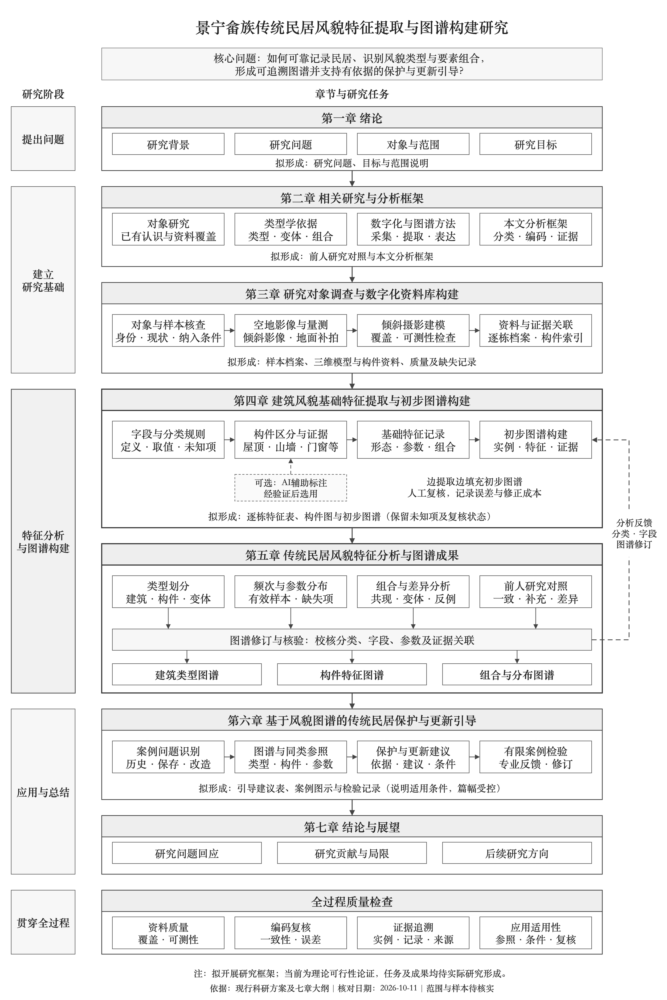

> 历史资料，已于2026-10-12归档。当前论文大纲为[[景宁畲族传统民居风貌特征提取与知识图谱构建研究v0.5]]；本文件保留当时的方案与论证，不作为当前研究安排或已完成成果的依据。

# 导师汇报提纲：理论可行性论证

> 本次定位由用户于2026年10月11日明确：尚未开始具体研究实施，目前只完成理论可行性论证。本次不安排真实建筑处理样例或实验结果展示，增加研究框架图和目录大纲，展示论文思路。省略样例仅针对此次汇报，不取消后续试采、特征提取或方法验证。
>
> 本次可行性论证包含两项关键问题：**对象是否有足够、可追踪的研究基础；已有方法是否可以迁移。**对象依据先于方法论证展开，尚未确认的现状与有效样本明确保留。
>
> 方法论证主线是：**已有研究 → 已实现的工作与成果 → 可迁移的方法 → 本研究拟定路径及迁移条件。**目录用于安排讲解顺序，每章重点展示类似工作已有先例、方法有出处、迁移有条件。
>
> 对象筛选资料、方法文献和图谱框架用于解释研究基础；现状、有效样本、单栋工时与技术效果仍待后续核实。虚构演示数据不作为研究发现。文献依据支持进入后续核查与试采，不等于景宁现场及整条流程已验证。

## 一、本次汇报内容（建议9页，约15分钟）

按用户确认，将“前人研究对照与理论可行性”和“目录大纲”整合，以已有研究的具体工作和成果论证路径可迁移性。2026-10-11进一步明确对象基础是关键问题：用两页独立展示数量口径、具体建筑及已有图文，再用一页文献中的初步建筑特征说明研究价值，随后进入框架与方法论证。详细写作任务保留在文末；本次仅调整汇报证据组织，不改变研究范围或科研方案。

| 页 | 内容 | 展示材料与要回答的问题 |
| --- | --- | --- |
| 1 | 上次反馈及研究方向调整 | 暂定题目、核心问题、主体成果；说明特征提取与图谱的聚焦要求 |
| 2 | 对象基础①：哪些村资料较多 | 按村概览数量、已有图纸／图表和资料优势；区分建筑数量与图像数量 |
| 3 | 对象基础②：逐村资料展示 | 以东弄图纸、敕木山官方资料等为重点，逐村展示已有图纸、可打开的PDF及网络链接；完整资料卡留作备查 |
| 4 | 初步建筑特征与研究价值 | 以文献图纸和照片说明山地适应、住宅形制与空间、构造及装饰的组合与差异；明确为前人案例归纳 |
| 5 | 论文研究框架 | 使用更新后的阶段—章节—任务—拟形成成果图，说明第四、第五章的分析反馈和全过程质量检查 |
| 6 | 目录与研究基础：资料采集与特征提取 | 第一、二章简述；第三、四章展示汤茗喆等已实现的采集、构件区分与参数记录，结合原文解释迁移步骤和条件 |
| 7 | 目录与研究基础：图谱分析与有限应用 | 第五、六章展示廖瑞等实际图谱、引导表与案例图示，说明可借鉴内容；第七章简述 |
| 8 | 方法路线与实施条件 | 将文献方法串成拟实施路线，说明设备与数据条件；时间有限时此页作为备查，汇报压缩为8页 |
| 9 | 下一阶段计划与待讨论事项 | 先请导师判断对象范围与样本核查方案，再讨论增量、方法和工作量；安排身份／现状补证与试采 |

对象基础建议讲3—4分钟，初步特征与价值约2分钟，方法及图谱迁移约5分钟，其余用于方向、框架和待讨论事项；均为汇报安排建议。对象部分采用逐村资料卡，现场重点展示概览与有明确出处的图纸，完整PDF和网络清单可点开备查。特征部分挑选能直接看出空间或构造关系的图，不逐项讲完总结。方法部分按“前人做过什么—原文证据是什么—我们迁移哪部分—需要什么条件”讲解。

## 二、研究对象与资料基础：按村落展示已有资料

**本节先回答：哪些村的资料较集中，各有多少建筑数量线索，已有哪些图纸，文献和网络资料在哪里打开。**按村落固定采用“建筑数量—已有图纸／图表—文献PDF—网络资料”的结构。

依据截至2026-10-06的已有整理，不新增现场调查。本次比较的是已收集资料的类型和丰富程度，不构成正式样本选择或全县资料穷尽；数量保留原文口径，当前存量与进入条件仅在各村末尾简短标明。文献文件名年份沿用本地文件，数量时点优先说明论文提交或实际调查时间。

### 2.1 哪些村的资料比较集中

| 村落 | 已有建筑数量依据 | 图纸／图表资料 | 已收集网络图像及主要资料优势 |
| --- | --- | --- | --- |
| **东弄** | 2022年提交论文记107幢民居，其中传统民居73幢，73幢中空置16幢；另有1—52号调查记录，含公共建筑 | 编号分布与质量图、逐项现状表；蓝坤宝寮一二层平面、剖透视和剖面 | 9份明确指向东弄的精选图像，含公共建筑候选；数量调查与单体图纸较集中 |
| **敕木山** | 2022年官方介绍记四幢典型大户古民居，是子集而非全村总量 | 28号蓝姓寮凤凰纹示意、门楼装饰资料；现有整理尚无四幢完整平立剖测绘图 | 14份精选图像；官方介绍、文保名录、历史旧宅和摄影资料较集中 |
| **桃源** | 文献记清代建筑10幢／10处，尚无逐栋清单，不能全部认定为畲族民居 | 清代建筑数量与村落资料页；现有整理尚未确认具名单体完整测绘图 | 21份精选图像，其中15份为民居／构件／环境、6份为公共建筑；照片较丰富 |
| **大张坑** | 2015年提交论文记37幢民居，其中钢筋水泥结构1幢；近期报道另记16间待盘活民居 | 研究范围、数量及文献照片组；现有整理尚未确认具名单体完整测绘图 | 4份精选图像；专题对象论文、数量基线与近期报道相互补充 |
| **周湖** | 全村建筑总量未明确；侧样分型表有15个民居编号行，不能视为总量 | 侧样分型及编号资料；8号民居模型与立面图 | 4份村景／门楼／巷道图像；资料规模有限，但有较明确图纸入口 |

以上图像数来自已保存的网络图册，不包含论文图纸；图像数不是建筑数。村落排序用于展示不同资料优势，不意味着保存状况、代表性或采集条件已经确认。

### 2.2 东弄村：数量调查与住宅图纸较集中

**建筑数量。** 吴钰论文（2022年提交，实际调查年月未载）记107幢民居，其中传统民居73幢，73幢中16幢空置。赵圣洁论文另有2012—2013年调查的1—52号分布图与现状表，包含住宅、村庙、祠堂、商店等；吴钰还记录52座较大体量建筑的质量分类。两套“52”尚未逐项对应，不与73幢相加。

**已有图纸与图表。**

| 图纸／图表 | 原文位置 | 已保存图像 |
| --- | --- | --- |
| 东弄建筑编号分布与质量图 | 赵圣洁，PDF115／正文99，附录5 | 下方嵌图 |
| 建筑现状表01—52号 | 赵圣洁，PDF116—123／正文100—107 | [首表01—08号](../../01_sources/assets/she-crops/BUUUUWRW-p116-table01-08.png)；全表入口见本村完整资料卡 |
| 蓝坤宝寮一层平面，图4-4 | PDF65／正文49 | 下方嵌图 |
| 蓝坤宝寮二层平面，图4-5 | PDF65／正文49 | 下方嵌图 |
| 蓝坤宝寮剖透视，图4-3 | PDF64／正文48 | 下方嵌图 |
| 蓝坤宝寮1-1剖面，图4-19 | PDF73／正文57 | 下方嵌图 |
| 建筑质量统计，表6-1及续页 | 吴钰，PDF83—84／正文68—69 | [第一页](../../01_sources/assets/she-image-bank/AAPV5P6L-pdf83.png)、[续页](../../01_sources/assets/she-image-bank/AAPV5P6L-pdf84.png) |

**文献PDF指引。**

| 文献PDF（点击打开） | 已有相关内容／关键页 |
| --- | --- |
| [《基于民族特性的新畲寮风格民居设计研究——以景宁东弄村为例》](</Users/wangyuelin/Zotero/storage/4DR4PDQC/吴钰 - 2023 - 基于民族特性的新畲寮风格民居设计研究 ——以景宁东弄村为例.pdf>) | 数量PDF25／正文10；质量分类PDF83—84；设计对象PDF89、93，设计图不作为现状实景 |
| [《国家历史文化名城研究中心历史街区调研——浙江景宁东弄畲族村》](</Users/wangyuelin/Zotero/storage/YVPUXG82/阮仪三 - 2008 - 国家历史文化名城研究中心历史街区调研——浙江景宁东弄畲族村.pdf>) | 村落及公共建筑背景，PDF2／刊页98 |
| [《浙江省景宁县东弄村畲族民居初探》](</Users/wangyuelin/Zotero/storage/DBVNTMI4/赵圣洁 - 2015 - 浙江省景宁县东弄村畲族民居初探.pdf>) | 编号调查PDF115—123；蓝坤宝寮图纸PDF64—65、73；访谈PDF101／正文85 |
| [《聚落“双修”视角下景宁畲族传统村落公共文化空间重构研究》](</Users/wangyuelin/Zotero/storage/BQJ5582I/柴一涵 - 2025 - 聚落“双修”视角下景宁畲族传统村落公共文化空间重构研究.pdf>) | 蓝氏宗祠建筑群、汤三公庙等背景，PDF79—83／正文65—69；公共建筑不计住宅 |
| [《浙江景宁畲族自治县县城建筑有机更新研究》](</Users/wangyuelin/Zotero/storage/BPBDYMEF/朱凌 - 2012 - 浙江景宁畲族自治县县城建筑有机更新研究.pdf>) | 东弄宗祠与庙宇照片，PDF35／正文26 |

**网络资料与已收集照片。**

| 网络来源 | 日期 | 已有内容 |
| --- | --- | --- |
| [东弄村摄影图文：这处低调小众的景宁畲乡秘境](https://www.163.com/dy/article/IKID55FB0544AW5X.html) | 2023-11-27 | 民居组团、土墙、屋面及宗祠外观候选；文图叶望庆，现代新建文昌阁另列 |
| [县文广旅体局关于第41号提案的答复](https://www.jingning.gov.cn/art/2025/7/21/art_1229847974_88006.html) | 2025-07-21 | 二期古村20多幢老房子失修线索，未与73幢逐项对应 |
| [2026年保护报道（已保存S03）](https://www.sohu.com/a/984593291_121106994) | 2026年发布，具体日期见来源索引 | 检查、整改与回访资料；混有其他地点图片，不全部计入东弄 |

已选9份明确指向东弄的网络图像。蓝坤宝寮尚无可靠新增单体照片；现址及当前状态待核。[东弄完整资料卡](../../研究对象候选汇总-按村落.md#东弄村)。

### 2.3 敕木山村：官方介绍、保护身份及网络照片较集中

**建筑数量。** 2022年市文广旅体局介绍记四幢典型大户畲族古民居，清代及民国时期、二层，描述一字排开与合院两种形式；四幢不是全村总量。2026名录列“敕木山村畲族民居”为一项省级文保单位，不是新增一栋住宅。

**已有图纸与构件资料。** 现有整理未取得四幢逐栋完整平立剖测绘图；已有28号蓝姓寮卷草凤凰纹示意（蓝法勤，PDF2／刊页95图1），以及蓝村长家门楼构件照片（PDF3／刊页96图6）。后者为照片，不当作整宅测绘图。

**文献PDF指引。**

| 文献PDF（点击打开） | 已有相关内容／关键页 |
| --- | --- |
| [《浙江景宁畲族传统民居卷草凤凰纹装饰研究》](</Users/wangyuelin/Zotero/storage/PIHCARAE/蓝法勤 - 2013 - 浙江景宁畲族传统民居卷草凤凰纹装饰研究.pdf>) | 28号蓝姓寮纹样PDF2／刊页95图1；蓝村长家门楼PDF3／刊页96图6 |

**网络资料与已收集照片。**

| 网络来源 | 日期 | 已有内容 |
| --- | --- | --- |
| [丽博观古·处州遗存——敕木山村畲族民居](https://www.lishui.gov.cn/art/2022/7/11/art_1229268129_57336308.html) | 2022-07-11 | 四幢数量、年代、形态与构造描述；官方照片 |
| [景宁2026年度文保单位名录](https://www.jingning.gov.cn/col/col1229631018/art/2026/art_e28476d814684e38843b01cad4474107.html) | 2026-01-08 | “敕木山村畲族民居”省级在册身份 |
| [畲寨行：敕木山村摄影图文](https://www.sohu.com/a/257397347_100188381) | 2018-10-02 | 民居、檐廊、墙体、院落及旧宅／展馆线索；摄影光林 |
| [史图博的敕木情缘](http://epaper.jnnews.zj.cn/html/2023-03/23/content_4685_15932222.htm) | 2023-03-23 | 史图博曾住蓝文成家小阁楼的历史身份线索，未提供现门牌 |
| [2025年敕木山研究的第三方摘要线索](https://www.51wendang.com/doc/a282ae843147d30a3c221c9c77cc3805c04b6fd0) | 摘要指向《城市规划》2025年第2期 | 原刊尚未取得，摘要数字未纳入建筑数量依据 |

已选14份网络图像，包括村域、民居及旧宅改用线索，照片未逐栋对应四幢。四幢组成名单、28号及历史旧宅之间关系待核。[敕木山完整资料卡](../../研究对象候选汇总-按村落.md#敕木山村)。

### 2.4 桃源村：数量线索与成组网络照片较丰富

**建筑数量。** 赵潇诺、柴一涵文献记清代建筑10幢／10处，可能指同批对象，不相加；尚无逐栋名单，不能全部认定为畲族传统民居。L08论文提交2022年；L12有2023年村落调查，但各单体记录日未明确。

**已有图纸与图表。** 当前整理有数量与村落资料原页（柴一涵PDF122／正文108），尚未确认具名传统民居完整平立剖图；已有资料以村景、住宅与构件照片为主。五显殿、文昌亭及桥梁作为公共空间背景另列。

**文献PDF指引。**

| 文献PDF（点击打开） | 已有相关内容／关键页 |
| --- | --- |
| [《景宁畲族传统民居营造技艺研究》](</Users/wangyuelin/Zotero/storage/52VRHDAG/赵潇诺 - 2023 - 景宁畲族传统民居营造技艺研究.pdf>) | 附录A，PDF113／正文102：村落与10幢清代建筑线索 |
| [《聚落“双修”视角下景宁畲族传统村落公共文化空间重构研究》](</Users/wangyuelin/Zotero/storage/BQJ5582I/柴一涵 - 2025 - 聚落“双修”视角下景宁畲族传统村落公共文化空间重构研究.pdf>) | 村落及数量PDF122／正文108；五显殿PDF125；文昌亭与桥梁PDF128，均需区分住宅与公共建筑 |

**网络资料与已收集照片。**

| 网络来源 | 日期 | 已有内容 |
| --- | --- | --- |
| [景宁县融媒体：这里没有桃花，却藏着真正的“世外桃源”](http://www.jnnews.zj.cn/syzx/202607/t20260710_7546909.shtml) | 2026-07-10 | 坡地住宅、木构檐廊、板壁、石墙、门窗、牛腿及街巷；另有五显爷殿资料 |

已选21份网络图像：15份民居／构件／环境，6份公共建筑；[住宅整体](../../01_sources/assets/she-web-2026-10-06/S06/S06-21.jpg)、[木构檐廊](../../01_sources/assets/she-web-2026-10-06/S06/S06-20.jpg)、[牛腿细部](../../01_sources/assets/she-web-2026-10-06/S06/S06-25.jpg)。图像未与10幢／处清代建筑逐栋对应，原网页合署保留在照片索引。[桃源完整资料卡](../../研究对象候选汇总-按村落.md#桃源村)。

### 2.5 大张坑自然村：专题论文、数量依据与近期照片相互补充

**建筑数量。** 王文辉论文2015年提交，记37幢民居，其中1幢钢筋水泥结构，不能反推36幢均为传统畲族民居。2026年高校报道另提16间待盘活民居，保留“间”，不替换37幢基线。地点为东坑镇大张坑自然村，与沙湾镇张坑分开。

**已有图纸与图表。** 当前有研究范围及数量页（王文辉PDF16／正文8、PDF20／正文12），村落和民居照片组（PDF19、23）。现有整理尚未确认具名住宅完整平立剖测绘图；照片组单独归类。雷氏祠堂为公共建筑历史照片，另作背景。

**文献PDF指引。**

| 文献PDF（点击打开） | 已有相关内容／关键页 |
| --- | --- |
| [《浙江景宁传统畲族民居及其保护与更新——以大张坑村为中心》](</Users/wangyuelin/Zotero/storage/QSHMJCA4/王文辉 - 2016 - 浙江景宁传统畲族民居及其保护与更新 ——以大张坑村为中心.pdf>) | 范围PDF16／正文8；数量PDF20／正文12；照片PDF19、23 |
| [《浙江景宁畲族自治县县城建筑有机更新研究》](</Users/wangyuelin/Zotero/storage/BPBDYMEF/朱凌 - 2012 - 浙江景宁畲族自治县县城建筑有机更新研究.pdf>) | 雷氏祠堂历史照片PDF37／正文28图3.16，公共建筑 |
| [《基于民族特性的新畲寮风格民居设计研究——以景宁东弄村为例》](</Users/wangyuelin/Zotero/storage/4DR4PDQC/吴钰 - 2023 - 基于民族特性的新畲寮风格民居设计研究 ——以景宁东弄村为例.pdf>) | 大张坑未具名院墙及材料做法线索，PDF72／正文57 |

**网络资料与已收集照片。**

| 网络来源 | 日期 | 已有内容 |
| --- | --- | --- |
| [晚潮：畲寨大张坑，红色村庄别样“红”](https://news.qq.com/rain/a/20260629A025AT00) | 2026-06-29 | 山地村落、土墙民居、石阶巷道与瓦屋面；作者严慧荣 |
| [浙江旅游职业学院转载潮新闻调研报道](https://tourzj.edu.cn/info/1019/24690.htm) | 2026-09-01，报道当年7月调研 | 16间待盘活民居及运营方案线索，尚无清单或方案全文 |
| [澎湃政务号转载丽水日报：革命历史展览馆报道](https://www.thepaper.cn/newsDetail_forward_4317527) | 2019年 | 展览馆2018年启动建设、2019年开放的资料；用于辨别新建筑，不作为传统住宅 |

已选4份网络图像；[民居与石阶巷道](../../01_sources/assets/she-web-2026-10-06/S05/S05-03.jpg)、[村落与瓦屋面](../../01_sources/assets/she-web-2026-10-06/S05/S05-07.png)。37幢逐栋身份、修缮和现状仍待核。[大张坑完整资料卡](../../研究对象候选汇总-按村落.md#大张坑村)。

### 2.6 周湖村：侧样与编号住宅图纸较明确

**建筑数量。** 全村建筑总量未明确；赵潇诺侧样分型表有15个民居编号行，是调查表记录数，不能改写为全村15幢住宅。“周湖8号”是论文住宅标识，不是数量，也未确认为现行门牌。

**已有图纸与图表。** 侧样分型及编号资料（赵潇诺PDF55／正文44表3.7）；8号民居模型与立面资料（朱凌PDF40／正文31图3.20—3.21）。

**文献PDF指引。**

| 文献PDF（点击打开） | 已有相关内容／关键页 |
| --- | --- |
| [《景宁畲族传统民居营造技艺研究》](</Users/wangyuelin/Zotero/storage/52VRHDAG/赵潇诺 - 2023 - 景宁畲族传统民居营造技艺研究.pdf>) | 侧样表PDF55／正文44；附录PDF113／正文102 |
| [《浙江景宁畲族自治县县城建筑有机更新研究》](</Users/wangyuelin/Zotero/storage/BPBDYMEF/朱凌 - 2012 - 浙江景宁畲族自治县县城建筑有机更新研究.pdf>) | 8号民居图3.20—3.21，PDF40／正文31 |
| [《聚落“双修”视角下景宁畲族传统村落公共文化空间重构研究》](</Users/wangyuelin/Zotero/storage/BQJ5582I/柴一涵 - 2025 - 聚落“双修”视角下景宁畲族传统村落公共文化空间重构研究.pdf>) | 村域公共空间背景，PDF74／正文60 |

**网络资料与已收集照片。**

| 网络来源 | 日期 | 已有内容 |
| --- | --- | --- |
| [逛景宁云中大祭，走周湖老村](https://ishare.ifeng.com/c/s/7kRaaJeh3MJ) | 2019-02-20 | 门楼、院墙与街巷，账号乐柚游；部分拼图带2018年文字日期 |

已选4份网络图像，[门楼与院墙照片](../../01_sources/assets/she-web-2026-10-06/S07/S07-03.jpg)尚未对应8号民居。侧样记录与建筑、现址及当前状态待核。[周湖完整资料卡](../../研究对象候选汇总-按村落.md#周湖村)。

### 2.7 其他已收集资料的村落与补充入口

以下保留在备查，不遗漏已有构件或单体资料；村内更多对象见链接资料卡。

| 村落 | 数量与现有资料 | PDF／原图指引 | 网络来源 |
| --- | --- | --- | --- |
| 深垟 | 网络报道“30多幢老宅”未附清单，暂不作为正式存量；陈璧大宅历史门头照片、院落与旧宅改用照片，网络精选5份 | [深垟资料卡](../../研究对象候选汇总-按村落.md#深垟村)：赵潇诺PDF113；朱凌PDF37图3.17，[原图页](../../01_sources/assets/she-crops/VSES7L3M-p037-fig316-17.png)，主体文献时点已毁，门头不计完整住宅 | [2025年深垟图文](https://www.sohu.com/a/942250774_121627717) |
| 张庄 | 侧样表8个编号行，不是村级总量；侧样与编号资料 | [张庄资料卡](../../研究对象候选汇总-按村落.md#张庄村)：赵潇诺PDF56／正文45，[原页](../../01_sources/assets/she-image-bank/ZWDJJE99-056.png) | 当前整理未新增可靠单体网络照片 |
| 季庄 | 侧样表10个编号行，不是村级总量；有刘宅线索，族群关联待核 | [季庄资料卡](../../研究对象候选汇总-按村落.md#季庄村)：赵潇诺PDF57及113，[侧样原页](../../01_sources/assets/she-image-bank/ZWDJJE99-057.png) | 当前整理未新增可靠单体网络照片 |
| 沙湾镇张坑 | 蓝凤新寮具名住宅、木雕及营造者资料，全村总量不明 | [沙湾镇张坑资料卡](../../研究对象候选汇总-按村落.md#张坑村（沙湾镇，原文地点）)：蓝法勤PDF3／刊页96图3；照片与纹样资料，不是完整测绘图 | 具名检索未取得有效新增单体照片，不以大张坑照片替代 |
| 汤湾 | 4号为住宅标识，村级总量不明；平面、照片与室内使用资料，单体族群关联待核 | [汤湾资料卡](../../研究对象候选汇总-按村落.md#汤湾村)：朱凌PDF41／正文32，[图3.22](../../01_sources/assets/she-crops/VSES7L3M-p041-fig322.png) | 当前整理未补到可靠单体对应 |

### 2.8 全部已整理资料的入口与简短状态说明

- [按村落对象汇总](../../研究对象候选汇总-按村落.md)：包含上述村落及岗石、惠明寺、董川、鹤溪等更多地点，原文及PDF按村落归集。
- [网络照片图册](../../01_sources/2026-10-06-景宁民居网络照片图册.html)：已保存照片、来源和用途，可筛选及放大。
- [逐项网络调研](../../01_sources/2026-10-06-重点民居逐项调研与照片图册.md)与[网络照片索引](../../01_sources/2026-10-06-民居网络照片索引.md)：保留日期、署名及单体对应状态。
- [文献图像裁切清单](../../01_sources/2026-10-06-文献图像裁切清单.md)：17个裁切单元及原页。
- [文献图像分析索引](../../01_sources/2026-10-06-畲族文献图像分析索引.md)：已整理图像的对象与用途，待核图像状态保留。
- [文献地点与建筑证据表](../../01_sources/2026-10-06-畲族建筑文献地点与建筑证据表.md)：23条文献逐项页码和地点线索，不是建筑栋数。

本节将已有数量、图纸和来源集中展示，供导师判断对象基础。当前数量主要为历史记录，现存、可进入和有效样本数未统一核实；村景与构件照片不自动对应具名单体。现场条件与正式样本范围待后续核查，本次不改变科研方案或指定正式研究范围。

## 三、初步建筑特征与研究价值

依据用户补充的[[景宁畲族传统民居建筑特征初步总结]]，本节回答：**已有文献记录了哪些特征，它们为什么值得进一步提取、比较和整理为图谱？**完整总结保留四个空间尺度和两个贯穿维度；汇报页压缩为下列四组关系，保留具体案例和来源。

| 汇报重点 | 文献中的初步认识 | 可展示的证据 | 如何衔接论文思路 |
| --- | --- | --- | --- |
| 山地环境与聚居 | 东弄、大张坑等案例顺应等高线和坡地层叠布置，住宅与路径、水系及生产用地相联系 | 总结图2：敕木山实景；图3：东弄编号分布图。依据R1、R2正文33—34、43—44页及R3正文11—12页 | 为单体的位置、朝向、高差和屋面处理提供背景，村落与组团不扩展为新的主体研究尺度 |
| 住宅形制与生活空间 | 一字形长屋与合院式并见；长间与檐廊、起居与储藏、生产及祭祀形成空间组合；家庭变化有横向增建线索 | 总结图4、5：蓝坤宝寮平面与剖透视。依据R2正文47—53页、R3正文20—21页 | 拟比较平面、剖面、功能及增建关系，寻找共同项和变体；保留不同文献的空间称谓 |
| 构造与屋面变体 | 石基、土墙、木构与瓦屋面配合；柱筒、墙体承重、腰檐及后侧屋面做法存在变化 | 总结图6：侧样构架与屋面分层。依据R4正文41—61页；其他材料记录见原总结 | 为第四章候选字段、第五章构件与组合比较提供对象依据；内部构造仍需图纸、测绘或访谈 |
| 装饰部位与文化表达 | 卷草凤凰纹在前檐梁、门楼梁等部位具有具体形式和文化解释；不同住宅及畲汉案例之间存在差异 | 总结图7、8：敕木山纹样示意与门楼照片。依据R7印刷95—98页 | 拟记录构件部位、纹样组织及解释来源，比较其组合；纹样有无不单独作为族群身份判断 |

表中R1—R7与图号均对应[初步总结的来源表](../../景宁畲族传统民居建筑特征初步总结.md#五、主要来源与本轮核对范围)，可从原总结打开PDF、查看页码和图注。汇报页建议以蓝坤宝寮平面／剖透视为主，配一张构架或装饰细部图；村景及完整分层图可作为备查，保证图中文字可读。

**由特征衔接研究价值：**既有研究已提供空间、构造和文化方面的具体记录，本研究拟借助特征提取与证据关联，进一步比较“哪些做法共同出现、哪些部位发生变化、差异有何依据”，并形成可复核的图谱。相对前人的具体增量仍需在第二章逐项对照，并由后续样本检验。

本节是已有文献案例的初步归纳，保留各村和各栋差异；不据此宣称全县普遍性或民族专属性。组团关系当前作为背景线索，单体与构件仍是分析主体；图纸和实景均为前人资料，不是本研究已完成的处理样例。

## 四、研究框架图

[可编辑图源](论文研究框架图.drawio)。采用用户更新的图：左侧列研究阶段，中部按七章组织任务与拟形成成果，右侧表达分析反馈，底部集中列全过程质量检查。现有PNG已与图源核对并完成视觉检查，内容与现行科研方案及七章大纲一致。研究框架图用于说明论文逻辑，[[archive/2026-10-12-大纲切换/研究路径图.drawio|现有研究路径图]]用于说明计划实施步骤；二者均不表示采集与实验已完成。

框架图讲解要点：

- 第一、二章明确问题、对象、前人基础与分析依据。
- 第三章建立可靠的对象资料；第四章把资料转为可比较的特征和初步图谱。
- 第五章依托初步图谱开展类型、组合与差异分析，分析反馈修订图谱，形成主要建筑学成果。
- 第六章在主要成果之后安排篇幅受控的保护与局部更新引导；第七章总结贡献和限制。

## 五、目录与研究基础对照（汇报整合版）

以现行一、二级目录为线索，下表作为目录导航；实际汇报重点使用第六节的文献证据与迁移论证。每章以参考研究已完成的具体工作和成果说明方法出处，再讨论迁移。下表依据当前方案保存的核读与证据状态整理，没有新增文献精读或实验。

| 论文章节 | 主要二级目录 | 研究基础与参考 | 本研究拟推进内容与待检验条件 |
| --- | --- | --- | --- |
| **第一章 绪论** | 1.1 研究背景 1.2 研究问题与研究目标 1.3 研究对象与范围 1.4 核心概念与研究方法 | 导师讨论所确定的特征提取与图谱方向；现有对象文献、村落候选资料及初步建筑特征总结。 | 提出问题与暂定边界，说明资料记录和风貌认识的研究价值；研究缺口、全县范围与代表性仍需对象文献及现状证据支持。 |
| **第二章 相关研究与分析框架** | 2.1 景宁畲族及相关传统民居研究 2.2 建筑类型学与风貌特征识别研究 2.3 数字化采集与辅助特征提取研究 2.4 图谱研究评述与本文分析框架 2.5 本章小结 | 初步建筑特征总结及其原文定位、赵潇诺等景宁民居研究作为对象研究入口；汤茗喆为采集与提取方法参考；廖瑞为图谱及应用组织参考；郭锐等补充证据关联思路。 | 将对象研究与方法研究转为分类、编码和图谱分析依据；明确已核读内容与待核内容。前人已研究类型学，不能预设其缺失；具体增量待进一步对照。 |
| **第三章 研究对象调查与数字化资料库构建** | 3.1 研究区域与样本框架 3.2 实地调查与建筑信息记录 3.3 数字化记录与质量检查 3.4 建筑资料库构建 3.5 本章小结 | 村落候选汇总与文献数量基线；汤茗喆第42—52页的空地影像融合和量测检查；郭锐等第18—19页的建筑／构件资料关联。 | 拟建立逐栋档案，以倾斜摄影、地面补充与量测形成资料基础；需核实现存身份、采集条件、模型覆盖和可测性。参考研究的精度不能直接作为本研究能力。 |
| **第四章 建筑风貌基础特征提取与初步图谱构建** | 4.1 风貌特征体系与调查编码 4.2 基础特征提取与初步图谱组织 4.3 AI辅助处理的任务设计与验证 4.4 编码一致性与误差讨论 4.5 本章小结 | 汤茗喆第25—31页的构件与类型组织、第53—73页的构件区分及形态、几何参数、组合记录；初步建筑特征总结为候选观察维度提供对象依据，结合现有候选词表与图谱框架。 | 拟将字段规则、构件资料、参数与证据组织成初步图谱；需试采后确认字段可观察性、编码一致性及误差。AI区域标注仅为候选任务，效果与总成本待试验。 |
| **第五章 传统民居风貌特征分析与图谱成果** | 5.1 建筑类型划分 5.2 核心构件与风貌特征分布 5.3 要素组合及样本差异 5.4 与既有研究的对照及新增认识 5.5 图谱修订与成果表达规则 5.6 风貌特征图谱成果 5.7 图谱校核与使用检查 5.8 本章小结 | 初步建筑特征总结及其所引景宁对象研究为类型、构造及形态对照入口；廖瑞第83—87页的图谱组织；汤茗喆的形态、参数与组合整理；郭锐等的资料关联。 | 拟比较类型、频次、参数与组合，并据分析修订图谱。当前有分析组织依据，尚无本研究样本结论；与前人的一致、补充或差异须由逐栋数据和原文对照确认。 |
| **第六章 基于风貌图谱的传统民居保护与更新引导** | 6.1 应用目标与原则 6.2 风貌特征向引导建议的转化 6.3 典型案例应用与检验 6.4 应用边界与后续用途 6.5 本章小结 | 廖瑞第五章第89—101页的分要素引导表及案例表达；导师关于应用放在末尾小部分、设计可不做的意见。 | 拟形成“依据—建议—适用条件”的有限应用，复用主体资料；需检查同类参照适配与专业反馈。不能移用康巴参数、文化解释或声称实施效果；独立第六章是用户确认的安排，待导师复核。 |
| **第七章 结论与展望** | 7.1 主要研究结论 7.2 研究贡献与不足 7.3 后续研究展望 | 前六章未来形成的对象资料、分析、图谱及案例检查；第二章的前人对照作为贡献判断依据。 | 拟逐项回应研究问题，区分资料补充、建筑学认识与方法贡献；结论和贡献需在真实研究完成后形成，目前只展示总结方式。 |

### 讲解时重点展开第三至第六章

- **第三章：资料怎样获得。** 参考空地影像融合及量测检查的成熟思路，针对景宁对象拟建立资料库；现场可进入性与有效精度尚待试采。
- **第四章：资料怎样转成特征。** 参考构件组织、几何参数与组合记录方法，拟形成特征表及初步图谱；字段可用性、AI辅助作用与质量尚待验证。
- **第五章：由特征形成什么认识。** 借鉴图谱组织方式，开展类型、组合与差异分析；以直接对象文献为对照，判断是否形成新增认识，不能提前宣称结论。
- **第六章：成果怎样作有限应用。** 借鉴分要素引导表和案例表达，拟把图谱依据转为建议，控制范围并检查适用条件。

前人研究对照必须保留“已有对象研究做到了哪里”和“本研究拟补充什么”这一条主线，不能仅把各章节配上一篇方法文献。尚未核实的研究缺口应明确列为待讨论项。

### 核心参考及证据状态

| 参考 | 已有依据与核读状态 | 本次展示方式 |
| --- | --- | --- |
| 赵潇诺《景宁畲族传统民居营造技艺研究》及其他景宁对象文献 | 已有阅读笔记、地点／建筑证据整理；具体类型结论、覆盖完整性和拟补充内容仍需逐项回到原文，不能视为已完成全面差异论证 | 作为对象基础和增量判断的对照；只展示有原文定位的内容，未核内容标为待核 |
| 汤茗喆《基于数字信息模型的传统村落建筑风貌保护更新方法研究——以尚志市镇北村为例》 | 现行方案记录已重点核读第2、3章及相关衔接内容；精度和分割效果的统计存在需谨慎使用之处 | 对应第三、第四章及第五章的分析组织，展示可迁移的步骤，不照搬效果数值 |
| 郭锐等《基于多源数据融合与知识图谱的历史建筑数字化保护方法研究》 | 现行方案记录三页全文及图表已核读；完整构件提取与知识图谱实现细节未充分展开 | 补充第三至第五章的资料关联和追溯依据，不作为技术已跑通的证据 |
| 廖瑞《康巴藏区传统民居建筑风貌图谱研究》 | 现行方案记录已核读第五章及相关衔接章节，核对图谱与应用图表 | 对应第五、六章，展示图谱表达、引导表与案例组织；地域内容和实施效果另行取证 |

具体文献出处、原文页码、阅读范围与限制见[[archive/2026-10-12-大纲切换/科研方案-导师反馈调整版#4.1 对象研究与方法研究对照]]及第9.2、9.4、9.5节；完整三级标题与写作说明见[[archive/2026-10-12-大纲切换/论文大纲-特征提取与图谱构建]]。

## 六、第三至第六章的文献依据与迁移论证（本次主讲）

**本次需要向导师说明：已有研究做过类似环节并形成成果，我们有具体参考路径，可以在景宁对象上有条件地迁移。**每章以原文中的关键流程、图表或成果为主体，目录标题和本研究设想用于连接这些证据。

本节沿用科研方案第4.1、9.4、9.5节已保存的核读依据，页码均为原文印刷页码。本次更新未重新精读全文或新增图表裁切；下列图表是汇报选材入口，嵌入前须核对原页、图注和引用。文献支持范围与本研究判断分开表达。

### 第三章：已有研究如何建立可用于分析的建筑数字资料

**拟论证的环节：空地影像采集 → 建模与量测检查 → 建筑资料组织。**

| 已有研究 | 已做的类似工作与原文依据 | 我们可以迁移什么 |
| --- | --- | --- |
| 汤茗喆《基于数字信息模型的传统村落建筑风貌保护更新方法研究——以尚志市镇北村为例》 | 第42—52页展示空地影像融合与量测检查，把建筑影像转为数字化资料并检查尺寸；可选对应采集／建模流程及表3-6量测记录作为依据 | 参考空中与地面补充的组织、三维资料生成和独立尺寸检查，拟建立景宁逐栋模型与档案 |
| 郭锐、齐文娟、陈勇《基于多源数据融合与知识图谱的历史建筑数字化保护方法研究》 | 第18—19页第2.2节提供建筑、构件、属性、历史资料及保护信息的关联思路 | 参考建筑与构件的资料关联，将模型、照片、量测、文献及现场记录统一对应到对象 |

**据此可作的论证：** 建筑影像转为可分析数字资料、并与历史信息关联，已有研究路径可参考。景宁调查可以沿这一路径组织资料基础。

**迁移条件：** 现场影像能否覆盖目标部位、遮挡与尺度参照是否可控，需要试采。郭文采用地面激光扫描与无人机协同采集，其精度不能用于承诺本研究仅用倾斜摄影的效果；汤文表3-6的记录和误差口径存在限制，参考检查思路而非直接采用数值标准。

**汇报选材：** 一组前人采集／建模流程与量测检查证据，配一句“拟迁移到景宁的环节”和一列现场待核条件。

### 第四章：已有研究如何由数字资料提取构件与风貌信息

**拟论证的环节：构件组织与区分 → 形态、几何参数及组合记录 → 实例信息整理。**

| 已有研究 | 已做的类似工作与原文依据 | 我们可以迁移什么 |
| --- | --- | --- |
| 汤茗喆研究 | 第25—31页提供构件结构与类型组织；第53—59页介绍六类构件点云分割；第60—73页将风貌整理为形态、几何参数及组合信息；第74—79页介绍构件信息模型建立 | 借鉴构件组织、区分以及由几何资料记录形态、参数和组合的步骤；按景宁资料条件调整构件类别与字段，形成实例特征及初步图谱 |

**据此可作的论证：** 从建筑数字资料进一步提取构件与特征，并非只有概念设想；参考论文已经给出处理步骤和对应成果。第四章可以以其为方法骨架，讨论在景宁对象上如何迁移。

**迁移条件：** 点云类别分割不等于建筑整体类型判断；是否采用点云训练需评估资料和标注成本，人工区分也需统一规则。参考研究不能直接证明本研究拟采用的图像辅助标注任务有效；AI工具选择、质量和总成本仍待小试。汤文部分分割指标统计口径存在疑点，不以其数值作为本研究接受标准。

**汇报选材：** 优先展示构件结构／类型组织、构件区分成果，以及形态—参数—组合信息的实际表达；在旁标出拟保留的步骤和需调整的内容。重点说明迁移过程，不罗列全部计划字段。

### 第五章：已有研究如何组织类型认识与风貌图谱

**拟论证的环节：实例比较与分类 → 风貌信息整理 → 类型、构件及组合的图谱表达。**

| 已有研究 | 已做的类似工作与原文依据 | 我们可以迁移什么 |
| --- | --- | --- |
| 廖瑞《康巴藏区传统民居建筑风貌图谱研究》 | 第83—87页展示五类图谱，可用其实际图谱说明如何将风貌信息按要素组织和表达 | 借鉴图谱分类、图例和成果编排方式，调整为景宁建筑类型、构件特征及组合／分布图谱 |
| 汤茗喆研究 | 第25—31页的类型组织及第60—73页的形态、参数与组合信息，为分类和比较提供方法参考 | 将分类依据和实例参数组织为可并置的信息，再依据景宁样本开展类型及差异分析 |
| 赵潇诺等景宁对象研究 | 已有阅读笔记及地点、建筑和图像证据整理，提供当地类型、形态及营造研究的入口；具体分类结论与成果图表仍需逐项回到原文定位 | 对照前人实际研究范围、分类及结论，明确继承哪些认识、后续可能补充哪些资料或比较；待核内容不作为已确认的研究缺口 |

**据此可作的论证：** 风貌分类与图谱表达已有类似研究成果，可以据其组织景宁的分析与成果表达。成熟方法可提供分析框架，具体类型和差异仍由本研究样本归纳。

**迁移条件：** 康巴的地域类型与参数不能直接转为景宁结论；图示图谱不自动等于计算机知识图谱。第四、第五章之间的分析反馈循环及具体统计安排属于本研究的组织设计，不能称为上述文献已经整体验证。样本规模、资料可比性与具体增量后续核查。

**汇报选材：** 一页前人实际图谱，标明其分类或编排逻辑，以及拟用于景宁的部分；当地对象研究仅展示已取得原文定位的类型图或结论，并明确未完成的增量对照。

### 第六章：已有研究如何由图谱形成引导与案例表达

**拟论证的环节：风貌特征认识 → 分要素引导 → 案例表达。**

| 已有研究 | 已做的类似工作与原文依据 | 我们可以迁移什么 |
| --- | --- | --- |
| 廖瑞研究第五章，第89—101页 | 按平面、形态、材料、装饰、色彩提出引导；表5-1、5-2（第92页）展示尺度引导，表5-3、5-4（第93、95页）组织材料与装饰建议；图5-5、5-6（第96页）展示改建案例、线图及模型；表5-6、图5-8（第99页）展示部位用色引导 | 参考“特征认识—分类引导—案例表达”的结构，在景宁已有图谱与调查资料基础上，拟组织保护与局部更新建议及少量案例说明 |

**据此可作的论证：** 从风貌图谱延伸到分要素引导和案例表达，已有具体研究先例。第六章可以沿这一组织方式开展有限应用，并以本研究证据补充建议的适用条件。

**迁移条件：** 迁移的是组织方式；具体尺度、材料做法与文化解释须依据景宁对象重新取证。廖文未展示系统的工程实施效果比较，不能据其声称本研究建议已有效。本研究计划中的证据追溯、专业反馈和修订需另行开展。

**汇报选材：** 选择一张分要素引导表和一组案例图示，说明其如何承接前文图谱，再标明拟迁移的结构及应用范围。

### 本次口头论证顺序与材料状态

讲解时先介绍论文与对象，再指向具体流程、成果图或表：**“这项研究已做过类似工作，原文这里展示了做法与成果；我们拟参考其中这些步骤，调整到景宁对象，以下条件需要后续确认。”**

| 环节 | 当前可用的文献依据 | 当前论证能支持的程度 |
| --- | --- | --- |
| 采集、建模与资料关联 | 汤茗喆相关处理与量测检查；郭锐等资料关联 | 有类似路径可借鉴；景宁采集条件与精度待试采 |
| 构件区分与特征记录 | 汤茗喆构件组织、点云区分、形态／参数／组合整理 | 有具体方法及成果参考；所选工具与字段可用性待验证 |
| 分类与图谱表达 | 廖瑞实际图谱；汤茗喆类型与信息组织 | 有分析及表达先例；景宁类型、组合与研究增量尚未形成 |
| 分要素引导与案例表达 | 廖瑞第五章引导表与案例图示 | 有应用组织先例；本研究案例适配性与建议效果尚未验证 |

完整文献出处、核读范围及限制以科研方案第9.4、9.5节为准：

- [汤茗喆论文全文](</Users/wangyuelin/Zotero/storage/GSZYPRIQ/汤茗喆 - 2024 - 基于数字信息模型的传统村落建筑风貌保护更新方法研究 ——以尚志市镇北村为例.pdf>)。
- [郭锐等论文全文](</Users/wangyuelin/Zotero/storage/H4N4454A/郭锐 等 - 2026 - 基于多源数据融合与知识图谱的历史建筑数字化保护方法研究.pdf>)。
- [廖瑞论文全文](</Users/wangyuelin/Zotero/storage/NKZMF4ZJ/廖瑞 - 2025 - 康巴藏区传统民居建筑风貌图谱研究.pdf>)。

## 七、下一阶段与导师讨论

| 需要判断的事项 | 本次可提供的依据 | 后续待完成的工作 |
| --- | --- | --- |
| 研究范围与题目是否匹配 | 按村落候选汇总、不同时间及类别的数量依据 | 逐栋身份、当前保存状态及可进入条件核查，再确定有效样本 |
| 相对前人的增量是否成立 | 对象研究与可迁移方法的原文对照 | 将候选增量细化为可由样本回答的问题，后续调查和分析检验 |
| 理论路线是否值得进入试采 | 成熟方法依据、研究框架和路径图 | 核实设备及现场条件，开展少量试采与处理，记录质量和工时 |
| 应用章节范围是否适当 | 七章分工与篇幅受控的应用安排 | 请导师复核第六章的必要性和深度；本次不承诺完整设计或实施效果 |

## 八、备查材料

- [[景宁畲族传统民居建筑特征初步总结]]：分层特征、研究价值、原文页码及配图；用于背景说明和对象研究对照。
- [论文研究框架图](论文研究框架图.png) · [可编辑图源](论文研究框架图.drawio)：用户更新的阶段、章节、任务与拟形成成果关系。
- [[研究对象候选汇总-按村落]]：对象、图片、图纸与待核实问题。
- [[景宁畲族建筑遗存存量与代表案例核实-2026-10-06]]：数量口径和代表案例线索。
- [[archive/2026-10-12-大纲切换/科研方案-导师反馈调整版]]：研究问题、方法依据、质量检查与边界。
- [[archive/2026-10-12-大纲切换/论文大纲-特征提取与图谱构建]]：供导师阅读的完整目录与逐节概要，按资料丰富程度展开；调查与研究结果待形成。
- [[建筑风貌知识图谱基础框架]]：仅作为候选组织方式的补充说明，虚构示例不能用作结果。

## 九、后续写作任务备查（本次不作主讲）

本节将现行大纲与方案细化为写作任务和预期图表，不改变章节结构或研究主线。当前尚未实施，以下均为计划；解释性例子只说明组织方式，不作为景宁畲族民居的已发现特征。

四章的衔接是：**第三章取得可靠资料 → 第四章转为可比较的实例特征及初步图谱 → 第五章归纳类型、组合与差异并形成最终图谱 → 第六章依图谱提出有限引导并检查依据。**

### 第三章：研究对象调查与数字化资料库构建

**本章要回答：研究哪些建筑，取得什么资料，这些资料能支持哪些分析？**

| 对应目录 | 具体展开 | 拟形成图表或材料 |
| --- | --- | --- |
| 3.1 研究区域与样本框架 | 简要交代与建筑相关的地形、聚居及历史背景；提出传统营造、年代、族群及使用背景的纳入依据；区分候选、现存、可进入和资料有效的对象，说明选择与排除原因 | 研究区域及候选分布图；样本筛选表；最终样本构成表 |
| 3.2 实地调查与建筑信息记录 | 用统一建筑卡记录身份、位置、历史依据、使用与保存情况、改造信息；按后续字段需要采集屋顶、立面、门窗及细部，安排空中与地面影像、尺度参照及独立检查尺寸 | 调查记录卡；采集部位示意；原始影像及尺寸记录 |
| 3.3 数字化记录与质量检查 | 交代影像匹配、重建、模型／点云及适用视图生成流程；检查目标构件是否完整、能否量测，用独立尺寸比较实测与模型值；记录遮挡和缺失 | 建模流程及模型视图；实测—模型尺寸对照表；构件覆盖与缺失表 |
| 3.4 建筑资料库构建 | 用建筑编号串联原图、模型、量测、文献及现场记录，保留采集日期和来源；说明不同建筑资料可支持的任务，例如可识别形式但不能可靠测量坡度 | 单栋档案模板；资料关联表；各项分析的有效资料清单 |

3.5小结说明资料支持范围和缺口，作为第四章的输入。借鉴汤茗喆的空地影像融合与量测检查、郭锐等的资料关联思路；是否现场可用须由本研究试采确认。

**本次汇报可展示：** 已有候选和来源、拟定纳入条件、采集需求与建筑卡字段、资料库关联方式。未试采时不填模型精度或有效样本数。

### 第四章：建筑风貌基础特征提取与初步图谱构建

**本章要回答：怎样按统一规则把资料转成特征，而且每项取值可以核查？**

| 对应目录 | 具体展开 | 拟形成图表或材料 |
| --- | --- | --- |
| 4.1 风貌特征体系与调查编码 | 按屋顶、山墙、立面、门窗、材料与可见构造选择字段；分清形态类别、几何参数和组合关系，规定定义、观察部位、单位、取值方式及未知原因 | 特征体系表；字段定义与判读规则；图谱组织框架 |
| 4.2 基础特征提取与初步图谱组织 | 对每栋建筑标记构件实例，依据照片及可靠几何记录形态、尺寸、位置和组合；将构件图、特征记录、建筑编号和来源相连，边提取边填充初步图谱 | 构件轮廓或线图；逐栋／逐构件特征表；带来源的初步图谱 |
| 4.3 AI辅助处理的任务设计与验证 | 若采用区域标注，先明确输入、人工参照和目标区域，再比较原始输出、修正结果、失败情况及全过程耗时；是否采用以质量及成本判断 | 任务说明；人工与辅助结果对照；错误及修正成本表 |
| 4.4 编码一致性与误差讨论 | 复核形态判断与尺寸记录，说明分歧及规则调整；确定哪些字段可作统计、哪些只能定性描述。独立复核不可得时如实说明 | 分歧及修订表；可用参数与资料限制表 |

4.5小结交付可比较的实例特征和初步图谱。借鉴汤茗喆的构件组织、形态及参数记录方法；现有词表提供候选字段，不能预先固定本地参数或类型规律。

**以屋顶字段为说明：** 屋顶形式记录多视角判读依据；坡度记录经检查几何或实测的取值部位、数值和单位；出檐记录测量端点与长度；同门窗、山墙的关系记录实际位置及排列。无法测量的值保留未知，不能从斜拍照片直接推定真实角度。

**本次汇报可展示：** 拟选字段、取值规则、所需证据及初步图谱的组织方式。尚无实施资料时不填实际取值，不以虚构原型替代提取结果。

### 第五章：传统民居风貌特征分析与图谱成果

**本章要回答：不同实例之间有什么共性、差异及组合规律，相对前人形成什么认识？**

| 对应目录 | 具体展开 | 拟形成图表或材料 |
| --- | --- | --- |
| 5.1 建筑类型划分 | 依据可靠记录的体量、构件排列与要素组合提出可解释的整体分类；平面仅在有图纸或现场证据时纳入；列出代表、变体及无法简单归类的实例 | 类型判别表；代表与变体对照图 |
| 5.2 核心构件与风貌特征分布 | 描述屋顶、山墙、门窗及表面材料的类型频次和可测参数分布；交代每项有效样本与缺失情况，不仅列一个极值范围 | 构件类型对照；频次表／图；逐栋参数及分布图 |
| 5.3 要素组合及样本差异 | 按建筑并置构件与参数，查看常见搭配、同类内部差异；在资料可比时比较村落、保存及改造状态，不把相关或共现直接当作文化成因 | 建筑—构件矩阵；组合对照图；分组比较表 |
| 5.4 与既有研究的对照及新增认识 | 针对前人具体结论记录一致、补充或差异，说明是否来自时点、对象范围、定义或量测方式不同；决定哪些实际结果可以作为贡献 | 前人结论—本研究结果—证据及解释对照表 |
| 5.5 图谱修订与成果表达规则 | 对分类歧义、反例和异常量测回查原资料，修订字段或类型后重做受影响分析；统一图例、编号、参数和来源标识 | 规则修订记录；成果表达规则 |
| 5.6 风貌特征图谱成果 | 整理建筑类型图谱、构件特征图谱、组合与分布图谱；每个单元包含规则、代表实例、变体或反例、参数及证据索引 | 最终图谱及对应数据表 |
| 5.7 图谱校核与使用检查 | 抽查图例和数值能否回到原资料，检查分类解释与专业意见；记录修订及尚存分歧 | 证据抽查表；专业反馈及修改记录 |

5.8小结归纳证据支持的发现，并限定可供第六章使用的内容。第四章以单个实例记录为核心，第五章由多个实例比较形成类型和规律；初步图谱作为比较载体，分析又反馈修订图谱。

**统计单位要说明：** 建筑层面的比例按具备该项有效资料的建筑统计；窗等构件层面的数量另列，并记录所属建筑，避免把同栋照片或多扇窗当成多个独立建筑样本。样本不足时采用描述性比较，不强行推断全县规律。

**本次汇报可展示：** 拟比较的问题、矩阵空表及图谱编排方式；说明准备如何与景宁对象研究对照。类型数量、常见参数、民族独有性和研究增量均留待样本分析。

### 第六章：基于风貌图谱的传统民居保护与更新引导

**本章要回答：面对具体建筑问题，图谱能提供什么参照，建议是否有依据且适用？**

| 对应目录 | 具体展开 | 拟形成图表或材料 |
| --- | --- | --- |
| 6.1 应用目标与原则 | 从已调查对象选择资料充分、问题明确的局部部位；核实历史、类型、改造及使用需求，限定保护与更新任务 | 案例问题清单；应用目标与依据表 |
| 6.2 风貌特征向引导建议的转化 | 根据对象历史和类型选择同类参照，将第五章的图谱单元、构件实例及证据对应到案例问题，再提出有条件的引导建议 | 问题—参照—证据—建议—适用条件表 |
| 6.3 典型案例应用与检验 | 原则上以1—2个资料充分案例说明过程，数量按资料和工作量调整；并置现状、历史依据、同类参照和建议示意，检查参照适配、变体保留及专业反馈 | 案例对照图；引导表；反馈及修改记录 |
| 6.4 应用边界与后续用途 | 说明建议适用的建筑类型、部位及资料条件，哪些还需补证；少量案例检验说明推导与适用性，工程实施效果需要另行验证 | 适用条件及待补证清单 |

6.5小结总结图谱实际支持哪些判断。借鉴廖瑞的分要素引导和案例表达；具体建议须根据景宁案例证据形成，不能直接照搬其他地域的尺寸或文化解释。

**以门窗改造为假设情境：** 先确认是否存在改动及其历史依据，再查询同类建筑中可靠的门窗记录，比较尺度、位置与材料，同时考虑使用需求；最后解释建议及适用条件。仅因某种门窗在样本中常见，不能要求全部建筑统一更换。

**本次汇报可展示：** 拟解决的局部问题范围、引导表字段及案例选择条件；目前不展示案例结论或设计效果。

### 后续写作衔接说明

以上用于后续开展研究与写作时检查任务衔接；本次口头汇报按第六节展示前人工作、具体原文证据、拟迁移部分及条件。

