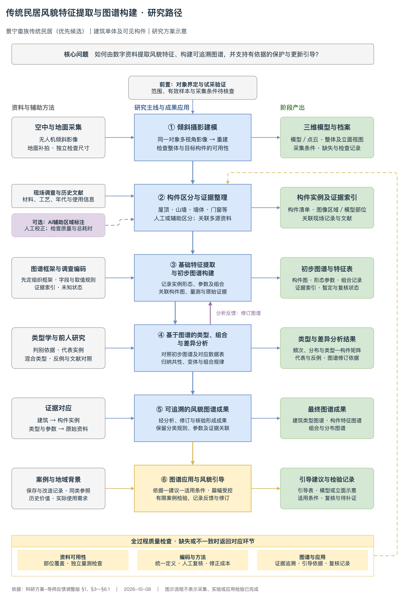

> 历史资料，已于2026-10-12归档。当前论文大纲为[[景宁畲族传统民居风貌特征提取与知识图谱构建研究v0.5]]；本文件保留当时的方案与论证，不作为当前研究安排或已完成成果的依据。

# 科研方案：传统民居风貌特征提取与图谱构建

> 依据2026年9月17日导师指导重新设计。用户已授权据此调整方案；本稿是执行建议，具体研究对象边界、样本量、技术配置和题目尚待可行性核查与导师复核。
>
> 配套文档：[[archive/2026-10-12-大纲切换/一周科研计划与待办-2026-09-18至09-24]]、[[archive/2026-10-12-大纲切换/论文大纲-特征提取与图谱构建]]。

> 2026年10月7日更新：依据用户明确的无人机倾斜摄影建模方式及本轮文献核读，细化采集、构件区分、特征提取、类型分析与图谱之间的衔接；进一步区分图谱框架、初步图谱与最终成果，明确基础特征提取与初步图谱构建同步开展，类型、组合与差异分析依托初步图谱及对应数据表，并反馈修订图谱。以下技术路线为本轮确认的实施方向，设备配置、采集规模与可用精度仍需试采验证；文献借鉴不视为导师已逐项认可或本研究已完成实验。

> 2026年10月8日更新：按用户确认的结构建议，借鉴廖瑞《康巴藏区传统民居建筑风貌图谱研究》第五章，在主体图谱成果之后增加篇幅受控的应用环节。论文仍保留七章：第五章整合风貌特征分析与图谱成果，第六章安排基于图谱的保护与更新引导及有限案例检验。该结构由本轮讨论提出并经用户确认，不表述为导师已明确要求独立应用章；文献依据及迁移限制见第9.5节。

## 一、研究方向聚焦

### 1.1 推荐方向与暂定题目

**推荐方向：** 以景宁畲族传统民居为优先候选对象，以无人机倾斜摄影建模获得的三维资料为主要形态与量测依据，结合地面细部影像、现场记录和历史文献，识别建筑类型及构件特征，分析样本中的共性、差异与组合关系，形成可追溯的建筑风貌特征图谱。AI作为具体资料处理环节的辅助工具，通过小样本验证后决定是否采用。

**研究主线：倾斜摄影建模 → 构件区分与证据整理 → 基础特征提取与初步图谱构建 → 基于图谱的类型、组合与差异分析 → 可追溯的风貌图谱成果。**

**成果应用：可追溯的风貌图谱成果 → 基于图谱的传统民居保护与更新引导 → 有限案例检验及适用条件说明。**

图谱的组织框架可在试采与编码设计阶段先行建立；基础特征提取与初步图谱构建同步开展，分析结果再反馈修订分类规则、字段及图谱。第三、第四环节反复迭代，核验后形成最终成果。

三维模型支撑观察、量测与制图，研究重点是由这些资料形成建筑类型、构件变体和组合关系的新认识。采集与处理使用成熟工具，质量检查围绕后续特征分析是否可用展开。

**暂定题目：**《景宁畲族传统民居风貌特征提取与图谱构建研究》。

题目使用条件：研究范围和样本能够支持该地域表述。若最终仅覆盖某片区或若干村落，应在题目或副标题中明确具体范围，不能以局部便利样本代表全县。AI尚未经过试验，不先写入题目；若后续方法验证充分，再讨论是否加“人工智能辅助”或“基于数字化采集”等限定。

### 1.2 研究主体与范围

| 项目 | 本轮建议 |
| --- | --- |
| 研究对象 | 有传统营造与历史背景依据的民居建筑；景宁优先，具体村落和数量待查 |
| 主要尺度 | 建筑单体及可见构件，优先屋顶、山墙、立面、门窗、材料及可见构造 |
| 背景资料 | 聚落环境、历史、族群与生活语境，用于解释样本差异 |
| 内部空间 | 有实际测绘、可靠图纸或现场证据时纳入；不能从外观猜测内部结构 |
| 方法主体 | 倾斜摄影建模、构件区分与证据整理、基础特征提取与初步图谱构建、基于图谱的类型与组合分析、图谱修订及成果表达 |
| AI角色 | 优先试验构件区域辅助标注；其他识别或分类任务须另有证据和验证 |
| 主要成果 | 建筑样本档案、可用于分析的三维模型及构件资料、调查编码表、特征分析、图谱、引导建议与案例检验记录及方法质量检查 |
| 应用位置 | 论文第六章安排篇幅受控的图谱应用，形成有依据的保护与局部更新建议并作有限案例检验；完整设计、生成评价与工程实施不列为主体任务 |

现阶段不将整个县域的所有遗存、建筑全生命周期、全部室内空间和多种AI任务同时列为完成承诺。

### 1.3 研究问题

**总问题：** 如何对明确范围内的景宁畲族传统民居开展可靠的资料采集与特征提取，揭示建筑类型及要素组合特征，并形成可核查的风貌图谱？

1. **对象与证据：** 如何界定研究对象、建立样本框架，并把倾斜摄影影像、三维模型、构件量测、历史与现场信息组织成可比较的建筑档案？
2. **建筑学发现：** 样本存在哪些类型、共同特征、变体与要素组合？这些认识与前人记录有什么一致、补充或差异？
3. **方法与质量：** 倾斜摄影模型能否支撑所选特征的观察与量测，AI辅助处理能否在特定任务中提高可用性或效率？误差、缺失、人工修正成本和适用边界是什么？
4. **成果应用：** 如何将图谱中的类型、参数与组合认识转为有依据的保护与局部更新建议？这些建议在具体案例中是否有充分证据、适用条件和可追溯的推导过程？

第三问服从前两问，第四问承接前述成果，以末尾的有限应用环节回应。若AI效果不佳，仍应能通过可靠采集、人工编码和类型分析完成主要建筑学研究，但需重新核对方法特色与工作量是否足以支撑论文。

### 1.4 可争取的贡献及其证明条件

| 候选贡献 | 需要补齐的证据 | 不能提前声称的结论 |
| --- | --- | --- |
| 系统资料补充 | 前人覆盖范围、现有名录、逐栋档案、采集质量与缺失记录 | “首次全面扫描景宁畲族建筑” |
| 风貌类型与组合认识 | 可复核编码、按建筑统计的分布、典型与反例、原文对照 | “发现全新的民族建筑基因” |
| 资料处理方法改进 | 人工参照、辅助处理结果、误差与总耗时比较 | “使用AI即构成方法创新” |
| 可追溯图谱表达 | 每项类型与参数能够回到原始证据，图例和适用条件明确 | “画成图谱就证明方法有效” |
| 图谱应用的可检验性 | 引导建议对应图谱单元、案例问题及原始证据，并记录复核与修订 | 未经实施和效果比较就声称“策略已改善建筑风貌” |

是否构成贡献，以补查后的文献和真实结果为准。结论与前人相同也要诚实报告，再判断是否形成资料更新、适用条件或测量精度方面的增量。

## 二、导师意见如何落实到方案

以下时间均指[[01_sources/2026-09-17-论文汇报讨论原始记录|原始讨论记录]]。转写中的民族名称和说话人编号存在识别错误，按连续语境理解；举例数量不转化为硬性要求。

| 导师意见 | 时间 | 本方案的响应 |
| --- | --- | --- |
| 题目、研究内容和最终成果必须一致 | 03:21—04:45 | 题目围绕特征提取和图谱，成果与问题逐项对应 |
| 先认识传统风貌，再考虑现代创作；后者难形成统一评价 | 07:10—11:28 | 以既有建筑为研究主体，取消生成效果优劣作为核心问题 |
| 核实遗存数量、代表性与个人工作量 | 12:50—15:06 | 第一周先做对象核查与采集工时估计 |
| 同时找对象研究和可迁移的方法研究 | 15:06—17:28 | 比对既有民居研究，拆解成熟图谱和采集方法 |
| 技术使用成熟路径，形成具体对象的新认识 | 20:55—21:45 | 不自行开发基础模型；从现成工具与人工基线起步 |
| 资料分类、特征提取、图谱即可构成主体 | 52:04—54:33 | 以样本、编码、分析、图谱四类成果组织论文 |
| AI最好发挥具体作用，但不使用AI也可以出图谱 | 52:22—52:54 | 用小样本判断是否采用，不为技术标签扩展任务 |
| 应用只放最后一小部分，设计不是必做 | 55:03—58:06 | 末尾安排篇幅受控的图谱应用与案例检验；独立为第六章是本轮讨论形成并经用户确认的结构建议，保持前面的基础研究为主体 |
| 一周内拿出可行性、研究路径与计划 | 31:06、49:02—50:45 | 9月18—24日安排可核查的阶段性交付 |

录音初段关于“评价框架”的提议属于讨论过程，最终建议以特征提取及图谱为主。本稿以讨论后段反复确认的方向为依据。

## 三、研究对象、样本与资料边界

### 3.1 定义研究对象

先核验专业文献、保护名录和地方资料中的定义，再写纳入与排除条件。不直接采用录音中的“50年”“100年”作为年代标准。

建议逐栋记录四类证据：建筑历史或年代依据、传统营造证据、族群与使用背景、后期改造状况。保护名录是重要线索，但不等于该区域全部传统建筑；不在名录中的建筑也不能自动排除。

### 3.2 建立样本框架

先形成候选清单，再区分“文献记载”“名录在册”“现状核实”“能够进入”“资料满足分析”五种状态。候选建筑数不等于现存数，现存数也不等于最终有效样本数。

在可核实范围内，结合村落位置、保存与改造状态及初步形态差异选择样本，同时保留偏离既有词表的实例。不能只选“看起来最像畲族”的建筑，再据此证明所有建筑都符合预设风貌。

正式采集量由第一周核查和试采耗时决定。首轮试采建议1—3栋，仅用于检验流程；不得用该数量支持全县类型结论，也不得把每栋的几十张照片当成几十个独立建筑样本。

### 3.3 研究尺度与无法观察的内容

以建筑单体及构件为主，聚落作为地理和社会背景。室内平面、梁架与工艺只有在获得相关证据时进入分析；不可达部位标注“未观察”，与“确认不存在”分开。

缺乏外部比较样本时，结论表述为“本次调查样本中的常见特征”，不表述为“畲族独有”或“显著区别于汉族”。若有真实需求再增加小范围、条件可比的周边建筑参照，不能因而扩展成跨民族大样本比较。

## 四、研究任务与技术路线

图示依据本方案第1、3—5节及第6.1节绘制，用于梳理研究流程，不表示现场采集或实验已完成。[可编辑图源](研究路径图.drawio)。后续方案涉及对象、主线、处理环节、成果或质量检查的调整时，同步核对并更新本图；具体维护规则见[AGENTS.md](../../AGENTS.md)。

以下五个环节按建筑编号及构件编号衔接，保留每一步的输入、处理记录与结果。图谱框架可以先搭建，第三环节边提取实例信息边填充初步图谱，第四环节依托它及对应数据表进行比较分析，再反馈修订；不要求全部样本提取结束后才开始制图与分析。具体对象范围和采集规模经试采核定。

五个主体环节完成后，增加成果应用环节，对应论文第六章；应用依托已有图谱、档案及案例资料，控制在能够说明推导依据和适用性的范围内。

| 环节 | 主要输入与处理 | 阶段产出及后续用途 |
| --- | --- | --- |
| 倾斜摄影建模 | 同一对象的重叠影像、必要地面补拍与独立检查尺寸；成熟工具重建，记录遮挡、缺面与量测条件 | 可用于分析的三维模型或点云、整体及立面视图、采集与质量记录，作为构件区分和参数量测依据 |
| 构件区分与证据整理 | 按建筑学定义人工或辅助区分屋顶、山墙、墙体、门窗等；关联细部图像、现场记录和文献 | 构件实例清单、图像区域或模型部位标记、证据索引；区分观察事实、资料记载与解释性判断 |
| 基础特征提取与初步图谱构建 | 依据统一字段记录实例形态及暂定类别，从可用几何量测尺寸、角度与比例，记录实际排列和组合；将构件图、模型部位、量测及证据按框架组织 | 逐栋、逐构件特征表及初步图谱，包含单位、取值依据、未知项与复核状态；作为类型归纳和差异分析的依据 |
| 基于图谱的类型、组合与差异分析 | 对照初步图谱及对应数据表，依明确规则进行建筑与构件分类，比较特征频次、参数分布、变体及组合，并与前人记录对照；发现歧义或反例时返回前一环节复核与修订 | 类型判别规则、代表与反例、类型—构件矩阵、参数及差异分析，以及分类与图谱的修订记录；结论限定于有效样本 |
| 可追溯的风貌图谱成果 | 将经过分析、修订和核验的分类与规律整理为照片、线图、模型视图、参数表及关系表达 | 建筑类型、构件特征、组合与分布图谱，各单元可回到原图、模型部位、量测或文献依据 |
| 成果应用：图谱应用与风貌引导 | 核实案例的原有类型、保存与改造问题，调用图谱及同类参照，形成“依据—建议—适用条件”，进行案例对照与可获得的专业复核 | 引导建议表、模型或立面示意、案例检验与修订记录；说明待补证项，不以示意证明实施效果 |

### 4.1 对象研究与方法研究对照

对象文献优先核验已有赵潇诺研究笔记对应的论文原文，检查样本、平面、侧样、材料及比较研究到底做到了哪里。现有笔记已记录相当多类型学内容，因此不能直接沿用“前人没有研究类型学”的判断。

方法文献从既有李世芬等图谱研究笔记及数字化采集方法入手，提取“输入资料—处理步骤—分类依据—输出成果—验证方式”。只迁移适合本对象的数据和方法，不复制其地域性结论。

每篇核心文献保留原文页码与图号。上述本地材料是阅读笔记，不代替原文；赵潇诺笔记标题年份与其中提交日期存在差异，正式引用前需核准书目信息。

本轮核读的两篇方法文献，分别服务于模型后的特征提取和资料关联。阅读范围、来源及证据限制见第9.4节，页码均指原文印刷页码。

应用章节另借鉴廖瑞论文的第五章及其与第四章图谱的衔接；阅读范围和证据见第9.5节。

| 方法文献 | 参考位置与可迁移内容 | 在本研究中的使用边界 |
| --- | --- | --- |
| 汤茗喆《基于数字信息模型的传统村落建筑风貌保护更新方法研究——以尚志市镇北村为例》 | 核心方法参考；第2.3节（第25—31页）的构件结构树、类型树，第3.2—3.5节（第42—79页）的空地影像融合、构件区分、几何量测及信息组织 | 借鉴三维资料转为形态、参数与组合信息的过程；构件类别分割后仍需类型学判读。DGCNN训练、BIM族库和更新设计按实际需求另行判断，地域取值与效果数值须重新验证 |
| 郭锐、齐文娟、陈勇《基于多源数据融合与知识图谱的历史建筑数字化保护方法研究》 | 背景引用及方法补充；第18—19页第2.2节的建筑／构件、属性、历史资料及保护信息关联 | 借鉴资料关联与来源追溯；其激光扫描和无人机协同采集精度不能视为本研究倾斜摄影的预期结果，知识图谱平台与保护决策管理不列为主体完成承诺 |
| 廖瑞《康巴藏区传统民居建筑风貌图谱研究》 | 应用章节结构的核心参考；第83—87页的五类图谱，第89—101页的传承原则、分要素引导表与案例示意 | 迁移“特征认识—分类引导—案例表达”的组织方式；地域尺度、文化寓意和做法重新取证，案例示意不视为实施效果验证，风貌图谱不自动等于计算机知识图谱系统 |

### 4.2 数字化采集与档案建立

**基础采集包：** 建筑编号、位置及日期、可见面与细部图像、可获取的平面或构造资料、尺寸参照、保存与改造记录、证据来源。第一次试采后即可检验是否能支持分类和主要参数分析。

**主体采集与建模：** 以无人机倾斜摄影为主要数字化采集方式，通过成熟摄影测量工具建立可用于建筑及构件分析的实景模型或点云。先对典型建筑试采，检查屋顶、山墙、立面和门窗等目标部位的覆盖、细节与几何可测性，再根据有效样本范围、现场条件和处理工时确定正式规模。

**地面补充与资料关联：** 针对檐下、窄巷、遮挡部位和细部构件补充近地面多视角照片或细部照片。用于三维融合的补拍影像须满足同一对象的重叠与匹配条件；仅用于材料、装饰记录的细部照片单独保留用途。模型不具备的年代、工艺、使用与文化信息通过现场调查和可靠文献补充，并关联到建筑或构件实例。

**模型与原始资料留存：** 区分原始影像、重建模型、点云、派生立面视图和构件图，记录所用软件、处理步骤及版本。建模输出格式、细节程度和立面视图生成方式由试采确定；受遮挡或无法进入影响的部位保留缺失状态，不先承诺每栋均有完整精细模型。

COLMAP官方教程说明，多视角重建依赖同一对象具有重叠视野的多张图像，并经稀疏及稠密重建形成几何资料。因此，一组不同房子的网络单图不能作为同栋建筑的重建输入。[COLMAP官方教程](https://colmap.github.io/tutorial.html)

方案实施时另设独立尺度参照和检查量，记录遮挡、模型缺失及量测条件。二维材料可支持局部图像描述，但不能无条件替代真实坡度、长度或体量的测量。

质量检查除整体模型外，还应覆盖实际用于分类或量测的构件。用于重建或尺度设置的参照与独立检查尺寸分别记录，并保留现场实测值、模型量测值、差值及单位。图像增强、色彩补偿与纹理处理须留记录，色彩分析同时保留原始照片及拍摄条件作为参照。

### 4.3 将旧词表改为调查编码表

旧词表作为候选字段库使用，不作为已验证的地方标准。优先调整如下：

| 原有内容 | 本轮处理 |
| --- | --- |
| L0文化语境、L1聚落、L2建筑、L3空间 | 保留作为信息分类参考，以建筑和可见构件为核心，背景层不强行量化 |
| 屋顶、山墙、墙体、门窗、材料、构造字段 | 优先复用，补定义、观察条件、证据与未知状态 |
| 25°—26°坡度、窗墙比等预设值 | 回查原文并通过实测检验，不据此筛掉不符合的样本 |
| “独有”“唯一性”“绝对主流”等判断 | 视为待核验命题，没有比较证据不升级为事实 |
| 正样本／负样本与禁止元素 | 改为历史证据、保存状态、改造情况和可观察程度的独立记录 |
| Prompt、ControlNet、LoRA及控制强度 | 从主体方法中移出，保留旧稿供应用研究参考 |

每个字段至少包括：字段名称、建筑学定义、取值方式、观察部位、证据编号、未知原因和复核状态。文化解释与视觉事实分栏保存，避免AI或研究者凭外观推断文化成因。

每条构件记录关联所属建筑编号、构件实例编号、原图或模型部位、取值方法及日期。构件实例编号与类型名称分别保存，使“同一栋的不同窗”和“不同建筑的同类窗”都可比较；类型规则发生修订时保留原记录与修订依据。

编码设计时同步建立图谱组织框架，明确建筑、构件实例、暂定类别、参数、组合及证据的对应位置。框架先用于安排信息，类别和字段经试采调整，不将预设分类视为已发现的风貌规律。

### 4.4 核心特征的操作化与初步图谱构建

以下为首轮优先检验项，不是既定的畲族特征结论。

特征提取分为三个相互关联的层面：**形态类别**记录屋顶、山墙、门窗及装饰的可见形式；**几何参数**记录尺寸、坡度、出檐及有明确定义的比例；**组合关系**记录构件的相对位置、间距、排列、立面分段与类型搭配。材料、工艺和文化解释分别注明证据来源，可观察部分不替代隐蔽构造或历史判断。

| 特征 | 所需证据与处理 | 输出与边界 |
| --- | --- | --- |
| 屋顶及山墙类型 | 多视角图像与类型判别规则，人工核验 | 类型、判别依据及不确定项；单一正视图不足时留空 |
| 屋面坡度与出檐 | 实测、可靠测绘或经检查的三维几何 | 有单位或角度的参数及误差；不把斜拍图上的斜率当真实坡度 |
| 层数、开间及立面组合 | 整体图像、适当的现场核验与示意线图 | 计数和组合类型；不由立面门窗数直接推定内部开间结构 |
| 门窗与墙面区域 | 可比较的立面资料、人工或辅助分割 | 区域轮廓；仅有照片时区分图像占比与真实立面面积比例 |
| 表面材料及构造做法 | 细部图像、现场观察或可靠记载 | 观察到的材料类别及来源；不把外饰面等同承重结构 |
| 色彩与装饰 | 拍摄条件记录、必要的色彩参照与细部证据 | 当前表面色彩或纹样描述；不将光照差异或风化色等同历史原色 |

量测时先在可用模型、点云或立面资料中标明目标部位和测量端点／区域，再记录数值、单位与定义；比例类字段同时保留分子、分母及面积或长度的取值范围。每个参数区间回到逐栋数据，列出有效样本数与缺失数，不把典型案例尺寸或其他地域的参数区间作为本对象标准。

基础提取首先回答“这个建筑或构件实际具有什么形态、尺寸及组合”，按统一框架将构件照片、线图或模型视图与特征表、量测记录、证据索引关联，逐步形成初步图谱。初步图谱随样本增加持续填充，暂定类别、缺失项及待复核内容保留状态；共有特征、类型的变异范围和组合规律留待比较分析后归纳。

### 4.5 AI辅助处理：先验证一个任务

**优先候选任务：** 对来源明确的照片或由模型生成的适用立面视图中的屋顶、墙体或门窗区域进行提示式辅助分割，人工修正后用于构件资料提取和图谱制图。派生视图保留模型版本与生成方式，标注结果对应到建筑及构件记录。

构件区分可通过人工标记、图像区域标注或点云分类实现。汤茗喆论文提供了点云语义分割的参考路径，但是否采用需另行检查标注工作量、数据规模及结果可用性；本轮不将训练DGCNN设为必做任务。区分“墙、门、窗”等类别后，构件变体及建筑整体类型继续依据建筑学规则判读。

SAM 2官方资料将其定位为图像与视频中的提示式分割模型，输出包括区域掩膜。这里据此提出“辅助标注”的试验用途；它并不直接提供建筑年代、文化归属或类型学结论。[SAM 2官方仓库](https://github.com/facebookresearch/sam2)

| 环节 | 输入 | 处理 | 留存结果 |
| --- | --- | --- | --- |
| 人工参照 | 来源清楚的样本图 | 按统一规则绘制或复核目标轮廓 | 参照掩膜、歧义说明 |
| 辅助提取 | 同类图像及人工提示 | 模型输出区域 | 原始输出、提示、版本 |
| 校正 | 辅助结果 | 人工检查并修正 | 最终掩膜、修改范围、耗时 |
| 资料使用 | 已检查结果 | 提取构件图与适用的图像特征 | 关联原图和建筑编号的成果 |

AI是否减少时间、能否达到可用质量，均通过试验确定。若辅助分割本身没有足够效果，保留人工流程，并与导师讨论是否转向一种更匹配的数据处理任务；不在第一周同时试验多个模型体系。

### 4.6 基于图谱的类型划分与特征分析

以初步图谱及其对应特征表为分析依据，按明确的建筑学规则形成初步分类，再比较每栋建筑的参数、构件和组合，归纳样本中的共有特征与差异。图谱帮助并置和对照实例，频次、参数分布及组合统计回到逐栋记录计算。保留混合类型及反例，区分“建筑整体类型”和“单一屋顶类型”，避免用一个构件替代整体分类。

优先完成类型数量、特征频次、参数分布和组合对照。每项统计列出可观察建筑数与缺失数，同栋多张照片归并处理；样本少时以描述和案例解释为主，不强求显著差异或演变因果。

构件分析区分实例层与类型层：实例层记录实际形态与量测值，类型层说明共有规则及变异范围。按建筑建立类型—构件矩阵，检查哪些构件常共同出现、同一建筑类型内部有哪些变体，以及保存、改造或有证据的历史背景能解释哪些差异。几何相关或组合共现本身不作为文化成因的证明。

分析发现分类歧义、反例、字段缺漏或量测异常时，回到第4.3—4.4节复核原始证据并修订规则、记录与初步图谱，随后重新比较受影响样本。保留修订理由及影响范围；不得仅为获得整齐的类型图谱而删除不符合预期的实例。

### 4.7 图谱的修订与最终形式

这里的图谱指带有分类规则、图例、参数、关系和证据索引的建筑学成果；不预设开发知识图谱平台或软件系统。

图谱在研究中有三个层次：**组织框架**在试采与编码设计时先行建立；**初步图谱**随实例信息提取持续填充，用于类型、组合与差异分析；**最终图谱**在分析、反馈修订和核验后整理形成。三者使用同一套建筑与构件编号，保持数据和证据衔接。

1. **建筑类型图谱：** 类型名称、判别规则、代表建筑与反例。
2. **构件特征图谱：** 屋顶、山墙、门窗等分类图例、照片或线图与样本依据。
3. **组合与分布图谱：** 类型—构件矩阵、参数分布及有可靠位置记录时的空间分布。

每个图谱单元均能回到建筑编号、图像或模型、测量或标注记录。初步图谱中的暂定类别及待核验项与最终确认结果分开标记，不得将占位图或未经核验的示意值作为研究结果。

参考郭锐等的资料关联思路，组织“建筑—构件实例—类型与参数—原始证据”的对应关系：建筑与构件间记录组成关系，构件与类型间记录归类依据，参数与照片、模型部位、量测记录或文献间记录来源关系。类型之间的组合或差异关系来自本研究分析结果。上述关系先以编码表、矩阵和图谱索引落实；是否增加图数据库由后续具体检索需求及工作量决定。

### 4.8 图谱应用与传统民居保护更新引导

**定位与任务：** 作为论文末尾篇幅受控的成果应用章，回答图谱如何支持具体建筑的保护与局部更新判断。优先围绕屋顶、山墙、立面、门窗及表面材料等已有可靠证据的部位，借助同类参照提出建议；室内平面、隐蔽构造和工艺需另有资料，不能仅由倾斜摄影模型推定。

**推导过程：** 具体建筑的问题 → 图谱中的同类参照 → 特征、参数与组合依据 → 引导建议 → 适用条件与复核。先核实案例原有类型、历史记录和改造情况，再说明参照选择的理由。图谱提供信息与关系依据，引导判断结合保存价值、实际使用需求和地域背景，由研究者提出并接受复核。

**引导表：** 每条建议记录应用对象及部位、现状问题、关联图谱单元、实例及证据编号、参照特征或参数、建议内容、适用条件、待补证项和复核状态。将样本中的常见形式、历史变体与有证据的改造分别表达；统计频次和参数区间是比较依据，不直接作为全部建筑必须遵守的控制标准。未确认的文化寓意不用于确定装饰选用要求。

**案例与表达：** 建议优先从已调查样本中选择1—2个资料充分、问题清楚的案例，数量按资料与工作量调整。使用原始照片、经检查的三维模型、适用立面视图、构件图和引导表，展示现状部位、同类参照、建议及理由；需要示意调整时，区分现状记录、历史依据和建议示意。由少量案例说明应用过程，不以其代表全域的策略效果。

**检验与修订：** 检查建议是否可回到证据、参照是否与案例类型及条件相符、是否保留历史变体、是否出现资料不足却给出确定结论的情况。通过可获得的建筑学专业反馈记录认可、分歧与修改理由；无法取得独立复核时说明限制。发现图谱分类或资料缺漏时返回原记录补证与修订。完成标准是形成有依据、适用条件清楚且经过案例检查的建议，不把模型示意或专业意见等同工程实施效果。

完整建筑设计、自动生成评价和全域风貌管控平台不列为本章完成承诺。数字展示、跨区域比较及新建设计借鉴等扩展用途放入成果边界和后续展望。

## 五、可靠性与方法评价

### 5.1 评价对象的变化

本方案保留评价，围绕采集资料、特征提取、图谱可靠性及应用建议的依据和适用性展开，不评价生成建筑方案是否优美、是否继承了某个比例的传统风貌。

| 评价层面 | 建议记录 | 参照或复核 |
| --- | --- | --- |
| 资料质量 | 可见面覆盖、目标构件细节、关键部位缺失、几何可测性及量测差值 | 现场记录、独立量测或检查尺寸；核查实际分析部位 |
| 特征编码 | 字段一致与分歧、未知比例、修订原因 | 第二位有建筑学背景者复核可获得的样本 |
| AI辅助处理 | 未修正输出与最终输出的区域重合情况、失败例、总耗时 | 独立人工参照与纯人工流程 |
| 图谱表达 | 分类规则是否可解释、建筑与构件对应是否准确、证据链接是否完整、暂定与确认状态是否清楚、分析反馈修订是否落实 | 抽查初步与最终图谱到逐栋记录及原图／模型的对应，结合专家反馈、反例分析和修订记录 |
| 图谱应用 | 问题、参照、证据与建议是否对应，适用条件是否明确，变体及待补证项是否保留 | 逐条检查引导表与案例图示，记录可获得的专业反馈及修订；区分建议的适用性检查与实施效果验证 |

区域分割可记录交并比（预测区域与参照的交集面积／并集面积）及修正次数。若没有开展自动类型分类，就不额外承诺分类准确率等不适用指标。

### 5.2 防止试验结果偏高

正式方法验证按建筑划分调试与评价资料，避免同栋不同角度的照片同时充当调参和独立验证证据。第一周的小样本只检查可行性，不报告普遍有效性。

人工参照尽量在查看模型输出前完成；辅助流程耗时包含提示、等待、修正与检查，不能只比较模型推理秒数。若同一人反复处理同图，需说明熟悉效应，正式计时考虑随机顺序、分批或匹配样本。

无独立复核人时，先如实报告单人标注限制，保留证据与重测记录；不把自我检查称为专家一致性验证。

### 5.3 试验后再确定接受标准

不先规定任意的“准确率达到90%”或“误差小于5%”。依据图谱用途、采集精度及导师意见确定可接受误差，并在正式验证前固定规则。

采用AI的条件是：在可接受质量下，总处理成本值得投入；或虽不节省时间，但能形成被证据支持的新增分析能力。没有满足条件则保留基础方法，不美化失败结果。

## 六、成果、工作量与阶段安排

### 6.1 最低完整成果

| 成果 | 完成标准 |
| --- | --- |
| 对象与样本说明 | 边界、入选依据、有效样本与缺失情况清楚 |
| 可追溯资料档案 | 每栋图像、必要量测和背景资料可对应，原始与处理文件分开 |
| 三维模型与构件资料 | 模型或点云能够支撑所选特征分析；构件图、模型部位、缺失及质量记录可对应到建筑编号 |
| 调查编码表 | 字段定义、取值规则、证据及未知状态明确 |
| 特征分析结果 | 至少形成与研究问题对应的类型、分布和组合分析，并与前人对照 |
| 图谱 | 保留用于分析的初步图谱及修订依据；最终建筑、构件及组合图谱相互关联，能够追溯到实例与证据 |
| 图谱应用与案例检验 | 形成有依据的保护或局部更新引导表及有限案例图示，记录适用条件、待补证项、检验与修订依据 |
| 方法质量说明 | 交代采集误差、编码复核与所采用AI任务的试验结果 |
| 论文 | 论点、图表、原始证据和结论一致，应用章篇幅受控，主体为特征提取、分析与图谱 |

用于主体分析的三维模型与构件资料属于基础成果，图谱应用优先复用这些资料。更高细节的参数化复建、BIM族库、三维打印和完整设计示例按实际需求及资源选择，不替代特征分析与图谱成果。

### 6.2 用试采结果估算工作量

分开记录每栋的现场采集、整理、重建、人工编码、AI交互及制图耗时。分别记录人工作业时间和机器运行时间，不能将二者直接相加作为全部占用时间。

应用章另记录案例筛选、同类参照整理、建议表编制、图示与专业复核耗时，优先使用已有调查资料；补充信息应限定于案例判断的实际缺口。

预算式：**总人工工时＝固定准备时间＋各类建筑数量×该类单栋人工工时＋交通协调与集中制图时间＋缓冲。**缓冲可先按约25%估算，属于计划假设，待实测更新。

先得到预算再确定正式数量。若处理成本过高，优先减少深度建模比例、限定地域或类型范围；保持基础样本的选择逻辑，不单纯为了凑数量降低资料质量。

### 6.3 从本周到论文完成的建议节奏

以下是内部计划，不代表已获导师认可或学校正式节点。录音讨论以2027年上半年完成论文为背景，具体送审时间需核准学院通知。

| 时间 | 阶段成果 | 进入下一阶段的条件 |
| --- | --- | --- |
| 2026-09-18—09-24 | 对象可行性、文献对照、小样本流程和下一阶段计划 | 能回答对象在哪里、方法怎样跑、最终交付什么 |
| 09-25—10-11 | 对象范围、采集表和一轮现场试采 | 数据能支持主要特征，工时与进入条件可控 |
| 10-12—11-08 | 分批完成主体采集和基础整理 | 第一批数据检查合格后再扩大，不能全采完才发现缺项 |
| 11-09—12-06 | 完成主要编码、所选AI任务验证和特征表 | 类型与参数有证据，主要缺失已补采或明确排除 |
| 12-07—2027-01-10 | 形成特征分析、图谱、有限应用案例与核心章节稿 | 每项主要结论能对应图表、样本和前人研究，应用建议的依据及适用条件清楚 |
| 01-11—02-14 | 整合完整初稿并提交导师 | 方法、结果、讨论一致，引用和图表基本完整 |
| 02-15—03-14 | 修改、补充核验与送审准备缓冲 | 按正式节点调整，避免此时才大规模采集 |

文献和章节写作随数据工作并行推进。若学院节点提前，优先前移初稿和核验时间，而不是压缩到最后一周。

## 七、可行性判断与备选处理

| 情况 | 优先处理 | 需要说明的限制 |
| --- | --- | --- |
| 候选很多但现状不明 | 先核实少量典型点位与名录状态 | 暂不能宣称全域覆盖 |
| 可进入对象有限 | 缩小到可论证的地区或建筑类型 | 相应缩小题目与结论范围 |
| 三维采集条件不足 | 采用可靠二维资料与必要现场量测，少量典型建筑深化 | 删除无法量测的空间参数，不将照片当完整数字孪生 |
| AI修正成本高 | 采用人工编码与成熟量测方法 | 调整题目与技术贡献表述 |
| 既有研究已很系统 | 明确资料更新、具体特征或测量问题，再判断是否值得做 | “新工具处理旧结论”本身未必足够 |
| 对象与资料长期不可获得 | 带着证据及时与导师讨论相邻地区或其他类型对象 | 不自行宣称原对象无研究价值，也不无限横向换题 |

第一周的判断可以是“可继续”“限定范围后继续”或“需调整对象／方法”，无需为了按时汇报把所有未知都写成已解决。

## 八、旧成果的继承与论文结构

| 旧工作 | 新方案中的位置 |
| --- | --- |
| 在地性、类型学、风貌识别文献 | 保留与对象认知、分类和特征提取直接有关的部分 |
| 风貌要素词表v2.4 | 转为待核验的调查字段库；补证据、未知状态与实际取值 |
| 语义关系与编码 | 服务样本和图谱索引，不独立扩大成本体平台开发 |
| AIGC转译表、LoRA和ControlNet方案 | 保留为历史方案和应用前景资料 |
| 原生成A/B/C对照设计 | 不再作为主体；必要的对照改为所选资料处理任务的质量与效率检查 |
| 前版七章目录 | 保留七章阅读结构，第四章安排基础提取与初步图谱，第五章整合特征分析与图谱成果，第六章安排有限应用，见配套大纲 |

当前论文结构按本轮用户确认落实如下，具体目录及写作说明以[[archive/2026-10-12-大纲切换/论文大纲-特征提取与图谱构建]]为准：

| 章节 | 任务与衔接 |
| --- | --- |
| 第一章 绪论 | 明确问题、对象、目标及研究与应用边界 |
| 第二章 相关研究与分析框架 | 建立分类、特征、图谱及应用的依据 |
| 第三章 研究对象调查与数字化资料库构建 | 倾斜摄影建模、地面补充及逐栋证据档案 |
| 第四章 建筑风貌基础特征提取与初步图谱构建 | 字段操作化、实例信息提取、初步图谱及方法可靠性 |
| 第五章 传统民居风貌特征分析与图谱成果 | 类型、组合与差异分析，反馈修订、成果表达及校核 |
| 第六章 基于风貌图谱的传统民居保护与更新引导 | 形成“依据—建议—适用条件”，进行有限案例检验 |
| 第七章 结论与展望 | 回应研究问题，说明贡献、局限及后续用途 |

旧稿均保留。本方案是当前任务中新形成的研究建议，不把历史文件中的研究叙事静默改写为已获批准的新事实。

## 九、来源与证据状态

### 9.1 导师指导依据

- [[01_sources/2026-09-17-论文汇报讨论原始记录]]：原文件为用户提供的《新录音 2.md》；记录时间2026年9月17日，2026年9月18日原样复制保存。使用[项目内存档](</Users/wangyuelin/Desktop/Obsidian/Paper/01_sources/2026-09-17-论文汇报讨论原始记录.md>)核查，重点为03:21—35:05及48:43—58:19。
- 本稿中的任务、时间预算、字段和验证设计为据导师意见提出的实施建议，不是导师逐项指定。

### 9.2 已有资料，尚需原文与现场核验

- [风貌要素词表v2.4](/Users/wangyuelin/Desktop/Obsidian/Linx_AI/04_outputs/academic/thesis/midterm/03-风貌要素词表v2.4.md)：用于选择候选字段；原稿标为待实地调研。
- [赵潇诺研究阅读笔记](/Users/wangyuelin/Desktop/Obsidian/Linx_AI/03_wiki/academic/thesis/literature-review/建筑类型学/赵潇诺2023-景宁畲族传统民居营造技艺研究.md)：对象研究入口，书目、取值及结论需回到论文原文。
- [李世芬等图谱研究阅读笔记](/Users/wangyuelin/Desktop/Obsidian/Linx_AI/03_wiki/academic/thesis/literature-review/建筑类型学/李世芬等2022-渤海南域乡村民居建筑基因识别与图谱研究.md)：方法迁移入口，不能把其他地域结论直接用于景宁。

### 9.3 技术能力参考

- [COLMAP官方教程](https://colmap.github.io/tutorial.html)：支持多视角重建流程与输入条件的说明，不证明本研究现场一定可重建。
- [SAM 2官方仓库](https://github.com/facebookresearch/sam2)：支持提示式分割的能力说明，不证明本研究构件提取的质量。

### 9.4 本轮核读的方法文献与迁移依据（2026年10月7日）

- **汤茗喆：《基于数字信息模型的传统村落建筑风貌保护更新方法研究——以尚志市镇北村为例》。** 哈尔滨工业大学建筑学硕士学位论文，封面及答辩页为2021年12月；Zotero条目日期为2024年11月16日，正式引用需按原文核准，梁静为导师。[Zotero条目](zotero://select/library/items/7DN6GEAX)；[本地全文](</Users/wangyuelin/Zotero/storage/GSZYPRIQ/汤茗喆 - 2024 - 基于数字信息模型的传统村落建筑风貌保护更新方法研究 ——以尚志市镇北村为例.pdf>)。重点核读第2、3章，并核对绪论、第4章应用、结论和关键图表。第25—31页支持构件结构与类型组织思路；第42—52页支持空地影像融合及量测检查；第53—59页介绍六类构件点云分割；第60—73页将风貌整理为形态、几何参数及组合信息；第74—79页介绍构件信息模型建立。评价为核心方法参考，迁移内容见第4.1—4.6节。
- **汤文的证据限制：** 表3-6（第52页）正文称8条检查线段，表内列出7条，且“中误差0.062%”的计算口径未明确；第57—58页的输入特征维度表述不一致；表3-9（第59页）部分F1与IoU数值按通常同一统计口径不能相互对应。参数区间表未呈现完整的逐栋测量值、有效样本数与分布。参考其处理与检查思路，不将其精度、分割效果或地域参数作为本研究接受标准。
- **郭锐、齐文娟、陈勇：《基于多源数据融合与知识图谱的历史建筑数字化保护方法研究》。** 《建筑科技》，2026，10（9）：17—19。[Zotero条目](zotero://select/library/items/PZ3CR96H)；[本地全文](</Users/wangyuelin/Zotero/storage/H4N4454A/郭锐 等 - 2026 - 基于多源数据融合与知识图谱的历史建筑数字化保护方法研究.pdf>)。已核读三页全文及图表，第18—19页第2.2节支持以建筑和构件关联属性、历史资料及保护信息的思路。评价为背景引用及方法补充，迁移到本研究的证据组织与图谱索引，见第4.2、4.7节。
- **郭文的证据限制：** 其模型采用地面激光扫描与无人机协同采集，作者报告的平面／高程中误差不能推定本研究仅用倾斜摄影可达到同样结果。文中未展开构件提取方法、完整本体、数据库配置或可复现查询及推理验证；“外业效率提升约65%”未提供比较基线与计时口径。现有展示支持方法与应用思路，效果数值不作为本研究已验证能力。

### 9.5 应用章节参考与结构调整依据（2026年10月8日落实）

- **廖瑞：《康巴藏区传统民居建筑风貌图谱研究》。** 西南科技大学城乡规划学硕士学位论文，封面为2024年5月、答辩页为2024年5月19日；本地文件名标为2025年，正式引用按原文核准。[本地全文](</Users/wangyuelin/Zotero/storage/NKZMF4ZJ/廖瑞 - 2025 - 康巴藏区传统民居建筑风貌图谱研究.pdf>)。本轮核读第五章全文（印刷第89—101页），并对照第1.3.2节（第5页）的图谱定义、第1.5节（第9—11页）的研究问题与方法、第4.3—4.4节（第83—88页）的图谱与小结、第六章结论与不足，以及关键图表。
- **应用组织依据：** 第五章先提出传承原则与价值，再按平面、形态、材料、装饰、色彩提出引导。表5-1、5-2（第92页）展示尺度引导；表5-3、5-4（第93、95页）展示按材料及装饰部位组织建议；图5-5、5-6（第96页）展示改建案例、线图及模型；表5-6、图5-8（第99页）展示部位用色引导。评价为应用章节结构的核心参考，迁移到第4.8节及论文第六章。
- **迁移限制：** 该文的图谱是建筑学的图示谱系与分析方法，第五章未展示计算机知识图谱的查询或自动推理系统，也未呈现系统的实施效果比较。借鉴策略组织与案例表达，不照搬康巴的尺度、工艺或文化寓意；本研究通过有限案例检查建议依据与适用性，不提前声称策略的工程实施效果。
- **结构决定来源：** 导师讨论55:03—56:56支持将应用放在最后的小部分，并说明设计可不做。本轮讨论提出将特征分析与图谱成果整合到第五章、有限应用独立为第六章，用户已明确同意更新；不将这一具体章节安排归为导师原话。

截至本次更新，已完成方案、七章大纲与研究路径图的结构调整、既有材料复核、汤茗喆和郭锐等论文的方法核读，以及廖瑞论文第五章与相关衔接章节的核读；研究主线及有限应用的结构安排已获用户确认。尚未据此完成对象遗存数量核查、全部对象与方法文献比对、设备测试、现场采集、重建量测、AI实验或应用案例检验。原第6.3节日程保留为初始计划，不表示过去日期的工作已完成；实际进度另行核实。
