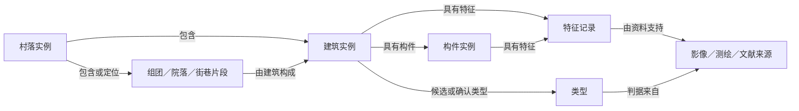

# 景宁畲族传统民居风貌特征提取与知识图谱构建研究

**论文大纲 v0.5｜以v0.4目录为准的内容整合稿**

> **本版整合说明**：五章结构、既有三级标题及研究定位沿用v0.4；1.4.2补入文献研究正文，三级标题下以“1）—4）”区分四个主题段落；将旧七章稿中可复用的逐节论证、候选村落与文献线索、技术条件、特征提取与复核要求迁入相应章节。已取消的保护更新策略及独立AI开发任务不恢复。所有尚无本研究实证支持的判断均保持“拟、待核、候选”状态。
>
> **本版核心调整**：以景宁畲族传统民居建筑风貌为研究对象，以知识图谱作为特征组织、关系建模和比较分析的研究方法。知识图谱的构建过程包含必要的分类与初步关联判断；第四章专门呈现并检验基于图谱获得的建筑学认识。以文化遗产数字化保护作为现实政策背景，不把政策响应直接称为学术创新。
>
> **关于题名**：本稿为突出已确定的方法定位，暂用“**景宁畲族传统民居风貌特征提取与知识图谱构建研究**”。若导师希望更鲜明地突出建筑学问题，可讨论备选题名“**基于知识图谱的景宁畲族传统民居建筑风貌特征研究**”。两者尚未定稿，不能仅凭题名判断研究结论。

---

# 第一部分 论文目录与逐节论证概要

> 本部分沿用v0.4的既有目录。1.4.2已填入文献研究正文，内部以“1）—4）”标记四个主题段落，文末列其10项实际引用；其余章节段落主要仍为研究内容与证据安排，不是本研究已完成的实证结论。宋晓青著作依公开书评转述，段然论文仅题录转引，未补造原著成果。正文引用与学校版式在全文成稿时统一校核。

## 第一章 绪论

### 1.1 研究背景

本节以“国家文化遗产数字化保护要求—景宁传统民居风貌资料及认知需求—知识图谱所提供的研究条件”为线索。政策回答现实必要性，既有研究对照回答学术问题，不能以技术先进性或政策支持直接替代研究缺口的论证。

#### 1.1.1 文化遗产数字化保护与传统建筑信息系统化的现实需求

国家推进文化资源数字化、文化遗产系统性保护与数字档案管理，为传统民居的持续记录和知识利用提供了政策背景。本文将数字化的具体任务限定为村落、组团、单体风貌资料的采集、编码、关联与追溯。建筑数字档案与知识图谱可以支持后续保护认知，但不能等同于完成实体建筑修缮，也不表示本项目已经纳入特定国家工程。政策原文及适用表述见文末政策依据。

#### 1.1.2 景宁畲族传统民居建筑风貌系统认知与保护的研究需求

景宁传统民居已有空间形制、屋面、侧样、营造技艺与装饰文化等研究。旧稿保存了东弄编号调查、蓝坤宝寮图纸、敕木山纹样、周湖侧样等资料线索，说明相关建筑知识并非空白。现阶段应重点核查：既有资料是否已实现跨实例、跨尺度的一致记录与关系比较；何种内容需要补充现场证据；哪些特征的历史状态受到改造影响。不得仅因没有同名“风貌知识图谱”论文就判定无人研究风貌。

#### 1.1.3 多尺度风貌研究与知识图谱方法的应用契机

倾斜摄影可为村落形态、屋顶群体和组团关系提供整体观察基础，地面影像、既有图纸与必要量测补足檐下细部和尺度信息。知识图谱可进一步将村落、组团、建筑、构件、类型与证据建立明确联系，支持关系查询和多维比较。其引入是解决信息关联问题的研究选择，并不要求研发新算法、全构件BIM或AI生成设计。AI只在能够验证识别质量和成本收益时辅助执行具体处理任务。

### 1.2 研究目的与意义

将研究意义分为建筑学认识、方法探索和知识积累，同时明确政策背景属于现实需求。研究目的应与第二至四章的实际数据、图谱构建和分析任务对应，避免把技术流程本身表述为研究发现。

#### 1.2.1 研究目的

通过景宁传统民居样本调查建立明确的对象与证据边界；从村落整体、建筑组团和建筑单体三个尺度提取可比较的风貌特征；构建连接对象、类型、特征与资料来源的知识图谱；利用图谱开展类型、组合、差异与跨尺度分析，形成经实例支持的建筑学认识。第四章发现反例或分类歧义时，应反馈修订第三章形成的基础图谱。

#### 1.2.2 建筑学研究与方法探索意义

建筑学层面，拟在既有形制、营造技艺研究基础上补充组团及跨尺度关系的观察，并通过实例比较检验类型的共同规则与变体。方法层面，探索“统一特征定义—证据关联—实体关系建模—图谱查询—分析回填”的可复核过程。只有在真实样本与前人成果对照后，才能确定哪些属于新增认识；“首次使用知识图谱”或“绘制大量图表”不足以单独构成创新。

#### 1.2.3 风貌知识积累及遗产数字化保护的实践意义

将调查影像、三维视图、局部量测、建筑身份、特征取值及其来源联系为可查询、可更新的风貌知识资源，可为传统民居识别、类型对照和后续资料补录提供依据。这对应国家文化遗产数字化保护的方向，但研究成果定位为基础知识与保护认知参考，不预设制定修缮规范、建筑更新设计方案或工程成效评估。

### 1.3 相关概念界定

概念界定直接服务数据模型与分析边界：研究对象的族群与建筑身份、风貌的观察层次、建筑学风貌图示与信息学知识图谱均应清楚区分，防止不同类型证据在构图时被混同。

#### 1.3.1 景宁畲族传统民居的研究对象与界定范围

以景宁调查范围内、经年代、使用、传统营造方式及可靠记录综合核查的传统居住建筑为主要对象。处在畲族村落并不直接证明一栋建筑的所有做法为畲族专属；民族图案也不能单独确认建筑身份。公共建筑可作为村落环境与空间节点的背景资料，但不得混入住宅样本的类型频数。身份无法确定、经过明显改造的案例可保留核验状态，并在分析中区分使用。

#### 1.3.2 建筑风貌、风貌特征与多尺度分析单元

建筑风貌指向可观察的空间组织、建筑形态、构件、材料、色彩和组合关系，文化意义与历史成因须另行举证。三级尺度分别以村落整体、可依据院落或街巷界面划定的组团、建筑单体为分析单元；单体内的构件属于特征层而非平行的第四尺度。三级观察不意味着三个尺度都必须形成完备类型划分，尺度深度由实际样本支持程度决定。

#### 1.3.3 知识图谱及其与建筑风貌图谱的区别与联系

知识图谱在本文中是具有可明确识别的实体、属性、关系、实例与来源的知识组织结构，能够通过成熟数据库或等效结构执行关联查询；建筑风貌图谱则是形态、类型和空间关系的建筑学图示表达。两者可以对应：知识图谱组织可计算关系，风貌图示展示分析结果。仅有图片汇编、特征表或静态节点示意，不足以证明已建立可查询的知识图谱。

### 1.4 国内外相关研究现状

综述以主题而非单篇文章为组织单元。既有景宁研究回答对象基础，康巴图谱等研究提供风貌表达的比较线索，汤茗喆和历史建筑知识图谱研究提供信息提取、组织与校核方法。评述重点是已有成果覆盖了什么，以及本研究提出的增量如何被证实或推翻。

#### 1.4.1 传统民居建筑风貌特征与类型研究

梳理传统民居形制、构件、材料、装饰及类型学研究如何确定分类判据、处理典型与变体、区分特征共现和形成机制。康巴论文目录可参考其“调研—风貌要素分析—综合分析—图谱成果”的论证安排，但不能未经全文查证便断言其具体算法或各项指标。本研究不直接迁入建筑景观基因理论体系，也不照搬其他地区的类型阈值。

#### 1.4.2 景宁畲族传统民居建筑形制、营造技艺及聚落研究

景宁畲族传统民居及村落研究主要围绕山地聚落环境、住宅空间形制、地方营造技艺和文化装饰展开，调查、测绘与访谈构成其重要资料基础。较早的研究题录中已见段然《景宁畲族传统村落与建筑文化的研究与开发》，该题录可由赵圣洁论文的参考文献核对（转引自文献[1]）。相关成果分别从村落空间、建筑构成和营造过程等层面推进了对景宁民居的认识，并为讨论其共同特征、内部差异及形成条件提供了依据。

**1）景宁畲族传统村落空间形态研究**

山地环境与聚落空间的关系是景宁传统村落研究的重要线索。汪梅从坡地、水源和住宅空间入手，讨论顺坡布置、前后出入口、院落、厨房与排水的联系[2]。赵圣洁以东弄村为对象，将自然环境、聚落内外空间和典型住宅测绘相结合，分析溪流、道路、台地与建筑布局的关系[1]。这些研究将地形适应从地域背景转化为具体的建筑空间问题，提示村落风貌需要通过建筑落位、入口方向、院落高差及道路连接等关系加以理解。

村落空间还通过居住与公共活动获得不同的组织方式。柴一涵以传统村落和少数民族村寨名录的交集确定12个研究村落，归纳团状集中、带状密集和辐射分散三类空间形态，并以周湖、东弄、岗石进行典型分析；其公共文化空间研究进一步联系了设施节点、文化活动及参与者[3]。潘钊则将村落环境、居民生活和保护发展需求共同纳入规划讨论[4]。两者分别从形态与使用、保护与发展出发，扩展了对村落整体风貌的认识，但总体形态分类、公共活动联系与住宅组团的组成关系仍是不同的分析对象。

相关研究也已尝试以景观分类和图谱组织村落知识。根据方一珊对宋晓青等《乡村景观营建与文化传承研究：以景宁地区畲族传统村落为例》的评介，该书将建筑、选址布局与环境纳入景观基因分析，涉及要素识别、分类编码、信息库和图谱构建[5]。这一公开评介表明，景宁村落研究已存在整体要素组织的相关成果，不能将建筑特征分类或图谱表达本身视为尚无人涉及的任务。其具体分类规则、实例覆盖与关系表达方式仍需依据专著原文进一步辨析。

总体而言，已有研究从地形适应、空间布局和活动节点等方面提供了村落风貌认识，并在个案中联系住宅空间。进一步比较可关注同类聚落内部住宅组合的差异，以及临溪、临路和不同台地位置与建筑入口、院落、屋面之间的联系。对院落组合、相邻住宅及街巷界面的分析，应区分可见的空间邻接、共享空间和住户关系，不能仅由聚落轮廓推定建筑组团的社会或产权边界。

**2）景宁畲族传统民居建筑形制与构件特征研究**

建筑形制研究已经形成平面、院落、屋面、材料和装饰等方面的描述。汪梅记录“五柱三间两进”、横向扩展与排屋空间，王文辉以大张坑为中心讨论“四架三间”和“一字形竹筒寮”，潘钊整理住宅类型、空间与构件装饰[2,6-7]。这些成果说明景宁住宅包含多种空间组织方式，而非单一形态。不同文献采用的柱、架、间、进以及住宅俗称涉及不同观察口径，建立类型比较时需要明确它们分别描述构架、开间、进深还是院落组合。

单体测绘使形制认识进一步进入空间与构造的联系。赵圣洁对蓝坤宝寮的分析将院落、厅堂、廊道、房间与高低屋面放在平面、立面和剖面中共同讨论[1]。汪梅对排屋的记录则将横向相连的住宅、贯通廊道及二层空间联系到家族居住和交往[2]。两类材料分别呈现单体内部组织与相邻住宅组合，说明体量、屋面和界面特征需要结合空间使用理解；深入测绘的个案仍须与其他规模、年代及改造状态的住宅比较，才能判断其代表性。

材料与装饰研究补充了外观及构件尺度的认识。汪梅介绍素木、黑瓦及重点木构件的雕饰，潘钊从土木构造、院落和厅堂组织讨论建筑文化，使材料色彩与空间、构件共同进入形态描述[2,7]。蓝法勤则对卷草凤凰纹进行构成与变体分析，并联系其所在梁、门楼及厅堂位置讨论地方称谓和文化意义[8]。这使装饰比较由图案名称扩展到纹样构成、承载构件及使用空间之间的关系。畲汉居民对相近纹样的不同称谓，也提示可见形态与文化认同需要分别记录，不能直接以单个符号认定民族专属性[8]。

保护更新研究提供了形制变化的时间线索。王文辉记录大张坑住宅外墙、檐篷、门窗及使用空间的改造，揭示生活改善与外观趋同之间的张力[6]。对于风貌研究，这类材料的主要作用是帮助区分原有构造、修缮替换和当代展示，识别同一建筑在不同记录时点的变化。已有文献因此既可作为特征提取依据，也可作为历史对照，不能将调查期的形态和数量直接视为当前状态。

**3）景宁畲族传统民居营造技艺及其风貌表现研究**

营造技艺研究将建筑形态与形成过程联系起来。赵潇诺的学位论文以文化、匠意和匠技组织研究，结合匠师访谈、营造手稿和构造比较，讨论地盘、侧样、取尺、屋水及榫卯操作[9]。其中，地盘和侧样分别关联平面组织与木构架侧向形态，取尺和屋水则涉及尺寸及屋架斜率的营造规则。这些成果记录了地方知识参与建筑形成的具体方式，使风貌解释能够进入构架、尺寸和工序层面。

赵潇诺、佟士枢和何礼平的木构侧样研究进一步以院墙承重、后厨天井、柱筒组合及屋面分层辨析形制变化[10]。作者认为所调查构架的前架较稳定，变化多从后廊柱开始，通过增减柱与直筒、柱筒转化及屋面调整处理进深、材料和使用条件。这里的直筒按作者注释指不落地柱，与柱分别计数。这一研究的重要认识是，侧样差异可以被理解为相互组合的构造调整，而不只是若干固定类型的并列；后廊、后厨、院墙和屋面因此成为连接空间形制与营造规则的关键部位。

作者结合实测、匠师手稿与营造典籍推定原型，并通过邻近地区比较讨论技艺联系[9-10]。原型推定与实物类型分布所回答的问题不同，宜作为后续实例比较的参照，而不直接等同于所有住宅的共同历史起点。相似构架和功能可以提示地域联系，但传播方向、年代及实际环境效果，还需要相应的历史或测量证据。

王文辉对择基、起梁、砌灶和乔迁等过程的记录，则补充了营造活动与家庭生活、仪式选择之间的联系[6]。综合这些成果，营造技艺既可解释木构和空间形成，也包含不同主体对建筑的理解。后续风貌分析应将构造观察、操作规则及文化解释分层使用，比较它们如何在具体住宅中共同呈现，而不以一般文化叙述代替形态形成的证据。

**4）景宁畲族传统民居建筑风貌研究评述**

现有研究已将景宁民居认识从地域文化与住宅特色的描述，推进到聚落空间、单体测绘、木构变体和营造规则等多个层面。其共同贡献是揭示建筑与山地环境、居住组织、地方工艺及文化表达之间的联系，并提供可继续核查的具体空间和构件资料。由此，景宁畲族传统民居风貌更适合被理解为多种条件在不同实例中的组合结果，民族文化的作用需要在地域共享形式和内部差异中辨析。

在村落整体层面，地形适应、布局类型及空间节点已有较明确的讨论；在建筑单体层面，平面、屋面、构架、材料与装饰也有测绘和分类成果。院落、排屋及共享空间研究提供了建筑组团的个案线索，部分文献已联系村落环境、住宅空间与构架。因此，后续研究不应以“首次开展多尺度研究”或“此前缺乏系统分类”为预设创新，而应检验既有认识在不同实例和尺度中的适用范围。

进一步研究可聚焦于一个建筑学问题：**景宁传统民居的空间、屋面及构件特征，在不同村落和组团位置中如何组合，并形成怎样的共同形式与局部差异？** 具体可比较相似外观是否对应不同构架或使用组织，院落、排屋及街巷片段如何连接单体形制，以及修缮和用途变化如何改变这些组合。对这一问题的判断，需要可比较的特征口径及明确的对象、时间和来源，才能辨认共同形式、局部变体与不符合既有解释的实例。

宋晓青等研究的公开评介已经提示相关分类与图谱成果的存在，应进一步将其具体指标、实例覆盖、尺度关系及分析任务与本文逐项对照[5]。在当前材料范围内，上述问题属于候选深化方向，尚不能确认为领域空白。本文拟在既有建筑学认识基础上，围绕村落、组团和单体之间的特征组合及关系展开比较。知识图谱可作为组织实例、特征、空间归属和证据的候选方法；本节的作用是明确需要组织和分析的建筑风貌知识。其与已有景观图谱的区别及实际分析价值，仍须在1.4.3的方法研究和后续实证分析中论证。

#### 1.4.3 文化遗产数字化、建筑信息组织与知识图谱应用研究

从多源影像与数字记录、结构化风貌指标、知识图谱实体关系组织和文化遗产知识利用四类文献梳理方法。汤茗喆的构件结构树、类型树及空地采集提供资料处理先例；郭锐等涉及多源资料与知识图谱的思路可用于比较证据关联方式。应分别讨论数据可见性、量测条件、模型精度、更新机制和溯源要求，避免将数字模型、数据库和知识图谱混用。

#### 1.4.4 相关研究评述与本研究的切入点

评述拟围绕三个可验证问题展开：景宁现有研究在多尺度统一描述和跨实例比较方面是否仍有缺口；知识图谱是否能清楚表达风貌要素与空间归属的关系；基于该图谱能否形成有实例支持的特征与类型认识。相关研究缺口属于待核查的候选判断，不能因已有文献题名不同而成立。必要时压缩研究任务，以实际可取证的核心问题作为选题切口。

### 1.5 研究问题、内容与方法

研究任务围绕一个建筑学目标组织：在知识图谱支持下识别景宁传统民居风貌的类型、组合和跨尺度联系。资料采集、编码、构图与查询共同服务这一目标，不额外增加独立的AI训练、参数化设计或修缮方案开发任务。

#### 1.5.1 研究问题

核心问题是如何将多尺度风貌信息组织为可追溯的知识图谱，并由此形成经过证据验证的风貌认识。子问题依次为：哪些对象和指标可以可靠观察；建筑、构件、特征、类型及空间归属怎样建模；图谱怎样支持查询、类型比较和跨尺度分析；所得认识相对既有景宁研究增加了什么，以及在何种数据条件下成立。

#### 1.5.2 研究内容

研究内容按“样本及证据—特征与知识图谱—基于图谱的建筑学分析”三个实证环节组织。第二章形成正式样本及数字化资料，第三章形成特征编码手册、实体关系结构和可查询的基础图谱，第四章展示不同尺度的类型、组合、差异与反例，并记录分析对图谱的修订。最终成果既包含风貌知识资源，也包含具体的建筑学结论。

#### 1.5.3 研究方法

主要采用文献对照、田野调查、倾斜摄影与地面补拍、必要量测、建筑类型学、特征分类编码、知识建模、关系查询及实例比较。对可测量指标使用可靠尺寸和明确分母，对难以测量的风貌特征保留规范的定性类别。AI辅助构件标注只在可用性和总成本均经过小规模测试后采用，不将AI效果作为必需创新点。

### 1.6 研究技术路线

技术路线可表示为：文献对照与对象界定 → 试调查及三级尺度样本确定 → 空地采集、资料核验与编码 → 三级风貌特征提取 → 实体、属性和关系建模 → 基础知识图谱实例化 → 图谱查询与类型／差异／跨尺度分析 → 证据回查与图谱修订 → 研究结论。路径允许分析后回到原始资料补采或修订编码，不应画成完全单向流程。

## 第二章 景宁畲族传统民居建筑风貌现状调研

### 2.1 研究范围与对象

研究区域和样本设计承担结论适用范围的界定。旧稿已积累不同村落的历史数量、照片、具名图纸和构架调查线索，但这些材料的时间、统计口径和建筑身份不一，必须经过逐栋核查才可进入正式样本。

#### 2.1.1 景宁县域及传统民居分布概况

说明景宁县域、畲族传统聚居背景及主要候选传统民居分布。将研究范围区分为地理背景范围与正式调查村落范围，不把行政县域自动等同于实证覆盖区域。旧稿保留的村落包括东弄、敕木山、桃源、大张坑和周湖；它们具有不同的照片、图纸或调查优势，是否全部纳入应由实地调查条件决定。

#### 2.1.2 研究对象与调查范围的确定

结合传统居住用途、既有档案、结构与形制线索、现状保存及可采集程度建立纳入与排除规则。逐栋记录历史编号、位置、当前用途、结构与改造情况，区分“传统建筑现存”“曾被文献记录”“仅作为对照的改建建筑”等状态。正式样本规模与有效分析子集须调查后确定，不将历史调查总数直接当作现存数量。

#### 2.1.3 村落整体—建筑组团—建筑单体的调查尺度

村落尺度记录边界、街巷、建筑分布、地形和群体屋顶；组团尺度以空间上可辨认的院落、相邻宅院或连续街巷片段为单元；单体尺度观察整体形制、屋面、立面与可见构件。组团划分需要平面、邻接和现场界面依据，不应仅据物理接近推定同一家族或同一营造体系。可将无法归属稳定组团的建筑直接关联村落并保留不确定说明。

### 2.2 研究区域的自然、人文与聚落环境

环境背景用于提出风貌差异的观察线索，而不是在调查前预设风貌成因。自然条件、聚居历史与聚落形态均需对应到具体实例与可核查资料。尤其要区分“空间相关”与“地形或族群导致某种形式”的因果判断。

#### 2.2.1 自然地理、山地地形与气候条件

据公开地形、遥感和实地资料记录山地坡度、谷地或台地等地形条件，以及住宅在高差与路径系统中的位置。气候指标如需用于解释屋面或构造，必须具备具名数据来源和可比较样本；不能从常识直接推导当地全部传统民居的形式。航拍可判断可见空间关系，真实坡度和高程差应使用经过核验的几何数据。

#### 2.2.2 地域历史、民族文化与民居营造背景

梳理景宁的地域历史、畲族居住文化、营造传统及具体村落的居住组织背景，并利用赵潇诺等研究核对一字形、院落式、长间、檐廊、侧样和屋面变化等已有认识。文化意义和构造工艺应标注访谈或文献证据，不从装饰样式直接推断民族专属性；历史因素仅在证据充分时用于讨论特征差异。

#### 2.2.3 聚落空间形态与传统民居保存现状

描述样本村落的街巷、台地、院落、公共节点和传统住宅群体的关系，并标示与新建、改造建筑混合的现状。村落轮廓、屋顶群体及连续界面可形成航拍与地面双重记录。保存现状应说明资料时点、具体建筑及改造部位，避免把建筑外观变化概括成未经验证的普遍“风貌破坏”。

### 2.3 传统民居分布与调查样本选取

样本选择不能只求典型或便利，应同时考虑类型差异、空间位置、保存和改造状态、资料可获得性。村落、组团和单体各层次需清楚记录实际数量以及能够用于每项比较的有效数量。

#### 2.3.1 候选村落与传统民居的分布及资料核查

整合旧稿的候选村落资料：东弄有文献记载的住宅统计及1—52号建筑调查和蓝坤宝寮图纸；敕木山有典型大户民居与纹样资料；桃源有清代建筑数量线索和成组照片；大张坑有专题调查；周湖有侧样编号及8号住宅图纸。每条数量保留年份与原统计口径，不并入现存建筑总量。下表仅作为待核候选资料，不是2026年实地普查结果。

**候选村落资料线索（来自原七章稿，待现场核实）**

| 村落 | 原资料及统计口径 | 可沿用的资料基础 | 当前使用边界 |
| --- | --- | --- | --- |
| 东弄 | 2022年提交的研究记民居107幢，其中传统民居73幢；另有2012—2013年1—52号建筑调查（含公共建筑） | 蓝坤宝寮的一、二层平面与剖透视、建筑编号和现状记录 | 历史统计、编号和现存可用建筑不能直接等同 |
| 敕木山 | 2022年官方介绍提及四幢典型大户古民居，属于子集而非全村总量 | 实景、建筑装饰及28号蓝姓寮纹样线索 | 四幢的完整测绘资料尚待核实 |
| 桃源 | 文献记录清代建筑10幢／10处 | 村落、民居及构件照片 | 逐栋身份与现状尚未核查 |
| 大张坑 | 2015年提交研究记民居37幢，其中钢筋水泥结构1幢 | 专题论文、调查照片与数量线索 | 不能直接将其余36幢全视为传统民居 |
| 周湖 | 侧样研究列15个编号行，并非全村数量 | 侧样类型、8号民居模型与立面资料 | 编号子集不能用于估计全村覆盖率 |

*来源入口：原稿《archive/2026-10-12-大纲切换/论文大纲-特征提取与图谱构建.md》的“3.1 研究区域与样本框架”；进一步追溯至 `研究对象候选汇总-按村落.md`、`archive/2026-10-12-大纲切换/导师汇报提纲-理论可行性论证.md` 及相应论文／官方材料。该表不是本次独立完成的2026年普查。*

#### 2.3.2 村落、建筑组团与单体样本的分层选取

按村落位置、地形环境、风貌保存程度、建筑类型差异和调查可达性分层选择。先以不同条件的村落开展试调查，检验组团边界、外部构件可见性和样本工作量，再确定正式方案。建筑单体可分为基本记录与深入复核两个深度，非典型和现代改造实例应纳入必要的对照，不要求全部样本进行室内详测或构件级BIM。

#### 2.3.3 样本建筑的年代、身份与改造状态记录

每栋建筑至少保存建筑身份及依据、现状用途、资料日期、可判断的年代范围、保存及改造部位、已有图纸或照片。尤其将“某处材料现状为水泥”“据访谈可能为后期替换”与“历史原貌可确定”为不同证据状态。保留无法判定的建筑，不用现有外形对历史真实性作确定判断，并在第四章分析时控制改造造成的偏差。

### 2.4 多尺度风貌调查与数字化资料采集

利用同一轮整体倾斜摄影服务村落与组团分析，以地面多视角照片和必要实测补足单体细部。调查组织以目标风貌字段能够被准确提取为标准，而不是以重建模型越精细越好为标准；时间、路线及设备在实地实施后如实填写。

#### 2.4.1 调查方案、时间与路线

在确定试调查与正式采集村落后，按航拍条件、街巷遮挡、单体可进入性安排路线。统一拍摄清单，说明每次采集时间、天气、设备、航线与照片用途。对于文献中出现但现场找不到的具名住宅，记录核查过程而不以附近同形态建筑替代；调研经过只据实际实施记录填写。

#### 2.4.2 村落整体倾斜摄影与空间资料采集

采用村落范围的倾斜摄影取得整体三维表达和可判断的屋面、街巷、建筑群分布资料。根据实际精度生成正射或俯瞰视图；建筑密集、树木遮挡及坡地高差会影响重建。村落群体形态可以依靠模型定性分析，但涉及坡度、高度及建筑间距的数值，必须经过尺度与几何质量检查。

#### 2.4.3 建筑组团、院落和街巷界面的补充调查

对具有明确空间边界的院落或街巷片段补拍相邻建筑端部、连续立面、屋脊方向和高差衔接，以保证组团关系可以回到具体组成建筑。组团编号应同时记录划界理由和组成实例；组团不清晰时改用“院落／街巷片段”观察单元，避免强行建立不存在的围合类型。

#### 2.4.4 建筑单体外观、可见构件与必要量测

记录建筑整体形制、层数、屋顶形式、山墙、立面分段、门窗、檐廊、台基、可见构造、材料和色彩等外部信息。坡度、出檐、窗墙比及开口尺寸等只在实测或可靠正射与尺度支持时计算。已收集的蓝坤宝寮平面、剖面及周湖侧样图纸可供个案对照，不能推定全部单体的内部空间或构架。

### 2.5 调研资料整理与证据质量控制

资料整理应从原始文件起建立稳定编号、时间和版本，并规定不同质量等级数据的用途。数字模型仅是可能的数据来源之一；知识图谱节点和特征取值应能指向原始影像、图纸或调查记录。

#### 2.5.1 三维模型、正射视图与影像资料整理

按村落和采集批次保存原始空地影像、三维模型、点云及模型派生的俯视、立面与局部视图，记录使用软件、版本和几何基准。模型视图可帮助统一观察角度，但未达正射与尺度要求的截图不得当作精确测绘图。对窄巷、檐下、墙角和树木遮挡部位保留补拍或不可见标记。

#### 2.5.2 调查对象统一编号与原始资料关联

建立 village_id—group_id—building_id—component_id—source_id 的实例索引，同时保存对应的旧文献编号。建筑实例、构件实例与构件类型不能混为同一实体；一栋建筑中的多个窗属于不同构件实例，但可以共享窗型定义。来源记录包括作者／采集者、日期、照片编号、图纸页码或模型视图与可信状态，保证每项特征可以复查。

#### 2.5.3 数据完整性、精度及有效样本核查

分别检查是否拍到目标部位、照片是否清晰、几何是否可靠、能否判断属性及有无历史佐证；将“不可见”“未采集”“不适用”“存在但不能分型”“证据冲突”和“确实不存在”分开编码。按指标报告有效村落、组团或建筑数量，抽查关键几何值，避免用全部样本数作为每项比较的统计分母。缺失严重的指标可以降级为定性观察或暂时剔除。

### 2.6 本章小结

本章最终产出是具有明确身份和范围的样本名录、三级尺度原始资料及其质量说明，而不是三维渲染展示。哪些指标可量化、哪些只能定性、哪些需补证，应作为第三章特征体系和知识图谱实例化的输入约束。

## 第三章 景宁畲族传统民居风貌特征提取与知识图谱构建

### 3.1 多尺度建筑风貌特征提取体系

以现有V/G/B候选指标为起点，结合赵潇诺等对象研究及汤茗喆的信息组织方法，建立可观察、可编码且能支持后续查询分析的指标体系。先确定分析问题，再删改字段，避免为追求图谱规模而无限增加属性。

#### 3.1.1 风貌特征提取的依据与指标筛选原则

指标筛选同时考察建筑学意义、跨样本可比性、现场可见性、数据可靠性和获取成本。旧稿中的屋顶、腰檐、后侧屋面变化、立面门窗、石基土墙板壁与梁部门楼装饰均有文献线索；文化寓意与不可见构架须单独取证。区分决定类型的分类判据与用于比较类型的其他特征，避免“以屋顶分型又以屋顶差异证明分型有效”的循环推论。

#### 3.1.2 村落—组团—单体三级风貌特征体系

沿用v0.4中的三级框架，将村落整体V01—V07、组团G01—G07及单体B01—B18合计32项视为试调查候选，不是必须全部完成的字段。村落关注地形选址、总体形态、建筑分布、街巷、屋顶群体与节点；组团关注边界、排列、院落、体量屋顶组合与街巷界面；单体关注形制、屋顶、立面、门窗、檐廊、台基、材料、色彩及可见构造。正式编码需按试采结果细化取值，不能把该候选清单当作发现的类型结论。

**三级尺度候选指标与证据来源（试调查后精简）**

| 尺度 | 候选指标范围 | 核心字段示例 | 主要证据 |
| --- | --- | --- | --- |
| 村落 V01—V07 | 地形选址、总体形态、建筑分布、街巷结构、屋顶群体、公共节点、自然环境关系 | 聚落边界、街巷组织、屋脊方向、建筑分布 | 航拍、正射、地形与现场核查 |
| 组团 G01—G07 | 组团边界、建筑排列、院落及开敞空间、朝向间距、体量屋顶组合、连续界面、地形高差 | 构成建筑、邻接关系、围合方式、界面连续性 | 村落模型、地面补拍、必要量测 |
| 单体 B01—B18 | 整体形制、层数体量、几何尺度、屋顶及檐部、山墙、立面、门窗、附加空间、台基、材料、装饰、色彩及可见构造 | 屋顶类型、腰檐、门窗排列、材料与部位、构件形式 | 单体影像、图纸、局部实测及文献 |
| 跨尺度 R01—R05（候选） | 对象归属、单体类型分布、组团组合、村落差异和证据关联等分析任务 | 关系查询与派生比较，非额外五个强制实测字段 | 上述编号和关联资料 |

*原稿的32项指标仅包含 V7＋G7＋B18；R项为候选派生分析，不计入32项。现有材料未给出经实地验证的B01—B18逐项正式定义，因此本稿不自行发明每个代码的唯一含义。正式字典见待建附录C。*

#### 3.1.3 特征判读、取值、分类与编码规则

为每项字段规定对象层级、构件部位、观察方法、类别与数值类型、单位、判读示例、未知状态、证据强度和版本。地方术语如长间、侧样、腰檐须保留原称谓并说明操作性定义。区分事实记录与作者解释：图像中可见的装饰位置可编码为事实，民族寓意须有额外文献或访谈支持。对混合、变体、改造与无法判断设置显式状态，避免强制归类。

### 3.2 多尺度建筑风貌特征提取

三级尺度提取既产生实例事实，也为后续实体关系建模提供可比较的类别和空间归属。每条记录须含实例ID、特征代码、取值、来源和判读状态；局部构件必须能返回所属单体及部位。

#### 3.2.1 村落整体的空间形态、街巷与建筑分布特征提取

从经核对的村落底图、航拍或三维视图提取聚落边界、建筑群分布、街巷形态、屋脊方向、公共节点及自然环境关系。不同村落的边界与建筑认定口径需保持一致；已有建筑分布不能自动等同于传统民居分布。形成村落特征记录和可比较的空间定位图，为第四章分析整体风貌提供输入。

#### 3.2.2 建筑组团的排列、围合、体量及界面特征提取

以现场划定的组团、院落或连续街巷片段为单位，记录建筑排列、围合、朝向间距、体量高差、屋顶组合和界面连续性。邻接可以作为几何关系提取，但院落归属、同一宅院或历史家族关系须独立证据。通过组成建筑的编号将组团特征连接到单体记录，以便分析一种单体形式在不同组合场景中的变化。

#### 3.2.3 建筑单体的形制、屋顶、立面、材料与细部特征提取

提取整体形制、层数与轮廓、屋顶类型与山墙、檐口和腰檐、立面分段、门窗排列、檐廊与台基、表面材料及细部装饰。参考旧稿关于双坡、悬山、后侧屋面、石基、土墙、板壁和卷草凤凰纹位置的候选观察，实际取值均以实例证据为准。内部平面、架构及营造工艺只在可靠图纸、入户测绘或访谈充分时加入，不能由外观推断。

#### 3.2.4 多尺度特征记录、结构化整理与初步校核

将村落、组团、建筑和构件特征表按同一编号统一整理，保留原始影像、模型局部、页码及判读者信息；检查类别重复、单位冲突、相同构件重复计数和数据缺失。可以以构件边界人工标注作为基准试验图像辅助识别，但AI输出必须人工核对，并记录修正时间与失败案例。数据转换前先形成“事实—来源—状态”完整记录，避免错误被图谱结构固化。

### 3.3 建筑风貌知识图谱的知识组织模型

知识组织模型应围绕第四章真实分析任务设计，而不是先列出庞大的通用本体。需清楚表示“谁属于哪个空间单元、具有什么特征、按什么判据分类、由哪份资料支持”，并处理历史时点、未知信息与修订情况。

#### 3.3.1 建筑风貌知识组织单元与层级结构

最小知识单元包括村落、组团或院落／街巷片段、建筑实例、构件实例、风貌特征及取值、分类类型和来源记录。村落与建筑是具名对象，建筑类型和构件类型是概念类别，某一窗实例不是“窗类型”本身。属性挂接在正确层级，避免将村落地形特征直接当作某栋住宅的实测属性。

#### 3.3.2 风貌实体、属性及关系类型定义

实体可采用Village、Group、Building、Component、Feature、Type、Source等类别；属性包括身份编号、位置、年代与改造状态、特征代码、取值与单位、证据等级和采集时点。关系可包含位于、由……组成、具有特征、属于类型、构件归属、资料支持、空间邻接等。某类构造“受某种文化影响”不是默认实体关系，只有明确历史证据且分析确需使用时才可建立。

**最小知识组织结构示例（表示数据结构，不是实证结果）**

该图强调可追溯的实例关系。允许建筑没有确定的组团归属；类型需存储候选／确认状态；改造和历史信息需标注日期及来源。实际实现可选择属性图或其他支持关系查询的结构，不预设特定软件。

#### 3.3.3 多尺度空间归属、类型与特征关联模型

以村落—组团—单体—构件的定位链条连接不同尺度特征，再以类型与特征关系支持横向比较。组团边界可能重叠或尚未明确，应明确关系方向、基数和例外：建筑至少隶属于样本村落，但未必能可靠归入唯一组团。跨尺度派生关系可用原候选R01—R05作为待设计问题清单，必须先说明实际查询用途再确定关系类型。

#### 3.3.4 实例证据、数据来源及状态信息的关联规则

每条关键事实或类型归属都应关联来源ID、采集或发表时点、判读状态与修订版本。分别保存现状属性、历史记录和推断属性，防止后期材料覆盖历史做法；分清“未观察”“不适用”“证据冲突”等状态。来源可为带拍摄位置的照片、经核验模型局部、实测记录、具名图纸或文献页码，优先保证研究结论能够沿关系链回到真实建筑证据。

### 3.4 建筑风貌知识图谱构建

将经校核的特征记录映射为实体、属性与关系，并构建支持实际检索的基础知识图谱。图谱初建时可以进行发现性查询，但第四章才集中论证类型、差异和跨尺度认识，以避免构图章节先行宣称最终结论。

#### 3.4.1 风貌特征数据映射与结构化转换

建立字段到实体和关系的映射表，例如建筑实例ID映射Building实体，组团ID映射归属关系，屋顶形式映射建筑所具有的特征记录，照片编号映射支持证据。统一数据类型、单位与枚举值，检查建筑编号冲突、来源缺失、同一实例多重不一致分类及时间戳语义。根据研究工作量可选择成熟图数据库、RDF或等效可执行关联查询的结构。

#### 3.4.2 多尺度风貌知识图谱实例化构建

以真实调查样本分批导入村落、组团、单体和主要构件及其特征、类型候选与资料来源。展示一条可以复查的实例链：从村落定位组团与建筑，查看建筑屋顶或檐廊特征，再返回照片和调查记录。对于暂定类型、材料更新或来源冲突设置状态，不为图谱连通性而生成没有证据的边。报告实际节点、关系及有效实例覆盖，但不以规模作为成果质量的主要指标。

#### 3.4.3 实例查询、关系检索与初步关联发现

以第四章拟开展的分析为导向测试查询：按特征找实例；按建筑找构件及来源；比较相同建筑类型在不同组团内的出现情况；发现某组特征共现的候选实例；检索混合与例外。查询结果先检查重复、遗漏、分母和历史时点，再作为分析线索。若普通表格已足以处理单字段统计，应明确图谱主要贡献在跨对象、多关系和溯源操作，而不是夸大其独占性。

### 3.5 知识图谱的数据校核与可用性检验

区分记录真实性、图谱结构正确性和查询可用性三个质量层次。知识图谱可能查询成功但原始取值错误，因此需要从原始证据、类型判据和关系链条分别核查。

#### 3.5.1 实体对应、关系一致性与缺失信息检查

核查同一建筑是否因不同来源重复建点，构件是否误归属相邻建筑，空间邻接是否有几何依据，类型及特征取值是否互相冲突。对于有多份历史资料的实例，保留来源时间并标示未解决冲突。检查可选组团关系、缺失构件和分类未知项是否被错误转为“不存在”。抽检比例应在正式样本数量明确后决定。

#### 3.5.2 图谱节点、关系及特征取值的来源追溯

选取典型、改造、混合及疑难案例，执行“查询结论—建筑／构件实例—特征取值—照片、图纸或现场记录”的逐级回查，并核对单位、时点、判读规则与来源准确性。记录被撤销或修改的实体和关系及原因。若由同一调查者独立复核，只能证明可追溯的自检过程，不能宣称第三方一致性。

#### 3.5.3 图谱查询任务与后续风貌分析的适用性检验

设计少量完整分析任务，检验图谱是否能同时查询不同空间尺度及其特征，并准确返回实例与资料来源。可与常规特征矩阵或人工检索完成相同任务的步骤、遗漏和纠错时间做限定比较；比较结果不足时仅报告完成能力和适用边界。不设置无证据的准确率或节时比例；AI部分不影响知识图谱主体的成立。

### 3.6 本章小结

本章应形成经过试调查修订的特征字典、记录矩阵、实体关系定义、真实数据实例化的基础知识图谱以及校核结果。初步发现、未确认类型和证据问题进入第四章继续分析，不在此提前总结景宁全部风貌类型或所谓形成机制。

## 第四章 基于知识图谱的景宁畲族传统民居风貌特征分析

### 4.1 基于知识图谱的风貌分析方法与任务

第四章侧重“通过图谱得到了什么建筑学认识、这种认识为何可信”，而不是重复第三章的软件配置与数据导入。按研究问题选择查询、分组、类型比较与空间并置方法，充分说明统计口径及证据回查条件。

#### 4.1.1 风貌特征查询、组合比较与关联分析方法

从建筑类型—构件特征—空间归属之间的关系提出可检验的查询任务：同类住宅有哪些稳定特征；某类檐廊或屋顶组合出现于哪些村落与组团；一种单体类型在不同街巷界面中如何组合。根据查询结果制作类型—特征矩阵、频数或比例表、空间分布图和带来源的实例对照图。关系查询提供观察入口，是否存在规律仍需建筑学判断与反例核验。

**示例研究任务（供试调查与图谱设计反向检验）**

| 任务 | 最小数据条件 | 研究输出 |
| --- | --- | --- |
| 按屋顶／檐廊特征检索单体 | 可靠特征编码、建筑ID、来源ID | 带证据的实例集及特征频数 |
| 某类单体在不同组团中的表现 | 单体类型判据、组团归属、排列／界面关系 | 同类单体的组团差异及例外 |
| 组团在不同村落中的组合 | 组团界定规则、村落定位、有效组团数 | 样本村落间的空间组合比较 |
| 从分析结论追溯至资料 | 实例—特征—来源链、资料时间与状态 | 可核查的判读依据及修订记录 |

*这些是研究问题和验证任务，不是预先确定的景宁建筑风貌规律。*

#### 4.1.2 不同尺度的分析单元、指标与比较口径

村落比较以有效村落为单位，组团比较以明确定义的院落或街巷片段为单位，单体类型比较以有效建筑实例为单位；构件频次与建筑频次不能混用。每项表图报告有效样本数与缺失原因，并区分用于分型的判据和用于独立比较的指标。样本规模不足时采用描述性分析，不对整个景宁或全部畲族地区作统计总体推断。

#### 4.1.3 研究结论的证据追溯与可信度判定

对关键结论提出最低证据要求：有明确的取值规则、足够可比实例、代表与反例、原始来源与时间状态，并和既有文献相互对照。共现关系不能直接证明地形、宗教、族群或迁徙是其成因；若欲作历史机制解释，须补充专门历史、口述或跨地区材料。判断可靠性应随采样、模型精度和改造程度明确限定。

### 4.2 村落整体尺度的建筑风貌特征分析

村落尺度主要研究建筑群与空间组织在不同样本村落中的呈现，并利用知识图谱回看组成的组团及单体资料。若正式村落数量有限，应突出空间比较与样本说明，不强制建立地域普遍类型。

#### 4.2.1 样本村落空间形态与传统民居分布特征

依据图谱中建筑位置、传统民居身份和村落边界，比较可见聚落形态、街巷联系、屋顶群体及自然地形关系。可以叠合航拍视图与建筑分布，展示传统民居和其他建筑的空间分布差异。若部分建筑身份未确定，分开统计已确认与待核实例，避免将历史调查清单等同于现状分布。

#### 4.2.2 村落建筑群体风貌的共性与差异

从村落整体风貌入手比较街巷走向、坡地适应、群体轮廓与建筑分布等共同点和差异。借助图谱检索相同单体类型在不同村落中的分布，分析其是否与组团组合共同影响整体印象。对少量村落的观察只形成样本间描述，不能凭村落名称直接归纳民族或文化分区。

### 4.3 建筑组团尺度的风貌组合特征分析

组团分析承接村落与单体两个层级，重点检查空间组合如何改变或强化可见风貌。这里的研究增量可能比单体类型重复分类更明显，但组团边界是否成立必须以现场证据为前提。

#### 4.3.1 组团空间组织、排列与界面组合特征

根据组团实体与所含建筑、院落、街巷及高差关系，比较相邻、围合、沿街连续等空间组织，考察屋脊方向、体量高差、连续立面的组合。若某一形态不具有稳定判据，应保留实例描述或改用街巷片段分析，不为获得整齐分类而强制命名组团类型。

#### 4.3.2 组团风貌组合与内部单体类型的关联

利用图谱查询不同组团内部的单体类型及其屋顶、立面、材料特征，比较相同建筑类型在不同组团关系中的表现。明确某组团的组合风貌不只是组成单体属性的简单相加，还包含邻接、界面与高差等空间关系；同一院落或家族的历史解释需额外资料，不能由图谱邻接边推出。

### 4.4 建筑单体尺度的风貌类型与特征关联分析

单体尺度继承既有景宁民居形制与侧样研究，重点核查不同类型的复合特征、稳定组合和真实变体。图谱检索有助于避免只挑选典型住宅，但分类依据与差异分析应保持相对独立。

#### 4.4.1 单体形制与风貌类型的判定及已有分类复核

以既有一字形、合院及侧样等分类为候选判据，逐栋核对整体形制、附加空间与可见构件组合，必要时在新样本中修订。区分决定整体归类的核心判据与类型内部允许变化的部位；平面与内部构架不足时只做外部形态分类。赵潇诺已提出的形式和构造变体应当明确引用，不重新包装成本文首次发现。

#### 4.4.2 屋顶、立面、材料与构件特征的组合关系

检索屋顶、山墙、腰檐、立面门窗、檐廊、石基／土墙／板壁和装饰部位的实际共现情况，并与整体类型交叉比较。对几何参数使用经核验的建筑数与单位；构件数量多的建筑不得因此被误判为某类型占比更高。文化寓意或承重机制的判断须独立于现状表面材料记录。

#### 4.4.3 典型类型、混合实例与变体的比较

选取类型判据清晰的代表案例，同时加入低频、混合、改造和无法归类实例，检验分类边界。借助实例及来源链区分历史变体、后期修改、照片遮挡与编码不一致的可能性，并记录图谱修订。不能将最常见类型直接称为历史原型，也不能用单一典型个案代替类型整体。

### 4.5 多尺度建筑风貌关联与综合比较

跨尺度分析是知识图谱相对单张建筑特征表值得重点检验的用途：将村落层面的空间分布、组团层面的组合关系及单体层面的类型特征联系起来，形成可回到实例的解释。

#### 4.5.1 村落—组团—单体的特征关联与空间对应关系

沿村落—组团—单体—构件关系链检索具体案例，展示某类屋顶或檐廊特征在不同建筑、组团和村落中的出现位置，比较是否形成相似的群体组合。可选取若干证据充足的实例链进行示意，但必须保留实际建筑编号及来源，不绘制脱离样本的抽象“典型关联”来代替实证。

#### 4.5.2 不同村落及样本间风貌特征的共性与差异

使用统一取值规则比较不同村落和组团中的单体形式及特征组合，归纳稳定共性、差异与反例。比较时控制建筑身份、改造状态、资料年份以及有效样本差异，区分“某处观察到”与“某一地区普遍存在”。若发现未知项较多，不应以删去缺失记录后的比例直接推出地域规律。

#### 4.5.3 改造状态、反例与风貌特征解释边界

重点分析现状材料替换、屋顶修缮、门窗改变等对特征判断的影响，并辨别无法观测与真实不存在。对同现特征、地形或使用条件的相关性仅给出受资料支持的解释，不预设族群专属性或历史传承机制。被反例否定的类型和关系应从图谱中修订或标注为待核，而不是隐藏以保持结论整齐。

### 4.6 风貌知识综合归纳与图谱研究价值检验

在总结风貌认识的同时检验知识图谱的研究贡献：它是否使类型判断、跨尺度比较和来源追溯更加明确，以及怎样反过来完善知识资源。研究增量必须从实证和可复核过程提出，不能由图谱规模推定。

#### 4.6.1 与已有景宁畲族民居研究成果的对照

逐项对照赵潇诺等研究已提出的单体形制、侧样、屋面及构件认识，区分“得到再次支持”“通过新增样本细化”“发现反例需限定”和“研究范围不同不可比”。尤其说明新加入的组团层面及跨尺度分析是否揭示了前人未呈现的具体联系。文献对照结果决定论文最终可主张的建筑学认识增量。

#### 4.6.2 分析结果驱动的类型、关系修订与图谱完善

将分析产生的稳定类型、候选变体、例外及新确认的空间关系反馈到知识图谱，保存原判据、修改依据、受影响建筑和来源证据。分类变更后重新核对相关查询和统计，避免修订只停留在可视化图面。用实际修订案例说明知识图谱构建与风貌分析是相互促进的过程。

#### 4.6.3 知识图谱对风貌比较、溯源与知识利用的支持效果

选取按特征找建筑、按建筑追溯资料、跨组团比较组合等明确任务，检验知识图谱能否支持准确查询、实例复核和持续补录。有条件时与传统表格／人工检索进行同任务比较，记录完成步骤、遗漏和修订成本；没有比较数据时只陈述已验证功能，不宣称优越性。知识图谱的价值最终体现于形成可检验的风貌认识与可复用知识，而不是节点数、可视化效果或平台规模。

### 4.7 本章小结

本章应据真实样本总结各尺度的类型、组合、共性与差异及其跨尺度关系，并明确哪些是新发现、哪些来自既有研究、哪些因证据不足保持暂定。作为研究成果的知识图谱同步完成必要的分类及关系修订，结果与限制进入第五章。

## 第五章 结论与展望

### 5.1 主要研究结论

结论按绪论提出的研究问题顺序组织，优先呈现具体建筑学认识，再归纳知识图谱的组织与分析适用性。不得把计划中的指标、建模流程或查询演示当作已经验证的研究结论。

#### 5.1.1 景宁畲族传统民居多尺度风貌特征与类型认识

根据第四章实际结果概括村落整体、建筑组团及建筑单体的主要可见风貌特征，说明实际有效样本和类型判据。既有一字形、合院、侧样及屋面变体等文献认识，应与本文新增或修订的结果区分，未取得的内部空间与构架证据不能由外观补写。

#### 5.1.2 风貌特征的组合关系、共性差异与跨尺度联系

总结有证据支持的屋顶、立面、材料、构件等组合及类型内部的变体，再概括村落—组团—单体跨尺度联系。对常见关系报告适当分母，对少见和反例说明其位置与状态，避免以共现直接推定文化和历史形成机制。实际样本不能代表的县域与民族整体结论必须明确排除。

#### 5.1.3 建筑风貌知识图谱的构建结果及分析适用性

概括知识图谱实际建立的实体、关系、字段和证据连接范围，以及它对类型检索、跨尺度比较与原始来源追溯的可验证支持。若存在数据覆盖不足、图谱修订困难或普通表格同样有效的任务，应如实说明。仅对经过可靠量测的字段评价量化能力，不声称知识图谱会自动使全部风貌信息量化。

### 5.2 研究贡献与创新点

创新和贡献应由前人研究对照及实际成果共同决定，分别评价对象认识、研究路径和知识资源。应避免将政策响应、使用无人机或搭建图数据库直接写成学术创新。

#### 5.2.1 景宁畲族传统民居建筑风貌认识的补充

以具体结论说明相对既有景宁民居研究新增、细化或修订了什么：例如此前未充分比较的组团组合、跨尺度关系或新的反例（均须有真实实例支持）。更多照片和样本可以构成资料贡献，但不自动等同于新的建筑学理论结论。

#### 5.2.2 多尺度风貌知识组织与图谱化分析的方法贡献

若可复核地完成三级指标定义、实体—属性—关系组织、证据来源联结与图谱分析任务，可将其定位为知识图谱在地方传统民居风貌研究中的应用性方法探索。其价值应通过实际查询、分析修订与复核展示，而非宣称提出全新的知识图谱算法或通用本体。

#### 5.2.3 数字化风貌知识积累与可追溯表达的成果价值

在实际建成并完成基本核验的范围内，强调风貌知识从分散图纸、照片和描述性记录转为具有稳定编号、来源、版本和关联查询能力的知识资源。它可为后续传统民居调查、保护研究和数字化档案完善提供参照，但不是已经实施保护工程或证明修缮绩效。

### 5.3 研究不足与展望

局限既要说明样本和方法不足，也要指出它影响哪一种具体类型、比较或解释；展望应优先回应这些不确定性，避免把未来复杂平台或设计任务写成已完成研究。

#### 5.3.1 调查样本、模型精度与知识图谱覆盖范围的局限

说明村落覆盖、组团划界、现代改造、建筑身份、遮挡和有限量测带来的字段缺失，以及编码一致性、数据转换和来源冲突的影响。分别指出村落比较、单体参数、历史风貌解释和跨尺度关联受到的限制。独立复核条件不足时不能报告外部一致性或不具备依据的准确率。

#### 5.3.2 后续样本补充、知识更新与保护研究应用展望

后续可逐步扩充具有历史资料的村落与建筑样本，补充内部构架、营造访谈和可比邻区资料，完善知识图谱的时序属性、版本更新与共享机制。保护认知、数字展示和设计借鉴只作为可能用途提出，其有效性需另行建立对象、证据及评价标准，本研究不新增独立的保护更新策略章节。

## 参考文献（已写正文引用）

[1] 赵圣洁. 浙江省景宁县东弄村畲族民居初探[D]. 南京: 南京工业大学, 2013.

[2] 汪梅. 人与自然的完美演绎——记景宁畲族住宅建筑的特色[J]. 浙江工艺美术, 2006, 32(2): 70-74.

[3] 柴一涵. 聚落“双修”视角下景宁畲族传统村落公共文化空间重构研究[D]. 杭州: 浙江工商大学, 2024.

[4] 潘钊. 景宁畲族传统村落的保护与发展研究[D]. 济南: 山东建筑大学, 2015.

[5] 方一珊. 乡村文化景观基因特征和传承路径——评《乡村景观营建与文化传承研究》[J]. 世界林业研究, 2025, 38(1): 143-144.

[6] 王文辉. 浙江景宁传统畲族民居及其保护与更新——以大张坑村为中心[D]. 金华: 浙江师范大学, 2015.

[7] 潘钊. 浙江景宁畲族传统建筑文化研究[J]. 设计艺术(山东工艺美术学院学报), 2017(1): 51-54.

[8] 蓝法勤. 浙江景宁畲族传统民居卷草凤凰纹装饰研究[J]. 设计艺术研究, 2013, 3(1): 94-99.

[9] 赵潇诺. 景宁畲族传统民居营造技艺研究[D]. 杭州: 浙江农林大学, 2022.

[10] 赵潇诺, 佟士枢, 何礼平. 浙西南景宁畲族民居木构侧样研究[J]. 古建园林技术, 2023(5): 10-15.

## 附录（建议）

- 附录A　调查样本名录、选择依据与身份信息
- 附录B　多尺度现场调查表及影像、测量记录
- 附录C　风貌特征指标、编码规则与判读示例
- 附录D　知识图谱实体、属性、关系字典与实例映射表
- 附录E　典型查询任务、结果及原始资料证据索引
- 附录F　建筑风貌综合图示与典型实例对照图
---

# 第二部分 研究定位与章节说明（工作文件，不计入正式目录）

## 一、研究定位

### 1. 核心定位

本研究以**景宁畲族传统民居建筑风貌**为研究对象，以**村落整体—建筑组团—建筑单体**为多尺度观察框架，利用调查资料与数字化采集信息提取风貌特征，通过**知识图谱**组织建筑实例、属性、类型、空间归属及证据之间的关系，并在构建、查询、比较与修订的过程中，形成对传统民居风貌类型、共性、差异及跨尺度联系的建筑学认识。

本研究既不是通用知识图谱算法研发，也不是仅将建筑风貌结论画成图示；其重点在于**知识图谱支持下的建筑风貌研究**。

### 2. 研究问题

**核心研究问题**：如何将景宁畲族传统民居多尺度建筑风貌信息组织为可追溯、可比较的知识图谱，并借助图谱中的特征与关系形成对当地建筑风貌的系统认识？

子问题：

1. **研究对象与特征**：景宁畲族传统民居在村落、组团、单体三个尺度上，有哪些可观察、可提取和可核验的风貌特征？
2. **知识组织与图谱**：如何建立特征分类、对象实体、属性取值、跨尺度关系及原始证据之间的明确关联，并形成可查询的知识图谱？
3. **基于图谱的建筑学分析**：基于图谱能够识别出哪些风貌类型、特征组合、共性差异及跨尺度联系？这些认识与既有景宁研究有何关系？
4. **有效性与利用边界**：图谱在实例比较、证据追溯及后续知识积累方面具有何种可验证的作用？受样本与资料质量的哪些限制？

### 3. 方法与结果的关系

**调查资料 → 特征提取与初步分类 → 实体属性及关系建模 → 基础知识图谱 → 查询、比较与关联分析 → 类型/关系修订 → 经证据支持的风貌认识与完善图谱。**

这里存在迭代，而不是绝对线性顺序。第三章中的分类、关系建模与初步检视已经包含分析；第四章不再重复数据转换步骤，而是展示**分析过程如何形成建筑学认识，并如何反过来修正图谱**。

## 二、研究价值及其证据要求

| 层面 | 可以提出的研究价值 | 正文应提供的证据 | 不宜宣称 |
| --- | --- | --- | --- |
| 现实与政策背景 | 呼应文化遗产系统性保护与数字化建设需求 | 相关政策原文、景宁具体资料与保护需求 | 因有政策支持就构成学术创新 |
| 建筑学认识 | 系统研究景宁民居风貌类型、组合、共性差异与跨尺度关联 | 带样本分母的比较、典型实例、反例、前人研究对照 | 未核实即宣称畲族独有、全县普遍或历史因果机制 |
| 方法探索 | 建立可复核的多尺度风貌特征组织及知识图谱分析路径 | 指标手册、实体关系定义、实际查询分析任务、规则修订记录 | 将知识图谱本身或新软件使用视为原创算法 |
| 知识资源积累 | 形成可查询、可追溯、可修订的建筑风貌知识成果 | 实例ID、特征来源、资料索引、更新规则及溯源演示 | 把数字档案等同于实体建筑修缮成效 |

**措辞建议**：优先使用“系统化、结构化、兼顾定性与定量、可追溯和可比较”。“可量化”只用于有清晰分母、有效样本和可靠量测依据的指标；知识图谱不会自动使定性风貌信息变成可信的数值。

## 三、五章分工：避免重复的关键

| 章节 | 核心问题 | 必须拿出的成果 | 边界 |
| --- | --- | --- | --- |
| 第一章 绪论 | 为什么研究、已有何种基础、采用什么方法？ | 明确研究问题、政策与学术背景、技术路线 | 政策不代替研究缺口论证；研究增量暂为待证假设 |
| 第二章 现状调研 | 研究哪些实例、证据质量如何？ | 样本名录、原始影像/模型、编号、采集质量说明 | 不把倾斜摄影模型等同于风貌分析结论 |
| 第三章 特征提取与知识图谱构建 | 如何将风貌资料转化为关联知识？ | 指标与编码手册、实体关系模型、可查询基础图谱、校核记录 | 可以进行初步比较，但不预先宣称最终类型与规律 |
| 第四章 基于图谱的风貌分析 | 图谱让我们获得了哪些建筑学认识？ | 多尺度分析、类型与变体、共性差异、实例链条、结论证据 | 不重写第三章的数据处理；不将同现关系写为因果解释 |
| 第五章 结论 | 研究结论、真实贡献及局限是什么？ | 回答研究问题、文献对照后的贡献、局限与展望 | 不用计划中的成果代替实际完成的成果 |

## 四、知识图谱的最小实现要求

若题名与第三、四章使用“知识图谱”，应形成真正的**结构化实体—属性—关系模型**，并可执行关系查询。可用成熟工具或数据库实现，无需开发新算法、完整软件平台或复杂推理系统。

- **对象类实体**：村落、组团（或有证据的院落/街巷片段）、建筑单体、可见构件、风貌特征或取值、类型、资料来源。
- **主要属性**：实例编号、所在位置、形态与构件类别、定量数值（有可靠依据时）、改造状态、信息时间、置信程度或判读状态等。
- **关系类型**：`位于/隶属`、`由……组成`、`具有特征`、`属于类型`、`关联证据`、`与……相邻`等。邻接关系应有实际空间依据；不要在没有历史与访谈证据时加入“受某文化影响”等因果关系。
- **最小查询任务**：按特征查找建筑实例；按建筑实例追溯所在组团/村落和资料来源；对比不同组团或村落中的某类特征组合；检索典型类型与例外。
- **数据与图谱区分**：特征记录表是输入材料，三元组/实体关系结构及可查询组织是知识图谱，分析图表是图谱支持的研究表达；三者不能等同。
- **知识图谱与建筑风貌图谱区分**：前者强调可计算的关系组织及查询，后者强调建筑学的空间、形态、类型与视觉图示。第四章可用风貌图示呈现知识图谱支持的分析发现，但不再独立设置一章重复制图。

## 五、第三章与第四章的研究成果接口

| 特征与资料 | 第三章：记录及构图 | 第四章：分析与论证 |
| --- | --- | --- |
| 村落 V01—V07（候选） | 地形、总体形态、建筑分布、街巷、屋顶群体、公共节点和环境关系；对应实例与来源 | 不同村落之间的空间构成及风貌差异；样本不足时不强行分型 |
| 组团 G01—G07（候选） | 组团边界、排列、院落、朝向/间距、体量、屋顶、街巷界面及地形联系 | 组团空间组合与单体类型关系；先验证组团观察单元是否稳定 |
| 单体 B01—B18（候选） | 整体形制、屋顶、山墙、立面、门窗、檐廊、台基、材料、色彩等外部可见特征 | 既有类型复核、特征组合、混合与变体实例及差异 |
| 跨尺度关系（原框架 R01—R05） | 确立村落—组团—单体实例链、类型与证据链接 | 查询具体实例链条、比较分布和组合，不用简单相邻推断历史来源 |
| 资料证据与背景字段 | 时间、身份、改造状态、缺失、置信程度、原始图像/图纸ID | 判断差异是否与改造或资料不足有关；说明结论适用边界 |

**注意**：V7/G7/B18合计32项只是v0.1/v0.2时期的候选框架，试调查后应按可观察性、成本、稳定性和研究价值删改。三级尺度是分析层次，不意味着每个尺度都要建立完备的类型体系。

## 六、第四章至少应完成的图谱分析任务（示例，不是预设结论）

1. **特征—实例检索**：寻找具有某类屋顶、檐廊或立面组合的建筑，并回溯原始影像，检查分类一致性。
2. **类型—特征组合比较**：在有效单体样本中比较不同类型与特征的共现、比例及例外，注意区分分型依据与待检验特征，避免循环论证。
3. **单体—组团联系**：检索某类建筑在不同组团中的排列、围合与界面关系，观察风貌组合的变化。
4. **组团—村落联系**：按村落比较组团组合及建筑类型的空间分布；村落数少时使用描述性比较，不做总体推断。
5. **溯源与复用测试**：选取少量实际查询任务，检验从分析结果返回实例和来源的完整程度，并与常规表格检索方式进行必要的操作比较。

可根据样本条件计算频数、占比和有依据的几何参数，但应报告有效样本分母及缺失情况。**“可比较、可复核、有新的建筑学认识”比“图谱节点多、关系多”更重要。**

## 七、政策依据与写作使用范围（已核对公开政策）

建议政策背景以国家正式文件为依据，并与具体研究任务逐一对应：

1. **2022年《关于推进实施国家文化数字化战略的意见》**：提出文化资源数字化及逻辑关联、快速链接、检索共享等方向，可用于说明数字文化资源结构化组织的政策背景。  
   核对来源：财政部网站转载新华社，2022-05-22。  
   https://yn.mof.gov.cn/tongzhitonggao/202206/t20220624_3821516.htm
2. **2026年《文化遗产保护传承“十五五”规划》**：强调文化遗产系统性保护，并提出推进无人机、实景三维等技术应用，加强文化遗产数字档案和数字资产管理，可用于说明数字化采集与系统性资料组织的现实需求。  
   核对来源：国家档案局2026-09-30公布全文；南京市党史办转载全文中的相关条款。  
   https://www.saac.gov.cn/daj/yaow/202609/0b51765b92ad44648163e40209f01fb7.shtml  
   https://dsb.nanjing.gov.cn/yw/202609/t20260930_5920397.html
3. **2026年《关于开展传统村落特色保护区建设工作的通知》（财办建〔2026〕5号）**：明确将数字化保护与风貌整治列入支持内容，可用于说明传统村落保护领域存在数字化资料建设需求。  
   核对来源：财政部网站，2026-02-09。  
   https://bgt.mof.gov.cn/zhuantilanmu/rdwyh/czyw/202602/t20260209_3983519.htm

**政策表述边界**：以上政策支持相关技术和研究方向，不意味着本项目属于国家工程或景宁属于特定中央财政支持名单；也不能用宏观政策直接证明景宁已有风貌资料存在何种具体缺口。后者必须依靠景宁文献、保护实践和调查证据核实。

## 八、参考研究与待核对事项

- **《康巴藏区传统民居建筑风貌图谱研究》**：主要借鉴其“绪论—调研—风貌要素分析—综合研究—成果”的硕士论文论证结构。用户目前提供的是目录；其具体研究方法与实证结论需要全文核查。**本研究不照搬其原真性传承策略章，也不默认具有相同风貌成因证据。**
- **赵潇诺《景宁畲族传统民居营造技艺研究》**：用作当地民居形制、营造技艺与构件类型的既有研究基础。第四章必须说明哪些成果已经由其研究提出，哪些认识确由本次样本及关联分析补充。
- **汤茗喆《基于数字信息模型的传统村落建筑风貌保护更新方法研究》**：参考多维特征信息提取与构件组织思路，不照搬其完整BIM、AI开发和更新设计任务。
- **待核验**：候选样本村落、组团边界、可使用的几何参数、具体知识图谱实现工具、数据质量、既有分类覆盖和知识图谱相对表格的增益，应在试调查与文献核对后确定。

---

# 第三部分 v0.4版本修改记录（保留，非本轮迁移记录）

| v0.3 | v0.4 | 原因 |
| --- | --- | --- |
| 六章：特征提取→类型分析→图谱构建 | 五章：调研→特征提取与知识图谱构建→基于图谱分析→结论 | 确认知识图谱是核心研究方法，而不只是末尾展示成果 |
| 1.1侧重风貌保护与数字化技术 | 1.1增加文化遗产数字化保护政策背景 | 对应真实政策需求，但与学术创新区分 |
| 第三章特征提取，未落实实体关系结构 | 第三章加入知识组织、实体属性关系、实例化及质量检验 | 使“知识图谱”名实相符，支持实际查询分析 |
| 第四章分析先于图谱 | 第四章明确基于图谱的单体、组团、村落和跨尺度分析 | 让研究价值体现在具体建筑学发现 |
| 第五章独立图谱表达 | 不再重复图谱构建；图谱完善及利用价值检验并入第四章 | 避免重复制图和人为增加章节 |
| 第六章结论 | 第五章结论 | 保持学位论文完整闭环 |

**当前阶段的底线**：本文件是研究设计与目录建议，不是已经得到景宁畲族传统民居风貌类型、关系规律或图谱效果的实证报告。正式写作中，所有结论必须根据实际样本、有效数据和既有研究对照进行调整。

# 第四部分 旧稿内容迁移、资料入口与待核验事项（工作文件，不计入正式目录）

## 一、内容迁移对照

| 旧七章稿内容 | v0.5归入的位置 | 处理原则 |
| --- | --- | --- |
| 第一章对象问题、概念、研究背景与方法 | 第一章1.1—1.6 | 保留景宁既有研究基础与证据边界，补充遗产数字化及知识图谱价值 |
| 第二章类型学、构件特征、数字采集与图谱文献 | 第一章1.4、第三章3.1／3.3 | 按主题融入综述及指标依据，不再独立设理论章 |
| 第三章候选村落、历史统计、空地资料和编号 | 第二章2.1—2.5 | 保留具名实例和数量口径，明确待现场核验 |
| 第四章特征字段、构件标注、AI辅助与误差控制 | 第三章3.1—3.2、3.5 | 数据和质量部分保留，AI降为可选辅助，不设独立创新任务 |
| 第五章类型、典型／变体、组合与前人对照 | 第四章4.2—4.6 | 转为基于知识图谱的建筑学分析，不重复构图实现 |
| 第五章最终风貌图谱及图示表达 | 第三章基础图谱＋第四章分析图示／修订＋附录F | 区分可查询知识图谱与建筑学结果图示 |
| 第六章保护与更新引导、设计案例 | 第一章实践意义、第四章4.6.3及第五章展望中的有限用途 | **不作为独立研究章节和承诺成果**；保留“可用于识别与参照”的边界 |
| 第七章结论、贡献、局限 | 第五章 | 结论由实际研究结果填充，不预写数值及新发现 |

## 二、已整理的对象资料及核心参考入口

以下是旧稿记录的**资料入口和核查方向**，不表示本次重新读取了全部原文；其中本地相对路径以原资料库目录为准。正式论文引用须以原始PDF、论文页码及学校规范复核。

| 来源或资料组 | 拟发挥的作用 | 使用边界 |
| --- | --- | --- |
| 赵潇诺：《景宁畲族传统民居营造技艺研究》；`文献库/2022-赵潇诺-景宁畲族传统民居营造技艺.md` | 景宁已有形制、侧样、屋面、营造技术与类型比较 | 旧稿按论文提交年记2022，文件名有2023，引用前核对书目信息与实例编号 |
| 汤茗喆：《基于数字信息模型的传统村落建筑风貌保护更新方法研究》；`文献库/2021-汤茗喆-数字信息模型与传统村落风貌保护更新.md` | 多维特征提取、构件结构／类型组织、空地影像采集及质量核验 | 旧稿按提交年记2021，文件名有2024；不迁移其完整BIM／更新设计任务 |
| 廖瑞：《康巴藏区传统民居建筑风貌图谱研究》；`文献库/2024-廖瑞-康巴藏区传统民居建筑风貌图谱.md` | 硕士论文“调研—要素分析—综合—成果”章节范式与风貌图示 | 用户已提供完整目录；具体指标和成因分析仍需核读原文，不直接移植传承策略 |
| 郭锐等：《基于多源数据融合与知识图谱的历史建筑数字化保护方法研究》；`文献库/2026-郭锐等-多源数据与知识图谱历史建筑保护.md` | 多源资料、实体及来源关联的方法对照 | 概念和实现范围须以原文为准 |
| 赵圣洁等、蓝法勤及地方建筑研究；`景宁畲族传统民居建筑特征初步总结.md` | 蓝坤宝寮空间、檐廊、梁部门楼纹样、材料和建造做法线索 | 个案资料不可代表整个景宁或全部畲族民居 |
| `研究对象候选汇总-按村落.md`、`archive/2026-10-12-大纲切换/导师汇报提纲-理论可行性论证.md` | 逐村数量来源、具名建筑、图纸及照片检索入口 | 历史数量与现存可采样本严格分开 |
| `建筑风貌知识图谱基础框架.md` | 可讨论的实体关系原型 | 旧稿说明原型建筑及取值是虚构演示，**不得作为研究实证数据** |

## 三、下一阶段必须补齐的证据

| 研究环节 | 目前可直接沿用的基础 | 必须完成的核验 | 对最终论文的影响 |
| --- | --- | --- | --- |
| 研究背景和缺口 | 政策文本入口、景宁已有文献与康巴目录 | 实际对照既有样本、尺度、分类、图谱和数字化研究 | 决定1.4.4及5.2的创新表述能否成立 |
| 调研与样本 | 五个候选村落的历史文献及图像线索 | 逐栋现状、身份、组团边界、样本覆盖与质量 | 决定研究范围、有效样本数及可推广边界 |
| 特征指标 | V7／G7／B18候选项及已有对象特征 | 试调查、正式字段定义、取值规则、几何核验、缺失记录 | 决定可进入图谱和量化比较的字段 |
| 知识图谱 | 待建实体关系结构及旧演示原型 | 实际实例化、可执行关系查询、来源追溯、修改记录 | 决定是否名实相符地使用“知识图谱” |
| 建筑学分析 | 已知的形制、侧样、屋面等前人认识 | 类型判据、共现及例外、跨尺度比较、原文对照 | 决定论文真正的建筑学发现和新认识 |
| 实际利用价值 | 查询／比较／溯源任务的设计 | 使用同一批真实样本检验；条件允许时与表格流程对照 | 决定“系统化、可复核、便于利用”可主张到什么程度 |

## 四、写作底线

- **v0.4正式目录优先**：本版未新增独立的保护策略章、技术算法章或文献综述章，也未改变已确定的五章结构。
- **事实与计划分开**：村落统计和既有建筑特征为来源记载；本研究的样本、指标取值、类型数量、关联强度和图谱效果均须据实际调查填写。
- **知识图谱与分析迭代**：第三章确立可查询的基础图谱，第四章既利用图谱形成认识，也将经验证的分类与关系回填修订。
- **可量化不等于全部量化**：定性类别可以编码并参与统计，但尺寸、坡度、比例等参数须有可靠几何或实测来源；每项统计均保留有效分母与缺失。
- **资料的真实性**：旧稿中的绝对Zotero本机路径与图谱虚拟演示样本不作为本稿可验证的实证证据；原始论文和具体页码引用待正式核查。
