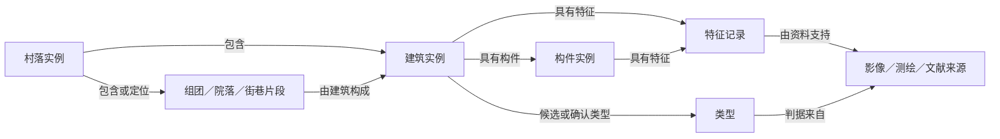

# 景宁畲族传统民居风貌特征提取与知识图谱构建研究

## 第一章 绪论

### 1.1 研究背景

#### 1.1.1 文化遗产数字化保护与传统建筑风貌知识系统化的现实需求

随着我国文化遗产保护工作的持续推进，文化遗产数字化已成为文化资源保护、研究与利用的重要发展方向。2022年，中共中央办公厅、国务院办公厅印发《关于推进实施国家文化数字化战略的意见》，提出统筹利用既有文化数字化成果，关联形成中华文化数据库，推进国家文化大数据体系建设与文化资源共享[11]。《“十四五”文物保护和科技创新规划》提出加强文物数字化保护，建立数字化标准规范体系，健全数据管理和开放共享机制，并将文物知识图谱研究纳入科技创新任务[12]。2026年，财政部办公厅、住房城乡建设部办公厅印发《关于开展传统村落特色保护区建设工作的通知》，将公共传统建筑保护修缮、传统建筑营造技艺传承与数字化保护列为中央财政资金支持内容[13]。相关政策表明，文化遗产数字化保护既重视遗产信息的记录与保存，也关注文化资源的组织、关联及持续利用。

传统民居作为乡土建筑遗产的重要组成部分，其价值不仅体现在建筑实体与外部形态，还包含聚落布局、空间组织、建筑形制、材料构造及营造技艺等多方面信息。这些信息相互联系，共同构成具有地域特点的建筑风貌。传统民居的数字化记录通常涉及影像、测绘图纸、三维模型、历史文献及现场调查等多种资料。不同资料在表现尺度、记录时间与信息内容上存在差异，需要通过统一的对象识别、特征描述与关联规则，形成能够支持比较研究的知识资源。

数字化采集与三维建模为建筑形态的记录和观察提供了技术基础，但形态资料的积累并不直接等同于建筑风貌知识的系统化。如何从多源资料中识别具有建筑学意义的风貌特征，建立不同建筑实例、空间尺度及构件信息之间的联系，并保存相应的判断依据，是传统民居数字化研究需要持续探索的问题。因此，在文化遗产数字化保护背景下，开展传统民居风貌特征的结构化提取与知识组织研究，具有现实意义。

#### 1.1.2 景宁畲族传统民居风貌保护与系统认知的研究需求

景宁畲族自治县位于浙江省丽水市，是全国唯一的畲族自治县。当地传统民居在山地环境适应、聚落空间组织、住宅形制、木构架及装饰等方面形成了丰富的地方建筑实践[1,6,8-10]。这些建筑既是居民生产生活的空间载体，也是研究地方营造传统、地域建筑形式及畲汉文化交流的重要实物资料。

景宁拥有较为丰富的传统村落资源。据2024年2月公开报道，当地共有省级以上传统村落65个，其中国家级传统村落56个；同年，景宁入选浙江省首批传统村落集中连片保护利用试点县，试点范围包括东坑镇北溪村（大张坑村）、桃源村，澄照乡金坵村、漈头村及大漈乡大漈村[15]。2024年12月，景宁融媒报道试点项目已经启动，金坵村正开展传统建筑修缮及周边环境提升，其他试点村落也陆续开工[16]。这些实践体现了传统建筑保护、居住条件改善与村落环境整治相衔接的地方需求。上述数量为报道时点的县域传统村落统计，反映区域保护资源基础，具体建筑的保存与改造状态仍需结合规划、历史记录及现场调查判断。

浙江省住房和城乡建设厅于2025年12月编制发布的《浙江省传统村落保护利用指南》，在传统风貌建筑保护与整治中强调地域性特征、典型构件、体量尺度、乡土材料及有价值构架的保留，并将改善使用功能与保存传统风貌相联系[14]。这类要求使传统民居保护不仅涉及单栋建筑的修缮，还涉及建筑特征的识别及其与周边空间的协调。对既有形式、局部变体和后期改造进行区分，是理解传统民居风貌及其变化的基础。

从建筑学研究来看，已有景宁畲族传统民居研究为认识当地建筑风貌奠定了基础。相关成果涉及山地聚落空间、住宅平面形制、院落布局、木构侧样、屋面构造、地方营造技艺和装饰文化等方面[1,6,8-10]。这些研究从不同角度揭示了景宁传统民居的形态特点及形成条件，提供了具体的调查、测绘和历史资料。

传统民居建筑风貌并非单一建筑要素的集合，而是建筑形态、空间组织及其组合关系的综合表现。同一建筑形制可能出现在不同的组团环境中，相似的屋面和立面形式也可能对应不同的构造或空间组织。因此，在已有研究基础上，仍有必要进一步考察不同建筑实例之间的特征组合关系，以及这些组合在村落、建筑组团和建筑单体三个尺度上的表现与差异。

通过对景宁传统民居开展统一的特征记录和跨实例比较，可以进一步检验既有类型认识的适用范围，辨析共同形式、局部变体及改造形成的差异，为理解当地传统民居建筑风貌及其保护提供更加系统的建筑学依据。

#### 1.1.3 多尺度建筑风貌研究与知识组织方法的发展需求

建筑风貌具有多尺度、多要素及关系复杂的特点。在村落尺度，建筑风貌表现为建筑群与地形环境、街巷系统及整体空间格局的联系；在组团尺度，主要体现为建筑排列、院落围合、体量组合及连续界面的组织方式；在单体尺度，则具体表现为建筑形制、屋顶、立面、材料与构件等特征。不同尺度既具有相对独立的观察对象，又通过空间归属、形态组合与类型关系相互联系。因此，对传统民居风貌的认识不仅需要提取不同层次的形态特征，还需要分析其空间分布及组合关系。

随着数字测绘与信息处理技术的发展，倾斜摄影、三维重建和地面影像采集等方法，为传统村落的多尺度记录提供了技术条件。倾斜摄影能够辅助观察村落整体形态、建筑群体与屋顶组合，地面影像和测绘资料则可补充建筑立面、可见构件及局部构造信息。不同采集方法所获得的数据在尺度、精度和内容上存在差异，将其用于建筑风貌比较研究，需要建立统一的特征分类、对象编码与信息关联机制，使分散的数据能够对应具体建筑实例，并支持跨尺度分析。

多层级数字化资料组织已有实践基础。住房城乡建设部2025年印发的《传统村落保护利用可复制经验清单（第三批）》收录了北京市密云区的数字化保护经验，其数据库按照区域、村落、院落、建筑与构件等层级组织资料，并结合三维实景、地面影像和数据档案建设文化资源平台[17]。这一实践为不同层级建筑资料的组织提供了参照，建筑风貌特征之间的语义关系及其比较分析方式仍需要结合具体研究问题展开。

知识图谱通过实体、属性与关系对知识进行结构化表达，可以将村落、组团、建筑、构件、风貌特征及资料来源联系起来，为特征检索、类型比较、关系查询与来源追溯提供方法选择。对于传统民居风貌研究，其适用价值在于连接具体建筑实例、特征判断与空间组合，使跨尺度比较能够回到明确的对象和资料依据。

基于上述背景，本文以景宁畲族传统民居为研究对象，结合村落整体倾斜摄影、地面影像及既有文献资料，从村落、组团和单体三个尺度开展建筑风貌特征提取，并探索以知识图谱组织建筑实例、形态特征、空间关系及资料来源的方法。在此基础上，通过类型比较、特征关联与跨尺度分析，形成具有资料依据、可检索和可追溯的风貌知识，为景宁畲族传统民居的建筑学研究及数字化保护资料积累提供参考。

### 1.2 研究目的与意义

### 1.2.1 研究目的

本文以浙江省景宁畲族自治县传统民居为研究对象，针对传统民居建筑风貌具有多尺度、多要素及复杂关联关系的特点，结合数字化测绘、建筑类型学与知识图谱等方法，探索从风貌信息采集、特征提取、知识组织到关联分析的研究路径。通过典型村落与建筑实例的比较，系统认识景宁畲族传统民居的风貌特征及其组合关系，并形成具有来源依据、可检索和可追溯的建筑风貌知识资源。

具体研究目的包括以下三个方面。

（1）**识别景宁畲族传统民居的多尺度风貌特征，深化对建筑风貌及其组合关系的认识。**

在既有景宁传统民居研究成果基础上，通过实地调查、数字化采集和文献对照，从村落整体、建筑组团与建筑单体三个尺度建立风貌特征分类体系。识别不同尺度下具有建筑学意义且可比较的风貌特征，分析建筑形制、空间组织及构件特征之间的组合关系。通过不同村落和建筑实例的类型比较，归纳传统民居风貌的共同形式、局部差异及典型变体，进一步检验和补充既有建筑类型与形制认识。

（2）**探索多尺度建筑风貌特征提取与知识图谱构建相结合的研究方法。**

结合倾斜摄影、地面影像、测绘资料及历史文献，建立统一的风貌特征描述、分类与编码规则，将多源资料转化为具有明确对象、属性及来源依据的结构化信息。在此基础上，构建关联村落、组团、建筑、构件、风貌特征和资料来源的知识图谱，探索多尺度风貌知识的组织与表达方式。进一步通过实例检索、类型比较及跨尺度关联分析，检验知识图谱在建筑风貌研究中的适用性，形成从资料采集到知识组织、再到建筑学分析的研究路径。

（3）**建立可追溯、可持续补充的建筑风貌知识资源，为传统民居保护研究提供基础。**

通过建筑实例、风貌特征、空间归属及资料来源之间的关联，形成具有统一记录规则的景宁畲族传统民居风貌知识资源。保留不同实例的特征取值、分类依据、改造状态和资料记录时间，使风貌分析结果能够对应具体建筑及原始证据。探索知识图谱在后续样本补充、类型对照和资料更新中的使用方式，为景宁传统民居的持续调查、风貌识别和数字化保护研究提供参考。

### 1.2.2 建筑学研究与方法探索意义

**（1）深化对景宁畲族传统民居建筑风貌特征及其组合关系的认识。**

已有景宁畲族传统民居研究对聚落空间、住宅形制、木构侧样、营造技艺及装饰文化等方面进行了调查与分析，为认识当地传统建筑提供了重要基础。本文在此基础上，将村落、组团与单体纳入统一的风貌分析框架，关注不同尺度之间的空间联系，以及建筑形态与构件特征在具体实例中的组合方式。通过具有统一判据的类型比较与特征关联分析，检验已有类型认识在不同实例中的适用范围，辨析共同形式、局部变体与改造差异，为理解景宁畲族传统民居建筑风貌的整体构成提供补充。

**（2）探索知识图谱支持建筑风貌特征研究的系统化方法。**

传统民居风貌研究涉及建筑实例、空间位置、类型特征、构件信息及历史资料等多种对象，其研究过程不仅需要对单项特征进行分类，还需要分析不同特征及空间层级之间的联系。本文尝试将建筑类型学的特征分类与比较方法，同知识图谱的实体、属性及关系表达方式相结合，建立从多尺度特征提取、结构化编码到关系建模和实例分析的研究流程。

通过知识图谱组织建筑风貌信息，可以在统一的知识结构下开展特征组合、类型分布及跨尺度联系的分析，并依据具体实例和资料来源对分析结果进行复核。本文将结合实际分析任务，检验这一方法在风貌特征组织、关系查询及证据追溯中的作用，探讨其适用条件和局限，为传统民居建筑风貌研究提供一种可供参考的方法路径。

### 1.2.3 风貌知识积累及遗产数字化保护的实践意义

**（1）促进景宁畲族传统民居风貌资料的系统化整理与知识积累。**

传统民居的影像、测绘、文献和调查记录具有不同的信息特点。本文通过统一对象编号、风貌特征分类和资料关联规则，将分散的建筑资料组织为相互关联的知识资源，使不同村落、组团及建筑实例的风貌信息能够进行检索、比较与追溯。通过保留建筑身份、资料来源、记录时间及改造状态，增强风貌知识记录的可核查性与可补充性，为后续调查和相关研究提供较为系统的基础资料。

**（2）为传统民居风貌识别与数字化保护研究提供参考。**

通过对景宁传统民居风貌特征及其组合关系的整理与分析，本文拟形成建筑类型、典型特征、空间分布及实例差异等方面的研究成果，为传统建筑调查建档、风貌识别、类型对照及保护研究提供依据。知识图谱可将相关判断与具体建筑实例及原始资料联系起来，便于后续研究者核查、补充和修订已有认识。

同时，本文探索的多尺度特征记录与知识组织方法，可为具有类似资料条件的地域传统民居调查提供参考。其推广价值需要结合不同地区的建筑特点、样本规模及数据条件进一步检验。

### 1.3 相关概念界定

本文从研究对象、风貌观察层次和知识组织方式三个方面界定相关概念，以明确样本纳入、特征提取及分析的范围。

#### 1.3.1 景宁畲族传统民居的研究对象与界定范围

本文以景宁调查范围内的传统居住建筑为主要研究对象，综合建筑年代、居住用途、传统营造方式及文献记录核查其身份。畲族村落的地域归属、住户身份与建筑做法的民族属性分别记录；建筑位于畲族村落，并不意味着其全部形式与构造具有民族专属性。公共建筑作为村落环境及空间节点的背景资料，不计入住宅类型的统计。身份尚不明确或经过明显改造的建筑保留相应状态，按具体分析任务确定其使用范围。

#### 1.3.2 建筑风貌、风貌特征与多尺度分析单元

本文所称建筑风貌，是空间组织、建筑形态、构件、材料、色彩及其组合关系的可观察表现；文化意义与历史成因属于解释层面，需要相应文献或调查证据支持。村落整体、建筑组团和建筑单体构成三级分析单元。组团依据院落、建筑邻接或街巷界面等空间关系划定，构件作为单体内部的特征层。各尺度的分析深度由资料覆盖与样本条件决定。

#### 1.3.3 知识图谱及其与建筑风貌图谱的区别与联系

知识图谱是以实体、属性和关系组织知识的结构，本文通过建筑实例、特征记录、分类类型及资料来源的关联，支持关系检索和来源追溯。建筑风貌图谱则侧重空间、形态、类型及其关系的建筑学图示表达。两者在本文中分别承担知识组织与分析表达的作用：知识图谱保存可查询的对象关系，风貌图示呈现类型比较及空间分析结果。

### 1.4 国内外相关研究现状

相关研究从传统民居风貌与类型、景宁民居及聚落、建筑数字化与知识组织三个方面展开梳理。综述关注各类研究的对象尺度、资料基础、分类依据及分析方法，并据此讨论本文的研究问题与方法选择。

#### 1.4.1 传统民居建筑风貌特征与类型研究

传统民居风貌特征与类型研究涉及住宅空间形制、建筑构件、材料和装饰等内容。本文关注不同研究如何建立分类判据，如何处理典型形式与变体，以及如何将特征组合与形成条件联系起来。区域风貌图谱研究还为形态、类型及空间关系的图示表达提供了比较方向。相关方法的适用性需要结合研究地区、样本尺度及资料条件进行讨论。

<!-- 本节尚未形成完整综述；具体文献、分类判据与结论须据原文补充。康巴论文目前仅有目录依据，不能据此补写其方法与结果。 -->

#### 1.4.2 景宁畲族传统民居建筑形制、营造技艺及聚落研究

景宁畲族传统民居及村落研究主要围绕山地聚落环境、住宅空间形制、地方营造技艺和文化装饰展开，调查、测绘与访谈构成其重要资料基础。较早的研究题录中已见段然《景宁畲族传统村落与建筑文化的研究与开发》，该题录可由赵圣洁论文的参考文献核对（转引自文献[1]）。相关成果分别从村落空间、建筑构成和营造过程等层面推进了对景宁民居的认识，并为讨论其共同特征、内部差异及形成条件提供了依据。

**1）景宁畲族传统村落空间形态研究**

山地环境与聚落空间的关系是景宁传统村落研究的重要线索。汪梅从坡地、水源和住宅空间入手，讨论顺坡布置、前后出入口、院落、厨房与排水的联系[2]。赵圣洁以东弄村为对象，将自然环境、聚落内外空间和典型住宅测绘相结合，分析溪流、道路、台地与建筑布局的关系[1]。这些研究将地形适应从地域背景转化为具体的建筑空间问题，提示村落风貌需要通过建筑落位、入口方向、院落高差及道路连接等关系加以理解。

村落空间还通过居住与公共活动获得不同的组织方式。柴一涵以传统村落和少数民族村寨名录的交集确定12个研究村落，归纳团状集中、带状密集和辐射分散三类空间形态，并以周湖、东弄、岗石进行典型分析；其公共文化空间研究进一步联系了设施节点、文化活动及参与者[3]。潘钊则将村落环境、居民生活和保护发展需求共同纳入规划讨论[4]。两者分别从形态与使用、保护与发展出发，扩展了对村落整体风貌的认识，但总体形态分类、公共活动联系与住宅组团的组成关系仍是不同的分析对象。

相关研究也已尝试以景观分类和图谱组织村落知识。根据方一珊对宋晓青等《乡村景观营建与文化传承研究：以景宁地区畲族传统村落为例》的评介，该书将建筑、选址布局与环境纳入景观基因分析，涉及要素识别、分类编码、信息库和图谱构建[5]。这一公开评介表明，景宁村落研究已存在整体要素组织的相关成果，不能将建筑特征分类或图谱表达本身视为尚无人涉及的任务。其具体分类规则、实例覆盖与关系表达方式仍需依据专著原文进一步辨析。

总体而言，已有研究从地形适应、空间布局和活动节点等方面提供了村落风貌认识，并在个案中联系住宅空间。进一步比较可关注同类聚落内部住宅组合的差异，以及临溪、临路和不同台地位置与建筑入口、院落、屋面之间的联系。对院落组合、相邻住宅及街巷界面的分析，应区分可见的空间邻接、共享空间和住户关系，不能仅由聚落轮廓推定建筑组团的社会或产权边界。

**2）景宁畲族传统民居建筑形制与构件特征研究**

建筑形制研究已经形成平面、院落、屋面、材料和装饰等方面的描述。汪梅记录“五柱三间两进”、横向扩展与排屋空间，王文辉以大张坑为中心讨论“四架三间”和“一字形竹筒寮”，潘钊整理住宅类型、空间与构件装饰[2,6-7]。这些成果说明景宁住宅包含多种空间组织方式，而非单一形态。不同文献采用的柱、架、间、进以及住宅俗称涉及不同观察口径，建立类型比较时需要明确它们分别描述构架、开间、进深还是院落组合。

单体测绘使形制认识进一步进入空间与构造的联系。赵圣洁对蓝坤宝寮的分析将院落、厅堂、廊道、房间与高低屋面放在平面、立面和剖面中共同讨论[1]。汪梅对排屋的记录则将横向相连的住宅、贯通廊道及二层空间联系到家族居住和交往[2]。两类材料分别呈现单体内部组织与相邻住宅组合，说明体量、屋面和界面特征需要结合空间使用理解；深入测绘的个案仍须与其他规模、年代及改造状态的住宅比较，才能判断其代表性。

材料与装饰研究补充了外观及构件尺度的认识。汪梅介绍素木、黑瓦及重点木构件的雕饰，潘钊从土木构造、院落和厅堂组织讨论建筑文化，使材料色彩与空间、构件共同进入形态描述[2,7]。蓝法勤则对卷草凤凰纹进行构成与变体分析，并联系其所在梁、门楼及厅堂位置讨论地方称谓和文化意义[8]。这使装饰比较由图案名称扩展到纹样构成、承载构件及使用空间之间的关系。畲汉居民对相近纹样的不同称谓，也提示可见形态与文化认同需要分别记录，不能直接以单个符号认定民族专属性[8]。

保护更新研究提供了形制变化的时间线索。王文辉记录大张坑住宅外墙、檐篷、门窗及使用空间的改造，揭示生活改善与外观趋同之间的张力[6]。对于风貌研究，这类材料的主要作用是帮助区分原有构造、修缮替换和当代展示，识别同一建筑在不同记录时点的变化。已有文献因此既可作为特征提取依据，也可作为历史对照，不能将调查期的形态和数量直接视为当前状态。

**3）景宁畲族传统民居营造技艺及其风貌表现研究**

营造技艺研究将建筑形态与形成过程联系起来。赵潇诺的学位论文以文化、匠意和匠技组织研究，结合匠师访谈、营造手稿和构造比较，讨论地盘、侧样、取尺、屋水及榫卯操作[9]。其中，地盘和侧样分别关联平面组织与木构架侧向形态，取尺和屋水则涉及尺寸及屋架斜率的营造规则。这些成果记录了地方知识参与建筑形成的具体方式，使风貌解释能够进入构架、尺寸和工序层面。

赵潇诺、佟士枢和何礼平的木构侧样研究进一步以院墙承重、后厨天井、柱筒组合及屋面分层辨析形制变化[10]。作者认为所调查构架的前架较稳定，变化多从后廊柱开始，通过增减柱与直筒、柱筒转化及屋面调整处理进深、材料和使用条件。这里的直筒按作者注释指不落地柱，与柱分别计数。这一研究的重要认识是，侧样差异可以被理解为相互组合的构造调整，而不只是若干固定类型的并列；后廊、后厨、院墙和屋面因此成为连接空间形制与营造规则的关键部位。

作者结合实测、匠师手稿与营造典籍推定原型，并通过邻近地区比较讨论技艺联系[9-10]。原型推定与实物类型分布所回答的问题不同，宜作为后续实例比较的参照，而不直接等同于所有住宅的共同历史起点。相似构架和功能可以提示地域联系，但传播方向、年代及实际环境效果，还需要相应的历史或测量证据。

王文辉对择基、起梁、砌灶和乔迁等过程的记录，则补充了营造活动与家庭生活、仪式选择之间的联系[6]。综合这些成果，营造技艺既可解释木构和空间形成，也包含不同主体对建筑的理解。后续风貌分析应将构造观察、操作规则及文化解释分层使用，比较它们如何在具体住宅中共同呈现，而不以一般文化叙述代替形态形成的证据。

**4）景宁畲族传统民居建筑风貌研究评述**

现有研究已将景宁民居认识从地域文化与住宅特色的描述，推进到聚落空间、单体测绘、木构变体和营造规则等多个层面。其共同贡献是揭示建筑与山地环境、居住组织、地方工艺及文化表达之间的联系，并提供可继续核查的具体空间和构件资料。由此，景宁畲族传统民居风貌更适合被理解为多种条件在不同实例中的组合结果，民族文化的作用需要在地域共享形式和内部差异中辨析。

在村落整体层面，地形适应、布局类型及空间节点已有较明确的讨论；在建筑单体层面，平面、屋面、构架、材料与装饰也有测绘和分类成果。院落、排屋及共享空间研究提供了建筑组团的个案线索，部分文献已联系村落环境、住宅空间与构架。因此，后续研究不应以“首次开展多尺度研究”或“此前缺乏系统分类”为预设创新，而应检验既有认识在不同实例和尺度中的适用范围。

进一步研究可聚焦于一个建筑学问题：**景宁传统民居的空间、屋面及构件特征，在不同村落和组团位置中如何组合，并形成怎样的共同形式与局部差异？** 具体可比较相似外观是否对应不同构架或使用组织，院落、排屋及街巷片段如何连接单体形制，以及修缮和用途变化如何改变这些组合。对这一问题的判断，需要可比较的特征口径及明确的对象、时间和来源，才能辨认共同形式、局部变体与不符合既有解释的实例。

宋晓青等研究的公开评介已经提示相关分类与图谱成果的存在，应进一步将其具体指标、实例覆盖、尺度关系及分析任务与本文逐项对照[5]。在当前材料范围内，上述问题属于候选深化方向，尚不能确认为领域空白。本文拟在既有建筑学认识基础上，围绕村落、组团和单体之间的特征组合及关系展开比较。知识图谱可作为组织实例、特征、空间归属和证据的候选方法；本节的作用是明确需要组织和分析的建筑风貌知识。其与已有景观图谱的区别及实际分析价值，仍须在1.4.3的方法研究和后续实证分析中论证。

#### 1.4.3 文化遗产数字化、建筑信息组织与知识图谱应用研究

文化遗产数字化与建筑信息组织涉及多源资料采集、特征结构化、实体关系建模及知识利用等环节。本文从资料采集与模型表达、风貌特征组织、知识图谱及来源关联三个方面考察相关方法，重点比较其对数据可见性、几何精度、资料更新与来源追溯的处理方式。数字模型提供建筑形态信息，数据库承担记录存储，知识图谱侧重对象及知识之间的关系表达；三者的功能与适用条件构成方法比较的基础。

<!-- 本节尚未形成完整综述；汤茗喆、郭锐等文献的具体方法和适用边界须核读原文后补充引用。 -->

#### 1.4.4 相关研究评述与本研究的切入点

既有景宁研究已提供村落空间、住宅形制、构件及营造规则等方面的认识。本文拟在此基础上，考察空间、屋面与构件特征在不同建筑实例及组团位置中的组合方式，并比较这些组合在不同村落中的共同形式与局部差异。知识图谱用于关联建筑实例、空间归属、特征取值和资料来源，其研究价值将通过实例比较、关系查询与证据回查加以检验。本文的切入点是既有认识在不同实例和尺度中的适用性及其进一步细化，研究增量由文献对照与实证分析共同确定。

### 1.5 研究问题、内容与方法

本文围绕多尺度建筑风貌特征及其组合关系开展研究，将资料采集、特征编码、知识图谱构建与建筑学分析相衔接。

#### 1.5.1 研究问题

本文的核心问题是如何将景宁传统民居的多尺度风貌信息组织为可追溯的知识图谱，并据此形成具有证据支持的风貌认识。具体考察可可靠提取的对象与特征，建筑、构件、类型及空间归属的知识表达，图谱对类型比较和跨尺度分析的支持，以及所得认识与既有景宁研究的关系。

#### 1.5.2 研究内容

研究内容包括三个主要环节。首先，通过文献对照与现场调查确定样本及其资料基础，形成多尺度数字化记录。其次，建立风貌特征的分类与编码规则，定义实体、属性及关系，构建可查询的基础知识图谱。最后，围绕类型、特征组合及跨尺度联系开展实例比较，并依据分析结果修订分类与关系。研究成果包括具有来源依据的风貌知识资源及建立在有效样本之上的建筑学认识。

#### 1.5.3 研究方法

本文拟采用文献研究、田野调查、倾斜摄影与地面影像采集、必要量测、建筑类型学、特征分类编码、知识建模及实例比较等方法。定量分析使用具有可靠尺度依据的参数，并明确有效样本数；定性分析采用统一类别与判读规则。图像辅助标注作为可选的数据处理方式，其采用与否由小规模测试中的识别质量、人工修正时间及总体工作量确定。

### 1.6 研究技术路线

研究首先进行文献对照与对象界定，通过试调查确定村落、组团与单体的观察单元及采集条件；随后开展空地影像采集、资料核验和特征编码，建立实体、属性与关系模型，并将样本记录转化为基础知识图谱；在此基础上，通过图谱查询、类型比较及跨尺度分析形成风貌认识。分析中的分类歧义、来源冲突与反例将反馈至资料核查和图谱修订环节，构成调查、知识组织与分析之间的迭代过程。

## 第二章 景宁畲族传统民居建筑风貌现状调研

### 2.1 研究范围与对象

本文拟以景宁县域为地理背景，从具有文献、影像或测绘资料的传统民居村落中选择调查对象。研究范围的确定兼顾建筑身份、资料时点、保存状态和现场可采集条件，使样本选择与后续比较的适用范围相对应。

#### 2.1.1 景宁县域及传统民居分布概况

东弄、敕木山、桃源、大张坑和周湖具有建筑调查、照片、图纸或构架研究等资料线索，是本研究的候选调查村落。景宁县域用于说明地域背景，正式调查范围则由候选资料核查与试调查确定。各村资料覆盖程度存在差异，研究将分别记录文献调查范围和本次实际覆盖范围。

#### 2.1.2 研究对象与调查范围的确定

样本筛选依据传统居住用途、历史记录、结构形制、保存状态及资料获取条件进行。调查记录包括历史编号、位置、当前用途、结构与改造情况，并区分现存建筑、历史文献记录及改建对照实例。正式样本及各项分析的有效子集由现场核查结果确定，历史统计作为资料线索单独保留。

#### 2.1.3 村落整体—建筑组团—建筑单体的调查尺度

村落尺度记录边界、街巷、建筑分布、地形及屋顶群体；组团尺度以具有可辨识空间关系的院落、相邻宅院或连续街巷片段为单元；单体尺度记录建筑形制、屋面、立面及可见构件。组团边界依据平面、邻接和现场界面判定。无法确定组团归属的建筑直接关联所在村落，并记录归属状态；家族与营造关系另以历史或访谈资料说明。

### 2.3 传统民居分布与调查样本选取

样本选择综合考虑建筑类型、空间位置、保存与改造状态及资料可获得性。村落、组团与单体分别记录调查数量，并按具体比较任务统计有效样本，以体现不同层次的数据覆盖。

#### 2.3.1 候选村落与传统民居的分布及资料核查

候选村落的资料基础包括东弄的建筑编号调查与蓝坤宝寮图纸、敕木山的住宅及装饰资料、桃源的建筑与构件照片、大张坑的专题调查，以及周湖的侧样与住宅图纸。本文拟将这些线索与现场位置、建筑身份和保存状态逐项对应。不同年份、不同口径的村级统计、调查编号与个案资料分别记录，用于确定核查对象及资料补充方向。

#### 2.3.2 村落、建筑组团与单体样本的分层选取

研究拟按村落位置、地形条件、风貌保存状态、类型差异及调查可达性进行分层选取。试调查用于检验组团划界、外部构件可见性和采集工作量，并据此确定正式样本。单体调查区分基本记录与深入复核两个层次，类型边界不清或经过改造的实例作为必要对照，以检验分类的适用范围。

#### 2.3.3 样本建筑的年代、身份与改造状态记录

每栋建筑记录身份及依据、现状用途、资料日期、可判断的年代范围、保存与改造部位，以及既有图纸或照片。现状观察、访谈判断和历史记录分别标注，例如现状材料、可能的后期替换和具有文献依据的历史做法具有不同的证据性质。无法确定的内容保留未知状态，分析时按改造程度与资料可靠性进行区分。

### 2.2 研究区域的自然、人文与聚落环境

自然地形、聚居历史与居住组织构成建筑风貌的地域背景。本文将环境信息与具体建筑实例关联，作为比较空间位置、形态及特征差异的条件；对特征形成原因的讨论则结合专门的历史、营造或使用资料展开。

#### 2.2.1 自然地理、山地地形与气候条件

自然环境调查拟结合公开地形、遥感与现场资料，记录坡地、谷地、台地等地形条件，以及住宅与高差、道路系统的空间关系。航拍影像用于识别可见空间组织，坡度、高程差和建筑间距等参数采用经尺度核验的几何资料。气候条件与屋面或构造的关系在具备可比较数据和实例证据时纳入讨论。

#### 2.2.2 地域历史、民族文化与民居营造背景

地域与人文资料包括景宁聚居历史、畲族居住文化、地方营造传统及具体村落的居住组织。既有研究中的一字形、院落式、长间、檐廊、侧样及屋面变化等认识，为调查提供对照[1,9-10]。文化意义与营造工艺分别记录其文献或访谈依据，以辨析地域共享形式、实例差异和民族文化表达。

#### 2.2.3 聚落空间形态与传统民居保存现状

聚落调查拟记录街巷、台地、院落、公共节点与传统住宅群体的空间关系，以及传统建筑与新建、改造建筑混合的现状。村落轮廓、屋顶群体与连续界面由航拍和地面影像共同记录。保存状态按具体建筑、资料日期及改造部位描述，为后续识别现状变化对风貌判断的影响提供依据。

### 2.4 多尺度风貌调查与数字化资料采集

数字化采集拟以村落整体倾斜摄影为基础，结合地面多视角影像与必要实测，分别满足村落空间、组团关系和单体细部的观察需求。采集范围与模型精度依据目标风貌特征确定，形成从整体空间到局部构件相互补充的资料体系。

#### 2.4.1 调查方案、时间与路线

调查路线拟结合航拍条件、街巷遮挡及建筑可进入性安排，采用统一拍摄清单记录采集时间、天气、设备、航线和影像用途。文献中具名建筑的现场对应单独核查，未能定位的对象保留核查记录。调查时间、路线及设备参数将在实际采集后列明。

#### 2.4.2 村落整体倾斜摄影与空间资料采集

村落整体倾斜摄影用于获取建筑群、屋面、街巷及空间分布的三维资料，并依据实际几何质量生成俯瞰或正射视图。建筑密集、树木遮挡及地形高差可能影响重建完整性。空间形态的定性判读与尺寸量测分别确定资料要求，坡度、高度和间距等数值在尺度与几何质量核验后使用。

#### 2.4.3 建筑组团、院落和街巷界面的补充调查

组团补充调查拟记录相邻建筑端部、连续立面、屋脊方向和高差衔接，建立空间组合与组成建筑之间的对应。组团编号同时记录划界依据及建筑清单。边界不稳定的区域采用院落或街巷片段作为观察单元，保留其空间范围与判定理由。

#### 2.4.4 建筑单体外观、可见构件与必要量测

单体调查拟记录整体形制、层数、屋顶、山墙、立面分段、门窗、檐廊、台基、可见构造、材料与色彩。屋面坡度、出檐、窗墙比和开口尺寸等参数采用实测或具有可靠尺度的图像资料。既有平面、剖面和侧样图纸用于相应个案的内部空间及构架对照，内部信息的覆盖范围按实例记录。

### 2.5 调研资料整理与证据质量控制

资料整理以对象编号、记录时点和文件版本为基础，将原始影像、测绘图纸、三维模型与特征记录相互关联。各类数据按完整性与几何可靠性确定用途，为特征提取和知识图谱构建提供可追溯的输入。

#### 2.5.1 三维模型、正射视图与影像资料整理

原始空地影像、三维模型、点云及派生视图按村落和采集批次整理，记录软件、版本及几何基准。模型视图用于统一观察角度；满足正射和尺度要求的视图用于相应量测。窄巷、檐下、墙角及树木遮挡部位记录补拍情况或不可见状态，以明确模型资料的覆盖范围。

#### 2.5.2 调查对象统一编号与原始资料关联

对象索引包括村落、组团、建筑、构件与资料来源的独立编号，并保留与既有文献编号的对应。建筑实例、构件实例与构件类型分别组织，例如同一建筑中的多个窗具有各自编号，并可归属于同一窗型。来源记录包括作者或采集者、日期、照片编号、图纸页码、模型视图及判读状态，以支持特征复查。

#### 2.5.3 数据完整性、精度及有效样本核查

数据质量核查包括目标部位覆盖、影像清晰度、几何可靠性、属性可判读性及历史依据。不可见、未采集、不适用、无法分型、证据冲突和确认不存在分别编码。各指标按有效村落、组团或建筑报告分析数量，关键几何值进行抽查。缺失程度较高的指标根据资料条件调整为定性观察或暂不纳入比较。

### 2.6 本章小结

本章拟通过研究范围界定、分层选样和多尺度资料采集，建立具有对象身份、空间归属、来源信息及质量状态的样本记录。资料覆盖与量测可靠性将作为特征筛选、取值及图谱实例化的基础条件。

## 第三章 景宁畲族传统民居风貌特征提取与知识图谱构建

### 3.1 多尺度建筑风貌特征提取体系

风貌特征体系拟结合既有建筑研究与试调查建立，围绕类型比较、空间组合及来源追溯选择观察内容。指标同时考虑建筑学意义、可观察性与跨实例可比性，使特征记录能够支持后续知识组织和分析。

#### 3.1.1 风貌特征提取的依据与指标筛选原则

指标筛选依据建筑学意义、跨样本可比性、现场可见性、资料可靠性与采集成本进行。屋顶、腰檐、立面门窗、石基、土墙、板壁及装饰部位等作为候选观察内容，文化寓意与内部构架另设证据要求。分类判据与用于检验类型差异的指标分别定义，以保持类型划分和比较分析之间的独立性。

#### 3.1.2 村落—组团—单体三级风貌特征体系

特征体系以村落、组团和单体为三级框架，初步设置村落7项、组团7项和单体18项候选指标，共32项，后续依据试调查调整。村落层面关注地形选址、总体形态、建筑分布、街巷、屋顶群体及空间节点；组团层面关注边界、排列、院落、体量与屋顶组合及街巷界面；单体层面关注形制、屋顶、立面、门窗、檐廊、台基、材料、色彩及可见构造。跨尺度关系作为派生分析任务组织，不计入上述32项。

**三级尺度候选指标及资料依据**

| 尺度 | 候选指标范围 | 核心字段示例 | 主要证据 |
| --- | --- | --- | --- |
| 村落 V01—V07 | 地形选址、总体形态、建筑分布、街巷结构、屋顶群体、公共节点、自然环境关系 | 聚落边界、街巷组织、屋脊方向、建筑分布 | 航拍、正射、地形与现场核查 |
| 组团 G01—G07 | 组团边界、建筑排列、院落及开敞空间、朝向间距、体量屋顶组合、连续界面、地形高差 | 构成建筑、邻接关系、围合方式、界面连续性 | 村落模型、地面补拍、必要量测 |
| 单体 B01—B18 | 整体形制、层数体量、几何尺度、屋顶及檐部、山墙、立面、门窗、附加空间、台基、材料、装饰、色彩及可见构造 | 屋顶类型、腰檐、门窗排列、材料与部位、构件形式 | 单体影像、图纸、局部实测及文献 |
| 跨尺度 R01—R05（候选） | 对象归属、单体类型分布、组团组合、村落差异和证据关联等分析任务 | 关系查询与派生比较，非额外五个强制实测字段 | 上述编号和关联资料 |

注：跨尺度R项为派生查询与比较任务。各项正式定义及编码字典将根据试调查建立。

#### 3.1.3 特征判读、取值、分类与编码规则

特征字典包括对象层级、构件部位、观察方法、类别或数值类型、单位、判读示例、未知状态、证据依据与版本。长间、侧样、腰檐等地方术语保留原称谓，并结合图示说明操作性定义。形态位置等可见事实与文化寓意等解释性信息分别记录，混合、变体、改造和无法判断的实例保留独立状态。

### 3.2 多尺度建筑风貌特征提取

特征提取以统一编号连接各尺度记录。每条记录包含对象编号、特征代码、取值、来源及判读状态，构件记录同时关联所属建筑与具体部位，以支持后续查询和实例比较。

#### 3.2.1 村落整体的空间形态、街巷与建筑分布特征提取

村落特征拟从底图、航拍影像及三维视图中提取，包括聚落边界、建筑群分布、街巷形态、屋脊方向、公共节点及自然环境关系。不同村落采用一致的边界与建筑认定规则，传统民居分布依据身份核查结果标注。村落记录与空间定位图共同构成整体风貌比较的资料基础。

#### 3.2.2 建筑组团的排列、围合、体量及界面特征提取

组团特征拟以院落、建筑组团或连续街巷片段为单元，记录排列、围合、朝向、间距、体量高差、屋顶组合及界面连续性。几何邻接、院落归属与历史家族关系分别记录其依据。组成建筑的编号用于连接组团与单体资料，使同一单体形式能够在不同空间组合中进行比较。

#### 3.2.3 建筑单体的形制、屋顶、立面、材料与细部特征提取

单体特征拟包括整体形制、层数与轮廓、屋顶与山墙、檐口和腰檐、立面分段、门窗排列、檐廊与台基、表面材料及细部装饰。双坡与悬山屋顶、后侧屋面变化、石基土墙板壁组合及卷草凤凰纹位置等文献线索用于指导观察，具体取值依据建筑实例确定。内部平面、构架和营造工艺在具备可靠图纸、入户测绘或访谈资料的实例中补充记录。

#### 3.2.4 多尺度特征记录、结构化整理与初步校核

多尺度特征表按统一编号整理，并关联原始影像、模型局部、文献页码及判读者信息。初步校核包括类别重复、单位冲突、构件重复计数与缺失状态。图像辅助标注以人工判读作为核对依据，记录识别错误与修正时间。数据转换采用包含事实、来源及状态的完整记录，以减少错误在图谱中的传播。

### 3.3 建筑风貌知识图谱的知识组织模型

知识组织模型围绕实例定位、特征检索、类型比较和来源追溯等分析任务建立。模型表达建筑的空间归属、特征取值、分类依据及资料支持，并记录历史时点、未知信息与修订状态。

#### 3.3.1 建筑风貌知识组织单元与层级结构

知识组织单元包括村落、组团或院落与街巷片段、建筑实例、构件实例、特征记录、分类类型及资料来源。村落与建筑作为具名对象，建筑类型与构件类型作为概念类别，特征取值关联其实际观察层级。构件实例与类型分别建模，以表达同类构件在不同建筑中的分布。

#### 3.3.2 风貌实体、属性及关系类型定义

实体类别拟包括村落、组团、建筑、构件、特征、类型与来源，属性记录身份编号、位置、年代、改造状态、特征代码、取值、单位及资料时点。关系包括空间归属、组成、具有特征、类型归属、资料支持和空间邻接等。形态与空间关系依据可核查资料建立，文化影响等解释性关系则以专门历史或调查证据为依据。

**拟采用的实体关系结构**

模型保留组团归属不确定、类型暂定及改造时点等状态，并将相关判断关联至资料来源。

#### 3.3.3 多尺度空间归属、类型与特征关联模型

多尺度关联模型以空间归属和组成关系连接村落、组团、单体与构件，再通过类型及特征关系支持横向比较。模型拟明确各关系的方向、数量约束与例外，允许组团边界重叠或归属不确定的情况。建筑关联所在村落，组团关系依据实际划界结果建立；跨尺度派生关系按具体查询任务定义。

#### 3.3.4 实例证据、数据来源及状态信息的关联规则

关键特征与类型归属关联来源编号、采集或发表时点、判读状态及修订版本。现状观察、历史记录与推断信息分别保存，以表达材料替换或形态改变前后的差异。来源包括照片、经核验的模型视图、测量记录、图纸及文献页码，形成从知识记录返回建筑证据的关联链。

### 3.4 建筑风貌知识图谱构建

知识图谱构建拟将经校核的特征记录映射为实体、属性及关系，形成支持检索的基础图谱。构建阶段通过查询检查数据覆盖与初步关联，后续类型和跨尺度分析进一步检验其建筑学意义。

#### 3.4.1 风貌特征数据映射与结构化转换

结构化转换拟建立原始字段与图谱实体、属性、关系的映射表。建筑编号对应建筑实体，组团编号对应空间归属，屋顶形式对应特征记录，照片编号对应资料支持关系。转换过程统一数据类型、单位与枚举值，并检查编号冲突、来源缺失、分类不一致及时间信息。实现方式从成熟图数据库、RDF或其他支持关联查询的结构中，根据分析任务和工作量选择。

#### 3.4.2 多尺度风貌知识图谱实例化构建

图谱实例化拟按资料核验进度分批导入村落、组团、建筑、主要构件、特征记录、候选类型及资料来源。实例链连接村落位置、组成建筑、局部特征与原始记录，支持逐级查看和来源回查。暂定分类、材料更新及来源冲突保留状态标识。节点、关系数量与有效实例覆盖用于说明构建范围，质量评价同时结合数据可靠性与任务完成情况。

#### 3.4.3 实例查询、关系检索与初步关联发现

图谱查询拟包括按特征检索实例、按建筑查找构件及来源、比较同类建筑在不同组团中的分布，以及检索特征共现、混合与例外实例。查询结果经重复、遗漏、有效样本及资料时点核查后，作为进一步分析的输入。图谱应用重点考察跨对象、多关系与来源追溯任务，单字段统计则与常规特征表相衔接。

### 3.5 知识图谱的数据校核与可用性检验

图谱质量检验包括记录真实性、结构一致性与查询可用性三个方面。原始证据核查用于确认取值依据，关系检查用于确认对象对应，任务测试用于评价查询结果与研究需求的一致性。

#### 3.5.1 实体对应、关系一致性与缺失信息检查

一致性检查拟核查建筑重复建点、构件归属、空间邻接依据、类型与特征冲突等情况。具有多时点资料的实例保留各来源及其尚未解决的差异。缺失、归属不确定与确认不存在分别处理，抽检范围依据正式样本规模及疑难记录分布确定。

#### 3.5.2 图谱节点、关系及特征取值的来源追溯

来源追溯拟选取典型、改造、混合及疑难实例，沿查询结果、建筑或构件、特征取值、原始资料的顺序逐级回查，核对单位、时点及判读依据。实体和关系的修改保存原因与证据。复核结果按自检或独立复核的实际条件报告，以明确质量评价的依据。

#### 3.5.3 图谱查询任务与后续风貌分析的适用性检验

可用性检验拟设置连接空间尺度、特征与来源的完整任务，考察查询结果、实例对应及资料返回的准确性与完整性。在条件允许时，以同一批样本与常规特征矩阵或人工检索进行比较，记录操作步骤、遗漏和纠错时间。检验结果用于界定图谱适用任务及数据条件。

### 3.6 本章小结

本章拟建立与试调查结果相适应的特征字典、记录矩阵和实体关系模型，并通过真实样本实例化形成基础知识图谱。数据校核与查询测试为后续风貌比较提供依据，未确认类型和证据冲突作为进一步分析的对象保留。

## 第四章 基于知识图谱的景宁畲族传统民居风貌特征分析

### 4.1 基于知识图谱的风貌分析方法与任务

风貌分析拟利用图谱中的类型、特征及空间归属关系，比较景宁传统民居在不同尺度中的形式与组合。分析围绕建筑学问题选择查询、分组及空间并置方法，并以原始资料回查检验比较结果。

#### 4.1.1 风貌特征查询、组合比较与关联分析方法

关系查询拟围绕同类住宅的共同特征、屋顶或檐廊组合的空间分布，以及单体类型在不同街巷界面中的组合展开。查询结果组织为类型与特征矩阵、频数或比例表、空间分布图及带来源的实例对照图。特征共现与候选分类进一步通过实例比较和反例检验分析其稳定性。

**拟开展的分析任务及数据条件**

| 任务 | 最小数据条件 | 研究输出 |
| --- | --- | --- |
| 按屋顶／檐廊特征检索单体 | 可靠特征编码、建筑ID、来源ID | 带证据的实例集及特征频数 |
| 某类单体在不同组团中的表现 | 单体类型判据、组团归属、排列／界面关系 | 同类单体的组团差异及例外 |
| 组团在不同村落中的组合 | 组团界定规则、村落定位、有效组团数 | 样本村落间的空间组合比较 |
| 从分析结论追溯至资料 | 实例—特征—来源链、资料时间与状态 | 可核查的判读依据及修订记录 |

#### 4.1.2 不同尺度的分析单元、指标与比较口径

村落比较以有效村落为单位，组团比较以具有明确边界的院落或街巷片段为单位，单体比较以有效建筑为单位。构件频次与建筑频次分别统计，每项分析记录有效样本数及缺失情况。分类判据与独立比较指标分开使用；资料覆盖不足以支持总体推断时，分析限定为样本间的描述性比较。

#### 4.1.3 研究结论的证据追溯与可信度判定

研究判断的可信度拟从取值规则、实例可比性、典型与反例、来源时点及文献对照等方面评价。特征共现作为描述性关系，历史或文化成因的解释另以相应历史、口述或跨地区资料支持。采样范围、模型精度与改造程度共同限定结果的解释范围。

### 4.2 村落整体尺度的建筑风貌特征分析

村落尺度分析拟比较建筑群与空间组织在样本村落中的表现，并通过图谱关联相应组团与单体资料。分析以可核查的空间构成和样本差异为重点，类型归纳的深度由有效村落数量及资料覆盖决定。

#### 4.2.1 样本村落空间形态与传统民居分布特征

村落空间分析拟结合建筑位置、传统民居身份、村落边界和航拍视图，比较聚落形态、街巷联系、屋顶群体及地形关系。传统民居与其他建筑分别标注，身份已确认与尚待核查的实例分别统计，以建立现状空间分布与资料覆盖之间的对应。

#### 4.2.2 村落建筑群体风貌的共性与差异

群体风貌比较拟考察街巷走向、坡地适应、群体轮廓与建筑分布的共同点及差异。图谱检索用于连接同类单体的分布与组团组合，考察单体特征如何参与村落整体的风貌呈现。结果按实际样本村落表述其覆盖范围。

### 4.3 建筑组团尺度的风貌组合特征分析

组团分析拟连接村落空间与单体形态，考察建筑排列、院落及连续界面对可见风貌组合的影响。组团边界与组成关系经过现场核查后，作为比较单元进入分析。

#### 4.3.1 组团空间组织、排列与界面组合特征

空间组织比较拟依据组团及其建筑、院落、街巷和高差关系，考察相邻、围合与沿街连续等组织方式，以及屋脊方向、体量高差和立面连续性的组合。具有稳定判据的形式进行归类，边界不清或低频形式以实例描述或街巷片段比较呈现。

#### 4.3.2 组团风貌组合与内部单体类型的关联

组团内部比较拟检索单体类型及屋顶、立面、材料特征，考察相同建筑类型在不同空间组合中的表现。组团风貌同时包含单体属性与邻接、界面、高差等关系特征。院落使用、家族联系及其历史演变根据专门资料讨论，与几何关系分别表述。

### 4.4 建筑单体尺度的风貌类型与特征关联分析

单体分析拟在既有景宁民居形制与侧样研究基础上，复核类型判据，考察复合特征、共同组合及变体。图谱检索提供同类及例外实例，分类与比较依据分别记录。

#### 4.4.1 单体形制与风貌类型的判定及已有分类复核

类型复核拟以既有一字形、合院和侧样等认识为参照，核对整体形制、附加空间及可见构件组合[1,9-10]。分类区分核心判据与类型内部允许变化的部位；平面及内部构架资料不足的实例，分类限于外部形态。新增样本对既有分类的支持、细化或修订分别记录。

#### 4.4.2 屋顶、立面、材料与构件特征的组合关系

特征组合分析拟比较屋顶、山墙、腰檐、门窗、檐廊、石基、土墙、板壁及装饰部位的共现，并与整体类型交叉对照。几何参数采用经核验的单位和有效建筑数，构件数量与建筑类型比例分别统计。现状表面材料、承重构造及文化解释依据不同资料层次进行分析。

#### 4.4.3 典型类型、混合实例与变体的比较

类型边界检验拟同时比较代表案例、低频形式、混合实例、改造建筑及无法归类实例。通过特征与来源关联，辨析历史变体、后期修改、观察遮挡和编码差异，并据此修订分类。类型频次、代表性与历史形成关系分别讨论。

### 4.5 多尺度建筑风貌关联与综合比较

跨尺度分析拟将村落空间分布、组团组合关系与单体类型特征联系起来，检验图谱对多对象比较及来源追溯的支持。分析采用实际实例链，考察同一特征在不同空间层次中的表现。

#### 4.5.1 村落—组团—单体的特征关联与空间对应关系

空间对应分析拟沿村落、组团、单体与构件的关联，检索屋顶或檐廊等特征的出现位置，比较其在建筑群中的组合。证据充分的实例链以建筑编号、空间图示及来源资料共同呈现，使跨尺度判断具有具体对象依据。

#### 4.5.2 不同村落及样本间风貌特征的共性与差异

不同村落及组团之间的比较采用统一取值规则，考察单体形式与特征组合的共性、差异和例外。建筑身份、改造状态、资料年份及有效样本差异分别纳入解释。缺失资料与可判读实例同时报告，以明确观察频率所对应的覆盖范围。

#### 4.5.3 改造状态、反例与风貌特征解释边界

改造影响分析拟考察材料替换、屋顶修缮和门窗改变对特征判读及分类的影响，并区分不可观察与确认不存在。现状共现、地形或使用条件的关联按已有证据解释，民族专属性及历史传承关系另以专门资料检验。与既有分类不一致的实例用于限定或修订类型及关系。

### 4.6 风貌知识综合归纳与图谱研究价值检验

综合分析拟将多尺度风貌认识与知识组织效果相联系，评价图谱对类型判断、实例比较和来源追溯的支持，并依据分析结果完善分类及关系。研究价值的判断以具体认识和可复核任务为依据。

#### 4.6.1 与已有景宁畲族民居研究成果的对照

研究结果拟与既有形制、侧样、屋面及构件研究逐项对照[1,9-10]，区分再次得到支持的认识、新增样本带来的细化、反例引起的限定，以及研究范围不同而不可比较的内容。组团和跨尺度分析的贡献以具体实例联系及其与前人研究的差异说明。

#### 4.6.2 分析结果驱动的类型、关系修订与图谱完善

分析形成的类型判据、候选变体、例外及空间关系拟反馈至知识图谱，保存修改依据、受影响实例与来源证据。分类或关系调整后重新核对相应查询及统计，使图谱中的知识记录与分析结果保持一致。修订过程用于说明知识组织与建筑学分析之间的相互作用。

#### 4.6.3 知识图谱对风貌比较、溯源与知识利用的支持效果

图谱支持效果拟通过按特征检索建筑、按实例追溯资料和跨组团比较等任务检验，评价查询、复核及持续补录的完成情况。在具备对照条件时，与常规表格或人工检索比较操作步骤、遗漏和修订成本。结果按已验证任务说明图谱功能、适用条件及局限。

### 4.7 本章小结

本章拟通过三级尺度比较及跨尺度关联分析，辨析类型、组合、共性、差异与反例，并结合文献对照界定研究增量。分类及关系的修订同步反馈至知识图谱，最终认识的范围由实际样本与证据条件限定。

## 第五章 结论与展望

### 5.1 主要研究结论

<!-- 待实证分析完成后填写。 -->

#### 5.1.1 景宁畲族传统民居多尺度风貌特征与类型认识

<!-- 待实证分析完成后填写。 -->

#### 5.1.2 风貌特征的组合关系、共性差异与跨尺度联系

<!-- 待实证分析完成后填写。 -->

#### 5.1.3 建筑风貌知识图谱的构建结果及分析适用性

<!-- 待实证分析完成后填写。 -->

### 5.2 研究贡献与创新点

<!-- 待实证分析完成后填写。 -->

#### 5.2.1 景宁畲族传统民居建筑风貌认识的补充

<!-- 待实证分析完成后填写。 -->

#### 5.2.2 多尺度风貌知识组织与图谱化分析的方法贡献

<!-- 待实证分析完成后填写。 -->

#### 5.2.3 数字化风貌知识积累与可追溯表达的成果价值

<!-- 待实证分析完成后填写。 -->

### 5.3 研究不足与展望

<!-- 待实证分析完成后填写。 -->

#### 5.3.1 调查样本、模型精度与知识图谱覆盖范围的局限

<!-- 待实证分析完成后填写。 -->

#### 5.3.2 后续样本补充、知识更新与保护研究应用展望

<!-- 待实证分析完成后填写。 -->

## 参考文献

[1] 赵圣洁. 浙江省景宁县东弄村畲族民居初探[D]. 南京: 南京工业大学, 2013.

[2] 汪梅. 人与自然的完美演绎——记景宁畲族住宅建筑的特色[J]. 浙江工艺美术, 2006, 32(2): 70-74.

[3] 柴一涵. 聚落“双修”视角下景宁畲族传统村落公共文化空间重构研究[D]. 杭州: 浙江工商大学, 2024.

[4] 潘钊. 景宁畲族传统村落的保护与发展研究[D]. 济南: 山东建筑大学, 2015.

[5] 方一珊. 乡村文化景观基因特征和传承路径——评《乡村景观营建与文化传承研究》[J]. 世界林业研究, 2025, 38(1): 143-144.

[6] 王文辉. 浙江景宁传统畲族民居及其保护与更新——以大张坑村为中心[D]. 金华: 浙江师范大学, 2015.

[7] 潘钊. 浙江景宁畲族传统建筑文化研究[J]. 设计艺术(山东工艺美术学院学报), 2017(1): 51-54.

[8] 蓝法勤. 浙江景宁畲族传统民居卷草凤凰纹装饰研究[J]. 设计艺术研究, 2013, 3(1): 94-99.

[9] 赵潇诺. 景宁畲族传统民居营造技艺研究[D]. 杭州: 浙江农林大学, 2022.

[10] 赵潇诺, 佟士枢, 何礼平. 浙西南景宁畲族民居木构侧样研究[J]. 古建园林技术, 2023(5): 10-15.

[11] 新华社. 中共中央办公厅 国务院办公厅印发《关于推进实施国家文化数字化战略的意见》[EB/OL]. (2022-05-22)[2026-10-13]. https://www.xinhuanet.com/2022-05/22/c_1128674022.htm.

[12] 国务院办公厅. 国务院办公厅关于印发“十四五”文物保护和科技创新规划的通知：国办发〔2021〕43号[EB/OL]. (2021-11-08)[2026-10-13]. https://app.www.gov.cn/govdata/gov/202111/08/477948/article.html.

[13] 财政部办公厅, 住房城乡建设部办公厅. 关于开展传统村落特色保护区建设工作的通知：财办建〔2026〕5号[EB/OL]. (2026-02-09)[2026-10-13]. https://bgt.mof.gov.cn/zhuantilanmu/rdwyh/czyw/202602/t20260209_3983519.htm.

[14] 浙江省住房和城乡建设厅. 浙江省传统村落保护利用指南[EB/OL]. (2025-12)[2026-10-13]. https://zjjcmspublicnew.oss-cn-hangzhou-zwynet-d01-a.internet.cloud.zj.gov.cn/cms_files/filemanager/1568154/attach/202512/d7f722f47d50453fa4cd52256bcb1c6c.pdf.

[15] 澎湃新闻·澎湃号·政务. 景宁县入选省级传统村落集中连片保护利用试点县[EB/OL]. (2024-02-05)[2026-10-13]. https://www.thepaper.cn/newsDetail_forward_26273655.

[16] 景宁融媒. “古村落”焕发“新魅力” 景宁启动省级传统村落集中连片保护利用试点县项目建设[EB/OL]. (2024-12-18)[2026-10-13]. https://tidenews.com.cn/short_news.html?id=676275a53e6c750001266e4b.

[17] 全国勘察设计信息网. 住房城乡建设部印发传统村落保护利用可复制经验清单（第三批）[EB/OL]. (2025-12-15)[2026-10-13]. https://www.cidn.net.cn/show.asp?id=201496.

## 附录

- 附录A　调查样本名录、选择依据与身份信息
- 附录B　多尺度现场调查表及影像、测量记录
- 附录C　风貌特征指标、编码规则与判读示例
- 附录D　知识图谱实体、属性、关系字典与实例映射表
- 附录E　典型查询任务、结果及原始资料证据索引
- 附录F　建筑风貌综合图示与典型实例对照图
