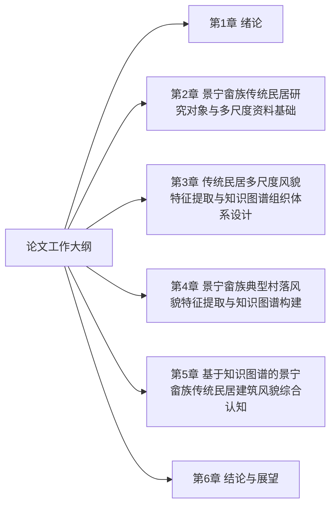

# 现行工作大纲

**这是可调整的工作大纲，不是定稿目录，也不是正文自动改写结果。**

结构维护：[[论文章节/大纲结构.yaml]]；研究目标：[[context/PROJECT_CONTEXT.md]]；工作路线：[[研究成果/论文研究路径/研究路径工作图.md]]。

当前章目和小节由v0.6接续，仍须逐项对齐“多尺度语义描述＋三维空间关联”的定位。本轮落实动态机制，不宣称已完成学术重构。

## 章节总览

| 当前章节                                                                                                                                                     | 论证任务                                   | 结构状态                    |
| -------------------------------------------------------------------------------------------------------------------------------------------------------- | -------------------------------------- | ----------------------- |
| [第1章 绪论](01-%E7%BB%AA%E8%AE%BA/%E7%AB%A0%E8%8A%82%E5%AF%BC%E8%88%AA.md)                                                                                  | 总述问题、目标与路线；后续章节反哺本章，不把计划改成已完成结果。       | 工作结构；沿用旧稿章目，待结合当前定位逐项修订 |
| [第2章 景宁畲族传统民居研究对象与多尺度资料基础](02-%E7%A0%94%E7%A9%B6%E5%AF%B9%E8%B1%A1%E4%B8%8E%E8%B5%84%E6%96%99%E5%9F%BA%E7%A1%80/%E7%AB%A0%E8%8A%82%E5%AF%BC%E8%88%AA.md) | 交代研究对象、样本和资料可用性；不能以文献线索数量替代现存建筑数。      | 工作结构；沿用旧稿章目，待结合当前定位逐项修订 |
| [第3章 传统民居多尺度风貌特征提取与知识图谱组织体系设计](03-%E4%BD%93%E7%B3%BB%E4%B8%8E%E6%96%B9%E6%B3%95%E8%AE%BE%E8%AE%A1/%E7%AB%A0%E8%8A%82%E5%AF%BC%E8%88%AA.md)               | 展开特征、语义表达与三维关联方法；候选规则、实施约定和验证结果分别表述。   | 工作结构；沿用旧稿章目，待结合当前定位逐项修订 |
| [第4章 景宁畲族典型村落风貌特征提取与知识图谱构建](04-%E6%A1%88%E4%BE%8B%E5%AE%9E%E6%96%BD%E4%B8%8E%E6%A3%80%E9%AA%8C/%E7%AB%A0%E8%8A%82%E5%AF%BC%E8%88%AA.md)                  | 说明真实案例实施及检验；V01仅作合成试建参照，不放入实证样本统计。     | 工作结构；沿用旧稿章目，待结合当前定位逐项修订 |
| [第5章 基于知识图谱的景宁畲族传统民居建筑风貌综合认知](05-%E5%88%86%E6%9E%90%E6%AF%94%E8%BE%83%E4%B8%8E%E8%AE%A8%E8%AE%BA/%E7%AB%A0%E8%8A%82%E5%AF%BC%E8%88%AA.md)                | 将可复核分析结果组织为建筑认识与方法讨论；当前不预写真实样本结论。      | 工作结构；沿用旧稿章目，待结合当前定位逐项修订 |
| [第6章 结论与展望](06-%E7%BB%93%E8%AE%BA%E4%B8%8E%E5%B1%95%E6%9C%9B/%E7%AB%A0%E8%8A%82%E5%AF%BC%E8%88%AA.md)                                                    | 只总结已有证据支持的结果；创新声明、局限和适用边界须逐项回到方法及案例检验。 | 工作结构；沿用旧稿章目，待结合当前定位逐项修订 |

## 调整方式

在大纲结构中调整章节／小节列表顺序即调整展示编号；ID和文件路径保持稳定。`included: false`表示停用而非删除证据。标题、论证任务、主题采用和状态均由同一主源生成。

[设计与日常维护说明](../%E9%A1%B9%E7%9B%AE%E7%AE%A1%E7%90%86/%E5%8A%A8%E6%80%81%E7%A0%94%E7%A9%B6%E4%BD%93%E7%B3%BB.md)。
