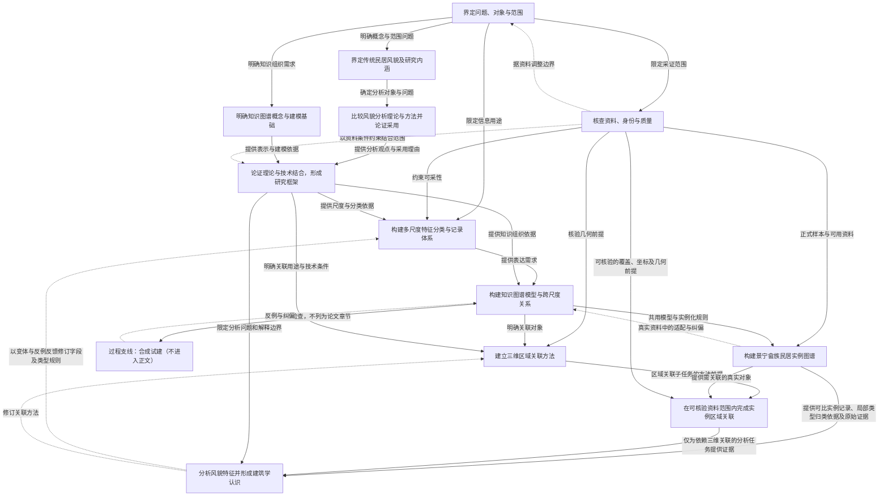

# 研究路径工作图

**工作依赖图，不是已完成流程图。**实线表示依赖，虚线表示反馈；合成试例不替代真实样本检验。

维护源：[[研究成果/〔研究路线〕论文研究路径/研究路径结构.json]]；论文叙述结构见[[论文章节/现行大纲.md]]。

| 环节 | 相关主题 | 当前边界 |
|---|---|---|
| 界定问题、对象与范围 | [〔研究界定〕研究对象与样本边界](../../%E4%B8%BB%E9%A2%98%E7%A0%94%E7%A9%B6/%E3%80%94%E7%A0%94%E7%A9%B6%E7%95%8C%E5%AE%9A%E3%80%95%E7%A0%94%E7%A9%B6%E5%AF%B9%E8%B1%A1%E4%B8%8E%E6%A0%B7%E6%9C%AC%E8%BE%B9%E7%95%8C/%E3%80%94%E7%A0%94%E7%A9%B6%E7%95%8C%E5%AE%9A%E3%80%95%E7%A0%94%E7%A9%B6%E5%AF%B9%E8%B1%A1%E4%B8%8E%E6%A0%B7%E6%9C%AC%E8%BE%B9%E7%95%8C.md)、[〔理论与文献依据〕畲族民居研究现状与研究缺口](../../%E4%B8%BB%E9%A2%98%E7%A0%94%E7%A9%B6/%E3%80%94%E7%90%86%E8%AE%BA%E4%B8%8E%E6%96%87%E7%8C%AE%E4%BE%9D%E6%8D%AE%E3%80%95%E7%95%B2%E6%97%8F%E6%B0%91%E5%B1%85%E7%A0%94%E7%A9%B6%E7%8E%B0%E7%8A%B6%E4%B8%8E%E7%A0%94%E7%A9%B6%E7%BC%BA%E5%8F%A3/%E3%80%94%E7%90%86%E8%AE%BA%E4%B8%8E%E6%96%87%E7%8C%AE%E4%BE%9D%E6%8D%AE%E3%80%95%E7%95%B2%E6%97%8F%E6%B0%91%E5%B1%85%E7%A0%94%E7%A9%B6%E7%8E%B0%E7%8A%B6%E4%B8%8E%E7%A0%94%E7%A9%B6%E7%BC%BA%E5%8F%A3.md) | 对象类型已确认；纳入标准与样本仍待落实 |
| 界定传统民居风貌及研究内涵 | [〔理论与文献依据〕畲族民居研究现状与研究缺口](../../%E4%B8%BB%E9%A2%98%E7%A0%94%E7%A9%B6/%E3%80%94%E7%90%86%E8%AE%BA%E4%B8%8E%E6%96%87%E7%8C%AE%E4%BE%9D%E6%8D%AE%E3%80%95%E7%95%B2%E6%97%8F%E6%B0%91%E5%B1%85%E7%A0%94%E7%A9%B6%E7%8E%B0%E7%8A%B6%E4%B8%8E%E7%A0%94%E7%A9%B6%E7%BC%BA%E5%8F%A3/%E3%80%94%E7%90%86%E8%AE%BA%E4%B8%8E%E6%96%87%E7%8C%AE%E4%BE%9D%E6%8D%AE%E3%80%95%E7%95%B2%E6%97%8F%E6%B0%91%E5%B1%85%E7%A0%94%E7%A9%B6%E7%8E%B0%E7%8A%B6%E4%B8%8E%E7%A0%94%E7%A9%B6%E7%BC%BA%E5%8F%A3.md)、[〔研究界定〕研究对象与样本边界](../../%E4%B8%BB%E9%A2%98%E7%A0%94%E7%A9%B6/%E3%80%94%E7%A0%94%E7%A9%B6%E7%95%8C%E5%AE%9A%E3%80%95%E7%A0%94%E7%A9%B6%E5%AF%B9%E8%B1%A1%E4%B8%8E%E6%A0%B7%E6%9C%AC%E8%BE%B9%E7%95%8C/%E3%80%94%E7%A0%94%E7%A9%B6%E7%95%8C%E5%AE%9A%E3%80%95%E7%A0%94%E7%A9%B6%E5%AF%B9%E8%B1%A1%E4%B8%8E%E6%A0%B7%E6%9C%AC%E8%BE%B9%E7%95%8C.md) | 已有概念与文献对照；工作定义及近义概念辨析待综合 |
| 比较风貌分析理论与方法并论证采用 | [〔理论与文献依据〕畲族民居研究现状与研究缺口](../../%E4%B8%BB%E9%A2%98%E7%A0%94%E7%A9%B6/%E3%80%94%E7%90%86%E8%AE%BA%E4%B8%8E%E6%96%87%E7%8C%AE%E4%BE%9D%E6%8D%AE%E3%80%95%E7%95%B2%E6%97%8F%E6%B0%91%E5%B1%85%E7%A0%94%E7%A9%B6%E7%8E%B0%E7%8A%B6%E4%B8%8E%E7%A0%94%E7%A9%B6%E7%BC%BA%E5%8F%A3/%E3%80%94%E7%90%86%E8%AE%BA%E4%B8%8E%E6%96%87%E7%8C%AE%E4%BE%9D%E6%8D%AE%E3%80%95%E7%95%B2%E6%97%8F%E6%B0%91%E5%B1%85%E7%A0%94%E7%A9%B6%E7%8E%B0%E7%8A%B6%E4%B8%8E%E7%A0%94%E7%A9%B6%E7%BC%BA%E5%8F%A3.md)、[〔研究方法〕类型识别与语义关系表达](../../%E4%B8%BB%E9%A2%98%E7%A0%94%E7%A9%B6/%E3%80%94%E7%A0%94%E7%A9%B6%E6%96%B9%E6%B3%95%E3%80%95%E7%B1%BB%E5%9E%8B%E8%AF%86%E5%88%AB%E4%B8%8E%E8%AF%AD%E4%B9%89%E5%85%B3%E7%B3%BB%E8%A1%A8%E8%BE%BE/%E3%80%94%E7%A0%94%E7%A9%B6%E6%96%B9%E6%B3%95%E3%80%95%E7%B1%BB%E5%9E%8B%E8%AF%86%E5%88%AB%E4%B8%8E%E8%AF%AD%E4%B9%89%E5%85%B3%E7%B3%BB%E8%A1%A8%E8%BE%BE.md) | 已有应用论文与类型拆解；理论原典、统一比较及取舍待补 |
| 明确知识图谱概念与建模基础 | [〔体系设计〕多尺度语义模型与建模依据](../../%E4%B8%BB%E9%A2%98%E7%A0%94%E7%A9%B6/%E3%80%94%E4%BD%93%E7%B3%BB%E8%AE%BE%E8%AE%A1%E3%80%95%E5%A4%9A%E5%B0%BA%E5%BA%A6%E8%AF%AD%E4%B9%89%E6%A8%A1%E5%9E%8B%E4%B8%8E%E5%BB%BA%E6%A8%A1%E4%BE%9D%E6%8D%AE/%E3%80%94%E4%BD%93%E7%B3%BB%E8%AE%BE%E8%AE%A1%E3%80%95%E5%A4%9A%E5%B0%BA%E5%BA%A6%E8%AF%AD%E4%B9%89%E6%A8%A1%E5%9E%8B%E4%B8%8E%E5%BB%BA%E6%A8%A1%E4%BE%9D%E6%8D%AE.md) | 已有方法比较与双基准；基础概念及表示层次待综合 |
| 论证理论与技术结合，形成研究框架 | [〔理论与文献依据〕畲族民居研究现状与研究缺口](../../%E4%B8%BB%E9%A2%98%E7%A0%94%E7%A9%B6/%E3%80%94%E7%90%86%E8%AE%BA%E4%B8%8E%E6%96%87%E7%8C%AE%E4%BE%9D%E6%8D%AE%E3%80%95%E7%95%B2%E6%97%8F%E6%B0%91%E5%B1%85%E7%A0%94%E7%A9%B6%E7%8E%B0%E7%8A%B6%E4%B8%8E%E7%A0%94%E7%A9%B6%E7%BC%BA%E5%8F%A3/%E3%80%94%E7%90%86%E8%AE%BA%E4%B8%8E%E6%96%87%E7%8C%AE%E4%BE%9D%E6%8D%AE%E3%80%95%E7%95%B2%E6%97%8F%E6%B0%91%E5%B1%85%E7%A0%94%E7%A9%B6%E7%8E%B0%E7%8A%B6%E4%B8%8E%E7%A0%94%E7%A9%B6%E7%BC%BA%E5%8F%A3.md)、[〔研究方法〕类型识别与语义关系表达](../../%E4%B8%BB%E9%A2%98%E7%A0%94%E7%A9%B6/%E3%80%94%E7%A0%94%E7%A9%B6%E6%96%B9%E6%B3%95%E3%80%95%E7%B1%BB%E5%9E%8B%E8%AF%86%E5%88%AB%E4%B8%8E%E8%AF%AD%E4%B9%89%E5%85%B3%E7%B3%BB%E8%A1%A8%E8%BE%BE/%E3%80%94%E7%A0%94%E7%A9%B6%E6%96%B9%E6%B3%95%E3%80%95%E7%B1%BB%E5%9E%8B%E8%AF%86%E5%88%AB%E4%B8%8E%E8%AF%AD%E4%B9%89%E5%85%B3%E7%B3%BB%E8%A1%A8%E8%BE%BE.md)、[〔体系设计〕多尺度语义模型与建模依据](../../%E4%B8%BB%E9%A2%98%E7%A0%94%E7%A9%B6/%E3%80%94%E4%BD%93%E7%B3%BB%E8%AE%BE%E8%AE%A1%E3%80%95%E5%A4%9A%E5%B0%BA%E5%BA%A6%E8%AF%AD%E4%B9%89%E6%A8%A1%E5%9E%8B%E4%B8%8E%E5%BB%BA%E6%A8%A1%E4%BE%9D%E6%8D%AE/%E3%80%94%E4%BD%93%E7%B3%BB%E8%AE%BE%E8%AE%A1%E3%80%95%E5%A4%9A%E5%B0%BA%E5%BA%A6%E8%AF%AD%E4%B9%89%E6%A8%A1%E5%9E%8B%E4%B8%8E%E5%BB%BA%E6%A8%A1%E4%BE%9D%E6%8D%AE.md) | 四问题中的结合任务；已有局部衔接，完整理论链与技术支撑、适用条件待论证 |
| 核查资料、身份与质量 | [〔研究界定〕研究对象与样本边界](../../%E4%B8%BB%E9%A2%98%E7%A0%94%E7%A9%B6/%E3%80%94%E7%A0%94%E7%A9%B6%E7%95%8C%E5%AE%9A%E3%80%95%E7%A0%94%E7%A9%B6%E5%AF%B9%E8%B1%A1%E4%B8%8E%E6%A0%B7%E6%9C%AC%E8%BE%B9%E7%95%8C/%E3%80%94%E7%A0%94%E7%A9%B6%E7%95%8C%E5%AE%9A%E3%80%95%E7%A0%94%E7%A9%B6%E5%AF%B9%E8%B1%A1%E4%B8%8E%E6%A0%B7%E6%9C%AC%E8%BE%B9%E7%95%8C.md)、[〔研究方法〕三维资料质量与空间区域关联](../../%E4%B8%BB%E9%A2%98%E7%A0%94%E7%A9%B6/%E3%80%94%E7%A0%94%E7%A9%B6%E6%96%B9%E6%B3%95%E3%80%95%E4%B8%89%E7%BB%B4%E8%B5%84%E6%96%99%E8%B4%A8%E9%87%8F%E4%B8%8E%E7%A9%BA%E9%97%B4%E5%8C%BA%E5%9F%9F%E5%85%B3%E8%81%94/%E3%80%94%E7%A0%94%E7%A9%B6%E6%96%B9%E6%B3%95%E3%80%95%E4%B8%89%E7%BB%B4%E8%B5%84%E6%96%99%E8%B4%A8%E9%87%8F%E4%B8%8E%E7%A9%BA%E9%97%B4%E5%8C%BA%E5%9F%9F%E5%85%B3%E8%81%94.md) | 已有资料索引；现状与三维可用性待核验 |
| 构建多尺度特征分类与记录体系 | [〔体系设计〕风貌特征筛选与数据记录](../../%E4%B8%BB%E9%A2%98%E7%A0%94%E7%A9%B6/%E3%80%94%E4%BD%93%E7%B3%BB%E8%AE%BE%E8%AE%A1%E3%80%95%E9%A3%8E%E8%B2%8C%E7%89%B9%E5%BE%81%E7%AD%9B%E9%80%89%E4%B8%8E%E6%95%B0%E6%8D%AE%E8%AE%B0%E5%BD%95/%E3%80%94%E4%BD%93%E7%B3%BB%E8%AE%BE%E8%AE%A1%E3%80%95%E9%A3%8E%E8%B2%8C%E7%89%B9%E5%BE%81%E7%AD%9B%E9%80%89%E4%B8%8E%E6%95%B0%E6%8D%AE%E8%AE%B0%E5%BD%95.md) | D03—D05主要记录／分析范围已确认，D01及D02外部部分按各自主源；局部类型接口与规则候选待试采。D02内部构架暂停，D07暂缓，D08本阶段不纳入 |
| 构建知识图谱模型与跨尺度关系 | [〔体系设计〕多尺度语义模型与建模依据](../../%E4%B8%BB%E9%A2%98%E7%A0%94%E7%A9%B6/%E3%80%94%E4%BD%93%E7%B3%BB%E8%AE%BE%E8%AE%A1%E3%80%95%E5%A4%9A%E5%B0%BA%E5%BA%A6%E8%AF%AD%E4%B9%89%E6%A8%A1%E5%9E%8B%E4%B8%8E%E5%BB%BA%E6%A8%A1%E4%BE%9D%E6%8D%AE/%E3%80%94%E4%BD%93%E7%B3%BB%E8%AE%BE%E8%AE%A1%E3%80%95%E5%A4%9A%E5%B0%BA%E5%BA%A6%E8%AF%AD%E4%B9%89%E6%A8%A1%E5%9E%8B%E4%B8%8E%E5%BB%BA%E6%A8%A1%E4%BE%9D%E6%8D%AE.md)、[〔研究方法〕类型识别与语义关系表达](../../%E4%B8%BB%E9%A2%98%E7%A0%94%E7%A9%B6/%E3%80%94%E7%A0%94%E7%A9%B6%E6%96%B9%E6%B3%95%E3%80%95%E7%B1%BB%E5%9E%8B%E8%AF%86%E5%88%AB%E4%B8%8E%E8%AF%AD%E4%B9%89%E5%85%B3%E7%B3%BB%E8%A1%A8%E8%BE%BE/%E3%80%94%E7%A0%94%E7%A9%B6%E6%96%B9%E6%B3%95%E3%80%95%E7%B1%BB%E5%9E%8B%E8%AF%86%E5%88%AB%E4%B8%8E%E8%AF%AD%E4%B9%89%E5%85%B3%E7%B3%BB%E8%A1%A8%E8%BE%BE.md) | 已有依据与原型；条目状态分别核对 |
| 建立三维区域关联方法 | [〔研究方法〕三维资料质量与空间区域关联](../../%E4%B8%BB%E9%A2%98%E7%A0%94%E7%A9%B6/%E3%80%94%E7%A0%94%E7%A9%B6%E6%96%B9%E6%B3%95%E3%80%95%E4%B8%89%E7%BB%B4%E8%B5%84%E6%96%99%E8%B4%A8%E9%87%8F%E4%B8%8E%E7%A9%BA%E9%97%B4%E5%8C%BA%E5%9F%9F%E5%85%B3%E8%81%94/%E3%80%94%E7%A0%94%E7%A9%B6%E6%96%B9%E6%B3%95%E3%80%95%E4%B8%89%E7%BB%B4%E8%B5%84%E6%96%99%E8%B4%A8%E9%87%8F%E4%B8%8E%E7%A9%BA%E9%97%B4%E5%8C%BA%E5%9F%9F%E5%85%B3%E8%81%94.md) | 研究目标；资料与判据待落实 |
| 过程支线：合成试建（不进入正文） | [〔检验与评价〕合成试建与规则检验](../../%E4%B8%BB%E9%A2%98%E7%A0%94%E7%A9%B6/%E3%80%94%E6%A3%80%E9%AA%8C%E4%B8%8E%E8%AF%84%E4%BB%B7%E3%80%95%E5%90%88%E6%88%90%E8%AF%95%E5%BB%BA%E4%B8%8E%E8%A7%84%E5%88%99%E6%A3%80%E9%AA%8C/%E3%80%94%E6%A3%80%E9%AA%8C%E4%B8%8E%E8%AF%84%E4%BB%B7%E3%80%95%E5%90%88%E6%88%90%E8%AF%95%E5%BB%BA%E4%B8%8E%E8%A7%84%E5%88%99%E6%A3%80%E9%AA%8C.md) | 仅用于规则检查和纠偏；V01、D01保持合成身份，不入正文或默认附录 |
| 构建景宁畲族民居实例图谱 | [〔研究界定〕研究对象与样本边界](../../%E4%B8%BB%E9%A2%98%E7%A0%94%E7%A9%B6/%E3%80%94%E7%A0%94%E7%A9%B6%E7%95%8C%E5%AE%9A%E3%80%95%E7%A0%94%E7%A9%B6%E5%AF%B9%E8%B1%A1%E4%B8%8E%E6%A0%B7%E6%9C%AC%E8%BE%B9%E7%95%8C/%E3%80%94%E7%A0%94%E7%A9%B6%E7%95%8C%E5%AE%9A%E3%80%95%E7%A0%94%E7%A9%B6%E5%AF%B9%E8%B1%A1%E4%B8%8E%E6%A0%B7%E6%9C%AC%E8%BE%B9%E7%95%8C.md)、[〔体系设计〕风貌特征筛选与数据记录](../../%E4%B8%BB%E9%A2%98%E7%A0%94%E7%A9%B6/%E3%80%94%E4%BD%93%E7%B3%BB%E8%AE%BE%E8%AE%A1%E3%80%95%E9%A3%8E%E8%B2%8C%E7%89%B9%E5%BE%81%E7%AD%9B%E9%80%89%E4%B8%8E%E6%95%B0%E6%8D%AE%E8%AE%B0%E5%BD%95/%E3%80%94%E4%BD%93%E7%B3%BB%E8%AE%BE%E8%AE%A1%E3%80%95%E9%A3%8E%E8%B2%8C%E7%89%B9%E5%BE%81%E7%AD%9B%E9%80%89%E4%B8%8E%E6%95%B0%E6%8D%AE%E8%AE%B0%E5%BD%95.md)、[〔体系设计〕多尺度语义模型与建模依据](../../%E4%B8%BB%E9%A2%98%E7%A0%94%E7%A9%B6/%E3%80%94%E4%BD%93%E7%B3%BB%E8%AE%BE%E8%AE%A1%E3%80%95%E5%A4%9A%E5%B0%BA%E5%BA%A6%E8%AF%AD%E4%B9%89%E6%A8%A1%E5%9E%8B%E4%B8%8E%E5%BB%BA%E6%A8%A1%E4%BE%9D%E6%8D%AE/%E3%80%94%E4%BD%93%E7%B3%BB%E8%AE%BE%E8%AE%A1%E3%80%95%E5%A4%9A%E5%B0%BA%E5%BA%A6%E8%AF%AD%E4%B9%89%E6%A8%A1%E5%9E%8B%E4%B8%8E%E5%BB%BA%E6%A8%A1%E4%BE%9D%E6%8D%AE.md)、[〔研究方法〕三维资料质量与空间区域关联](../../%E4%B8%BB%E9%A2%98%E7%A0%94%E7%A9%B6/%E3%80%94%E7%A0%94%E7%A9%B6%E6%96%B9%E6%B3%95%E3%80%95%E4%B8%89%E7%BB%B4%E8%B5%84%E6%96%99%E8%B4%A8%E9%87%8F%E4%B8%8E%E7%A9%BA%E9%97%B4%E5%8C%BA%E5%9F%9F%E5%85%B3%E8%81%94/%E3%80%94%E7%A0%94%E7%A9%B6%E6%96%B9%E6%B3%95%E3%80%95%E4%B8%89%E7%BB%B4%E8%B5%84%E6%96%99%E8%B4%A8%E9%87%8F%E4%B8%8E%E7%A9%BA%E9%97%B4%E5%8C%BA%E5%9F%9F%E5%85%B3%E8%81%94.md) | 第四章计划成果；需真实样本、记录、实例化及质量校核；区域关联单独核查，不由三维资料不足推定所有实例事实均不可构建 |
| 在可核验资料范围内完成实例区域关联 | [〔研究方法〕三维资料质量与空间区域关联](../../%E4%B8%BB%E9%A2%98%E7%A0%94%E7%A9%B6/%E3%80%94%E7%A0%94%E7%A9%B6%E6%96%B9%E6%B3%95%E3%80%95%E4%B8%89%E7%BB%B4%E8%B5%84%E6%96%99%E8%B4%A8%E9%87%8F%E4%B8%8E%E7%A9%BA%E9%97%B4%E5%8C%BA%E5%9F%9F%E5%85%B3%E8%81%94/%E3%80%94%E7%A0%94%E7%A9%B6%E6%96%B9%E6%B3%95%E3%80%95%E4%B8%89%E7%BB%B4%E8%B5%84%E6%96%99%E8%B4%A8%E9%87%8F%E4%B8%8E%E7%A9%BA%E9%97%B4%E5%8C%BA%E5%9F%9F%E5%85%B3%E8%81%94.md)、[〔体系设计〕多尺度语义模型与建模依据](../../%E4%B8%BB%E9%A2%98%E7%A0%94%E7%A9%B6/%E3%80%94%E4%BD%93%E7%B3%BB%E8%AE%BE%E8%AE%A1%E3%80%95%E5%A4%9A%E5%B0%BA%E5%BA%A6%E8%AF%AD%E4%B9%89%E6%A8%A1%E5%9E%8B%E4%B8%8E%E5%BB%BA%E6%A8%A1%E4%BE%9D%E6%8D%AE/%E3%80%94%E4%BD%93%E7%B3%BB%E8%AE%BE%E8%AE%A1%E3%80%95%E5%A4%9A%E5%B0%BA%E5%BA%A6%E8%AF%AD%E4%B9%89%E6%A8%A1%E5%9E%8B%E4%B8%8E%E5%BB%BA%E6%A8%A1%E4%BE%9D%E6%8D%AE.md) | 仍为研究目标；需真实对象、几何及对应核查，未覆盖部分标为未实施或受限，不作为全部图谱分析的前提 |
| 分析风貌特征并形成建筑学认识 | [〔检验与评价〕案例查询风貌比较与有效性](../../%E4%B8%BB%E9%A2%98%E7%A0%94%E7%A9%B6/%E3%80%94%E6%A3%80%E9%AA%8C%E4%B8%8E%E8%AF%84%E4%BB%B7%E3%80%95%E6%A1%88%E4%BE%8B%E6%9F%A5%E8%AF%A2%E9%A3%8E%E8%B2%8C%E6%AF%94%E8%BE%83%E4%B8%8E%E6%9C%89%E6%95%88%E6%80%A7/%E3%80%94%E6%A3%80%E9%AA%8C%E4%B8%8E%E8%AF%84%E4%BB%B7%E3%80%95%E6%A1%88%E4%BE%8B%E6%9F%A5%E8%AF%A2%E9%A3%8E%E8%B2%8C%E6%AF%94%E8%BE%83%E4%B8%8E%E6%9C%89%E6%95%88%E6%80%A7.md)、[〔研究方法〕类型识别与语义关系表达](../../%E4%B8%BB%E9%A2%98%E7%A0%94%E7%A9%B6/%E3%80%94%E7%A0%94%E7%A9%B6%E6%96%B9%E6%B3%95%E3%80%95%E7%B1%BB%E5%9E%8B%E8%AF%86%E5%88%AB%E4%B8%8E%E8%AF%AD%E4%B9%89%E5%85%B3%E7%B3%BB%E8%A1%A8%E8%BE%BE/%E3%80%94%E7%A0%94%E7%A9%B6%E6%96%B9%E6%B3%95%E3%80%95%E7%B1%BB%E5%9E%8B%E8%AF%86%E5%88%AB%E4%B8%8E%E8%AF%AD%E4%B9%89%E5%85%B3%E7%B3%BB%E8%A1%A8%E8%BE%BE.md)、[〔研究方法〕三维资料质量与空间区域关联](../../%E4%B8%BB%E9%A2%98%E7%A0%94%E7%A9%B6/%E3%80%94%E7%A0%94%E7%A9%B6%E6%96%B9%E6%B3%95%E3%80%95%E4%B8%89%E7%BB%B4%E8%B5%84%E6%96%99%E8%B4%A8%E9%87%8F%E4%B8%8E%E7%A9%BA%E9%97%B4%E5%8C%BA%E5%9F%9F%E5%85%B3%E8%81%94/%E3%80%94%E7%A0%94%E7%A9%B6%E6%96%B9%E6%B3%95%E3%80%95%E4%B8%89%E7%BB%B4%E8%B5%84%E6%96%99%E8%B4%A8%E9%87%8F%E4%B8%8E%E7%A9%BA%E9%97%B4%E5%8C%BA%E5%9F%9F%E5%85%B3%E8%81%94.md) | D06综合产出范围已确认；由可比记录与局部类型形成组合、变体、现状空间差异及证据化建筑学解释。具体判据与真实样本未验证；时期演变和人的感知不在本阶段 |

## 图源职责

本工作图由JSON生成，随研究依赖调整，不等于正文结构同步或研究完成。原[[研究成果/〔研究路线〕论文研究路径/研究路径图.drawio|draw.io图源]]及[[研究成果/〔研究路线〕论文研究路径/研究路径图.png|PNG]]保留为2026-10-20定位同步的阶段汇报快照；没有自动同步，不称为最新工作图。需要新的正式汇报图时，另行从已核对的工作主源更新draw.io并重新导出核验。
