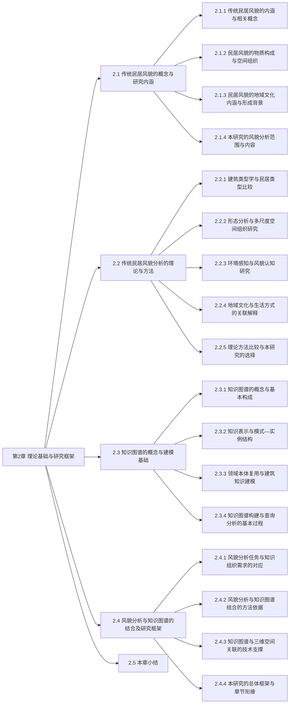

# 第2章 理论基础与研究框架

本页为工作结构视图；原始章目与采用状态已接续至大纲结构主源。

<!-- dynamic-chapter:start -->
## 当前工作安排

> 由[[论文章节/大纲结构.yaml|大纲结构]]生成。修改主源后运行同步；文件夹编号仅为历史路径，不决定当前章节顺序。

**本章任务：** 依次回答传统民居风貌是什么、如何分析及其理论依据、知识图谱是什么、二者怎样结合，论证理论与技术支撑并形成研究框架。区别于绪论的范围交代，本章展开概念辨析与采用理由；具体特征、模型及规则在第三章构建。

**结构状态：** 四问题工作结构已确认；概念综合、理论取舍及结合论证待完成。下方正文入口仅供旧稿参考，尚未按本章新大纲改写

**正文接续：** 旧稿第二章为“研究对象与多尺度资料基础”，其对象、样本与资料内容已按迁移映射进入现行第四章；本章（理论基础与研究框架）无直接旧稿，需新写。

**章内逻辑：** 风貌是什么 → 怎样分析 → 图谱是什么 → 如何结合 → 研究框架。

**向后接续：** 向第三章交付观察与表达的依据；不在本章提前完成具体特征表或图谱模型。

## 小节与主题成果采用表

| 小节 | 主题及成果入口 | 本节用途 | 采用状态与证据缺口 |
|---|---|---|---|
| 2.1 传统民居风貌的概念与研究内涵 | [〔理论与文献依据〕畲族民居研究与理论依据](../../%E4%B8%BB%E9%A2%98%E7%A0%94%E7%A9%B6/%E3%80%94%E7%90%86%E8%AE%BA%E4%B8%8E%E6%96%87%E7%8C%AE%E4%BE%9D%E6%8D%AE%E3%80%95%E7%95%B2%E6%97%8F%E6%B0%91%E5%B1%85%E7%A0%94%E7%A9%B6%E4%B8%8E%E7%90%86%E8%AE%BA%E4%BE%9D%E6%8D%AE/%E3%80%94%E7%90%86%E8%AE%BA%E4%B8%8E%E6%96%87%E7%8C%AE%E4%BE%9D%E6%8D%AE%E3%80%95%E7%95%B2%E6%97%8F%E6%B0%91%E5%B1%85%E7%A0%94%E7%A9%B6%E4%B8%8E%E7%90%86%E8%AE%BA%E4%BE%9D%E6%8D%AE.md)、[〔研究界定〕研究对象与样本边界](../../%E4%B8%BB%E9%A2%98%E7%A0%94%E7%A9%B6/%E3%80%94%E7%A0%94%E7%A9%B6%E7%95%8C%E5%AE%9A%E3%80%95%E7%A0%94%E7%A9%B6%E5%AF%B9%E8%B1%A1%E4%B8%8E%E6%A0%B7%E6%9C%AC%E8%BE%B9%E7%95%8C/%E3%80%94%E7%A0%94%E7%A9%B6%E7%95%8C%E5%AE%9A%E3%80%95%E7%A0%94%E7%A9%B6%E5%AF%B9%E8%B1%A1%E4%B8%8E%E6%A0%B7%E6%9C%AC%E8%BE%B9%E7%95%8C.md) | 辨析风貌与形态、类型、风格，界定单体特征与群体组合，区分直接研究内容及形成解释背景 | 已有概念线索与跨文献对照；本研究风貌工作定义及概念辨析尚待综合 |
| 2.2 传统民居风貌分析的理论与方法 | [〔理论与文献依据〕畲族民居研究与理论依据](../../%E4%B8%BB%E9%A2%98%E7%A0%94%E7%A9%B6/%E3%80%94%E7%90%86%E8%AE%BA%E4%B8%8E%E6%96%87%E7%8C%AE%E4%BE%9D%E6%8D%AE%E3%80%95%E7%95%B2%E6%97%8F%E6%B0%91%E5%B1%85%E7%A0%94%E7%A9%B6%E4%B8%8E%E7%90%86%E8%AE%BA%E4%BE%9D%E6%8D%AE/%E3%80%94%E7%90%86%E8%AE%BA%E4%B8%8E%E6%96%87%E7%8C%AE%E4%BE%9D%E6%8D%AE%E3%80%95%E7%95%B2%E6%97%8F%E6%B0%91%E5%B1%85%E7%A0%94%E7%A9%B6%E4%B8%8E%E7%90%86%E8%AE%BA%E4%BE%9D%E6%8D%AE.md)、[〔研究方法〕类型识别与比较](../../%E4%B8%BB%E9%A2%98%E7%A0%94%E7%A9%B6/%E3%80%94%E7%A0%94%E7%A9%B6%E6%96%B9%E6%B3%95%E3%80%95%E7%B1%BB%E5%9E%8B%E8%AF%86%E5%88%AB%E4%B8%8E%E6%AF%94%E8%BE%83/%E3%80%94%E7%A0%94%E7%A9%B6%E6%96%B9%E6%B3%95%E3%80%95%E7%B1%BB%E5%9E%8B%E8%AF%86%E5%88%AB%E4%B8%8E%E6%AF%94%E8%BE%83.md)、[〔研究界定〕研究对象与样本边界](../../%E4%B8%BB%E9%A2%98%E7%A0%94%E7%A9%B6/%E3%80%94%E7%A0%94%E7%A9%B6%E7%95%8C%E5%AE%9A%E3%80%95%E7%A0%94%E7%A9%B6%E5%AF%B9%E8%B1%A1%E4%B8%8E%E6%A0%B7%E6%9C%AC%E8%BE%B9%E7%95%8C/%E3%80%94%E7%A0%94%E7%A9%B6%E7%95%8C%E5%AE%9A%E3%80%95%E7%A0%94%E7%A9%B6%E5%AF%B9%E8%B1%A1%E4%B8%8E%E6%A0%B7%E6%9C%AC%E8%BE%B9%E7%95%8C.md) | 比较风貌分析的认识视角、分析单位、方法与适用条件，再说明本研究拟采用及暂不采用的依据 | 已有多篇分析框架与方法拆解；跨理论比较、原典取证及本研究选择理由仍不完整 |
| 2.3 知识图谱的概念与建模基础 | [〔体系设计〕多尺度语义模型与建模依据](../../%E4%B8%BB%E9%A2%98%E7%A0%94%E7%A9%B6/%E3%80%94%E4%BD%93%E7%B3%BB%E8%AE%BE%E8%AE%A1%E3%80%95%E5%A4%9A%E5%B0%BA%E5%BA%A6%E8%AF%AD%E4%B9%89%E6%A8%A1%E5%9E%8B%E4%B8%8E%E5%BB%BA%E6%A8%A1%E4%BE%9D%E6%8D%AE/%E3%80%94%E4%BD%93%E7%B3%BB%E8%AE%BE%E8%AE%A1%E3%80%95%E5%A4%9A%E5%B0%BA%E5%BA%A6%E8%AF%AD%E4%B9%89%E6%A8%A1%E5%9E%8B%E4%B8%8E%E5%BB%BA%E6%A8%A1%E4%BE%9D%E6%8D%AE.md) | 解释概念、类型、实例、属性与关系，区分知识模型、实例数据及构建、查询、分析的职责 | 已有图谱应用论文比较和双基准；基础概念综合及表示／实现层次说明尚待形成 |
| 2.4 风貌分析与知识图谱的结合及研究框架 | [〔理论与文献依据〕畲族民居研究与理论依据](../../%E4%B8%BB%E9%A2%98%E7%A0%94%E7%A9%B6/%E3%80%94%E7%90%86%E8%AE%BA%E4%B8%8E%E6%96%87%E7%8C%AE%E4%BE%9D%E6%8D%AE%E3%80%95%E7%95%B2%E6%97%8F%E6%B0%91%E5%B1%85%E7%A0%94%E7%A9%B6%E4%B8%8E%E7%90%86%E8%AE%BA%E4%BE%9D%E6%8D%AE/%E3%80%94%E7%90%86%E8%AE%BA%E4%B8%8E%E6%96%87%E7%8C%AE%E4%BE%9D%E6%8D%AE%E3%80%95%E7%95%B2%E6%97%8F%E6%B0%91%E5%B1%85%E7%A0%94%E7%A9%B6%E4%B8%8E%E7%90%86%E8%AE%BA%E4%BE%9D%E6%8D%AE.md)、[〔体系设计〕多尺度语义模型与建模依据](../../%E4%B8%BB%E9%A2%98%E7%A0%94%E7%A9%B6/%E3%80%94%E4%BD%93%E7%B3%BB%E8%AE%BE%E8%AE%A1%E3%80%95%E5%A4%9A%E5%B0%BA%E5%BA%A6%E8%AF%AD%E4%B9%89%E6%A8%A1%E5%9E%8B%E4%B8%8E%E5%BB%BA%E6%A8%A1%E4%BE%9D%E6%8D%AE/%E3%80%94%E4%BD%93%E7%B3%BB%E8%AE%BE%E8%AE%A1%E3%80%95%E5%A4%9A%E5%B0%BA%E5%BA%A6%E8%AF%AD%E4%B9%89%E6%A8%A1%E5%9E%8B%E4%B8%8E%E5%BB%BA%E6%A8%A1%E4%BE%9D%E6%8D%AE.md)、[〔体系设计〕风貌特征筛选与数据记录](../../%E4%B8%BB%E9%A2%98%E7%A0%94%E7%A9%B6/%E3%80%94%E4%BD%93%E7%B3%BB%E8%AE%BE%E8%AE%A1%E3%80%95%E9%A3%8E%E8%B2%8C%E7%89%B9%E5%BE%81%E7%AD%9B%E9%80%89%E4%B8%8E%E6%95%B0%E6%8D%AE%E8%AE%B0%E5%BD%95/%E3%80%94%E4%BD%93%E7%B3%BB%E8%AE%BE%E8%AE%A1%E3%80%95%E9%A3%8E%E8%B2%8C%E7%89%B9%E5%BE%81%E7%AD%9B%E9%80%89%E4%B8%8E%E6%95%B0%E6%8D%AE%E8%AE%B0%E5%BD%95.md)、[〔研究方法〕三维资料质量与空间区域关联](../../%E4%B8%BB%E9%A2%98%E7%A0%94%E7%A9%B6/%E3%80%94%E7%A0%94%E7%A9%B6%E6%96%B9%E6%B3%95%E3%80%95%E4%B8%89%E7%BB%B4%E8%B5%84%E6%96%99%E8%B4%A8%E9%87%8F%E4%B8%8E%E7%A9%BA%E9%97%B4%E5%8C%BA%E5%9F%9F%E5%85%B3%E8%81%94/%E3%80%94%E7%A0%94%E7%A9%B6%E6%96%B9%E6%B3%95%E3%80%95%E4%B8%89%E7%BB%B4%E8%B5%84%E6%96%99%E8%B4%A8%E9%87%8F%E4%B8%8E%E7%A9%BA%E9%97%B4%E5%8C%BA%E5%9F%9F%E5%85%B3%E8%81%94.md)、[〔检验与评价〕图谱试建、查询与有效性](../../%E4%B8%BB%E9%A2%98%E7%A0%94%E7%A9%B6/%E3%80%94%E6%A3%80%E9%AA%8C%E4%B8%8E%E8%AF%84%E4%BB%B7%E3%80%95%E5%9B%BE%E8%B0%B1%E8%AF%95%E5%BB%BA%E3%80%81%E6%9F%A5%E8%AF%A2%E4%B8%8E%E6%9C%89%E6%95%88%E6%80%A7/%E3%80%94%E6%A3%80%E9%AA%8C%E4%B8%8E%E8%AF%84%E4%BB%B7%E3%80%95%E5%9B%BE%E8%B0%B1%E8%AF%95%E5%BB%BA%E3%80%81%E6%9F%A5%E8%AF%A2%E4%B8%8E%E6%9C%89%E6%95%88%E6%80%A7.md) | 分别论证建筑学分析依据与技术方案如何衔接，明确第三至第五章的输入、产出和解释边界 | 已有问题—数据—模型的局部衔接；完整结合论证、多尺度扩展与真实资料适用条件待补 |
| 2.5 本章小结 | [〔体系设计〕多尺度语义模型与建模依据](../../%E4%B8%BB%E9%A2%98%E7%A0%94%E7%A9%B6/%E3%80%94%E4%BD%93%E7%B3%BB%E8%AE%BE%E8%AE%A1%E3%80%95%E5%A4%9A%E5%B0%BA%E5%BA%A6%E8%AF%AD%E4%B9%89%E6%A8%A1%E5%9E%8B%E4%B8%8E%E5%BB%BA%E6%A8%A1%E4%BE%9D%E6%8D%AE/%E3%80%94%E4%BD%93%E7%B3%BB%E8%AE%BE%E8%AE%A1%E3%80%95%E5%A4%9A%E5%B0%BA%E5%BA%A6%E8%AF%AD%E4%B9%89%E6%A8%A1%E5%9E%8B%E4%B8%8E%E5%BB%BA%E6%A8%A1%E4%BE%9D%E6%8D%AE.md)、[〔理论与文献依据〕畲族民居研究与理论依据](../../%E4%B8%BB%E9%A2%98%E7%A0%94%E7%A9%B6/%E3%80%94%E7%90%86%E8%AE%BA%E4%B8%8E%E6%96%87%E7%8C%AE%E4%BE%9D%E6%8D%AE%E3%80%95%E7%95%B2%E6%97%8F%E6%B0%91%E5%B1%85%E7%A0%94%E7%A9%B6%E4%B8%8E%E7%90%86%E8%AE%BA%E4%BE%9D%E6%8D%AE/%E3%80%94%E7%90%86%E8%AE%BA%E4%B8%8E%E6%96%87%E7%8C%AE%E4%BE%9D%E6%8D%AE%E3%80%95%E7%95%B2%E6%97%8F%E6%B0%91%E5%B1%85%E7%A0%94%E7%A9%B6%E4%B8%8E%E7%90%86%E8%AE%BA%E4%BE%9D%E6%8D%AE.md) | 归纳本研究的风貌工作界定、分析依据、知识图谱基础及二者结合条件，为第三章体系构建提供依据 | 随前四节论证完成后撰写；不是当前已完成的理论结论 |

## 三级标题与论证分工

三级标题用于思路梳理；理论及分析视角是比较对象，不表示全部采用。成果入口和采用关系沿用父节，不重复计数。

| 三级标题 | 论证任务 | 状态 |
|---|---|---|
| 2.1.1 传统民居风貌的内涵与相关概念 | 比较风貌、形态、类型和风格的用法，形成工作界定，不以现有字段反向定义风貌 | 思路梳理用工作安排；不表示理论选择、正文或研究已完成 |
| 2.1.2 民居风貌的物质构成与空间组织 | 说明单体建筑及群体组合如何进入风貌认识，区分对象、组成与观察尺度 | 思路梳理用工作安排；不表示理论选择、正文或研究已完成 |
| 2.1.3 民居风貌的地域文化内涵与形成背景 | 区分可观察特征、感知意义与形成解释，不由外观直接推定文化归属或成因 | 思路梳理用工作安排；不表示理论选择、正文或研究已完成 |
| 2.1.4 本研究的风貌分析范围与内容 | 从概念辨析界定本研究直接分析内容和关联解释范围，为理论比较确定对象 | 思路梳理用工作安排；不表示理论选择、正文或研究已完成 |
| 2.2.1 建筑类型学与民居类型比较 | 承接已有类型文献比较原型、类型与变体的分析用途；列入讨论不等于已决定采用整套理论 | 思路梳理用工作安排；不表示理论选择、正文或研究已完成 |
| 2.2.2 形态分析与多尺度空间组织研究 | 比较形态及形态类型学的观察单位、尺度和空间关系方法，论证村落—组团—单体的分工，不预设完整历时资料 | 思路梳理用工作安排；不表示理论选择、正文或研究已完成 |
| 2.2.3 环境感知与风貌认知研究 | 梳理感知认知视角能回答什么及其独立取证要求；不默认新增感知实验或综合评价主线 | 思路梳理用工作安排；不表示理论选择、正文或研究已完成 |
| 2.2.4 地域文化与生活方式的关联解释 | 比较文化、生活与营造相关解释的证据条件，不将所有解释视角包装为同一种理论或已验证因果 | 思路梳理用工作安排；不表示理论选择、正文或研究已完成 |
| 2.2.5 理论方法比较与本研究的选择 | 统一比较对象、尺度、判据、证据条件和解释能力，区分采用、条件采用与不采用，向第三章传递具体依据 | 思路梳理用工作安排；不表示理论选择、正文或研究已完成 |
| 2.3.1 知识图谱的概念与基本构成 | 解释实体、概念、类型、实例、属性和关系，区分知识图谱与一般可视化网络 | 思路梳理用工作安排；不表示理论选择、正文或研究已完成 |
| 2.3.2 知识表示与模式—实例结构 | 说明模式和实例、三元组和属性图的层次，避免把软件平台等同研究模型 | 思路梳理用工作安排；不表示理论选择、正文或研究已完成 |
| 2.3.3 领域本体复用与建筑知识建模 | 概述已有本体的作用和边界；BOT作为建模参照，本研究的具体采用与扩展在第三章论述 | 思路梳理用工作安排；不表示理论选择、正文或研究已完成 |
| 2.3.4 知识图谱构建与查询分析的基本过程 | 区分知识整理、模式设计、实例化、质量控制、查询和分析；只交代通用概念，不代写第三、四章 | 思路梳理用工作安排；不表示理论选择、正文或研究已完成 |
| 2.4.1 风貌分析任务与知识组织需求的对应 | 从第二章的对象和分析观点说明分析任务需要何种知识组织，不提前形成第三章具体特征清单，也不从可用软件反推研究问题 | 思路梳理用工作安排；不表示理论选择、正文或研究已完成 |
| 2.4.2 风貌分析与知识图谱结合的方法依据 | 衔接理论观点、观察判据、知识组织、分析操作与建筑学解释，说明为何需要图谱而非仅称二者都有关系 | 思路梳理用工作安排；不表示理论选择、正文或研究已完成 |
| 2.4.3 知识图谱与三维空间关联的技术支撑 | 区分已有技术覆盖、本研究需扩展部分及资料条件；三维关联是服务特定分析的组成，不是全部图谱分析的前提 | 思路梳理用工作安排；不表示理论选择、正文或研究已完成 |
| 2.4.4 本研究的总体框架与章节衔接 | 呈现第三章体系与方法、第四章景宁实例、第五章风貌分析的章节级输入输出，不展开第三章具体设计；区别于绪论的研究步骤说明 | 思路梳理用工作安排；不表示理论选择、正文或研究已完成 |

## 逐节研究问题与证据要求

以下是待执行的研究要求，不是已完成或已验证声明；采用状态仍以上表为准。

### 传统民居风貌的概念与研究内涵

- **问题**：传统民居风貌指什么，研究者所描述的建筑特征与感知、文化意义之间有何联系和边界？
- **所需证据／待核材料**：已有起点：夏雷第二章概念与理论引文拆解、风貌研究与畲族建筑研究对照；具体来源见理论与文献依据主题；待形成：不同作者的风貌定义、适用对象与尺度对照；区分原文定义、二手转引及本研究工作界定；待论证：单体与群体、物质形态与感知意义、核心特征与关联解释的边界；不可用现成字段反向定义风貌。
- **完成判据**：形成有来源和范围的工作界定，并说明与近义概念的差别；不把感知或文化意义直接当作外观可读事实。

### 传统民居风貌分析的理论与方法

- **问题**：已有研究如何认识与分析风貌；哪些理论观点能支持本研究的尺度、观察内容、比较及解释？
- **所需证据／待核材料**：已有起点：夏雷理论引文追溯、类型与形态文献证据记录、吴莹理论化用精读及风貌目标对照；待形成：核心观点—分析对象与尺度—方法—证据要求—可解释内容—局限的统一比较表，区分理论、方法和具体技术；待论证：村落—组团—单体的分析分工；区分已读应用论文、待回读的理论原典及本研究采用理由；保留不采用／条件采用项。
- **完成判据**：理论梳理与理论采用分别给出依据；不照搬单篇论文的理论组合，不把类型学、系统论或某种算法预设为已采用。

### 知识图谱的概念与建模基础

- **问题**：知识图谱组织什么知识，知识表示、领域本体、实例化与数据库实现之间如何区分？
- **所需证据／待核材料**：已有起点：知识图谱文献拆解中徽州、伏岭、聚类及问答四篇方法与成果比较；BOT原始基准与研究优化基准；待补：知识图谱基础概念的直接文献及概念对照，辨析语义网络、领域本体、实体关系图谱与文献计量网络；待说明：模式与实例、三元组与属性图的表示区别，BOT适用范围及平台实现边界；具体本研究Schema与扩展规则留第三章。
- **完成判据**：基础概念有直接来源，技术层级不混同；BOT作为建模参照而非风貌理论，Neo4j平台不等同于研究模型。

### 风貌分析与知识图谱的结合及研究框架

- **问题**：理论怎样进入观察判据、知识组织及分析解释；已有方案能覆盖什么，尚需哪些扩展和资料条件？
- **所需证据／待核材料**：已有起点：分析问题与数据依赖、单体框架—本体衔接、四篇图谱方法比较及BOT双基准；三维资料与查询评价主题；待形成理论／方法链：理论观点—分析问题—观察内容与判据—知识组织和分析操作—建筑学解释；待形成技术支撑对照：需求—既有方法／本体覆盖—本研究扩展—资料条件—验证任务；分别论证图谱必要性与三维关联用途；待形成总体框架及其适用条件；村落与组团扩展、真实三维区域关联及比较证据不能由单体候选模型或合成试例代替。
- **完成判据**：不能只因建筑与图谱都有关系便认定结合成立；同时说明支持与不能支持的结论，不前移第三章具体模型或预写第五章成效。

### 本章小结

- **问题**：哪些概念、理论观点和技术依据进入后续研究，哪些仍为候选或受资料条件限制？
- **所需证据／待核材料**：前四节已完成的概念辨析、理论取舍与结合论证；第三至第五章任务及证据边界。
- **完成判据**：仅总结已论证内容，未完成采用与验证不得升级为结论。

## 本章结构图

## 稳定节点与原稿接续

- `section-2-style-concept`：传统民居风貌的概念与研究内涵；纳入当前工作大纲。原稿编号：新节点；变更说明：2026-10-29据用户确认的第二章四问题新增；重组原理论任务，旧节点保留追溯；无对应的新正文。

- `section-2-analysis-foundations`：传统民居风貌分析的理论与方法；纳入当前工作大纲。原稿编号：新节点；变更说明：2026-10-29据用户确认的第二章四问题新增；重组原理论任务，旧节点保留追溯；无对应的新正文。

- `section-2-kg-foundations`：知识图谱的概念与建模基础；纳入当前工作大纲。原稿编号：新节点；变更说明：2026-10-29据用户确认的第二章四问题新增；重组原理论任务，旧节点保留追溯；无对应的新正文。

- `section-2-integration-framework`：风貌分析与知识图谱的结合及研究框架；纳入当前工作大纲。原稿编号：新节点；变更说明：2026-10-29据用户确认的第二章四问题新增；重组原理论任务，旧节点保留追溯；无对应的新正文。

- `section-2-summary`：本章小结；纳入当前工作大纲。原稿编号：新节点；变更说明：2026-10-29随四问题重组小结职责；稳定ID保留，正文未改写；2026-10-29标题与逻辑梳理：由“本章小结：理论依据与研究框架”接续，仍为工作大纲，正文不改。

- `section-2-architecture-theory`：传统民居风貌研究的多尺度观察与分类依据；停用、保留追溯。原稿编号：新节点；变更说明：2026-10-29按用户四问题重组第二章；原技术环节式安排停用，相关任务接续至风貌概念、分析理论、知识图谱基础及结合框架四节；保留稳定ID和原稿入口。

- `section-2-semantic-theory`：风貌知识组织与语义关系表达基础；停用、保留追溯。原稿编号：新节点；变更说明：2026-10-29按用户四问题重组第二章；原技术环节式安排停用，相关任务接续至风貌概念、分析理论、知识图谱基础及结合框架四节；保留稳定ID和原稿入口。

- `section-2-spatial-theory`：语义描述与三维空间关联的研究依据；停用、保留追溯。原稿编号：新节点；变更说明：2026-10-29按用户四问题重组第二章；原技术环节式安排停用，相关任务接续至风貌概念、分析理论、知识图谱基础及结合框架四节；保留稳定ID和原稿入口。

- `section-3-1`：研究框架与体系、图谱及分析的衔接；停用、保留追溯。原稿编号：3.1；变更说明：2026-10-29按用户四问题重组第二章；原技术环节式安排停用，相关任务接续至风貌概念、分析理论、知识图谱基础及结合框架四节；保留稳定ID和原稿入口。

## 三级稳定节点

- `sub-concept-definition`：传统民居风貌的内涵与相关概念；纳入当前工作大纲；2026-10-29依用户要求展开第二章三级标题，沿用父节成果入口和研究状态。

- `sub-concept-physical`：民居风貌的物质构成与空间组织；纳入当前工作大纲；2026-10-29依用户要求展开第二章三级标题，沿用父节成果入口和研究状态。

- `sub-concept-cultural`：民居风貌的地域文化内涵与形成背景；纳入当前工作大纲；2026-10-29依用户要求展开第二章三级标题，沿用父节成果入口和研究状态。

- `sub-concept-scope`：本研究的风貌分析范围与内容；纳入当前工作大纲；2026-10-29依用户要求展开第二章三级标题，沿用父节成果入口和研究状态。

- `sub-analysis-typology`：建筑类型学与民居类型比较；纳入当前工作大纲；2026-10-29依用户要求展开第二章三级标题，沿用父节成果入口和研究状态。

- `sub-analysis-morphology`：形态分析与多尺度空间组织研究；纳入当前工作大纲；2026-10-29依用户要求展开第二章三级标题，沿用父节成果入口和研究状态。

- `sub-analysis-perception`：环境感知与风貌认知研究；纳入当前工作大纲；2026-10-29依用户要求展开第二章三级标题，沿用父节成果入口和研究状态。

- `sub-analysis-culture`：地域文化与生活方式的关联解释；纳入当前工作大纲；2026-10-29依用户要求展开第二章三级标题，沿用父节成果入口和研究状态。

- `sub-analysis-selection`：理论方法比较与本研究的选择；纳入当前工作大纲；2026-10-29依用户要求展开第二章三级标题，沿用父节成果入口和研究状态。

- `sub-kg-concepts`：知识图谱的概念与基本构成；纳入当前工作大纲；2026-10-29依用户要求展开第二章三级标题，沿用父节成果入口和研究状态。

- `sub-kg-representation`：知识表示与模式—实例结构；纳入当前工作大纲；2026-10-29依用户要求展开第二章三级标题，沿用父节成果入口和研究状态。

- `sub-kg-ontology`：领域本体复用与建筑知识建模；纳入当前工作大纲；2026-10-29依用户要求展开第二章三级标题，沿用父节成果入口和研究状态。

- `sub-kg-workflow`：知识图谱构建与查询分析的基本过程；纳入当前工作大纲；2026-10-29依用户要求展开第二章三级标题，沿用父节成果入口和研究状态。

- `sub-integration-needs`：风貌分析任务与知识组织需求的对应；纳入当前工作大纲；2026-10-29依用户要求展开第二章三级标题，沿用父节成果入口和研究状态。

- `sub-integration-methods`：风貌分析与知识图谱结合的方法依据；纳入当前工作大纲；2026-10-29依用户要求展开第二章三级标题，沿用父节成果入口和研究状态。

- `sub-integration-technology`：知识图谱与三维空间关联的技术支撑；纳入当前工作大纲；2026-10-29依用户要求展开第二章三级标题，沿用父节成果入口和研究状态。

- `sub-integration-framework`：本研究的总体框架与章节衔接；纳入当前工作大纲；2026-10-29依用户要求展开第二章三级标题，沿用父节成果入口和研究状态。

## 已移往其他章节的原节点

- [景宁畲族传统民居的地域背景与建筑概况](../04-%E6%A1%88%E4%BE%8B%E5%AE%9E%E6%96%BD%E4%B8%8E%E6%A3%80%E9%AA%8C/%E7%AB%A0%E8%8A%82%E5%AF%BC%E8%88%AA.md#section-2-2)：稳定ID不变，原入口转接。

- [研究样本选择与多尺度分析单元确定](../04-%E6%A1%88%E4%BE%8B%E5%AE%9E%E6%96%BD%E4%B8%8E%E6%A3%80%E9%AA%8C/%E7%AB%A0%E8%8A%82%E5%AF%BC%E8%88%AA.md#section-2-1)：稳定ID不变，原入口转接。

- [多源资料整理与研究对象对应](../04-%E6%A1%88%E4%BE%8B%E5%AE%9E%E6%96%BD%E4%B8%8E%E6%A3%80%E9%AA%8C/%E7%AB%A0%E8%8A%82%E5%AF%BC%E8%88%AA.md#section-2-4)：稳定ID不变，原入口转接。

- [候选民居核查与样本纳入依据](../04-%E6%A1%88%E4%BE%8B%E5%AE%9E%E6%96%BD%E4%B8%8E%E6%A3%80%E9%AA%8C/%E7%AB%A0%E8%8A%82%E5%AF%BC%E8%88%AA.md#section-2-3)：稳定ID不变，原入口转接。

- [资料质量、对象对应与证据记录](../04-%E6%A1%88%E4%BE%8B%E5%AE%9E%E6%96%BD%E4%B8%8E%E6%A3%80%E9%AA%8C/%E7%AB%A0%E8%8A%82%E5%AF%BC%E8%88%AA.md#section-2-5)：稳定ID不变，原入口转接。

- [本章小结：可用输入与研究限制](../04-%E6%A1%88%E4%BE%8B%E5%AE%9E%E6%96%BD%E4%B8%8E%E6%A3%80%E9%AA%8C/%E7%AB%A0%E8%8A%82%E5%AF%BC%E8%88%AA.md#section-2-6)：稳定ID不变，原入口转接。

## 调整与反馈

需要调整题名、顺序、节的归属或采用状态时，修改大纲结构；稳定ID不随编号改变。新增、停用、拆分合并必须保留理由及原稿接续，不能由文件数自动认定研究完成。
<!-- dynamic-chapter:end -->
