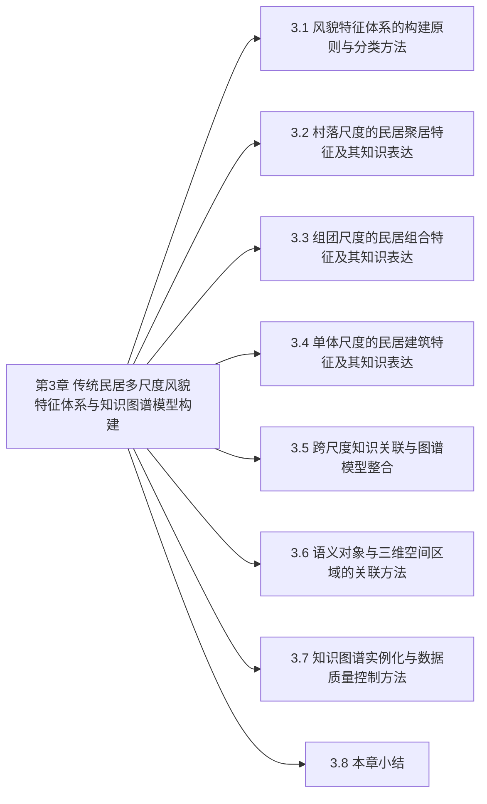

# 第3章 传统民居多尺度风貌特征体系与知识图谱模型构建

本页为工作结构视图；原始章目与采用状态已接续至大纲结构主源。

<!-- dynamic-chapter:start -->
## 当前工作安排

> 由[[论文章节/大纲结构.yaml|大纲结构]]生成。修改主源后运行同步；文件夹编号仅为历史路径，不决定当前章节顺序。

**本章任务：** 将各尺度的建筑特征分类与语义表达共同展开，形成适用范围明确的可复用特征体系、图谱模型及关联规则；不预写景宁风貌结论。

**结构状态：** 按已确认分工调整的工作结构；正文与研究证据待补，不表示已完成应用或验证

[打开既有正文对应章](../%E5%85%A8%E6%96%87%E5%B7%A5%E4%BD%9C%E7%A8%BF/%E6%99%AF%E5%AE%81%E7%95%B2%E6%97%8F%E4%BC%A0%E7%BB%9F%E6%B0%91%E5%B1%85%E9%A3%8E%E8%B2%8C%E7%89%B9%E5%BE%81%E6%8F%90%E5%8F%96%E4%B8%8E%E7%9F%A5%E8%AF%86%E5%9B%BE%E8%B0%B1%E6%9E%84%E5%BB%BA%E7%A0%94%E7%A9%B6v0.6.md#%E7%AC%AC%E4%B8%89%E7%AB%A0%20%E4%BC%A0%E7%BB%9F%E6%B0%91%E5%B1%85%E5%A4%9A%E5%B0%BA%E5%BA%A6%E9%A3%8E%E8%B2%8C%E7%89%B9%E5%BE%81%E6%8F%90%E5%8F%96%E4%B8%8E%E7%9F%A5%E8%AF%86%E5%9B%BE%E8%B0%B1%E7%BB%84%E7%BB%87%E4%BD%93%E7%B3%BB%E8%AE%BE%E8%AE%A1)。正文未随结构自动改写。

**章内逻辑：** 原则与分类 → 分尺度特征及表达 → 跨尺度整合 → 三维关联方法 → 实例化与质量规则。

**向后接续：** 向第四章交付共同规则和可操作记录方式；这里的分类体系不是景宁分析结论。

## 小节与主题成果采用表

| 小节 | 主题及成果入口 | 本节用途 | 采用状态与证据缺口 |
|---|---|---|---|
| 3.1 风貌特征体系的构建原则与分类方法 | [〔体系设计〕风貌特征筛选与数据记录](../../%E4%B8%BB%E9%A2%98%E7%A0%94%E7%A9%B6/%E3%80%94%E4%BD%93%E7%B3%BB%E8%AE%BE%E8%AE%A1%E3%80%95%E9%A3%8E%E8%B2%8C%E7%89%B9%E5%BE%81%E7%AD%9B%E9%80%89%E4%B8%8E%E6%95%B0%E6%8D%AE%E8%AE%B0%E5%BD%95/%E3%80%94%E4%BD%93%E7%B3%BB%E8%AE%BE%E8%AE%A1%E3%80%95%E9%A3%8E%E8%B2%8C%E7%89%B9%E5%BE%81%E7%AD%9B%E9%80%89%E4%B8%8E%E6%95%B0%E6%8D%AE%E8%AE%B0%E5%BD%95.md)、[〔研究方法〕类型识别与比较](../../%E4%B8%BB%E9%A2%98%E7%A0%94%E7%A9%B6/%E3%80%94%E7%A0%94%E7%A9%B6%E6%96%B9%E6%B3%95%E3%80%95%E7%B1%BB%E5%9E%8B%E8%AF%86%E5%88%AB%E4%B8%8E%E6%AF%94%E8%BE%83/%E3%80%94%E7%A0%94%E7%A9%B6%E6%96%B9%E6%B3%95%E3%80%95%E7%B1%BB%E5%9E%8B%E8%AF%86%E5%88%AB%E4%B8%8E%E6%AF%94%E8%BE%83.md)、[〔研究界定〕研究对象与样本边界](../../%E4%B8%BB%E9%A2%98%E7%A0%94%E7%A9%B6/%E3%80%94%E7%A0%94%E7%A9%B6%E7%95%8C%E5%AE%9A%E3%80%95%E7%A0%94%E7%A9%B6%E5%AF%B9%E8%B1%A1%E4%B8%8E%E6%A0%B7%E6%9C%AC%E8%BE%B9%E7%95%8C/%E3%80%94%E7%A0%94%E7%A9%B6%E7%95%8C%E5%AE%9A%E3%80%95%E7%A0%94%E7%A9%B6%E5%AF%B9%E8%B1%A1%E4%B8%8E%E6%A0%B7%E6%9C%AC%E8%BE%B9%E7%95%8C.md) | 把第二章的对象界定和分析依据转为各尺度的特征筛选、分类判据及记录原则 | 按已确认分工调整的工作结构；正文与研究证据待补，不表示已完成应用或验证 |
| 3.2 村落尺度的民居聚居特征及其知识表达 | [〔体系设计〕风貌特征筛选与数据记录](../../%E4%B8%BB%E9%A2%98%E7%A0%94%E7%A9%B6/%E3%80%94%E4%BD%93%E7%B3%BB%E8%AE%BE%E8%AE%A1%E3%80%95%E9%A3%8E%E8%B2%8C%E7%89%B9%E5%BE%81%E7%AD%9B%E9%80%89%E4%B8%8E%E6%95%B0%E6%8D%AE%E8%AE%B0%E5%BD%95/%E3%80%94%E4%BD%93%E7%B3%BB%E8%AE%BE%E8%AE%A1%E3%80%95%E9%A3%8E%E8%B2%8C%E7%89%B9%E5%BE%81%E7%AD%9B%E9%80%89%E4%B8%8E%E6%95%B0%E6%8D%AE%E8%AE%B0%E5%BD%95.md)、[〔体系设计〕多尺度语义模型与建模依据](../../%E4%B8%BB%E9%A2%98%E7%A0%94%E7%A9%B6/%E3%80%94%E4%BD%93%E7%B3%BB%E8%AE%BE%E8%AE%A1%E3%80%95%E5%A4%9A%E5%B0%BA%E5%BA%A6%E8%AF%AD%E4%B9%89%E6%A8%A1%E5%9E%8B%E4%B8%8E%E5%BB%BA%E6%A8%A1%E4%BE%9D%E6%8D%AE/%E3%80%94%E4%BD%93%E7%B3%BB%E8%AE%BE%E8%AE%A1%E3%80%95%E5%A4%9A%E5%B0%BA%E5%BA%A6%E8%AF%AD%E4%B9%89%E6%A8%A1%E5%9E%8B%E4%B8%8E%E5%BB%BA%E6%A8%A1%E4%BE%9D%E6%8D%AE.md)、[〔研究界定〕研究对象与样本边界](../../%E4%B8%BB%E9%A2%98%E7%A0%94%E7%A9%B6/%E3%80%94%E7%A0%94%E7%A9%B6%E7%95%8C%E5%AE%9A%E3%80%95%E7%A0%94%E7%A9%B6%E5%AF%B9%E8%B1%A1%E4%B8%8E%E6%A0%B7%E6%9C%AC%E8%BE%B9%E7%95%8C/%E3%80%94%E7%A0%94%E7%A9%B6%E7%95%8C%E5%AE%9A%E3%80%95%E7%A0%94%E7%A9%B6%E5%AF%B9%E8%B1%A1%E4%B8%8E%E6%A0%B7%E6%9C%AC%E8%BE%B9%E7%95%8C.md) | 围绕民居分布、聚居形态与环境关联，构建村落尺度的特征分类和表达方式 | 按已确认分工调整的工作结构；正文与研究证据待补，不表示已完成应用或验证 |
| 3.3 组团尺度的民居组合特征及其知识表达 | [〔体系设计〕风貌特征筛选与数据记录](../../%E4%B8%BB%E9%A2%98%E7%A0%94%E7%A9%B6/%E3%80%94%E4%BD%93%E7%B3%BB%E8%AE%BE%E8%AE%A1%E3%80%95%E9%A3%8E%E8%B2%8C%E7%89%B9%E5%BE%81%E7%AD%9B%E9%80%89%E4%B8%8E%E6%95%B0%E6%8D%AE%E8%AE%B0%E5%BD%95/%E3%80%94%E4%BD%93%E7%B3%BB%E8%AE%BE%E8%AE%A1%E3%80%95%E9%A3%8E%E8%B2%8C%E7%89%B9%E5%BE%81%E7%AD%9B%E9%80%89%E4%B8%8E%E6%95%B0%E6%8D%AE%E8%AE%B0%E5%BD%95.md)、[〔研究方法〕类型识别与比较](../../%E4%B8%BB%E9%A2%98%E7%A0%94%E7%A9%B6/%E3%80%94%E7%A0%94%E7%A9%B6%E6%96%B9%E6%B3%95%E3%80%95%E7%B1%BB%E5%9E%8B%E8%AF%86%E5%88%AB%E4%B8%8E%E6%AF%94%E8%BE%83/%E3%80%94%E7%A0%94%E7%A9%B6%E6%96%B9%E6%B3%95%E3%80%95%E7%B1%BB%E5%9E%8B%E8%AF%86%E5%88%AB%E4%B8%8E%E6%AF%94%E8%BE%83.md)、[〔体系设计〕多尺度语义模型与建模依据](../../%E4%B8%BB%E9%A2%98%E7%A0%94%E7%A9%B6/%E3%80%94%E4%BD%93%E7%B3%BB%E8%AE%BE%E8%AE%A1%E3%80%95%E5%A4%9A%E5%B0%BA%E5%BA%A6%E8%AF%AD%E4%B9%89%E6%A8%A1%E5%9E%8B%E4%B8%8E%E5%BB%BA%E6%A8%A1%E4%BE%9D%E6%8D%AE/%E3%80%94%E4%BD%93%E7%B3%BB%E8%AE%BE%E8%AE%A1%E3%80%95%E5%A4%9A%E5%B0%BA%E5%BA%A6%E8%AF%AD%E4%B9%89%E6%A8%A1%E5%9E%8B%E4%B8%8E%E5%BB%BA%E6%A8%A1%E4%BE%9D%E6%8D%AE.md) | 围绕组团界定、排列、邻接、围合及界面组合，构建组团尺度的特征分类和表达方式 | 按已确认分工调整的工作结构；正文与研究证据待补，不表示已完成应用或验证 |
| 3.4 单体尺度的民居建筑特征及其知识表达 | [〔体系设计〕风貌特征筛选与数据记录](../../%E4%B8%BB%E9%A2%98%E7%A0%94%E7%A9%B6/%E3%80%94%E4%BD%93%E7%B3%BB%E8%AE%BE%E8%AE%A1%E3%80%95%E9%A3%8E%E8%B2%8C%E7%89%B9%E5%BE%81%E7%AD%9B%E9%80%89%E4%B8%8E%E6%95%B0%E6%8D%AE%E8%AE%B0%E5%BD%95/%E3%80%94%E4%BD%93%E7%B3%BB%E8%AE%BE%E8%AE%A1%E3%80%95%E9%A3%8E%E8%B2%8C%E7%89%B9%E5%BE%81%E7%AD%9B%E9%80%89%E4%B8%8E%E6%95%B0%E6%8D%AE%E8%AE%B0%E5%BD%95.md)、[〔研究方法〕类型识别与比较](../../%E4%B8%BB%E9%A2%98%E7%A0%94%E7%A9%B6/%E3%80%94%E7%A0%94%E7%A9%B6%E6%96%B9%E6%B3%95%E3%80%95%E7%B1%BB%E5%9E%8B%E8%AF%86%E5%88%AB%E4%B8%8E%E6%AF%94%E8%BE%83/%E3%80%94%E7%A0%94%E7%A9%B6%E6%96%B9%E6%B3%95%E3%80%95%E7%B1%BB%E5%9E%8B%E8%AF%86%E5%88%AB%E4%B8%8E%E6%AF%94%E8%BE%83.md)、[〔体系设计〕多尺度语义模型与建模依据](../../%E4%B8%BB%E9%A2%98%E7%A0%94%E7%A9%B6/%E3%80%94%E4%BD%93%E7%B3%BB%E8%AE%BE%E8%AE%A1%E3%80%95%E5%A4%9A%E5%B0%BA%E5%BA%A6%E8%AF%AD%E4%B9%89%E6%A8%A1%E5%9E%8B%E4%B8%8E%E5%BB%BA%E6%A8%A1%E4%BE%9D%E6%8D%AE/%E3%80%94%E4%BD%93%E7%B3%BB%E8%AE%BE%E8%AE%A1%E3%80%95%E5%A4%9A%E5%B0%BA%E5%BA%A6%E8%AF%AD%E4%B9%89%E6%A8%A1%E5%9E%8B%E4%B8%8E%E5%BB%BA%E6%A8%A1%E4%BE%9D%E6%8D%AE.md) | 围绕平面、屋顶、立面、材料、构造与装饰，构建单体尺度的特征分类和表达方式 | 按已确认分工调整的工作结构；正文与研究证据待补，不表示已完成应用或验证 |
| 3.5 跨尺度知识关联与图谱模型整合 | [〔体系设计〕多尺度语义模型与建模依据](../../%E4%B8%BB%E9%A2%98%E7%A0%94%E7%A9%B6/%E3%80%94%E4%BD%93%E7%B3%BB%E8%AE%BE%E8%AE%A1%E3%80%95%E5%A4%9A%E5%B0%BA%E5%BA%A6%E8%AF%AD%E4%B9%89%E6%A8%A1%E5%9E%8B%E4%B8%8E%E5%BB%BA%E6%A8%A1%E4%BE%9D%E6%8D%AE/%E3%80%94%E4%BD%93%E7%B3%BB%E8%AE%BE%E8%AE%A1%E3%80%95%E5%A4%9A%E5%B0%BA%E5%BA%A6%E8%AF%AD%E4%B9%89%E6%A8%A1%E5%9E%8B%E4%B8%8E%E5%BB%BA%E6%A8%A1%E4%BE%9D%E6%8D%AE.md)、[〔研究方法〕类型识别与比较](../../%E4%B8%BB%E9%A2%98%E7%A0%94%E7%A9%B6/%E3%80%94%E7%A0%94%E7%A9%B6%E6%96%B9%E6%B3%95%E3%80%95%E7%B1%BB%E5%9E%8B%E8%AF%86%E5%88%AB%E4%B8%8E%E6%AF%94%E8%BE%83/%E3%80%94%E7%A0%94%E7%A9%B6%E6%96%B9%E6%B3%95%E3%80%95%E7%B1%BB%E5%9E%8B%E8%AF%86%E5%88%AB%E4%B8%8E%E6%AF%94%E8%BE%83.md) | 整合各尺度的对象、类型、属性、关系及证据组织，形成共同模型并说明扩展边界 | 按已确认分工调整的工作结构；正文与研究证据待补，不表示已完成应用或验证 |
| 3.6 语义对象与三维空间区域的关联方法 | [〔研究方法〕三维资料质量与空间区域关联](../../%E4%B8%BB%E9%A2%98%E7%A0%94%E7%A9%B6/%E3%80%94%E7%A0%94%E7%A9%B6%E6%96%B9%E6%B3%95%E3%80%95%E4%B8%89%E7%BB%B4%E8%B5%84%E6%96%99%E8%B4%A8%E9%87%8F%E4%B8%8E%E7%A9%BA%E9%97%B4%E5%8C%BA%E5%9F%9F%E5%85%B3%E8%81%94/%E3%80%94%E7%A0%94%E7%A9%B6%E6%96%B9%E6%B3%95%E3%80%95%E4%B8%89%E7%BB%B4%E8%B5%84%E6%96%99%E8%B4%A8%E9%87%8F%E4%B8%8E%E7%A9%BA%E9%97%B4%E5%8C%BA%E5%9F%9F%E5%85%B3%E8%81%94.md)、[〔体系设计〕多尺度语义模型与建模依据](../../%E4%B8%BB%E9%A2%98%E7%A0%94%E7%A9%B6/%E3%80%94%E4%BD%93%E7%B3%BB%E8%AE%BE%E8%AE%A1%E3%80%95%E5%A4%9A%E5%B0%BA%E5%BA%A6%E8%AF%AD%E4%B9%89%E6%A8%A1%E5%9E%8B%E4%B8%8E%E5%BB%BA%E6%A8%A1%E4%BE%9D%E6%8D%AE/%E3%80%94%E4%BD%93%E7%B3%BB%E8%AE%BE%E8%AE%A1%E3%80%95%E5%A4%9A%E5%B0%BA%E5%BA%A6%E8%AF%AD%E4%B9%89%E6%A8%A1%E5%9E%8B%E4%B8%8E%E5%BB%BA%E6%A8%A1%E4%BE%9D%E6%8D%AE.md) | 规定对象与空间区域的指认、对应、记录和不确定性处理；不把三维关联设为全部图谱构建的必要条件 | 按已确认分工调整的工作结构；正文与研究证据待补，不表示已完成应用或验证 |
| 3.7 知识图谱实例化与数据质量控制方法 | [〔体系设计〕多尺度语义模型与建模依据](../../%E4%B8%BB%E9%A2%98%E7%A0%94%E7%A9%B6/%E3%80%94%E4%BD%93%E7%B3%BB%E8%AE%BE%E8%AE%A1%E3%80%95%E5%A4%9A%E5%B0%BA%E5%BA%A6%E8%AF%AD%E4%B9%89%E6%A8%A1%E5%9E%8B%E4%B8%8E%E5%BB%BA%E6%A8%A1%E4%BE%9D%E6%8D%AE/%E3%80%94%E4%BD%93%E7%B3%BB%E8%AE%BE%E8%AE%A1%E3%80%95%E5%A4%9A%E5%B0%BA%E5%BA%A6%E8%AF%AD%E4%B9%89%E6%A8%A1%E5%9E%8B%E4%B8%8E%E5%BB%BA%E6%A8%A1%E4%BE%9D%E6%8D%AE.md)、[〔体系设计〕风貌特征筛选与数据记录](../../%E4%B8%BB%E9%A2%98%E7%A0%94%E7%A9%B6/%E3%80%94%E4%BD%93%E7%B3%BB%E8%AE%BE%E8%AE%A1%E3%80%95%E9%A3%8E%E8%B2%8C%E7%89%B9%E5%BE%81%E7%AD%9B%E9%80%89%E4%B8%8E%E6%95%B0%E6%8D%AE%E8%AE%B0%E5%BD%95/%E3%80%94%E4%BD%93%E7%B3%BB%E8%AE%BE%E8%AE%A1%E3%80%95%E9%A3%8E%E8%B2%8C%E7%89%B9%E5%BE%81%E7%AD%9B%E9%80%89%E4%B8%8E%E6%95%B0%E6%8D%AE%E8%AE%B0%E5%BD%95.md)、[〔检验与评价〕图谱试建、查询与有效性](../../%E4%B8%BB%E9%A2%98%E7%A0%94%E7%A9%B6/%E3%80%94%E6%A3%80%E9%AA%8C%E4%B8%8E%E8%AF%84%E4%BB%B7%E3%80%95%E5%9B%BE%E8%B0%B1%E8%AF%95%E5%BB%BA%E3%80%81%E6%9F%A5%E8%AF%A2%E4%B8%8E%E6%9C%89%E6%95%88%E6%80%A7/%E3%80%94%E6%A3%80%E9%AA%8C%E4%B8%8E%E8%AF%84%E4%BB%B7%E3%80%95%E5%9B%BE%E8%B0%B1%E8%AF%95%E5%BB%BA%E3%80%81%E6%9F%A5%E8%AF%A2%E4%B8%8E%E6%9C%89%E6%95%88%E6%80%A7.md) | 规定从规范记录到图谱实例的转换、对象一致性、来源追溯及质量控制方法，为第四章实施提供规则 | 按已确认分工调整的工作结构；正文与研究证据待补，不表示已完成应用或验证 |
| 3.8 本章小结 | [〔体系设计〕多尺度语义模型与建模依据](../../%E4%B8%BB%E9%A2%98%E7%A0%94%E7%A9%B6/%E3%80%94%E4%BD%93%E7%B3%BB%E8%AE%BE%E8%AE%A1%E3%80%95%E5%A4%9A%E5%B0%BA%E5%BA%A6%E8%AF%AD%E4%B9%89%E6%A8%A1%E5%9E%8B%E4%B8%8E%E5%BB%BA%E6%A8%A1%E4%BE%9D%E6%8D%AE/%E3%80%94%E4%BD%93%E7%B3%BB%E8%AE%BE%E8%AE%A1%E3%80%95%E5%A4%9A%E5%B0%BA%E5%BA%A6%E8%AF%AD%E4%B9%89%E6%A8%A1%E5%9E%8B%E4%B8%8E%E5%BB%BA%E6%A8%A1%E4%BE%9D%E6%8D%AE.md)、[〔体系设计〕风貌特征筛选与数据记录](../../%E4%B8%BB%E9%A2%98%E7%A0%94%E7%A9%B6/%E3%80%94%E4%BD%93%E7%B3%BB%E8%AE%BE%E8%AE%A1%E3%80%95%E9%A3%8E%E8%B2%8C%E7%89%B9%E5%BE%81%E7%AD%9B%E9%80%89%E4%B8%8E%E6%95%B0%E6%8D%AE%E8%AE%B0%E5%BD%95/%E3%80%94%E4%BD%93%E7%B3%BB%E8%AE%BE%E8%AE%A1%E3%80%95%E9%A3%8E%E8%B2%8C%E7%89%B9%E5%BE%81%E7%AD%9B%E9%80%89%E4%B8%8E%E6%95%B0%E6%8D%AE%E8%AE%B0%E5%BD%95.md)、[〔研究方法〕三维资料质量与空间区域关联](../../%E4%B8%BB%E9%A2%98%E7%A0%94%E7%A9%B6/%E3%80%94%E7%A0%94%E7%A9%B6%E6%96%B9%E6%B3%95%E3%80%95%E4%B8%89%E7%BB%B4%E8%B5%84%E6%96%99%E8%B4%A8%E9%87%8F%E4%B8%8E%E7%A9%BA%E9%97%B4%E5%8C%BA%E5%9F%9F%E5%85%B3%E8%81%94/%E3%80%94%E7%A0%94%E7%A9%B6%E6%96%B9%E6%B3%95%E3%80%95%E4%B8%89%E7%BB%B4%E8%B5%84%E6%96%99%E8%B4%A8%E9%87%8F%E4%B8%8E%E7%A9%BA%E9%97%B4%E5%8C%BA%E5%9F%9F%E5%85%B3%E8%81%94.md) | 总结向景宁实例构建交付的模型与规则 | 按已确认分工调整的工作结构；正文与研究证据待补，不表示已完成应用或验证 |

## 逐节研究问题与证据要求

以下是待执行的研究要求，不是已完成或已验证声明；采用状态仍以上表为准。

### 风貌特征体系的构建原则与分类方法

- **问题**：哪些内容属于风貌特征、关联解释或基础证据信息？
- **所需证据／待核材料**：候选项来源及筛选理由；尺度职责、定义与记录规范。
- **完成判据**：形成研究适用范围内的分类和表达体系；不把既有候选字段直接定为必备项。

### 村落尺度的民居聚居特征及其知识表达

- **问题**：如何描述服务民居认识的聚居特征及关联对象？
- **所需证据／待核材料**：聚居观察与分类依据；对象、特征、关系的表达方案及来源。
- **完成判据**：服务传统民居分析，不扩展为全村综合评价；不预写景宁样本的聚居类型。

### 组团尺度的民居组合特征及其知识表达

- **问题**：怎样一致识别并描述组团及其中的组合关系？
- **所需证据／待核材料**：组团界定与分类依据；关系定义、对象边界及不确定性记录方案。
- **完成判据**：组团界定可复核；分类判据与表达规则分清，不将几何经验冒称外部本体规定。

### 单体尺度的民居建筑特征及其知识表达

- **问题**：单体类型、组成与特征如何区分并关联？
- **所需证据／待核材料**：建筑学分类依据及原文定位；特征定义、记录规则与模型表达方案。
- **完成判据**：建筑对象、类型、属性和关系职责清楚；构件作为单体内部特征层，不强求全覆盖。

### 跨尺度知识关联与图谱模型整合

- **问题**：如何在同一模型中关联各尺度而不混同实例、类型和证据？
- **所需证据／待核材料**：BOT原定义与本研究采用、扩展规则对照；模型结构与跨尺度关系说明。
- **完成判据**：沿用、扩展、工作规则与待验证状态分开；明确所依据的定义及来源，保持跨尺度定义一致。

### 语义对象与三维空间区域的关联方法

- **问题**：如何建立可追溯、可复核的语义—区域对应？
- **所需证据／待核材料**：资料质量要求及区域指认依据；关联记录和遮挡、歧义、不可关联处理规则。
- **完成判据**：本节呈现规则与适用条件，第四章呈现具体实施，第五章解释分析用途。

### 知识图谱实例化与数据质量控制方法

- **问题**：怎样把规范记录转为图谱实例，并检查身份、关系、来源和缺失信息？
- **所需证据／待核材料**：第三章整合的模型和数据记录规范；实例转换、来源追溯及质量控制规则。
- **完成判据**：通用方法与第四章实际实施结果分开；查询分析任务在第二章界定用途、第五章展开应用，不以软件导入成功替代质量检验。

### 本章小结

- **问题**：形成了哪些体系成果，它们在何种资料与对象条件下适用？
- **所需证据／待核材料**：分类体系、模型及关联规则的汇总；适用范围与尚待检验问题。
- **完成判据**：体系是可复用研究设计，不冒称适用所有传统民居的普适本体或已验证成果。

## 本章结构图

## 稳定节点与原稿接续

- `section-3-2`：风貌特征体系的构建原则与分类方法；纳入当前工作大纲。原稿编号：3.2；变更说明：2026-10-29用户确认体系—实例图谱—风貌分析分工；由“风貌特征筛选与规范记录体系”调整，保留稳定ID及原稿接续；正文未改写；2026-10-29标题与逻辑梳理：由“多尺度风貌特征体系的构建原则与分类依据”接续，仍为工作大纲，正文不改。

- `section-3-village`：村落尺度的民居聚居特征及其知识表达；纳入当前工作大纲。原稿编号：新节点；变更说明：2026-10-29按用户确认分工新增研究任务；无旧正文对应，不表示研究完成；2026-10-29标题与逻辑梳理：由“村落尺度的民居聚居特征分类与模型表达”接续，仍为工作大纲，正文不改。

- `section-3-group`：组团尺度的民居组合特征及其知识表达；纳入当前工作大纲。原稿编号：新节点；变更说明：2026-10-29按用户确认分工新增研究任务；无旧正文对应，不表示研究完成；2026-10-29标题与逻辑梳理：由“组团尺度的民居组合特征分类与模型表达”接续，仍为工作大纲，正文不改。

- `section-3-building`：单体尺度的民居建筑特征及其知识表达；纳入当前工作大纲。原稿编号：新节点；变更说明：2026-10-29按用户确认分工新增研究任务；无旧正文对应，不表示研究完成；2026-10-29标题与逻辑梳理：由“单体尺度的民居风貌特征分类与模型表达”接续，仍为工作大纲，正文不改。

- `section-3-3`：跨尺度知识关联与图谱模型整合；纳入当前工作大纲。原稿编号：3.3；变更说明：2026-10-29用户确认体系—实例图谱—风貌分析分工；由“对象、类型与语义关系的描述模型”调整，保留稳定ID及原稿接续；正文未改写；2026-10-29标题与逻辑梳理：由“跨尺度关系与知识图谱模型整合”接续，仍为工作大纲，正文不改。

- `section-3-spatial-association`：语义对象与三维空间区域的关联方法；纳入当前工作大纲。原稿编号：新节点；变更说明：2026-10-29用户确认体系—实例图谱—风貌分析分工；由“语义对象与三维空间区域关联方法”调整，保留稳定ID及原稿接续；正文未改写；2026-10-29标题与逻辑梳理：由“语义对象与三维空间区域关联规则”接续，仍为工作大纲，正文不改。

- `section-3-4`：知识图谱实例化与数据质量控制方法；纳入当前工作大纲。原稿编号：3.4；变更说明：2026-10-29用户确认体系—实例图谱—风貌分析分工；由“记录、图谱实现与查询的操作流程”调整，保留稳定ID及原稿接续；正文未改写；2026-10-29标题与逻辑梳理：由“知识图谱构建与查询分析的通用规则”接续，仍为工作大纲，正文不改。

- `section-3-5`：本章小结；纳入当前工作大纲。原稿编号：3.5；变更说明：2026-10-29用户确认体系—实例图谱—风貌分析分工；由“本章小结：待检验规则与评价任务”调整，保留稳定ID及原稿接续；正文未改写；2026-10-29标题与逻辑梳理：由“本章小结：特征体系、图谱模型及适用范围”接续，仍为工作大纲，正文不改。

## 已移往其他章节的原节点

- [研究框架与体系、图谱及分析的衔接](../02-%E7%A0%94%E7%A9%B6%E5%AF%B9%E8%B1%A1%E4%B8%8E%E8%B5%84%E6%96%99%E5%9F%BA%E7%A1%80/%E7%AB%A0%E8%8A%82%E5%AF%BC%E8%88%AA.md#section-3-1)：稳定ID不变，原入口转接。

## 调整与反馈

需要调整题名、顺序、节的归属或采用状态时，修改大纲结构；稳定ID不随编号改变。新增、停用、拆分合并必须保留理由及原稿接续，不能由文件数自动认定研究完成。
<!-- dynamic-chapter:end -->
