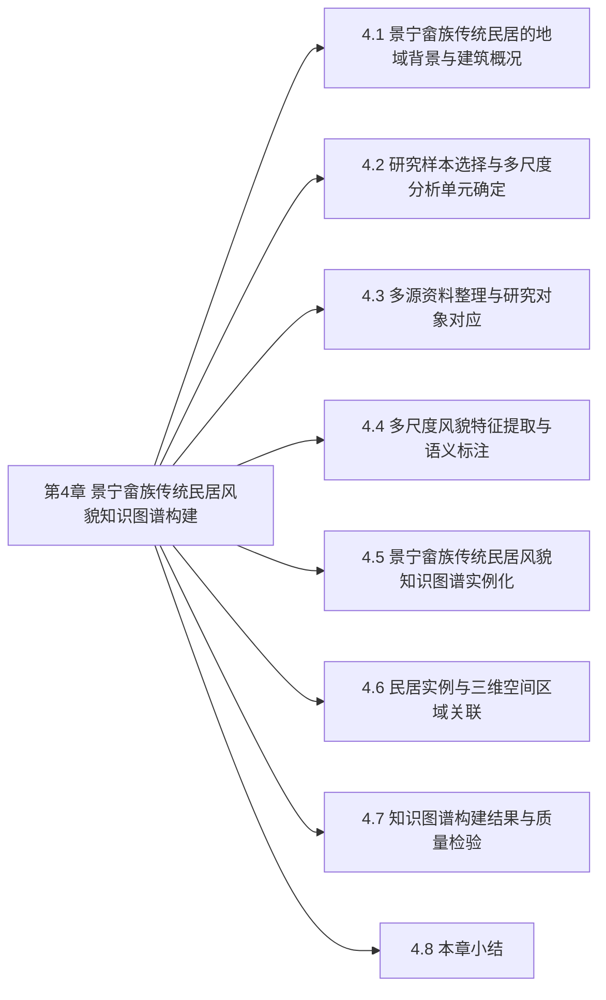

# 第4章 景宁畲族传统民居风貌知识图谱构建

本页为工作结构视图；原始章目与采用状态已接续至大纲结构主源。

<!-- dynamic-chapter:start -->
## 当前工作安排

> 由[[论文章节/大纲结构.yaml|大纲结构]]生成。修改主源后运行同步；文件夹编号仅为历史路径，不决定当前章节顺序。

**本章任务：** 依据景宁研究对象与资料，应用第三章体系完成特征记录和实例图谱构建，并在可核验资料范围内建立三维关联，呈现图谱成果、空间对应及质量边界。

**结构状态：** 按已确认分工调整的工作结构；正文与研究证据待补，不表示已完成应用或验证

[打开既有正文对应章](../%E5%85%A8%E6%96%87%E5%B7%A5%E4%BD%9C%E7%A8%BF/%E6%99%AF%E5%AE%81%E7%95%B2%E6%97%8F%E4%BC%A0%E7%BB%9F%E6%B0%91%E5%B1%85%E9%A3%8E%E8%B2%8C%E7%89%B9%E5%BE%81%E6%8F%90%E5%8F%96%E4%B8%8E%E7%9F%A5%E8%AF%86%E5%9B%BE%E8%B0%B1%E6%9E%84%E5%BB%BA%E7%A0%94%E7%A9%B6v0.6.md#%E7%AC%AC%E5%9B%9B%E7%AB%A0%20%E6%99%AF%E5%AE%81%E7%95%B2%E6%97%8F%E5%85%B8%E5%9E%8B%E6%9D%91%E8%90%BD%E9%A3%8E%E8%B2%8C%E7%89%B9%E5%BE%81%E6%8F%90%E5%8F%96%E4%B8%8E%E7%9F%A5%E8%AF%86%E5%9B%BE%E8%B0%B1%E6%9E%84%E5%BB%BA)。正文未随结构自动改写。

**章内逻辑：** 地域背景 → 样本与单元 → 资料对应 → 特征标注 → 图谱实例化 → 空间关联 → 质量检验。

**向后接续：** 向第五章交付可回查的真实实例事实和资料边界；三维关联仅约束依赖它的分析任务。

## 小节与主题成果采用表

| 小节 | 主题及成果入口 | 本节用途 | 采用状态与证据缺口 |
|---|---|---|---|
| 4.1 景宁畲族传统民居的地域背景与建筑概况 | [〔研究界定〕研究对象与样本边界](../../%E4%B8%BB%E9%A2%98%E7%A0%94%E7%A9%B6/%E3%80%94%E7%A0%94%E7%A9%B6%E7%95%8C%E5%AE%9A%E3%80%95%E7%A0%94%E7%A9%B6%E5%AF%B9%E8%B1%A1%E4%B8%8E%E6%A0%B7%E6%9C%AC%E8%BE%B9%E7%95%8C/%E3%80%94%E7%A0%94%E7%A9%B6%E7%95%8C%E5%AE%9A%E3%80%95%E7%A0%94%E7%A9%B6%E5%AF%B9%E8%B1%A1%E4%B8%8E%E6%A0%B7%E6%9C%AC%E8%BE%B9%E7%95%8C.md)、[〔理论与文献依据〕畲族民居研究与理论依据](../../%E4%B8%BB%E9%A2%98%E7%A0%94%E7%A9%B6/%E3%80%94%E7%90%86%E8%AE%BA%E4%B8%8E%E6%96%87%E7%8C%AE%E4%BE%9D%E6%8D%AE%E3%80%95%E7%95%B2%E6%97%8F%E6%B0%91%E5%B1%85%E7%A0%94%E7%A9%B6%E4%B8%8E%E7%90%86%E8%AE%BA%E4%BE%9D%E6%8D%AE/%E3%80%94%E7%90%86%E8%AE%BA%E4%B8%8E%E6%96%87%E7%8C%AE%E4%BE%9D%E6%8D%AE%E3%80%95%E7%95%B2%E6%97%8F%E6%B0%91%E5%B1%85%E7%A0%94%E7%A9%B6%E4%B8%8E%E7%90%86%E8%AE%BA%E4%BE%9D%E6%8D%AE.md) | 交代帮助理解研究民居及其群体组合的地域、聚居与建筑背景，不提前宣告本研究分析发现 | 按已确认分工调整的工作结构；正文与研究证据待补，不表示已完成应用或验证 |
| 4.2 研究样本选择与多尺度分析单元确定 | [〔研究界定〕研究对象与样本边界](../../%E4%B8%BB%E9%A2%98%E7%A0%94%E7%A9%B6/%E3%80%94%E7%A0%94%E7%A9%B6%E7%95%8C%E5%AE%9A%E3%80%95%E7%A0%94%E7%A9%B6%E5%AF%B9%E8%B1%A1%E4%B8%8E%E6%A0%B7%E6%9C%AC%E8%BE%B9%E7%95%8C/%E3%80%94%E7%A0%94%E7%A9%B6%E7%95%8C%E5%AE%9A%E3%80%95%E7%A0%94%E7%A9%B6%E5%AF%B9%E8%B1%A1%E4%B8%8E%E6%A0%B7%E6%9C%AC%E8%BE%B9%E7%95%8C.md) | 在第一章范围内落实样本选择、纳入依据以及村落、组团和单体的具体对应 | 按已确认分工调整的工作结构；正文与研究证据待补，不表示已完成应用或验证 |
| 4.3 多源资料整理与研究对象对应 | [〔研究方法〕三维资料质量与空间区域关联](../../%E4%B8%BB%E9%A2%98%E7%A0%94%E7%A9%B6/%E3%80%94%E7%A0%94%E7%A9%B6%E6%96%B9%E6%B3%95%E3%80%95%E4%B8%89%E7%BB%B4%E8%B5%84%E6%96%99%E8%B4%A8%E9%87%8F%E4%B8%8E%E7%A9%BA%E9%97%B4%E5%8C%BA%E5%9F%9F%E5%85%B3%E8%81%94/%E3%80%94%E7%A0%94%E7%A9%B6%E6%96%B9%E6%B3%95%E3%80%95%E4%B8%89%E7%BB%B4%E8%B5%84%E6%96%99%E8%B4%A8%E9%87%8F%E4%B8%8E%E7%A9%BA%E9%97%B4%E5%8C%BA%E5%9F%9F%E5%85%B3%E8%81%94.md)、[〔体系设计〕风貌特征筛选与数据记录](../../%E4%B8%BB%E9%A2%98%E7%A0%94%E7%A9%B6/%E3%80%94%E4%BD%93%E7%B3%BB%E8%AE%BE%E8%AE%A1%E3%80%95%E9%A3%8E%E8%B2%8C%E7%89%B9%E5%BE%81%E7%AD%9B%E9%80%89%E4%B8%8E%E6%95%B0%E6%8D%AE%E8%AE%B0%E5%BD%95/%E3%80%94%E4%BD%93%E7%B3%BB%E8%AE%BE%E8%AE%A1%E3%80%95%E9%A3%8E%E8%B2%8C%E7%89%B9%E5%BE%81%E7%AD%9B%E9%80%89%E4%B8%8E%E6%95%B0%E6%8D%AE%E8%AE%B0%E5%BD%95.md)、[〔研究界定〕研究对象与样本边界](../../%E4%B8%BB%E9%A2%98%E7%A0%94%E7%A9%B6/%E3%80%94%E7%A0%94%E7%A9%B6%E7%95%8C%E5%AE%9A%E3%80%95%E7%A0%94%E7%A9%B6%E5%AF%B9%E8%B1%A1%E4%B8%8E%E6%A0%B7%E6%9C%AC%E8%BE%B9%E7%95%8C/%E3%80%94%E7%A0%94%E7%A9%B6%E7%95%8C%E5%AE%9A%E3%80%95%E7%A0%94%E7%A9%B6%E5%AF%B9%E8%B1%A1%E4%B8%8E%E6%A0%B7%E6%9C%AC%E8%BE%B9%E7%95%8C.md) | 整理文献、图像、测绘及可用三维资料，明确来源、调查时点、对象对应和输入资料条件 | 按已确认分工调整的工作结构；正文与研究证据待补，不表示已完成应用或验证 |
| 4.4 多尺度风貌特征提取与语义标注 | [〔体系设计〕风貌特征筛选与数据记录](../../%E4%B8%BB%E9%A2%98%E7%A0%94%E7%A9%B6/%E3%80%94%E4%BD%93%E7%B3%BB%E8%AE%BE%E8%AE%A1%E3%80%95%E9%A3%8E%E8%B2%8C%E7%89%B9%E5%BE%81%E7%AD%9B%E9%80%89%E4%B8%8E%E6%95%B0%E6%8D%AE%E8%AE%B0%E5%BD%95/%E3%80%94%E4%BD%93%E7%B3%BB%E8%AE%BE%E8%AE%A1%E3%80%95%E9%A3%8E%E8%B2%8C%E7%89%B9%E5%BE%81%E7%AD%9B%E9%80%89%E4%B8%8E%E6%95%B0%E6%8D%AE%E8%AE%B0%E5%BD%95.md)、[〔研究方法〕类型识别与比较](../../%E4%B8%BB%E9%A2%98%E7%A0%94%E7%A9%B6/%E3%80%94%E7%A0%94%E7%A9%B6%E6%96%B9%E6%B3%95%E3%80%95%E7%B1%BB%E5%9E%8B%E8%AF%86%E5%88%AB%E4%B8%8E%E6%AF%94%E8%BE%83/%E3%80%94%E7%A0%94%E7%A9%B6%E6%96%B9%E6%B3%95%E3%80%95%E7%B1%BB%E5%9E%8B%E8%AF%86%E5%88%AB%E4%B8%8E%E6%AF%94%E8%BE%83.md) | 按第三章既定判据记录真实样本的特征、类型和关系；这里只做记录性类型判定，类型分布、共性差异与跨尺度发现留第五章 | 按已确认分工调整的工作结构；正文与研究证据待补，不表示已完成应用或验证 |
| 4.5 景宁畲族传统民居风貌知识图谱实例化 | [〔体系设计〕多尺度语义模型与建模依据](../../%E4%B8%BB%E9%A2%98%E7%A0%94%E7%A9%B6/%E3%80%94%E4%BD%93%E7%B3%BB%E8%AE%BE%E8%AE%A1%E3%80%95%E5%A4%9A%E5%B0%BA%E5%BA%A6%E8%AF%AD%E4%B9%89%E6%A8%A1%E5%9E%8B%E4%B8%8E%E5%BB%BA%E6%A8%A1%E4%BE%9D%E6%8D%AE/%E3%80%94%E4%BD%93%E7%B3%BB%E8%AE%BE%E8%AE%A1%E3%80%95%E5%A4%9A%E5%B0%BA%E5%BA%A6%E8%AF%AD%E4%B9%89%E6%A8%A1%E5%9E%8B%E4%B8%8E%E5%BB%BA%E6%A8%A1%E4%BE%9D%E6%8D%AE.md)、[〔体系设计〕风貌特征筛选与数据记录](../../%E4%B8%BB%E9%A2%98%E7%A0%94%E7%A9%B6/%E3%80%94%E4%BD%93%E7%B3%BB%E8%AE%BE%E8%AE%A1%E3%80%95%E9%A3%8E%E8%B2%8C%E7%89%B9%E5%BE%81%E7%AD%9B%E9%80%89%E4%B8%8E%E6%95%B0%E6%8D%AE%E8%AE%B0%E5%BD%95/%E3%80%94%E4%BD%93%E7%B3%BB%E8%AE%BE%E8%AE%A1%E3%80%95%E9%A3%8E%E8%B2%8C%E7%89%B9%E5%BE%81%E7%AD%9B%E9%80%89%E4%B8%8E%E6%95%B0%E6%8D%AE%E8%AE%B0%E5%BD%95.md) | 应用第三章规则，将真实特征记录组织为实例、类型、关系与证据相联的景宁图谱 | 按已确认分工调整的工作结构；正文与研究证据待补，不表示已完成应用或验证 |
| 4.6 民居实例与三维空间区域关联 | [〔研究方法〕三维资料质量与空间区域关联](../../%E4%B8%BB%E9%A2%98%E7%A0%94%E7%A9%B6/%E3%80%94%E7%A0%94%E7%A9%B6%E6%96%B9%E6%B3%95%E3%80%95%E4%B8%89%E7%BB%B4%E8%B5%84%E6%96%99%E8%B4%A8%E9%87%8F%E4%B8%8E%E7%A9%BA%E9%97%B4%E5%8C%BA%E5%9F%9F%E5%85%B3%E8%81%94/%E3%80%94%E7%A0%94%E7%A9%B6%E6%96%B9%E6%B3%95%E3%80%95%E4%B8%89%E7%BB%B4%E8%B5%84%E6%96%99%E8%B4%A8%E9%87%8F%E4%B8%8E%E7%A9%BA%E9%97%B4%E5%8C%BA%E5%9F%9F%E5%85%B3%E8%81%94.md) | 在可核验的真实资料范围内建立对象与区域对应，记录未覆盖、不可判定与受限情况 | 按已确认分工调整的工作结构；正文与研究证据待补，不表示已完成应用或验证 |
| 4.7 知识图谱构建结果与质量检验 | [〔体系设计〕多尺度语义模型与建模依据](../../%E4%B8%BB%E9%A2%98%E7%A0%94%E7%A9%B6/%E3%80%94%E4%BD%93%E7%B3%BB%E8%AE%BE%E8%AE%A1%E3%80%95%E5%A4%9A%E5%B0%BA%E5%BA%A6%E8%AF%AD%E4%B9%89%E6%A8%A1%E5%9E%8B%E4%B8%8E%E5%BB%BA%E6%A8%A1%E4%BE%9D%E6%8D%AE/%E3%80%94%E4%BD%93%E7%B3%BB%E8%AE%BE%E8%AE%A1%E3%80%95%E5%A4%9A%E5%B0%BA%E5%BA%A6%E8%AF%AD%E4%B9%89%E6%A8%A1%E5%9E%8B%E4%B8%8E%E5%BB%BA%E6%A8%A1%E4%BE%9D%E6%8D%AE.md)、[〔检验与评价〕图谱试建、查询与有效性](../../%E4%B8%BB%E9%A2%98%E7%A0%94%E7%A9%B6/%E3%80%94%E6%A3%80%E9%AA%8C%E4%B8%8E%E8%AF%84%E4%BB%B7%E3%80%95%E5%9B%BE%E8%B0%B1%E8%AF%95%E5%BB%BA%E3%80%81%E6%9F%A5%E8%AF%A2%E4%B8%8E%E6%9C%89%E6%95%88%E6%80%A7/%E3%80%94%E6%A3%80%E9%AA%8C%E4%B8%8E%E8%AF%84%E4%BB%B7%E3%80%95%E5%9B%BE%E8%B0%B1%E8%AF%95%E5%BB%BA%E3%80%81%E6%9F%A5%E8%AF%A2%E4%B8%8E%E6%9C%89%E6%95%88%E6%80%A7.md)、[〔研究方法〕三维资料质量与空间区域关联](../../%E4%B8%BB%E9%A2%98%E7%A0%94%E7%A9%B6/%E3%80%94%E7%A0%94%E7%A9%B6%E6%96%B9%E6%B3%95%E3%80%95%E4%B8%89%E7%BB%B4%E8%B5%84%E6%96%99%E8%B4%A8%E9%87%8F%E4%B8%8E%E7%A9%BA%E9%97%B4%E5%8C%BA%E5%9F%9F%E5%85%B3%E8%81%94/%E3%80%94%E7%A0%94%E7%A9%B6%E6%96%B9%E6%B3%95%E3%80%95%E4%B8%89%E7%BB%B4%E8%B5%84%E6%96%99%E8%B4%A8%E9%87%8F%E4%B8%8E%E7%A9%BA%E9%97%B4%E5%8C%BA%E5%9F%9F%E5%85%B3%E8%81%94.md) | 呈现实例图谱组成、资料覆盖、关系组织、来源可追溯性及空间对应核查结果，不替代第五章风貌分析 | 按已确认分工调整的工作结构；正文与研究证据待补，不表示已完成应用或验证 |
| 4.8 本章小结 | [〔检验与评价〕图谱试建、查询与有效性](../../%E4%B8%BB%E9%A2%98%E7%A0%94%E7%A9%B6/%E3%80%94%E6%A3%80%E9%AA%8C%E4%B8%8E%E8%AF%84%E4%BB%B7%E3%80%95%E5%9B%BE%E8%B0%B1%E8%AF%95%E5%BB%BA%E3%80%81%E6%9F%A5%E8%AF%A2%E4%B8%8E%E6%9C%89%E6%95%88%E6%80%A7/%E3%80%94%E6%A3%80%E9%AA%8C%E4%B8%8E%E8%AF%84%E4%BB%B7%E3%80%95%E5%9B%BE%E8%B0%B1%E8%AF%95%E5%BB%BA%E3%80%81%E6%9F%A5%E8%AF%A2%E4%B8%8E%E6%9C%89%E6%95%88%E6%80%A7.md)、[〔研究界定〕研究对象与样本边界](../../%E4%B8%BB%E9%A2%98%E7%A0%94%E7%A9%B6/%E3%80%94%E7%A0%94%E7%A9%B6%E7%95%8C%E5%AE%9A%E3%80%95%E7%A0%94%E7%A9%B6%E5%AF%B9%E8%B1%A1%E4%B8%8E%E6%A0%B7%E6%9C%AC%E8%BE%B9%E7%95%8C/%E3%80%94%E7%A0%94%E7%A9%B6%E7%95%8C%E5%AE%9A%E3%80%95%E7%A0%94%E7%A9%B6%E5%AF%B9%E8%B1%A1%E4%B8%8E%E6%A0%B7%E6%9C%AC%E8%BE%B9%E7%95%8C.md) | 归纳景宁图谱及三维关联成果，限定第五章输入 | 按已确认分工调整的工作结构；正文与研究证据待补，不表示已完成应用或验证 |

## 逐节研究问题与证据要求

以下是待执行的研究要求，不是已完成或已验证声明；采用状态仍以上表为准。

### 景宁畲族传统民居的地域背景与建筑概况

- **问题**：哪些地方背景与所研究民居的特征存在有据联系？
- **所需证据／待核材料**：地域与聚居文献及对象关联证据。
- **完成判据**：背景服务于民居解释，不扩展为全村综合研究；不据民族名称推断专属性。

### 研究样本选择与多尺度分析单元确定

- **问题**：哪些真实对象进入图谱，资料与身份是否支持纳入？
- **所需证据／待核材料**：对象身份与去重核查；样本清单、资料时点、选择理由与纳入排除标准。
- **完成判据**：正式样本经核查确定；首批资料村不自动成为固定样本，文献条目数不当建筑数。

### 多源资料整理与研究对象对应

- **问题**：各类真实资料能支持哪些记录、建库及关联任务？
- **所需证据／待核材料**：来源—对象—时点对应清单；三维文件、坐标、尺度、覆盖、遮挡与质量记录；缺失、不可判定及不适用信息。
- **完成判据**：已有、待核验和拟采集分列，不从历史方案推断实施完成；质量条件影响后续分析范围。

### 多尺度风貌特征提取与语义标注

- **问题**：如何把景宁资料转化为可追溯的特征及关系记录？
- **所需证据／待核材料**：真实标注记录与原文、原图定位；疑难判断、缺失与复核记录。
- **完成判据**：记录事实与推断分开，不能为了入库强填未知项；本节不代替第五章规律分析。

### 景宁畲族传统民居风貌知识图谱实例化

- **问题**：第三章的共用模型如何承载景宁对象，哪些内容需要有据适配？
- **所需证据／待核材料**：实例记录与来源对应；构建、导入和一致性校核记录；复用规则与必要适配的说明。
- **完成判据**：具体图谱构建作为研究成果呈现；不以导入成功证明风貌分析有效，不混入合成实例。

### 民居实例与三维空间区域关联

- **问题**：真实图谱对象与三维区域能否对应及追溯？
- **所需证据／待核材料**：对象—区域关联清单与定位记录；抽查、错配、遮挡及无法关联记录。
- **完成判据**：仅在可核验资料覆盖范围内实施；不足处标记未实施或受限，展示成功不替代质量判断。

### 知识图谱构建结果与质量检验

- **问题**：具体建成的图谱包含什么，哪些内容能够进入后续分析？
- **所需证据／待核材料**：实际图谱构成与覆盖情况；来源、一致性及关联质量校核；可查询任务与分析输入范围。
- **完成判据**：统计以实际图谱和记录为准；区分数据质量、查询可运行与建筑学解释，不预写规模或成效。

### 本章小结

- **问题**：图谱为哪些风貌分析提供了可靠材料，仍有哪些限制？
- **所需证据／待核材料**：可分析数据版本及来源；排除项、缺失项和资料限制。
- **完成判据**：形成实例图谱的证据与可分析范围，不提前给出风貌规律或有效性结论。

## 本章结构图

## 稳定节点与原稿接续

- `section-2-2`：景宁畲族传统民居的地域背景与建筑概况；纳入当前工作大纲。原稿编号：2.2；变更说明：2026-10-29用户确认体系—实例图谱—风貌分析分工；由“服务民居解释的聚居与环境背景”调整，保留稳定ID及原稿接续；正文未改写；2026-10-29标题与逻辑梳理：由“景宁畲族传统民居的地域与聚居背景”接续，仍为工作大纲，正文不改。

- `section-2-1`：研究样本选择与多尺度分析单元确定；纳入当前工作大纲。原稿编号：2.1；变更说明：2026-10-29用户确认体系—实例图谱—风貌分析分工；由“研究范围与传统民居对象边界”调整，保留稳定ID及原稿接续；正文未改写；2026-10-29标题与逻辑梳理：由“研究范围、民居样本与纳入依据”接续，仍为工作大纲，正文不改。

- `section-2-4`：多源资料整理与研究对象对应；纳入当前工作大纲。原稿编号：2.4；变更说明：2026-10-29用户确认体系—实例图谱—风貌分析分工；由“多源资料组成与三维数据条件”调整，保留稳定ID及原稿接续；正文未改写；2026-10-29标题与逻辑梳理：由“多源资料整理、对象对应与质量核查”接续，仍为工作大纲，正文不改。

- `section-4-2`：多尺度风貌特征提取与语义标注；纳入当前工作大纲。原稿编号：4.2；变更说明：2026-10-29用户确认体系—实例图谱—风貌分析分工；由“多尺度特征记录与语义标注”调整，保留稳定ID及原稿接续；正文未改写；2026-10-29标题与逻辑梳理：由“多尺度风貌特征提取与语义标注”接续，仍为工作大纲，正文不改。

- `section-4-3`：景宁畲族传统民居风貌知识图谱实例化；纳入当前工作大纲。原稿编号：4.3；变更说明：2026-10-29用户确认体系—实例图谱—风貌分析分工；由“语义模型实例化与图谱组织”调整，保留稳定ID及原稿接续；正文未改写；2026-10-29标题与逻辑梳理：由“景宁畲族传统民居知识图谱实例化构建”接续，仍为工作大纲，正文不改。

- `section-4-spatial-association`：民居实例与三维空间区域关联；纳入当前工作大纲。原稿编号：新节点；变更说明：2026-10-29用户确认体系—实例图谱—风貌分析分工；由“三维区域关联实施与对应核查”调整，保留稳定ID及原稿接续；正文未改写；2026-10-29标题与逻辑梳理：由“三维空间区域关联与对应核查”接续，仍为工作大纲，正文不改。

- `section-4-4`：知识图谱构建结果与质量检验；纳入当前工作大纲。原稿编号：4.4；变更说明：2026-10-29用户确认体系—实例图谱—风貌分析分工；由“实施质量校核、问题定位与规则反馈”调整，保留稳定ID及原稿接续；正文未改写；2026-10-29标题与逻辑梳理：由“知识图谱构建结果与质量校核”接续，仍为工作大纲，正文不改。

- `section-4-5`：本章小结；纳入当前工作大纲。原稿编号：4.5；变更说明：2026-10-29用户确认体系—实例图谱—风貌分析分工；由“本章小结：可用于分析的数据及限制”调整，保留稳定ID及原稿接续；正文未改写；2026-10-29标题与逻辑梳理：由“本章小结：实例图谱成果与分析条件”接续，仍为工作大纲，正文不改。

- `section-2-3`：候选民居核查与样本纳入依据；停用、保留追溯。原稿编号：2.3；变更说明：2026-10-29：样本纳入任务并入第四章“研究范围、民居样本与纳入依据”。

- `section-2-5`：资料质量、对象对应与证据记录；停用、保留追溯。原稿编号：2.5；变更说明：2026-10-29：资料质量任务并入第四章资料核查及图谱质量校核。

- `section-2-6`：本章小结：可用输入与研究限制；停用、保留追溯。原稿编号：2.6；变更说明：2026-10-29：原资料章小结由第四章实例图谱成果与分析条件接续。

- `section-4-1`：真实民居样本与实施数据准备；停用、保留追溯。原稿编号：4.1；变更说明：2026-10-29：数据准备任务并入第四章样本依据与多源资料整理，避免重复。

- `section-4-synthetic`：合成试建与规则检查的实施边界；停用、保留追溯。原稿编号：新节点；变更说明：2026-10-29：用户明确合成试建不进入正文，也不默认转入附录；V01、D01及规则试验继续在原过程材料主源维护。

## 调整与反馈

需要调整题名、顺序、节的归属或采用状态时，修改大纲结构；稳定ID不随编号改变。新增、停用、拆分合并必须保留理由及原稿接续，不能由文件数自动认定研究完成。
<!-- dynamic-chapter:end -->
