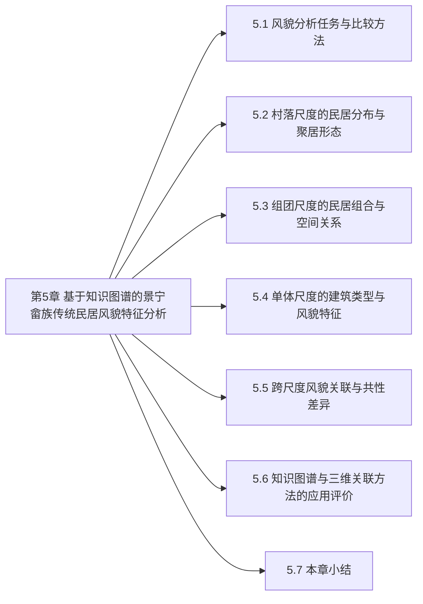

# 第5章 基于知识图谱的景宁畲族传统民居风貌特征分析

本页为工作结构视图；原始章目与采用状态已接续至大纲结构主源。

<!-- dynamic-chapter:start -->
## 当前工作安排

> 由[[论文章节/大纲结构.yaml|大纲结构]]生成。修改主源后运行同步；文件夹编号仅为历史路径，不决定当前章节顺序。

**本章任务：** 以实例图谱及原始资料为基础，按任务使用三维关联，分析民居类型、空间组合及跨尺度联系，形成有证据的建筑学认识；在此基础上评价体系及关联方法的应用作用。

**结构状态：** 按已确认分工调整的工作结构；正文与研究证据待补，不表示已完成应用或验证

[打开既有正文对应章](../%E5%85%A8%E6%96%87%E5%B7%A5%E4%BD%9C%E7%A8%BF/%E6%99%AF%E5%AE%81%E7%95%B2%E6%97%8F%E4%BC%A0%E7%BB%9F%E6%B0%91%E5%B1%85%E9%A3%8E%E8%B2%8C%E7%89%B9%E5%BE%81%E6%8F%90%E5%8F%96%E4%B8%8E%E7%9F%A5%E8%AF%86%E5%9B%BE%E8%B0%B1%E6%9E%84%E5%BB%BA%E7%A0%94%E7%A9%B6v0.6.md#%E7%AC%AC%E4%BA%94%E7%AB%A0%20%E5%9F%BA%E4%BA%8E%E7%9F%A5%E8%AF%86%E5%9B%BE%E8%B0%B1%E7%9A%84%E6%99%AF%E5%AE%81%E7%95%B2%E6%97%8F%E4%BC%A0%E7%BB%9F%E6%B0%91%E5%B1%85%E5%BB%BA%E7%AD%91%E9%A3%8E%E8%B2%8C%E7%BB%BC%E5%90%88%E8%AE%A4%E7%9F%A5)。正文未随结构自动改写。

**章内逻辑：** 分析任务 → 分尺度比较 → 跨尺度综合 → 方法应用评价。

**向后接续：** 向第六章交付有证据的风貌认识及方法应用判断；不以查询演示或图谱规模替代认识。

## 小节与主题成果采用表

| 小节 | 主题及成果入口 | 本节用途 | 采用状态与证据缺口 |
|---|---|---|---|
| 5.1 风貌分析任务与比较方法 | [〔检验与评价〕图谱试建、查询与有效性](../../%E4%B8%BB%E9%A2%98%E7%A0%94%E7%A9%B6/%E3%80%94%E6%A3%80%E9%AA%8C%E4%B8%8E%E8%AF%84%E4%BB%B7%E3%80%95%E5%9B%BE%E8%B0%B1%E8%AF%95%E5%BB%BA%E3%80%81%E6%9F%A5%E8%AF%A2%E4%B8%8E%E6%9C%89%E6%95%88%E6%80%A7/%E3%80%94%E6%A3%80%E9%AA%8C%E4%B8%8E%E8%AF%84%E4%BB%B7%E3%80%95%E5%9B%BE%E8%B0%B1%E8%AF%95%E5%BB%BA%E3%80%81%E6%9F%A5%E8%AF%A2%E4%B8%8E%E6%9C%89%E6%95%88%E6%80%A7.md)、[〔研究界定〕研究对象与样本边界](../../%E4%B8%BB%E9%A2%98%E7%A0%94%E7%A9%B6/%E3%80%94%E7%A0%94%E7%A9%B6%E7%95%8C%E5%AE%9A%E3%80%95%E7%A0%94%E7%A9%B6%E5%AF%B9%E8%B1%A1%E4%B8%8E%E6%A0%B7%E6%9C%AC%E8%BE%B9%E7%95%8C/%E3%80%94%E7%A0%94%E7%A9%B6%E7%95%8C%E5%AE%9A%E3%80%95%E7%A0%94%E7%A9%B6%E5%AF%B9%E8%B1%A1%E4%B8%8E%E6%A0%B7%E6%9C%AC%E8%BE%B9%E7%95%8C.md)、[〔研究方法〕类型识别与比较](../../%E4%B8%BB%E9%A2%98%E7%A0%94%E7%A9%B6/%E3%80%94%E7%A0%94%E7%A9%B6%E6%96%B9%E6%B3%95%E3%80%95%E7%B1%BB%E5%9E%8B%E8%AF%86%E5%88%AB%E4%B8%8E%E6%AF%94%E8%BE%83/%E3%80%94%E7%A0%94%E7%A9%B6%E6%96%B9%E6%B3%95%E3%80%95%E7%B1%BB%E5%9E%8B%E8%AF%86%E5%88%AB%E4%B8%8E%E6%AF%94%E8%BE%83.md) | 承接第二章分析依据、第三章规则和第四章可用事实，将已选方法落实到本案例的可比范围、查询和回查操作，不重新选择整套理论 | 按已确认分工调整的工作结构；正文与研究证据待补，不表示已完成应用或验证 |
| 5.2 村落尺度的民居分布与聚居形态 | [〔研究界定〕研究对象与样本边界](../../%E4%B8%BB%E9%A2%98%E7%A0%94%E7%A9%B6/%E3%80%94%E7%A0%94%E7%A9%B6%E7%95%8C%E5%AE%9A%E3%80%95%E7%A0%94%E7%A9%B6%E5%AF%B9%E8%B1%A1%E4%B8%8E%E6%A0%B7%E6%9C%AC%E8%BE%B9%E7%95%8C/%E3%80%94%E7%A0%94%E7%A9%B6%E7%95%8C%E5%AE%9A%E3%80%95%E7%A0%94%E7%A9%B6%E5%AF%B9%E8%B1%A1%E4%B8%8E%E6%A0%B7%E6%9C%AC%E8%BE%B9%E7%95%8C.md)、[〔检验与评价〕图谱试建、查询与有效性](../../%E4%B8%BB%E9%A2%98%E7%A0%94%E7%A9%B6/%E3%80%94%E6%A3%80%E9%AA%8C%E4%B8%8E%E8%AF%84%E4%BB%B7%E3%80%95%E5%9B%BE%E8%B0%B1%E8%AF%95%E5%BB%BA%E3%80%81%E6%9F%A5%E8%AF%A2%E4%B8%8E%E6%9C%89%E6%95%88%E6%80%A7/%E3%80%94%E6%A3%80%E9%AA%8C%E4%B8%8E%E8%AF%84%E4%BB%B7%E3%80%95%E5%9B%BE%E8%B0%B1%E8%AF%95%E5%BB%BA%E3%80%81%E6%9F%A5%E8%AF%A2%E4%B8%8E%E6%9C%89%E6%95%88%E6%80%A7.md) | 利用图谱和原始资料分析民居分布、聚居差异及有据的环境联系 | 按已确认分工调整的工作结构；正文与研究证据待补，不表示已完成应用或验证 |
| 5.3 组团尺度的民居组合与空间关系 | [〔研究方法〕类型识别与比较](../../%E4%B8%BB%E9%A2%98%E7%A0%94%E7%A9%B6/%E3%80%94%E7%A0%94%E7%A9%B6%E6%96%B9%E6%B3%95%E3%80%95%E7%B1%BB%E5%9E%8B%E8%AF%86%E5%88%AB%E4%B8%8E%E6%AF%94%E8%BE%83/%E3%80%94%E7%A0%94%E7%A9%B6%E6%96%B9%E6%B3%95%E3%80%95%E7%B1%BB%E5%9E%8B%E8%AF%86%E5%88%AB%E4%B8%8E%E6%AF%94%E8%BE%83.md)、[〔检验与评价〕图谱试建、查询与有效性](../../%E4%B8%BB%E9%A2%98%E7%A0%94%E7%A9%B6/%E3%80%94%E6%A3%80%E9%AA%8C%E4%B8%8E%E8%AF%84%E4%BB%B7%E3%80%95%E5%9B%BE%E8%B0%B1%E8%AF%95%E5%BB%BA%E3%80%81%E6%9F%A5%E8%AF%A2%E4%B8%8E%E6%9C%89%E6%95%88%E6%80%A7/%E3%80%94%E6%A3%80%E9%AA%8C%E4%B8%8E%E8%AF%84%E4%BB%B7%E3%80%95%E5%9B%BE%E8%B0%B1%E8%AF%95%E5%BB%BA%E3%80%81%E6%9F%A5%E8%AF%A2%E4%B8%8E%E6%9C%89%E6%95%88%E6%80%A7.md) | 利用图谱及可用空间资料分析排列、邻接、围合、体量及界面组合的特征与差异 | 按已确认分工调整的工作结构；正文与研究证据待补，不表示已完成应用或验证 |
| 5.4 单体尺度的建筑类型与风貌特征 | [〔研究方法〕类型识别与比较](../../%E4%B8%BB%E9%A2%98%E7%A0%94%E7%A9%B6/%E3%80%94%E7%A0%94%E7%A9%B6%E6%96%B9%E6%B3%95%E3%80%95%E7%B1%BB%E5%9E%8B%E8%AF%86%E5%88%AB%E4%B8%8E%E6%AF%94%E8%BE%83/%E3%80%94%E7%A0%94%E7%A9%B6%E6%96%B9%E6%B3%95%E3%80%95%E7%B1%BB%E5%9E%8B%E8%AF%86%E5%88%AB%E4%B8%8E%E6%AF%94%E8%BE%83.md)、[〔体系设计〕风貌特征筛选与数据记录](../../%E4%B8%BB%E9%A2%98%E7%A0%94%E7%A9%B6/%E3%80%94%E4%BD%93%E7%B3%BB%E8%AE%BE%E8%AE%A1%E3%80%95%E9%A3%8E%E8%B2%8C%E7%89%B9%E5%BE%81%E7%AD%9B%E9%80%89%E4%B8%8E%E6%95%B0%E6%8D%AE%E8%AE%B0%E5%BD%95/%E3%80%94%E4%BD%93%E7%B3%BB%E8%AE%BE%E8%AE%A1%E3%80%95%E9%A3%8E%E8%B2%8C%E7%89%B9%E5%BE%81%E7%AD%9B%E9%80%89%E4%B8%8E%E6%95%B0%E6%8D%AE%E8%AE%B0%E5%BD%95.md)、[〔检验与评价〕图谱试建、查询与有效性](../../%E4%B8%BB%E9%A2%98%E7%A0%94%E7%A9%B6/%E3%80%94%E6%A3%80%E9%AA%8C%E4%B8%8E%E8%AF%84%E4%BB%B7%E3%80%95%E5%9B%BE%E8%B0%B1%E8%AF%95%E5%BB%BA%E3%80%81%E6%9F%A5%E8%AF%A2%E4%B8%8E%E6%9C%89%E6%95%88%E6%80%A7/%E3%80%94%E6%A3%80%E9%AA%8C%E4%B8%8E%E8%AF%84%E4%BB%B7%E3%80%95%E5%9B%BE%E8%B0%B1%E8%AF%95%E5%BB%BA%E3%80%81%E6%9F%A5%E8%AF%A2%E4%B8%8E%E6%9C%89%E6%95%88%E6%80%A7.md) | 比较单体类型、特征组合、共同特征、变体与特殊个案，不把第三章的分类规则当作分析发现 | 按已确认分工调整的工作结构；正文与研究证据待补，不表示已完成应用或验证 |
| 5.5 跨尺度风貌关联与共性差异 | [〔检验与评价〕图谱试建、查询与有效性](../../%E4%B8%BB%E9%A2%98%E7%A0%94%E7%A9%B6/%E3%80%94%E6%A3%80%E9%AA%8C%E4%B8%8E%E8%AF%84%E4%BB%B7%E3%80%95%E5%9B%BE%E8%B0%B1%E8%AF%95%E5%BB%BA%E3%80%81%E6%9F%A5%E8%AF%A2%E4%B8%8E%E6%9C%89%E6%95%88%E6%80%A7/%E3%80%94%E6%A3%80%E9%AA%8C%E4%B8%8E%E8%AF%84%E4%BB%B7%E3%80%95%E5%9B%BE%E8%B0%B1%E8%AF%95%E5%BB%BA%E3%80%81%E6%9F%A5%E8%AF%A2%E4%B8%8E%E6%9C%89%E6%95%88%E6%80%A7.md)、[〔研究方法〕三维资料质量与空间区域关联](../../%E4%B8%BB%E9%A2%98%E7%A0%94%E7%A9%B6/%E3%80%94%E7%A0%94%E7%A9%B6%E6%96%B9%E6%B3%95%E3%80%95%E4%B8%89%E7%BB%B4%E8%B5%84%E6%96%99%E8%B4%A8%E9%87%8F%E4%B8%8E%E7%A9%BA%E9%97%B4%E5%8C%BA%E5%9F%9F%E5%85%B3%E8%81%94/%E3%80%94%E7%A0%94%E7%A9%B6%E6%96%B9%E6%B3%95%E3%80%95%E4%B8%89%E7%BB%B4%E8%B5%84%E6%96%99%E8%B4%A8%E9%87%8F%E4%B8%8E%E7%A9%BA%E9%97%B4%E5%8C%BA%E5%9F%9F%E5%85%B3%E8%81%94.md)、[〔研究方法〕类型识别与比较](../../%E4%B8%BB%E9%A2%98%E7%A0%94%E7%A9%B6/%E3%80%94%E7%A0%94%E7%A9%B6%E6%96%B9%E6%B3%95%E3%80%95%E7%B1%BB%E5%9E%8B%E8%AF%86%E5%88%AB%E4%B8%8E%E6%AF%94%E8%BE%83/%E3%80%94%E7%A0%94%E7%A9%B6%E6%96%B9%E6%B3%95%E3%80%95%E7%B1%BB%E5%9E%8B%E8%AF%86%E5%88%AB%E4%B8%8E%E6%AF%94%E8%BE%83.md) | 统合单体、组团与村落之间的对应关系和样本差异，形成超出分尺度罗列的风貌认识；文化与形成解释须有独立依据 | 按已确认分工调整的工作结构；正文与研究证据待补，不表示已完成应用或验证 |
| 5.6 知识图谱与三维关联方法的应用评价 | [〔检验与评价〕图谱试建、查询与有效性](../../%E4%B8%BB%E9%A2%98%E7%A0%94%E7%A9%B6/%E3%80%94%E6%A3%80%E9%AA%8C%E4%B8%8E%E8%AF%84%E4%BB%B7%E3%80%95%E5%9B%BE%E8%B0%B1%E8%AF%95%E5%BB%BA%E3%80%81%E6%9F%A5%E8%AF%A2%E4%B8%8E%E6%9C%89%E6%95%88%E6%80%A7/%E3%80%94%E6%A3%80%E9%AA%8C%E4%B8%8E%E8%AF%84%E4%BB%B7%E3%80%95%E5%9B%BE%E8%B0%B1%E8%AF%95%E5%BB%BA%E3%80%81%E6%9F%A5%E8%AF%A2%E4%B8%8E%E6%9C%89%E6%95%88%E6%80%A7.md)、[〔体系设计〕多尺度语义模型与建模依据](../../%E4%B8%BB%E9%A2%98%E7%A0%94%E7%A9%B6/%E3%80%94%E4%BD%93%E7%B3%BB%E8%AE%BE%E8%AE%A1%E3%80%95%E5%A4%9A%E5%B0%BA%E5%BA%A6%E8%AF%AD%E4%B9%89%E6%A8%A1%E5%9E%8B%E4%B8%8E%E5%BB%BA%E6%A8%A1%E4%BE%9D%E6%8D%AE/%E3%80%94%E4%BD%93%E7%B3%BB%E8%AE%BE%E8%AE%A1%E3%80%95%E5%A4%9A%E5%B0%BA%E5%BA%A6%E8%AF%AD%E4%B9%89%E6%A8%A1%E5%9E%8B%E4%B8%8E%E5%BB%BA%E6%A8%A1%E4%BE%9D%E6%8D%AE.md)、[〔理论与文献依据〕畲族民居研究与理论依据](../../%E4%B8%BB%E9%A2%98%E7%A0%94%E7%A9%B6/%E3%80%94%E7%90%86%E8%AE%BA%E4%B8%8E%E6%96%87%E7%8C%AE%E4%BE%9D%E6%8D%AE%E3%80%95%E7%95%B2%E6%97%8F%E6%B0%91%E5%B1%85%E7%A0%94%E7%A9%B6%E4%B8%8E%E7%90%86%E8%AE%BA%E4%BE%9D%E6%8D%AE/%E3%80%94%E7%90%86%E8%AE%BA%E4%B8%8E%E6%96%87%E7%8C%AE%E4%BE%9D%E6%8D%AE%E3%80%95%E7%95%B2%E6%97%8F%E6%B0%91%E5%B1%85%E7%A0%94%E7%A9%B6%E4%B8%8E%E7%90%86%E8%AE%BA%E4%BE%9D%E6%8D%AE.md)、[〔研究方法〕三维资料质量与空间区域关联](../../%E4%B8%BB%E9%A2%98%E7%A0%94%E7%A9%B6/%E3%80%94%E7%A0%94%E7%A9%B6%E6%96%B9%E6%B3%95%E3%80%95%E4%B8%89%E7%BB%B4%E8%B5%84%E6%96%99%E8%B4%A8%E9%87%8F%E4%B8%8E%E7%A9%BA%E9%97%B4%E5%8C%BA%E5%9F%9F%E5%85%B3%E8%81%94/%E3%80%94%E7%A0%94%E7%A9%B6%E6%96%B9%E6%B3%95%E3%80%95%E4%B8%89%E7%BB%B4%E8%B5%84%E6%96%99%E8%B4%A8%E9%87%8F%E4%B8%8E%E7%A9%BA%E9%97%B4%E5%8C%BA%E5%9F%9F%E5%85%B3%E8%81%94.md) | 依据本章实际分析讨论图谱和三维关联分别支持什么、限制什么，说明体系可用性、复用条件与成本；不预写优越性 | 按已确认分工调整的工作结构；正文与研究证据待补，不表示已完成应用或验证 |
| 5.7 本章小结 | [〔检验与评价〕图谱试建、查询与有效性](../../%E4%B8%BB%E9%A2%98%E7%A0%94%E7%A9%B6/%E3%80%94%E6%A3%80%E9%AA%8C%E4%B8%8E%E8%AF%84%E4%BB%B7%E3%80%95%E5%9B%BE%E8%B0%B1%E8%AF%95%E5%BB%BA%E3%80%81%E6%9F%A5%E8%AF%A2%E4%B8%8E%E6%9C%89%E6%95%88%E6%80%A7/%E3%80%94%E6%A3%80%E9%AA%8C%E4%B8%8E%E8%AF%84%E4%BB%B7%E3%80%95%E5%9B%BE%E8%B0%B1%E8%AF%95%E5%BB%BA%E3%80%81%E6%9F%A5%E8%AF%A2%E4%B8%8E%E6%9C%89%E6%95%88%E6%80%A7.md) | 归纳可进入结论的风貌发现及其适用边界 | 按已确认分工调整的工作结构；正文与研究证据待补，不表示已完成应用或验证 |

## 逐节研究问题与证据要求

以下是待执行的研究要求，不是已完成或已验证声明；采用状态仍以上表为准。

### 风貌分析任务与比较方法

- **问题**：要认识哪些民居类型、组合或空间联系，什么资料与方法能够支持？
- **所需证据／待核材料**：第四章可分析数据及样本条件；分析问题—查询/比较—原始证据对应关系。
- **完成判据**：分析议题不是预定发现；同条件比较范围可说明，不以软件功能清单代替建筑学问题。

### 村落尺度的民居分布与聚居形态

- **问题**：可用样本反映哪些聚居特征及差异？
- **所需证据／待核材料**：位置与对象对应数据；分布比较结果及原始资料；环境关联的证据与解释条件。
- **完成判据**：结论限定于样本与资料范围，不扩展为全村综合风貌评价。

### 组团尺度的民居组合与空间关系

- **问题**：样本的组合模式及空间关系呈现哪些建筑学特征？
- **所需证据／待核材料**：组团边界与关系记录；图谱查询、比较结果及图纸/图像定位；边界歧义与反例。
- **完成判据**：组团划分和结果可复核，描述模式与机制解释分开。

### 单体尺度的建筑类型与风貌特征

- **问题**：哪些组合是样本共同特征，哪些构成类型差异或个案变体？
- **所需证据／待核材料**：类型判定及特征记录；共现或比较结果；原图、测绘及来源回查。
- **完成判据**：共同、典型与特殊个案分开；无比较证据不称畲族独有。

### 跨尺度风貌关联与共性差异

- **问题**：不同单体特征怎样与组团组合、村落聚居相联系，样本间体现哪些共性和差异？
- **所需证据／待核材料**：跨尺度关系与比较结果；对象、空间区域及原始证据回查；反例、缺失与解释限制。
- **完成判据**：形成跨尺度对应及有原始依据的建筑学解释，不重复单尺度统计，不把关联推为因果或民族专属性。

### 知识图谱与三维关联方法的应用评价

- **问题**：图谱组织和三维关联分别为风貌分析提供了什么支持，其资料、操作和复用边界是什么？
- **所需证据／待核材料**：结果—证据—建筑学解释对应；既有研究对照；真实应用中的共用规则、必要适配及失败/成本记录。
- **完成判据**：从本章实际分析回查方法作用；区分图谱与三维关联的贡献、未实施任务和局限，不预设优越性或把展示功能当作有效性。

### 本章小结

- **问题**：哪些结论有直接证据，哪些仍是解释或待验证推断？
- **所需证据／待核材料**：风貌结论—分析结果—原始来源对应表。
- **完成判据**：事实、解释与推断分列，不超出样本覆盖；不预先填入尚未得到的发现。

## 本章结构图

## 稳定节点与原稿接续

- `section-5-1`：风貌分析任务与比较方法；纳入当前工作大纲。原稿编号：5.1；变更说明：2026-10-29用户确认体系—实例图谱—风貌分析分工；由“分析任务、比较条件与评价方案”调整，保留稳定ID及原稿接续；正文未改写；2026-10-29标题与逻辑梳理：由“风貌分析问题、样本范围与比较方法”接续，仍为工作大纲，正文不改。

- `section-5-2`：村落尺度的民居分布与聚居形态；纳入当前工作大纲。原稿编号：5.2；变更说明：2026-10-29用户确认体系—实例图谱—风貌分析分工；由“村落尺度的民居分布与聚居差异”调整，保留稳定ID及原稿接续；正文未改写；2026-10-29标题与逻辑梳理：由“村落尺度的民居分布与聚居特征”接续，仍为工作大纲，正文不改。

- `section-5-3`：组团尺度的民居组合与空间关系；纳入当前工作大纲。原稿编号：5.3；变更说明：2026-10-29用户确认体系—实例图谱—风貌分析分工；由“组团尺度的民居组合与空间关系”调整，保留稳定ID及原稿接续；正文未改写；2026-10-29标题与逻辑梳理：由“组团尺度的民居组合与空间关系”接续，仍为工作大纲，正文不改。

- `section-5-4`：单体尺度的建筑类型与风貌特征；纳入当前工作大纲。原稿编号：5.4；变更说明：2026-10-29用户确认体系—实例图谱—风貌分析分工；由“单体尺度的风貌类型与特征组合”调整，保留稳定ID及原稿接续；正文未改写；2026-10-29标题与逻辑梳理：由“单体尺度的风貌类型与特征组合”接续，仍为工作大纲，正文不改。

- `section-5-5`：跨尺度风貌关联与共性差异；纳入当前工作大纲。原稿编号：5.5；变更说明：2026-10-29用户确认体系—实例图谱—风貌分析分工；由“跨尺度查询与三维关联支持的风貌比较”调整，保留稳定ID及原稿接续；正文未改写；2026-10-29标题与逻辑梳理：由“跨尺度风貌关联与样本综合比较”接续，仍为工作大纲，正文不改。

- `section-5-6`：知识图谱与三维关联方法的应用评价；纳入当前工作大纲。原稿编号：5.6；变更说明：2026-10-29用户确认体系—实例图谱—风貌分析分工；由“方法有效性、适用条件与局限讨论”调整，保留稳定ID及原稿接续；正文未改写；2026-10-29标题与逻辑梳理：由“风貌认识的综合归纳与体系应用讨论”接续，仍为工作大纲，正文不改。

- `section-5-7`：本章小结；纳入当前工作大纲。原稿编号：5.7；变更说明：2026-10-29用户确认体系—实例图谱—风貌分析分工；由“本章小结：建筑认识与方法证据”调整，保留稳定ID及原稿接续；正文未改写；2026-10-29标题与逻辑梳理：由“本章小结：风貌特征与建筑学认识”接续，仍为工作大纲，正文不改。

## 调整与反馈

需要调整题名、顺序、节的归属或采用状态时，修改大纲结构；稳定ID不随编号改变。新增、停用、拆分合并必须保留理由及原稿接续，不能由文件数自动认定研究完成。
<!-- dynamic-chapter:end -->
