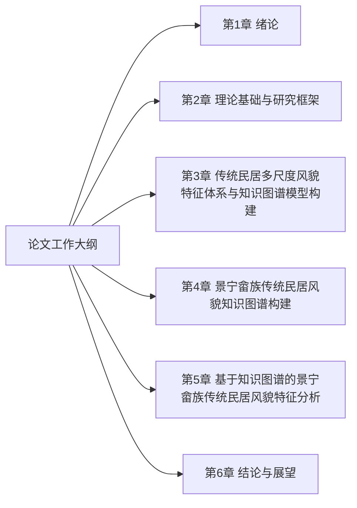

# 现行工作大纲

**这是可调整的工作大纲，不是定稿目录，也不是正文自动改写结果。**

结构维护：[[论文章节/大纲结构.yaml]]；研究目标：[[context/PROJECT_CONTEXT.md]]；工作路线：[[研究成果/〔研究路线〕论文研究路径/研究路径工作图.md]]。

按2026-11-05用户授权方案组织理论与框架—体系与方法—真实案例构建—风貌分析与认识；二级按论证任务、三级按具体内容组织，合成试建保留正文外身份。结构修订不代表样本、规则、有效性或论文结论已验证；旧正文与原稿锚点继续保留。

## 章节总览

| 当前章节 | 论证任务 | 结构状态 |
|---|---|---|
| [第1章 绪论](%E7%AB%A0%E8%8A%82%E5%AF%BC%E8%88%AA/01-%E7%BB%AA%E8%AE%BA.md) | 提出景宁畲族传统民居风貌研究问题，交代体系构建、实例图谱构建和建筑学分析的目标及证据要求。 | 按已确认分工调整的工作结构；正文与研究证据待补，不表示已完成应用或验证 |
| [第2章 理论基础与研究框架](%E7%AB%A0%E8%8A%82%E5%AF%BC%E8%88%AA/02-%E7%90%86%E8%AE%BA%E5%9F%BA%E7%A1%80.md) | 依次回答传统民居风貌是什么、如何分析及其理论依据、知识图谱是什么、二者怎样结合，论证理论与技术支撑并形成研究框架。区别于绪论的范围交代，本章展开概念辨析与采用理由；具体特征、模型及规则在第三章构建。 | 四问题工作结构已确认；概念综合、理论取舍及结合论证待完成。下方正文入口仅供旧稿参考，尚未按本章新大纲改写 |
| [第3章 传统民居多尺度风貌特征体系与知识图谱模型构建](%E7%AB%A0%E8%8A%82%E5%AF%BC%E8%88%AA/03-%E4%BD%93%E7%B3%BB%E4%B8%8E%E6%A8%A1%E5%9E%8B.md) | 将各尺度的建筑特征分类与语义表达共同展开，形成适用范围明确的可复用特征体系、图谱模型、关联规则与类型比较方法；不预写景宁风貌结论。 | 按已确认分工调整的工作结构；正文与研究证据待补，不表示已完成应用或验证 |
| [第4章 景宁畲族传统民居风貌知识图谱构建](%E7%AB%A0%E8%8A%82%E5%AF%BC%E8%88%AA/04-%E6%99%AF%E5%AE%81%E5%AE%9E%E4%BE%8B.md) | 依据景宁研究对象与资料，应用第三章体系完成特征记录和实例图谱构建，并在可核验资料范围内建立三维关联，呈现图谱成果、空间对应及质量边界。 | 按已确认分工调整的工作结构；正文与研究证据待补，不表示已完成应用或验证 |
| [第5章 基于知识图谱的景宁畲族传统民居风貌特征分析](%E7%AB%A0%E8%8A%82%E5%AF%BC%E8%88%AA/05-%E9%A3%8E%E8%B2%8C%E5%88%86%E6%9E%90.md) | 以实例图谱及原始资料为基础，按任务使用三维关联，分析民居类型、空间组合及跨尺度联系，形成有证据的建筑学认识；在此基础上评价体系及关联方法的应用作用。 | 按已确认分工调整的工作结构；正文与研究证据待补，不表示已完成应用或验证 |
| [第6章 结论与展望](%E7%AB%A0%E8%8A%82%E5%AF%BC%E8%88%AA/06-%E7%BB%93%E8%AE%BA.md) | 分别总结特征体系与模型、景宁实例图谱及建筑学认识，限定贡献、适用范围与尚未解决的问题。 | 按已确认分工调整的工作结构；正文与研究证据待补，不表示已完成应用或验证 |

## 当前整理重点

优化章际和章内论证层级；第三章讲规则、第四章讲真实事实、第五章讲建筑学认识；目录更新不等于正文、样本或实证完成。

**全文逻辑：** 问题与范围 → 理论与研究框架 → 特征体系、图谱构建与类型比较方法 → 真实样本、可靠记录与实例图谱 → 分尺度分析、跨尺度综合与应用评价 → 结论及适用范围。

## 标题总览（二级与已展开的三级）

### 第1章 绪论

**章内逻辑：** 背景 → 对象范围 → 研究现状 → 问题目标 → 内容方法 → 技术路线。

- [1.1 研究背景](%E7%AB%A0%E8%8A%82%E5%AF%BC%E8%88%AA/01-%E7%BB%AA%E8%AE%BA.md#section-1-1)
- [1.2 研究对象与研究范围](%E7%AB%A0%E8%8A%82%E5%AF%BC%E8%88%AA/01-%E7%BB%AA%E8%AE%BA.md#section-1-3)
- [1.3 国内外研究现状与评述](%E7%AB%A0%E8%8A%82%E5%AF%BC%E8%88%AA/01-%E7%BB%AA%E8%AE%BA.md#section-1-4)
- [1.4 研究问题、目标与意义](%E7%AB%A0%E8%8A%82%E5%AF%BC%E8%88%AA/01-%E7%BB%AA%E8%AE%BA.md#section-1-2)
- [1.5 研究内容与研究方法](%E7%AB%A0%E8%8A%82%E5%AF%BC%E8%88%AA/01-%E7%BB%AA%E8%AE%BA.md#section-1-5)
- [1.6 技术路线与论文结构](%E7%AB%A0%E8%8A%82%E5%AF%BC%E8%88%AA/01-%E7%BB%AA%E8%AE%BA.md#section-1-6)

**向后接续：** 输出研究问题和范围，交第二章论证概念、分析依据及结合方式。

### 第2章 理论基础与研究框架

**章内逻辑：** 风貌是什么 → 怎样分析 → 图谱是什么 → 如何结合 → 研究框架。

- [2.1 传统民居风貌的概念与研究内涵](%E7%AB%A0%E8%8A%82%E5%AF%BC%E8%88%AA/02-%E7%90%86%E8%AE%BA%E5%9F%BA%E7%A1%80.md#section-2-style-concept)
  - [2.1.1 传统民居风貌的内涵与相关概念](%E7%AB%A0%E8%8A%82%E5%AF%BC%E8%88%AA/02-%E7%90%86%E8%AE%BA%E5%9F%BA%E7%A1%80.md#sub-concept-definition)
  - [2.1.2 民居风貌的物质构成与空间组织](%E7%AB%A0%E8%8A%82%E5%AF%BC%E8%88%AA/02-%E7%90%86%E8%AE%BA%E5%9F%BA%E7%A1%80.md#sub-concept-physical)
  - [2.1.3 民居风貌的地域文化内涵与形成背景](%E7%AB%A0%E8%8A%82%E5%AF%BC%E8%88%AA/02-%E7%90%86%E8%AE%BA%E5%9F%BA%E7%A1%80.md#sub-concept-cultural)
  - [2.1.4 本研究的风貌分析范围与内容](%E7%AB%A0%E8%8A%82%E5%AF%BC%E8%88%AA/02-%E7%90%86%E8%AE%BA%E5%9F%BA%E7%A1%80.md#sub-concept-scope)
- [2.2 传统民居风貌分析的理论方法及其适用性](%E7%AB%A0%E8%8A%82%E5%AF%BC%E8%88%AA/02-%E7%90%86%E8%AE%BA%E5%9F%BA%E7%A1%80.md#section-2-analysis-foundations)
  - [2.2.1 建筑类型学与民居类型比较](%E7%AB%A0%E8%8A%82%E5%AF%BC%E8%88%AA/02-%E7%90%86%E8%AE%BA%E5%9F%BA%E7%A1%80.md#sub-analysis-typology)
  - [2.2.2 形态分析与多尺度空间组织研究](%E7%AB%A0%E8%8A%82%E5%AF%BC%E8%88%AA/02-%E7%90%86%E8%AE%BA%E5%9F%BA%E7%A1%80.md#sub-analysis-morphology)
  - [2.2.3 环境感知与风貌认知研究](%E7%AB%A0%E8%8A%82%E5%AF%BC%E8%88%AA/02-%E7%90%86%E8%AE%BA%E5%9F%BA%E7%A1%80.md#sub-analysis-perception)
  - [2.2.4 地域文化与生活方式的关联解释](%E7%AB%A0%E8%8A%82%E5%AF%BC%E8%88%AA/02-%E7%90%86%E8%AE%BA%E5%9F%BA%E7%A1%80.md#sub-analysis-culture)
  - [2.2.5 理论方法比较与本研究的选择](%E7%AB%A0%E8%8A%82%E5%AF%BC%E8%88%AA/02-%E7%90%86%E8%AE%BA%E5%9F%BA%E7%A1%80.md#sub-analysis-selection)
- [2.3 知识图谱与领域本体的建模基础](%E7%AB%A0%E8%8A%82%E5%AF%BC%E8%88%AA/02-%E7%90%86%E8%AE%BA%E5%9F%BA%E7%A1%80.md#section-2-kg-foundations)
  - [2.3.1 知识图谱的概念与基本构成](%E7%AB%A0%E8%8A%82%E5%AF%BC%E8%88%AA/02-%E7%90%86%E8%AE%BA%E5%9F%BA%E7%A1%80.md#sub-kg-concepts)
  - [2.3.2 知识表示与模式—实例结构](%E7%AB%A0%E8%8A%82%E5%AF%BC%E8%88%AA/02-%E7%90%86%E8%AE%BA%E5%9F%BA%E7%A1%80.md#sub-kg-representation)
  - [2.3.3 领域本体复用与建筑知识建模](%E7%AB%A0%E8%8A%82%E5%AF%BC%E8%88%AA/02-%E7%90%86%E8%AE%BA%E5%9F%BA%E7%A1%80.md#sub-kg-ontology)
  - [2.3.4 知识图谱构建与查询分析的基本过程](%E7%AB%A0%E8%8A%82%E5%AF%BC%E8%88%AA/02-%E7%90%86%E8%AE%BA%E5%9F%BA%E7%A1%80.md#sub-kg-workflow)
- [2.4 风貌分析与知识图谱结合的研究框架](%E7%AB%A0%E8%8A%82%E5%AF%BC%E8%88%AA/02-%E7%90%86%E8%AE%BA%E5%9F%BA%E7%A1%80.md#section-2-integration-framework)
  - [2.4.1 风貌分析任务与知识组织需求的对应](%E7%AB%A0%E8%8A%82%E5%AF%BC%E8%88%AA/02-%E7%90%86%E8%AE%BA%E5%9F%BA%E7%A1%80.md#sub-integration-needs)
  - [2.4.2 风貌分析与知识图谱结合的方法依据](%E7%AB%A0%E8%8A%82%E5%AF%BC%E8%88%AA/02-%E7%90%86%E8%AE%BA%E5%9F%BA%E7%A1%80.md#sub-integration-methods)
  - [2.4.3 知识图谱与三维空间关联的技术支撑](%E7%AB%A0%E8%8A%82%E5%AF%BC%E8%88%AA/02-%E7%90%86%E8%AE%BA%E5%9F%BA%E7%A1%80.md#sub-integration-technology)
  - [2.4.4 本研究的总体框架与章节衔接](%E7%AB%A0%E8%8A%82%E5%AF%BC%E8%88%AA/02-%E7%90%86%E8%AE%BA%E5%9F%BA%E7%A1%80.md#sub-integration-framework)
- [2.5 本章小结](%E7%AB%A0%E8%8A%82%E5%AF%BC%E8%88%AA/02-%E7%90%86%E8%AE%BA%E5%9F%BA%E7%A1%80.md#section-2-summary)

**向后接续：** 向第三章交付观察与表达的依据；不在本章提前完成具体特征表或图谱模型。

### 第3章 传统民居多尺度风貌特征体系与知识图谱模型构建

**章内逻辑：** 构建依据 → 特征内容及分尺度表达 → 统一知识组织与构建 → 类型识别与比较方法。

- [3.1 风貌特征体系的构建依据与原则](%E7%AB%A0%E8%8A%82%E5%AF%BC%E8%88%AA/03-%E4%BD%93%E7%B3%BB%E4%B8%8E%E6%A8%A1%E5%9E%8B.md#section-3-2)
- [3.2 多尺度风貌特征体系及其知识表达](%E7%AB%A0%E8%8A%82%E5%AF%BC%E8%88%AA/03-%E4%BD%93%E7%B3%BB%E4%B8%8E%E6%A8%A1%E5%9E%8B.md#section-3-multiscale)
  - [3.2.1 村落尺度的民居聚居特征](%E7%AB%A0%E8%8A%82%E5%AF%BC%E8%88%AA/03-%E4%BD%93%E7%B3%BB%E4%B8%8E%E6%A8%A1%E5%9E%8B.md#section-3-village)
  - [3.2.2 组团尺度的民居组合特征](%E7%AB%A0%E8%8A%82%E5%AF%BC%E8%88%AA/03-%E4%BD%93%E7%B3%BB%E4%B8%8E%E6%A8%A1%E5%9E%8B.md#section-3-group)
  - [3.2.3 单体尺度的民居建筑特征](%E7%AB%A0%E8%8A%82%E5%AF%BC%E8%88%AA/03-%E4%BD%93%E7%B3%BB%E4%B8%8E%E6%A8%A1%E5%9E%8B.md#section-3-building)
- [3.3 知识图谱模型与构建方法](%E7%AB%A0%E8%8A%82%E5%AF%BC%E8%88%AA/03-%E4%BD%93%E7%B3%BB%E4%B8%8E%E6%A8%A1%E5%9E%8B.md#section-3-graph-methods)
  - [3.3.1 图谱总体结构与跨尺度知识关联](%E7%AB%A0%E8%8A%82%E5%AF%BC%E8%88%AA/03-%E4%BD%93%E7%B3%BB%E4%B8%8E%E6%A8%A1%E5%9E%8B.md#section-3-3)
  - [3.3.2 语义对象与三维空间区域关联](%E7%AB%A0%E8%8A%82%E5%AF%BC%E8%88%AA/03-%E4%BD%93%E7%B3%BB%E4%B8%8E%E6%A8%A1%E5%9E%8B.md#section-3-spatial-association)
  - [3.3.3 图谱实例化规则与质量控制方法](%E7%AB%A0%E8%8A%82%E5%AF%BC%E8%88%AA/03-%E4%BD%93%E7%B3%BB%E4%B8%8E%E6%A8%A1%E5%9E%8B.md#section-3-4)
- [3.4 风貌类型识别与比较分析方法](%E7%AB%A0%E8%8A%82%E5%AF%BC%E8%88%AA/03-%E4%BD%93%E7%B3%BB%E4%B8%8E%E6%A8%A1%E5%9E%8B.md#section-3-type-methods)
  - [3.4.1 类型识别与归类规则](%E7%AB%A0%E8%8A%82%E5%AF%BC%E8%88%AA/03-%E4%BD%93%E7%B3%BB%E4%B8%8E%E6%A8%A1%E5%9E%8B.md#sub-type-classification)
  - [3.4.2 类型组合与跨尺度比较](%E7%AB%A0%E8%8A%82%E5%AF%BC%E8%88%AA/03-%E4%BD%93%E7%B3%BB%E4%B8%8E%E6%A8%A1%E5%9E%8B.md#sub-type-comparison)
- [3.5 本章小结](%E7%AB%A0%E8%8A%82%E5%AF%BC%E8%88%AA/03-%E4%BD%93%E7%B3%BB%E4%B8%8E%E6%A8%A1%E5%9E%8B.md#section-3-5)

**向后接续：** 向第四章交付记录、实例化、质量与三维关联规则；向第五章交付类型识别与比较程序。规则不等于真实类型发现。

### 第4章 景宁畲族传统民居风貌知识图谱构建

**章内逻辑：** 研究对象与样本 → 可靠资料与特征记录 → 实例知识组织与空间关联 → 构建成果和使用边界。

- [4.1 研究区域与样本确定](%E7%AB%A0%E8%8A%82%E5%AF%BC%E8%88%AA/04-%E6%99%AF%E5%AE%81%E5%AE%9E%E4%BE%8B.md#section-4-sampling)
  - [4.1.1 研究区域与传统民居概况](%E7%AB%A0%E8%8A%82%E5%AF%BC%E8%88%AA/04-%E6%99%AF%E5%AE%81%E5%AE%9E%E4%BE%8B.md#section-2-2)
  - [4.1.2 样本选择与多尺度分析单元确定](%E7%AB%A0%E8%8A%82%E5%AF%BC%E8%88%AA/04-%E6%99%AF%E5%AE%81%E5%AE%9E%E4%BE%8B.md#section-2-1)
- [4.2 多源资料采集与风貌特征提取](%E7%AB%A0%E8%8A%82%E5%AF%BC%E8%88%AA/04-%E6%99%AF%E5%AE%81%E5%AE%9E%E4%BE%8B.md#section-4-data-production)
  - [4.2.1 多源资料采集、整理与质量评估](%E7%AB%A0%E8%8A%82%E5%AF%BC%E8%88%AA/04-%E6%99%AF%E5%AE%81%E5%AE%9E%E4%BE%8B.md#section-2-4)
  - [4.2.2 风貌特征提取与语义标注](%E7%AB%A0%E8%8A%82%E5%AF%BC%E8%88%AA/04-%E6%99%AF%E5%AE%81%E5%AE%9E%E4%BE%8B.md#section-4-2)
- [4.3 实例图谱构建与三维空间关联](%E7%AB%A0%E8%8A%82%E5%AF%BC%E8%88%AA/04-%E6%99%AF%E5%AE%81%E5%AE%9E%E4%BE%8B.md#section-4-instance-construction)
  - [4.3.1 实例数据组织与图谱构建](%E7%AB%A0%E8%8A%82%E5%AF%BC%E8%88%AA/04-%E6%99%AF%E5%AE%81%E5%AE%9E%E4%BE%8B.md#section-4-3)
  - [4.3.2 民居对象与三维空间区域关联](%E7%AB%A0%E8%8A%82%E5%AF%BC%E8%88%AA/04-%E6%99%AF%E5%AE%81%E5%AE%9E%E4%BE%8B.md#section-4-spatial-association)
- [4.4 图谱构建成果与质量检验](%E7%AB%A0%E8%8A%82%E5%AF%BC%E8%88%AA/04-%E6%99%AF%E5%AE%81%E5%AE%9E%E4%BE%8B.md#section-4-4)
  - [4.4.1 图谱成果及其覆盖范围](%E7%AB%A0%E8%8A%82%E5%AF%BC%E8%88%AA/04-%E6%99%AF%E5%AE%81%E5%AE%9E%E4%BE%8B.md#sub-case-coverage)
  - [4.4.2 数据质量检验与使用边界](%E7%AB%A0%E8%8A%82%E5%AF%BC%E8%88%AA/04-%E6%99%AF%E5%AE%81%E5%AE%9E%E4%BE%8B.md#sub-case-quality)
- [4.5 本章小结](%E7%AB%A0%E8%8A%82%E5%AF%BC%E8%88%AA/04-%E6%99%AF%E5%AE%81%E5%AE%9E%E4%BE%8B.md#section-4-5)

**向后接续：** 向第五章交付可回查的真实实例事实和资料边界；三维关联仅约束依赖它的分析任务。

### 第5章 基于知识图谱的景宁畲族传统民居风貌特征分析

**章内逻辑：** 分尺度分析 → 跨尺度类型组合与综合认识 → 方法应用评价。

- [5.1 村落尺度的民居分布与环境关系](%E7%AB%A0%E8%8A%82%E5%AF%BC%E8%88%AA/05-%E9%A3%8E%E8%B2%8C%E5%88%86%E6%9E%90.md#section-5-2)
- [5.2 组团尺度的民居组合与街巷空间](%E7%AB%A0%E8%8A%82%E5%AF%BC%E8%88%AA/05-%E9%A3%8E%E8%B2%8C%E5%88%86%E6%9E%90.md#section-5-3)
- [5.3 单体尺度的民居类型与建筑特征](%E7%AB%A0%E8%8A%82%E5%AF%BC%E8%88%AA/05-%E9%A3%8E%E8%B2%8C%E5%88%86%E6%9E%90.md#section-5-4)
- [5.4 跨尺度风貌关联与综合特征分析](%E7%AB%A0%E8%8A%82%E5%AF%BC%E8%88%AA/05-%E9%A3%8E%E8%B2%8C%E5%88%86%E6%9E%90.md#section-5-5)
- [5.5 知识图谱与三维关联方法的应用评价](%E7%AB%A0%E8%8A%82%E5%AF%BC%E8%88%AA/05-%E9%A3%8E%E8%B2%8C%E5%88%86%E6%9E%90.md#section-5-6)
- [5.6 本章小结](%E7%AB%A0%E8%8A%82%E5%AF%BC%E8%88%AA/05-%E9%A3%8E%E8%B2%8C%E5%88%86%E6%9E%90.md#section-5-7)

**向后接续：** 向第六章交付有证据的风貌认识及方法应用判断；不以查询演示或图谱规模替代认识。

### 第6章 结论与展望

**章内逻辑：** 主要结论 → 研究贡献 → 不足与展望。

- [6.1 主要研究结论](%E7%AB%A0%E8%8A%82%E5%AF%BC%E8%88%AA/06-%E7%BB%93%E8%AE%BA.md#section-6-1)
- [6.2 研究贡献与适用范围](%E7%AB%A0%E8%8A%82%E5%AF%BC%E8%88%AA/06-%E7%BB%93%E8%AE%BA.md#section-6-2)
- [6.3 研究不足与展望](%E7%AB%A0%E8%8A%82%E5%AF%BC%E8%88%AA/06-%E7%BB%93%E8%AE%BA.md#section-6-3)

**向后接续：** 回应第一章研究问题，不在结论新增未在前文建立的证据或主张。

## 后续证据任务（不作为本轮标题梳理的完成门槛）

### 第1章 绪论

- **[1.1 研究背景](%E7%AB%A0%E8%8A%82%E5%AF%BC%E8%88%AA/01-%E7%BB%AA%E8%AE%BA.md#section-1-1)**：从传统民居风貌研究和资料利用的实际问题引出研究必要性，不从软件工具倒推研究对象；本节只交代问题缘起，正式研究问题在1.4提出
  - 所需证据：已核文献与资料实例；问题发生的具体场景及来源定位。
- **[1.2 研究对象与研究范围](%E7%AB%A0%E8%8A%82%E5%AF%BC%E8%88%AA/01-%E7%BB%AA%E8%AE%BA.md#section-1-3)**：交代传统民居对象、地域范围与观察尺度；区分对象纳入依据、样本共同特征与畲族特有特征三个层次，概念深化留第二章，正式样本落实留第四章
  - 所需证据：当前对象边界；术语及尺度职责对照。
- **[1.3 国内外研究现状与评述](%E7%AB%A0%E8%8A%82%E5%AF%BC%E8%88%AA/01-%E7%BB%AA%E8%AE%BA.md#section-1-4)**：梳理传统民居风貌、景宁畲族民居、知识图谱及三维关联研究，评述已有贡献与有据不足；综述须保留景宁畲族民居的建筑学积累，理论比较与取舍留2.2
  - 所需证据：原文作者、题名、Zotero条目与PDF页码；景宁畲族民居研究谱系及建筑学认识积累；方法及适用范围对照。
- **[1.4 研究问题、目标与意义](%E7%AB%A0%E8%8A%82%E5%AF%BC%E8%88%AA/01-%E7%BB%AA%E8%AE%BA.md#section-1-2)**：在研究现状评述后，提出体系构建、实例图谱与风貌认识相互衔接的问题、目标及意义
  - 所需证据：文献缺口及资料实例；研究问题—体系—应用—认识的对应关系。
- **[1.5 研究内容与研究方法](%E7%AB%A0%E8%8A%82%E5%AF%BC%E8%88%AA/01-%E7%BB%AA%E8%AE%BA.md#section-1-5)**：将研究目标分解为体系设计、景宁实例构建和风貌分析，交代各项内容所用的方法
  - 所需证据：目标—内容—方法—证据对应关系。
- **[1.6 技术路线与论文结构](%E7%AB%A0%E8%8A%82%E5%AF%BC%E8%88%AA/01-%E7%BB%AA%E8%AE%BA.md#section-1-6)**：说明研究步骤与章节论证的关系，区分研究依赖、迭代过程和论文呈现
  - 所需证据：现行研究路径结构；章节任务及证据缺口。
### 第2章 理论基础与研究框架

- **[2.1 传统民居风貌的概念与研究内涵](%E7%AB%A0%E8%8A%82%E5%AF%BC%E8%88%AA/02-%E7%90%86%E8%AE%BA%E5%9F%BA%E7%A1%80.md#section-2-style-concept)**：辨析风貌与形态、类型、风格，界定单体特征与群体组合，区分直接研究内容及形成解释背景
  - 所需证据：已有起点：夏雷第二章概念与理论引文拆解、风貌研究与畲族建筑研究对照；具体来源见理论与文献依据主题；待形成：不同作者的风貌定义、适用对象与尺度对照；区分原文定义、二手转引及本研究工作界定；待论证：单体与群体、物质形态与感知意义、核心特征与关联解释的边界；不可用现成字段反向定义风貌。
- **[2.2 传统民居风貌分析的理论方法及其适用性](%E7%AB%A0%E8%8A%82%E5%AF%BC%E8%88%AA/02-%E7%90%86%E8%AE%BA%E5%9F%BA%E7%A1%80.md#section-2-analysis-foundations)**：比较风貌分析的认识视角、分析单位、方法与适用条件，再说明本研究拟采用及暂不采用的依据；2.2.3、2.2.4作为比较对象，采用、条件采用或不采用在2.2.5统一说明，篇幅不要求等权
  - 所需证据：已有起点：夏雷理论引文追溯、类型与形态文献证据记录、吴莹理论化用精读及风貌目标对照；待形成：核心观点—分析对象与尺度—方法—证据要求—可解释内容—局限的统一比较表，区分理论、方法和具体技术；待论证：村落—组团—单体的分析分工；区分已读应用论文、待回读的理论原典及本研究采用理由；保留不采用／条件采用项。
- **[2.3 知识图谱与领域本体的建模基础](%E7%AB%A0%E8%8A%82%E5%AF%BC%E8%88%AA/02-%E7%90%86%E8%AE%BA%E5%9F%BA%E7%A1%80.md#section-2-kg-foundations)**：解释概念、类型、实例、属性与关系，区分知识模型、实例数据及构建、查询、分析的职责
  - 所需证据：已有起点：知识图谱文献拆解中徽州、伏岭、聚类及问答四篇方法与成果比较；BOT原始基准与研究优化基准；待补：知识图谱基础概念的直接文献及概念对照，辨析语义网络、领域本体、实体关系图谱与文献计量网络；待说明：模式与实例、三元组与属性图的表示区别，BOT适用范围及平台实现边界；具体本研究Schema与扩展规则留第三章。
- **[2.4 风貌分析与知识图谱结合的研究框架](%E7%AB%A0%E8%8A%82%E5%AF%BC%E8%88%AA/02-%E7%90%86%E8%AE%BA%E5%9F%BA%E7%A1%80.md#section-2-integration-framework)**：分别论证建筑学分析依据与技术方案如何衔接，明确第三至第五章的输入、产出和解释边界；2.4是全章论证落点，不能只做风貌研究与知识图谱两部分拼接
  - 所需证据：已有起点：分析问题与数据依赖、单体框架—本体衔接、四篇图谱方法比较及BOT双基准；三维资料与查询评价主题；待形成理论／方法链：理论观点—分析问题—观察内容与判据—知识组织和分析操作—建筑学解释；待形成技术支撑对照：需求—既有方法／本体覆盖—本研究扩展—资料条件—验证任务；分别论证图谱必要性与三维关联用途；待形成总体框架及其适用条件；村落与组团扩展、真实三维区域关联及比较证据不能由单体候选模型或合成试例代替。
- **[2.5 本章小结](%E7%AB%A0%E8%8A%82%E5%AF%BC%E8%88%AA/02-%E7%90%86%E8%AE%BA%E5%9F%BA%E7%A1%80.md#section-2-summary)**：归纳本研究的风貌工作界定、分析依据、知识图谱基础及二者结合条件，为第三章体系构建提供依据
  - 所需证据：前四节已完成的概念辨析、理论取舍与结合论证；第三至第五章任务及证据边界。
### 第3章 传统民居多尺度风貌特征体系与知识图谱模型构建

- **[3.1 风貌特征体系的构建依据与原则](%E7%AB%A0%E8%8A%82%E5%AF%BC%E8%88%AA/03-%E4%BD%93%E7%B3%BB%E4%B8%8E%E6%A8%A1%E5%9E%8B.md#section-3-2)**：把第二章概念及分析依据转为特征筛选、可观察判据、提取与记录原则，说明体系适用范围；具体类型识别与归类程序在本章类型分析方法节展开。内部构架暂停，演变暂缓，人的感知本阶段不纳入。
  - 所需证据：候选项来源及筛选理由；可观察判据、提取方式与记录规范；分类规则、实例归类及缺失/歧义/复核的处理。
- **[3.2 多尺度风貌特征体系及其知识表达](%E7%AB%A0%E8%8A%82%E5%AF%BC%E8%88%AA/03-%E4%BD%93%E7%B3%BB%E4%B8%8E%E6%A8%A1%E5%9E%8B.md#section-3-multiscale)**：说明村落、组团、单体三个尺度如何共同构成同一多尺度风貌特征体系；三个尺度分别展开分类与表达，跨尺度关系留3.3。
  - 所需证据：三个尺度的特征分类与表达规则；尺度间对象、特征与关系的一致性；各尺度边界及缺失/歧义处理。
- **[3.3 知识图谱模型与构建方法](%E7%AB%A0%E8%8A%82%E5%AF%BC%E8%88%AA/03-%E4%BD%93%E7%B3%BB%E4%B8%8E%E6%A8%A1%E5%9E%8B.md#section-3-graph-methods)**：整合分尺度表达为统一图谱模型，依次交代跨尺度组织、三维关联及实例化与质量控制；不重复逐字段定义，不将类型比较混同入库流程。
  - 所需证据：各尺度表达与统一模型对应；BOT与研究扩展的来源及状态；区域关联及实例化质量规则。
- **[3.4 风貌类型识别与比较分析方法](%E7%AB%A0%E8%8A%82%E5%AF%BC%E8%88%AA/03-%E4%BD%93%E7%B3%BB%E4%B8%8E%E6%A8%A1%E5%9E%8B.md#section-3-type-methods)**：以3.2的特征判据及3.3中对象、特征与关系的统一定义为结构化基础，规定由记录及关系形成局部类型、组合变体、空间差异和有据解释的程序；与建库流程分开，不以数据库导入或全部三维关联完成作为普遍前提，规则允许依据真实比较中的变体与反例迭代。
  - 所需证据：D06及类型识别主题的候选工作路径；归类对象、判别条件、规则来源与版本；未知、边界案例、反例与修订依据。
- **[3.5 本章小结](%E7%AB%A0%E8%8A%82%E5%AF%BC%E8%88%AA/03-%E4%BD%93%E7%B3%BB%E4%B8%8E%E6%A8%A1%E5%9E%8B.md#section-3-5)**：总结特征体系、图谱模型、记录与三维关联规则及类型比较方法，明确适用条件和待验证内容。
  - 所需证据：分类体系、模型及关联规则的汇总；适用范围与尚待检验问题。
### 第4章 景宁畲族传统民居风貌知识图谱构建

- **[4.1 研究区域与样本确定](%E7%AB%A0%E8%8A%82%E5%AF%BC%E8%88%AA/04-%E6%99%AF%E5%AE%81%E5%AE%9E%E4%BE%8B.md#section-4-sampling)**：交代服务民居研究的地域背景、真实样本纳入与多尺度分析单元；不固定村数、数量或代表性。
  - 所需证据：对应主题主源、原始证据及可复核记录；实际结果待形成。
- **[4.2 多源资料采集与风貌特征提取](%E7%AB%A0%E8%8A%82%E5%AF%BC%E8%88%AA/04-%E6%99%AF%E5%AE%81%E5%AE%9E%E4%BE%8B.md#section-4-data-production)**：交代真实资料怎样成为可靠特征记录，分清输入质量与标注判断；不以技术操作清单替代证据说明。
  - 所需证据：对应主题主源、原始证据及可复核记录；实际结果待形成。
- **[4.3 实例图谱构建与三维空间关联](%E7%AB%A0%E8%8A%82%E5%AF%BC%E8%88%AA/04-%E6%99%AF%E5%AE%81%E5%AE%9E%E4%BE%8B.md#section-4-instance-construction)**：将记录组织为真实实例图谱，并仅在可核验资料范围内关联三维区域；合成原型不补位真实案例。
  - 所需证据：对应主题主源、原始证据及可复核记录；实际结果待形成。
- **[4.4 图谱构建成果与质量检验](%E7%AB%A0%E8%8A%82%E5%AF%BC%E8%88%AA/04-%E6%99%AF%E5%AE%81%E5%AE%9E%E4%BE%8B.md#section-4-4)**：呈现实例图谱组成、资料覆盖、关系组织、来源可追溯性，以及记录、语义和空间对应是否可靠；不替代第五章风貌分析
  - 所需证据：实际图谱构成与覆盖情况；记录与来源一致性、对象/类型/关系语义正确性；空间对应、错配、遮挡及不可关联情况；技术可查询性与数据输入边界（不选择具体分析任务）。
- **[4.5 本章小结](%E7%AB%A0%E8%8A%82%E5%AF%BC%E8%88%AA/04-%E6%99%AF%E5%AE%81%E5%AE%9E%E4%BE%8B.md#section-4-5)**：归纳景宁图谱及三维关联成果，限定第五章输入
  - 所需证据：可分析数据版本及来源；排除项、缺失项和资料限制。
### 第5章 基于知识图谱的景宁畲族传统民居风貌特征分析

- **[5.1 村落尺度的民居分布与环境关系](%E7%AB%A0%E8%8A%82%E5%AF%BC%E8%88%AA/05-%E9%A3%8E%E8%B2%8C%E5%88%86%E6%9E%90.md#section-5-2)**：利用图谱和原始资料分析民居分布、聚居差异及有据的环境联系
  - 所需证据：位置与对象对应数据；分布比较结果及原始资料；环境关联的证据与解释条件。
- **[5.2 组团尺度的民居组合与街巷空间](%E7%AB%A0%E8%8A%82%E5%AF%BC%E8%88%AA/05-%E9%A3%8E%E8%B2%8C%E5%88%86%E6%9E%90.md#section-5-3)**：利用图谱及可用空间资料分析排列、邻接、围合、体量及界面组合的特征与差异
  - 所需证据：组团边界与关系记录；图谱查询、比较结果及图纸/图像定位；边界歧义与反例。
- **[5.3 单体尺度的民居类型与建筑特征](%E7%AB%A0%E8%8A%82%E5%AF%BC%E8%88%AA/05-%E9%A3%8E%E8%B2%8C%E5%88%86%E6%9E%90.md#section-5-4)**：比较单体类型、特征组合、共同特征、变体与特殊个案，不把第三章的分类规则当作分析发现
  - 所需证据：类型判定及特征记录；共现或比较结果；原图、测绘及来源回查。
- **[5.4 跨尺度风貌关联与综合特征分析](%E7%AB%A0%E8%8A%82%E5%AF%BC%E8%88%AA/05-%E9%A3%8E%E8%B2%8C%E5%88%86%E6%9E%90.md#section-5-5)**：分析单体类型、院落组织、组团组合与街巷界面之间的联系、重复组合及特殊情形，形成超出分尺度复述的建筑学认识；按发现—实例与图表证据—解释—适用范围及反例组织。关系及共现不等于文化成因，不借综合分析恢复演变或感知研究。
  - 所需证据：跨尺度关系与比较结果；对象、空间区域及原始证据回查；反例、缺失与解释限制。
- **[5.5 知识图谱与三维关联方法的应用评价](%E7%AB%A0%E8%8A%82%E5%AF%BC%E8%88%AA/05-%E9%A3%8E%E8%B2%8C%E5%88%86%E6%9E%90.md#section-5-6)**：依据本章实际分析讨论图谱和三维关联分别支持什么、限制什么，说明体系可用性、复用条件与成本；不预写优越性，不重复6.2的研究贡献
  - 所需证据：结果—证据—建筑学解释对应；既有研究对照；真实应用中的共用规则、必要适配及失败/成本记录。
- **[5.6 本章小结](%E7%AB%A0%E8%8A%82%E5%AF%BC%E8%88%AA/05-%E9%A3%8E%E8%B2%8C%E5%88%86%E6%9E%90.md#section-5-7)**：归纳可进入结论的风貌发现及其适用边界
  - 所需证据：风貌结论—分析结果—原始来源对应表。
### 第6章 结论与展望

- **[6.1 主要研究结论](%E7%AB%A0%E8%8A%82%E5%AF%BC%E8%88%AA/06-%E7%BB%93%E8%AE%BA.md#section-6-1)**：分别回应体系构建、景宁图谱与风貌分析的研究问题；只写跨章结论，可引用第五章小结但不得重复其章内归纳
  - 所需证据：第三至第五章实际成果与证据；研究问题—结论对应表。
- **[6.2 研究贡献与适用范围](%E7%AB%A0%E8%8A%82%E5%AF%BC%E8%88%AA/06-%E7%BB%93%E8%AE%BA.md#section-6-2)**：区分体系与模型设计、实例图谱构建及建筑学认识的贡献，依据前文章节限定其证据和适用范围；可引用第五章应用评价的评价证据，但不重复展开方法应用评价
  - 所需证据：模型及构建方法与既有研究的对照；真实实例成果与建筑学分析证据。
- **[6.3 研究不足与展望](%E7%AB%A0%E8%8A%82%E5%AF%BC%E8%88%AA/06-%E7%BB%93%E8%AE%BA.md#section-6-3)**：围绕实际未解决的问题、资料和适用范围提出后续研究，不增加未经论证的成果声明
  - 所需证据：样本和资料限制；失败及未解决问题记录。

## 调整方式

在大纲结构中调整顺序即调整展示编号；稳定ID不变。`included: false`表示停用而非删除证据。章节路径保留历史编号；主题角色或成果类型改名须显式迁移并同步引用，生成器只检查、不自行移动。标题、论证任务、采用状态与证据要求均由同一主源生成。

[设计与日常维护说明](../%E9%A1%B9%E7%9B%AE%E7%AE%A1%E7%90%86/%E5%8A%A8%E6%80%81%E7%A0%94%E7%A9%B6%E4%BD%93%E7%B3%BB.md) · [本轮逐项修订及旧稿接续](../%E9%A1%B9%E7%9B%AE%E7%AE%A1%E7%90%86/%E5%AD%A6%E6%9C%AF%E5%A4%A7%E7%BA%B2%E4%B8%8E%E8%A7%92%E8%89%B2%E5%91%BD%E5%90%8D%E4%BF%AE%E8%AE%A2%E8%AF%B4%E6%98%8E.md)。
