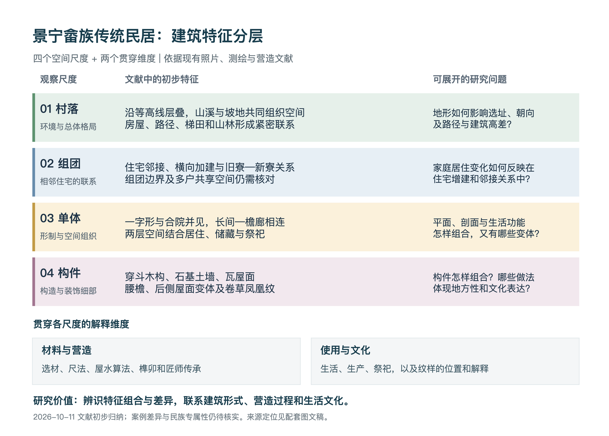
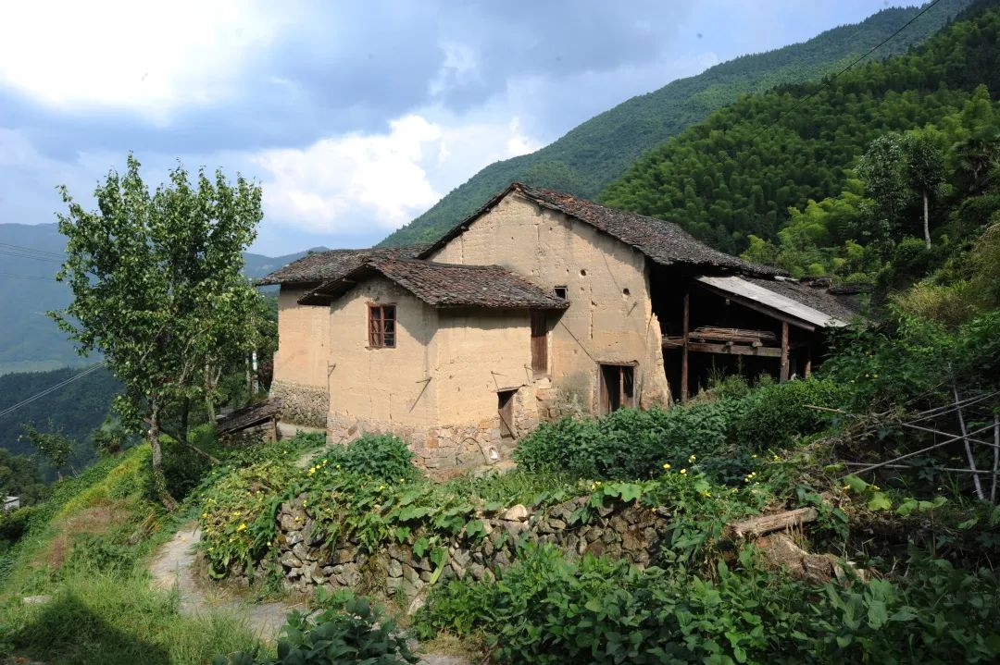
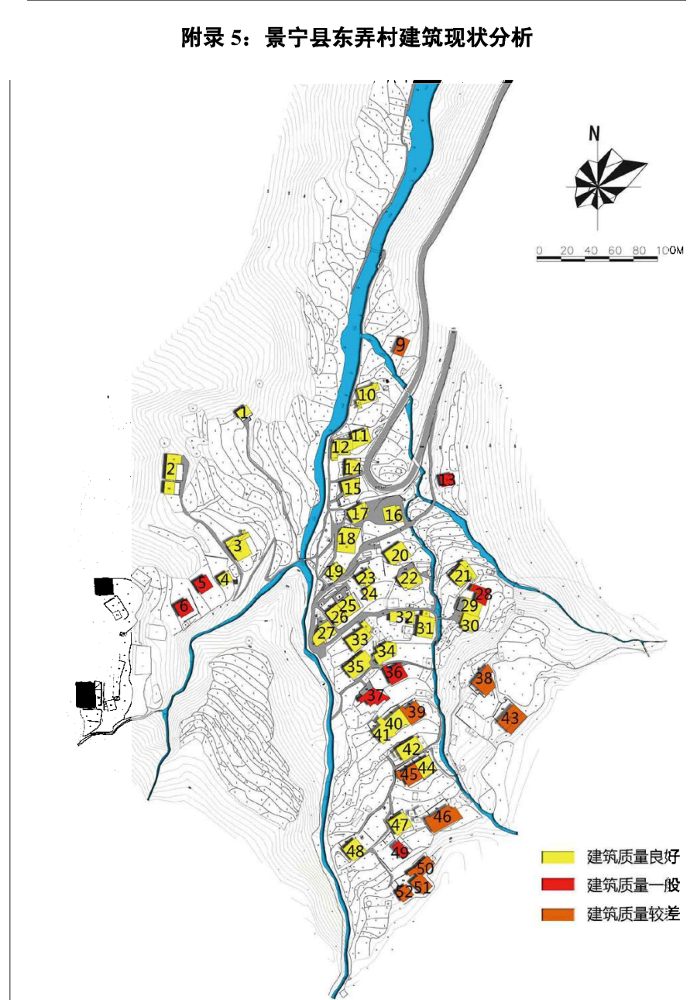
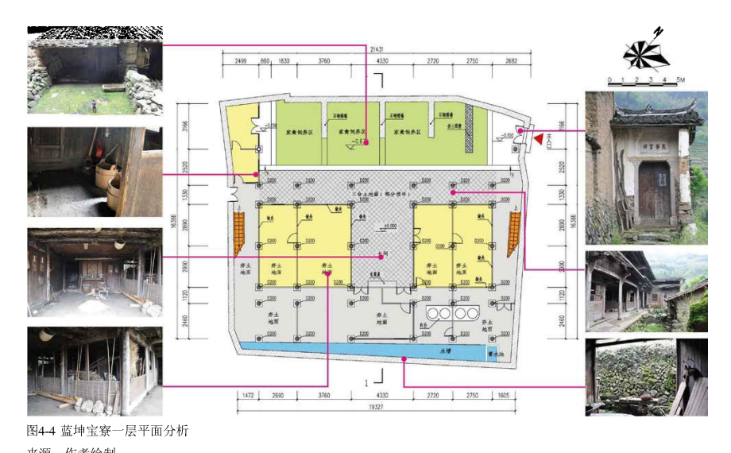
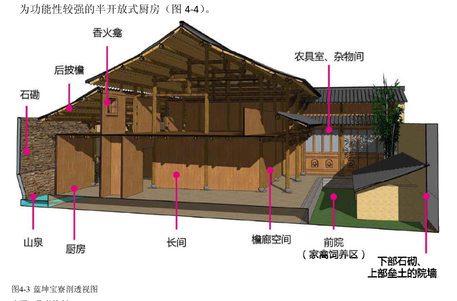
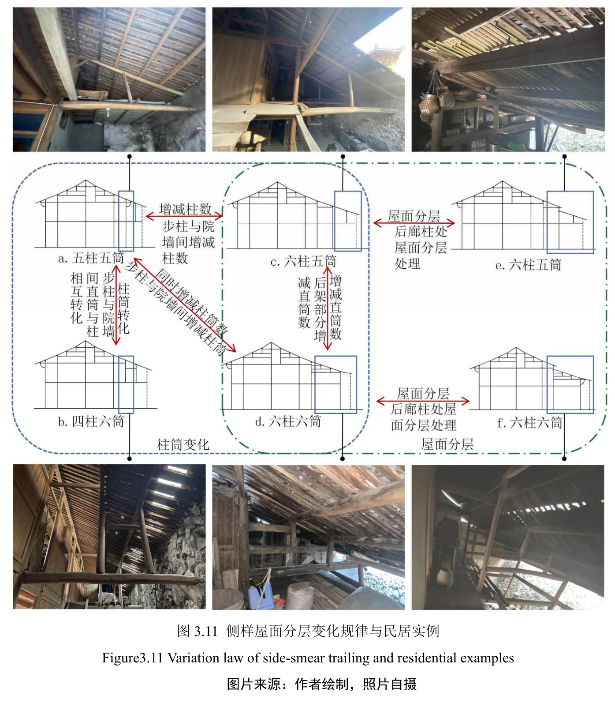
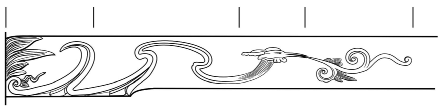
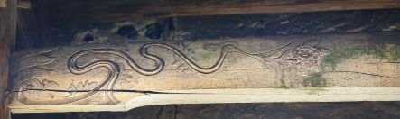

# 景宁畲族传统民居建筑特征初步总结

**现有研究可以支持：景宁畲族传统民居具有可辨识的地方特征，其研究价值体现在山地环境、住宅形制、生产生活、祭祀空间、木构营造和装饰表达之间的组合关系。** 特征既包含与浙南山地民居共享的做法，也包含在具体畲族住宅中具有文化意义的空间和纹样；不同村落、家庭与匠师之间还存在值得比较的变体。

本文用于研究背景与理论可行性汇报。以下是文献初步归纳，按具体案例及来源理解，不作为全县普遍性、民族专属性或2026年逐栋现状的结论。它没有调整现行科研方案的研究范围：村落、组团提供背景，单体及构件仍是现行方案的分析主体。

## 一、先划分维度：四个空间尺度与两个贯穿维度

| 维度 | 分析对象 | 主要观察内容 | 目前证据情况 |
| --- | --- | --- | --- |
| 村落 | 整个聚落及其环境 | 山、水、田与村关系；选址、朝向；等高线、台地、路径与房屋分布 | 东弄、大张坑及敕木山有较明确的个案记述和照片 |
| 组团 | 数个相邻宅院及其联系 | 邻接、横向加建、旧寮与新寮关系；道路、入口和边界；家庭或支系的空间联系 | 增建、邻接与家庭共有有线索；完整组团边界、支系对应及公共院落证据较薄 |
| 单体 | 一栋住宅及宅院 | 一字形／合院、开间、层数、前院、檐廊、长间、卧室、后厨和祭祀空间 | 蓝坤宝寮等有平面、剖面和功能记录；可以展开比较 |
| 构件 | 建筑的组成部位 | 屋顶、腰檐、后披屋面、土墙、木柱、梁枋、门窗、门楼及装饰 | 有构架分析、测绘、细部照片与卷草凤凰纹研究 |
| 材料与营造，贯穿上述尺度 | 建筑如何被建造 | 石、土、木、瓦的分工；尺法、屋水、榫卯；匠师术语、手稿和传承 | 有专门营造研究，内部构造需要图纸、测绘或访谈证据 |
| 使用与文化，贯穿上述尺度 | 建筑如何被使用与理解 | 家庭共有、生产储藏、接待议事、祖先祭祀、起寮仪式及纹样解释 | 有访谈和个案材料；文化成因与视觉事实分别记录 |

组团与单体需分开：**一栋长屋内多户合住，属于单体的居住组织；数个独立宅院彼此联系，才构成组团分析。** 同姓聚居也不直接证明村内每个住宅组团都按宗族支系划分。

*图1　本次文献归纳的观察框架；组团层的待核实项在图中保留。[可编辑图源](../../研究成果/〔特征归纳〕景宁畲族传统民居建筑特征/景宁畲族传统民居特征分层图.drawio)。*

## 二、各维度的初步建筑特征

### 1. 村落：顺应山地的层叠聚居与山水田联系

**沿等高线布置、随地形层叠，是现有案例中较明确的空间特征。** 赵圣洁对东弄的研究记载房屋沿等高线逐级升高，并以山溪作为村落发展轴线；阮仪三的东弄记录描述同一坡坳内的纵向层叠及溪流穿村。大张坑房屋落在人工整平的小地块上，顺山势及等高线上升，耕地、小河和坡地共同构成环境。敕木山的官方资料也描述山坳、坡地住宅及周边梯田。依据：R2正文33—34页；R3正文11—12页；R6第1—2页；R1。

路径随坡转折，以台阶、石路和宅前路连接房屋，形成明显的水平曲折与垂直高差。住宅、农田、菜园、山林和水源的紧密关系，使聚落同时承担居住与山地生产组织的功能。朝向应逐村记录：东弄文献写有坐南朝北的总体布局，不能统一写成所有畲村均坐北朝南。依据：R2正文34、43—44页；R3正文11—12页。

**研究价值：**可考察地形、用地与生产需求如何共同影响住宅位置、朝向、高差和路径，形成可比较的山地适应方式。

*图2　敕木山民居实景，可观察坡地、石墙基、土墙、木构和不同高度的瓦屋面。来源：R1，网页2022-07-11发布；照片拍摄日和具体单体名称未注明。*

### 2. 组团：住宅邻接、横向增建与家庭居住变化

**可先关注相邻住宅如何连接，以及家庭变化如何带来横向增建、另建和分居。** 文献对景宁一字形寮记有向左右延展的做法；蓝坤宝寮的正文与访谈记录了家族共有、老宅西侧横向扩建、部分家庭迁出及毗邻另建等情形。这为研究“旧寮—增建部分—邻近新寮”的空间关系提供了具体线索。依据：R2正文28、47、85页；R5印刷60页。

同一坡面的住宅通过路径彼此接近，但路径、院墙、院门和高差的具体组合仍需定位到各个宅院。东弄的蓝氏宗祠、大张坑的雷氏祠堂有宗族祭祀和议事功能记录，可作为理解居住社会背景的公共节点；这些公共建筑与各住宅组团的对应关系尚未明确。依据：R6第2页；R3正文14—15页。

**目前不宜把“共享院落、共享晒坪、按宗族支系分组”写成已确认的普遍特征。** 现有前院饲养、晒物等描述，多属于单户或单栋住宅的使用记录。

**研究价值：**可以连接物质空间与家庭居住变化，分析增建方向、宅院边界及新旧住宅关系。该层当前更适合作为背景线索和待核实问题。

*图3　东弄建筑编号分布与质量图，R2附录5，正文99／PDF115页。可辅助观察邻接关系；图含民居和公共等其他建筑，编号不是已经划定的住宅组团。*

### 3. 单体：横向展开的形制与复合生活空间

**形制上，一字形长屋与合院式并见。** 一字形寮横向展开，可随家庭需求增加开间；较大住宅也有正屋、两厢、天井和回廊组成的合院。敕木山官方资料列出这两类形式；蓝坤宝寮则呈现“一字形主体与前院、附属空间组合”的具体实例。两层在这些文献案例中较常见，但也有单层、三层等差异。依据：R1；R2正文28、47—48页；R4正文32、41—42、96—97页。

**空间上，居中的厅堂与前檐廊相连，形成开敞、半开敞的活动空间。** 东弄的赵圣洁文献称主要堂屋为“长间”，记载其接待、家庭议事和喜丧活动；大张坑文献称“中堂／大堂”，记载接待、喜宴和工匠作业等功能。比较时保留各自称谓，再核对位置与用途。檐廊兼顾通行、遮蔽、晾晒、手工劳动和休息，两侧房间组织日常起居。这些空间的关系比单个屋顶轮廓更能体现居住方式。依据：R2正文48、50—52页；R3正文20—21页。

**剖面上，居住、储藏、生产与祭祀叠合。** 蓝坤宝寮记有一层生活、二层储粮和杂物，并在二层中部设香火龛；前院有养禽用途，后厨与山泉引水、排水及屋面开口联系。这里的前院用途、后厨做法和二层祭祀位置有个案依据，不能一并推广到所有景宁畲族民居。其他地区或村落的香火榜、厨房与取暖空间也有不同布置。依据：R2正文48、50—53页；R3正文16—17、20—21页。

**研究价值：**可比较平面、剖面与功能的组合，辨析一字形与合院、长间与檐廊、上层空间与祭祀位置的共同项及变体。

*图4　蓝坤宝寮一层平面与局部照片，R2图4-4，正文49／PDF65页。注意院门、前院、檐廊、居中长间及后厨之间的关系。*

*图5　蓝坤宝寮剖透视，R2图4-3，正文48／PDF64页。作者的分析图展示生活、储藏、祭祀、养禽与地形的组合；它不是本研究已完成的三维采集成果。*

### 4. 构件：土木材料组合、屋面变化与梁部装饰

**材料与构造：石墙基、土墙或木板壁、木构架和瓦屋面组成相互配合的体系。** 石基处理地面与土墙的接触，夯土墙和板壁形成围护，穿斗木构组织开间与楼层。木架与墙体的承重关系存在变体：营造研究记录有后院墙参与承重、替代部分后侧柱的做法，所以不能把所有土墙概括为仅围护，也不能把所有住宅归为完全相同的木构类型。依据：R1；R2正文54、56、60—61页；R3正文18—19页；R4正文48页。

**屋面与檐部：双坡瓦屋面、悬山形式、腰檐和后侧屋面变化值得一起观察。** 腰檐可保护外露木柱、板壁，并参与晾晒等活动；后侧屋面可能连续披下，也可能另起低一层，联系后厨、天井、地形与采光。双坡／悬山是形态分类，腰檐是檐部做法，后侧分层是剖面变化，三者应分别记录。少见屋顶与特殊层数也应保留。依据：R2正文54—57页；R4正文41、47—53、96—97页；R5印刷60页。

*图6　侧样的柱筒与屋面分层变化，R4图3.11，正文51／PDF62页。原图中的柱数、柱筒转化和屋面分层是可以组合的变化条件，不是本总结重新确定的若干互斥建筑类型。*

**装饰：卷草凤凰纹与梁部、门楼位置结合，具有较明确的文化解释材料。** 蓝法勤记录了前檐梁、门楼梁上的卷草凤凰纹，以及凤头鹤嘴式、金鸡头式、卷草与凤鸟结合等样式；其骨架有曲线向梁中延展、凤首与植物结合等特点。比“建筑上有凤凰”更具体的观察，是纹样位于何种构件、如何与梁柱相接、怎样排列及如何被当地居民解释。依据：R7印刷95—98页、图1及图3—8。

*图7　敕木山28号蓝姓寮的卷草凤凰纹骨架，R7图1，印刷95／PDF2页。图片从原PDF提取；分段说明见原页。*

*图8　敕木山蓝村长家门楼梁上的凤凰纹，R7图6，印刷96／PDF3页。从原PDF提取原始照片；与图7不是已确认的同一住宅。*

同一装饰研究也记载汉族住宅使用凤凰纹，并讨论纹样顺序、称呼和解释的差异。因此，凤凰纹具有研究价值，但单凭它的有无不足以判断一栋建筑的族群属性。“堂屋开敞”“腰檐”“穿斗木构”等亦存在邻区共享做法。依据：R7印刷96—97页；R5印刷61—62页；R4正文90—96页。

**研究价值：**可将构件、材料、屋架、檐部与纹样联系起来，形成可追溯的特征记录，并比较其组合和局部差异。

## 三、贯穿各尺度的营造与文化特征

| 观察方向 | 初步总结 | 对研究的意义与证据 |
| --- | --- | --- |
| 匠师知识 | 地方术语、定盘与侧样手稿、尺法、屋水算法、选材和榫卯共同组织营造 | 外形差异可追查营造依据；R4正文23—27、33—35、42—72页。具体尺长及算法不先设为全县统一标准 |
| 社会协作 | 文献记录同村帮工、互相还工以及家庭共有、分居和增建 | 营造和居住组织可以解释部分空间变化；R2正文47、57、85页；R3正文22页；R4正文32页 |
| 祭祀与日常 | 长间接待议事，香火龛或香火榜、起寮仪式与家庭生活相联 | 文化表达也体现在空间位置和使用中；R2正文51—53页；R3正文20—21页；R4正文23—27页 |
| 区域交流 | 与周边汉族地区、其他畲族地区既有联系也有差异 | 可以讨论地方适应与技艺交流；R4正文90—97页、R5印刷61—62页。传播路径及因果解释仍须另证 |

干栏文化可以作为前人的解释线索：牛建农等将横向延展、开敞堂屋、腰檐及部分架空实例联系到干栏传统，同时也展示了汉族住宅中的类似做法。**现有一字形寮中有一层住人的实例，不能直接把“景宁畲族传统民居”统一写成底层架空、上层住人的干栏式。** 具体架空、挑出和楼层使用应逐栋观察。依据：R5印刷58—62页；R2正文48—50页。

## 四、用于论证研究价值：突出组合、差异与证据

| 价值方向 | 目前已有依据 | 后续可形成的建筑学认识 |
| --- | --- | --- |
| 山地适应 | 坡面、等高线、水系、台地、路径与住宅的联系 | 解释环境条件怎样影响位置、高差、进深与屋面处理 |
| 类型与变体 | 一字形／合院；层数；后厨、天井、墙体承重、柱筒和屋面差异 | 比较共同规则与可变部位，避免以一座大宅替代所有住宅 |
| 空间与文化 | 长间、檐廊、储藏、香火龛以及卷草凤凰纹的部位和解释 | 连接建筑形式、居住活动、家庭组织与族群认同 |
| 记录与保护 | 已有照片、测绘、编号调查和营造访谈，但身份及现状尚未完全对应 | 形成建筑—空间—构件—做法—来源之间可复核的关系，为后续保护判断提供依据 |

适合汇报的核心观点是：**景宁畲族传统民居的特色可以体现为具有地方环境与文化意义的特征组合，以及这种组合在不同住宅中的变化。** 研究的可行基础是既有图纸、照片、案例和营造记录；其可进一步开展的内容是关联、比较和核实，而不是宣称前人没有研究或已经证明一套全县唯一风格。

### 可直接用于背景说明的一段文字

景宁畲族传统民居在山地聚居环境中形成了具有地方特征的空间与营造组合。现有文献所记录的东弄、大张坑和敕木山等案例，表现出沿等高线层叠布置、住宅横向延展、一字形与合院式并见等特点；居中的长间与檐廊相连，居住、储藏、生产及祖先祭祀在住宅内部复合组织。石基、土墙、穿斗木构和瓦屋面相互配合，腰檐、后侧屋面分层及卷草凤凰纹进一步体现其构造与文化表达。不同村落和住宅之间又存在天井、墙体承重、屋架、空间用途与装饰位置等差异。因此，景宁畲族传统民居为研究山地环境适应、空间类型、构件组合及地方文化的建筑表达提供了具体对象，具有开展特征提取、比较分析与可追溯图谱整理的价值。上述认识仍需结合建筑身份、年代、改造情况和现状调查进一步验证。

## 五、主要来源与本轮核对范围

| 编号 | 来源 | 本文主要定位 |
| --- | --- | --- |
| R1 | 丽水市文广旅体局：[丽博观古·处州遗存——敕木山村畲族民居](https://www.lishui.gov.cn/art/2022/7/11/art_1229268129_57336308.html)，2022-07-11 | 山地环境、材料、一字排开与合院；沿用[已保存核查记录](../../研究资料/来源证据/2026-10-06-景宁畲族建筑遗存网络资料核查.md)及原照片 |
| R2 | 赵圣洁：[浙江省景宁县东弄村畲族民居初探](</Users/wangyuelin/Zotero/storage/DBVNTMI4/赵圣洁 - 2015 - 浙江省景宁县东弄村畲族民居初探.pdf>) | 正文28、33—34、43—44、47—57、85、99页；PDF页序为正文页＋16。图4-3、4-4、附录5 |
| R3 | 王文辉：[浙江景宁传统畲族民居及其保护与更新——以大张坑村为中心](</Users/wangyuelin/Zotero/storage/QSHMJCA4/王文辉 - 2016 - 浙江景宁传统畲族民居及其保护与更新 ——以大张坑村为中心.pdf>) | 正文11—12、14—22页；PDF页序为正文页＋8。地形、道路、院落、结构、生活及宗族公共节点 |
| R4 | 赵潇诺：[景宁畲族传统民居营造技艺研究](</Users/wangyuelin/Zotero/storage/52VRHDAG/赵潇诺 - 2023 - 景宁畲族传统民居营造技艺研究.pdf>) | 正文23—27、32—35、41—72、90—97页；PDF页序为正文页＋11。图3.11；[已有阅读卡](../../文献库/赵潇诺-2022-景宁畲族传统民居营造技艺.md) |
| R5 | 牛建农、葛联娟、何燕丽：[浙江景宁畲族自治县畲族民居特色探析](</Users/wangyuelin/Zotero/storage/QCWFQQ3A/牛建农 等 - 2009 - 浙江景宁畲族自治县畲族民居特色探析.pdf>)，2009 | 印刷57—62页／PDF1—6页。横向延展、干栏文化解释、开敞堂屋与腰檐、畲汉交流 |
| R6 | 阮仪三：[国家历史文化名城研究中心历史街区调研——浙江景宁东弄畲族村](</Users/wangyuelin/Zotero/storage/YVPUXG82/阮仪三 - 2008 - 国家历史文化名城研究中心历史街区调研——浙江景宁东弄畲族村.pdf>)，2008 | PDF1—2页；印刷97—98页依已有文献定位记录。村落、巷路及宗祠 |
| R7 | 蓝法勤：[浙江景宁畲族传统民居卷草凤凰纹装饰研究](</Users/wangyuelin/Zotero/storage/PIHCARAE/蓝法勤 - 2013 - 浙江景宁畲族传统民居卷草凤凰纹装饰研究.pdf>)，2013 | 印刷94—99页／PDF1—6页，图1及图3—8；原页图像核对纹样、构件部位及比较案例 |

本轮按主题核对相关正文、原页与图注，没有将所有论文称为全文逐页精读。R2的2015是现有书目字段，封面日期栏未载；R4原PDF提交年为2022，文件名／原书目为2023；正式引用须沿已有阅读卡说明核准。R1本轮重新读取超时，使用2026-10-06已保存的官方资料，没有将其更新为2026现状证据。

图4—6是前人分析与测绘图，图2、8为来源资料中的实景照片，图7为纹样示意，图1为本次归纳框架。保留各图来源和案例身份；新增提取图的来源页及处理方式见[图像来源记录](../../研究成果/〔特征归纳〕景宁畲族传统民居建筑特征/图像来源.json)。
