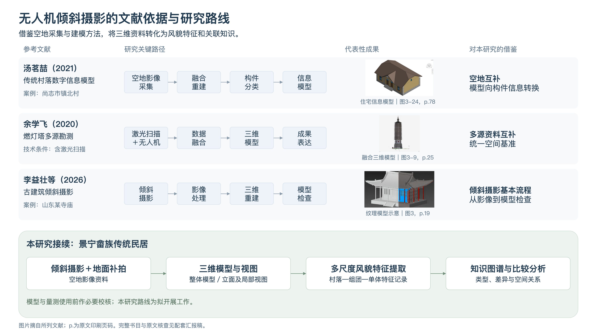

# 无人机倾斜摄影的文献依据与研究路线

**上一版详细原文：**[三维建模技术方案调研汇总与后续技术路线—详细讨论稿](../../archive/2026-10-12-三维建模汇报简化/三维建模技术方案调研汇总与后续技术路线-详细讨论稿.md)。本页为汇报简版，详细原文及原路线图保留在该归档入口。

汇报展示三篇文献的关键路径、代表性成果及可借鉴内容，并接续本研究的四个节点。文献路径为汇报概括，完整处理细节保留在备查资料中。

[可编辑图源](../../研究成果/〔技术路线〕三维建模技术路线/无人机倾斜摄影技术路线.drawio)。图片摘自原文，页码见图下及下列书目；本研究路线为拟开展工作。

## 汇报说明

已有研究展示了从空地采集、三维重建到模型和构件信息组织的处理路径。本研究借鉴其中的倾斜摄影与地面补充方法，获取村落、组团和重点单体的模型及视图，经过必要校核提取多尺度风貌特征，再通过实例与证据编号组织为知识图谱，开展类型、差异及空间关系比较。燃灯塔案例包含激光扫描，其多源条件单独标明。

**本研究接续：倾斜摄影＋地面补拍 → 三维模型与视图 → 多尺度风貌特征提取 → 知识图谱与比较分析。**

## 文献与配图出处

1. **汤茗喆，2021**：《基于数字信息模型的传统村落建筑风貌保护更新方法研究——以尚志市镇北村为例》，哈尔滨工业大学硕士学位论文。采用图3-24“住宅建筑模型”，印刷78页／PDF87页，展示构件信息模型的应用成果。[阅读卡](../../文献库/汤茗喆-2021-数字信息模型与传统村落风貌保护更新.md) · [原图摘录](../../研究资料/来源证据/assets/uav-report-2026-10-12/tang-residential-model.png)。
2. **余学飞，2020**：《多源数字化勘测技术在北京通州燃灯塔中的应用研究》，北京建筑大学硕士学位论文。采用图3-9“通州燃灯塔三维模型”，印刷25页／PDF33页。[原文PDF](</Users/wangyuelin/Zotero/storage/GMJMCWYG/余学飞 - 2020 - 多源数字化勘测技术在北京通州燃灯塔中的应用研究.pdf>) · [原图摘录](../../研究资料/来源证据/assets/uav-report-2026-10-12/yu-tower-model.png)。
3. **李益壮等，2026**：《基于无人机倾斜摄影测量技术的古建筑三维建模与保护研究》，《科学技术创新》第13期，17—20页。采用图3“纹理贴图效果”，印刷19页／PDF3页，标为文中的纹理模型示意。[原文PDF](</Users/wangyuelin/Zotero/storage/PQ963XWW/李益壮 等 - 2026 - 基于无人机倾斜摄影测量技术的古建筑三维建模与保护研究.pdf>) · [原图摘录](../../研究资料/来源证据/assets/uav-report-2026-10-12/li-textured-model.png)。

配图按原页图像边界裁切，未补画或修改色彩；原件、页面及裁切位置见[配图来源记录](../../研究资料/来源证据/assets/uav-report-2026-10-12/manifest.json)。

## 备查资料

[原文方法与数值核查](../../研究资料/来源证据/2026-10-12-三维建模方法核查记录.md)保留阅读覆盖和精度疑点；[详细讨论稿及原路线图](../../archive/2026-10-12-三维建模汇报简化/README.md)保留采集、质量检查和试采比较细节。现行研究定位仍以[[论文章节/全文工作稿/景宁畲族传统民居风貌特征提取与知识图谱构建研究v0.6.md]]为准，汇报简化不表示这些工作已实施。
