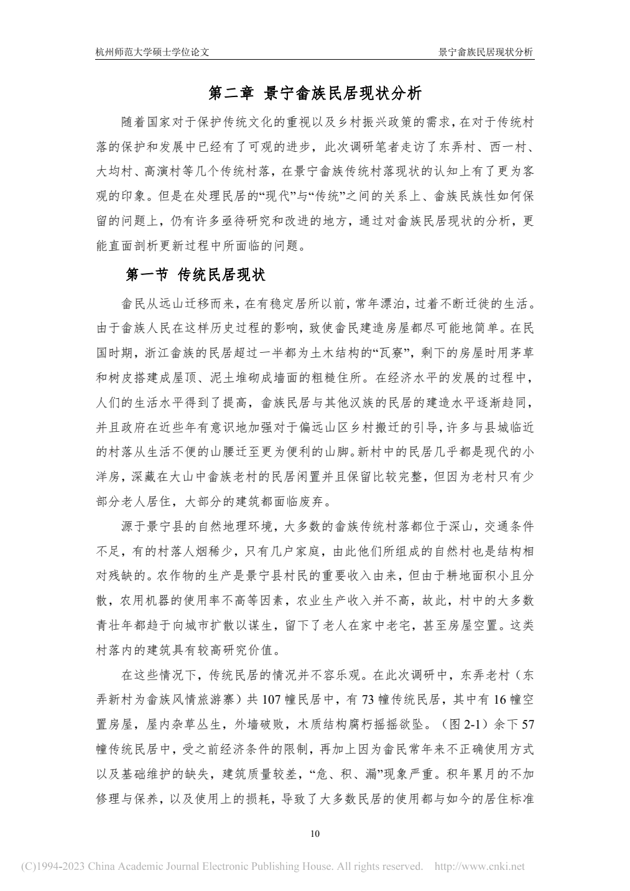
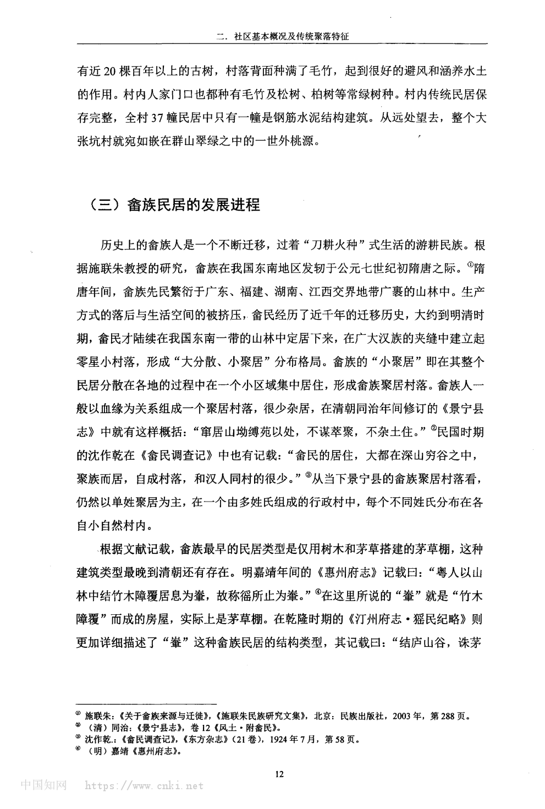
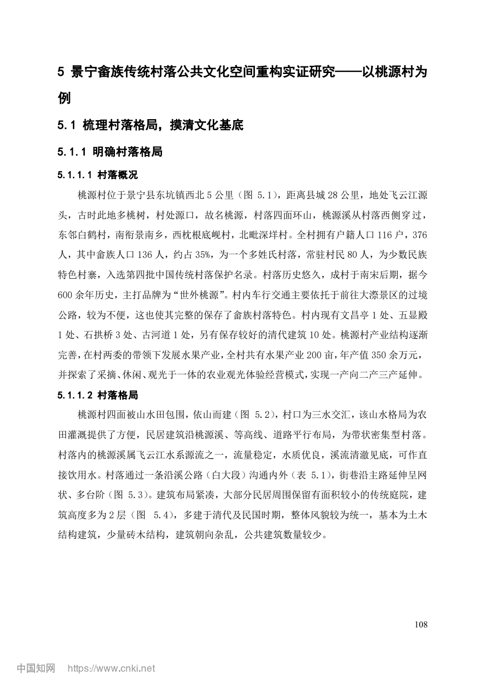
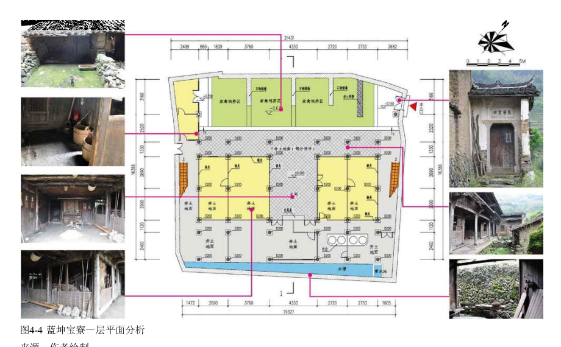
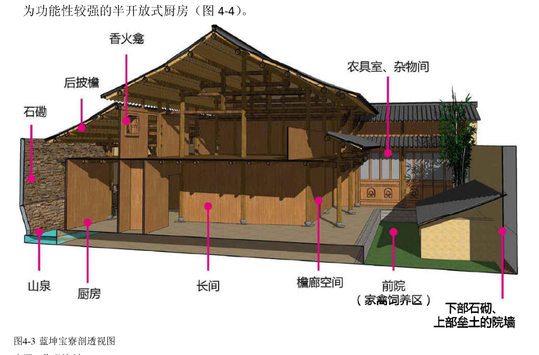
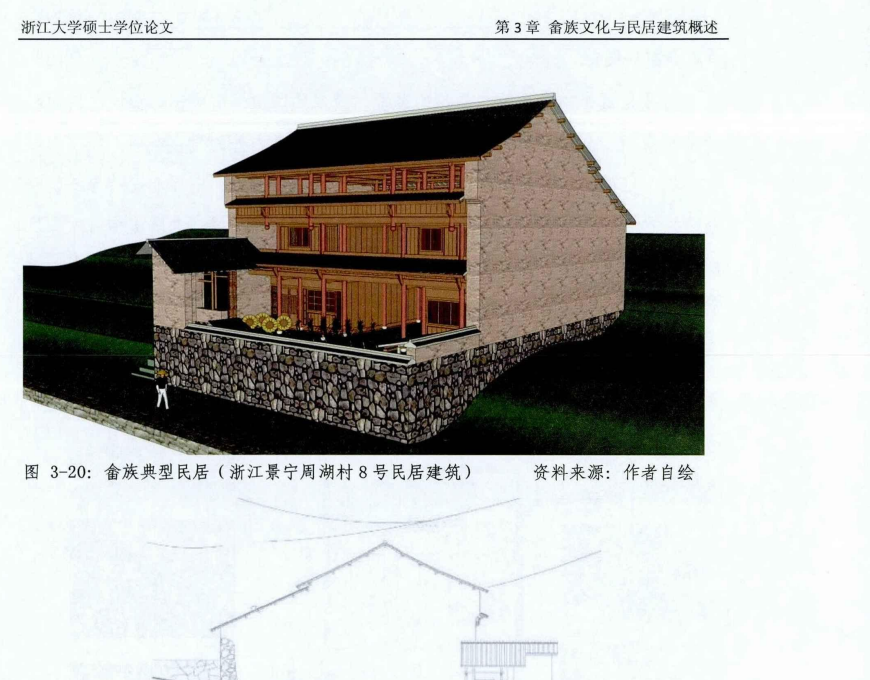

# 景宁畲族建筑遗存：存量依据与代表案例核实

本次按用户要求收束到两个问题：景宁畲族建筑遗存有多少，哪些遗存值得作为代表案例。暂以传统民居为主要数量口径，宗祠、庙宇及残存构件分列。下表是现有资料中可核查的文献基线，不是2026年现存名录。

完整文献底表及更多地点见[[研究资料/文献证据汇总/景宁畲族建筑遗存文献汇总表-2026-10-06.md]]。本页只提炼关键数字与优先核查对象，不替代原始证据。

2026-10-06补充了网络核查，官方原文、网址、日期与附件读取状态见[[研究资料/来源证据/2026-10-06-景宁畲族建筑遗存网络资料核查.md]]。新增敕木山四幢典型民居的官方记载及2026在册信息，仍未获得全县当前逐栋名录。

随后逐项调研与照片获取见[[研究资料/来源证据/2026-10-06-重点民居逐项调研与照片图册.md]]：已保存113个网页图像文件、精选58份；补得史图博曾居蓝文成家的地方报纸线索。照片多未具名单体，未以图像数更新本页的建筑数量。

## 一、目前能确认的数量依据

| 地点 | 文献明确记录的数量 | 时间依据 | 原始来源 | 当前能支持的结论 | 2026年现存数 |
| --- | --- | --- | --- | --- | --- |
| 东弄老村 | 民居107幢，其中传统民居73幢；73幢中有16幢空置 | 吴钰论文提交于2022年；确切调查日期未载 | L14《基于民族特性的新畲寮风格民居设计研究——以景宁东弄村为例》，PDF25／正文10 | 具有明确传统民居类别数量的村级文献基线；107、73、16为包含关系 | 待核实 |
| 大张坑自然村 | 民居37幢，其中钢筋水泥结构1幢 | 王文辉论文提交于2015年；确切调查日期未载 | L09《浙江景宁传统畲族民居及其保护与更新——以大张坑村为中心》，PDF20／正文12；自然村范围见PDF16／正文8 | 有明确民居总体数量；原文没有逐栋认定其余36幢均为传统民居 | 待核实 |
| 桃源村 | 清代建筑10幢／10处 | L08论文提交于2022年，调查日未载；L12桃源调查为2023年2月、12月，单体记录日未明 | L08《景宁畲族传统民居营造技艺研究》，PDF113／正文102；L12《聚落“双修”视角下景宁畲族传统村落公共文化空间重构研究》，PDF122／正文108 | 两文献提供相近类别数量，但未给逐栋名单；不能认定全部为畲族传统民居 | 待核实 |

三项数字不能相加为景宁畲族传统民居总量：统计类别不同，单体族群关联和当前状态亦未全部核实。现有资料不能给出全县2026年现存总数或可靠下限；“待核实”不等于0。

### 网络核查新增依据

下列编号对应[[研究资料/来源证据/2026-10-06-景宁畲族建筑遗存网络资料核查.md]]中的来源，网页发布时间不自动等于建筑调查时间。

| 地点 | 新资料 | 时间及来源 | 对原有判断的补充 |
| --- | --- | --- | --- |
| 敕木山村 | 官方介绍记载典型的大户畲族古民居4幢，建于清代及民国时期，均为二层；“敕木山村畲族民居”列入2026省级文保单位名录 | W01：丽水市政府网站、市文广旅体局，2022-07-11；W02：景宁县文保单位名录，2026-01-08 | 新增有官方数量与代表性描述的候选组；4幢仅为典型大户子集，具体名称／门牌及2026逐栋保存状态待补 |
| 东弄古村 | 官方答复称二期古村内20多幢老房子年久失修，部分已无法维修 | W03：县文广旅体局答复，2025-07-21发布 | 提供近年保存状况线索；不是全村总量，未与73幢逐项对应，不能据此扣减数量 |
| 大张坑村 | 高校调研报道提及村内16间待盘活民居，并形成文旅运营方案 | W04：浙江旅游职业学院转载潮新闻，2026-09-01，报道当年7月调研 | 提供近期调查成果入口；单位是“间”，不是“幢”，不能替换旧文献37幢，也未确认全部为传统民居 |

全县21处历史建筑、11项传统建筑保护名录、40处四普第一批新发现不可移动文物，分别属于不同时间与类别的行政统计，不作为全县畲族民居数量。详见网络核查W05—W07。

### 原文图像依据

以下三张为此前从原始PDF提取的页面，本轮重新目视核对了数量语句。

**东弄：107幢民居、73幢传统民居、16幢空置。**

**大张坑：37幢民居，其中1幢钢筋水泥结构。**

**桃源：保存较好的清代建筑10处。**

## 二、可优先核实的代表案例候选

“代表”在本页表示有条件展示某一研究内容的候选，不表示已证明其代表全县，亦不表示已确认2026年现存。优先考虑具体地点与对象能否对应、资料是否能支持建筑分析、是否有明确畲族关联。正式入选仍需补当前状态与可调查条件。

| 对象 | 地点与类别 | 可以展示的内容／选择依据 | 已有资料及来源 | 当前缺口 |
| --- | --- | --- | --- | --- |
| 敕木山典型大户畲族民居组 | 敕木山村；官方记载四幢，单体尚未具名 | 官方介绍村落具有一定代表性，并描述一字排开与合院两种民居形式；有清代、民国年代线索 | 网络核查W01；W02确认“敕木山村畲族民居”为2026年度在册省级文保单位 | 四幢具体身份、与下列28号蓝姓寮的关系、2026逐栋保存情况待核；一项保护单位不等于一栋 |
| 蓝坤宝寮 | 东弄村；民居 | 单体空间与构造；有较完整资料，适合作为首个核查案例 | L17《浙江省景宁县东弄村畲族民居初探》：PDF64—65图4-3、4-4、4-5及PDF73图4-19；访谈PDF101／正文85 | 2013-04-11访谈称无人居住、用于放杂物；需核实现址、现存构成和进入条件 |
| 周湖村8号民居 | 周湖村；编号民居 | 原文作为典型住宅绘图，可用于建筑形态个案 | L22《浙江景宁畲族自治县县城建筑有机更新研究》：PDF40／正文31，图3.20—3.21 | 论文2012年，调查日未载；8号为原文编号，需与现址及侧样资料对应 |
| 28号蓝姓畲族寮 | 敕木山村（原文）；民居 | 卷草凤凰纹装饰实例 | L18《浙江景宁畲族传统民居卷草凤凰纹装饰研究》：PDF2／刊页95 | 文献2013年，调查日未载；需核对编号、建筑整体和现状，不将装饰照片当作完整建筑资料 |
| 蓝凤新寮 | 沙湾镇张坑村（原文）；民居 | 具名住宅与木雕、营造者线索 | L18：PDF3／刊页96，相关照片与文字；原记录明确一幢住宅 | 需核对现址、年代及整体保存状态；不得与其他乡镇同名张坑村自动合并 |
| 蓝氏宗祠建筑群 | 东弄村；宗祠及附楼 | 村落公共与宗族建筑；有多篇文献记录和改用信息 | L12：PDF81／正文67；L22：PDF35／正文26。L12记主楼及左右附楼共3幢 | 是1组建筑群及其3幢构成，不计3栋民居；需核对各部分年代与当前保存状态 |
| 雷氏祠堂 | 大张坑村；祠堂 | 大张坑的具名公共建筑案例 | L22：PDF37／正文28，图3.16 | 有具名照片，保存状态及现存构成未核实；不与遂昌同姓祠堂混合 |
| 陈璧大宅遗址／门头 | 深垟村；残存构件 | 可展示从完整宅院到局部遗存的保存情况 | L22：PDF37／正文28，图3.17，文献记主体已毁、门头保存较完整 | 仅作为残存构件线索，不计完整民居；需核对门头目前是否留存 |

本表保留原有4项具名／具编号民居候选、2项公共建筑候选和1项残存构件候选，新增敕木山1组四幢线索。该组与28号民居可能重合，尚未对应，不相加计数。条目数不是代表性遗存总数，也不能与村级数量相加。

### 首批可直接查阅的图纸

其他图像及原页面入口见[[研究资料/来源证据/2026-10-06-文献图像裁切清单.md]]。

## 三、从文献基线补成现存数据，还差什么

东弄可作为更新村落存量的优先入口，因为同时具有传统民居数量记录、编号分布图及具体住宅资料。敕木山可作为补齐代表性案例名单的优先入口，因为已有官方四幢线索、建筑描述和2026在册身份。这是资料可追踪性的排序，不代表已证明两村现存数量最多、保存最好，亦不是最终研究范围。

每个对象只需补齐：**现址／定位、同一建筑身份对应、当前留存情况、核实日期与来源、是否仍可采集所需资料。** 对已拆除、局部残存、整体重建和修缮分别记录；对单体畲族关联不明的条目保留待核。

可寻找的补证是：县文物或住建部门的最新名录及对应调查资料、传统村落保护规划中的逐栋调查表、近期修缮和拆建记录、带时间和可定位信息的现场照片。名录收录本身不必然证明当前完好，需看记录日期及其内容。

东弄L17另有2012—2013年调查的52项编号表，可以帮助定位。现有汇总将其中49项归为民居，但包含非传统畲寮、非畲民户主及新建住宅，不能将49项视为49栋传统畲族民居，也不能与L14的73幢直接相加。详见完整文献汇总表。

网络核查已于2026-10-06补充完成，替代此前仅有文献证据的状态。县住建局2024年答复确认已完成65个传统村落保护与发展规划，并对历史建筑进行数字化测绘建档，可作为取得逐栋资料的入口；本轮尚未获得目标村落的完整规划与测绘档案。

**现阶段可以使用的表述：**“既有文献与官方公开资料为景宁畲族建筑遗存提供了可核查的对象基础：文献记载东弄老村传统民居73幢、大张坑自然村民居37幢、桃源村清代建筑10幢／处；2022年官方介绍另记敕木山典型大户畲族古民居四幢，‘敕木山村畲族民居’仍列于2026年度省级文保单位名录。蓝坤宝寮、周湖8号民居等已有具体图纸或照片。上述记录统计范围与时点不同，尚不能合计为全县当前存量，需补逐栋身份及保存状态。”
