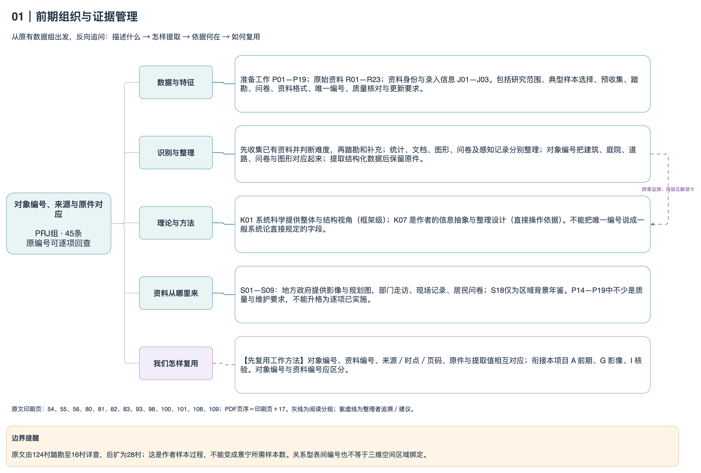

# 01 前期组织与证据管理

[返回总览](README.md) · [可编辑思维导图](01-前期组织与证据管理.drawio) · [逐项索引](逐项追溯索引.md#分支01)

本分支对应原明细 **45 条记录**（PRJ组），是整理者阅读分组，不是作者数据库的新分类或全部已采字段。

## 收集什么／描述什么

准备工作 P01—P19；原始资料 R01—R23；资料身份与录入信息 J01—J03。包括研究范围、典型样本选择、预收集、踏勘、问卷、资料格式、唯一编号、质量核对与更新要求。

## 作者怎样把资料变成信息

先收集已有资料并判断难度，再踏勘和补充；统计、文档、图形、问卷及感知记录分别整理；对象编号把建筑、庭院、道路、问卷与图形对应起来；提取结构化数据后保留原件。

## 可以追到什么理论或方法

K01 系统科学提供整体与结构视角（框架级）；K07 是作者的信息抽象与整理设计（直接操作依据）。不能把唯一编号说成一般系统论直接规定的字段。

## 原文提供的数据来源线索

S01—S09：地方政府提供影像与规划图，部门走访、现场记录、居民问卷；S18仅为区域背景年鉴。P14—P19中不少是质量与维护要求，不能升格为逐项已实施。

## 对本研究的复用判断（整理者建议）

【先复用工作方法】对象编号、资料编号、来源／时点／页码、原件与提取值相互对应；衔接本项目 A 前期、G 影像、I 核验。对象编号与资料编号应区分。

## 边界与容易误读的地方

原文由124村踏勘至16村详查，后扩为28村；这是作者样本过程，不能变成景宁所需样本数。关系型表间编号也不等于三维空间区域绑定。

## 原文定位与回查

[p.54／PDF71](zotero://open-pdf/library/items/URWHILLI?page=71)、[p.55／PDF72](zotero://open-pdf/library/items/URWHILLI?page=72)、[p.56／PDF73](zotero://open-pdf/library/items/URWHILLI?page=73)、[p.80／PDF97](zotero://open-pdf/library/items/URWHILLI?page=97)、[p.81／PDF98](zotero://open-pdf/library/items/URWHILLI?page=98)、[p.82／PDF99](zotero://open-pdf/library/items/URWHILLI?page=99)、[p.83／PDF100](zotero://open-pdf/library/items/URWHILLI?page=100)、[p.93／PDF110](zotero://open-pdf/library/items/URWHILLI?page=110)、[p.98／PDF115](zotero://open-pdf/library/items/URWHILLI?page=115)、[p.100／PDF117](zotero://open-pdf/library/items/URWHILLI?page=117)、[p.101／PDF118](zotero://open-pdf/library/items/URWHILLI?page=118)、[p.108／PDF125](zotero://open-pdf/library/items/URWHILLI?page=125)、[p.109／PDF126](zotero://open-pdf/library/items/URWHILLI?page=126)。

本分支的理论／方法详解：[K01](理论与方法解读卡.md#k01)、[K07](理论与方法解读卡.md#k07)。

数据逐项出处与证据状态以[完整索引](逐项追溯索引.md)及[原明细](../../夏雷-2020-东北严寒地区村落风貌数据库-数据收集工作明细.md)为准。理论联系只建立到本卡实际说明的层次，不能沿树形分组自动传递到每一字段。
