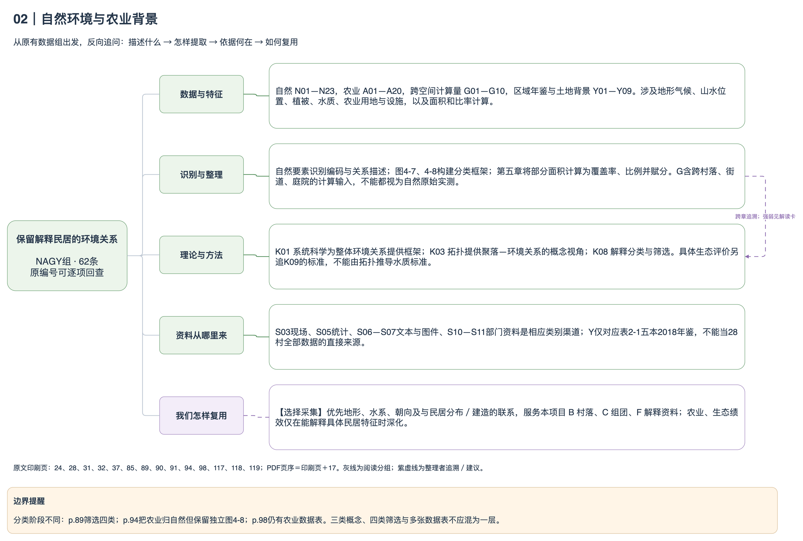

# 02 自然环境与农业背景

[返回总览](README.md) · [可编辑思维导图](02-自然环境与农业背景.drawio) · [逐项索引](逐项追溯索引.md#分支02)

本分支对应原明细 **62 条记录**（NAGY组），是整理者阅读分组，不是作者数据库的新分类或全部已采字段。

## 收集什么／描述什么

自然 N01—N23，农业 A01—A20，跨空间计算量 G01—G10，区域年鉴与土地背景 Y01—Y09。涉及地形气候、山水位置、植被、水质、农业用地与设施，以及面积和比率计算。

## 作者怎样把资料变成信息

自然要素识别编码与关系描述；图4-7、4-8构建分类框架；第五章将部分面积计算为覆盖率、比例并赋分。G含跨村落、街道、庭院的计算输入，不能都视为自然原始实测。

## 可以追到什么理论或方法

K01 系统科学为整体环境关系提供框架；K03 拓扑提供聚落—环境关系的概念视角；K08 解释分类与筛选。具体生态评价另追K09的标准，不能由拓扑推导水质标准。

## 原文提供的数据来源线索

S03现场、S05统计、S06—S07文本与图件、S10—S11部门资料是相应类别渠道；Y仅对应表2-1五本2018年鉴，不能当28村全部数据的直接来源。

## 对本研究的复用判断（整理者建议）

【选择采集】优先地形、水系、朝向及与民居分布／建造的联系，服务本项目 B 村落、C 组团、F 解释资料；农业、生态绩效仅在能解释具体民居特征时深化。

## 边界与容易误读的地方

分类阶段不同：p.89筛选四类；p.94把农业归自然但保留独立图4-8；p.98仍有农业数据表。三类概念、四类筛选与多张数据表不应混为一层。

## 原文定位与回查

[p.24／PDF41](zotero://open-pdf/library/items/URWHILLI?page=41)、[p.28／PDF45](zotero://open-pdf/library/items/URWHILLI?page=45)、[p.31／PDF48](zotero://open-pdf/library/items/URWHILLI?page=48)、[p.32／PDF49](zotero://open-pdf/library/items/URWHILLI?page=49)、[p.37／PDF54](zotero://open-pdf/library/items/URWHILLI?page=54)、[p.85／PDF102](zotero://open-pdf/library/items/URWHILLI?page=102)、[p.89／PDF106](zotero://open-pdf/library/items/URWHILLI?page=106)、[p.90／PDF107](zotero://open-pdf/library/items/URWHILLI?page=107)、[p.91／PDF108](zotero://open-pdf/library/items/URWHILLI?page=108)、[p.94／PDF111](zotero://open-pdf/library/items/URWHILLI?page=111)、[p.98／PDF115](zotero://open-pdf/library/items/URWHILLI?page=115)、[p.117／PDF134](zotero://open-pdf/library/items/URWHILLI?page=134)、[p.118／PDF135](zotero://open-pdf/library/items/URWHILLI?page=135)、[p.119／PDF136](zotero://open-pdf/library/items/URWHILLI?page=136)。

本分支的理论／方法详解：[K01](理论与方法解读卡.md#k01)、[K03](理论与方法解读卡.md#k03)、[K08](理论与方法解读卡.md#k08)、[K09](理论与方法解读卡.md#k09)。

数据逐项出处与证据状态以[完整索引](逐项追溯索引.md)及[原明细](../../夏雷-2020-东北严寒地区村落风貌数据库-数据收集工作明细.md)为准。理论联系只建立到本卡实际说明的层次，不能沿树形分组自动传递到每一字段。
