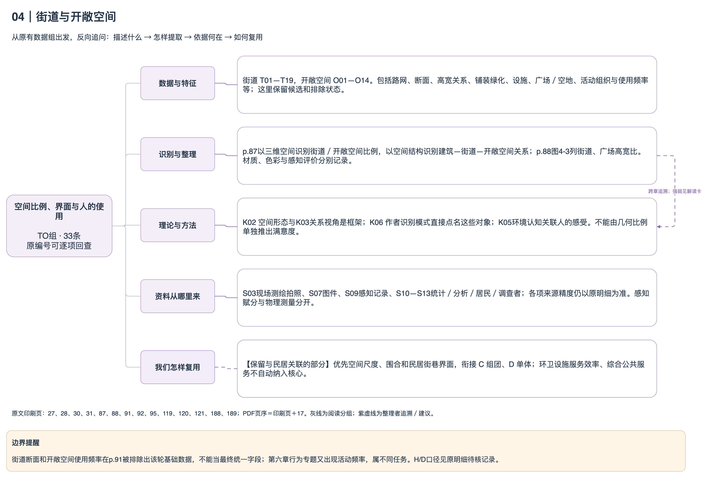

# 04 街道与开敞空间

[返回总览](README.md) · [可编辑思维导图](04-街道与开敞空间.drawio) · [逐项索引](逐项追溯索引.md#分支04)

本分支对应原明细 **33 条记录**（TO组），是整理者阅读分组，不是作者数据库的新分类或全部已采字段。

## 收集什么／描述什么

街道 T01—T19，开敞空间 O01—O14。包括路网、断面、高宽关系、铺装绿化、设施、广场／空地、活动组织与使用频率等；这里保留候选和排除状态。

## 作者怎样把资料变成信息

p.87以三维空间识别街道／开敞空间比例，以空间结构识别建筑—街道—开敞空间关系；p.88图4-3列街道、广场高宽比。材质、色彩与感知评价分别记录。

## 可以追到什么理论或方法

K02 空间形态与K03关系视角是框架；K06 作者识别模式直接点名这些对象；K05环境认知关联人的感受。不能由几何比例单独推出满意度。

## 原文提供的数据来源线索

S03现场测绘拍照、S07图件、S09感知记录、S10—S13统计／分析／居民／调查者；各项来源精度仍以原明细为准。感知赋分与物理测量分开。

## 对本研究的复用判断（整理者建议）

【保留与民居关联的部分】优先空间尺度、围合和民居街巷界面，衔接 C 组团、D 单体；环卫设施服务效率、综合公共服务不自动纳入核心。

## 边界与容易误读的地方

街道断面和开敞空间使用频率在p.91被排除出该轮基础数据，不能当最终统一字段；第六章行为专题又出现活动频率，属不同任务。H/D口径见原明细待核记录。

## 原文定位与回查

[p.27／PDF44](zotero://open-pdf/library/items/URWHILLI?page=44)、[p.28／PDF45](zotero://open-pdf/library/items/URWHILLI?page=45)、[p.30／PDF47](zotero://open-pdf/library/items/URWHILLI?page=47)、[p.31／PDF48](zotero://open-pdf/library/items/URWHILLI?page=48)、[p.87／PDF104](zotero://open-pdf/library/items/URWHILLI?page=104)、[p.88／PDF105](zotero://open-pdf/library/items/URWHILLI?page=105)、[p.91／PDF108](zotero://open-pdf/library/items/URWHILLI?page=108)、[p.92／PDF109](zotero://open-pdf/library/items/URWHILLI?page=109)、[p.95／PDF112](zotero://open-pdf/library/items/URWHILLI?page=112)、[p.119／PDF136](zotero://open-pdf/library/items/URWHILLI?page=136)、[p.120／PDF137](zotero://open-pdf/library/items/URWHILLI?page=137)、[p.121／PDF138](zotero://open-pdf/library/items/URWHILLI?page=138)、[p.188／PDF205](zotero://open-pdf/library/items/URWHILLI?page=205)、[p.189／PDF206](zotero://open-pdf/library/items/URWHILLI?page=206)。

本分支的理论／方法详解：[K02](理论与方法解读卡.md#k02)、[K03](理论与方法解读卡.md#k03)、[K05](理论与方法解读卡.md#k05)、[K06](理论与方法解读卡.md#k06)。

数据逐项出处与证据状态以[完整索引](逐项追溯索引.md)及[原明细](../../夏雷-2020-东北严寒地区村落风貌数据库-数据收集工作明细.md)为准。理论联系只建立到本卡实际说明的层次，不能沿树形分组自动传递到每一字段。
