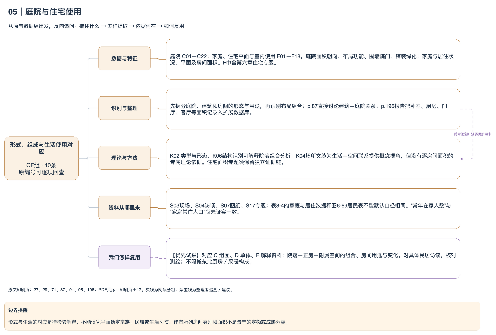

# 05 庭院与住宅使用

[返回总览](README.md) · [可编辑思维导图](05-庭院与住宅使用.drawio) · [逐项索引](逐项追溯索引.md#分支05)

本分支对应原明细 **40 条记录**（CF组），是整理者阅读分组，不是作者数据库的新分类或全部已采字段。

## 收集什么／描述什么

庭院 C01—C22；家庭、住宅平面与室内使用 F01—F18。庭院面积朝向、布局功能、围墙院门、铺装绿化；家庭与居住状况、平面及房间面积。F中含第六章住宅专题。

## 作者怎样把资料变成信息

先拆分庭院、建筑和房间的形态与用途，再识别布局组合；p.87直接讨论建筑—庭院关系；p.196报告把卧室、厨房、门厅、客厅等面积记录入扩展数据库。

## 可以追到什么理论或方法

K02 类型与形态、K06结构识别可解释院落组合分析；K04场所文脉为生活—空间联系提供概念视角，但没有逐房间面积的专属理论依据。住宅面积专题须保留独立证据链。

## 原文提供的数据来源线索

S03现场、S04访谈、S07图纸、S17专题；表3-4的家庭与居住数据和图6-69居民表不能默认口径相同。“常年在家人数”与“家庭常住人口”尚未证实一致。

## 对本研究的复用判断（整理者建议）

【优先试采】对应 C 组团、D 单体、F 解释资料：院落—正房—附属空间的组合、房间用途与变化。对具体民居访谈，核对测绘；不照搬东北厨房／采暖构成。

## 边界与容易误读的地方

形式与生活的对应是待检验解释，不能仅凭平面断定宗族、民族或生活习惯；作者所列房间类别和面积不是景宁的定额或成熟分类。

## 原文定位与回查

[p.27／PDF44](zotero://open-pdf/library/items/URWHILLI?page=44)、[p.29／PDF46](zotero://open-pdf/library/items/URWHILLI?page=46)、[p.71／PDF88](zotero://open-pdf/library/items/URWHILLI?page=88)、[p.87／PDF104](zotero://open-pdf/library/items/URWHILLI?page=104)、[p.91／PDF108](zotero://open-pdf/library/items/URWHILLI?page=108)、[p.95／PDF112](zotero://open-pdf/library/items/URWHILLI?page=112)、[p.196／PDF213](zotero://open-pdf/library/items/URWHILLI?page=213)。

本分支的理论／方法详解：[K02](理论与方法解读卡.md#k02)、[K04](理论与方法解读卡.md#k04)、[K06](理论与方法解读卡.md#k06)、[K12](理论与方法解读卡.md#k12)。

数据逐项出处与证据状态以[完整索引](逐项追溯索引.md)及[原明细](../../夏雷-2020-东北严寒地区村落风貌数据库-数据收集工作明细.md)为准。理论联系只建立到本卡实际说明的层次，不能沿树形分组自动传递到每一字段。
