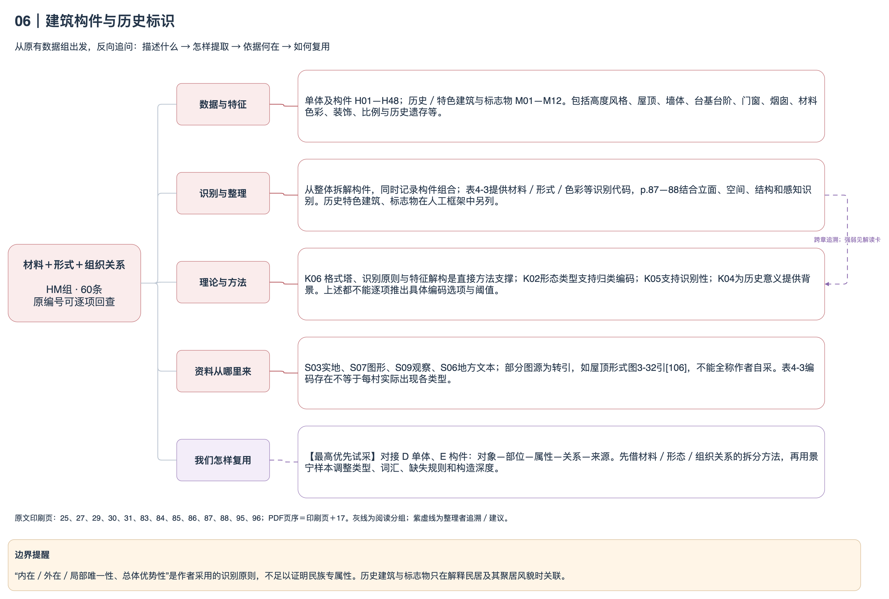

# 06 建筑构件与历史标识

[返回总览](README.md) · [可编辑思维导图](06-建筑构件与历史标识.drawio) · [逐项索引](逐项追溯索引.md#分支06)

本分支对应原明细 **60 条记录**（HM组），是整理者阅读分组，不是作者数据库的新分类或全部已采字段。

## 收集什么／描述什么

单体及构件 H01—H48；历史／特色建筑与标志物 M01—M12。包括高度风格、屋顶、墙体、台基台阶、门窗、烟囱、材料色彩、装饰、比例与历史遗存等。

## 作者怎样把资料变成信息

从整体拆解构件，同时记录构件组合；表4-3提供材料／形式／色彩等识别代码，p.87—88结合立面、空间、结构和感知识别。历史特色建筑、标志物在人工框架中另列。

## 可以追到什么理论或方法

K06 格式塔、识别原则与特征解构是直接方法支撑；K02形态类型支持归类编码；K05支持识别性；K04为历史意义提供背景。上述都不能逐项推出具体编码选项与阈值。

## 原文提供的数据来源线索

S03实地、S07图形、S09观察、S06地方文本；部分图源为转引，如屋顶形式图3-32引[106]，不能全称作者自采。表4-3编码存在不等于每村实际出现各类型。

## 对本研究的复用判断（整理者建议）

【最高优先试采】对接 D 单体、E 构件：对象—部位—属性—关系—来源。先借材料／形态／组织关系的拆分方法，再用景宁样本调整类型、词汇、缺失规则和构造深度。

## 边界与容易误读的地方

“内在／外在／局部唯一性、总体优势性”是作者采用的识别原则，不足以证明民族专属性。历史建筑与标志物只在解释民居及其聚居风貌时关联。

## 原文定位与回查

[p.25／PDF42](zotero://open-pdf/library/items/URWHILLI?page=42)、[p.27／PDF44](zotero://open-pdf/library/items/URWHILLI?page=44)、[p.29／PDF46](zotero://open-pdf/library/items/URWHILLI?page=46)、[p.30／PDF47](zotero://open-pdf/library/items/URWHILLI?page=47)、[p.31／PDF48](zotero://open-pdf/library/items/URWHILLI?page=48)、[p.83／PDF100](zotero://open-pdf/library/items/URWHILLI?page=100)、[p.84／PDF101](zotero://open-pdf/library/items/URWHILLI?page=101)、[p.85／PDF102](zotero://open-pdf/library/items/URWHILLI?page=102)、[p.86／PDF103](zotero://open-pdf/library/items/URWHILLI?page=103)、[p.87／PDF104](zotero://open-pdf/library/items/URWHILLI?page=104)、[p.88／PDF105](zotero://open-pdf/library/items/URWHILLI?page=105)、[p.95／PDF112](zotero://open-pdf/library/items/URWHILLI?page=112)、[p.96／PDF113](zotero://open-pdf/library/items/URWHILLI?page=113)。

本分支的理论／方法详解：[K02](理论与方法解读卡.md#k02)、[K04](理论与方法解读卡.md#k04)、[K05](理论与方法解读卡.md#k05)、[K06](理论与方法解读卡.md#k06)。

数据逐项出处与证据状态以[完整索引](逐项追溯索引.md)及[原明细](../../夏雷-2020-东北严寒地区村落风貌数据库-数据收集工作明细.md)为准。理论联系只建立到本卡实际说明的层次，不能沿树形分组自动传递到每一字段。
