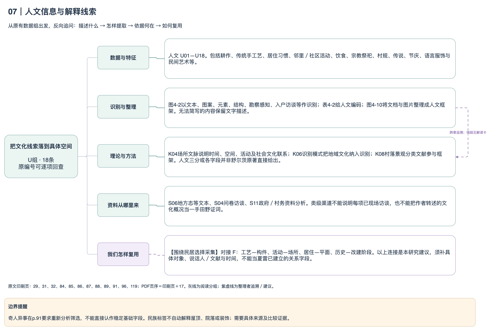

# 07 人文信息与解释线索

[返回总览](README.md) · [可编辑思维导图](07-人文信息与解释线索.drawio) · [逐项索引](逐项追溯索引.md#分支07)

本分支对应原明细 **18 条记录**（U组），是整理者阅读分组，不是作者数据库的新分类或全部已采字段。

## 收集什么／描述什么

人文 U01—U18。包括耕作、传统手工艺、居住习惯、邻里／社区活动、饮食、宗教祭祀、村规、传说、节庆、语言服饰与民间艺术等。

## 作者怎样把资料变成信息

图4-2以文本、图案、元素、结构、勘察感知、入户访谈等作识别；表4-2给人文编码；图4-10将文档与图片整理成人文框架。无法简写的内容保留文字描述。

## 可以追到什么理论或方法

K04场所文脉说明时间、空间、活动及社会文化联系；K06识别模式把地域文化纳入识别；K08村落景观分类文献参与框架。人文三分或各字段并非舒尔茨原著直接给出。

## 原文提供的数据来源线索

S06地方志等文本、S04问卷访谈、S11政府／村务资料分析。类级渠道不能说明每项已现场访谈，也不能把作者转述的文化概况当一手田野证词。

## 对本研究的复用判断（整理者建议）

【围绕民居选择采集】对接 F：工艺—构件、活动—场所、居住—平面、历史—改建阶段。以上连接是本研究建议，须补具体对象、说话人／文献与时间，不能当夏雷已建立的关系字段。

## 边界与容易误读的地方

奇人异事在p.91要求重新分析筛选，不能直接认作稳定基础字段。民族标签不自动解释屋顶、院落或装饰；需要具体来源及比较证据。

## 原文定位与回查

[p.29／PDF46](zotero://open-pdf/library/items/URWHILLI?page=46)、[p.31／PDF48](zotero://open-pdf/library/items/URWHILLI?page=48)、[p.32／PDF49](zotero://open-pdf/library/items/URWHILLI?page=49)、[p.84／PDF101](zotero://open-pdf/library/items/URWHILLI?page=101)、[p.85／PDF102](zotero://open-pdf/library/items/URWHILLI?page=102)、[p.86／PDF103](zotero://open-pdf/library/items/URWHILLI?page=103)、[p.87／PDF104](zotero://open-pdf/library/items/URWHILLI?page=104)、[p.88／PDF105](zotero://open-pdf/library/items/URWHILLI?page=105)、[p.89／PDF106](zotero://open-pdf/library/items/URWHILLI?page=106)、[p.91／PDF108](zotero://open-pdf/library/items/URWHILLI?page=108)、[p.96／PDF113](zotero://open-pdf/library/items/URWHILLI?page=113)、[p.119／PDF136](zotero://open-pdf/library/items/URWHILLI?page=136)。

本分支的理论／方法详解：[K04](理论与方法解读卡.md#k04)、[K06](理论与方法解读卡.md#k06)、[K08](理论与方法解读卡.md#k08)。

数据逐项出处与证据状态以[完整索引](逐项追溯索引.md)及[原明细](../../夏雷-2020-东北严寒地区村落风貌数据库-数据收集工作明细.md)为准。理论联系只建立到本卡实际说明的层次，不能沿树形分组自动传递到每一字段。
