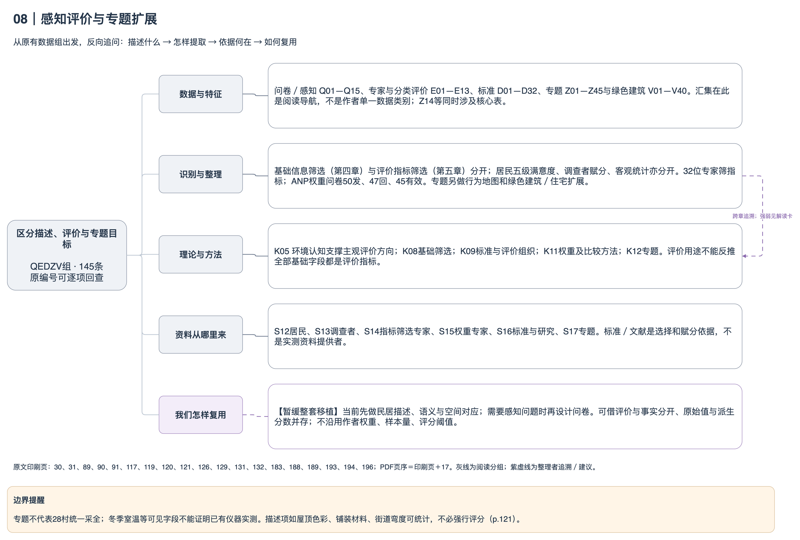

# 08 感知评价与专题扩展

[返回总览](README.md) · [可编辑思维导图](08-感知评价与专题扩展.drawio) · [逐项索引](逐项追溯索引.md#分支08)

本分支对应原明细 **145 条记录**（QEDZV组），是整理者阅读分组，不是作者数据库的新分类或全部已采字段。

## 收集什么／描述什么

问卷／感知 Q01—Q15、专家与分类评价 E01—E13、标准 D01—D32、专题 Z01—Z45与绿色建筑 V01—V40。汇集在此是阅读导航，不是作者单一数据类别；Z14等同时涉及核心表。

## 作者怎样把资料变成信息

基础信息筛选（第四章）与评价指标筛选（第五章）分开；居民五级满意度、调查者赋分、客观统计亦分开。32位专家筛指标；ANP权重问卷50发、47回、45有效。专题另做行为地图和绿色建筑／住宅扩展。

## 可以追到什么理论或方法

K05 环境认知支撑主观评价方向；K08基础筛选；K09标准与评价组织；K11权重及比较方法；K12专题。评价用途不能反推全部基础字段都是评价指标。

## 原文提供的数据来源线索

S12居民、S13调查者、S14指标筛选专家、S15权重专家、S16标准与研究、S17专题。标准／文献是选择和赋分依据，不是实测资料提供者。

## 对本研究的复用判断（整理者建议）

【暂缓整套移植】当前先做民居描述、语义与空间对应；需要感知问题时再设计问卷。可借评价与事实分开、原始值与派生分数并存；不沿用作者权重、样本量、评分阈值。

## 边界与容易误读的地方

专题不代表28村统一采全；冬季室温等可见字段不能证明已有仪器实测。描述项如屋顶色彩、铺装材料、街道弯度可统计，不必强行评分（p.121）。

## 原文定位与回查

[p.30／PDF47](zotero://open-pdf/library/items/URWHILLI?page=47)、[p.31／PDF48](zotero://open-pdf/library/items/URWHILLI?page=48)、[p.89／PDF106](zotero://open-pdf/library/items/URWHILLI?page=106)、[p.90／PDF107](zotero://open-pdf/library/items/URWHILLI?page=107)、[p.91／PDF108](zotero://open-pdf/library/items/URWHILLI?page=108)、[p.117／PDF134](zotero://open-pdf/library/items/URWHILLI?page=134)、[p.119／PDF136](zotero://open-pdf/library/items/URWHILLI?page=136)、[p.120／PDF137](zotero://open-pdf/library/items/URWHILLI?page=137)、[p.121／PDF138](zotero://open-pdf/library/items/URWHILLI?page=138)、[p.126／PDF143](zotero://open-pdf/library/items/URWHILLI?page=143)、[p.129／PDF146](zotero://open-pdf/library/items/URWHILLI?page=146)、[p.131／PDF148](zotero://open-pdf/library/items/URWHILLI?page=148)、[p.132／PDF149](zotero://open-pdf/library/items/URWHILLI?page=149)、[p.183／PDF200](zotero://open-pdf/library/items/URWHILLI?page=200)、[p.188／PDF205](zotero://open-pdf/library/items/URWHILLI?page=205)、[p.189／PDF206](zotero://open-pdf/library/items/URWHILLI?page=206)、[p.193／PDF210](zotero://open-pdf/library/items/URWHILLI?page=210)、[p.194／PDF211](zotero://open-pdf/library/items/URWHILLI?page=211)、[p.196／PDF213](zotero://open-pdf/library/items/URWHILLI?page=213)。

本分支的理论／方法详解：[K05](理论与方法解读卡.md#k05)、[K08](理论与方法解读卡.md#k08)、[K09](理论与方法解读卡.md#k09)、[K11](理论与方法解读卡.md#k11)、[K12](理论与方法解读卡.md#k12)。

数据逐项出处与证据状态以[完整索引](逐项追溯索引.md)及[原明细](../../夏雷-2020-东北严寒地区村落风貌数据库-数据收集工作明细.md)为准。理论联系只建立到本卡实际说明的层次，不能沿树形分组自动传递到每一字段。
