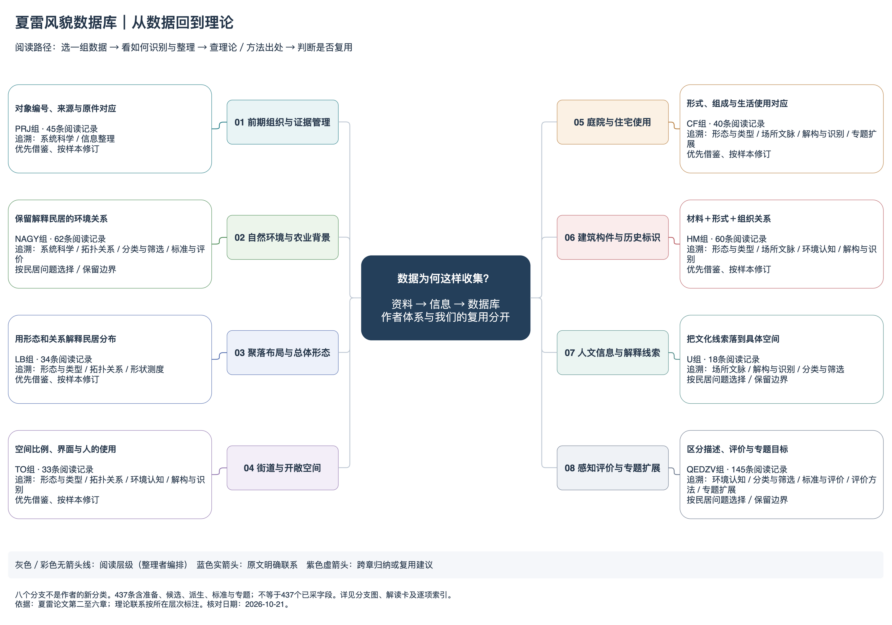

# 夏雷论文：数据与理论追溯思维导图

本套图回答：**作者为什么收集这些资料，怎样把资料转成风貌信息，依据来自哪里，哪些方法值得迁移到景宁传统民居研究？**

## 当前阅读入口：Obsidian原生思维导图

**[打开夏雷-数据收集与理论追溯.smm.md](夏雷-数据收集与理论追溯.smm.md)**

2026-10-22根据阅读反馈，改为 Simple Mind Map 插件可直接打开、折叠和编辑的原生导图。将上一版的段落节点拆为短语与子节点，八个数据分支聚合在一张导图中。默认先显示主要层级，再按需要展开。

- **数据层级**：如“建筑构件与历史标识 → 收集什么 → 建筑整体及构件 → 屋顶 → 材料／形式／颜色／坡度等原记录”。墙体、门窗、台基台阶、烟囱分别列支。
- **理论层级**：如“理论与方法依据 → 形态与类型 → 作者如何使用／引用文献与原文位置／迁移边界”。
- **来源和证据**：437条记录各有一个数据节点；详细七列内容、完整证据状态和原文定位保留在备注。相关节点显示候选、排除、框架、派生等提示，摘要标签不能代替完整证据状态。
- **复用判断**：单独标为整理者建议，进一步展开到具体可借方法、需校订内容与暂缓事项。

导图内共有1041个层级节点，包含阅读分组、方法、重复引用的理论卡与来源节点；**1041不是数据数量**。树线仅为阅读层级，不表示每个字段由同分支理论直接推导。58项评价交叉核对仍在[逐项索引](逐项追溯索引.md)中。

文件通过现有插件的独立读取和兼容性自动校验；该校验覆盖文件与解析，不等于像素级排版验收。[本轮转换复核](原生导图转换复核.md)检查层级拆分与证据保真。此前[文献内容复核与验收](复核与验收记录.md)继续作为内容依据。

## 上一版静态图与配套说明

原有Draw.io图、PNG和解读卡继续保留，供对照与回查。下图属于上一版静态展示，不是新原生导图的预览。

[打开可编辑总览](00-数据与理论总览.drawio) · [查看原文明确联系](00-原文明确联系.png) · [原文联系图源](00-原文明确联系.drawio)

总览的八组是整理者按阅读目的编排；作者原来的自然／人工／人文分类、农业生产在不同阶段的归属、数据库表结构仍在分支中分别说明。树上的灰色及彩色无箭头连接只是阅读层级。**蓝色实箭头表示原文明确联系；紫色虚箭头表示跨章归纳或本研究的复用建议。** 每条关系只适用于标明层次，不能沿分组线推为某个具体字段的直接理论来源。

## 按你关心的数据进入

- [01 前期组织与证据管理](01-前期组织与证据管理.md)：对象编号、来源与原件对应。覆盖原明细PRJ组，45条。
- [02 自然环境与农业背景](02-自然环境与农业背景.md)：保留解释民居的环境关系。覆盖原明细NAGY组，62条。
- [03 聚落布局与总体形态](03-聚落布局与总体形态.md)：用形态和关系解释民居分布。覆盖原明细LB组，34条。
- [04 街道与开敞空间](04-街道与开敞空间.md)：空间比例、界面与人的使用。覆盖原明细TO组，33条。
- [05 庭院与住宅使用](05-庭院与住宅使用.md)：形式、组成与生活使用对应。覆盖原明细CF组，40条。
- [06 建筑构件与历史标识](06-建筑构件与历史标识.md)：材料＋形式＋组织关系。覆盖原明细HM组，60条。
- [07 人文信息与解释线索](07-人文信息与解释线索.md)：把文化线索落到具体空间。覆盖原明细U组，18条。
- [08 感知评价与专题扩展](08-感知评价与专题扩展.md)：区分描述、评价与专题目标。覆盖原明细QEDZV组，145条。

## 最快的阅读顺序

先看 **06 建筑构件 → 05 庭院住宅 → 03 聚落布局 → 04 街道空间**，理解从单体到聚居环境的特征及关系；再看 **01 前期组织**，把候选记录连接到原件与对象。**07 人文、02 环境**按能否解释具体民居选择，**08 评价专题**用于识别可暂缓的工作。

1. [理论与方法解读卡](理论与方法解读卡.md)：12张卡，逐卡区分文献类别、名称、作者用途、原文定位与我们的判断。优先读K06特征解构、K02形态类型、K07信息抽象，然后补K03关系与K04文脉。
2. [逐项追溯索引](逐项追溯索引.md)：原437条逐项记录完整覆盖，保留18条来源索引与58条评价交叉核对；含每项证据状态、数据来源线索及原页链接。
3. [独立复核与主会话验收](复核与验收记录.md)：复核范围、发现、处理和未解决边界。

## 这次梳理得到的复用判断

- **先复用工作方法**：特征拆解；对象、来源和原件对应；材料、形式、组织关系分别记录；事实、派生量、主观判断分开；记录缺失和筛选理由。
- **需要景宁样本校订**：布局类型、构件选项、民族／地域特征解释、组团边界、观察尺度与采集深度。先试采，再形成正式字典。
- **当前可暂缓整套移植**：全村生态和公共服务绩效、综合风貌排名、ANP权重、全部居民满意度、绿色建筑全面评价。按具体民居问题保留必要部分。
- **仍需自行研究**：语义对象与三维空间区域的绑定、坐标／尺度、区域边界、空间关系计算与验证。夏雷的“三维空间识别”和关系型表关联不能替代这些方法。

以上是整理者依据[当前研究定位](../../../context/PROJECT_CONTEXT.md)作的复用建议，不是论文结论或已经验证的采集方案。本次未改动每村管理表、正式研究方案或研究路径图。

[三张关键原文图页](关键原文图页.md)可与思维导图并读，核对作者的总体理论框架、资料识别与编码，以及识别模式。

## 证据与文件边界

母文献：[夏雷论文PDF](zotero://open-pdf/library/items/URWHILLI)；沿用书目2020，PDF封面及答辩为2019年12月。所有p.指印刷页，PDF页序比其多17。

本轮以第二章p.24—34、43、49，第三章p.54—60及既有调查明细，第四章p.80—101，第五章有关来源、评价与权重的p.117—132，以及第六章既有专题明细为证据；新增重点回查理论到识别、编码、筛选的桥接段落及图2-1、图4-2、图4-3。既有437条索引按上一轮已复核明细完整转录，本轮不宣称重新独立验证每项调查的真实性。

被引著作在本轮未逐篇阅读。这里只确认“夏雷如何使用它们”，不能把二手引用当原著已核实结论。数据来源线索与理论来源分开记录：地方政府、测绘、居民是数据渠道；理论、文献、标准是分类、解释或评价的依据。原明细中“类级渠道／未明确”保持原状。

新发现的原文歧义：p.91排除项的变异系数文字与表4-4数值不协调，见K08；原有H/D、分类阶段、候选与实施状态差异继续保留。原文未公开的问卷、逐对象测绘表、仪器精度、代码隐藏字段与逐项理论出处均不补造。

## 与已有资料管理的衔接

- [原始数据收集工作明细](../../夏雷-2020-东北严寒地区村落风貌数据库-数据收集工作明细.md)
- [第二章引文拆解](../../夏雷-2020-东北严寒地区村落风貌数据库-第二章引文拆解.md)
- [村落资料总表](../../../研究资料/村落资料/资料收集总表.md) · [共同清单定义](../../../研究资料/村落资料/资料收集清单设计.md)
- [敕木山管理表](../../../研究资料/村落资料/敕木山/资料收集管理表.md) · [大张坑管理表](../../../研究资料/村落资料/大张坑/资料收集管理表.md)

后续调整采集内容时，在各村表中记录实施；本套图承担文献依据与取舍解释。理论卡K编号、数据原编号和各村资料编号互不替代。

核对与整理日期：2026-10-21。此日期表示本轮文献核查和交付，不表示实地采集或研究方法已经通过验证。
