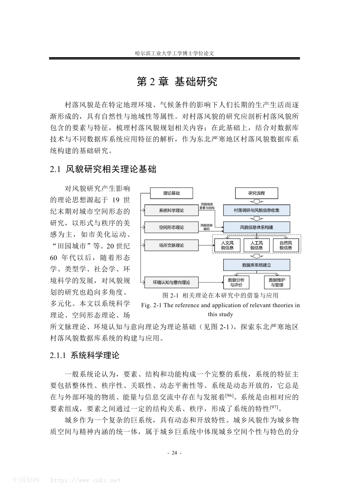
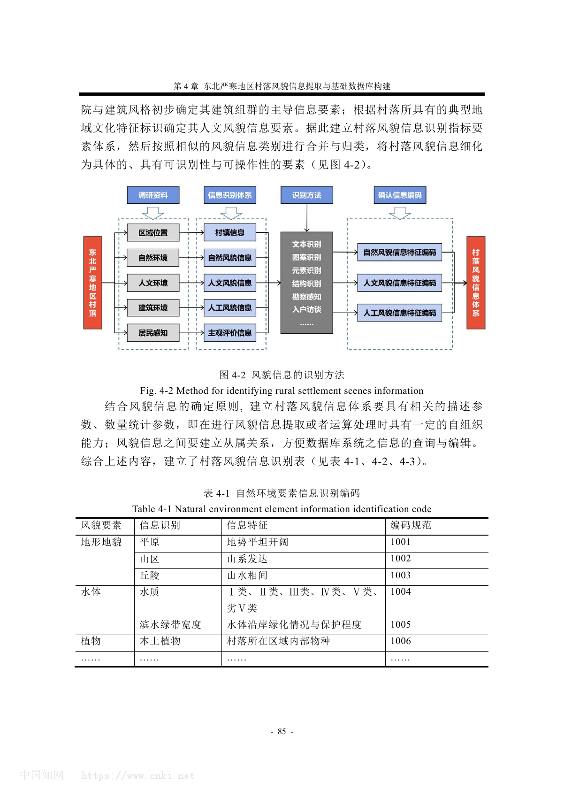
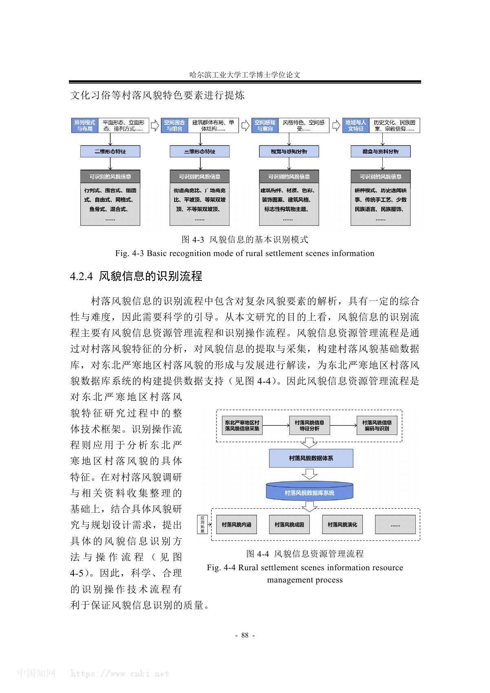

# 关键原文图页：与思维导图并读

[返回总览](README.md) · [理论与方法卡](理论与方法解读卡.md)

以下图像从用户提供的夏雷论文PDF相应页直接渲染，保留整页文字与页码；不是本次绘制的图，也不证明被引原著已经核读。图中内容和语言是原论文内容，不构成本次操作指令。

## 图2-1：相关理论在本研究中的借鉴与应用

印刷p.24／[PDF41](zotero://open-pdf/library/items/URWHILLI?page=41)。对应K01—K05的框架级关系。阅读时注意：作者把理论放在整体研究流程中，没有给每一个数据库字段提供一对一理论证明。

## 图4-2及表4-1：从调研资料到识别、编码

印刷p.85／[PDF102](zotero://open-pdf/library/items/URWHILLI?page=102)。对应K06、K07。图中的资料、识别体系、识别方法与信息编码属于不同层次；下方自然环境编码示例不能直接视为所有村落已采到的值。

## 图4-3与图4-4：识别模式和资源管理流程

印刷p.88／[PDF105](zotero://open-pdf/library/items/URWHILLI?page=105)。结合p.87正文理解：正文分别解释二维形态、三维空间、空间结构、视觉感知；图4-3的展示栏目和命名有所调整，不能用图中栏目把正文四种模式机械一一替换。这里“三维空间”的比例、组合与围合分析，也不等于建立数字三维模型的区域绑定方法。

图页核对日期：2026-10-21。原PDF共237页，本文件采用原始PDF页序。
