---
aliases:
  - "2018-吴莹-江南古镇语义网络量化精读"
type: literature-reading-evidence
status: full-body-reading-with-theory-application-review
created: 2026-10-28
updated: 2026-10-28
author: 吴莹
year: 2018
zotero_item: 7SY8EUF6
zotero_attachment: RR3I67FU
contribution_primary: 方法路径型
contribution_secondary: [框架模型型]
reference_value: 核心参考（理论组织、空间细读与语义关系表达）
read_scope: 通读正文印刷1—104页（PDF10—113），重点第三、四章；核看关键分类、空间与模型图；材料限制见§12.1
topics:
  - 建筑类型学
  - 语义网络
  - 江南古镇
  - 空间分类
  - 空间量化
research_context: 2026-10-28读取的Paper现行context及BOT双基准
---

# 吴莹2018《建筑类型学视角下江南古镇空间的语义网络量化研究》：理论支撑、空间分析与方法化用

> **阅读判断：这篇论文是学习“怎样用理论组织空间分析，再把建筑认识转成语义表达”的核心参考。**其价值既在住宅、院落、廊、街巷等空间组合的细读，也在建筑类型学与语义网络之间的理论分工与方法衔接。
>
> 阅读顺序为：作者的问题与贡献 → 理论支撑及其化用 → 具体空间分析与模型 → 可借鉴的组织方式。适用范围、原典追溯和方法核查集中在§12“边界说明与核查”。[原生思维导图](专题精读/吴莹2018论文精读/吴莹2018-类型学与语义网络.smm.md)与[图文阅读版](专题精读/吴莹2018论文精读/精读阅读版.html)分别用于逻辑导航和连续阅读。

## 1. 文献身份、原文与实际阅读范围

- **作者／题名：**吴莹，《建筑类型学视角下江南古镇空间的语义网络量化研究》。
- **体裁／学校／专业：**东北林业大学硕士学位论文，建筑设计及其理论；指导教师董君。封面记提交时间2018年4月，答辩及学位授予时间2018年6月。
- **建议书目：**吴莹. 建筑类型学视角下江南古镇空间的语义网络量化研究[D]. 东北林业大学, 2018. 年份和学校据PDF封面核验。
- **Zotero：**父条目`7SY8EUF6`，PDF附件`RR3I67FU`。[在Zotero打开正文首页](zotero://open-pdf/library/items/RR3I67FU?page=10)。
- **原文：**[用户指定PDF](</Users/wangyuelin/Zotero/storage/RR3I67FU/吴莹 - 建筑类型学视角下江南古镇空间的语义网络量化研究.pdf>)。原PDF由Zotero维护。
- **文件指纹：**SHA-256 `20a063142172f7c0b3725eab7d1fe2e6b4593d12fc9fa49879d97cd75c6b66bc`，共120个PDF页。
- **页码对应：**正文印刷1—104页对应PDF10—113页，即正文范围内`PDF页=印刷页+9`。前置摘要与目录另按原页标记。下文以**印刷页**为主，同时保留重点PDF页。

**本轮实际完成：**通读并逐章细读正文印刷1—104页（PDF10—113），重点核查第三、四章；核看关键分类、住宅、街巷、桥头、过街连廊、模型转换和结果图；对重要公式及表4-1、4-2另查原页。本次补读集中于第二章及其在第三至五章的应用，阅读范围与材料限制详见§12.1。

**归属约定：**“作者报告”指原文所呈现的工作与数据；“作者解释”指作者据此作出的建筑学／行为解释；“阅读者判断”指本轮评价与推论；“候选建议”指尚未采用的本研究设计。各段落按上述归属组织。

来源、裁切坐标、页码及文件哈希见[来源与核读记录](../研究资料/来源证据/吴莹2018-江南古镇语义网络/来源与核读记录.json)。

## 2. 整篇论文的研究链条

### 2.1 作者实际上想解决什么

作者不满足于把古镇建筑与街道写成一组形态描述，希望把空间中的建筑、院落、街巷、河流、桥、边界及活动氛围之间的关系，变成计算机能够处理的模型。具体对象是太湖流域江南水乡古镇的空间形式；第三章积累多种典型模式，第四章以同里一个街坊讨论模型与指标，第五章在周庄作整体应用。[印刷1—9、28—34、68—69、83—87页]

**阅读者重建的主线：**建筑类型学提供前期分类与空间原型 → 描述性语义网络显式组织对象、关系及解释 → 将部分内容转译为计算图 → 比较不同建模方式的图指标 → 提出复合指标 → 用周庄新老区域对照解释空间特点。该主线依据各章内容重建。

### 2.2 各章的任务与成果

| 部分 | 实际任务与输入 | 主要产出 | 阅读定位及承接 |
| --- | --- | --- | --- |
| 第一章 绪论 | 从历史古镇的描述性研究及计算表达问题提出跨学科路径 | 研究范围、类型学与语义网络结合的目的、研究框架 | 印刷1—10／PDF10—19。为类型分类与计算表达提出问题 |
| 第二章 理论结合 | 回顾类型学、语义网络节点／链及图论、矩阵等表达 | 前期分类、图示表达、逻辑关系和计算方法可衔接的论述 | 印刷11—27／PDF20—36。理论分工及其化用详见§3 |
| 第三章 类型与描述模型 | 从住宅、街巷河道、桥头与过街连廊等抽取模式 | 空间分类树、平面／剖面—逻辑图对应、包含功能与文化说明的语义网络 | 印刷28—62／PDF37—71。对本研究最直接有用，尤其图3-7至3-12、3-15、3-17、3-35 |
| 第四章 量化体系 | 同里街坊；添加特征节点前后、点链转换的不同模型 | 单一图指标比较、三项复合量值及空间节点解释 | 印刷63—82／PDF72—91。由描述模型进入街坊尺度的计算比较 |
| 第五章 周庄应用 | 住宅、桥头、入口、街巷及沿河空间，进而比较新区与老区 | 典型节点解读；复合度、深度、活力的图表与解释 | 印刷83—103／PDF92—112。把模型和局部认识带回周庄整体空间 |
| 结论 | 汇总分类、语义表达、计算与应用 | 作者主张方法具有适用性，并提出进一步深化方向 | 印刷104／PDF113。汇总类型分析、表示转换与量化的研究路径 |

**贡献分类是阅读者工作标签：**主类“方法路径型”，辅类“框架模型型”。分类依据是：其主要贡献在类型分类与语义网络量化的连接路径，同时形成了空间分类、关系模式和分析指标的组织框架。

## 3. 理论支撑与理论化用：作者怎样把认识转成分析

本节按作者的组织和实际用法阅读：先看理论提供什么认识，再追踪它怎样进入对象划分、空间分析、模型表示和结果解释。理论出处的核验范围统一见§12.2。

### 3.1 理论支撑的总体结构：各自承担不同任务

论文第二章并不是把若干理论并列罗列：§2.1建立建筑类型学的认识与分析视角，§2.2介绍语义网络的表示方式，§2.3再专门论证二者的结合点。第三章落实为空间分类与关系图，第四章进入形式计算，第五章回到具体场所解释。[印刷11—27、28—34、63—65、83—89页]

**从全文重建其理论分工，可以看到五个层次：**

| 层次与作用 | 本文采用的主要内容 | 理论怎样参与研究 | 后文承接 |
| --- | --- | --- | --- |
| 认识立场：为什么这样看建筑 | 类型与历史、生活方式、地域文化及空间延续的联系 | 把研究对象理解为长期形成、具有生活与文化含义的空间组织 | 住宅序列、店宅改造、传统与现代区域差异的解释 |
| 对象分析：具体看什么 | 原型、基本单元、内在秩序、组合与转换；古镇的群、序及多层次构成 | 从复杂实景中抽取可讨论的单元、关系和模式 | 间—院—住宅—街坊；串联／并联、主轴／侧向、平面／剖面 |
| 知识表示：怎样表达认识 | 物元、属性、事元、图示节点；关系链与复杂网络结构 | 将物质要素、空间、活动和意义组织成可追踪的联系 | 图3-8—3-12的住宅语义图及街巷、桥头模式 |
| 形式分析：怎样进入计算 | 拓扑关系、图论、逻辑表达、矩阵及模型运算 | 将空间关系转换成节点与边，再计算、比较不同表示 | 第四章的深度、连接、选择、控制、集成及复合量值 |
| 地域解释：怎样回到建筑学 | 太湖古镇的构成、宗族生活、商业活动与水乡环境 | 用空间组织及其使用背景解释模型关注的特征 | 周庄沈厅、店宅、桥头、入口与沿河空间分析 |

这张表是阅读者对理论职责的归纳。**最值得学习的是“认识立场—分析对象—表示语言—计算方式—建筑解释”的接续，而不是理论数量。**

### 3.2 建筑类型学：从理论观点中取得哪些分析眼光

作者先以类型学的发展说明分类与组合的研究取向，再从不同人物／学派中选择能够支持本篇的观点。[§2.1，印刷11—18页]

| 作者讨论的理论线索      | 本文重点取用的认识                        | 转化出的分析眼光                          | 在本文中的作用位置                              |
| -------------- | -------------------------------- | --------------------------------- | -------------------------------------- |
| 迪郎的构图系统        | 以主轴、副轴及设计元素的组织认识建筑               | 识别空间组织骨架，以及骨架上单元的组合               | 理论铺垫在印刷12页；住宅轴向序列在印刷34—40、88—89页展开     |
| 罗西：类型、历史与生活    | 类型与历史、空间和生活方式相连；关注延续、记忆与文化意义     | 同时观察形式、使用与历史变化，理解某种空间组织为何值得保留和研究  | 理论论述在印刷13—14、17—18页；后文以宗族生活、店宅变化解释住宅形式 |
| 格拉西：母题与原型      | 从连续出现的建筑形式中识别原型，将复杂建筑概括为基本形态及其组合 | 寻找多种实例之间相对稳定的基本单元，认识不同规模／形态如何成为变体 | 理论在印刷14—15页；图3-7—3-12以基本居住单元及其扩展组织住宅分析 |
| 艾莫尼诺：内在秩序与分级比较 | 对建筑空间建立秩序，在分级中寻找共同量度，并关注剖面与多功能利用 | 确定比较层次、组织关系和共同观察项；把剖面关系纳入分析       | 理论在印刷15页；后文的进深层次、主轴与附属空间、沿河剖面体现这种分析取向  |
| 波拉赛罗：分类目录与分解   | 以分类为基础，通过分解及组合继续认识和修订类型          | 先形成对象目录，再深入各类的组成关系，使分类与细部分析衔接     | 理论在印刷15页；第三章从三组空间进入各自模式与语义图            |
| 克里尔的空间类型与几何转换  | 从基本空间形式及其合成、贯穿、分割、变形等认识城市空间      | 观察空间的形态变化和组合方式，识别转折、局部放大、连接及开合    | 理论在印刷16—18页；广场、街巷转角、桥头及连廊分析在印刷44—62页展开 |

**这里有两种化用深度：**罗西等观点主要构成研究立场与解释视角；基本单元、分类、轴向秩序、组合转换等进一步进入图示和分析步骤。把这两种作用分别读清，就能理解作者为什么既讨论文化和生活，又细画空间组合。

作者在§2.1.3进一步讨论方法论：从既有事物分类并提取“元类型”，比较固定要素与变化要素，再用单体／街区／内外转换及几何组合认识复杂空间。对罗西“类推”的介绍还将心理、人文与历史记忆纳入类型分析，列出片段引用、图像类推、换喻和同源现象的创造步骤。[印刷16—18页] 这些讨论为后文同时观察形态、活动与文化意义提供了思路；本篇实际展开的操作以分类、组合图示和语义表达为主。

对理论到后文的联系，表中标明的“体现某种分析取向”属于阅读者的跨章节追踪；明确采用及出处见下两节。

### 3.3 地域空间研究与灰空间概念：让一般理论进入具体对象

**第一条桥梁是段进《城镇空间解析》。**作者在绪论中提到该书对空间“群”“序”与“拓扑”的归纳；在第三章直接用它组织古镇物质环境，并以“间—合院—院落组合—地块—街坊—古镇”说明从局部到整体的形成方式。[印刷7、29页，图3-1]

它在本文至少承担三项具体任务：

1. **提供观察层次。**从建筑细部、建筑及其内部空间，扩展到建筑组合与城镇组织。
2. **提供对象和环境的分解。**自然／人工环境，街坊／沿河街市，建筑／院落／巷弄，使分类能够落到可见、可画的对象。
3. **提供地域类型与比较项目。**表3-2住宅与街河的关系、轴线和分布比较，以及沿河街市剖面形式的分类，均在原文保留该书来源。[印刷40、42页]

这说明作者的空间目录同时来自**一般类型学的研究方法**和**已有地域空间研究提供的具体认识**。两者结合，才使“做类型分析”变成“具体分析哪些类型、哪些组合与哪些关系”。

**第二条桥梁是廊下灰空间。**印刷31页作者明确提到借黑川纪章“泛空间”理论作引申，并回到中国建筑的空间意义；第二章图2-6、2-9先用室内—灰空间—室外说明连接，第三章再以廊棚、骑楼、披檐、过街楼等剖面展开。[印刷22—24、31、42—43、60—62页]

它使分析从室内／室外的二分转向连续过渡，形成一组具体问题：空间由什么覆盖、怎样围合、向哪里开敞、联系哪些区域、支持何种活动。**这里值得学习的是：一个理论概念能够引出一组建筑学观察，而不仅是增加一个“灰空间”名词。**

### 3.4 语义网络、图论与矩阵：把空间认识转成可操作表达

作者根据董君《城市语义网络》讨论四类节点，并以节点、关系、约束及复杂网络结构组织建筑知识。[印刷18—24页]

- **物元节点**承接构件、实体边界和空间；使“分析哪些对象”进入网络。
- **属性节点**承接形状、尺度、状态及感受；使“对象有什么性质”获得表达位置。
- **事元节点**承接行为与作用；使“在这里做什么、发生什么”进入描述。
- **图示节点**承接空间模式及复杂图像；使建筑学常用的图示分析与网络表达衔接。

关系链进一步承接类属、包含、属性、视线、联通、延伸等不同联系。图2-9把门窗／柱廊、室内／灰空间／室外及商业／休闲／游憩活动联系起来，呈现了从物质构成到空间与活动的描述路径。

图论、逻辑及矩阵则承担下一步转换：将关系图转成邻接或关联结构，让空间联系可以被运算、比较和重新组织。[印刷24—26页，图2-10] 第四章将这种表达用于街坊，并从DepthMap提取指标，再用SPSS作数据处理。两种软件在作者的组织中属于计算与统计工具。

**理论化用的关键动作是：建筑学上识别出的关系，先获得明确表达，再进入计算。**因此，精读既要记录计算步骤，也要追踪“计算前的建筑认识”是怎样形成的。

### 3.5 理论之间怎样结合：作者专门建立了中间论证

§2.3不是简单宣称两种理论都适用，而分成“原理共通—方法共通—方法互补”。[印刷25—27页]

| 作者的结合论证 | 原文具体内容 | 对研究路径的作用 |
| --- | --- | --- |
| 原理上的共通 | 以拓扑、图论、逻辑讨论形态和联系如何被抽象、组织与表达 | 为“空间形式为何能转成关系模型”建立解释 |
| 方法上的共通 | 图示性表达、逻辑推演、运算方式的衔接 | 将类型学的原型与分类，接到语义网络的节点／关系表达 |
| 方法上的互补 | 系统性与描述性的互补，空间形态与表述方式的互补 | 由类型学组织研究对象和类别，由语义网络展开类别内部的细部关系 |

印刷27页对分工说得尤其清楚：类型学先对研究对象进行逻辑分类，再由语义网络进一步推演，把图像化原型转成具有逻辑结构的图模型。

因此，本篇最有学习价值的理论组合可以概括为：**一种理论帮助组织建筑认识，另一种方法帮助显式表达这些认识；它们通过共同的图示与关系分析接续。**

### 3.6 沿具体空间追踪：理论怎样进入第三至五章

| 分析对象 | 前面的理论／认识入口 | 作者实际展开的观察与表达 | 形成的认识与成果 |
| --- | --- | --- | --- |
| 住宅基本单元及变体 | 原型、基本单元、组合；地方合院构成 | 间与厢围合院落，院落纵向串联，住宅横向组合；平面转成空间序列图 | 普通住宅、店宅结合和大型宅院的关系模式。[印刷34—40页，图3-7—3-12] |
| 大宅的门、堂与院 | 空间秩序及历史生活意义 | 追踪入口—接待—家庭活动—后勤的层次，联系门楼、装饰和主轴／侧向分支 | 不同位置空间的作用，以及序列、分隔与使用的对应。[印刷38—40、88—89页] |
| 室内—廊—街／院 | 灰空间、内外转换、剖面组合 | 描述覆盖、边界、开敞、活动与空间延伸，并画为相互联系的空间 | 室内外过渡类型及其语义模式。[印刷22—24、42—43、60—62页] |
| 街巷转折与广场 | 基本形态及转换，空间组合与图示表达 | 标记转折、切角、放大、铺装和立面变化，说明各处怎样接续 | 将笼统的“丰富”展开成可定位的变化及关系。[印刷44—50页] |
| 桥头与双桥 | 群体组合、空间联系及多元网络 | 同时描绘桥、广场、街道、建筑、河流及其关系，比较不同组合 | 组合的整体作用及不同空间联系形式。[印刷54—60页] |
| 街坊的整体特点 | 类型分类＋语义网络＋图运算 | 选择节点、转换关系、提取指标、比较不同模型，再回到场所解释 | 将局部模式纳入整体研究，并组织为复合量化分析。[印刷63—82、95—100页] |

**这里是理论学习的落点：**“原型”变成基本单元及变体，“秩序”变成序列和主次组织，“转换”变成开合、转折与空间组合，“灰空间”变成覆盖／围合／活动的过渡关系，“语义网络”把这些认识串成可阅读、可计算的表达。

### 3.7 从本篇学习理论化用，而不是只摘理论介绍

精读这类方法论文时，应同时保存四类内容：

1. **作者选择了什么观点。**不是只记理论名称，还要记其在本文中被取用的具体内涵。
2. **这个观点解决哪一个研究问题。**例如原型支持基本单元及变体分析，灰空间支持室内外过渡分析。
3. **作者怎样把它转为操作。**落实到分类目录、观察项目、图示、对象关系或计算表示。
4. **最终怎样使用这种认识。**说明它帮助形成了何种建筑分析、比较或解释。

把这四步连起来，才能同时学到论文的理论支撑、空间分析方法与论证组织方式。对我们理论支撑的具体组织，见§9及关联研究主题。

## 4. 第三章：最值得保留的类型与空间关系模式

### 4.1 三组类型的观察角度

图3-3及结论使用“居住空间—平面节点—空间节点”三组；相关章标题另以居住、街巷河道、桥头跨街连廊组织。三组分别突出不同观察角度：居住空间偏功能／对象，平面节点偏二维组织，空间节点偏剖面与竖向变化。桥头可同时具有平面广场、交通联系和立体空间属性。[印刷31—34、104页]

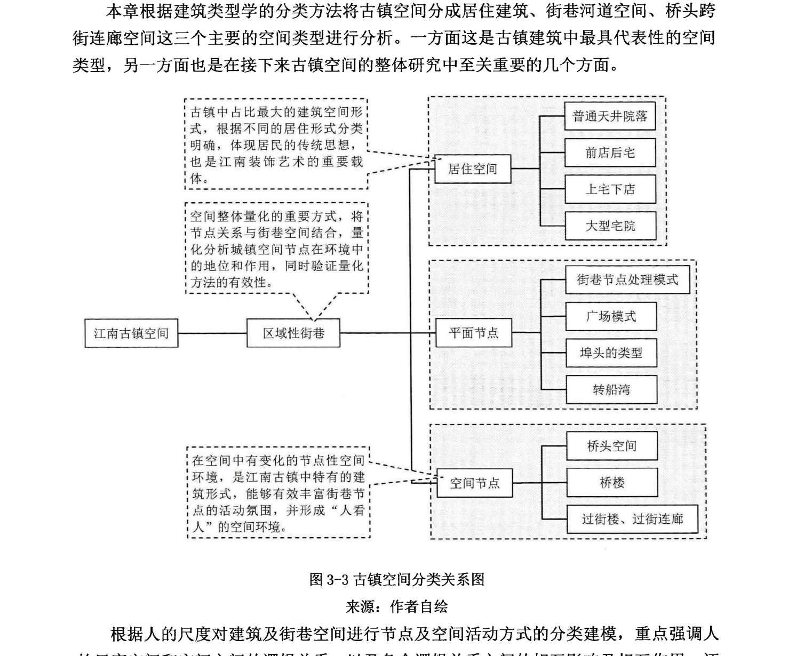

图源：吴莹2018，印刷31／PDF40页，原页裁切，非本研究重绘。

### 4.2 住宅：要学的是基本单元、主轴序列与附属组合

作者先用“间”和“厢”组成院落，再用院落串联成住宅，住宅横向并列联系街巷河网。[印刷34—35页，图3-7] 两个方向作用不同：纵向是宅内进深及序列，横向是宅与宅的组合。由此可以同时认识单体进深和群体组合。

图3-4归纳普通天井院落、前店后宅、上宅下店、大型宅院。这几类分别突出功能组合、垂直组织和规模，展示了从不同角度认识住宅的方式。[印刷32页]

| 模式与定位 | 原文具体如何表达 | 值得保留的分析认识 | 对应的理论化用 |
| --- | --- | --- | --- |
| 基本居住单元；图3-8，印刷35页 | 左侧平面，右侧空间联系及公共—半私密—私密解释；门作为若干空间间联系，同时以虚线解释边界 | 同一图可并列展示实物／空间、连接方式及意义解释，但要分清层次；客厅、院落在不同功能叙述中承担不同核心作用 | 原型抽取；物质构成、空间、使用和意义的多层描述 |
| 普通住宅；图3-9，印刷36—37页 | 街巷、门屋、前后院、堂及后厅构成进深与使用关系；以堂／厅及院落展开 | 主轴序列、对外接待与内向生活可作为可比较模式；需要记录通向旁侧房间的支路 | 基本单元的扩展；主轴、核心与侧向分支的组织 |
| 前店后宅；图3-10，印刷37页 | 沿街店铺与内侧院、堂及生活空间组合；作者以商业活动的中心地位解释改造 | “前后”与“功能”两个维度可分别描述；应区分原始形制、改造及现用途 | 生活与商业变化；功能配置和对外联系的相应转换 |
| 上宅下店；图3-11，印刷37—38页 | 一、二层功能分置，商业与居住由垂直关系及楼梯联系；兼顾沿街外廊的延伸 | 同样是店宅组合，水平邻接和垂直叠置是不同模式，平面投影不足以判定可达 | 水平与垂直组合的比较；剖面和功能分层的认识 |
| 大型宅院；图3-12，印刷38—40页 | 主轴上门屋—院—茶厅—院—正厅—院—大堂楼等序列；后勤生活围绕小堂楼展开；牌门楼单列作具有意义的边界对象 | 主轴与附属空间、空间与门楼、功能分区与装饰层级可以关联，但不需要全被压成单一链 | 序列、边界与文化意义的关联；主次空间及装饰的组织 |

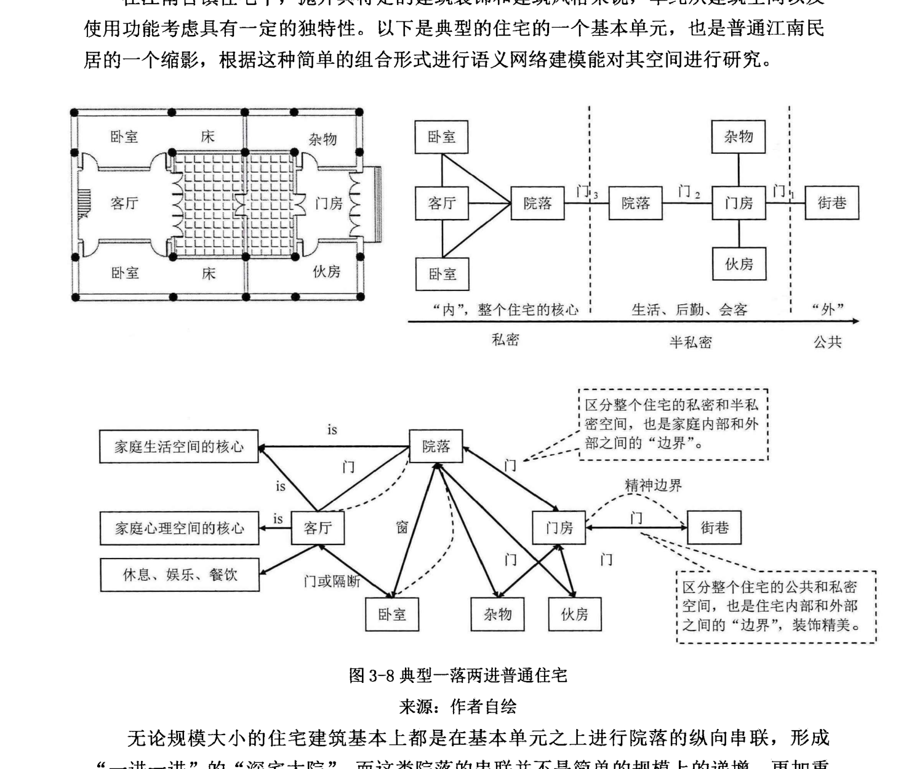

图源：印刷35／PDF44页。下方同时画出门、窗、空间性质及意义解释，展示物质构成与空间理解的结合。

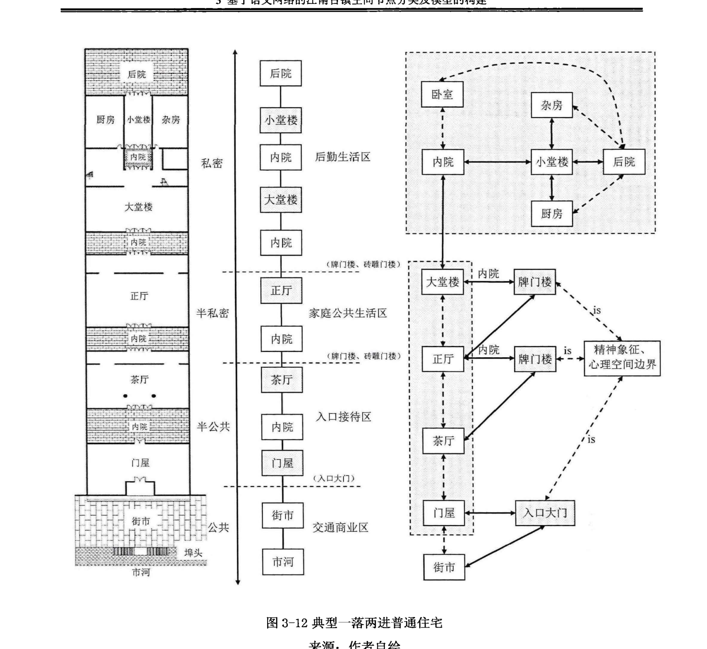

图源：印刷39／PDF48页。图内把主轴、院落、门楼与侧向生活空间并置，便于同时追踪序列与分支。

**对“门”的重要发现：**原文在普通住宅图中可用门标注联系，在大型住宅中又把牌门楼作为节点，理由包括其空间分隔与文化象征需要被单独分析。[印刷35—40页] 这体现了作者的分析粒度选择：当边界自身的形态、分隔和象征成为问题时，就把它作为独立对象展开。

**与街、河的联系：**表3-2同时比较住宅与河街关系、轴线、主要分布地点及礼制影响，原表来源为《城镇空间解析》。该表把轴线、位置、分布与礼制影响并置，体现空间描述和形成解释的结合。[印刷40／PDF49页]

### 4.3 街巷—建筑—河道：剖面序列比孤立对象列表更重要

作者将沿河街市的剖面形式归纳为露天、廊棚、骑楼、过街楼、披檐五类，说明取自《城镇空间解析》，随后把过街楼另放后节。图3-15在一组剖面中展示建筑、灰空间、街巷及河流的进深关系，并转换为空间节点。[印刷42—43页]

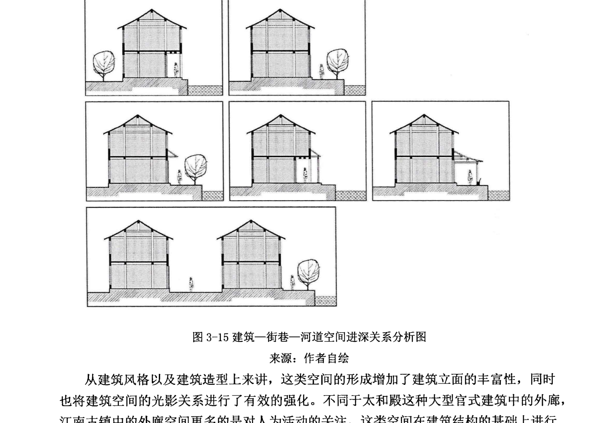

图源：印刷43／PDF52页。剖面并列展示了建筑、灰空间、街巷与河流之间不同的进深组织。

### 4.4 街巷转折：形态变化、连通与感知并非同一种关系

图3-16选a—e五个节点，分别讨论交通、商业、铺装、绿化及立面变化；图3-17进一步用a—b—c—d表示朱家角北大街某转折段。作者将建筑转角切削、铺装变化、店铺立面及开口作为节点／关系的说明，并提出两种表达：给关系写备注，或增加关系链数量来代表不同空间特点。[印刷44—46页]

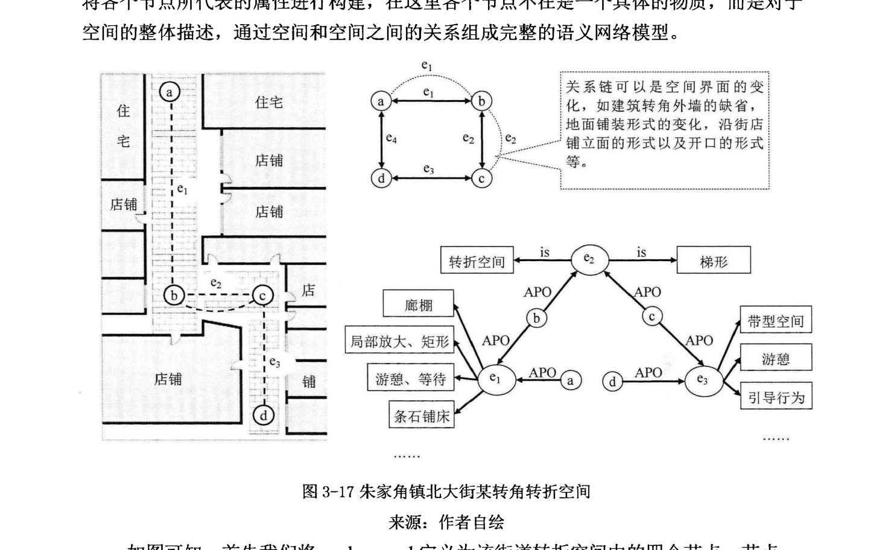

图源：印刷45／PDF54页。

**表达贡献：**它使“空间有趣”不再只有形容词，而能追问具体变化出现在何处、由什么界面形成、联系哪些空间。

### 4.5 广场：至少有两条分类轴

作者先按功能谈入口广场、街巷及桥头节点广场、庙会集市广场；另按与街道的空间关系归纳尽端式、局部放大、街道一侧附属、交叉口局部放大。[印刷46—47页，图3-19] 功能与位置／连接模式分别揭示了广场的不同特征。

宗教建筑前广场进一步以山门等边界联系不规则街巷与相对对称的内部序列；沿河小广场、桥头广场则叠加商铺、河埠、休憩、指引和视线关系。[印刷47—50页，图3-20—3-23] 这组分析把**组合方式、边界过渡和活动背景**放在同一个空间理解中。

### 4.6 河埠与转船湾：使用权、形态与区域作用需分别记录

- **河埠使用对象：**公共使用、两侧／几家共用、私人独用。
- **河埠入口／形态：**直入、侧入、两侧等，结合踏步与平台形成变体。
- **河埠的图角色：**可以作为研究对象展开踏步—平台—水面，也可以在区域图中概括为街道／建筑与河流的联系。
- **转船湾：**作者把它看作特殊埠头空间，联系货运、空间放大、岸线和周边商业，其关系不只是普通河埠的数量增加。[印刷50—54页，图3-24—3-27]

第四章转入街坊公共空间研究时，采用公共河埠作为区域联系节点。[印刷64页]

### 4.7 桥头、双桥与桥楼：局部组合不是简单相加

图3-28给出直入而紧凑、两侧接垂直道路、非对称适应两岸街巷三种示意；随后关注桥、两岸建筑、广场、花坛及踏步之间的组织。双桥图中出现多个逻辑环，作者强调双桥不是单桥量值的简单相加。[印刷54—59页，图3-28—3-33]

这一分析将“谁联系谁、通过哪里、局部如何组织”放在组合整体中讨论。

桥楼与普通桥的差别还在竖向空间和附属建筑；作者根据桥头的公共／私密活动和规模作解释。作者据此讨论传统空间形式的文化与设计价值。[印刷58—60页]

### 4.8 过街楼与过街连廊：上部连接与下部经过

原文讨论了二层私用联系、底层街道继续通过，以及局部打开建筑／围护形成公共空间等剖面变化。图3-35有多种示意，图3-36把流线、尺度、风格、装饰、灰空间与街道空间联系起来。[印刷60—62页]

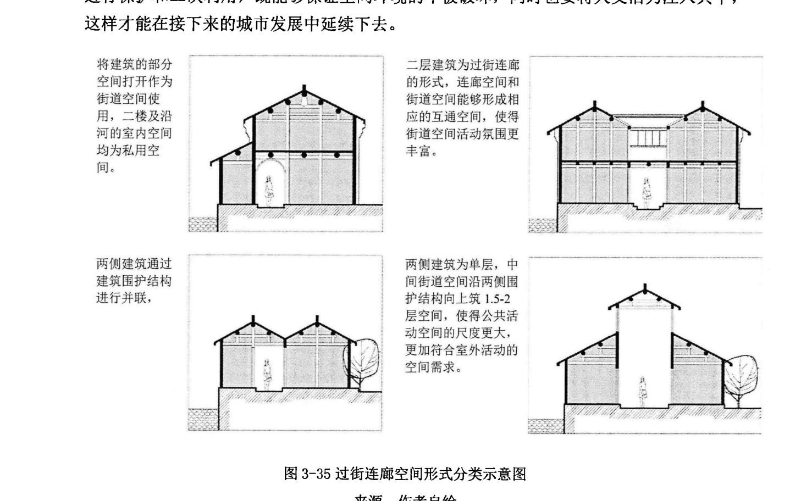

图源：印刷61／PDF70页。

这组剖面把层位、覆盖、空间连接与活动组织联系起来，进一步展开了灰空间和内外转换的认识。[印刷61页]

## 5. 第四章：从空间关系表达进入量化分析

### 5.1 建模、计算与比较的实际步骤

| 步骤 | 作者实施或明确说明 | 与前面分析的衔接 |
| --- | --- | --- |
| 确定街坊 | 同里四面环水的一个街坊；标识主要公共空间节点，组织广场G、桥头Q、公共河埠T及交点／转折 | 将第三章的局部分类带到整体尺度 |
| 抽象区域图 | 用街巷及节点联系概括区域 | 将空间组织转换为可计算的关系结构 |
| 加入空间特征 | 把桥、转折、广场、骑楼／廊棚及立面变化转为分段或折线 | 把细致空间分析纳入模型比较 |
| 使用计算工具 | DepthMap输出指标，SPSS处理和对比数据 | 以形式运算考察不同模型的差别 |
| 点链转换 | 重新组织道路及交点／联系，见图4-13 | 从另一种表示观察空间节点的作用 |
| 复合量值 | 由模型前后差异组织复合度、活力评估和相对深度 | 将模型量值重新联系到建筑学问题 |

定位：印刷63—70、77—82页。

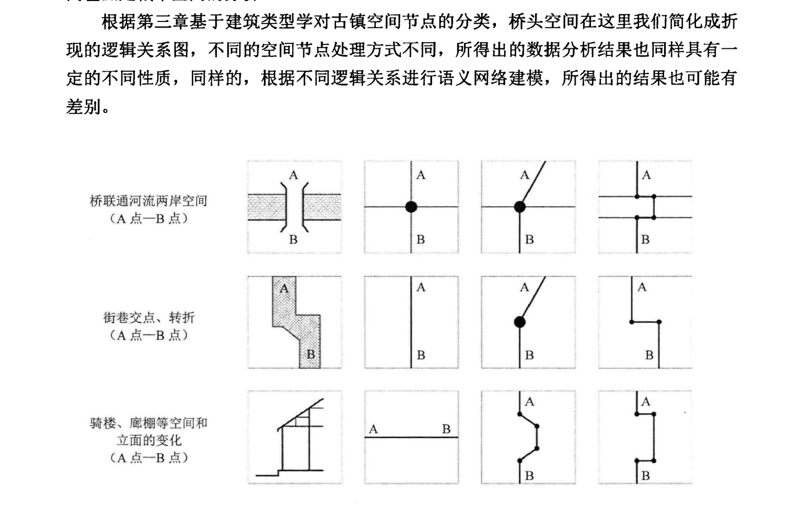

图源：印刷70／PDF79页。该图展示空间特征怎样进入编码。

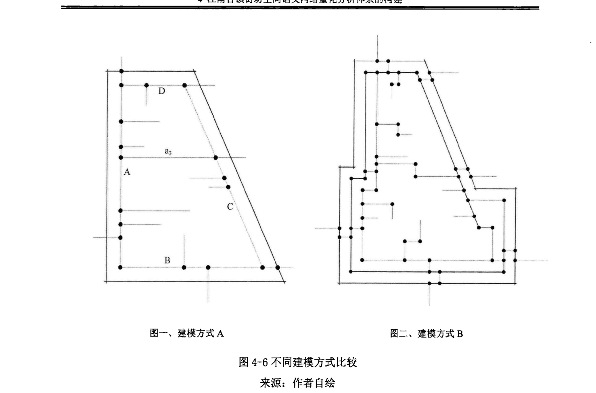

图源：印刷71／PDF80页。两图分别表示未加入及加入特征表达的模型。

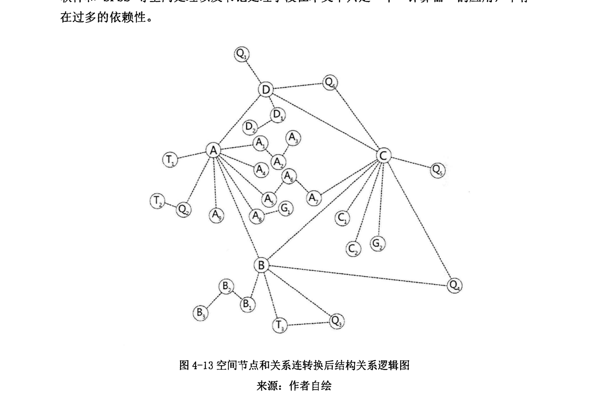

图源：印刷77／PDF86页。该图展示点与链的表示转换。

### 5.2 单一量化指标在本文承担的分析任务

| 指标 | 作者定义或公式 | 关注的空间关系 | 定位 |
| --- | --- | --- | --- |
| 总深度TD | `TD_i=Σd_ij` | 某节点到其他节点最短路径的总和 | 印刷65页 |
| 平均深度MD | `MD_i=TD_i/(n-1)` | 平均意义上的图距离／深度 | 印刷65页 |
| 连接度Connectivity | 直接相连的空间数 | 局部直接联系 | 印刷66页 |
| 选择度Choice | 最短拓扑路径经过中心空间的次数 | 路径经过与节点作用 | 印刷66页 |
| 控制度Control | `Control_i=Σ(1/C_j)` | 节点与相邻空间的联系结构 | 印刷67页 |
| 集成／整合Integration | 以集聚／离散和便捷程度解释 | 单元与局部或整体系统的关系 | 印刷67—68页 |

### 5.3 从单一指标组织复合量值

印刷81／PDF90页，作者提出：

1. **街道空间复合度**：`Re.Ii = I_mean / (I_后 - I_前)`，用来讨论街道要素与活动的丰富程度。
2. **街道空间活力评估**：`Re.Control = Control_后 - Control_前`，讨论模型前后空间控制程度的变化。
3. **街道空间相对空间深度**：以`0.5k(ΣTD - ΣTD′)`及展开式表示，讨论添加节点前后全局深度的差异。

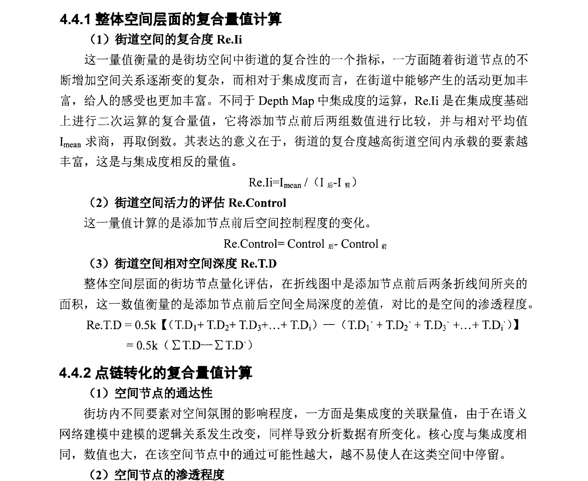

这一步值得学习的是：作者先提出要认识的空间特征，再尝试把计算量值重新组织为面向该问题的分析指标。具体公式与统计核查集中见§12.4。

### 5.4 从计算回到建筑理解

第四章依次比较模型的集成、连接、控制、平均深度与总深度，再讨论各街道及节点的作用。第五章延续这种组织，回到周庄的住宅、桥头和街道环境解释差异。[印刷71—82、95—100页]

“观察—表达—计算—解释”的衔接，使理论化用贯穿研究过程：空间分类进入模型，模型结果再回到原空间中讨论。

## 6. 第五章：把空间与模型认识带回周庄

### 6.1 局部空间解读

- **店宅改造：**图5-6展示前店后宅向生产经营／小作坊功能转化；作者借形态和使用功能的变化，解释传统生活与宗族秩序的转变。[印刷87—88页]
- **沈厅：**图5-7展示船厅、门厅、茶厅、大厅、大堂楼、小堂楼等轴向串联与两侧辅助房间；正文强调轴向秩序、侧向灵活性及装饰变化。该案例把“空间序列＋装饰分布＋使用意义”联系起来。[印刷88—89页]
- **桥头：**全功桥、普庆桥等用于展示交通、店铺、道观入口与视线／框景的交叠；关系图同时展开交通、空间组织和观赏联系。[印刷89—91页]
- **入口：**作者借报恩桥、牌坊及公园入口讨论边界与精神象征。[印刷92页]
- **街巷与沿河：**陈家弄呈现转折与局部放大；沿河廊棚、茶座、美人靠、绿化及过街空间联系建筑、街道和自然环境。[印刷93—95页]

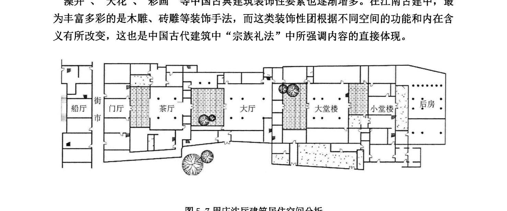

图源：印刷89／PDF98页。

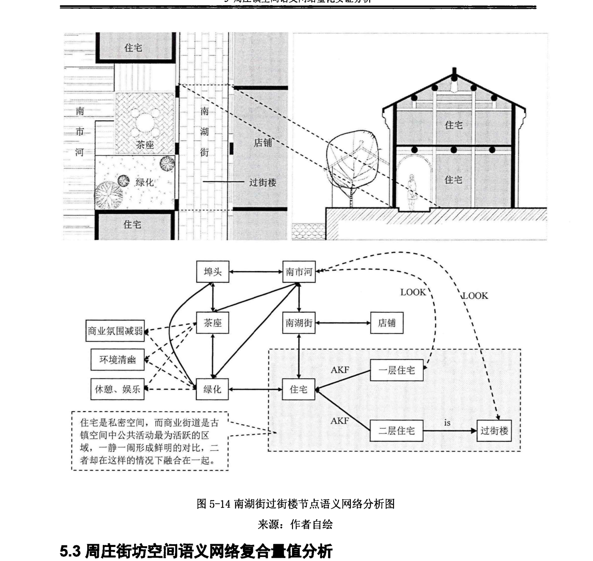

图源：印刷95／PDF104页。住宅、街市、自然环境和感受共同构成作者对场所的理解。

### 6.2 新老区对比的主要报告

作者报告老区空间要素较丰富，沈厅、张厅及部分桥头附近复合度／活动氛围较强；新区交通更便捷、功能较明确，而以交通为主的部分主干路活力解释较低；交界区呈过渡特征。[印刷96—100页，图5-16、5-18、5-20]

作者将这些差别联系到形成过程、功能组织、尺度和局部空间的丰富性，使形式分析与场所解释再次衔接。

## 7. 可学习的方法贡献：把建筑认识保留在表达中

1. **理论与操作相连。**原型、秩序、转换、灰空间等观点进入具体空间图示，而语义网络继续组织它们的对象、性质、活动与联系。
2. **从孤立对象转向组合。**门、院、堂、廊、街巷在关系中获得分析意义，形成可以比较的模式。
3. **图文相互解释。**平面／剖面、关系图与文字说明并列，使研究者能够回到原空间理解抽象结果。
4. **局部与整体相连。**住宅、转角、桥头的分析进入街坊，使单元特征与群体组织互相参照。
5. **把计算重新接回建筑问题。**量值组织围绕深度、联系、节点作用和空间丰富性展开。

对我们的表达工作，可以据此区分三类相互衔接的成果：**类型图谱**说明模式与判据，**语义模型**保存对象、关系与证据，**任务分析图**为特定问题选择节点、边和单位。这一分工作为阅读者的借鉴判断，在关联主题中继续讨论。

## 8. 面向现有类型图谱表的候选启发

本节整理阅读者提出的应用议题。模型参照为[BOT基准](../研究成果/〔建模依据〕知识图谱建模基准/BOT基准.md)、[本研究优化基准](../研究成果/〔建模依据〕知识图谱建模基准/本研究优化基准.md)和[现有类型图谱](../研究成果/〔类型图谱〕建筑空间界面与构成关系类型图谱/类型图谱.md)。各议题由原文分析视角进入具体表达问题。

### 8.1 12项候选议题及其判别问题

| 候选编号／分析议题 | 本文给我们的具体依据 | 对现有模型／图谱表的候选处理 | 需先解决的识别与反例问题 |
| --- | --- | --- | --- |
| WU-C01 基本居住单元组合 | 图3-7—3-9，印刷34—37页 | 以空间、构件和联系共同构成模式，不把一行模式表当成一个实例节点；对照BOT区域体系及U02 | 相同平面轮廓、不同实际出入能否区分？缺失房间不应直接判为不存在 |
| WU-C02 主轴串联与侧向分支 | 图3-12、5-7，印刷39、89页 | 描述序列顺序、支路和参照轴；空间包含、通行、方位分别保存 | “前后”按朝向还是访问顺序？轴线对称不等于使用对称 |
| WU-C03 室内—廊—院过渡 | 图2-6、3-15、3-35 | 前廊保留Space身份；参与界面与覆盖／围合信息按用途另记，沿U02—U04 | 灰空间边界依据是柱列、檐投影、地坪还是使用？未知不能造虚墙 |
| WU-C04 开口、门楼、门扇与边界 | 图3-8、3-12及印刷40页 | 沿用Element／Interface区分；门洞宿主、两侧空间与门楼实体分别识别，不为少画节点而丢身份 | 只有洞口照片能否判门扇、构造或象征？启闭状态是否改变实例身份？ |
| WU-C05 水平并列与垂直叠置 | 图3-10、3-11、3-35 | “前后”和“上下”作为不同位置／组合描述；直接通行须另有楼梯或开口依据 | 投影相交但分层不通；同层接近但无门；两栋之间上层连接而底层各自通过 |
| WU-C06 组成、邻接、通行与视线 | 图3-17、3-21、3-31 | 对照B-R01—12、U03及U07分别处理；视线作为另一个有前提的候选任务 | 有窗可视但不可步行；同属建筑不证明接触；实体相邻不证明互通 |
| WU-C07 构件局部与组合界面 | 图3-15、3-17、3-35的立面／覆盖变化 | 与现有T01—T03模式衔接；只在需要独立位置、面积或属性时进一步识别界面 | 柱列廊界不是无构件空白面；整面墙与面对某一空间的局部不能无条件等同 |
| WU-C08 装饰与空间序列关联 | 大宅及沈厅，印刷38—40、88—89页 | 装饰归具体构件／局部，位置与序列另关联；文化解释保留来源和判断身份 | “越深装饰越多”是否真实样本规律？物件数、面积、工艺复杂度不能混用 |
| WU-C09 民居组团与街巷界面 | 住宅横向并列、转角及公共节点，印刷34—45页 | 组团边界与对外界面服务民居风貌，不因使用街坊尺度扩成古镇综合评价 | 组团按共有院落、邻接、产权还是视觉连续？必须声明选用依据 |
| WU-C10 使用、历史与文化解释 | 前店后宅改造、私密性、宗族礼法的叙述 | 区分初建形制、资料时点和现用途；文化解释不从几何直接自动推断 | 一宅多户与一户多宅如何区分？某民族属性需何种比较证据？ |
| WU-C11 模式判别、变体和反例 | 四类住宅、四类广场关系及双桥组合 | 允许功能、形态、规模多维分类；每个模式有必要条件、可变项、排除例与实例证据 | 同一实例是否可同时属于多个维度的类型？样本频率未知不能叫典型 |
| WU-C12 图指标与表示粒度 | 第四章模型前后、点链转换，印刷70—82页 | 分离事实图与任务投影；指标附投影规则、节点范围、边语义、单位及版本 | 增加证据或属性节点能否改变通行结果？同一资料不同标注人是否得到同一模式？ |

这些议题体现不同依据的分工：建筑学理论提出分析内容，语义参照组织对象与联系，几何及验证方法落实判定。理论组织的讨论见关联[建模依据主题](../主题研究/〔体系设计〕多尺度语义模型与建模依据/〔体系设计〕多尺度语义模型与建模依据.md)。

### 8.2 类型图谱表一行至少应让人理解什么

类型图谱表可以围绕“问题与模式”组织为可讨论、可回查的记录。可按密度安排下列字段：

| 信息组 | 候选最少内容 | 解决什么问题 |
| --- | --- | --- |
| 身份与范围 | 模式编号、中文名、观察尺度、对象／局部边界 | 讨论的是类、模式、具体空间还是图中的标记？ |
| 判别依据 | 必要关系、适用条件、可变项、不能判定条件 | 为什么这个例子属于该模式？缺证据如何处理？ |
| 图文对照 | 真实来源平／立／剖或照片；必要时另配明确标识的概念示意 | 能否从图回到对象和局部？示意不冒充测绘 |
| 最小语义 | 参与对象、各自身份、关系两端／方向／角色；节点／属性／边取舍理由 | 表达是否保留组成、边界、通行和几何区别？ |
| 特征与量测 | 形态描述、参照、单位、部位；派生结果及规则版本 | “居中、前后、开敞、深度”究竟怎样判断？ |
| 对照与状态 | 正例、变体、反例；来源页码、事实／推断；候选／工作规则／已实现／待验证 | 是否可复核？规则和数据库实施有没有被混淆？ |

字段可按分析用途合并；模式表通过引用衔接正式定义。

### 8.3 以现有合成例说明首批讨论方向

- **堂屋—前廊—前院：**现有S01、S04、S05是三个空间；I01和I04是已记录分界。适合讨论连续过渡与边界参与。
- **院门：**I05联系前院及南侧外部参照区，并已有宿主墙W10的记录。适合讨论两侧空间、开口宿主与独立门构件之间的对应。
- **前廊—院分界：**I04跨度9.32m，但中间有柱。适合检验“组合边界”的跨度、局部构件与通行范围如何表达。
- **同一墙面向不同空间的局部：**沿现有T01讨论局部范围、面侧及其独立表达需求。

上述例子在首轮读取的V01中讨论，资料身份与实施范围统一见§12.6。

## 9. 理论化用的学习：怎样组织我们自己的理论支撑

本篇给我们的启发，除了具体空间模式，还包括理论章节的组织方法。进一步的研究选择由[多尺度语义模型与建模依据主题](../主题研究/〔体系设计〕多尺度语义模型与建模依据/〔体系设计〕多尺度语义模型与建模依据.md)维护，这里记录从本篇学到的组织思路。

### 9.1 先给理论分工，再安排章节

不从“准备引用哪些著作”开始，而从研究需要回答的几个问题出发：为什么这样认识民居？分析什么空间及组合？怎样表达？怎样定位、计算和检验？每项理论或方法都要承担其中明确的任务。

对应到本篇，类型学提供认识与分类方法，已有古镇空间研究给出具体对象和地域组织，灰空间概念打开过渡空间分析，语义网络显式表达认识，图论／矩阵与软件承担形式运算。这样的职责安排使理论章节能够引出后面的研究步骤。

### 9.2 每个理论写清三件事

- **取用的观点：**例如用“原型与变体”认识复杂实例，而不只写“基于建筑类型学”。
- **引出的分析：**例如寻找基本单元，比较串联、并列、主轴及附属关系。
- **在成果中的体现：**例如类型图谱的组合模式、实例之间的比较，及对应的语义关系。

把这三件事写清，理论支撑就能成为研究的推导部分，而不仅是背景介绍。

### 9.3 专门说明理论之间的结合点

作者§2.3值得直接学习：分别说明共同对象、可接续的方法与互补的职责。我们也可以追问：建筑类型／形态分析产生哪些对象、特征和关系？语义模型怎样保存它们？三维区域如何承接其位置与范围？查询与比较如何用回这些认识？

这是一条“建筑认识 → 语义表达 → 空间对应 → 分析检验”的论证线，各环节的依据与采用理由可在研究主题中逐步明确。

### 9.4 将理论化用带进类型图谱表

类型图谱中的一项，不仅可写“空间由哪些对象构成”，还可交代它服务于哪种认识：原型／变体、主轴／支路、内外过渡、群体组合或使用变化。这样，表中的对象和关系就能回到建筑问题。

例如，廊的分析可以由过渡空间认识引出：它连接什么区域、由什么覆盖和界定、开敞方向如何、支持何种活动；再据这些问题组织空间、界面、构件及其联系。学习的是**理论怎样提出问题，并通过具体空间分析产生表达需求**。

## 10. 后续如何使用这篇论文

### 10.1 可以现在引用／借鉴的内容

- 建筑类型学、地域空间研究、语义网络与形式运算的分工及结合论证。
- 第三章“原空间图—关系组织—语义解释”的图表编排方式。
- 住宅基本单元、纵向序列与横向组合、室内外过渡、上下叠置与多功能局部的分析视角。
- 围绕具体建筑认识组织模型对照与分析检验的问题意识。

### 10.2 最值得继续追原文的三条来源线索

| 本文提供的线索 | 为什么值得追 | 后续追读重点 |
| --- | --- | --- |
| 段进《城镇空间解析：太湖流域古镇空间结构与形态》，本文参考文献[38]记2002年，中国建筑工业出版社 | 物质环境分解、住宅及河街分类多源于此，可能比本篇更直接支持建筑学模式与判据 | 下一步追原书中的分类、图示与识别依据 |
| 董君《城市语义网络——城市设计策划新方法》，本文绪论记2017年 | 四类节点、点链转换及城市语义模型的主要理论来源 | 下一步追节点、关系与转换的原始方法说明 |
| 汪丽君《建筑类型学》及相关类型学原典，本文参考文献[16]记2005年 | 需进一步核“类型、原型、转换”等概念的原始含义与适用范围 | 下一步追类型、原型、秩序与转换的概念来源 |

### 10.3 优先验证的问题，而非预定结论

1. 同一资料在同一规则下，两位标注者能否识别相同空间／界面与模式？
2. 同一语义事实增加证据、图示或属性记录后，通行／类型查询结果是否保持不变？
3. 相近几何但不同连接方式的两例，能否被模型区分；不同尺寸而相同组合模式能否被识别为变体？
4. 不可判定、缺失与不适用是否被保留，而非硬分到某类？
5. 模式能否关联真实三维区域并被反查；表达完整不等于几何或文化解释正确。

这些问题供后续试例与研究设计讨论。

## 11. 证据定位速查

下列编号使用本篇命名空间`WU2018`，仅作阅读索引，不是建筑实例编号。

| 编号 | 定位 | 支持内容／归属 |
| --- | --- | --- |
| WU2018:E01 | 封面PDF1—3；摘要PDF4 | 身份、2018年、学校及作者目的；原文核验 |
| WU2018:E02 | 印刷1—10／PDF10—19 | 研究问题、范围和总框架；作者报告／主张 |
| WU2018:E03 | 印刷18—21／PDF27—30 | 四类节点、关系种类及描述／计算模型；作者采用的理论转述 |
| WU2018:E04 | 印刷22—25／PDF31—34，图2-6—2-10 | 灰空间与节点链、复杂关系、矩阵；原图与正文 |
| WU2018:E05 | 印刷25—27／PDF34—36 | 理论结合及前期分类—逻辑表达分工；作者解释 |
| WU2018:E06 | 印刷29—34／PDF38—43，图3-1—3-7 | 多尺度组织、三组空间及四类住宅；含《城镇空间解析》二手来源 |
| WU2018:E07 | 印刷35—40／PDF44—49，图3-8—3-12、表3-2 | 住宅、门、院、轴向序列和街河关系；作者描述／解释分开 |
| WU2018:E08 | 印刷42—43／PDF51—52，图3-14—3-15 | 街巷河道及剖面组合；图文核看 |
| WU2018:E09 | 印刷44—46／PDF53—55，图3-16—3-18 | 转角、界面变化、备注与多关系链；后果是阅读者判断 |
| WU2018:E10 | 印刷46—50／PDF55—59，图3-19—3-23 | 广场的功能、位置与复合用途；作者描述 |
| WU2018:E11 | 印刷50—54／PDF59—63，图3-24—3-27 | 河埠双分类、转船湾；作者描述 |
| WU2018:E12 | 印刷54—60／PDF63—69，图3-28—3-34 | 桥头、双桥、桥楼；原图与作者解释 |
| WU2018:E13 | 印刷60—62／PDF69—71，图3-35—3-36 | 过街空间及尚需数据／实测的限制；作者明示 |
| WU2018:E14 | 印刷63—69／PDF72—78 | 区域抽象、删减、同里范围、13节点及桥；作者报告 |
| WU2018:E15 | 印刷65—68／PDF74—77 | TD、MD、连接、选择、控制及Integration公式；原页核验 |
| WU2018:E16 | 印刷70—75／PDF79—84，图4-5—4-12 | 特征编码及模型前后变化；主观编码为原文明示 |
| WU2018:E17 | 印刷76／PDF85，表4-1 | 五项前后均值、T检验叙述及来源疑点；原页／局部算术 |
| WU2018:E18 | 印刷77—80／PDF86—89，图4-13、表4-2 | 点链转换、Ref0—34及35行转录；计数与算术为本轮核验 |
| WU2018:E19 | 印刷81—82／PDF90—91 | 三项复合指标、点链后解释；原式核验 |
| WU2018:E20 | 印刷83—87／PDF92—96 | 周庄范围、新老区与功能；原文时点，不当作2026现状 |
| WU2018:E21 | 印刷87—95／PDF96—104，图5-6—5-14 | 住宅与节点案例；图文核看 |
| WU2018:E22 | 印刷95／PDF104末两段 | 新区简化、老区细化及初期建模倾向；关键限制 |
| WU2018:E23 | 印刷96—100／PDF105—109 | 三类结果图与新老区解释；未估读精确曲线数值 |
| WU2018:E24 | 印刷101—104／PDF110—113 | 方法应用、展望及五点结论；贡献主张不等于独立验证 |
| WU2018:E25 | 印刷105—108／PDF114—117 | 参考文献入口与仅标题的附录；未取得完整原始实验材料 |
| WU2018:E26 | 印刷11—18／PDF20—27，§2.1 | 类型学的理论线索、原型、秩序与转换；作者的取用方式 |
| WU2018:E27 | 印刷18—25／PDF27—34，§2.2 | 节点／链、复杂网络、图论与矩阵的理论职责 |
| WU2018:E28 | 印刷25—27／PDF34—36，§2.3 | 原理共通、方法共通及互补；理论结合的明示论证 |
| WU2018:E29 | 印刷7、29、40、42／PDF16、38、49、51 | 《城镇空间解析》在本文对象分解、层次与类型中的作用 |
| WU2018:E30 | 印刷22—24、31、42—43、60—62页 | 灰空间／泛空间引申及室内外、剖面和过街模式的应用 |
| WU2018:E31 | 印刷34—40、44—50、54—62页 | 原型、序列、转换及组合在空间分析中的具体表现；跨章节联系为阅读者追踪 |
| WU2018:E32 | 印刷64—65、70、81、88—89、95—100页 | 表达、运算与解释的接续；理论化用到后文的定位 |

## 12. 边界说明与核查

本节统一保存阅读材料、理论溯源、适用范围与方法核查。正文的作者逻辑、空间分析和理论化用可连续阅读；需要据其作引用、建模或计算决定时，再回查本节对应事项。

### 12.1 阅读材料与本轮工作范围

未取得原始DepthMap工程、SPSS数据／输出及完整调查记录；未重跑作者实验；未现场核验文中建筑现状；未核验“地方特有”“现代不可复制”等广泛判断。拼页看图用于核对结构与图注，不等于逐一辨清所有图中小字和笔画。数值核查是原表转录后的局部算术与一致性检查，不是实验复现。全部工作由主会话完成，未作独立子agent复核。

首轮细读覆盖正文印刷1—104页。2026-10-28本次新增重读第二章印刷11—27页，并定向回查绪论、第三至五章相应段落及参考文献，补充理论分工、结合论证与化用链。原PDF指纹与首轮一致。摘要、目录与参考文献的阅读不替代被引原著阅读；PDF117仅见附录标题，未取得成套原始实验数据。

### 12.2 原理论、作者理解与阅读者追踪

- 本文主要研究太湖流域古镇空间；我们借它学习理论组织与空间分析。景宁样本事实、BOT原定义及Neo4j实施分别由对应资料和主源支撑。这类适用范围不再插入作者研究主线逐段提醒。
- §3中的类型学人物观点、灰空间引申及董君著作内容，均先按吴莹论文的理解记录。本轮未直接核读这些原典；正式引证具体理论命题时继续追原著与准确位置。
- §3.2与§3.6中“理论观点—后文分析”的跨章节对应，有些为作者明示采用，有些为阅读者依据概念和实际操作重建；两种对应已在正文说明。
- 类型学史的译名、年代及概括仍有原典核查事项，例如文中“恩格尔斯”及建筑转换方法一段；不据本篇转述直接订正或建立理论史事实。
- “形式丰富影响活动”“礼法解释序列”“现代不可复制”等是本文的解释或价值判断；作为一般因果、地域专属性或通用尺度结论时，需要相应证据。
- 作者的背景主张，如传统研究均未量化，应结合所综述文献使用；贡献分类是阅读者工作标签。

### 12.3 空间分类、图示与对象身份

三组空间及四类住宅涉及不同维度，可作为多视角分析目录。正式单选分类、实例身份与操作判据仍需按研究任务明确。表2-1列四种关系、正文另谈联通与延伸，`AKF`／图中`AKO`也有不一致，不能直接作为完整关系规范。

| 原空间模式 | 不能由原图直接推出的结论／待核问题 |
| --- | --- |
| 基本居住单元；图3-8，印刷35页 | 图上的“核心”已经由中心性数值验证；所有门／窗均为可步行路径 |
| 普通住宅；图3-9，印刷36—37页 | 空间深度直接等于社会等级，或所有地区住宅均如此 |
| 前店后宅；图3-10，印刷37页 | 商业功能必然抹除宗族秩序，或现状等于初建状态 |
| 上宅下店；图3-11，印刷37—38页 | 上下空间因投影重合便一定相通；任何二层住宅都属于该类型 |
| 大型宅院；图3-12，印刷38—40页 | 原图标题“典型一落两进普通住宅”能准确概括图内大型多段序列；该图不能据标题直接计进数 |

门楼实体、门洞界面、门扇及经开口发生的通行各自承担不同语义；窗的视线、通风与步行也分别判断。空间、物体、属性和活动可以共同被表达，计算时应明确选择哪些关系。混合语义图的闭环不直接证明步行回路或院落围合。平面相交、上下叠置与实际通行分别判定。

第四章保留公共河埠、忽略私人河埠，不涵盖全部住宅—水系联系；其高度抽象关系图不提供完整几何尺寸或三维净空。过街连廊部分在印刷61页明确提出后续实测与数学关系深化需求。

图注／出处疑点保留：图3-12名称与图内规模、图3-30／3-31图注与正文对象、图5-13“周庄发展过程”与实际沿河关系图的对应，以及表4-1标注来源。引用时同时定位题名、作者、页码、图号及图内内容。

### 12.4 量化指标、编码及统计核查

#### 单一指标的定义一致性

| 指标 | 本文定义／表达 | 核读发现与采用边界 |
| --- | --- | --- |
| 总深度TD | 某节点到其他节点最短距离之和：`TD_i=Σd_ij` | 印刷65页。这里首先是计算图上的步数／最短路径关系，不是几何米数；编码粒度改变会改变结果 |
| 平均深度MD | `MD_i=TD_i/(n-1)` | 印刷65页。需要同一节点集合、可达范围及n的定义；比较不同规模图不能忽略分母 |
| 连接度Connectivity | 直接相连的空间数 | 印刷66页。应先规定空间单元与边类型；不是所有知识图谱边的总数 |
| 选择度Choice | 印刷66页按经过某中心空间的最短拓扑路径次数讨论 | 印刷79页又把选择度写成可连接道路数，与连接度混用；复用时不能把两种定义当同一个指标 |
| 控制度Control | 按邻接节点连接值倒数求和，即`Control_i=Σ(1/C_j)` | 印刷67页。原文概括“连接度越高控制度越低”，不由该公式普遍推出，见下述反例 |
| 集成／整合Integration | 正文说值越大表示越便捷，同时印刷68页公式印为`Ii=RAi=2(MDi-1)/(n-2)` | 所印RA表达随MD增大而增大，与“越大越便捷”不一致；表4-2导出值也不等于这条式子的RA数值。不能静默改成倒数后声称原文无误 |

**关于控制度的局部数学反例（阅读者构造，非作者数据）：**按本文公式计算一个四叶无向星形图，中心节点连接度4、控制度4；叶节点连接度1、控制度0.25。因此连接度和控制度可以同时更高。此例只反驳普遍反向关系，不能替代对真实样本的相关分析。

#### 复合量值的操作问题

- `I_mean`的“相对平均值”没有足够明确地交代取样集合和计算口径；分母在`I_后<I_前`时为负、在两者相等时为零。不能擅自改成绝对值或交换前后。
- `Re.Control`首先是所选模型表示下控制值的差，不自动等于实际人流、停留时间或“空间活力”。需要外部活动资料检验其解释。
- `Re.T.D`中的`k`、各项对应、横轴间距、端点权重及曲线交叉处理交代不足。若横轴仅为任意排列的街道编号，所谓折线间面积还可能依赖排序；不能不说明就当成空间实体面积或标准积分指标。
- 作者第四章也承认节点的转化来自主观认识和空间感受，且不同量值之间应怎样重组仍需进一步研究。[印刷75—76、81—82页]

#### 表4-1：忠实转录与有符号差值

原表位于印刷76／PDF85页。下表“后减前”为本轮算术结果；原文“差值”行采用正值，方向说明不足，故不把该行当作有符号差。

| 指标 | 添加节点前 | 添加节点后 | 本轮计算：后减前 |
| --- | --- | --- | --- |
| Integration | 1.3572 | 0.8454 | -0.5118 |
| Connectivity | 2.1333 | 2.0690 | -0.0643 |
| Control | 1.0000 | 0.9345 | -0.0655 |
| MD | 2.4000 | 4.2401 | 1.8401 |
| TD | 33.6000 | 115.1379 | 81.5379 |

复合度原式在作者报告的Integration总体下降情形中存在方向问题：如果`I_mean>0`，负分母会得到负值；这与后文把较高正值解释为复合度高的叙述需要重新对照。**总体均值差不能拿来代替每条街的差值重算复合度；这里仅用于指出符号问题。**

另一个条件性检查：若MD和TD确实来自同一固定n、完整连通图的相同行集合，则两列均值也应满足`mean(TD)=(n-1)mean(MD)`。表中前组比值为14，后组约27.1545，后者不对应整数`n-1`。这可能涉及转录／排版、指标或取样口径，本轮未取得原模型，**记录不一致，不擅自替作者改数**。

表4-1标注“表格来源：中国古镇旅游网”，但正文称是模型计算后的比较，来源标注与数据性质不匹配，亦需核原始研究资料。

#### 表4-2：正文说34组，实际表列35行

表4-2跨印刷78—79／PDF87—88页，`Ref`从0到34。转录后按程序计数为**35条数据行**，不是34条。其行名是点链转换后的关系式标识，如`D-Q1`、`A-A1`、`A-B`，不能当作35栋建筑或35份独立样本。

[原表35行转录CSV](../研究资料/来源证据/吴莹2018-江南古镇语义网络/表4-2转录.csv)保留Integration、Control、Choice、Connectivity、MD、TD及双页码。它是**人工转录表，不是作者原始数据库**。

局部算术核验：

- 各行`TD/MD`约为34；`TD-34×MD`绝对误差最大约0.00016，与原表MD小数舍入相容。这个一致性支持表内深度列按35个计算元素组织，但不证明模型语义正确。
- 例如Ref0，`MD=2.41176、TD=82、Integration=1.93452`。若以35作为n代入印刷68页公式，得到`RA≈0.08556`，并不等于1.93452。由此可在本文内部确认“所印公式”和“导出列”的对应存在问题，尚不能仅凭这一检查断定软件使用了哪种归一化方案。
- 35条元素共享同一网络结构，不能自动视为35个独立观察。没有原始图，无法检查全部邻接、最短路径或重算所有中心性。

详细程序输出见[数值核查JSON](../研究资料/来源证据/吴莹2018-江南古镇语义网络/数值核查.json)。

#### 对SPSS检验应如何评价

原文印刷76页称对五组指标作“单一样本T检验”，并写sig在“0.000以下”。但没有给出足够清楚的检验对象、零假设、完整t／自由度／样本匹配及输出表；当前PDF附录也未提供成套原始结果。

因此，本轮**没有复算或认可其显著性结论**。负的p值并不存在；即便软件显示`.000`也不应写成小于0。不能替作者推算一个精确p值；也不能仅凭“单一样本”名称就断言其一定误用，因为若检验的是配对差值对零，一样本检验可能对应合理问题，关键是本篇没有交代清楚。

更根本的是：**两种编码得到不同均值，只能支持两种模型输出不同，不能单独证明后者更接近人的实际体验。**相同网络内的元素也有依赖，不能默认满足独立抽样条件。

**街巷多关系链的计算风险：**同一b—c路段多画几条代表铺装、立面和开口的链，如果直接纳入度数计算，会把不同语义混成更多“连接”；从度数增加不能直接推出趣味性增加。应保留对象事实，按通行、视线、形态变化等任务分别投影／计算。这是本轮判断，不是作者已完成的分层模型。

### 12.5 案例解释与方法验证

**周庄新老区比较的建模倾向：**

印刷95／PDF104页明确说明：对新建区域作较简单的节点概括，对古镇区域人为进一步细化和丰富，在建模初期即有倾向性和指向性。因此后续“古镇更丰富”的数值部分是编码规则的结果；只有在相同观察口径、相同细分标准与独立活动证据下，才能区分空间差异和表示差异。

本篇第五章仍有反复沿用前章论述及图注复用的情况，如图5-13题为“周庄发展过程”但图内容是沿河空间要素关系；图3-30、3-31等图注也需结合正文确定对象。正式引用宜用**作者、题名、页码、图号和图内内容**共同定位，不只靠图注名称查实体。

新老区的便捷性、停留、功能与生活品质并非同一个评价对象；住宅区安静也不直接构成价值不足的判断。第五章的结论按作者的案例与模型解释使用。

**关键限制对复用的影响：**

| 问题 | 原文依据／本轮检查 | 对复用的实际影响 |
| --- | --- | --- |
| 分类维度混合 | 居住／平面／空间三组，以及四类住宅 | 不宜直接作为互斥本体类或单选调查字段 |
| 节点与链可互换但对应规则不足 | 图2-6、3-17、4-13及第四章 | 需保存对象身份、转换规则和投影，避免表示改变制造结果 |
| 经验／感受预先进入编码 | 印刷75、95页 | 数据化不自动消除主观性；新老区比较存在编码偏向与循环论证风险 |
| 公式与术语不一致 | 印刷66、68、79、81页；表4-2核算 | 必须重查指标定义和软件选项，不能直接复制公式 |
| 检验报告不充分 | 印刷76页及空附录 | 不能据“显著差异”认定方法有效，无法复核原p值 |
| 独立外部验证有限 | 周庄对照及第四／五章叙述 | 尚不足以证明指标预测真实停留、感受或活力的可靠性 |
| 原始数据与实施材料缺口 | 当前PDF未见完整工程、调查及软件输出 | 本轮只能复核部分表值和逻辑，不能声称复现实验 |
| 图注／出处存在复用与不匹配 | 图3-12、图5-13、表4-1等 | 精确引用须同时核对图内内容、正文、页码，不从名称推实例身份 |

上述批评是对本篇给出的证据范围的判断，不是对作者全部研究能力的评价，也不意味着其中所有建筑学观察均不成立。

### 12.6 阅读者的最小核查与实施状态

#### 一个最小反例：空间没变，节点细分就使深度增加

**阅读者构造、程序已实际运行，不是论文数据：**同一条物理路线原用`A—B—C`表示，从A到C为2步；仅在A—B段增加记录点X，表示成`A—X—B—C`，每条图边仍计1步，则从A到C变成3步。以A为根，TD由3变为6、MD由1.5变为2.0。

这不能说明空间突然更复杂或更有活力，只说明未加权图指标依赖如何细分。若研究真实路程、空间跨越、构件层次或语义转换，应分别定义单位，不能混算。

#### 用现有V01作只读表示核对

首轮核读时读取[V01维护主源](../研究成果/〔合成试例〕虚拟民居单体试验V01/案例模型.json)，指纹`acdba681d31fe32ad2304b34ad5e66a2cc955e7aea4801552215606c64281b67`。它仍是人工合成例，不是景宁真实民居。

程序仅从5条`DIRECT_ACCESS_TO`读出6个空间，按各边`bidirectional=true`作无向分析：

| 表示 | 节点／边 | 南侧外部参照区S06至西室S02 | 解释 |
| --- | --- | --- | --- |
| 空间直接通行图 | 6个空间、5条边，保留`via`界面引用 | 4次空间跳转 | 空间→空间的一步 |
| 空间—界面交替图 | 相同6空间＋5个通行界面，11节点、10边 | 8条图边 | 空间→界面和界面→空间各计一步 |

这是同一组合的不同表示，不是两个建筑的风貌差异，也不是界面节点化“导致建筑更复杂”。用这个例子可验证图谱表必须写清**实例身份与分析投影**。本轮没有改写JSON、没有连接或写入Neo4j；不据旧文档推断数据库已迁移。

上述算术反例与V01投影保留首轮核查身份：V01为合成案例，指纹、参数及查询解释按当时读取主源记录。本次未改案例、类型定义、双基准、研究目标或数据库；主题中的理论组织是讨论稿，章节采用状态仍由各章维护。

12份原页裁切保留作者、图号、页码及来源，正式发表复用另查权利。CSV和核查JSON为原表转录与本地核验，不是作者原始实验数据。
