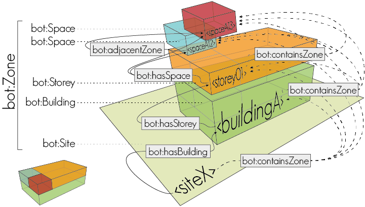
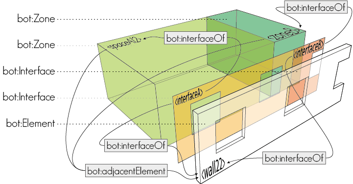

# BOT基准

本文件忠实整理BOT的概念、关系、形式声明、例子与适用范围，作为本课题后续建模的原始参照。中文为阅读者释义，原始术语、定位与版本保留；**不在本文件中加入本研究的墙轴、通行或证据管理规则。**这些应用取舍单独放在[本研究优化基准](本研究优化基准.md)。

本文件编号为 **BOT-B0.1**，这是阅读基准版本，不是BOT发布版本。原始来源固定为本次保存的官方文件与Zotero论文；网站以后更新时另存快照、比较差异，不静默覆盖。

## 1. 来源与核读范围

- **W：官方文档快照。**W3C Linked Building Data Community Group，[Building Topology Ontology](https://w3c-lbd-cg.github.io/bot/)，2026-10-26保存。[离线阅读](../../研究资料/来源证据/2026-10-26-BOT基准来源/官网离线阅读.html) · [原始HTML](../../研究资料/来源证据/2026-10-26-BOT基准来源/官网原始页.html)。本轮读定义、常见建模问题、完整示例、扩展示例及修订记录；不将外链演示视为全部运行验证。
- **T：官方本体文件。**[本地bot.ttl](../../研究资料/来源证据/2026-10-26-BOT基准来源/bot.ttl)，通过`https://w3id.org/bot/bot.ttl`取得，最终返回官方GitHub Pages文件。`owl:versionInfo=0.3.2`，`owl:versionIRI=https://w3id.org/bot-0.3.2`，文件内修改日期为2020-07-31。抓取日期、服务器修改日期、本体声明日期是不同信息。
- **P：论文。**Rasmussen, M. H.; Lefrançois, M.; Schneider, G. F.; Pauwels, P. (2021). *BOT: The building topology ontology of the W3C linked building data group*. Semantic Web, 12(1), 143–161. [DOI](https://doi.org/10.3233/SW-200385)。Zotero父条目`PNZ3865Z`、附件`6XP3U4GG`；[本地PDF](</Users/wangyuelin/Zotero/storage/6XP3U4GG/Rasmussen et al - 2021 - BOT Building Topology Ontology.pdf>)。题名页的Krzysztof Janowicz是编辑，不能按Zotero简略输出混入作者名单。

论文共19个印刷页，附件另含机构封面：印刷页＝PDF页＋141。既有阅读覆盖PDF1—18页正文，重点§3—4；图2—5和§4.3原页已看，本轮补看PDF17／印刷158页的数量限制表述。未独立复算作者性能实验，也未精读全部被引论文。

原文件哈希、时间、URL及许可说明集中保存在[来源清单](../../研究资料/来源证据/2026-10-26-BOT基准来源/来源清单.json)和[来源说明](../../研究资料/来源证据/2026-10-26-BOT基准来源/来源说明.md)。T文件头标注CC BY并给出1.0许可链接；配图保留官方署名与出处。官网自称社区组Public Draft，不能写成W3C Recommendation。

### 1.1 必须保留的版本差异

| 编号 | 核对内容 | 来源差异与本文件处理 |
| --- | --- | --- |
| B-V01 | 发布版本 | P§3.2写v0.3.1；本次T文件明确写v0.3.2。分别引用，不混作同一份规范 |
| B-V02 | Interface解释 | P印刷149页强调相关对象的共同局部及至少一方的边界；W／T解释为限定两个或多个对象联系的通用概念，至少一个对象为区域或构件。官网修订记录称v0.3.2修改定义措辞、未改逻辑；该声明不等于本研究已逐版本验证逻辑等价 |
| B-V03 | Interface最小关系数 | P§5.2印刷158页仍提及`ObjectMinCardinality(1 bot:interfaceOf)`；W的v0.3.1修订记录写明移除Interface数量限制，当前T核心声明也没有该限制。保留冲突，不将论文中的限制写成当前本体公理；未核清论文形成该差异的编辑过程 |
| B-V04 | 人类解释与机器约束 | W的“两个或多个对象”是概念说明；当前T没有强制Interface必须有两条边的数量公理。T的`interfaceOf`只声明定义域为Interface，没有封闭的值域清单。不能把自然语言示例直接变成正式数据验收约束 |

## 2. BOT解决什么问题

BOT面向建筑生命周期中多专业、多软件的数据互联，采用轻量核心本体与其他领域词汇组合。它描述建筑区域、构件及其关系，并允许关联几何、产品、观测等信息。[P印刷145—148，§1—3.1；W Introduction]

其建模路径为：提出需要回答的问题，选择概念和关系，说明与其他本体的组合，再用建筑模型导出和查询检验实现。P以三个建筑模型评价导出及六类查询；评价不等于自动识别建筑、构造计算或建筑风貌分析的验证。[P印刷155—159，§4.5—6]

以下B-Q编号是本文件的阅读索引，语义对应P§3.1的七个能力问题：

1. **B-Q01 区域组成：**如何表达场地、建筑、楼层、空间？
2. **B-Q02 区域层级：**哪些小区域包含于大区域？
3. **B-Q03 区域关系：**区域之间如何邻接或相交？
4. **B-Q04 构件组成：**有哪些构件及子构件？
5. **B-Q05 区域—构件：**构件位于区域内、与其邻接还是与其相交？
6. **B-Q06 联系附加信息：**如何进一步描述区域／构件之间的连接？
7. **B-Q07 几何关联：**如何把区域或构件关联到三维模型？

## 3. 核心概念：7个类

本表依据W同名条目、T的英文注释与类声明，另参照P§3.2—3.5。定义是中文转述；“不能混同”是依据这些定义作出的解释，不是新增类别。

| 编号／术语 | 基本定义 | 不能混同的对象或边界 |
| --- | --- | --- |
| B-C01 `Zone` 区域 | 物理或虚拟世界中具有位置及三维范围的部分；可以分组或细分 | 不只指室内空气，也不只指房间；几何表示可以另行关联 |
| B-C02 `Site` 场地 | 一类Zone，用于包含或计划包含一个或多个建筑 | 场地空间与地籍、所有权对象不自动等价 |
| B-C03 `Building` 建筑 | 一类Zone；具有特征空间结构、面向某种功能／活动的建成环境独立单元 | 在BOT中属于区域体系，不能无说明地与“所有实体构件的集合”视作同一概念 |
| B-C04 `Storey` 楼层 | 一类Zone，通常对应建筑中的层位，可与其他楼层通过垂直联系组织 | 中文一楼／二楼的编号习惯不是BOT规定；地上地下均可表示 |
| B-C05 `Space` 空间 | 三维范围由实际或理论边界界定，并在所在区域内提供一定功能的部分 | 不要求处处以墙围合；平面图是表达来源，不是空间实例本身 |
| B-C06 `Element` 构件／建筑组成对象 | 具有特定技术功能、形态或位置的建筑组成对象；正文及例子包括墙、门、设备、家具、传感器 | 其范围比中文狭义“结构构件”更广；纯几何面不能仅凭外观直接当成有形构件 |
| B-C07 `Interface` 界面／联系限定对象 | W／T：用于详细限定两个或多个对象间联系的通用概念，至少一个对象为区域或构件；P的边界性解释见B-V02 | 不限于门洞或两空间间分界；与Element、Zone分类互斥；不等于任何任意图边都必须节点化 |

图1：官网Zones原图，来源W，未重绘。它演示区域包含与邻接，不能从画面推出某一具体住宅必须具有完全相同的层级。

## 4. 关系与几何属性

箭头表示属性主语→宾语。表中的“未限制”指该项没有相应显式公理，不能据此推断现实没有边界。完整声明以T原文为依据。

| 编号／术语 | 方向与含义 | 形式声明及解释边界 |
| --- | --- | --- |
| B-R01 `containsZone` | Zone→Zone，大区域包含子区域 | 显式传递；不等于构件组成 |
| B-R02 `hasBuilding` | Zone→Building，区域含建筑 | R01子属性；典型起点Site，但形式定义域为Zone |
| B-R03 `hasStorey` | Zone→Storey，区域含楼层 | R01子属性；典型起点Building，形式定义域为Zone |
| B-R04 `hasSpace` | Zone→Space，区域含空间 | R01子属性；典型起点楼层或建筑，不把示例端点误作唯一合法端点 |
| B-R05 `adjacentZone` | Zone→Zone，两个区域共享界面而不相交 | 显式对称；与R06属性互斥。邻接不自动表示可通行 |
| B-R06 `intersectsZone` | Zone→Zone，三维范围相交，例如楼梯间与楼层 | 显式对称；与R05属性互斥。单纯二维投影相交不足以断言三维关系 |
| B-R07 `hasSubElement` | Element→Element，构件承载另一个构件，或组成细分 | 墙承载窗、设备含风机是示例。T未将该属性声明为传递属性 |
| B-R08 `hasElement` | Zone→Element，区域与构件的概括关系 | R09—R11的上位属性；原文建议由具体关系推得；不是明确区分位置方式的替代品 |
| B-R09 `containsElement` | Zone→Element，区域包含构件 | R08子属性；支持区域包含链的继承，见B-A05 |
| B-R10 `adjacentElement` | Zone→Element，构件与区域邻接并界定区域 | R08子属性；与R11属性互斥；不能直接改用为Wall→Wall |
| B-R11 `intersectingElement` | Zone→Element，构件与区域相交 | R08子属性；与R10属性互斥；不是任意两构件相交的通用关系 |
| B-R12 `interfaceOf` | Interface→参与对象，通常为Zone或Element，也可为其他对象 | 显式定义域Interface；无封闭值域、无当前数量限制；角色或方向性功能需另定义 |
| B-R13 `has3DModel` | 通常从Zone／Element指向一个三维模型IRI | 提供表示关联，不规定几何编码或识别算法；T标为unstable，只有domainIncludes提示 |
| B-R14 `hasZeroPoint` | Site→包含场地原点地理信息的对象 | T标为unstable；官网指出语义可能修订。不是完整坐标转换规则 |
| B-D01 `hasSimple3DModel` | 通常从Zone／Element指向编码三维模型的字面量 | 数据属性；T标为unstable。几何类型、单位、坐标系仍需具体表达 |

T核心共14个对象属性和1个数据属性；另保留两项弃用对象属性`hostsElement`、`aggregates`，均指向`hasSubElement`作为参考替代。**“核心14项”不等于整个文件只声明14个对象属性。**[T核心及“Depreciated concepts”段]

## 5. 形式规则与容易误读的地方

### B-A01 类互斥与继承

Zone、Element、Interface两两互斥；Site、Building、Storey、Space均为Zone子类且四者两两互斥。同一实例同时声明为Space与Building会产生类别冲突，不能靠“同一对象有多个标签”自动化解。这里是分类互斥，不是说它们的几何范围不能重合。[T类声明；P图2／3]

### B-A02 定义域／值域不是表单式枚举

RDFS／OWL的domain、range参与类别推断。把某节点放在`hasSubElement`起点，会支持其为Element的推断；不能理解成数据库自动执行了字段输入校验。`schema:domainIncludes`和`schema:rangeIncludes`在T中被声明为注释属性，其提示与`rdfs:domain/range`形式声明不同。未声明值域不意味着对象只能是文档列举的两类，也不意味着可以忽略语义解释。[T前缀后注释属性声明及各关系定义；表达机制参照[W3C OWL 2 Primer §4.6](https://www.w3.org/TR/2012/REC-owl2-primer-20121211/#Domain_and_Range_Restrictions)，2026-10-26定向核读]

### B-A03 对称、传递与存储方向分开

`adjacentZone`与`intersectsZone`声明对称，`containsZone`声明传递。不能把对称性推广给所有关系；当前T没有将`hasSubElement`或邻接声明为传递属性，不能据此推得它们具有传递性。T未显式声明自反、反自反或不对称的属性，不能仅凭我们希望的数据规则称其已被BOT声明。应用扩展需要另外论证和标明来源。[T]

### B-A04 组成、包含与邻接不同

空间内的构件、界定空间的构件、构件内部的子构件分别对应R09、R10、R07。一个通用“属于”关系不足以保留这些区别。原论文和官网的构件承载示例说明了R07的用途，但没有给出具体建筑中所有墙、窗或材料层的拆分算法。[P§3.3—3.4；W Elements]

### B-A05 两条关系链

T明确声明：

- `containsZone ∘ containsElement → containsElement`：大区域包含某子区域，该子区域包含构件，则大区域也包含该构件。
- `containsZone ∘ hasElement → hasElement`：大区域包含某子区域，该子区域与构件存在hasElement关系，则大区域也有该概括关系。

具体关系可通过子属性规则推到`hasElement`。**这不等于大区域自动与构件直接邻接，也不等于墙上的每扇窗自动邻接墙涉及的所有空间。**[T；P印刷151；W Common Modeling Questions—Windows]

### B-A06 Interface的概念、实例与数量

Interface能够承载关系的附加信息；一个Interface与参与对象通过`interfaceOf`联系。当前本体没有强制“两个端点”“每墙两个界面”或“必须有墙”的数量／存在规则。B-V03说明论文与现行文件之间的差异；项目可以制定自己的资料完整性规则，但须写成应用规则。[W／T；P§3.5]

### B-A07 未知与未声明

OWL采用开放世界语义，未声明某关系通常不能直接作为该关系不存在的证据。完整性检查、业务必填项和闭合空间要求，需要额外的数据校验约定；BOT核心关系本身不能替代它们。本段是对其RDF／OWL表达机制的解释，不是BOT论文新增的一项实证发现。[W3C OWL 2 Primer §2](https://www.w3.org/TR/2012/REC-owl2-primer-20121211/#What_is_OWL_2.3F)，2026-10-26定向核读。

### B-A08 几何关联与几何判定不同

三维模型链接提供几何入口，不直接计算相交、接触、净空、面积或视线。文档的“通常适用于Zone／Element”与显式定义域限制不同；是否给Interface另加几何表达，要依据使用方的词汇设计，不能冒称BOT已给出完整界面几何规范。[P§3.6；W 3D Model；T]

## 6. Interface的重点拆解

图2：官网Interfaces原图，来源W，未重绘。图中两个区域各有一个界面，分别关联该区域与同一面墙。**两个界面来自图示关系，不是“每墙强制正反两个面”的数量规则。**

P印刷151页§3.5给出三个用途：

- 空间—墙：限定热传递表面面积；面积属于这项局部联系，而不是必然等于整墙面积。
- 管道—墙：限定相交部位，以关联防火封堵信息。
- 空间—空间：描述出入类型及通行限制。

W／T的例子进一步涉及构件接头、窗与墙连接等。官网中的热损失一／二／三维表述属于其热传递例子，不直接当作所有界面几何维度的划分标准。

据此解释：**墙是构件；墙表面是几何描述；空间边界是区域范围的界限；Interface使某项局部联系可以被识别并携带信息。**它们可以在某个局部对应，但不必一一等同。这是对来源的概念辨析，具体面域分割、墙厚处理、开口扣除和分类方法不由BOT直接提供。

## 7. 官网具体示例能教会什么

- **区域分组：**多个房间可由一个Zone组织成公寓；分组不要求创建实体构件。[W Common Modeling Questions—Zones]
- **跨层楼梯间：**楼梯间与多个楼层的相交可用Interface扩展模式表达。示例自定义`ex:ZoneIntersection`和`ex:intersectsZone`，其中后者是`bot:interfaceOf`的子属性；**不能把它与BOT核心的`bot:intersectsZone`混为同一个关系**。[W Stairwell]
- **窗与空间：**窗由墙承载，不自动推出窗与墙涉及的每个空间都邻接；墙可能跨越多个楼层或房间，窗的空间对应要另行明确。[W Windows]
- **两层建筑与完整住宅示例：**展示区域层级、产品与建筑位置的组合；给出的是数据表达实例，不是所有建筑的必备采集目录。[W Complete Examples]
- **扩展类／属性：**可定义Element的子类，或包含关系的子属性；P§4.1也演示了这种方式。借用BOT不要求把所有领域词汇塞入BOT核心命名空间。[W Extending BOT；P印刷153]
- **属性赋值：**P§4.3比较直接数值与可描述属性情境的表达，§4.4说明类级要求与实例属性。它们提供组合思路，未规定统一的材料标签、测量置信度或历史修缮字段。[P印刷154—155]

对齐模块作为独立文件列出。本轮未逐一下载、执行或核验全部对齐；不能因官网有链接就声称本项目已经与IFC、Brick或DUL完成互操作。

## 8. BOT的适用边界

BOT提供建筑对象与核心关系的共享词汇。它没有完整规定传统民居类型、风貌指标、材料分类、构造连接、门窗分段、拓扑容差、点云识别或建筑文化解释。官网也明确其不提供通用RCC关系演算。[W Introduction；P§3.3、3.6]

论文的BIM导出和查询评价，只能按其模型、实现与测试条件解读。其导出器当时覆盖部分关系，邻接提取主要针对墙，几何与属性亦有简化；本文不把作者实现视为所有BOT关系均已自动识别。[P§4.5、5.1]

本文件不以“常识合理”为由补充BOT未声明的强制规则，也不把应用实例的数量和形状提升为本体公理。新增领域表达及其验证应引用[本研究优化基准](本研究优化基准.md)，与这里分开记录。

## 9. 维护与核验记录

- 2026-10-26建立BOT-B0.1，保留7个类、14个核心对象属性、1个数据属性、2个弃用属性的文本级声明核对；未运行RDF解析器或OWL一致性推理器。
- 保存官网原始HTML、两张原图、配置、样式及Turtle原件，另生成停用脚本的离线阅读副本。原图已实际看图；去除新增来源说明及脚本／样式后，离线副本与原页的规范化正文文本一致，两个本地图片引用有效，未保留活动脚本或远程加载资源。这是静态检查，不代表已测试所有互动示例或完成浏览器视觉验收。
- 论文阅读沿用前轮已核内容，本轮新增印刷158页原页核看，记录Interface数量限制差异。每次版本更新保留来源哈希和修改理由。
- 独立子agent `virtual_case_review` 于2026-10-26完成只读复核：概念／关系、文本公理、Interface版本差异、来源哈希及双基准25个本地链接通过，无阻断项。已采纳传递性措辞建议，区分“当前BOT未声明”与“应用不能扩展”。该验收不是RDF解析、OWL一致性推理或实证验证。原始来源事实可据新证据纠错，不因本文件被称为“基准”而不可修订。
