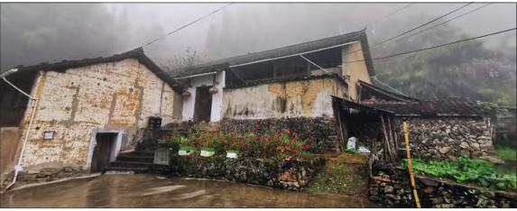
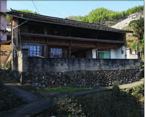
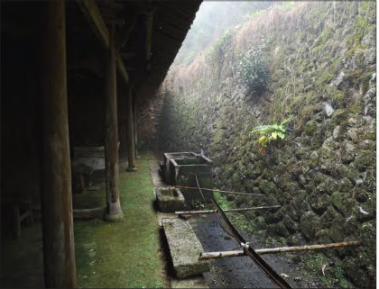
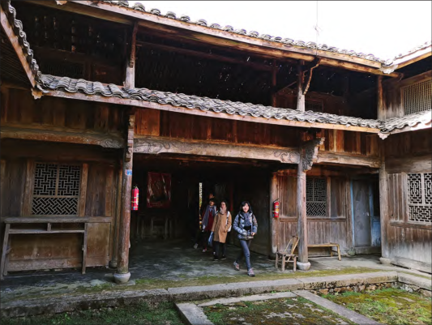

# 敕木山民居：形制与院落组织的文献成果

提取、整理和积累文献已经形成的建筑学成果，以作者的类型和特征归纳为主线，关联原文、图像与案例。

[打开成果与关系视图](院落与外部空间审核.html) · [返回成果入口](README.md) · [维护主源](拆解主源.json) · [执行记录](院落试例核验.json)

## 文献已经形成的成果

### 形制与组合

#### 一字型两层楼房是文中概括的主要形制

张云、都铭概括村内传统民居形制简朴，多为一字型两层楼房；面阔大多三至五开间，三进深，并记有两座面阔八开间的民居。

张云、都铭（2025），作者归纳。[CY-E11](#cy-e11)。

#### 四合院作为另一种形制记录

张云、都铭记载村内地势较低处有一栋汉族风格的四合院建筑，曾为蓝姓族长居所。

张云、都铭（2025），作者归纳。[CY-E01](#cy-e01)；[CY-E02](#cy-e02)。

#### 一字型民居的独栋与内院组合

作者图注分别展示“独栋一字型民居及条状前院”和“组合形成内院的一字型民居”，保存两种图示组织方式。

张云、都铭（2025），作者图注。[CY-E09](#cy-e09)；[CY-E12](#cy-e12)。

#### 2012文献记录“一长排形”及开间数

何孝辉将房屋样式描述为一长排形，一般为三间、五间或七间。

何孝辉（2012），作者归纳。[CY-E13](#cy-e13)。

### 前后院组织

#### 倚山民居前后设置狭长条状院落

张云、都铭描述民居顺应坡向、倚山而建，多为东西朝向；前后设院，院落狭长，与建筑平行呈条状。

张云、都铭（2025），作者归纳。[CY-E03](#cy-e03)。

#### 前院兼有入口与饲养用途

前院朝东，作为入口；作者将常设牲畜圈栏与用地紧张联系起来。

张云、都铭（2025），作者归纳。[CY-E04](#cy-e04)。

#### 后院利用山地界面形成天井式围合

后院朝西，院墙往往利用岩壁或上层台地的挡土墙；作者描述其空间围合似天井、视野闭塞。

张云、都铭（2025），作者归纳。[CY-E05](#cy-e05)。

#### 2012文献概括坡地分布与前院情况

何孝辉描述敕木山房屋建在陡峭山坡上，依山因地而建，整体分布不规则，并记“很少有人家房前有院子”。

何孝辉（2012），作者归纳。[CY-E07](#cy-e07)。

### 引水与生活

#### 后院、开敞厨房与引水入池相联系

作者描述后院紧贴开敞的厨房，并记竹竿引山水入池，池水供养鱼及日常生活。

张云、都铭（2025），作者归纳。[CY-E06](#cy-e06)；[CY-E14](#cy-e14)。

#### 引水串联鱼池、宅院、水渠与梯田

水经宅院流出，汇入小水渠灌溉梯田；作者将其概括为“山—鱼池—建筑—水渠—梯田”的小系统。

张云、都铭（2025），作者归纳。[CY-E14](#cy-e14)。

#### 养鱼与用水安全的地方说法

文中转述村民说法：水池养鱼用于鉴定水质、防御危害，而非为了食用。

张云、都铭（2025），作者转述村民说法。[CY-E15](#cy-e15)。

## 类型、要素与特征

| 类型或要素 | 文献描述 | 出处 |
|---|---|---|
| 四合院〔单体形制类型〕 | 文献记载的民居形制之一。 | [CY-E01](#cy-e01)；[CY-E02](#cy-e02) |
| 一字型〔单体形制类型〕 | 文中以一字型两层楼房概括村内传统民居的主要形制。 层数：多为两层。 开间与进深：文中描述面阔大多三至五开间、三进深，另记两座面阔八开间民居。 | [CY-E11](#cy-e11)；[CY-E09](#cy-e09)；[CY-E12](#cy-e12) |
| 一长排形〔形制称谓〕 | 何孝辉使用“一长排形”描述房屋样式。 开间：一般为三间、五间或七间。 | [CY-E13](#cy-e13) |
| 独栋＋条状前院〔组织方式〕 | 独栋一字型民居与条状前院相配合。 | [CY-E09](#cy-e09) |
| 组合形成内院〔组织方式〕 | 作者以图注记录一字型民居组合形成内院。 | [CY-E12](#cy-e12) |
| 倚山民居〔文献概括对象〕 | 顺应坡向、倚山而建；前后院与建筑共同形成条状的空间组织。 朝向：多为东西朝向。 | [CY-E03](#cy-e03)；[CY-E14](#cy-e14) |
| 前院〔空间要素〕 | 前院朝东、狭长呈条状，兼有入口与牲畜饲养用途。 形态：狭长，与建筑平行呈条状。 朝向：朝东。 用途：作为入口，常设牲畜圈栏。 | [CY-E03](#cy-e03)；[CY-E04](#cy-e04)；[CY-E09](#cy-e09) |
| 后院〔空间要素〕 | 后院朝西，借岩壁或上层台地挡土墙围合，紧贴开敞厨房。 形态：狭长，与建筑平行呈条状。 朝向：朝西。 围合特征：院墙往往利用岩壁或上层台地挡土墙；空间围合似天井。 | [CY-E03](#cy-e03)；[CY-E05](#cy-e05)；[CY-E06](#cy-e06)；[CY-E10](#cy-e10) |
| 厨房〔空间要素〕 | 文中描述厨房开敞，后院紧贴厨房。 空间特点：开敞。 | [CY-E06](#cy-e06) |
| 岩壁〔环境要素〕 | 后院院墙利用的山地界面之一；与挡土墙在原文中以“或”并列。 | [CY-E05](#cy-e05) |
| 上层台地挡土墙〔环境构筑物〕 | 后院院墙可利用上层台地的挡土墙。 | [CY-E05](#cy-e05) |
| 山水〔水源〕 | 以竹竿引山水入池。 | [CY-E14](#cy-e14) |
| 水池／鱼池〔用水设施〕 | 蓄水养鱼并供日常生活；村民所述养鱼用途为鉴定水质、防御危害。 使用：蓄水、养鱼、日常生活用水。 村民所述：养鱼并非食用，而为鉴定水质、防御危害。 | [CY-E14](#cy-e14)；[CY-E15](#cy-e15)；[CY-E10](#cy-e10) |
| 水渠〔输水设施〕 | 承接流经宅院的水，并灌溉梯田。 | [CY-E14](#cy-e14) |
| 梯田〔生产空间〕 | 由流经宅院、汇入水渠的水灌溉。 | [CY-E14](#cy-e14) |

## 文献所述联系

| 两端 | 联系 | 文献描述与出处 |
|---|---|---|
| 一字型 → 独栋＋条状前院 | 独栋布置 | 作者图注展示独栋一字型民居及条状前院。 [CY-E09](#cy-e09) |
| 一字型 → 组合形成内院 | 组合布置 | 作者图注展示一字型民居组合形成内院。 [CY-E12](#cy-e12) |
| 倚山民居 → 前院 | 前侧条状院 | 前院狭长，与建筑平行。 [CY-E03](#cy-e03)；[CY-E04](#cy-e04) |
| 倚山民居 → 后院 | 后侧条状院 | 后院狭长，与建筑平行。 [CY-E03](#cy-e03)；[CY-E05](#cy-e05) |
| 后院 → 厨房 | 紧贴 | 后院紧贴开敞的厨房。 [CY-E06](#cy-e06) |
| 后院 → 岩壁 | 院墙利用（或） | 后院院墙往往利用岩壁或上层台地挡土墙。 [CY-E05](#cy-e05) |
| 后院 → 上层台地挡土墙 | 院墙利用（或） | 保留作者描述中的另一种院墙利用方式。 [CY-E05](#cy-e05) |
| 山水 → 水池／鱼池 | 引水入池 | 以竹竿引山水入池。 [CY-E14](#cy-e14) |
| 水池／鱼池 → 倚山民居 | 经宅院流出 | 作者归纳的小系统中，池水再经宅院流出。 [CY-E14](#cy-e14) |
| 倚山民居 → 水渠 | 汇入水渠 | 流经宅院的水汇入小水渠。 [CY-E14](#cy-e14) |
| 水渠 → 梯田 | 灌溉 | 水渠引水灌溉梯田。 [CY-E14](#cy-e14) |

## 图片说明汇总

### 组合形成内院的一字型民居

作者图注所述组合方式的图像说明。对应：一字型民居的独栋与内院组合。

PDF第1页，题注“组合形成内院的一字型民居”；图文：张云、都铭；材料编号 `M008-F08`。

### 独栋一字型民居及条状前院

一字型形制与条状前院的图像说明。对应：一字型两层楼房是文中概括的主要形制、一字型民居的独栋与内院组合、倚山民居前后设置狭长条状院落、前院兼有入口与饲养用途。

PDF第1页，题注“独栋一字型民居及条状前院”；图文：张云、都铭；材料编号 `M008-F09`。

### 一字型民居条状后院和鱼塘

条状后院与鱼塘的图像说明。对应：倚山民居前后设置狭长条状院落、后院利用山地界面形成天井式围合、后院、开敞厨房与引水入池相联系、引水串联鱼池、宅院、水渠与梯田、养鱼与用水安全的地方说法。

PDF第2页，题注“一字型民居条状后院和鱼塘”；图文：张云、都铭；材料编号 `M008-F10`。

### 蓝姓族长的四合院民居

四合院形制与文献例子的配图。对应：四合院作为另一种形制记录。

PDF第2页，题注“蓝姓族长的四合院民居”；图文：张云、都铭；材料编号 `M008-F12`。

阅读者图像说明：照片前景可见院地及面向院地的建筑部分。

## 文献中的案例记录

- **蓝姓族长民居**：张云、都铭记载其位于村内地势较低处，形制为汉族风格四合院，曾为蓝姓族长居所。 [CY-E01](#cy-e01)；[CY-E02](#cy-e02)。
- **蓝村长家／敕木山畲族民居1号**：何孝辉在文中将蓝村长家与敕木山畲族民居1号对应。 [CY-E08](#cy-e08)。

## 原文与出处

### CY-E01

> 村内地势较低处有一栋汉族风格的四合院建筑，曾是蓝姓族长的居所。

张云、都铭（2025）《浙江省丽水市景宁县敕木山村 国家历史文化名城研究中心历史街区调研》；PDF第2页，§3 蓝姓族长四合院；作者报告。Zotero `PIW7KR8U`／附件 `N9ALJ8SM`；[打开原页](zotero://open-pdf/library/items/N9ALJ8SM?page=2)。

### CY-E02

> 蓝姓族长的四合院民居

张云、都铭（2025）《浙江省丽水市景宁县敕木山村 国家历史文化名城研究中心历史街区调研》；PDF第2页，题注“蓝姓族长的四合院民居”；作者图注。Zotero `PIW7KR8U`／附件 `N9ALJ8SM`；[打开原页](zotero://open-pdf/library/items/N9ALJ8SM?page=2)。

### CY-E03

> 顺应坡向，倚山而建的民居多为东西朝向，前后设院，院落狭长，与建筑平行呈条状。

张云、都铭（2025）《浙江省丽水市景宁县敕木山村 国家历史文化名城研究中心历史街区调研》；PDF第2页，§3首个完整段，起句“顺应坡向”；作者报告。Zotero `PIW7KR8U`／附件 `N9ALJ8SM`；[打开原页](zotero://open-pdf/library/items/N9ALJ8SM?page=2)。

### CY-E04

> 前院朝东，入院东望视野开阔。由于用地紧张，作为入口的前院也常设饲养牲畜的圈栏

张云、都铭（2025）《浙江省丽水市景宁县敕木山村 国家历史文化名城研究中心历史街区调研》；PDF第2页，§3首个完整段，前院句；图片另见PDF第1页M008-F09；作者报告。Zotero `PIW7KR8U`／附件 `N9ALJ8SM`；[打开原页](zotero://open-pdf/library/items/N9ALJ8SM?page=2)。

### CY-E05

> 后院朝西，由于地形陡峭，后院的院墙往往利用岩壁或上层台地的挡土墙，因此空间围合似天井

张云、都铭（2025）《浙江省丽水市景宁县敕木山村 国家历史文化名城研究中心历史街区调研》；PDF第2页，§3首个完整段，“后院朝西”至岩壁／挡土墙句；作者报告。Zotero `PIW7KR8U`／附件 `N9ALJ8SM`；[打开原页](zotero://open-pdf/library/items/N9ALJ8SM?page=2)。

### CY-E06

> 后院紧贴着开敞的厨房

张云、都铭（2025）《浙江省丽水市景宁县敕木山村 国家历史文化名城研究中心历史街区调研》；PDF第2页，§3首个完整段，后院—厨房句；作者报告。Zotero `PIW7KR8U`／附件 `N9ALJ8SM`；[打开原页](zotero://open-pdf/library/items/N9ALJ8SM?page=2)。

### CY-E07

> 在敕木山村，房子都建在陡峭的山坡上，依山因地而建，房子整体分布很不规则，很少有人家房前有院子。

何孝辉（2012）《浙江畲族80年文化变迁——《浙江景宁县敕木山畲民调查记》回访调查》；PDF第3页／印刷50页，右栏（三）首段；作者报告。Zotero `VQRBWRBF`／附件 `DAJ6JURK`；[打开原页](zotero://open-pdf/library/items/DAJ6JURK?page=3)。

### CY-E08

> 蓝村长家的这栋房子编号为敕木山畲族民居1号。

何孝辉（2012）《浙江畲族80年文化变迁——《浙江景宁县敕木山畲民调查记》回访调查》；PDF第4页／印刷51页，左栏第2段；作者报告。Zotero `VQRBWRBF`／附件 `DAJ6JURK`；[打开原页](zotero://open-pdf/library/items/DAJ6JURK?page=4)。

### CY-E09

> 独栋一字型民居及条状前院

张云、都铭（2025）《浙江省丽水市景宁县敕木山村 国家历史文化名城研究中心历史街区调研》；PDF第1页，题注“独栋一字型民居及条状前院”；作者图注。Zotero `PIW7KR8U`／附件 `N9ALJ8SM`；[打开原页](zotero://open-pdf/library/items/N9ALJ8SM?page=1)。

### CY-E10

> 一字型民居条状后院和鱼塘

张云、都铭（2025）《浙江省丽水市景宁县敕木山村 国家历史文化名城研究中心历史街区调研》；PDF第2页，题注“一字型民居条状后院和鱼塘”；作者图注。Zotero `PIW7KR8U`／附件 `N9ALJ8SM`；[打开原页](zotero://open-pdf/library/items/N9ALJ8SM?page=2)。

### CY-E11

> 村内传统民居形制简朴，多为一字型的两层楼房

> 房屋的面阔与开间较为随意，大多为三到五开间，三进深。有两座民居的面阔达到八开间。

张云、都铭（2025）《浙江省丽水市景宁县敕木山村 国家历史文化名城研究中心历史街区调研》；PDF第2页，§3第二个完整段，一字型与层数；作者归纳。Zotero `PIW7KR8U`／附件 `N9ALJ8SM`；[打开原页](zotero://open-pdf/library/items/N9ALJ8SM?page=2)。

### CY-E12

> 组合形成内院的一字型民居

张云、都铭（2025）《浙江省丽水市景宁县敕木山村 国家历史文化名城研究中心历史街区调研》；PDF第1页，题注“组合形成内院的一字型民居”；作者图注。Zotero `PIW7KR8U`／附件 `N9ALJ8SM`；[打开原页](zotero://open-pdf/library/items/N9ALJ8SM?page=1)。

### CY-E13

> 房子一般设计为三间、五间或七间，样式是一长排形

何孝辉（2012）《浙江畲族80年文化变迁——《浙江景宁县敕木山畲民调查记》回访调查》；PDF第4页／印刷51页，左栏第1段，接前页建筑概况；作者归纳。Zotero `VQRBWRBF`／附件 `DAJ6JURK`；[打开原页](zotero://open-pdf/library/items/DAJ6JURK?page=4)。

### CY-E14

> 内有竹竿引山水入池，池内蓄水养鱼并供日常生活。水再经宅院流出，汇入小水渠，灌溉梯田，形成“山-鱼池-建筑-水渠-梯田”的小系统

张云、都铭（2025）《浙江省丽水市景宁县敕木山村 国家历史文化名城研究中心历史街区调研》；PDF第2页，§3首个完整段，引水小系统；作者归纳。Zotero `PIW7KR8U`／附件 `N9ALJ8SM`；[打开原页](zotero://open-pdf/library/items/N9ALJ8SM?page=2)。

### CY-E15

> 据村民所述，水池养鱼并非为了食用，而是为鉴定水质，防御危害。

张云、都铭（2025）《浙江省丽水市景宁县敕木山村 国家历史文化名城研究中心历史街区调研》；PDF第2页，§3 水池养鱼用途；作者转述村民说法。Zotero `PIW7KR8U`／附件 `N9ALJ8SM`；[打开原页](zotero://open-pdf/library/items/N9ALJ8SM?page=2)。

## 本例组织与维护

- 类型可以从名称与出处起步，逐步补充特征和案例。
- 作者成果按原文对象范围与称谓保存；不同文章的描述分别保留。
- 图像对应到其说明的成果；局部观察放在图片说明中。

接续既有核读。本轮重读张云、都铭全文PDF1—2页和何孝辉建筑部分PDF3—4页，按原文提取与整理成果；新增查看M008-F08，其余三图沿用前轮图像阅读。

三个视图是本例为阅读组织的分组；内容按作者归属保存，图中位置仅为页面排版。现行事实只在 `courtyard_pilot` 维护，旧版保存在[调整前归档](../../archive/2026-11-03-院落示例成果提取重组前/README.md)。

本轮为文献成果提取与呈现，未改动D03、双基准、V01、Zotero及Neo4j。

版本 0.3；主源 SHA-256：`2fdd9a08f14f80aa725ed877d6e395c832ca13ce4ff25fb366f03dba87b8a399`；生成器：`CMS-CY-render-2.0`。
