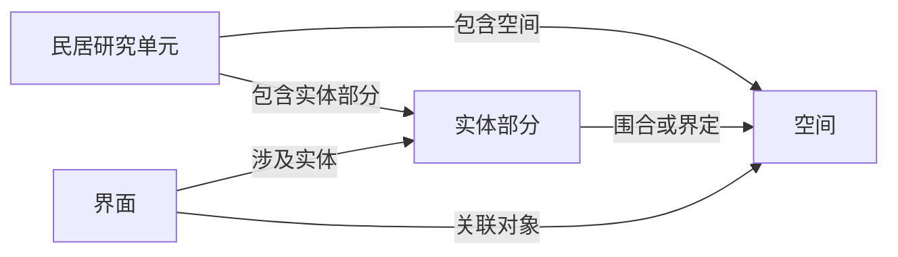

# 从传统民居到语义模型：现有成果讲解与论文呈现

整理日期：2026-10-22。依据当前v0.2模型、案例数据和已有文献证据记录编写。本稿用于理解与讨论，没有修改模型定义、案例事实或论文正文。以下阅读分组是解释方式，不是新增本体层级；论文图表安排是建议，不表示已经制成或完成真实样本验证。

## 1. 我们已经做了什么

我们建立了一套描述传统民居的规则：确定研究中要指认的对象，用特征描述对象，用关系描述对象之间的联系，再为这些描述保存资料依据和判断条件。把具体民居资料按这套规则编码，才形成实例图谱；浏览页面将其中一部分信息投影为节点、边、详情和查询结果。

可以把当前成果理解为三个相互配合的部分：

| 部分 | 回答什么 | 当前形式 |
|---|---|---|
| 语义模型 | 可以描述什么、如何描述、满足什么条件 | 模型定义中的概念、特征、关系及约束 |
| 实例数据 | 某个具体对象有哪些有依据的特征与关系 | 文献案例的对象、断言、证据及分类判断 |
| 展示与检验 | 如何查看、追溯和检查已编码信息 | 图谱浏览、关系表、查询与防错检查 |

模型是描述规则，实例是按规则编码的具体知识，页面是查看它们的工具。这三个部分各有任务。

## 2. 先理解对象、属性、关系和判断

以虚构的“堂屋—前廊”为例：堂屋A和前廊B是两个具体空间对象；“半开放”“交通用途”等是有关空间的特征；“相邻”“可直接通行”是两个空间之间的关系；“根据某套判据属于某类空间组织”则是进一步的分类判断。

“空间”是概念类，“堂屋A”是该类的一个实例。“堂屋”作为地方名称保留；如果需要将它归入某种空间类型，还需明确分类体系及判据。名称、用途、形态与类型各自表达不同信息。

当前记录中，属性值也保留证据、时点、范围和归属。页面可能为了浏览把一个属性值画成圆点，这个圆点仍可能只是属性值的可视化，不代表建筑中又多了一个实体。

## 3. 为什么需要这些对象

首先理解四类核心建筑对象：

| 概念 | 在建筑中指什么 | 单独表达的理由 |
|---|---|---|
| 民居研究单元 Dwelling | 本次单体分析纳入的住宅及明确归属部分 | 先交代研究边界，才能判断空间、构件和资料属于谁 |
| 空间 Space | 堂屋、卧室、廊、天井等具有可说明边界的区域 | 研究用途、围合和空间组织；边界可以是实体界面或语义分界 |
| 实体部分 Element | 墙、柱、梁、屋面、构架等物质对象 | 研究材料、构造、支承和围护关系 |
| 界面 Interface | 指定空间/构件之间的分界、接触或连接部位 | 为“两个对象怎样相接”提供可进一步描述的对象 |

核心概念关系的节选示意如下；它表示允许怎样组织描述，不代表某座建筑已经具有这些事实。

其余概念为这些建筑对象提供补充：Place用于村落、地块等外部定位；Representation保存图纸/照片/表格记录的身份；TypeScheme和TypeConcept保存分类体系与类别；ChangeEvent记录有时间证据的变化；GeometryRegion关联二维/三维区域；AnalysisRun保存派生分析的输入、方法和结果。

模型共有11个概念类，但不要求每座民居把11类全部填满。没有三维资料时，几何关联可以为空；没有时间资料时，不构造变化事件。Evidence、断言和分类判断另以记录结构保存，不能因为它们同样参与追溯，就声称当前全部作为独立概念类节点实现。

## 4. 理论和文献依据分别起什么作用

| 依据层面 | 帮助解决的问题 | 当前采用方式与限度 |
|---|---|---|
| 传统民居类型与形态研究 | 观察什么、拆分到什么单元、依据哪些特征比较 | 将空间组织、平面与立面、构架及分类判据纳入；不同来源口径继续保留 |
| 建筑语义体系研究 | 如何将建筑观察转成规范概念及逻辑联系 | 借鉴术语提取及类型、部分—整体、属性分类的区分 |
| BOT与室内空间语义研究 | 怎样表达空间、构件、界面及连接条件 | 借鉴Zone/Element/Interface、半开放空间与PseudoOpening；本地映射由研究者定义 |
| 知识图谱构建与应用研究 | 如何把规则落实为实例、分析与查询 | 借鉴模式到实例映射、分析结果关联、查询模板；不照搬地域分类或算法阈值 |

例如，既有徽州空间形式研究把厅堂、厢房、天井、檐廊等作为分析单元，并以通行联系建立空间拓扑表达；形态类型学文献讨论共时/历时及平面、立面与环境关系。这些为分析内容提供依据，但我们没有将某篇文献的全部分类直接认定为景宁分类。定位见[类型与形态证据记录](../〔文献拆解〕传统民居类型与形态拆解/证据与阅读记录.md)中的NQD9DRI3:E7/E11/E14与V5RJB5WJ:E2/E3。

汪强等区分is-a、p/o和a/o。其中a/o的原文含义是按属性划分类别，不能直接理解成实例属性值。见[PDF1／印刷94](zotero://open-pdf/library/items/9TUEWX22?page=1)。

BOT区分空间区域、实体构件和界面，并分别定义空间包含、邻接、相交及界面限定关系。见[PDF8—10／印刷149—151](zotero://open-pdf/library/items/6XP3U4GG?page=8)。Maheshwari等允许半开放空间，并提出没有实体门框、可由空间细分产生的PseudoOpening。见[PDF9—10](zotero://open-pdf/library/items/5X32QFZG?page=9)。

这些依据的作用不同：建筑学研究帮助确定分析内容和判据，空间语义研究帮助组织表达。证据记录、部分字段、约束和二者的衔接是本研究的综合设计，不称为六篇论文共同提出的模型。

## 5. 一种关系究竟怎样构建

关系构建有两个层次。

**模型层：定义一种关系。** 先提出建筑学问题，再根据文献与分析需要说明起点、终点、关系含义、方向、成立条件和证据要求。例如，为了分析室内空间组织，定义“可直接通行至”；它连接两个Space，需要明确界面、时点、通行方式和使用者。

**实例层：确认某一条关系。** 根据具体民居的平面、剖面、观察记录或文献，判断两个已识别对象是否满足上述条件。满足时写入断言和证据；资料不足时记缺失；有争议时保留冲突。

因此，“文献支持建立通行关系这一表达方式”和“某座住宅的堂屋确实通往前廊”需要不同依据。方法论文无法替代具体住宅的事实证据。

| 核心关系 | 起点→终点 | 识别或记录要求 | 容易混淆的情况 |
|---|---|---|---|
| 包含空间 | 民居/空间→空间 | 明确研究单元及空间划分范围 | 同院或同名不自动表示同一住宅内部 |
| 包含实体部分 | 民居/实体部分→实体部分 | 指明物理组成及对象归属 | 天井空腔不能当作木构件 |
| 围合或界定 | 实体部分→空间 | 指明哪个部位参与界定哪个空间 | 构件位于附近不足以证明围合关系 |
| 空间邻接 | 空间→空间 | 两者共享部分边界；关系对称 | 距离近不等于邻接，邻接不等于可通行 |
| 直接通行 | 空间→空间 | 同一界面连接两端，有方向、情境及证据 | 经第三空间到达是多跳可达，不能写成直接通行 |
| 支承 | 实体部分→实体部分 | 有构造或受力依据，承托者指向被承托者 | 几何接触不能自动证明支承 |
| 类型归属 | 对象/资料记录→类型概念 | 来自明确分类判断，保存体系、判据与输入 | 类型名称与建筑实例不能混为一谈 |
| 由记录表述 | 建筑对象→资料记录 | 对象身份与记录对应明确 | 同号图纸不能跨来源自动对应同一房屋 |

这张表是18类关系中的核心讲解摘选，完整方向与范围以[模型定义](模型定义.json)为准。界面关联、几何关联、变化作用和分析相似等也依同样原则定义，按资料条件使用。

## 6. 堂屋—前廊：从建筑现象到空间表达

以下对应当前合成演示，全部是教学设定，未对应真实住宅。

1. **识别对象。** 将堂屋A与前廊B分别作为Space，记录划分依据。两者开放连续，仍可因建筑意义与位置而区分。
2. **描述各自特征。** 前廊B记录地方名称“前廊”、围合程度“半开放”，以及交通和停留两项用途。不同描述轴可以并存。
3. **确定分界。** 建立界面I，分别关联堂屋A和前廊B。记录其为开放分界、无实体隔断；不用为了构造图谱补造一扇门。
4. **记录空间关系。** 另记A与B邻接。在场景明确设定的正常步行情境下，分别记录A经I通往B，以及B经I通往A。
5. **保留判断依据。** 这些记录回到E_DEMO场景定义。替换为实际住宅时，必须改由真实资料证明，不能继续引用E_DEMO。

对应的简化读法是：`堂屋A → 经开放界面I直接通行 → 前廊B`。查看详细记录时，还能知道I连接谁、有无实体隔断、适用什么情境、依据是什么。

演示中的堂屋与卧室则共用另一实体隔墙界面；它们相邻，但该界面被明确设定为不能穿越。此例只说明不能穿过这一界面，未设定卧室是否有其他入口或绕行路径。

“前廊整体半开放”“堂屋与前廊间无实体隔断”“二者可以直接通行”分别描述空间、界面和关系三个不同问题。

## 7. 周湖侧样：从文献事实到类型判断

空间组织只是当前模型的一部分。已有真实文献记录还展示了类型判定如何组织。

周湖8号的资料来自赵潇诺学位论文表3.7第8号行，当前将其保存为侧样记录R_8。原表记载院墙不承重、后厨天井一字形、五柱五筒、屋面不分层。见[原表PDF55／印刷44](zotero://open-pdf/library/items/52VRHDAG?page=55)。

它在“柱筒组合”这个维度匹配“五柱五筒”。当我们把它与2023侧样论文所述的四项原型条件比较时，其中柱筒条件要求“五柱四筒”，所以四项合取条件不全部匹配。原型原文见[PDF5／印刷14](zotero://open-pdf/library/items/M2XVALGA?page=5)。

这里依次保存：原表值、读者采用的分类判据、参与比较的断言、每项满足情况、整体判断与来源。四项试判是跨来源的读者操作化比较；不匹配不能解释为不存在历史关联或不属于研究范围。

四项表值仍限定在侧样记录上。五柱五筒不等于整栋房屋只有五根柱；后厨天井一字形不等于整栋住宅平面是一字形。Representation使我们能保留资料的描述范围。

## 8. 图谱最终可以形成什么结果

| 结果层次 | 可以输出什么 | 当前状态 |
|---|---|---|
| 模型成果 | 概念关系图、术语与关系定义表、编码及证据规则 | v0.2已有维护数据与说明 |
| 编码成果 | 某座住宅的空间/构件/特征/关系及其资料来源 | 当前只有受限的文献案例试表达；完整空间示例为合成 |
| 查询成果 | 组成查询、邻接与通行查询、来源回溯、类型判据比较 | 部分文献查询与合成空间查询已实现 |
| 建筑学认识 | 空间组织共性、类型差异、空间与构造的关联及变化 | 需要真实资料和比较验证；当前不预写结果 |

查询返回一张子图，可以是表达成果；它要成为建筑学研究结果，还需要明确研究问题、样本范围、比较方法、异例与解释边界。图谱节点和边的数量可以说明数据规模，不能单独证明研究价值。

## 9. 论文中怎样呈现

建议在方法部分讲“模型怎样来”，在案例部分讲“资料怎样进入”，在分析部分讲“支持了什么认识”。具体章节编号留待论文结构调整。

| 建议图表 | 应展示的内容 | 建议材料与注意事项 |
|---|---|---|
| 图1 语义模型构建过程图 | 研究问题→文献/资料→对象与维度→关系定义→实例编码→检查修订 | 对每个阶段说明输入和产物；不要把尚未进行的样本验证画成已完成 |
| 图2 核心概念关系图 | 民居、空间、实体部分、界面；再分组接入类型与资料 | 画概念类与允许关系，标明是模型层；核心与扩展分图，避免所有节点同图堆叠 |
| 表1 关系定义及依据表 | 起点、关系、终点、含义、成立条件、文献依据与实例证据要求 | 将本文第5节的核心表扩充；区分借鉴原词与研究者新增规则 |
| 图3 实例编码示例图 | 平面/剖面上的对象标识→对应实例子图→一条关系的证据记录 | 论文实证部分应选身份明确的实际住宅；当前合成示例只能标为方法示意 |
| 表2 查询及验证结果表 | 建筑学问题、所需数据、查询路径、返回结果、人工核对与资料缺口 | 当前程序通过可报告为表达一致性检查；有效性须补真实案例对照 |

正文解释选择理由、术语定义、关系判据、来源口径和限制；附录放完整的11类、30特征、18关系字典及记录示例。交互页面作为浏览补充，正文以能独立阅读的图表承载论证。

可用于方法部分的概括性初稿如下，正式入文时需补对应引文编号：

> 本研究以传统民居的空间组织、实体构成与类型特征为描述对象，在既有类型学、形态分析及建筑语义研究的基础上，构建单体层语义描述模型。模型区分民居研究单元、空间、实体部分与界面，并分别定义组成、空间联系、构造及分类等关系。具体资料通过对象识别、特征编码和关系判定进入实例数据，同时保存记录范围、时点、来源与判断依据。当前以文献记录和独立合成示例检查表达一致性，真实住宅中的空间划分、关系采集及三维区域对应仍需后续案例验证。

## 10. 当前成果如何准确表述

可以表述：形成了有文献依据的单体层语义模型讨论稿；进行了两条源内民居/侧样记录的有限试表达；通过合成空间示例检查开放分界、邻接与通行的表达；建立了来源追溯和程序核验规则。

尚不能表述：已完成完整景宁民居空间知识库、已验证地域普适性或民族专属性、已实现真实三维关联、已发现新的类型或文化因果规律。

现有成果的完整状态与验收范围见[README](README.md)、[独立验收](独立验收.md)及[研究过程记录](研究过程记录.md)。本讲解稿引用既有证据记录并核对当前数据，没有新增全文阅读、现场资料或案例判断。
