# 大张坑图文资料汇编

整理日期：2026-10-19。对象为**景宁县东坑镇大张坑自然村**。本页是既有资料整理，不是新风貌分析、语义模型或2026现状调查。除明确标记“逐字引文”的引用块外，文字均为**概述／图像内容说明**。资料工作编号及完整来源见[索引](资料索引.md)及[机器索引](资料索引.json)；[原件入口与检索覆盖](README.md)。

## 一、地名范围、区位与历史数量

### 1. 自然村与行政村不能混用

王文辉论文（L09，PDF16／印刷8，DZK-M003）将行政村记为辖大张坑、岭口、草鱼塘三个自然村，并在脚注③限定文中“大张坑”为大张坑自然村。该页区位图可用于历史区位说明，不是带坐标的村落测绘底图。**东坑镇大张坑不与沙湾镇张坑村、蓝凤新寮混同**。

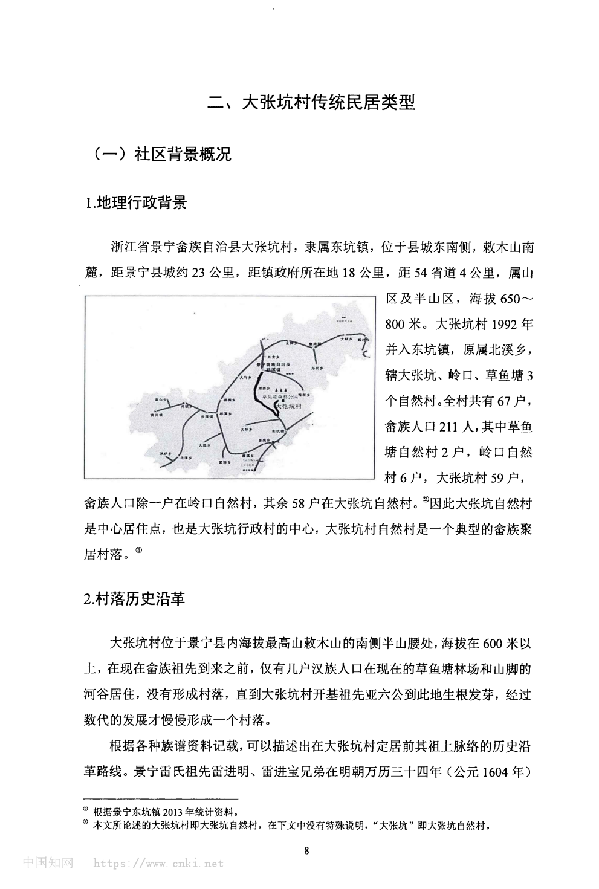

来源：L09 PDF16／印刷8，DZK-M003；转引2013年东坑镇统计。行政村67户、自然村59户是户数，不是住宅幢数；民族人口与户数不能套在每栋建筑上。原有证据E098、E101、E102的摘取见[sources](sources/原有证据摘取.json)。

### 2. 37幢／1幢保留历史时点；新增核实“传统样式”的直接措辞

L09 PDF20／印刷12（DZK-M007）写全村37幢民居中只有一幢钢筋水泥结构建筑。该页并未逐栋列明37幢的标准、名单和位置；不能据此做37减1的实体认定，更不能转成当下数量。

**本轮直接视觉复核还发现：**L09绪论PDF10／印刷2（DZK-M002）有独立的直接数量表述。以下为该页逐字引文：

> 全村37幢房子有36幢为传统样式民居

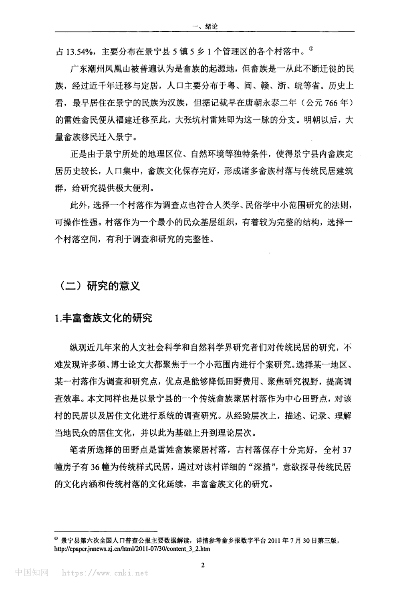

这个“36”是作者直接写出的**历史“传统样式民居”表述**，不是本轮由37减1推算。既有阅读卡已经概述过相近信息；旧证据表只收录PDF20的37／1口径。本包保留两处原文，既不隐去直接措辞，也不把“传统样式”自动升级为按统一标准认定的“传统畲族民居”。没有逐栋身份与当下核查，不能确认当下36幢，更不能生成36个建筑条目。论文封面提交2015-03-25；文件名与Zotero日期2016不替代封面年，确切调查年月未载。

## 二、村落与环境：山地布局、道路、水体和历史图像

### 1. 历史布局文字与村景

L09 PDF18—19／印刷10—11（DZK-M005—006）从自然环境进入村落布局。作者描述村落背靠山体、房屋依山势与等高线展开，主干石路连接各幢，村旁有水流与耕地。此处为论文调查时点的布局概述，不是本研究新提取的形态指标，也不据文字推断所有住宅朝向。

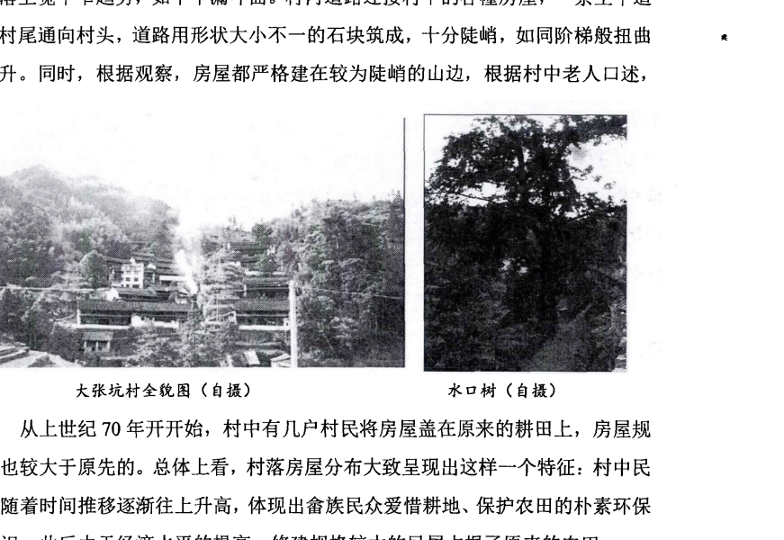

来源：L09 PDF19／印刷11；DZK-M024，原页DZK-M006。左图原注“大张坑村全貌图（自摄）”，右图“水口树（自摄）”；照片拍摄日期、相机位与单体定位未载。**一个照片组不等于两栋建筑**。

### 2. 已有村落布局示意，不当作当前空间底图

柴一涵论文L12表1.7的PDF41／印刷27（DZK-M020）有东坑镇大张坑第8项及建筑轮廓、道路示意。下图为本轮只截第8项的工作副本。

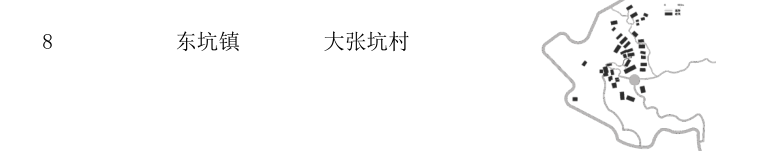

来源：L12，DZK-M029；[保留全页](assets/pages/L12-pdf041.png)。原表总体标题位于前页，表号沿用既存证据E124；本轮核对本页第8项村名与图，不声称已复核原始测绘过程。该示意缺少可用于本村空间锚定的坐标、明确比例和逐栋编号，不从轮廓数推算栋数；行政村与自然村边界也待核。

L08 PDF27／印刷16（DZK-M018）表1.2将大张坑列入“畲族村”组；其上方汉畲传统村落分布重合图为县域背景，不是大张坑实测图。L22 PDF35／印刷26（DZK-M022）将大张坑列为调查村落之一并有区域调研路线图；列表不等于取得逐栋调查清册。

### 3. 2026年报道所附村景：保留拍摄日期未知

以下四份图均来自既存S05资料，即潮新闻官方账号／腾讯新闻《晚潮｜畲寨大张坑，红色村庄别样“红”》，发布2026-06-29，仓库保存2026-10-06；**2026-10-19未重开网页**。摄影未署名，文章作者严慧荣；原图无独立图注，本页图下文字是内容说明，不冒充原图注。原文件、水印和来源URL保留于索引；未核得开放复用许可。

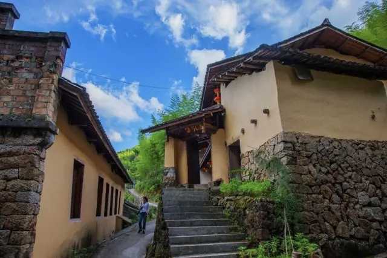

DZK-M032／S05-03：可看见阶梯道路、屋面、墙面与石砌基部的组合。照片中有多处建筑局部；没有宅名、门牌、精确拍摄日期，不据此给建筑编号，也不将可见面层直接判作原始材料。

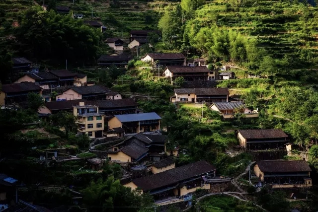

DZK-M035／S05-06：村景与植被、建筑组团同框。只支持图像所见形态观察；不能确认对应L09哪几幢。

DZK-M036／S05-07：村景及周围地表、植被。未有共同控制点、朝向和拍摄元数据，不能与旧图作精确几何或增减量比较。

DZK-M037／S05-08：夜景可以作为展示背景，但人工照明和曝光不适合直接提取昼间材料颜色；不证明夜景拍摄于发布日期。

来源页：[S05报道](https://news.qq.com/rain/a/20260629A025AT00)；各原图URL、原文件路径与SHA-256见[JSON](资料索引.json)。

## 三、组团与单体：外部空间、平面示意及附属设施

### 1. 历史材料中的院落和门，不建立未经确认的住宅集合

L09 PDF24—26／印刷16—18（DZK-M011—013）讨论院落、侧向入口、屋面与附属建筑。作者说明有依地形不设大门、直接联系道路的情况，因此本包不把侧开门写成全村强制属性。表一为作者自制图文归纳，未给每张住宅照片门牌。

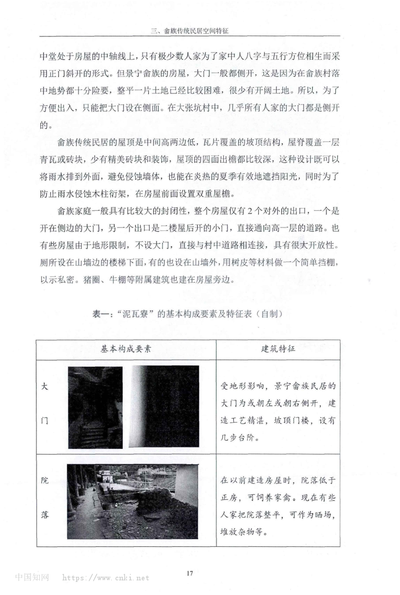

来源：L09 PDF25／印刷17，DZK-M012。表上半为门与院落照片及说明；可作为后续现场对照的资料，不先形成风貌标签。

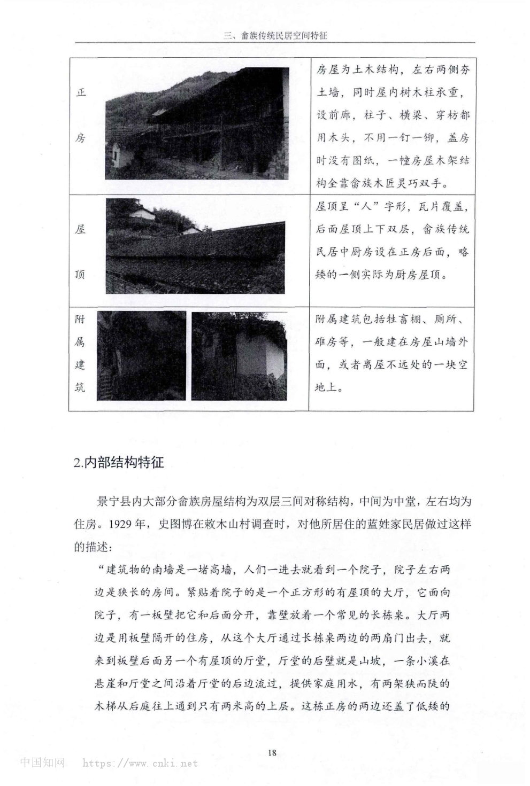

来源：L09 PDF26／印刷18，DZK-M013。表中正房、屋顶、畜棚／厕所等属于图文中的案例说明；同页下部引述较早调查的传统房屋叙述，不全是大张坑某一栋的实测记录。

### 2. 平面图是类型示意，不能当作具名民居测绘

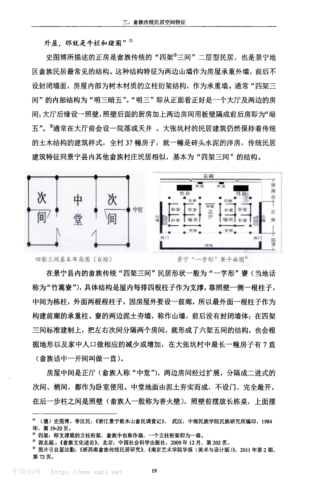

来源：L09 PDF27／印刷19，DZK-M014。左图原注“四架三间基本布局图（自绘）”，右图“景宁‘一字形’寮平面图”，脚注指向蓝法勤2011研究的图片引用（本轮未核被引原作）。**不是本村具名、带测量精度的单体平面**。内文也含景宁范围的类型讨论；不能把图上每个中堂、次间、后厨或水池直接写成某栋已定位建筑的空间实例。

## 四、公共建筑与构件：雷氏祠堂、祖宗牌位及未具名院墙

### 1. 王文辉原裁切标题纠正：不是“民居照片组”

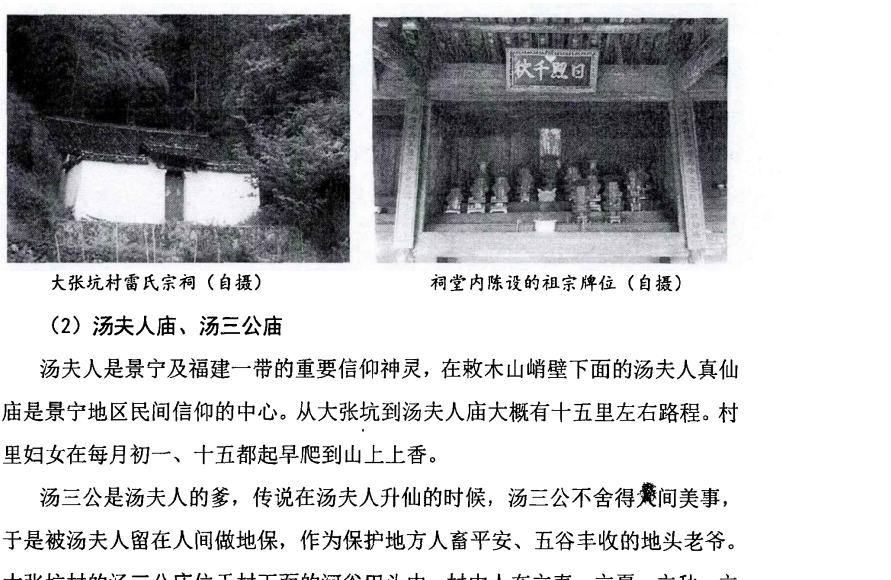

来源：L09 PDF23／印刷15，DZK-M025／原页DZK-M010。原图注分别为“大张坑村雷氏宗祠（自摄）”与“祠堂内陈设的祖宗牌位（自摄）”。既有裁切清单将其统称为“大张坑民居照片组”，本轮按原页纠正为**公共祭祀建筑及其室内陈设**。不改原文件、不当作住宅内部照片；宗祠外景与牌位图也不是两栋建筑。

L09 PDF22—23对宗祠、汤三公庙及公共生活设施有文字线索；汤夫人庙位于村外山路，不能由本页自动归入本自然村宅基地或住宅数量。关于具体位置、年代和今日存续仍待原始档案或现场资料。

### 2. 朱凌图3-16及旧裁切范围错误

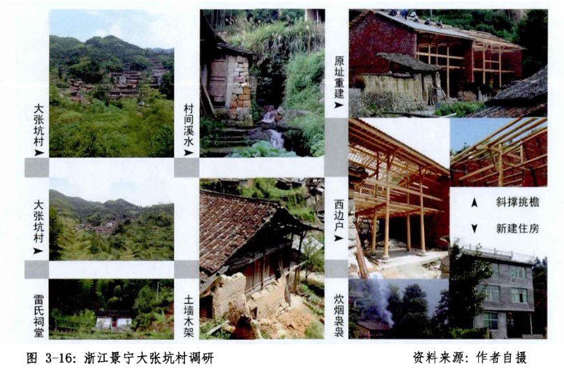

来源：L22 PDF37／印刷28，DZK-M027／原页DZK-M023。原注“图3-16：浙江景宁大张坑村调研”，资料来源“作者自摄”。图组左下明确标“雷氏祠堂”；其余格标有村间溪水、土墙木架、原址重建、西边户、新建住房等。这里既有祠堂也有住宅改建记录，不能把整组拆成未经定位的独立建筑，也不能把原址重建过程等同原始传统构造。

**旧裁切DZK-M026未包含左下的雷氏祠堂，且混入下方深垟图3-17局部。** 本包留存其副本仅为纠错追溯，主汇编改用本轮完整图3-16裁切；不再将旧裁切当成祠堂照片。原页下半深垟陈璧大宅材料不属于大张坑。大张坑“雷氏祠堂”与遂昌“雷氏宗祠”亦不合并。

L09宗祠与L22祠堂存在同村同姓名称关联线索；本轮没有现址、建筑细部与修缮时点的独立核实，**仅列待核关联，不完成实体合并**。

### 3. 未具名住宅院墙：一处构件实例

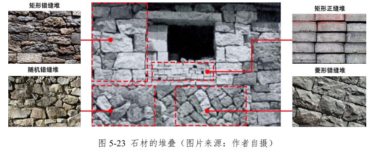

来源：吴钰论文L14 PDF72／印刷57，图5-23，DZK-M028／原页DZK-M021；原图注“石材的堆叠（图片来源：作者自摄）”。正文把该例称为景宁大张坑村一栋房子的围墙；本轮直接核到图号，补齐旧E181未注明图号的定位。图中以不同堆叠模式作标示，可供构件材料做法对照；**计数只是一处院墙实例，不是住宅存量或多个单体**。

同页图5-22是耐候钢板案例，图5-24是“瓦片的编织”且标百度来源；未证明为大张坑，不借同页关系归入本村。图5-23虽处于设计语言章节，仍需把作者自摄的既有院墙照片与新设计论述分开。

## 五、历史、保护更新与近年运营线索

### 1. 历史沿革与民俗材料只保留来源角色

L09 PDF17／印刷9（DZK-M004）含族谱世系图与作者拍摄的族谱内容照片；论文引用村民整理族谱与口述，属于历史资料线索，不是本轮独立验证的建村年代或所有家族谱系。族谱原件未入包，相关全文入口见[阅读卡摘录](sources/L09阅读卡摘录.md)。营造习俗PDF29—33、居住文化解释PDF34—42本轮未重读，不能把卡片记录升级为本轮现场事实。

### 2. 2012—2014改造实施记述与作者评价分开

L09 PDF49—50／印刷41—42（DZK-M016—017）记述2012年后按方案建设檐篷、粉刷外墙、改门窗、道路排水，以及2014年旅游合作、部分民居空间出租等。作者同时讨论同质化、文化资源利用及红色遗迹保护问题。这些是论文叙述的历史事件与作者判断，不能写成已独立评估的保护成效。

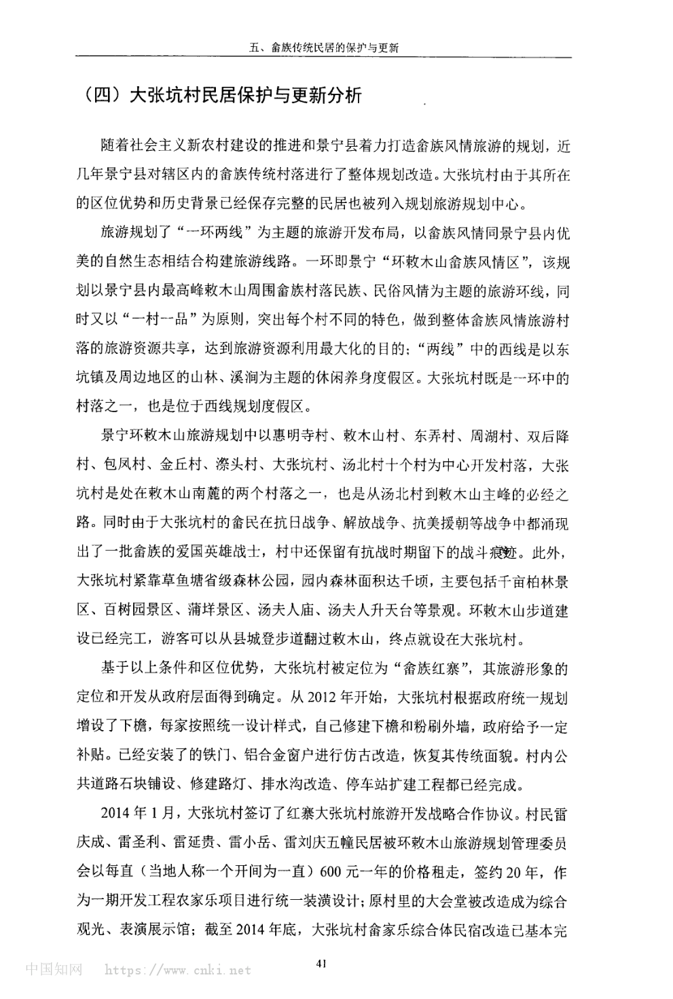

来源：L09 PDF49／印刷41，DZK-M016；后续问题讨论在[PDF50](assets/pages/L09-pdf050.png)。PDF50雷景三故居的危损叙述只反映作者调查期，不能未经定位认定为2026危房或对应报道展览馆。

L08 PDF113／印刷102（DZK-M019）的附录A将东坑镇大张坑民居情况写为“更新改造，保存较完善”；调查日未载，只有村级描述，没有逐栋清单。它可补不同研究的时点认识，不与L09合并成2026保存评级。

### 3. 2026调研中的“16间”是新近资料获取线索

[W04既存核查摘录](sources/W04既存核查摘录.md)（DZK-M038）保存2026-09-01浙江旅游职业学院转载报道，叙述2026年7月调研及《忠勇红寨・康养药谷》运营方案。旧核查保存的逐字报道引文为：

> 以及村内16间待盘活民居，为后续文旅发展积蓄条件。

本轮只核对仓库记录，没有重新访问原网页，未取得方案全文与16间清单；“间”不改成“幢”，不与37幢相减，也不认定均为传统民居。

### 4. 报道配图的辅助／排除类别

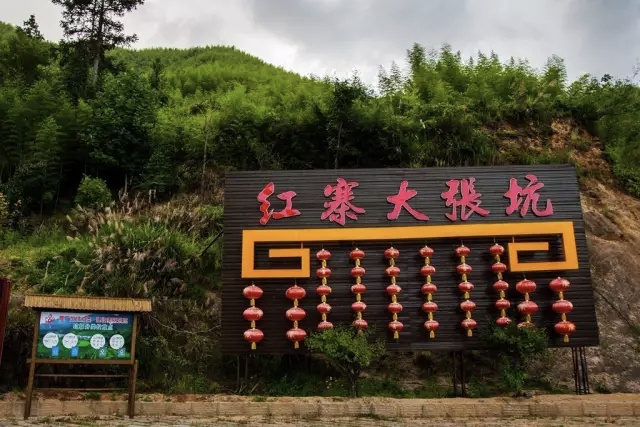

DZK-M031／S05-02：村口标识可辅助确认报道地点，不是可计数传统住宅。

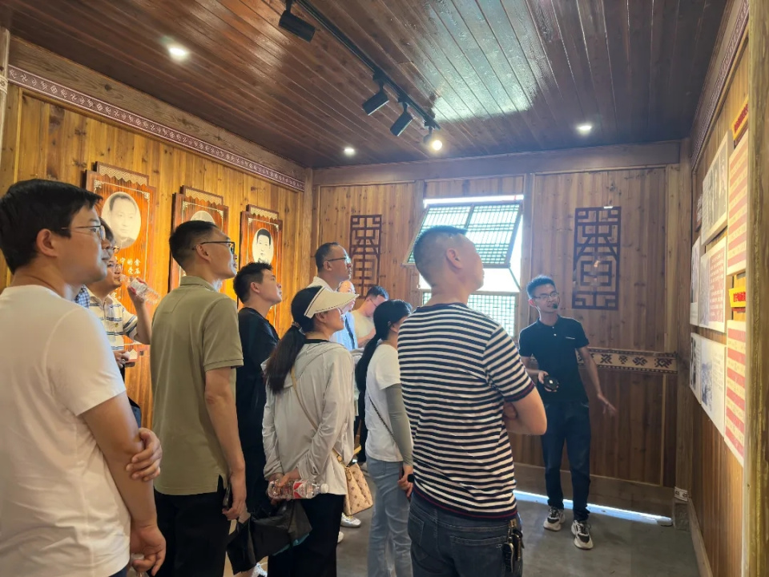

DZK-M033／S05-04（另有S05-05，DZK-M034）：旧清单将其记为革命历史展览馆内景，并保存“2018年启动建设”的辅助报道判断。本轮未重读那篇2019报道，故不新增其建设史结论；可以确定这些照片**不能直接当作传统民居室内构架资料**。S05-01为海浪“晚潮”栏目题图（DZK-M030），排除建筑证据，不在主汇编展示。

## 六、三维与原始采集资料：本轮未取得可锚定数据

在本仓库现有资料与常见模型／点云扩展名检索中，未找到可明确归属大张坑的真实三维模型、点云、航片工程、控制点或采集元数据；不得据此断言用户没有这些资料。现有三维技术路线与方法稿为拟开展方案、其他文献案例，不是本村已完成采集。所查路径和格式、待提供项见[缺口清单](待核与缺口.md)。

本包未建立图像—单体—三维区域的实证关联；现有二维示意图和普通照片不足以证明坐标、尺度、朝向或模型面片对应。**当前交付为资料组织与可追溯检索，不是语义模型或空间查询结果。**
