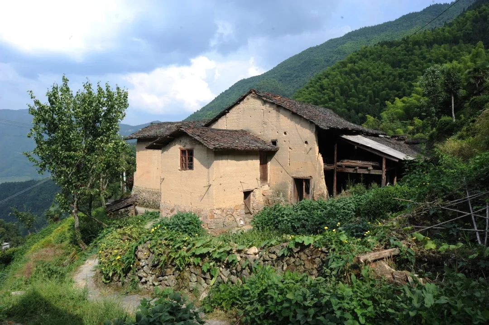
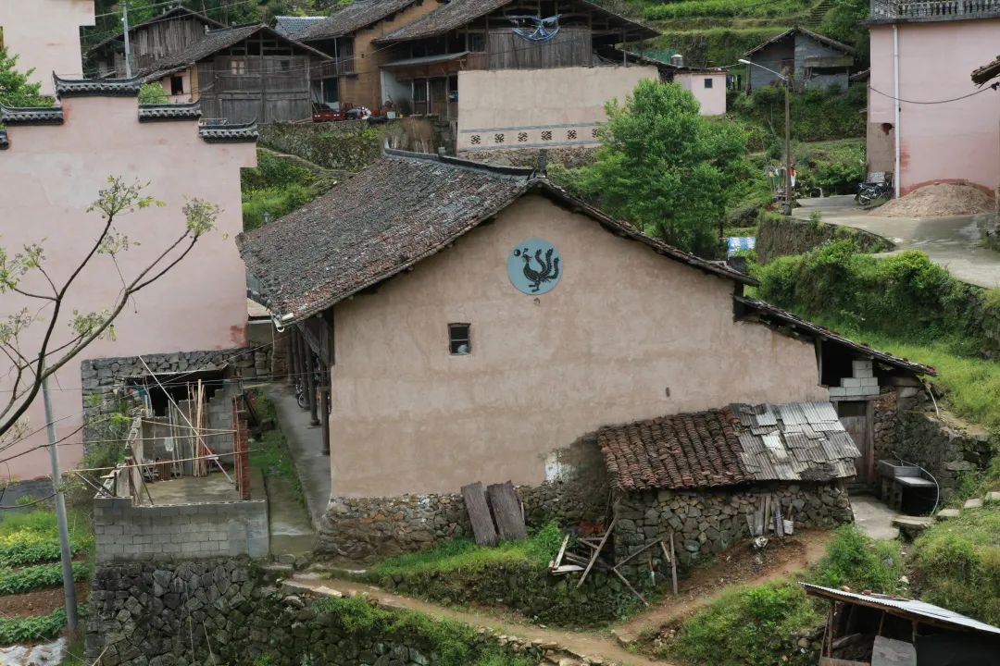
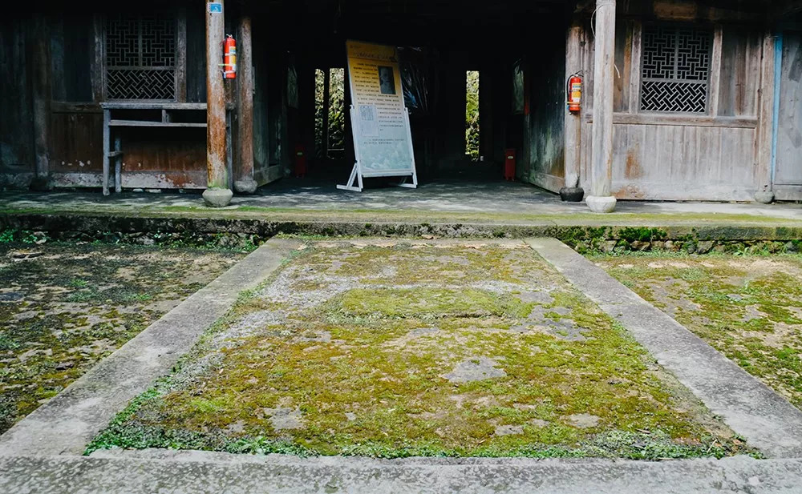

# 既有证据摘录

本文件是2026-10-19从仓库既有记录逐行摘存的工作副本，不是网页快照、原刊全文或新的现场证据。网页原链接与时点在索引逐条保留；本轮未重新请求网络。原件不移动、不覆盖。

## 研究资料/来源证据/2026-10-06-景宁畲族建筑遗存网络资料核查.md，原文件第29—57行

原件：[外部本地来源](file:///Users/wangyuelin/Desktop/Obsidian/Paper/01_sources/2026-10-06-%E6%99%AF%E5%AE%81%E7%95%B2%E6%97%8F%E5%BB%BA%E7%AD%91%E9%81%97%E5%AD%98%E7%BD%91%E7%BB%9C%E8%B5%84%E6%96%99%E6%A0%B8%E6%9F%A5.md)

```text
### W01　敕木山：数量、年代、形态与代表性

- 标题：[丽博观古·处州遗存——敕木山村畲族民居](https://www.lishui.gov.cn/art/2022/7/11/art_1229268129_57336308.html)
- 发布平台：丽水市政府门户网站；信息来源：市文广旅体局。
- 网页日期：2022-07-11；正文未注明该数量的实地核查日期。
- 阅读状态：已核对网页正文及图片说明。

> 该村现存典型的大户畲族古居民有四幢，建于清代及民国时期，均为二层楼屋。

上引“古居民”为网页原字，本文概述采用“古民居”。正文接着区分两类形态：一字排开的单体，前檐设廊；以及正屋带两厢、天井和回廊的合院式建筑。材料与构造记述包括碎石墙基、泥墙或木板壁、内部木结构、小青瓦和悬山屋顶。

> 敕木山村是景宁县现存村落形态和格局保存较为完整的畲族聚居村落，并保留着畲族的传统风俗习惯，具有一定的代表性。

**用途：**本轮最直接对应“代表性遗存有哪些、多少”的官方来源，可以支持优先核查敕木山这一案例组。代表性是该文对村落的评价，不能扩写为“四幢均代表全县全部类型”或“这些形态为畲族独有”。原文也指出房屋形式与当地同期传统山地民居基本相同。

**缺口：**网页没有列出四幢的逐栋名称、门牌或唯一编号，亦未将其与既有文献的“28号蓝姓畲族寮”对应。附有村落、民居及近景照片，但拍摄日期和四幢身份未标全；适合辅助展示，不能据图片补造清单。

### W02　2026年文保名录：敕木山仍为省级在册对象

- 标题：[景宁畲族自治县文保单位名录（2026年度）](https://www.jingning.gov.cn/col/col1229631018/art/2026/art_e28476d814684e38843b01cad4474107.html)
- 发布平台：景宁县政府网站；信息来源：县文广旅体局。
- 网页日期：2026-01-08。
- 阅读状态：已核对网页表格。

省级文物保护单位栏列有“鹤溪潘家大屋”“敕木山村畲族民居”“景宁孔庙”“严氏节孝木牌坊”；敕木山对应鹤溪街道辖区。全表按保护单位列全国重点2处、省级4处、县级40处，包含寺庙、廊桥、墓葬、窑址等多种类别。

**用途：**核对正式对象名称、保护级别及2026年度在册身份。W01与W02合用时，宜表述为“2022年官方介绍记载四幢典型大户古民居；该民居保护单位在2026年名录中仍列为省级文保单位”。

**边界：**文保单位处数、组成建筑栋数、畲族民居数量是不同口径。名录中“大张坑青花窑址”也不能替代大张坑传统民居的证据；其他住宅不能仅因位于景宁就认定为畲族住宅。
```

## 研究资料/来源证据/2026-10-06-景宁畲族建筑遗存网络资料核查.md，原文件第138—140行

原件：[外部本地来源](file:///Users/wangyuelin/Desktop/Obsidian/Paper/01_sources/2026-10-06-%E6%99%AF%E5%AE%81%E7%95%B2%E6%97%8F%E5%BB%BA%E7%AD%91%E9%81%97%E5%AD%98%E7%BD%91%E7%BB%9C%E8%B5%84%E6%96%99%E6%A0%B8%E6%9F%A5.md)

```text
| W07 | [第四次全国文物普查第一批新发现不可移动文物通知](https://www.jingning.gov.cn/col/col1229847966/art/2026/art_7ce16e4613144e738be4ac52e80c7c4f.html) | 县文广旅体局，景文广旅体〔2026〕13号；网页2026-04-20、正文落款2026-03-30、元数据2026-03-27；正文公布40处新发现不可移动文物 | XLS名录下载未成功，未逐项读取。40处不是新增畲族民居40栋，也不能与文保名录直接相加；附件值得继续取得并筛选 |
| W08 | [景宁县县级文物保护单位保护范围及建设控制地带划定方案公示](https://www.jingning.gov.cn/art/2024/6/25/art_1229438055_5321825.html) | 2024-06-25；涉及40处县级文保单位，公示期至2024-07-25 | PDF方案未读；是公示文本，不能直接视为最终批复。可继续核对保护范围／位置资料；不是省级敕木山的专门档案 |
| W09 | [划定泗洲造纸作坊遗址等345处文物保护单位保护范围和建设控制地带的批复](https://www.zj.gov.cn/art/2015/10/9/art_1229017138_63940.html) | 浙江省政府，浙政函〔2015〕115号；落款2015-09-28、发布2015-10-09；正文名录第345项“敕木山村畲族民居” | 已确认批复及对象名称；未读CEB附件，未获得具体边界、组成单体或图纸 |
```

## 研究资料/来源证据/2026-10-06-重点民居逐项调研与照片图册.md，原文件第35—71行

原件：[外部本地来源](file:///Users/wangyuelin/Desktop/Obsidian/Paper/01_sources/2026-10-06-%E9%87%8D%E7%82%B9%E6%B0%91%E5%B1%85%E9%80%90%E9%A1%B9%E8%B0%83%E7%A0%94%E4%B8%8E%E7%85%A7%E7%89%87%E5%9B%BE%E5%86%8C.md)

```text
## R01　敕木山四幢典型大户畲族民居组

**地点和保护身份。** 位于景宁县鹤溪街道敕木山村。“敕木山村畲族民居”列在[2026年度文保单位名录](https://www.jingning.gov.cn/col/col1229631018/art/2026/art_e28476d814684e38843b01cad4474107.html)的省级栏；是一个保护单位名称，不是四份独立保护单位。

**价值依据。** [2022年市文广旅体局介绍（S01）](https://www.lishui.gov.cn/art/2022/7/11/art_1229268129_57336308.html)记典型大户古民居四幢，清代及民国时期、二层楼屋，有一字排开和合院两种形式。碎石基础、泥墙／木板壁、内部木构、小青瓦、悬山顶等描述与图像可以相互参照。文章还评价村落形态与格局保存较完整、具有一定代表性；这是2022年发布内容，确切调查日期未载。

**照片所得。** S01保存3张官方照片，S02另选11张建筑及村落照片，共14张敕木山图像。其中可以观察民居整体、前檐、土墙、瓦屋面、门洞与山地高差。S02有摄影者“光林”署名，发布于2018年，不能称为2026照片。





**尚缺。** 四幢的正式组成单体表、名称／门牌、年代分配和近期修缮记录。现有照片不能直接拆成“四幢各一张”，也不能证明全部四幢当前完好。进一步优先查省级文保单位档案和保护范围图。

## R02　史图博曾住老宅与展览馆线索

**新增的具名证据。** [《畲乡报》2023年3月23日第04版《史图博的敕木情缘》](http://epaper.jnnews.zj.cn/html/2023-03/23/content_4685_15932222.htm)，叶小忠搜集整理，明确写道：

> 史图博住在了村长蓝文成家的小阁楼。

该文叙述1929年的调查经历，属于地方历史叙事，支持“蓝文成家”这一历史身份线索，未提供如今的门牌或建筑测绘。

[2018年《畲寨行》图文（S02）](https://www.sohu.com/a/257397347_100188381)称史图博居住过的小院已修缮，并介绍哈·史图博展览馆。紧邻展览馆段落的照片S02-07呈现木构正屋、格扇、石铺院落及说明展板，适合研究老宅展示利用和空间构成。



**可以写到的程度。** “蓝文成家”为1929年居住地点的具名线索；“史图博旧宅／展览馆”已有图像线索。两篇资料之间尚缺房屋地址、展馆说明牌清晰文字或保护档案的直接对应，暂不将它与28号蓝姓寮、论文中的“蓝村长家门楼”或四幢中的某一幢自动合并。也不将旅游报道中的“文物保护单位”表述独立升级为该单体的保护级别。

## R03　敕木山28号蓝姓畲族寮

**已有实证。** L18《浙江景宁畲族传统民居卷草凤凰纹装饰研究》（2013）PDF第2页／刊页95图1，图注明确“景宁县敕木山村28号蓝姓畲族寮”，是卷草凤凰纹的分段示意。第3页另有“敕木山村蓝村长家”的门楼装饰照片，但该图没有明确标28号，两个称呼不能直接合并。

**本轮结果。** 检索“景宁 敕木山 28号”未获得指认该单体的新网页；敕木山图集照片未见可确认的28号标记。本轮没有新增其整体外观照片。

**研究价值与缺口。** 适合做有明确原文编号的装饰案例；目前不足以单独支撑整栋形态分析或2026存续判断。应将纹样、门牌、宅名及整体照片串联后再确定样本身份。

[既有论文原页与图1](../images/L18-PDF02-原页.png) · [蓝村长家门楼装饰所在原页](../images/L18-PDF03-原页.png)
```

## 研究资料/来源证据/2026-10-06-重点民居逐项调研与照片图册.md，原文件第171—176行

原件：[外部本地来源](file:///Users/wangyuelin/Desktop/Obsidian/Paper/01_sources/2026-10-06-%E9%87%8D%E7%82%B9%E6%B0%91%E5%B1%85%E9%80%90%E9%A1%B9%E8%B0%83%E7%A0%94%E4%B8%8E%E7%85%A7%E7%89%87%E5%9B%BE%E5%86%8C.md)

```text
## 本轮没有填平的缺口

1. **敕木山四幢仍缺逐栋名单。** 新增了蓝文成家／史图博旧居的历史身份线索，但未得到四幢的门牌、保护档案或相互对应关系。
2. **四个原有具名／具编号住宅没有新增可靠单体照片。** 蓝坤宝寮、周湖8号、敕木山28号、蓝凤新寮仍主要依赖论文；村落图集只能辅助定位。
3. **照片发布时间不能直接更新现存数。** 2026网页可能采用旧照片，且多数没有拍摄日、坐标或门牌；照片不能证明村内未被拍到的房屋仍在。
4. **历史状态记录（截至2026-10-19；已由CMS-M008本轮全文取得记录覆盖）。** [文档站摘要](https://www.51wendang.com/doc/a282ae843147d30a3c221c9c77cc3805c04b6fd0)显示张云、都铭《浙江省丽水市景宁县敕木山村——国家历史文化名城研究中心历史街区调研》，《城市规划》2025年第2期、133—134页，摘要称约50栋建筑、多为传统风貌民居。截至当时仅读到第三方摘要；此句不代表当前状态。2026-10-22已取得原刊并逐页核读，现状以资料索引CMS-M008及本轮提取表为准。
```

## 研究成果/景宁畲族传统民居建筑特征/图像来源.json，原文件第1—17行

原件：[外部本地来源](file:///Users/wangyuelin/Desktop/Obsidian/Paper/outputs/%E6%99%AF%E5%AE%81%E7%95%B2%E6%97%8F%E4%BC%A0%E7%BB%9F%E6%B0%91%E5%B1%85%E5%BB%BA%E7%AD%91%E7%89%B9%E5%BE%81/%E5%9B%BE%E5%83%8F%E6%9D%A5%E6%BA%90.json)

```text
[
  {
    "file": "研究成果/景宁畲族传统民居建筑特征/图7-敕木山28号蓝姓寮卷草凤凰纹骨架.png",
    "source_pdf": "/Users/wangyuelin/Zotero/storage/PIHCARAE/蓝法勤 - 2013 - 浙江景宁畲族传统民居卷草凤凰纹装饰研究.pdf",
    "pdf_page": 2,
    "printed_page": 95,
    "figure": "图1",
    "method": "extract native PDF image; unmodified"
  },
  {
    "file": "研究成果/景宁畲族传统民居建筑特征/图8-敕木山蓝村长门楼凤凰纹.jpg",
    "source_pdf": "/Users/wangyuelin/Zotero/storage/PIHCARAE/蓝法勤 - 2013 - 浙江景宁畲族传统民居卷草凤凰纹装饰研究.pdf",
    "pdf_page": 3,
    "printed_page": 96,
    "figure": "图6",
    "method": "extract native PDF image; unmodified"
  },
```

## 文献库/2013-蓝法勤-卷草凤凰纹装饰研究.md，原文件第75—84行

原件：[外部本地来源](file:///Users/wangyuelin/Desktop/Obsidian/Paper/%E6%96%87%E7%8C%AE%E5%BA%93/2013-%E8%93%9D%E6%B3%95%E5%8B%A4-%E5%8D%B7%E8%8D%89%E5%87%A4%E5%87%B0%E7%BA%B9%E8%A3%85%E9%A5%B0%E7%A0%94%E7%A9%B6.md)

```text
### 3. 核心成果与证据

| 主要成果或命题 | 关键依据与推导/分析方式 | 适用范围、异例或不确定性 | 原文定位 |
| --- | --- | --- | --- |
| 作者将卷草凤凰纹概括为起始、中间、末端、延展四部分；前檐梁两侧纹样常呈对称走势，并结合阴刻、阳刻及双勾凹槽形成层次。 | 依构件照片、线描示意及对纹样走向的文字描述归纳；作者称具体纹样随梁材形态而变、无固定样式。 | 是描述性形态归纳，未建立统一测绘指标或样本频率；现场图版不能代表全县分布。 | 印刷页95，图1及“表现样式”节；PDF第2页。 |
| 文中归纳三类较显著的末端造型：凤头鹤嘴式、金鸡头式、卷草与风鸟相结合式。 | 对照图2—图6及各图注，比较凤头、喙、鸡冠与延展纹样组合；文中同时承认雕刻细节和走势变化。 | 作者未给分类互斥性、识别规则或各型数量；作为候选描述词比作已验证类型体系更稳妥。 | 印刷页95—96，图2—图6及“表现样式”节；PDF第2—3页。 |
| 居民对相似纹样的称谓有差异，作者据此讨论其文化意义。 | 敕木山畲民和木雕传承人称“凤凰纹”，当地汉族居民称“龙须纹”；大均李宅纹样排列与张坑蓝凤新寮的“凤在前、龙在后”形成比较。 | 来自少数案例与受访者叙述，未报告访谈样本规模、提问方式或不同代际差异；不能推及所有畲汉家庭。 | 印刷页96—97，图7—图8及“寓意”节；PDF第3—4页。 |
| 作者将凤凰纹与畲族“崇凤”、族群认同及民居厅堂的公共、祭祀和展示功能联系起来。 | 结合族源传说、《高皇歌》、凤凰髻与婚俗、建屋挂鸡等习俗叙述，以及厅的位置、使用和梁上装饰等级，解释前檐厅梁成为重点装饰部位。 | 这是作者基于访谈和文献的文化解释；未排除造价、匠师风格、建筑年代、阶层或装饰传统等其他影响。 | 印刷页97—98，“畲族的‘崇凤’思想”“厅文化对装饰的影响”及“结语”；PDF第4—5页。 |

**原词核对**：印刷第96页／PDF第3页原页的第三类名称作“卷草与风鸟相结合式”，下一句则写“凤嘴”，图6题为“凤凰纹装饰”。本卡保留“风鸟”这一原文用字，并标记疑似“凤鸟”的排印问题；若作为统一纹样术语，应再向原作者或更清晰版本核对，不能静默订正后称为作者原词。
```

