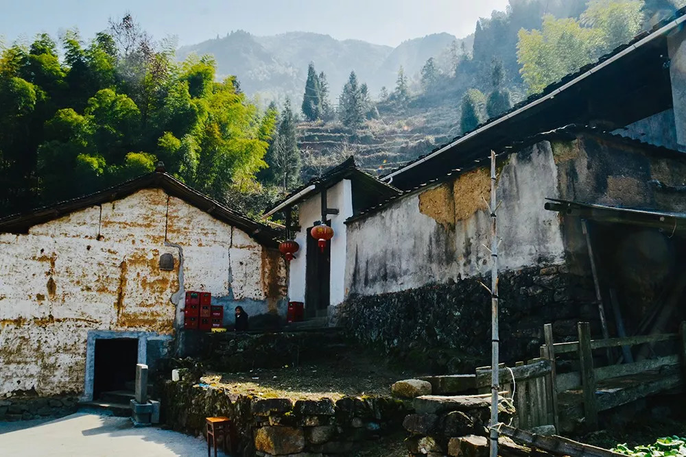
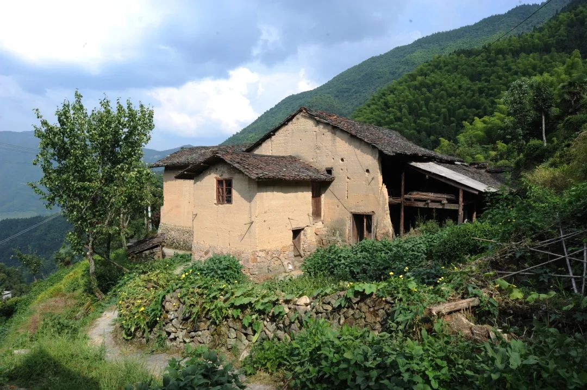
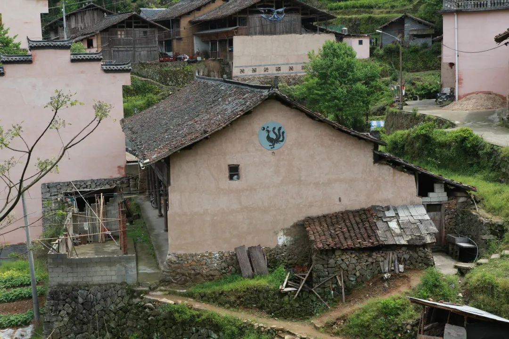
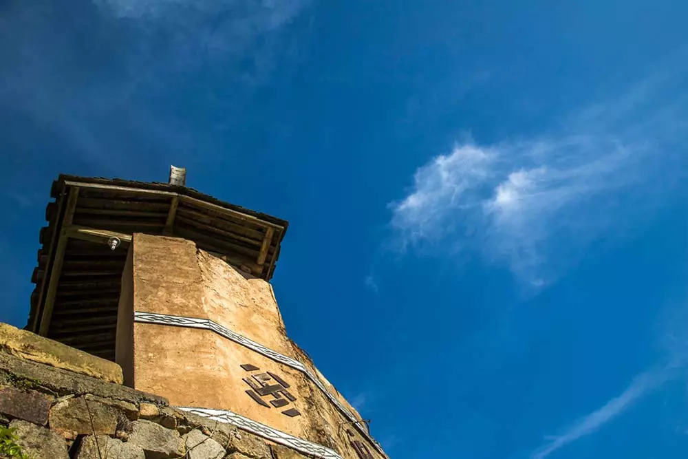
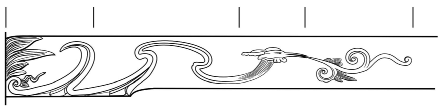
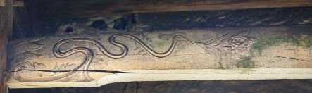
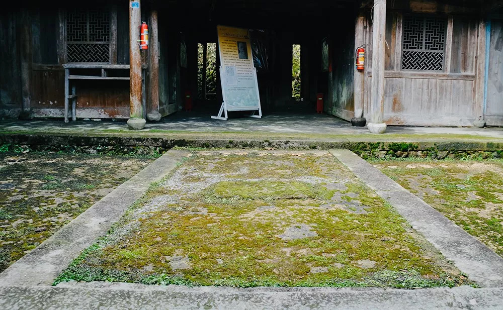
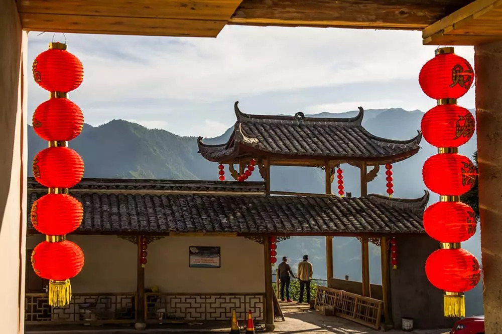

# 敕木山图文资料汇编

[资料入口](README.md) · [完整索引](资料索引.md) · [待核与缺口](待核与缺口.md)。整理日期：2026-10-19。

**阅读口径：**“转引”为从既有核查记录中保留的原文句子，本轮未重开原网页；“概述”为整理者归纳；“图像观察”只说明画面可见信息。所有图片均为历史来源或既有工作副本，不能证明2026年当前状态。下文编号均为资料编号，不是建筑编号。

## 一、村落与环境尺度：聚落、坡地和高差

**概述（CMS-M001）：**2022年官方介绍评价敕木山村落形态与格局保存较完整，具有一定代表性。这是发布时点的来源评价，不是本轮普查结论。该文同时指出房屋形式与当地同期山地民居基本相同，不能据此主张畲族专属形态。

*CMS-M010 / S01-01。官方栏目图，2022-07-11发布；拍摄日期未载，未署名。[原来源](https://www.lishui.gov.cn/art/2022/7/11/art_1229268129_57336308.html)。图像观察：房屋与山林坡地共同入画；画面不能提供村界、等高线、全村建筑清单或坐标。*

*CMS-M018 / S02-06。光林摄影、静珏撰文，2018-10-02发布；拍摄年月未载。[原来源](https://www.sohu.com/a/257397347_100188381)。图像观察：石阶、院墙与多层次屋顶可见；“紧邻旧宅段落”属于既有网页位置记录，不足以确定每栋身份。*

**可复用范围：**用于提出村落—巷道—院落的观察问题、后续照片定位比对；不能把透视照片当地图或实测布局图。其他村景S02-01、04、17见完整索引。S02-09梯田、S02-10/11茶叶与植物等仍列为背景，不能证明本村田块边界或土地权属。

## 二、组团与单体尺度：官方“四幢”与可见形态

**逐字转引（CMS-M001，既有W01记录）：**

> 该村现存典型的大户畲族古居民有四幢，建于清代及民国时期，均为二层楼屋。

保留“古居民”原字；整理概述使用“古民居”。[原网页](https://www.lishui.gov.cn/art/2022/7/11/art_1229268129_57336308.html)2022-07-11发布，实际核查年月未载。[包内既有证据摘录](sources/既有证据摘录.md)保留转引上下文。

**概述（同来源）：**正文区分前檐设廊的一字排开单体与带正屋、两厢、天井和回廊的合院式建筑，并提到碎石墙基、泥墙或木板壁、内部木构、小青瓦与悬山顶。这是来源对案例集合的描述，不能分配为“四栋中哪栋属于哪型”。清代及民国也未逐栋分配。

*CMS-M011 / S01-02。[2022官方来源](https://www.lishui.gov.cn/art/2022/7/11/art_1229268129_57336308.html)，摄影者及拍摄日期未载。图像观察：土墙、瓦屋面和侧向外廊等外观可见；未标建筑门牌、名称或“四幢”内部次序。*

*CMS-M012 / S01-03。同一官方来源与时点。图像观察：近处山墙、附屋及上层房屋有高差；不能用画面中出现几座屋顶替代栋数统计。*

*CMS-M017 / S02-05。光林摄影，2018-10-02发布，拍摄日未载。[2018来源](https://www.sohu.com/a/257397347_100188381)。图像观察：土墙转角、挑檐与坡地围护可作为外观参照；墙体做法、修缮层次和年代尚无实测核对。*

**保护资料（CMS-M002、003，概述）：**既有网络核查记录称“敕木山村畲族民居”列于[2026年度名录](https://www.jingning.gov.cn/col/col1229631018/art/2026/art_e28476d814684e38843b01cad4474107.html)省级栏、鹤溪街道辖区；[2015年批复](https://www.zj.gov.cn/art/2015/10/9/art_1229017138_63940.html)正文第345项同名。CEB边界附件未读，本轮没有保护范围图。一个保护单位不等于一栋，也不能证明官方四幢均在2026完好。

## 三、构件尺度：28号纹样示意与蓝村长家门楼

来源：蓝法勤，《浙江景宁畲族传统民居卷草凤凰纹装饰研究》，《设计艺术研究》2013，3(1):94—99，文献L18 / Zotero 7KCJR9EB。原PDF可访问但文字提取乱码，本轮核对清晰原页工作副本和独立图像，没有重新通读全文。[外部原文PDF](file:///Users/wangyuelin/Zotero/storage/PIHCARAE/蓝法勤%20-%202013%20-%20浙江景宁畲族传统民居卷草凤凰纹装饰研究.pdf)。

### 3.1 28号蓝姓畲族寮（CMS-M006 / E252）

*PDF第2页／刊页95，图1，图注“畲族卷草凤凰纹（景宁县敕木山村28号蓝姓畲族寮）”。独立图像来自既有原生图像提取，保留原文件；独立图未带完整文字标签，应与[同页图注及四部分说明](images/L18-PDF02-原页.png)对读。*

**概述：**作者将前檐梁纹样骨架分为起始、中间、末端和延展四部分。可用于构件局部的形态观察与词汇溯源；这幅线图不是住宅平面、剖面或实测几何，不能测算整栋尺寸。原文“28号”只作为当时图注编号，未证明等于今天门牌。

### 3.2 蓝村长家门楼梁（CMS-M007 / E255）

*PDF第3页／刊页96，图6，图注以“景宁县敕木山村蓝村长”定位门楼凤凰纹装饰；[整页原图与图注](images/L18-PDF03-原页.png)。该页其他图例来自丽水市区、沙湾镇张坑、小佐、大均，不归入敕木山资料。*

**概述：**原页将图6置于卷草与“风鸟”相结合式段落，下一句又用“凤嘴”；既有阅读卡已指出排印用字疑点。保留作者原词，不静默订正后当作定型术语。**图1与图6没有明确的同宅声明；不得将“蓝村长”直接等同于28号宅主或历史蓝文成。** 图像也不能独立证明该构件年代、匠人或2026存续。

## 四、单体—院落与使用史：蓝文成家、史图博旧宅及展馆

**逐字转引（CMS-M004，既有R02记录所存《畲乡报》）：**

> 史图博住在了村长蓝文成家的小阁楼。

[《史图博的敕木情缘》](http://epaper.jnnews.zj.cn/html/2023-03/23/content_4685_15932222.htm)，叶小忠搜集整理，2023-03-23第04版，追述1929年调查经历。这句话支持历史居住对象称谓，不提供现代门牌或坐标。

**概述（CMS-M005）：**2018年《畲寨行》图文称史图博住过的小院已修缮，并介绍哈·史图博展览馆。与2023报纸相互参照可保留旧宅改用线索；两者尚缺地址、档案或说明牌的直接对应。

*CMS-M019 / S02-07。光林摄影、静珏撰文，2018-10-02发布。[原来源](https://www.sohu.com/a/257397347_100188381)。图像观察：木构正屋、格扇、石铺院落及展示陈设可见。该图在既有来源记录中邻接展馆介绍，不单凭构件外观确认宅名；说明牌内容未由本轮清晰逐字识读。*

**结论边界：**“历史蓝文成家”与“展馆语境照片”分开保存；不合并为已核实同址，不把旅游文字中的保护表述升级为该单体独立文保级别，也不声称现时用途未变。

## 五、补充类型：门楼场景、室内生活与背景

*光林摄影，2018年发布，拍摄年未载。画面门楼、檐廊与灯笼可见；既有资料未注明单体和修建年代，不据仿古外观判为传统遗存，也不对应L18蓝村长家门楼。*

*光林摄影，2018年发布。原manifest未列建筑精选，本轮作为补充材料保留：人物、室内梁架与灶台语境可供生活空间观察，但未具名、不据人物服饰推定整栋民族归属，不作具名单体空间证据。*

S02-13人物服饰、S02-16围桌用餐与S02-09—11田园植物材料保留索引而未全部复制，避免用生活照片充当建筑主图。照片中可见的民族服饰不等于该建筑归属证据。

## 六、地图、测绘、三维与待核文献入口

- **构件示意实际存在：**CMS-M006为纹样骨架，不是平立剖；CMS-M007为照片，不是量测图。
- **布局/测绘现状：**本轮所查敕木山明确资料未取得可验证尺度的村落布局图、建筑平立剖或保护范围图。CMS-M003只提供批复附件线索，不伪装成已读图纸。
- **三维与元数据：**仓库所查格式与方法入口未找到本村可用模型、点云、航摄工程、控制点或相机坐标资料；不将别村文献模型图、拟开展方法稿或虚构展示原型纳入实证材料。详见[覆盖说明](README.md)和[三维缺口](待核与缺口.md)。
- **CMS-M008：**2025年《城市规划》原刊已取得全文并逐页核读；“约50栋”仅为文章时点的村落概述，不进入2026现状数量依据。
- **CMS-M009：**已视觉核对L10刊页71图2，图注明确“敕木山东弄村的山地院落建筑”；结合M030（2008）题名、地图和正文，将该图排除为东弄村材料，不归入敕木山建筑。东弄、惠明寺、大张坑等位于敕木山地理区域或周边的线索，不等于敕木山村。

这份汇编用于后续来源核对、案例取舍与资料分析准备，不包含已完成的语义描述模型或三维空间关联结果。
