# 文献图像裁切清单（二轮复核）

> 这里保存从页面级PDF图像中裁出的独立图像单元。每项保留来源页、原图文件和裁切用途；裁切不改变原文内容。

已完成 **17个**裁切单元。

|裁切图|图注/用途|来源页面|原始页面|
|---|---|---|---|
|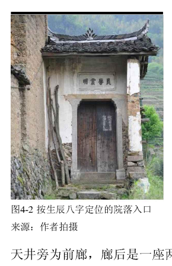|图4-2 按生辰八字定位的院落入口|BUUUUWRW-064.png|[查看原页面](assets/she-image-bank/BUUUUWRW-064.png)|
|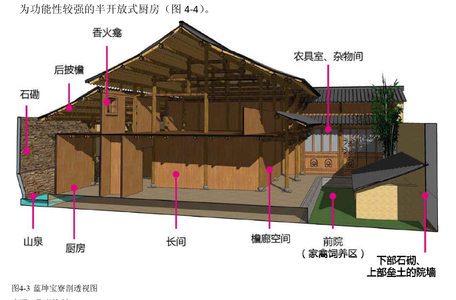|图4-3 蓝坤宝寮剖透视图|BUUUUWRW-064.png|[查看原页面](assets/she-image-bank/BUUUUWRW-064.png)|
|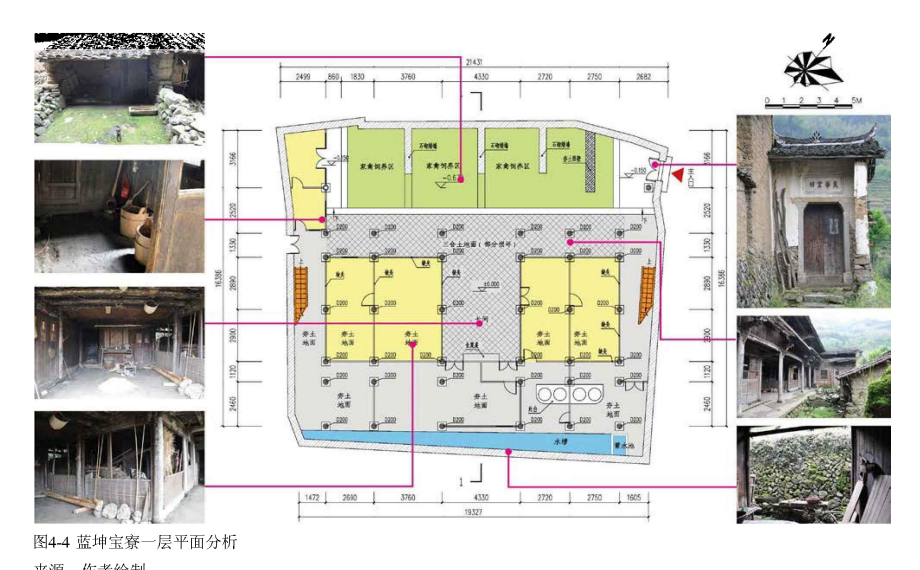|图4-4 蓝坤宝寮一层平面分析|BUUUUWRW-065.png|[查看原页面](assets/she-image-bank/BUUUUWRW-065.png)|
|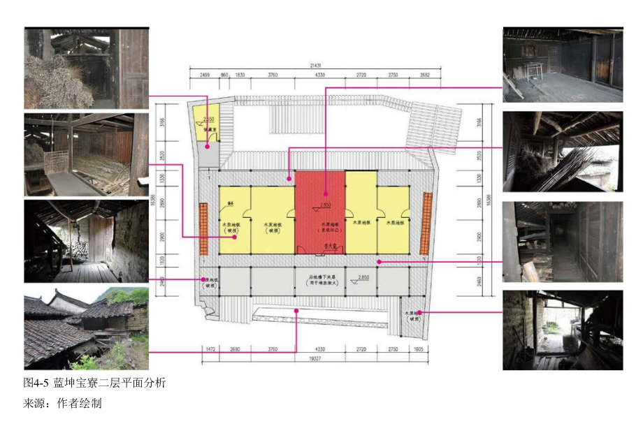|图4-5 蓝坤宝寮二层平面分析|BUUUUWRW-065.png|[查看原页面](assets/she-image-bank/BUUUUWRW-065.png)|
|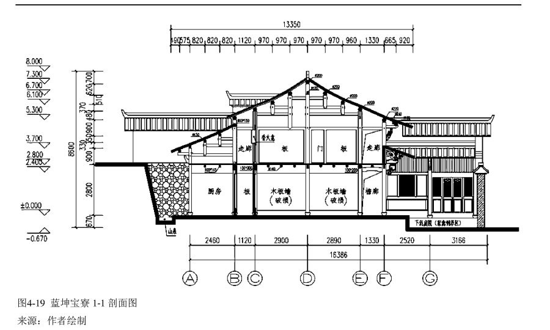|图4-19 蓝坤宝寮1-1剖面图|BUUUUWRW-073.png|[查看原页面](assets/she-image-bank/BUUUUWRW-073.png)|
|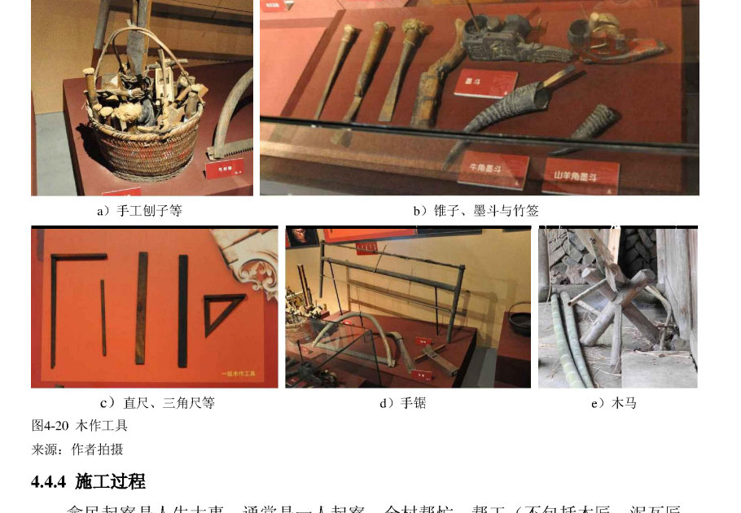|图4-20 木作工具|BUUUUWRW-073.png|[查看原页面](assets/she-image-bank/BUUUUWRW-073.png)|
|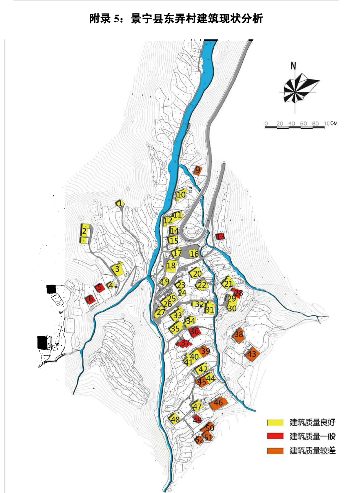|附录5 东弄村建筑编号分布与质量图|BUUUUWRW-115.png|[查看原页面](assets/she-image-bank/BUUUUWRW-115.png)|
|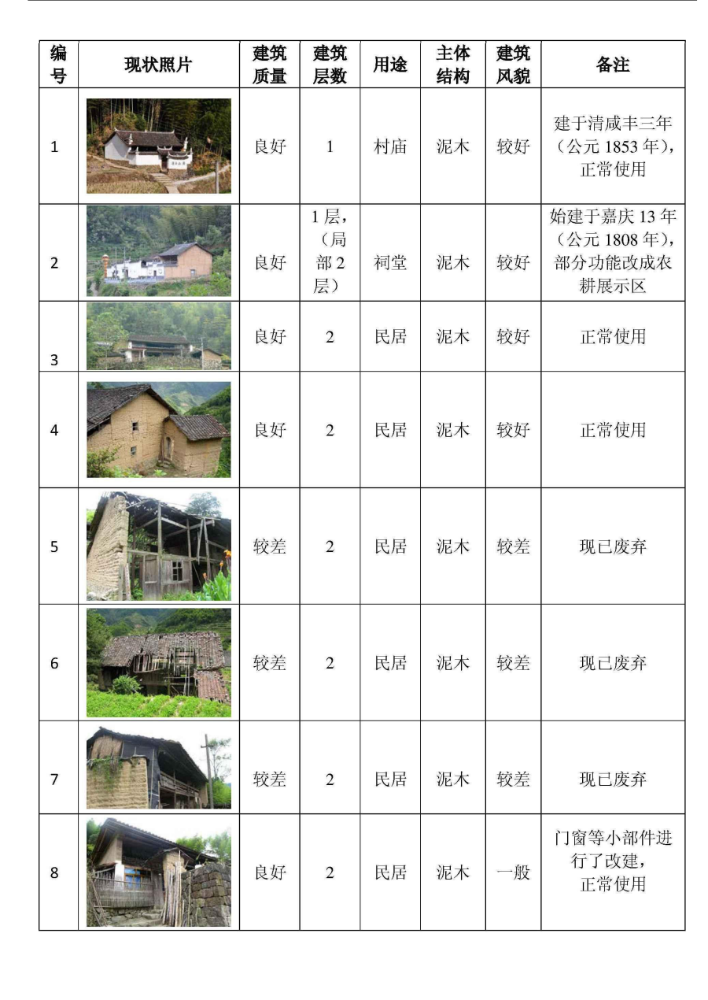|附录5 建筑现状表 01-08号|BUUUUWRW-116.png|[查看原页面](assets/she-image-bank/BUUUUWRW-116.png)|
|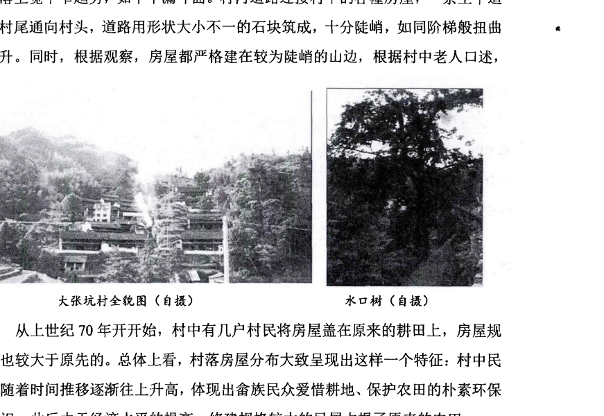|大张坑村落照片组|ETTYATRB-019.png|[查看原页面](assets/she-image-bank/ETTYATRB-019.png)|
|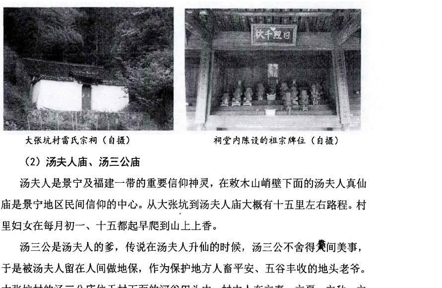|大张坑民居照片组|ETTYATRB-023.png|[查看原页面](assets/she-image-bank/ETTYATRB-023.png)|
|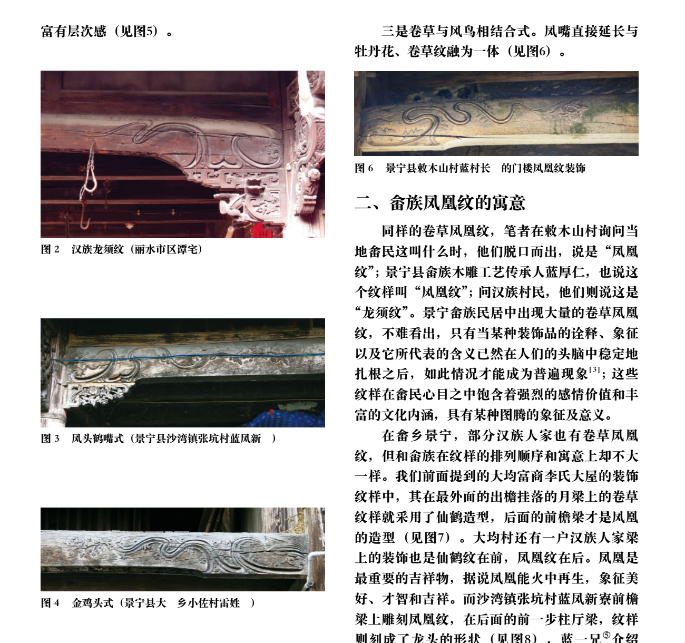|门楼与凤凰纹装饰图组|7KCJR9EB-003.png|[查看原页面](assets/she-image-bank/7KCJR9EB-003.png)|
|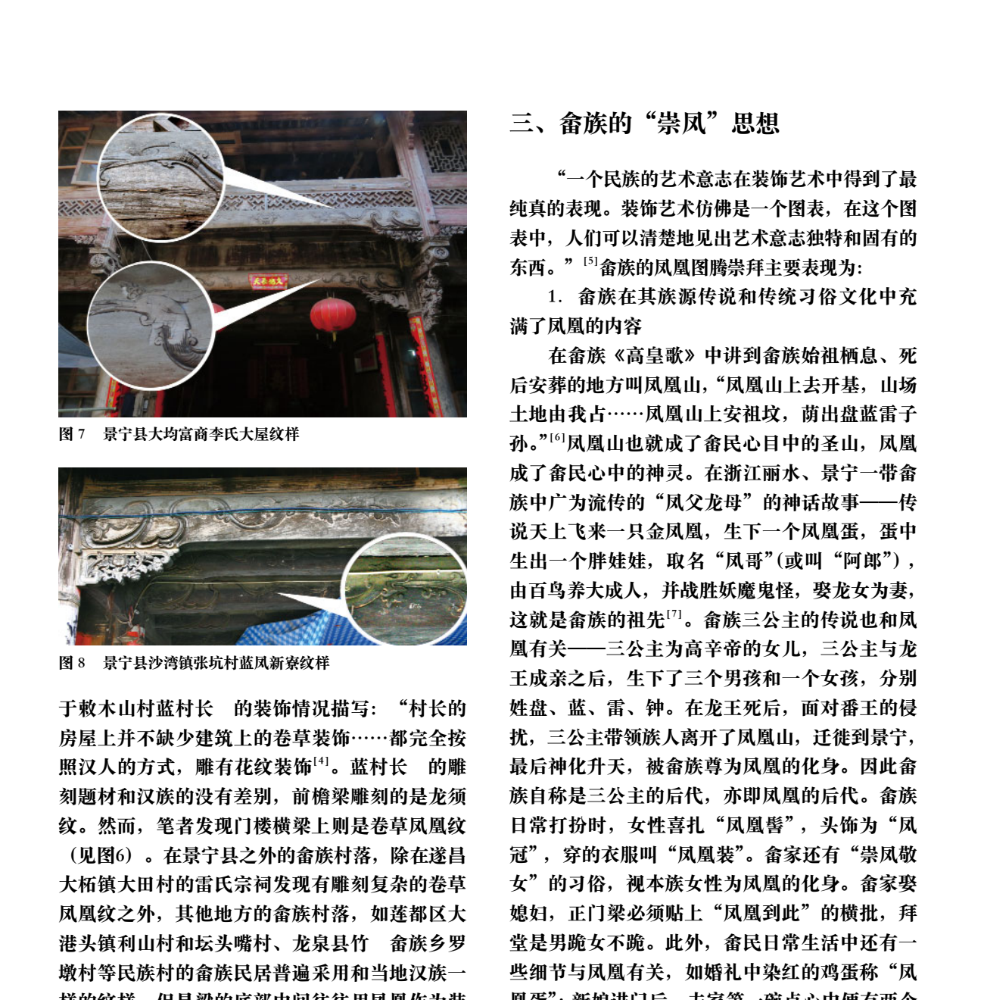|凤凰纹与梁部装饰图组|7KCJR9EB-004.png|[查看原页面](assets/she-image-bank/7KCJR9EB-004.png)|
|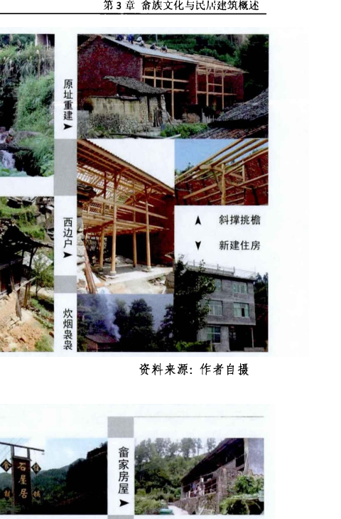|图3-16/3-17 祠堂与大宅遗存|VSES7L3M-pdf37.png|[查看原页面](assets/she-image-bank/VSES7L3M-pdf37.png)|
|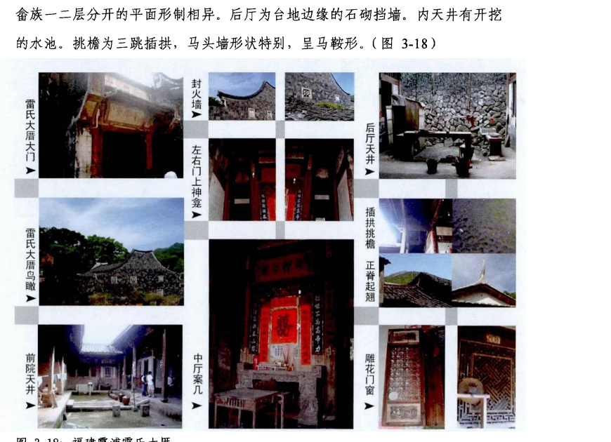|图3-18 雷世儒雷氏大宅|VSES7L3M-pdf38.png|[查看原页面](assets/she-image-bank/VSES7L3M-pdf38.png)|
|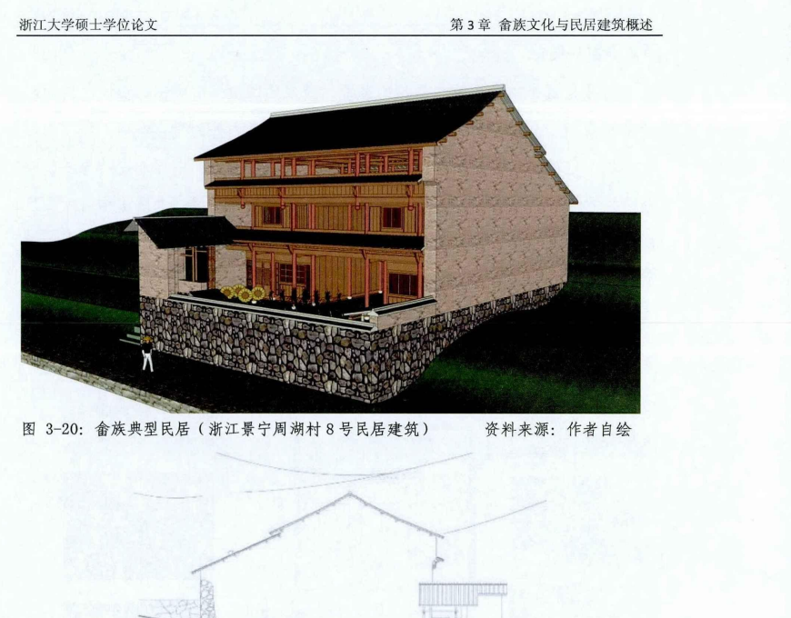|图3-20 周湖村8号民居|VSES7L3M-pdf40.png|[查看原页面](assets/she-image-bank/VSES7L3M-pdf40.png)|
|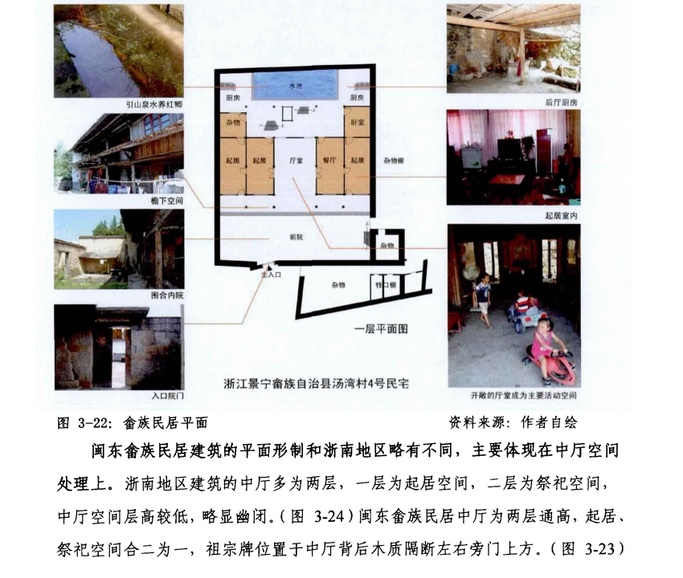|图3-22 汤湾村4号民宅|VSES7L3M-pdf41.png|[查看原页面](assets/she-image-bank/VSES7L3M-pdf41.png)|
|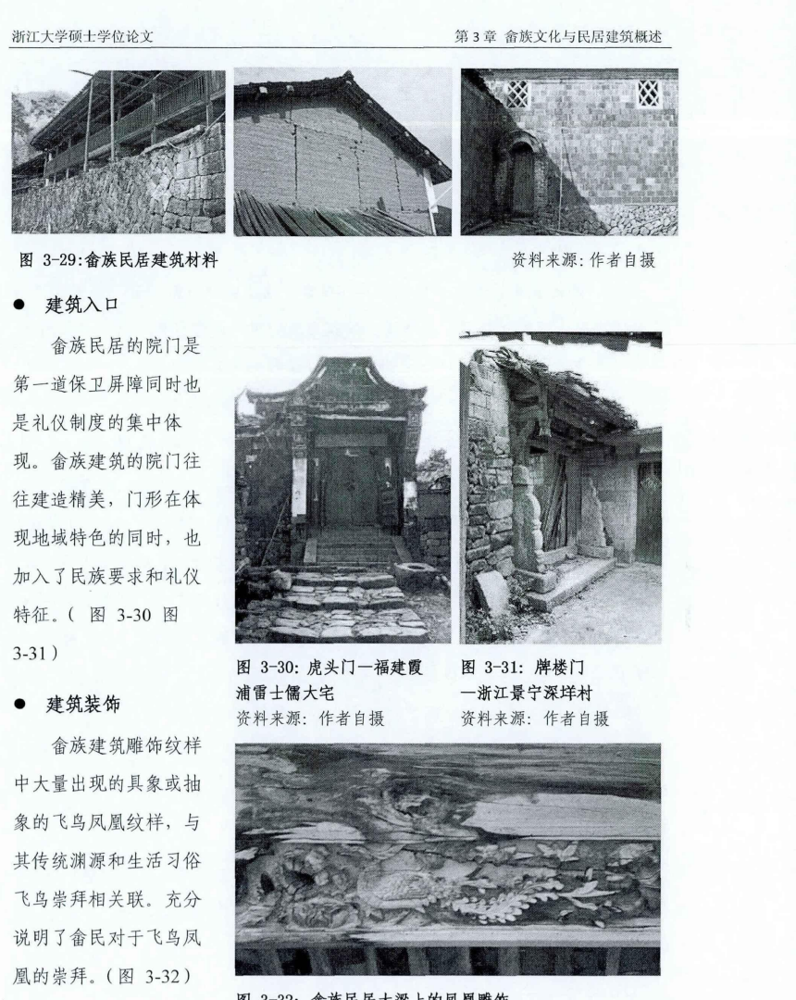|图3-24/3-25 民居遗存与门楼|VSES7L3M-pdf44.png|[查看原页面](assets/she-image-bank/VSES7L3M-pdf44.png)|

## 复核说明

裁切图均通过视觉检查，文字、图例和主要图像内容保持可读。裁切图是资料复用单元，不代表已确认2026年现状；跨文献对应关系见[[研究资料/来源证据/2026-10-06-跨文献遗存实体去重候选表.md]]。
