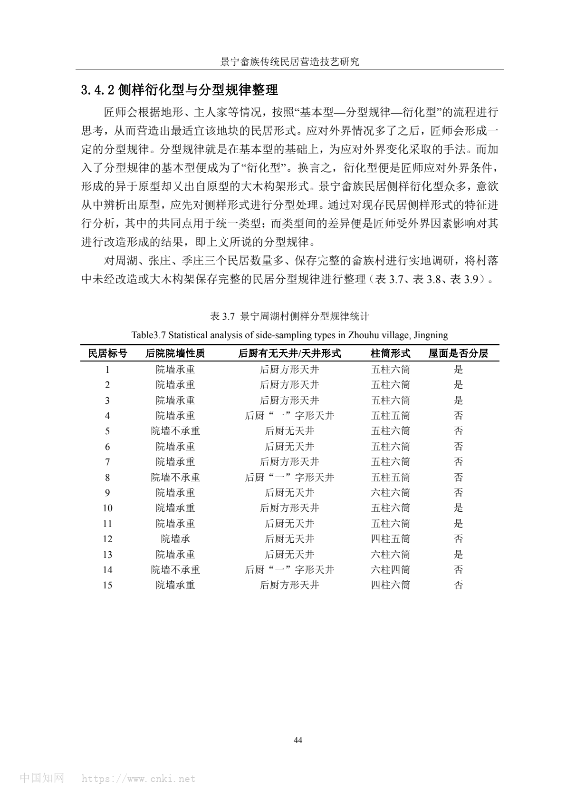
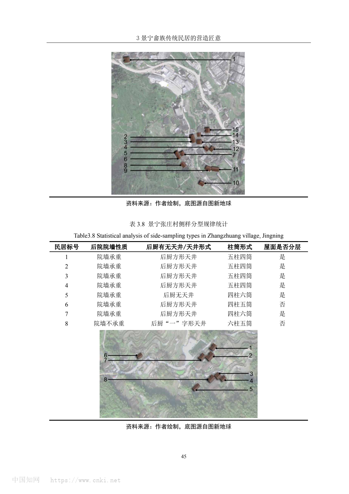
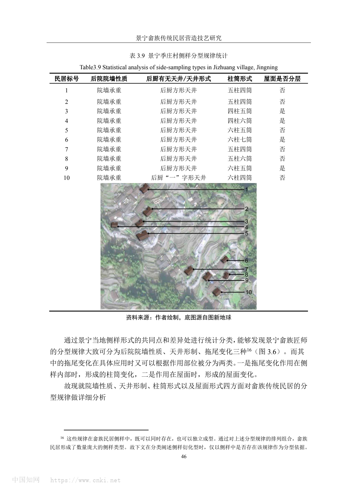
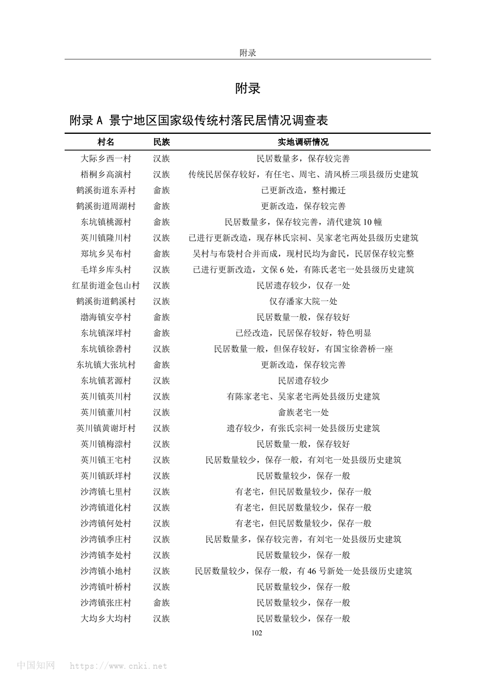
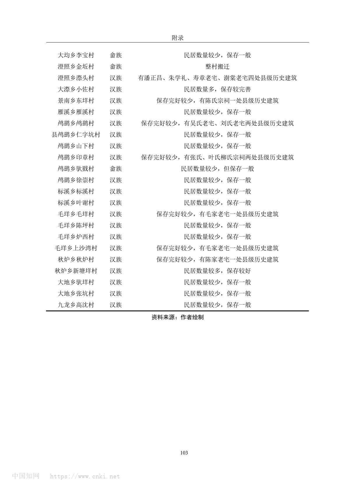
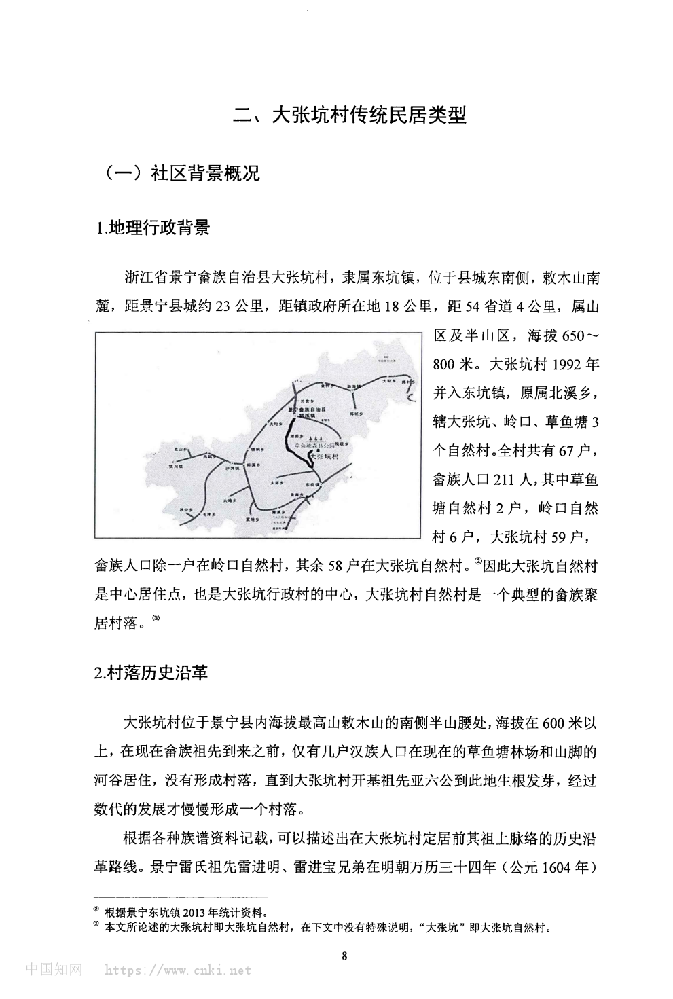
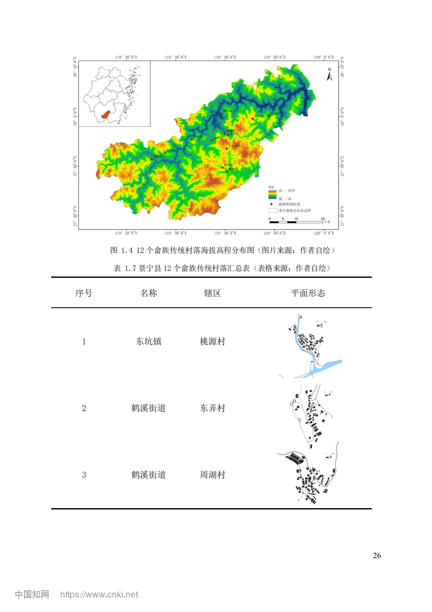
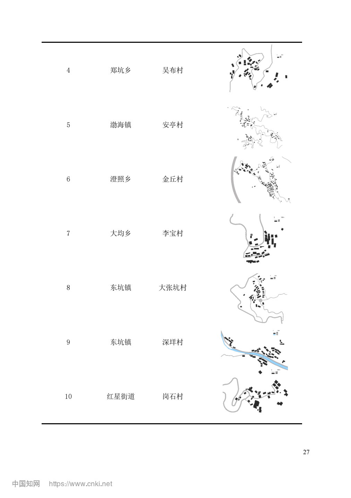
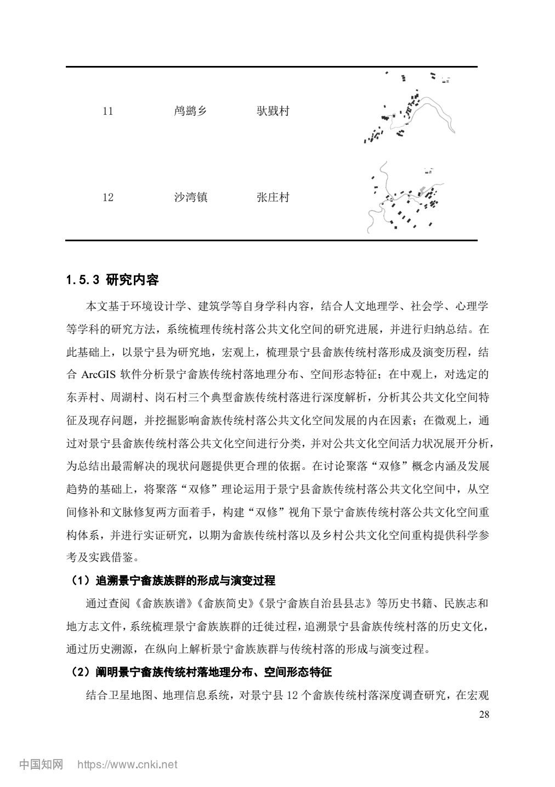

# 景宁畲族建筑遗存文献现状列表（第一版）

> 本表只整理文献调查时点的状态，不等同于2026年现状。当前状态统一暂记为“待核实”。数量、编号和建筑单体不自动合并。原文摘录为短摘录或证据概述，正式引用请回到PDF原页。

本表从23条文献的证据中整理 **128条记录**，以景宁相关线索为主，同时保留外地比较案例、村落统计和未具名单体的类型描述；不是128处景宁境内可定位遗存。对应图片的对象、类型、状态线索和复用用途见[[研究资料/来源证据/2026-10-06-畲族文献图像分析索引.md]]。同一遗存可能重复出现，地域、对象层级和单体对应仍需逐项筛选，暂不作为去重后的建筑数量。

|  序号 | 遗存名称                     | 地点                     | 类型            | 文献记录状态                                                 | 调查时点                                                               | 原文摘录/证据要点                                | 定位               | 图/表                    | 原文图像                                           | 来源            | 2026状态  | 备注                                                                                                                 |
| --: | ------------------------ | ---------------------- | ------------- | ------------------------------------------------------ | ------------------------------------------------------------------ | ---------------------------------------- | ---------------- | ---------------------- | ---------------------------------------------- | ------------- | ------- | ------------------------------------------------------------------------------------------------------------------ |
|   1 | 侧样分型统计表中的民居编号记录          | 周湖村                    | 侧样样本条目        | 表中民居编号记录                                               | 论文称对三村实地走访；未注明精确调查日                                                | 表格编号项数为人工逐行清点；不可当作全村民居栋数。                | PDF 55 / 印刷 44   | 表3.7                   |  | ZWDJJE99（L08） | 待2026核实 | 数量：15 表中民居编号行；表中逐行计数，非作者全村统计；一栋建筑是否对应多个侧样未说明；表内民居编号有对应分布图定位；逐行计数不是全村建筑总量，一栋建筑是否对应多个侧样未说明。                          |
|   2 | 侧样分型统计表中的民居编号记录          | 张庄村                    | 侧样样本条目        | 表中民居编号记录                                               | 论文称对三村实地走访；未注明精确调查日                                                | 表格编号项数为人工逐行清点；不可当作全村民居栋数。                | PDF 56 / 印刷 45   | 表3.8                   |  | ZWDJJE99（L08） | 待2026核实 | 数量：8 表中民居编号行；表中逐行计数，非作者全村统计；一栋建筑是否对应多个侧样未说明；表内民居编号有对应分布图定位；逐行计数不是全村建筑总量，一栋建筑是否对应多个侧样未说明。                           |
|   3 | 侧样分型统计表中的民居编号记录          | 季庄村                    | 侧样样本条目        | 表中民居编号记录                                               | 论文称对三村实地走访；未注明精确调查日                                                | 表格编号项数为人工逐行清点；不可当作全村民居栋数。                | PDF 57 / 印刷 46   | 表3.9                   |  | ZWDJJE99（L08） | 待2026核实 | 数量：10 表中民居编号行；表中逐行计数，非作者全村统计；一栋建筑是否对应多个侧样未说明；表中编号1–10可由对应分布图定位；表格行数与建筑栋数关系未交代。该文表1.2又将季庄列入汉族村组，与本段“畲族村”说法同源冲突，未判定。 |
|   4 | 任宅、周宅、清风桥                | 梧桐乡高演村                 | 县级历史建筑（含桥）    | 传统民居保存较好；有任宅、周宅、清风桥三项县级历史建筑                            | 论文附录A实地调研记录；精确调查日期未注明                                              | 任宅、周宅、清风桥三项县级历史建筑                        | PDF 113 / 印刷 102 | 附录A：景宁地区国家级传统村落民居情况调查表 |  | ZWDJJE99（L08） | 待2026核实 | 数量：3 项县级历史建筑；表列三项，包含清风桥；非民居栋数；数量为表述中的历史建筑项目数，其中清风桥非住宅。                                                             |
|   5 | 清代建筑（未具名）                | 东坑镇桃源村                 | 清代建筑          | 民居数量多，保存较完善；清代建筑10幢                                    | 论文附录A实地调研记录；精确调查日期未注明                                              | 清代建筑10幢                                  | PDF 113 / 印刷 102 | 附录A：景宁地区国家级传统村落民居情况调查表 |  | ZWDJJE99（L08） | 待2026核实 | 数量：10 幢；桃源村村域；表中未列具体宅名；原文直接数量，未给逐栋名称。                                                                              |
|   6 | 林氏宗祠、吴家老宅                | 英川镇隆川村                 | 县级历史建筑        | 已进行更新改造；现存林氏宗祠、吴家老宅两处县级历史建筑                            | 论文附录A实地调研记录；精确调查日期未注明                                              | 现存林氏宗祠、吴家老宅两处县级历史建筑                      | PDF 113 / 印刷 102 | 附录A：景宁地区国家级传统村落民居情况调查表 |  | ZWDJJE99（L08） | 待2026核实 | 数量：2 处；表列两处，不代表全村民居数量；                                                                                             |
|   7 | 文物保护点（表中未逐项命名）           | 毛垟乡库头村                 | 文保点           | 已进行更新改造；文保6处；有陈氏老宅一处县级历史建筑                             | 论文附录A实地调研记录；精确调查日期未注明                                              | 文保6处                                     | PDF 113 / 印刷 102 | 附录A：景宁地区国家级传统村落民居情况调查表 |  | ZWDJJE99（L08） | 待2026核实 | 数量：6 处；库头村文物保护点数，不是民居栋数；原文将此数表述为文保处数，不作民居总量。                                                                       |
|   8 | 陈氏老宅                     | 毛垟乡库头村                 | 县级历史建筑        | 有陈氏老宅一处县级历史建筑                                          | 论文附录A实地调研记录；精确调查日期未注明                                              | 陈氏老宅一处县级历史建筑                             | PDF 113 / 印刷 102 | 附录A：景宁地区国家级传统村落民居情况调查表 |  | ZWDJJE99（L08） | 待2026核实 | 数量：1 处；库头村具名建筑；                                                                                                    |
|   9 | 未具名民居遗存                  | 红星街道金包山村               | 民居遗存          | 民居遗存较少，仅存一处                                            | 论文附录A实地调研记录；精确调查日期未注明                                              | 民居遗存较少，仅存一处                              | PDF 113 / 印刷 102 | 附录A：景宁地区国家级传统村落民居情况调查表 |  | ZWDJJE99（L08） | 待2026核实 | 数量：1 处；村落现存遗存数；具体宅名未列；                                                                                             |
|  10 | 潘家大院                     | 鹤溪街道鹤溪村                | 民居/院落遗存       | 仅存潘家大院一处                                               | 论文附录A实地调研记录；精确调查日期未注明                                              | 仅存潘家大院一处                                 | PDF 113 / 印刷 102 | 附录A：景宁地区国家级传统村落民居情况调查表 |  | ZWDJJE99（L08） | 待2026核实 | 数量：1 处；村内所存一处；                                                                                                     |
|  11 | 徐砻桥                      | 东坑镇徐砻村                 | 桥梁/国宝         | 民居数量一般但保存较好；有国宝徐砻桥一座                                   | 论文附录A实地调研记录；精确调查日期未注明                                              | 有国宝徐砻桥一座                                 | PDF 113 / 印刷 102 | 附录A：景宁地区国家级传统村落民居情况调查表 |  | ZWDJJE99（L08） | 待2026核实 | 数量：1 座；表列桥梁，不是住宅数量；                                                                                                |
|  12 | 陈家老宅、吴家老宅                | 英川镇英川村                 | 县级历史建筑        | 有陈家老宅、吴家老宅两处县级历史建筑                                     | 论文附录A实地调研记录；精确调查日期未注明                                              | 有陈家老宅、吴家老宅两处县级历史建筑                       | PDF 113 / 印刷 102 | 附录A：景宁地区国家级传统村落民居情况调查表 |  | ZWDJJE99（L08） | 待2026核实 | 数量：2 处；表列两处；                                                                                                       |
|  13 | 未具名畲族老宅                  | 英川镇董川村                 | 畲族老宅          | 畲族老宅一处                                                 | 论文附录A实地调研记录；精确调查日期未注明                                              | 畲族老宅一处                                   | PDF 113 / 印刷 102 | 附录A：景宁地区国家级传统村落民居情况调查表 |  | ZWDJJE99（L08） | 待2026核实 | 数量：1 处；表述的一处畲族老宅；未具名；                                                                                              |
|  14 | 张氏宗祠                     | 英川镇黄谢圩村                | 县级历史建筑        | 民居遗存较少；有张氏宗祠一处县级历史建筑                                   | 论文附录A实地调研记录；精确调查日期未注明                                              | 有张氏宗祠一处县级历史建筑                            | PDF 113 / 印刷 102 | 附录A：景宁地区国家级传统村落民居情况调查表 |  | ZWDJJE99（L08） | 待2026核实 | 数量：1 处；黄谢圩村具名建筑；                                                                                                   |
|  15 | 刘宅                       | 英川镇王宅村                 | 县级历史建筑        | 民居数量较少，保存一般；有刘宅一处县级历史建筑                                | 论文附录A实地调研记录；精确调查日期未注明                                              | 有刘宅一处县级历史建筑                              | PDF 113 / 印刷 102 | 附录A：景宁地区国家级传统村落民居情况调查表 |  | ZWDJJE99（L08） | 待2026核实 | 数量：1 处；王宅村具名建筑；                                                                                                    |
|  16 | 刘宅                       | 沙湾镇季庄村                 | 县级历史建筑        | 民居数量多，保存较完善；有刘宅一处县级历史建筑                                | 论文附录A实地调研记录；精确调查日期未注明                                              | 有刘宅一处县级历史建筑                              | PDF 113 / 印刷 102 | 附录A：景宁地区国家级传统村落民居情况调查表 |  | ZWDJJE99（L08） | 待2026核实 | 数量：1 处；季庄村具名建筑；                                                                                                    |
|  17 | 46号新处                    | 沙湾镇小地村                 | 县级历史建筑        | 民居数量较少，保存一般；有46号新处一处县级历史建筑                             | 论文附录A实地调研记录；精确调查日期未注明                                              | 有46号新处一处县级历史建筑                           | PDF 113 / 印刷 102 | 附录A：景宁地区国家级传统村落民居情况调查表 |  | ZWDJJE99（L08） | 待2026核实 | 数量：1 处；小地村具名建筑；原文名号按表保留；                                                                                           |
|  18 | 潘正昌、朱学礼、寿章老宅、澍棠老宅        | 澄照乡漈头村                 | 县级历史建筑        | 有潘正昌、朱学礼、寿章老宅、澍棠老宅四处县级历史建筑                             | 论文附录A实地调研记录；精确调查日期未注明                                              | 有潘正昌、朱学礼、寿章老宅、澍棠老宅四处县级历史建筑               | PDF 114 / 印刷 103 | 附录A：景宁地区国家级传统村落民居情况调查表 |  | ZWDJJE99（L08） | 待2026核实 | 数量：4 处；漈头村表列四处；保留原文所列名称；                                                                                           |
|  19 | 陈氏宗祠                     | 景南乡东垟村                 | 县级历史建筑        | 保存完好较少；有陈氏宗祠一处县级历史建筑                                   | 论文附录A实地调研记录；精确调查日期未注明                                              | 有陈氏宗祠一处县级历史建筑                            | PDF 114 / 印刷 103 | 附录A：景宁地区国家级传统村落民居情况调查表 |  | ZWDJJE99（L08） | 待2026核实 | 数量：1 处；东垟村具名建筑；                                                                                                    |
|  20 | 吴氏老宅、刘氏老宅                | 鸬鹚乡鸬鹚村                 | 县级历史建筑        | 保存完好较少；有吴氏老宅、刘氏老宅两处县级历史建筑                              | 论文附录A实地调研记录；精确调查日期未注明                                              | 有吴氏老宅、刘氏老宅两处县级历史建筑                       | PDF 114 / 印刷 103 | 附录A：景宁地区国家级传统村落民居情况调查表 |  | ZWDJJE99（L08） | 待2026核实 | 数量：2 处；鸬鹚村表列两处；                                                                                                    |
|  21 | 张氏、叶氏、柳氏宗祠（原文如此，数量为两处）   | 鸬鹚乡印章村                 | 县级历史建筑        | 保存完好较少；有张氏、叶氏、柳氏宗祠两处县级历史建筑                             | 论文附录A实地调研记录；精确调查日期未注明                                              | 有张氏、叶氏、柳氏宗祠两处县级历史建筑                      | PDF 114 / 印刷 103 | 附录A：景宁地区国家级传统村落民居情况调查表 |  | ZWDJJE99（L08） | 待2026核实 | 数量：2 处；印章村表列两处；原文列出三姓称谓，具体对应待原文辨明；按原文保留三姓与“两处”并列表述，不自行拆分。                                                          |
|  22 | 毛家老宅                     | 毛垟乡毛垟村                 | 县级历史建筑        | 保存完好较少；有毛家老宅一处县级历史建筑                                   | 论文附录A实地调研记录；精确调查日期未注明                                              | 有毛家老宅一处县级历史建筑                            | PDF 114 / 印刷 103 | 附录A：景宁地区国家级传统村落民居情况调查表 |  | ZWDJJE99（L08） | 待2026核实 | 数量：1 处；毛垟村具名建筑；                                                                                                    |
|  23 | 毛家老宅                     | 毛垟乡上沙湾村                | 县级历史建筑        | 保存完好较少；有毛家老宅一处县级历史建筑                                   | 论文附录A实地调研记录；精确调查日期未注明                                              | 有毛家老宅一处县级历史建筑                            | PDF 114 / 印刷 103 | 附录A：景宁地区国家级传统村落民居情况调查表 |  | ZWDJJE99（L08） | 待2026核实 | 数量：1 处；上沙湾村具名建筑；与毛垟村同名但分属不同村；                                                                                      |
|  24 | 陈家老宅                     | 秋炉乡秋炉村                 | 县级历史建筑        | 保存完好较少；有陈家老宅一处县级历史建筑                                   | 论文附录A实地调研记录；精确调查日期未注明                                              | 有陈家老宅一处县级历史建筑                            | PDF 114 / 印刷 103 | 附录A：景宁地区国家级传统村落民居情况调查表 |  | ZWDJJE99（L08） | 待2026核实 | 数量：1 处；秋炉村具名建筑；                                                                                                    |
|  25 | 本文所称“大张坑”研究对象范围          | 东坑镇大张坑自然村              | 研究对象界定        | 本文所论述的大张坑即大张坑自然村                                       | 论文研究范围说明                                                           | 据脚注将PDF20的“全村”限定为大张坑自然村。                 | PDF 16 / 印刷 8    | 页下注③                   |  | ETTYATRB（L09） | 待2026核实 | —                                                                                                                  |
|  26 | 钢筋水泥结构民居（未逐栋编号）          | 东坑镇大张坑自然村              | 民居结构类别数量      | 钢筋水泥结构建筑                                               | 论文所述村落现状；精确调查日未注明                                                  | 原文仅报告一幢钢筋水泥结构；不据此推断其余36幢均为传统民居。          | PDF 20 / 印刷 12   | 村落现状调查段                |  | ETTYATRB（L09） | 待2026核实 | 数量：1 幢；37幢民居中的钢筋水泥结构建筑数；按印刷8脚注限定为大张坑自然村；                                                                           |
|  27 | ‘寮’式临时棚屋                 | 景宁畲族地区（未指明具体村落）        | 传统临时居住建筑类型    | 文称该类型当时除作临时用房外已无人居住；不是2026存量确认                         | 文章发表于2006年；作者称做过调查但日期未载                                            | 如今这种‘寮’棚除了作临时用房之外，已无人会去居住。               | PDF 1 / 印刷 70    | —                      | —                                              | EUX6U8YJ（L10） | 待2026核实 | 无单体地址或栋数。                                                                                                          |
|  28 | 夯土‘泥间’民居                 | 景宁畲族地区（未指明具体村落）        | 传统夯土住宅类型      | 文称当地当时仍可见少量此类民居；具体数量、地点和后续保存状态未载                       | 文章发表于2006年；调查日期未载                                                  | 现在在当地仍然有少量的民居可见。                         | PDF 2 / 印刷 71    | 图1山坳中夯土建筑              | —                                              | EUX6U8YJ（L10） | 待2026核实 | 少量是原文定性描述，不是精确数量，也不能作为2026现存量。                                                                                     |
|  29 | 山地院落建筑（畲族民居）             | 敕木山东弄村                 | 传统民居/村落建筑     | 文章列为现存典型山地村落并配院落建筑照片；未给栋数或保护状态                         | 2006年文章所述，调查日期未载                                                   | 敕木山东弄村的山地院落建筑                            | PDF 2 / 印刷 71    | 图2敕木山东弄村的山地院落建筑        | —                                              | EUX6U8YJ（L10） | 待2026核实 | 图2图注明确为敕木山东弄村；另文称双后岗、东弄村等为典型山地村落，村落数不是住宅栋数。                                                                        |
|  30 | 排屋建筑                     | 大均乡潘宅                  | 传统连排住宅        | 作为排屋类型和照片实例；没有单体保存等级或现状普查                              | 2006年文章；作者称曾访谈住在排屋中的畲民，日期未载                                        | 有的长达四五十米，可供十多个家庭一起居住的连排建筑。               | PDF 5 / 印刷 74    | 图6大均乡潘宅的排屋建筑           | —                                              | EUX6U8YJ（L10） | 待2026核实 | 长度约40–50米；容量十多个家庭。户数和长度是原文单位，不代表建筑栋数。                                                                              |
|  31 | 畲族山地村落（建筑个案未具名）          | 双后岗                    | 传统村落/聚落线索     | 作为典型山地村落名称被列举；未给具体建筑名称、数量或保存状态                         | 2006年文章称现存典型山地村落；具体调查日期未载                                          | 现存典型山地村落有双后岗、东弄村等多处。                     | PDF 2 / 印刷 71    | —                      | —                                              | EUX6U8YJ（L10） | 待2026核实 | 地点按原文“双后岗”保留，不与其他相近地名合并；“多处”指村落线索，不是建筑数。                                                                           |
|  32 | 景宁八井遗址/水井                | 景宁早期县城聚居区（老街一带）        | 水井遗迹（非住宅）     | 文称早期聚居区至今仍留有八口水井；无逐井保护状况                               | 2021文章现状叙述；调查日期未载                                                  | 在最早形成聚居区的地区至今仍留有八口水井                     | PDF 1 / 印刷 151   | —                      | —                                              | VCIM9KVW（L11） | 待2026核实 | 数量：8 口水井；文章所述早期县城聚居区遗留的井；水井数，保留口单位，不能计入民居/建筑栋数。                                                                    |
|  33 | 木拱廊桥（具体桥名未载）             | 东坑镇                    | 传统廊桥          | 文称木拱廊桥为东坑镇有名类型，分布和留存数量都很少；无精确数量或桥名                     | 2021文章概述；调查时点未载                                                    | 木拱廊桥是东坑镇最有名的廊桥之一，留存的数量也很少                | PDF 1 / 印刷 151   | —                      | —                                              | VCIM9KVW（L11） | 待2026核实 | 很少为定性说法，不是精确计数。                                                                                                    |
|  34 | 兰氏大厝                     | 晋安区新店镇健康村西村            | 畲族重要文物建筑/外地案例 | 文称2006年发现该畲族重要文物建筑；未说明此后保存状态                           | 文章转述2006年发现并引用[3]；2021文章未核后续现状                                     | 2006年，在福州晋安区新店镇健康村西村兰厝里发现了一处畲族重要文物建筑兰氏大厝 | PDF 1 / 印刷 151   | —                      | —                                              | VCIM9KVW（L11） | 待2026核实 | 数量：1 处（文章点名的具名建筑）；福州一处外地区案例；不是景宁建筑数；外地区案例，地点保留在福州；不得并入景宁总数。                                                        |
|  35 | 村中祠、宫等古建筑                | 景宁畲族村落（未具名）            | 传统宗教/公共建筑     | 文称村中祠、宫破损严重并有古建筑持续消失风险；未列单体或数量                         | 2021文章背景论述，未给村名或实地调查时间                                             | 村中的祠、宫等破损严重                              | PDF 1 / 印刷 151   | —                      | —                                              | VCIM9KVW（L11） | 待2026核实 | 区域性状态描述，不用于估算损坏建筑数。                                                                                                |
|  36 | 两层为主的传统住宅与联排住宅           | 景宁畲族村落（未具名）            | 传统民居类型        | 文描述多为两层、穿斗式及联排形式，称联排保留土墙、以老人居住为主；无栋数及单体保存状态            | 2021文章概述，未说明调查日期/样本量                                               | 联排住宅就是由几个‘三进五间’横向排列出来的住宅形式               | PDF 1 / 印刷 151   | —                      | —                                              | VCIM9KVW（L11） | 待2026核实 | 类型描述，不是数量调查。                                                                                                       |
|  37 | 景宁畲族博物馆/展览馆              | 景宁畲族博物馆                | 现代展馆/文化设施     | 作者称展馆设施陈旧、互动性较差并建议重规划；未报馆舍建成年代或物理保存等级                  | 2021文章提出建议时的现状叙述，现场日期未载                                            | 现如今展览馆设施陈旧，与游客互动性差                       | PDF 2 / 印刷 152   | —                      | —                                              | VCIM9KVW（L11） | 待2026核实 | 现代文化设施，不是传统民居；文章建议包含陶艺坊、畲银坊、竹编坊等。                                                                                  |
|  38 | 论文界定的12个畲族传统村落           | 景宁县域                   | 村落名录统计        | GIS/研究范围名单，不等同于逐村现场调查或建筑清单                             | 对象筛选依据涉及2021年县级少数民族村寨名录及2023年前传统村落名录                               | 共12个村落                                   | PDF 40 / 印刷 26   | 表1.7                   |  | 3IJX2PUQ（L12） | 待2026核实 | 数量：12 村；同时入选中国传统村落名录及县级以上少数民族村寨名录的研究对象；具体名单逐项保留于后续记录；不得因另一文献同为12村就视为同一名单。                                          |
|  39 | —                        | 桃源村                    | 村落名录项         | 名单列入；该行本身不说明建筑保存情况                                     | 研究对象名单；表格所依据名单时点见总体记录                                              | 东坑镇 桃源村                                  | PDF 40 / 印刷 26   | 表1.7                   |  | 3IJX2PUQ（L12） | 待2026核实 | 保留表1.7原名；不据此断定实地调查或具体建筑数量。                                                                                         |
|  40 | —                        | 东弄村                    | 村落名录项         | 名单列入；该行本身不说明建筑保存情况                                     | 研究对象名单；表格所依据名单时点见总体记录                                              | 鹤溪街道 东弄村                                 | PDF 40 / 印刷 26   | 表1.7                   |  | 3IJX2PUQ（L12） | 待2026核实 | 保留表1.7原名；不据此断定实地调查或具体建筑数量。                                                                                         |
|  41 | —                        | 周湖村                    | 村落名录项         | 名单列入；该行本身不说明建筑保存情况                                     | 研究对象名单；表格所依据名单时点见总体记录                                              | 鹤溪街道 周湖村                                 | PDF 40 / 印刷 26   | 表1.7                   |  | 3IJX2PUQ（L12） | 待2026核实 | 保留表1.7原名；不据此断定实地调查或具体建筑数量。                                                                                         |
|  42 | —                        | 吴布村                    | 村落名录项         | 名单列入；该行本身不说明建筑保存情况                                     | 研究对象名单；表格所依据名单时点见总体记录                                              | 郑坑乡 吴布村                                  | PDF 41 / 印刷 27   | 表1.7                   |  | 3IJX2PUQ（L12） | 待2026核实 | 保留表1.7原名；不据此断定实地调查或具体建筑数量。                                                                                         |
|  43 | —                        | 安亭村                    | 村落名录项         | 名单列入；该行本身不说明建筑保存情况                                     | 研究对象名单；表格所依据名单时点见总体记录                                              | 渤海镇 安亭村                                  | PDF 41 / 印刷 27   | 表1.7                   |  | 3IJX2PUQ（L12） | 待2026核实 | 保留表1.7原名；不据此断定实地调查或具体建筑数量。                                                                                         |
|  44 | —                        | 金丘村                    | 村落名录项         | 名单列入；该行本身不说明建筑保存情况                                     | 研究对象名单；表格所依据名单时点见总体记录                                              | 澄照乡 金丘村                                  | PDF 41 / 印刷 27   | 表1.7                   |  | 3IJX2PUQ（L12） | 待2026核实 | 保留本论文原名“金丘”，不与其他文献的“金坵”自行合并。                                                                                       |
|  45 | —                        | 李宝村                    | 村落名录项         | 名单列入；该行本身不说明建筑保存情况                                     | 研究对象名单；表格所依据名单时点见总体记录                                              | 大均乡 李宝村                                  | PDF 41 / 印刷 27   | 表1.7                   |  | 3IJX2PUQ（L12） | 待2026核实 | 保留表1.7原名；不据此断定实地调查或具体建筑数量。                                                                                         |
|  46 | —                        | 大张坑村                   | 村落名录项         | 名单列入；该行本身不说明建筑保存情况                                     | 研究对象名单；表格所依据名单时点见总体记录                                              | 东坑镇 大张坑村                                 | PDF 41 / 印刷 27   | 表1.7                   |  | 3IJX2PUQ（L12） | 待2026核实 | 保留表1.7原名；不据此断定实地调查或具体建筑数量。                                                                                         |
|  47 | —                        | 深垟村                    | 村落名录项         | 名单列入；该行本身不说明建筑保存情况                                     | 研究对象名单；表格所依据名单时点见总体记录                                              | 东坑镇 深垟村                                  | PDF 41 / 印刷 27   | 表1.7                   |  | 3IJX2PUQ（L12） | 待2026核实 | 保留表1.7原名；不据此断定实地调查或具体建筑数量。                                                                                         |
|  48 | —                        | 岗石村                    | 村落名录项         | 名单列入；该行本身不说明建筑保存情况                                     | 研究对象名单；表格所依据名单时点见总体记录                                              | 红星街道 岗石村                                 | PDF 41 / 印刷 27   | 表1.7                   |  | 3IJX2PUQ（L12） | 待2026核实 | 保留表1.7原名；不据此断定实地调查或具体建筑数量。                                                                                         |
|  49 | —                        | 驮戥村                    | 村落名录项         | 名单列入；该行本身不说明建筑保存情况                                     | 研究对象名单；表格所依据名单时点见总体记录                                              | 鸬鹚乡 驮戥村                                  | PDF 42 / 印刷 28   | 表1.7                   |  | 3IJX2PUQ（L12） | 待2026核实 | 保留表1.7原名；不据此断定实地调查或具体建筑数量。                                                                                         |
|  50 | —                        | 张庄村                    | 村落名录项         | 名单列入；该行本身不说明建筑保存情况                                     | 研究对象名单；表格所依据名单时点见总体记录                                              | 沙湾镇 张庄村                                  | PDF 42 / 印刷 28   | 表1.7                   |  | 3IJX2PUQ（L12） | 待2026核实 | 保留表1.7原名；不据此断定实地调查或具体建筑数量。                                                                                         |
|  51 | 入口广场                     | 周湖村                    | 公共文化空间        | 旁边新建惠明寺茶交易市场停车需求大，广场现已转作停车场；白天一般停5–10辆                 | 论文案例调查；精确日期未载                                                      | 面积约为560㎡                                 | PDF 76 / 印刷 62   | 图3.6                   | —                                              | 3IJX2PUQ（L12） | 待2026核实 | 数量：560 平方米；入口广场面积约值；停车车辆数不是建筑数量。                                                                                   |
|  52 | 惠明寺茶主题广场                 | 周湖村                    | 公共文化空间        | 入口处新型公共文化空间；因缺少无障碍设施和休憩设施，村民几乎不开展活动                    | 论文案例调查；精确日期未载                                                      | 面积约为550㎡                                 | PDF 77 / 印刷 63   | 图3.7                   | —                                              | 3IJX2PUQ（L12） | 待2026核实 | 数量：550 平方米；广场面积约值；避免把广场面积误作建筑占地。                                                                                   |
|  53 | 诚信主题景园                   | 周湖村                    | 景园            | 内有池塘3处、亭廊1处、景墙1处；部分砖块脱落、水泥开裂，水景水质差                     | 论文案例调查；精确日期未载                                                      | 面积约为1000㎡                                | PDF 77 / 印刷 63   | 图3.8                   | —                                              | 3IJX2PUQ（L12） | 待2026核实 | 数量：1000 平方米；景园面积约值；亭廊、景墙是内部构件数，非村内建筑总量。                                                                            |
|  54 | 传统民居（整体描述，未列栋数）          | 东弄村                    | 民居类别          | 作者称建筑基本为清代、1–2层土木结构，夯土建筑较多，古桥古堤因1994、2005年洪水已不复存在      | 论文案例调查；具体日未载                                                       | 内部建筑基本为清代建筑                              | PDF 79 / 印刷 65   | 图3.12                  | —                                              | 3IJX2PUQ（L12） | 待2026核实 | 仅保留作者报告时点状态，不外推至2026。                                                                                              |
|  55 | 蓝氏宗祠建筑群（蓝氏宗祠、耕读文化馆、功德舞馆） | 东弄村                    | 宗祠/附属文化建筑群    | 主楼整体保存较好但主体空间趋于衰败；1925年附楼2011年改耕读文化馆，1976年附楼2012年改功德舞馆 | 原文列建造及修缮年份；作者案例调查具体日未载                                             | 由三幢建筑组成，土木结构                             | PDF 81 / 印刷 67   | 图3.14                  | —                                              | 3IJX2PUQ（L12） | 待2026核实 | 数量：3 幢；宗祠由主楼及左右附楼构成；总占地约440㎡；主楼约150㎡；不同附楼年代/用途分载于正文。                                                               |
|  56 | 汤三公庙（地头庙）                | 东弄村                    | 庙宇            | 一层、三开间；梁、窗架有破损，尚未修缮（PDF89/印刷75）                        | 文载始建清咸丰三年（1853）；作者调查时期，具体日期未载                                      | 始建于清咸丰三年（1853年）                          | PDF 82 / 印刷 68   | 图3.15                  | —                                              | 3IJX2PUQ（L12） | 待2026核实 | 数量：180 平方米；庙宇占地面积；单栋报告。保护问题见PDF89/印刷75，勿外推到2026。                                                                   |
|  57 | 灵峰殿                      | 东弄村                    | 殿宇            | 一层，论文称质量较好                                             | 始建清末；2017年村民集资原址重建；现状记录日期未载                                        | 2017年由村民集资在原址上重建                         | PDF 82 / 印刷 68   | 图3.15                  | —                                              | 3IJX2PUQ（L12） | 待2026核实 | 数量：260 平方米；殿宇占地面积；原址重建不是清代原构现存的证明。                                                                                 |
|  58 | 戏台及马蹄形室外空间               | 东弄村                    | 戏台/公共文化空间     | 空间无人打理、荒凉混乱，戏台几乎被遗弃；北部设简单戏台                            | 作者案例调查时期，精确日期未载                                                    | 总体面积约为1700㎡，呈马蹄形                         | PDF 82 / 印刷 68   | 图3.16                  | —                                              | 3IJX2PUQ（L12） | 待2026核实 | 数量：1700 平方米；戏台所在总体室外空间面积约值；面积指包括广场、戏台、台阶的室外空间，非戏台建筑面积。                                                             |
|  59 | 畲族民歌传承馆（蓝景芬自家建筑）         | 岗石村                    | 民居改作文化空间      | 蓝景芬以自家建筑和村委合作设立；一楼厅堂用于活动、前院排练，接待游客学习民歌                 | 作者案例调查时期，精确日期未载                                                    | 建筑高二层                                    | PDF 85 / 印刷 71   | 图3.20                  | —                                              | 3IJX2PUQ（L12） | 待2026核实 | 数量：2 层；传承馆所在建筑层数；只知利用自家建筑，未给宅名、门牌或建成年代。                                                                            |
|  60 | 清莲广场                     | 岗石村                    | 公共文化空间        | 有清廉池、画室及农耕工具展示，文中描述畲族符号明显                              | 作者案例调查时期，精确日期未载                                                    | 面积约105㎡                                  | PDF 85 / 印刷 71   | 图3.21                  | —                                              | 3IJX2PUQ（L12） | 待2026核实 | 数量：105 平方米；广场面积；面积非建筑占地。                                                                                           |
|  61 | 休闲广场                     | 岗石村                    | 公共文化空间        | 村民少在此活动；报告时用于个别村民堆放木材，杂草丛生、缺乏管护                        | 作者案例调查时期，精确日期未载                                                    | 面积约为240㎡                                 | PDF 86 / 印刷 72   | 图3.22                  | —                                              | 3IJX2PUQ（L12） | 待2026核实 | 数量：240 平方米；广场面积约值；不是建筑数量。                                                                                          |
|  62 | 文化礼堂                     | 岗石村                    | 文化礼堂          | 二层土木结构，以戏台为主体；村节晚会、山歌表演等活动常用                           | 作者案例调查时期，精确日期未载                                                    | 占地面积约170㎡                                | PDF 86 / 印刷 72   | 图3.23                  | —                                              | 3IJX2PUQ（L12） | 待2026核实 | 数量：170 平方米；礼堂占地面积；有行政办公、道德讲堂、畲语课堂空间。                                                                               |
|  63 | 文化长廊及明理亭                 | 岗石村                    | 廊道/亭          | 含夯土景墙与观景亭；亭名“明理亭”，文中称通达条件较好、村民参与较高                     | 作者案例调查时期，精确日期未载                                                    | 观景亭名为“明理亭”                               | PDF 88 / 印刷 74   | 图3.25                  | —                                              | 3IJX2PUQ（L12） | 待2026核实 | 未报尺寸或建成年代。                                                                                                         |
|  64 | 桃源村保存较好的清代建筑（未列单体名录）     | 桃源村                    | 清代建筑类别统计      | 作者称保存较好                                                | 论文村况记录；桃源调查期为2023年2、12月，单体记录日不明                                    | 另有保存较好的清代建筑10处                           | PDF 122 / 印刷 108 | —                      | —                                              | 3IJX2PUQ（L12） | 待2026核实 | 数量：10 处；村内另列的保存较好清代建筑数量；未给可逐栋定位清单；同段另列文昌亭、五显殿、石拱桥、古河道；不应据此把10处映射成10栋可识别民居。                                         |
|  65 | 文昌亭                      | 桃源村                    | 亭/传统公共建筑      | 作者称现存建筑风貌古朴、保存完整；内部有遗弃桌椅、缺乏管理                          | 文载明万历五年（1577）吴景公率族人创建；1796洪水受损，1981年捐资重建；2011年道路工程拆去三面挡墙；调查记录2023年 | 文昌亭由拔贡秀才吴景公率族人建于明万历五年（1577年）             | PDF 128 / 印刷 114 | 图5.12                  | —                                              | 3IJX2PUQ（L12） | 待2026核实 | 数量：30 平方米；建筑占地面积约值；另为三层重檐六角攒尖顶；名称使用正文“文昌亭”；文中历史段亦称文昌阁。                                                             |
|  66 | 五显殿                      | 桃源村                    | 殿宇            | 砖木结构、一层、面阔三间进深五间；整体保存良好，内部堆物多且洗手池等设施损坏                 | 清代，具体年份不详；作者调查记录2023年                                              | 占地面积230㎡，坐北朝南                            | PDF 125 / 印刷 111 | 图5.6                   | —                                              | 3IJX2PUQ（L12） | 待2026核实 | 数量：230 平方米；建筑占地面积；类别总数另记村中五显殿1处；此为单体建筑细节。                                                                          |
|  67 | 桃源桥                      | 桃源村                    | 单孔石拱桥         | 论文记为现存石拱桥之一；未单独评估结构保存状态                                | 村民集资建于1978年；作者调查记录2023年                                            | 桃源桥由村民集资建于1978年                          | PDF 128 / 印刷 114 | 图5.11                  | —                                              | 3IJX2PUQ（L12） | 待2026核实 | 数量：1 座；三座石拱桥中的具名个体；桥宽4米、长19米；桥旁香樟树树龄500余年，不计为建筑。                                                                   |
|  68 | 中心桥                      | 桃源村                    | 单孔石拱桥         | 正文描述栏杆有几何纹样；未单独评估保存状态                                  | 建成年份未载；作者调查记录2023年                                                 | 村中的中心桥与广场相连                              | PDF 128 / 印刷 114 | 图5.11                  | —                                              | 3IJX2PUQ（L12） | 待2026核实 | 数量：1 座；三座石拱桥中的具名个体；宽3.5米、长约15米；单体尺寸属于桥梁，不是建筑栋数。                                                                    |
|  69 | 畲汉同心桥                    | 桃源村                    | 单孔石拱桥         | 栏杆带抱鼓石支撑装饰；未单独评估保存状态                                   | 建成年份未载；作者调查记录2023年                                                 | 主要连接村落西北部的七户人家                           | PDF 128 / 印刷 114 | 图5.11                  | —                                              | 3IJX2PUQ（L12） | 待2026核实 | 数量：1 座；三座石拱桥中的具名个体；宽3.1米、长12米；七户是桥梁连接对象，不是桥梁数量。                                                                    |
|  70 | 入口景园及廊架                  | 桃源村                    | 景园/廊架         | 现有景园设施同质化、指示牌摆放随意，基础照明少                                | 作者调查记录2023年；具体单体建造年未载                                              | 占地面积约300㎡                                | PDF 128 / 印刷 114 | 图5.13–5.14             | —                                              | 3IJX2PUQ（L12） | 待2026核实 | 数量：300 平方米；景园占地面积约值；廊架宽2.1米；既有景园空间；不要与后续效果图方案混为已建。                                                                 |
|  71 | 村中大广场                    | 桃源村                    | 公共广场          | 兼作村民停车场，利用率低、设施缺乏，活动与停车未隔开                             | 作者调查记录2023年；具体单体建造年未载                                              | 村中大广场占地面积约为350㎡                          | PDF 130 / 印刷 116 | 图5.15–5.16             | —                                              | 3IJX2PUQ（L12） | 待2026核实 | 数量：350 平方米；广场占地面积约值；非建筑面积。                                                                                         |
|  72 | 清中期米碓（舂米设施）              | 东弄村                    | 传统生产设施/历史遗存   | 作者称为清中期米碓；未给单体保护状况细节                                   | 论文报告时称为现有遗存；具体建成年代/调查日期未载                                          | 现有历史遗存主要为清中期米碓一处                         | PDF 79 / 印刷 65   | —                      | —                                              | 3IJX2PUQ（L12） | 待2026核实 | 数量：1 处；作者点名的主要历史遗存之一；文中并列古树两处；古树不计入建筑记录。                                                                           |
|  73 | 蓝氏宗祠建筑群                  | 东弄村                    | 宗祠/附属文化建筑群    | 原文称土木结构；主楼约150㎡；不同附楼功能已调整                              | PDF所载建造/修缮年份见主记录；调查日期未载                                            | 占地面积440㎡                                 | PDF 81 / 印刷 67   | 图3.14                  | —                                              | 3IJX2PUQ（L12） | 待2026核实 | 数量：440 平方米；三幢建筑组成的宗祠建筑群占地面积；与同页三幢数量及主楼约150㎡记录关联；不可把总占地分摊成单栋面积。                                                     |
|  74 | 蓝氏宗祠主楼                   | 东弄村                    | 宗祠主楼          | 主要祭祀场所，整体保护较好但主体空间趋于衰败                                 | 清道光年间始建，1933年、2012年两次重修；调查日期未载                                     | 面积约为150㎡                                 | PDF 81 / 印刷 67   | 图3.14                  | —                                              | 3IJX2PUQ（L12） | 待2026核实 | 数量：150 平方米；主楼面积约值；同一宗祠群总占地约440㎡；不与群组总量混算。                                                                          |
|  75 | 古河道                      | 桃源村                    | 历史水利/空间遗存     | 列入村内现存文化空间资源；未单列保护状况                                   | 论文村况记录；桃源调查期2023年2月、12月，单体记录日不明                                    | 古河道1处                                    | PDF 122 / 印刷 108 | —                      | —                                              | 3IJX2PUQ（L12） | 待2026核实 | 数量：1 处；村况段列出的古河道数量；不计入建筑栋数。                                                                                        |
|  76 | 表1侧样编号1–32               | 周湖村、张庄村、季庄村（合列）        | 木构侧样样本清单      | 表1列出编号1至32；纳入未经改造或大木构架保存完整的民居                          | 文中未注明确切调查年月                                                        | 原文称对周湖、张庄、季庄三村走访调查；32为表格条目数，不用于推算建筑栋数。   | PDF 2 / 印刷 11    | 表1：周湖村、张庄村、季庄村侧样分型规律统计 | —                                              | 83W7CJW2（L13） | 待2026核实 | 数量：32 个侧样编号记录；三村合并的表中编号1–32；不等于建筑总量，未给村别分配；                                                                        |
|  77 | 黄宅正房、七榴、九榴（侧样比较）         | 温州市泰顺县                 | 传统民居木构剖面比较例   | 作者称景宁侧样前部四柱做法在上述剖面中亦有体现                                | 文中未注明比较案例年代                                                        | 黄宅正房、七榴、九榴剖面中亦有体现                        | PDF 6 / 印刷 15    | 5.1侧样原型规律与邻县泰顺对比       | —                                              | 83W7CJW2（L13） | 待2026核实 | 引自泰顺传统建筑研究；与景宁实测样本分开。                                                                                              |
|  78 | 狮子口式（天门构架）               | 江西吉安                   | 民居构架比较例       | 作者称与畲族侧样屋面分层功能相同，形式和做法相似                               | 文中未注明比较案例年代                                                        | 当地称作“狮子口”                                | PDF 6 / 印刷 15    | 5.2侧样分型规律与邻省江西对比       | —                                              | 83W7CJW2（L13） | 待2026核实 | 论文引述江西民居研究[9][10]；非景宁建筑实测。                                                                                         |
|  79 | 东弄老村民居（村级总量）             | 东弄村                    | 民居总量          | 村级住宅统计；无逐栋身份清单                                         | 论文提交前调查记录；具体调查日未载                                                  | 东弄老村共107幢民居                              | PDF 25 / 印刷 10   | 图2-1                   | —                                              | AAPV5P6L（L14） | 待2026核实 | 数量：107 幢；东弄老村民居总数；不含东弄新村的明确统计口径。                                                                                   |
|  80 | 传统民居（村级分类）               | 东弄村                    | 传统民居类别数       | 作者分类统计                                                 | 论文提交前调查记录；具体调查日未载                                                  | 有73幢传统民居                                 | PDF 25 / 印刷 10   | —                      | —                                              | AAPV5P6L（L14） | 待2026核实 | 数量：73 幢；107幢东弄老村民居中的传统民居；无逐栋名单；勿与后文52座样本混同。                                                                        |
|  81 | 空置传统民居（村级分类）             | 东弄村                    | 空置民居类别数       | 文中记录为空置；非2026年现存确认                                     | 论文提交前调查记录；具体调查日未载                                                  | 其中有16幢空置房屋                               | PDF 25 / 印刷 10   | —                      | —                                              | AAPV5P6L（L14） | 待2026核实 | 数量：16 幢；73幢传统民居中的空置房；无逐栋名单；勿与52座样本混同。                                                                              |
|  82 | 走访民居（未列单体清单）             | 景宁县（多村）                | 民居调查样本        | 累计走访数量，不是单村建筑存量或普查总量                                   | 论文调查时期，日期未载                                                        | 共500余幢民居                                 | PDF 27 / 印刷 12   | —                      | —                                              | AAPV5P6L（L14） | 待2026核实 | 数量：500 余幢；跨多个村落走访接触的民居数量概述；不能拆分到村，也不是全县总量。                                                                         |
|  83 | 较大体量建筑样本（未公开身份清单）        | 东弄村                    | 建筑抽样样本        | 抽样对象；表6-1未见逐栋身份编号清单                                    | 论文调查时期，日期未载                                                        | 对东弄村52座规模相对大的建筑进行了调查                     | PDF 83 / 印刷 68   | 表6-1                   | —                                              | AAPV5P6L（L14） | 待2026核实 | 数量：52 座；作者选取的东弄村较大体量建筑样本；与PDF第25页107/73/16村级分类统计是不同口径。                                                             |
|  84 | 52座较大体量建筑中保存完好类          | 东弄村                    | 建筑状态分类样本      | 分类统计；非全村总量                                             | 论文调查时期，日期未载                                                        | 共有三十四幢这样的房屋                              | PDF 83 / 印刷 68   | 表6-1                   | —                                              | AAPV5P6L（L14） | 待2026核实 | 数量：34 座；52座样本中的完好类；PDF第83–84页图表核对；分类总计34+9+9=52。                                                                   |
|  85 | 52座较大体量建筑中一般类            | 东弄村                    | 建筑状态分类样本      | 分类统计；非全村总量                                             | 论文调查时期，日期未载                                                        | 共有九幢这样的建筑物                               | PDF 83 / 印刷 68   | 表6-1                   | —                                              | AAPV5P6L（L14） | 待2026核实 | 数量：9 座；52座样本中的一般类；PDF第83–84页图表核对；分类总计34+9+9=52。                                                                    |
|  86 | 52座较大体量建筑中严重破损类          | 东弄村                    | 建筑状态分类样本      | 分类统计；非全村总量                                             | 论文调查时期，日期未载                                                        | 比较破败的九幢民居                                | PDF 84 / 印刷 69   | 表6-1                   | —                                              | AAPV5P6L（L14） | 待2026核实 | 数量：9 座；52座样本中的严重破损类；PDF第83–84页图表核对；分类总计34+9+9=52。                                                                  |
|  87 | 已废弃传统民居照片（未具名/无门牌）       | 东弄村                    | 民居实例照片        | 图注称已废弃                                                 | 论文调查时期；具体年份未载                                                      | 已废弃的传统民居                                 | PDF 26 / 印刷 11   | 图2-1                   | —                                              | AAPV5P6L（L14） | 待2026核实 | 图注实际在PDF第26页（印刷11页）；统计段在PDF第25页（印刷10页）。图片无地址、编号或宅主，不能构成逐栋身份清单。                                                     |
|  88 | 一栋民居的石块堆砌院墙（未具名）         | 大张坑村                   | 民居构件实例        | 正文以材料堆叠方式作实地举例                                         | 论文调查时期，日期未载                                                        | 景宁大张坑村的一座民居的院墙                           | PDF 72 / 印刷 57   | —                      | —                                              | AAPV5P6L（L14） | 待2026核实 | 数量：1 处院墙实例；作者照片展示的单个院墙实例；无门牌/宅主；计的是院墙实例，不是房屋存量。                                                                    |
|  89 | 未空置的传统民居（村级分类）           | 东弄村                    | 传统民居类别数       | 原文称质量较差、危积漏现象严重；不作2026现存确认                             | 论文提交前调查记录；具体调查日未载                                                  | 余下57幢传统民居中                               | PDF 25 / 印刷 10   | —                      | —                                              | AAPV5P6L（L14） | 待2026核实 | 数量：57 幢；73幢传统民居中除16幢空置外的余数；原文明确称余57幢；原文依次给107幢民居、73幢传统、16幢空置、余57幢传统民居；无逐栋身份清单。                                     |
|  90 | 悬草寮/茅草寮                  | 景宁畲族村落（未指定村）           | 历史民居类型        | 文章称已无人居住，更多用于养殖菌类/菇类                                   | 作者称清朝以前常见；论文2017年概述当时状态                                            | 有些茅寮没有隔间，占地大约二十平方米                       | PDF 1 / 印刷 51    | —                      | —                                              | 5WC9FHTZ（L15） | 待2026核实 | 数量：20 平方米左右；部分无隔间茅草寮类型的占地面积描述；不是房屋数量；一般类型描述，无具体村落或单体身份。                                                            |
|  91 | “十扇厝”                    | 景宁畲族村落（未指定村）           | 民居类型/开间口径     | 作者称这类住宅可容纳全家二十几口人                                      | 论文2017年概述                                                          | 有的十扇厝可以满足全家二十几口人的居住                      | PDF 2 / 印刷 52    | —                      | —                                              | 5WC9FHTZ（L15） | 待2026核实 | 数量：10 扇（开间/间数）；十扇厝类型名称；不是十栋住宅；开间数和居住容量不能折算为建筑存量。                                                                   |
|  92 | 木结构泥墙瓦房/土墙厝              | 景宁畲族村落（未指定村）           | 传统民居类型        | 作者称现存传统建筑主要为木结构泥墙瓦房                                    | 论文2017年概述；实地调查具体日期未载                                               | 景宁畲族村落里现存的传统建筑主要是木结构泥墙瓦房                 | PDF 2 / 印刷 52    | —                      | —                                              | 5WC9FHTZ（L15） | 待2026核实 | 县域泛称，不逐村定位；不能据此推算现存数量。                                                                                             |
|  93 | 民居、宗祠/神庙、廊桥（类别）          | 景宁畲族村落（未指定村）           | 传统建筑类型分类      | 文章列为畲族传统建筑类型                                           | 论文2017年概述                                                          | 主要包括民居，宗祠、神庙，廊桥                          | PDF 2 / 印刷 52    | —                      | —                                              | 5WC9FHTZ（L15） | 待2026核实 | 一般分类信息，无村落清单或单体身份。                                                                                                 |
|  94 | 传统民居（未逐栋标识）              | 惠明寺村                   | 民居类别          | 多建于石砌台地，主体一般两层，多为院落并有天井、前院                             | 第4章村况记录；具体调查日未载                                                    | 传统民居建筑都建在石头砌成的台地上                        | PDF 58 / 印刷 50   | —                      | —                                              | 6NQGHZQC（L16） | 待2026核实 | 未给民居栋数或单体名称。                                                                                                       |
|  95 | 惠明塔                      | 惠明寺村                   | 塔/古建筑         | 规划称其为可发挥作用的著名古建筑；未给测绘/保护状态                             | 论文第4章规划阶段；单体现状核查日期未载                                               | 发挥惠明塔在区域中的著名古建筑效应                        | PDF 61 / 印刷 53   | —                      | —                                              | 6NQGHZQC（L16） | 待2026核实 | 规划文本点名，不代表当年实测保护状态。                                                                                                |
|  96 | 祠堂、神庙（未逐栋点名）             | 惠明寺村                   | 祠堂/神庙         | 被列入核心保护区研究对象范围；未分拆栋数或名称                                | 第4章规划阶段                                                            | 惠明塔、祠堂、神庙等有研究价值的建筑                       | PDF 61 / 印刷 53   | —                      | —                                              | 6NQGHZQC（L16） | 待2026核实 | 泛称，不能定位具体单体。                                                                                                       |
|  97 | 蓝坤宝寮（蓝坤宝家族住宅）            | 东弄村（村内未注明路段）           | 畲族民居          | 受访者称现无人居住，用于放杂物；父母搬至毗邻另建寮居住                            | 2013-04-11访谈                                                       | 这栋房子是我爸和几个叔叔伯伯的；现在这没人住了，就放杂物了。           | PDF 101 / 印刷 85  | 附录1访谈记录；访谈地点蓝坤宝寮内      | —                                              | BUUUUWRW（L17） | 待2026核实 | 户主女儿访谈；PDF内图题与正文均名为蓝坤宝寮。                                                                                           |
|  98 | 蓝坤宝寮（蓝坤宝家族住宅）            | 东弄村                    | 畲族民居          | 受访者称房主为父亲蓝坤宝；具体年代记忆不确定                                 | 受访者回忆，建造年月未能确认                                                     | 他叫蓝坤宝                                    | PDF 101 / 印刷 85  | 附录1访谈记录                | —                                              | BUUUUWRW（L17） | 待2026核实 | 蓝坤宝寮测绘与正文另有建筑细节；年代不作推断。                                                                                            |
|  99 | 村落概况统计                   | 东弄村行政村（辖东弄、周坑、岗头3个自然村） | 户数统计          | 全村100户                                                 | 论文所述村落调查；精确统计年份未注明                                                 | 辖东弄、周坑、岗头3个自然村；全村100户                    | PDF 95 / 印刷 79   | 附录1调研报告                | —                                              | BUUUUWRW（L17） | 待2026核实 | 数量：100 户；行政村辖3个自然村的全村户数；非栋数；行政村范围与东弄自然村单体样本有别。                                                                     |
| 100 | 28号蓝姓畲族寮                 | 景宁县敕木山村                | 畲族民居          | 图示卷草凤凰纹装饰                                              | 文章刊于2013年；具体调查日期未注明                                                | 图1：敕木山村28号蓝姓畲族寮                          | PDF 2 / 印刷 95    | 图1图注                   | —                                              | 7KCJR9EB（L18） | 待2026核实 | 以村名、编号、姓氏定位；文章未报告该寮现状保存状态。                                                                                         |
| 101 | 蓝凤新寮（蓝凤新家）               | 景宁县沙湾镇张坑村              | 畲族民居          | 蓝凤新建一幢5间两出手的寮；前檐梁见卷草凤凰纹                                | 文章刊于2013年；具体调查日期未注明                                                | 盖了一幢5间两出手的寮                              | PDF 3 / 印刷 96    | 图3图注；正文描述              | —                                              | 7KCJR9EB（L18） | 待2026核实 | 数量：1 幢；蓝凤新所建单体；不是张坑村民居总数；图3图注定位为“蓝凤新”；论文另述凤头鹤嘴式，构件雕刻部位见PDF3/印刷96图8。                                                |
| 102 | 蓝凤新兄弟所建寮（未具名）            | 景宁县沙湾镇张坑村              | 畲族民居          | 文中称其兄弟也在村里起了寮；纹样雕刻出自蓝凤新之手                              | 文章刊于2013年；具体调查日期未注明                                                | 同时他的兄弟也在村里起了寮                            | PDF 2 / 印刷 95    | 正文描述                   | —                                              | 7KCJR9EB（L18） | 待2026核实 | 作者未给房主姓名或编号；不把两处住宅推作全村数量。                                                                                          |
| 103 | 蓝村长家门楼及门楼梁               | 景宁县敕木山村                | 住宅门楼/梁上装饰     | 门楼梁上有凤凰纹装饰                                             | 文章刊于2013年；具体调查日期未注明                                                | 蓝村长的门楼凤凰纹装饰                              | PDF 3 / 印刷 96    | 图6图注；正文描述              | —                                              | 7KCJR9EB（L18） | 待2026核实 | 具名依据为村长称谓；不代表单体住宅名称。                                                                                               |
| 104 | 雷姓寮（未给具体宅名）              | 景宁县大漈乡小佐村              | 畲族民居          | 图示金鸡头式纹样                                               | 文章刊于2013年；具体调查日期未注明                                                | 景宁县大漈乡小佐村雷姓                              | PDF 3 / 印刷 96    | 图4图注                   | —                                              | 7KCJR9EB（L18） | 待2026核实 | 保留姓氏和村庄线索，未补写户主名。                                                                                                  |
| 105 | 未具名民居（图示金鸡头式）            | 景宁县大均乡大均村              | 传统民居          | 图示金鸡头式纹样                                               | 文章刊于2013年；具体调查日期未注明                                                | 景宁县大均乡大均村                                | PDF 3 / 印刷 96    | 图5图注                   | —                                              | 7KCJR9EB（L18） | 待2026核实 | 图注未提供单体宅名。                                                                                                         |
| 106 | 富商李氏大屋（李氏住宅）             | 景宁县大均村                 | 汉族住宅          | 住宅梁枋有卷草凤凰纹等装饰；作者称装饰由蓝凤新制作                              | 文章刊于2013年；具体调查日期未注明                                                | 景宁县大均富商李氏大屋纹样                            | PDF 4 / 印刷 97    | 图7图注；正文描述              | —                                              | 7KCJR9EB（L18） | 待2026核实 | 正文亦称“大均富商李氏住宅”；作为同一处实例别名保留。                                                                                        |
| 107 | 未具名汉族人家住宅                | 景宁县大均村                 | 汉族住宅          | 梁上仙鹤纹在前、凤凰纹在后                                          | 文章刊于2013年；具体调查日期未注明                                                | 大均村还有一户汉族人家梁上的装饰                         | PDF 3 / 印刷 96    | 正文描述                   | —                                              | 7KCJR9EB（L18） | 待2026核实 | 按正文泛称保留，不能与李氏大屋认作同一建筑。                                                                                             |
| 108 | 潭宅（汉族民居）                 | 浙江省丽水市区                | 汉族民居比较例       | 图示汉族龙须纹                                                | 文章刊于2013年；具体调查日期未注明                                                | 汉族龙须纹（丽水市区潭宅）                            | PDF 3 / 印刷 96    | 图2图注                   | —                                              | 7KCJR9EB（L18） | 待2026核实 | 位于景宁县外的装饰样式比较。                                                                                                     |
| 109 | 雷氏宗祠                     | 遂昌县大柘镇大田村              | 宗祠比较例         | 作者称在雷氏宗祠发现复杂卷草凤凰纹                                      | 文章刊于2013年；具体调查日期未注明                                                | 大柘镇大田村的雷氏宗祠                              | PDF 4 / 印刷 97    | 正文比较段                  | —                                              | 7KCJR9EB（L18） | 待2026核实 | 外县案例，与景宁本地调查分列。                                                                                                    |
| 110 | 村落畲族民居（未列单体名称）           | 浙江省莲都区大港头镇利山村          | 畲族民居比较例       | 作者称当地畲族民居常採本地汉族相似纹样，梁底中部常用凤凰图案                         | 文章刊于2013年；具体调查日期未注明                                                | 其他地方的畲族村落                                | PDF 4 / 印刷 97    | 正文比较段                  | —                                              | 7KCJR9EB（L18） | 待2026核实 | 论文未提供具体建筑编号或数量；地区列为比较线索。                                                                                           |
| 111 | 村落畲族民居（未列单体名称）           | 浙江省莲都区坛头嘴村             | 畲族民居比较例       | 作者称当地畲族民居常採本地汉族相似纹样，梁底中部常用凤凰图案                         | 文章刊于2013年；具体调查日期未注明                                                | 其他地方的畲族村落                                | PDF 4 / 印刷 97    | 正文比较段                  | —                                              | 7KCJR9EB（L18） | 待2026核实 | 论文未提供具体建筑编号或数量；地区列为比较线索。                                                                                           |
| 112 | 村落畲族民居（未列单体名称）           | 浙江省龙泉县竹垟畲族乡罗墩村         | 畲族民居比较例       | 作者称当地畲族民居常採本地汉族相似纹样，梁底中部常用凤凰图案                         | 文章刊于2013年；具体调查日期未注明                                                | 其他地方的畲族村落                                | PDF 4 / 印刷 97    | 正文比较段                  | —                                              | 7KCJR9EB（L18） | 待2026核实 | 论文未提供具体建筑编号或数量；地区列为比较线索。                                                                                           |
| 113 | 砖木结构庭院旁“泥间”              | 鹤溪镇近郊某村（村名未详）          | 泥间/架空住宅实例     | 泥墙围合底层用于养牛                                             | 作者2008年初短期考察                                                       | 占地大约10平方米左右，两层                           | PDF 2 / 印刷 58    | 图1（图注在PDF3/印刷59）       | —                                              | VRWLBN8X（L21） | 待2026核实 | 数量：10 平方米左右；单个泥间实例占地面积约值；另为两层；村名与宅主未记载；尺寸不是数量。                                                                     |
| 114 | 河边斜坡木构干栏民居               | 东坑镇附近某村（村名未详）          | 木构干栏民居实例      | 上两层全木构，底层木柱间以砖石围合，用于堆放杂物                               | 作者2008年初短期考察                                                       | 主体为三层，上面两层为全木构                           | PDF 2 / 印刷 58    | 图1（图注PDF3/印刷59）        | —                                              | VRWLBN8X（L21） | 待2026核实 | 数量：3 层；单栋实例层数；图注地点为东坑镇至大漈途中；村名未详。                                                                                  |
| 115 | 蓝姓村落民居（未逐栋编号）            | 鹤溪镇南部边缘“畲族风情村”         | 民居群           | 有些民居逾百年，多为两层、五或七开间，木构架及小青瓦；作者认为仍见干栏文化特征                | 作者2008年初考察                                                         | 村中有些民居已有一百多年的历史                          | PDF 3 / 印刷 59    | —                      | —                                              | VRWLBN8X（L21） | 待2026核实 | 文中称“畲族风情村”，未给正式村名，保留作者标签。                                                                                          |
| 116 | 雷姓民居（3户共建共居）             | 东坑镇雷姓畲族村（村名未详）         | 横向联排住宅        | 三户共建共居；平地条件仍采用横向延展                                     | 作者2008年初短期考察；村建于1968年                                              | 有一栋三户人家合住的民居，横向加长至11开间                   | PDF 4 / 印刷 60    | 图2                     | —                                              | VRWLBN8X（L21） | 待2026核实 | 数量：1 栋；文中指的一栋共居民居；横向扩展至11开间；11为开间数，3为户数，均非建筑栋数。                                                                    |
| 117 | 潘家大院                     | 鹤溪镇                    | 汉族院落住宅        | 多进式汉族院落；厅堂正面开敞并有多重屋檐                                   | 作者2008年初调查；文称有数百年历史                                                | 鹤溪镇潘家大院，是一处有数百年历史的多进式汉族院落                | PDF 5 / 印刷 61    | —                      | —                                              | VRWLBN8X（L21） | 待2026核实 | 景宁境内汉族比较案例，不归为畲族住宅。                                                                                                |
| 118 | 梅林老先生宅                   | 大祭村（原文名）               | 汉族住宅          | 各层均设屋檐，一层堂屋正面开敞                                        | 作者2008年初考察；建成年代未载                                                  | 大祭村梅林老先生宅第三层，每层均设屋檐                      | PDF 5 / 印刷 61    | 图3                     | —                                              | VRWLBN8X（L21） | 待2026核实 | 数量：3 层；图注所示宅院层数；非住宅数量；原文作“大祭村”；不擅自改并其他文献“ 大漈”写法。                                                                   |
| 119 | 梅氏院落                     | 大祭村（原文名）               | 汉族院落住宅        | 主屋两重腰檐，底层横梁为装饰重点                                       | 作者2008年初考察；年代未载                                                    | 大祭乡梅氏院落（汉族）                              | PDF 5 / 印刷 61    | —                      | —                                              | VRWLBN8X（L21） | 待2026核实 | 原文地名照录，不能仅凭同音/近形和其他记录合并。                                                                                           |
| 120 | 王姓汉族村落及民居                | 九龙乡岩下村                 | 汉族村落/民居群      | 半山村落；全木构民居横向扩展，借用畲族开敞堂屋、腰檐等做法                          | 作者2008年初考察；村建年代未载                                                  | 是一个建于半山的王姓汉族村落                           | PDF 5 / 印刷 61    | —                      | —                                              | VRWLBN8X（L21） | 待2026核实 | 对比案例，不归为畲族民居。                                                                                                      |
| 121 | 山脚一户民居侧挑大晾台              | 九龙乡岩下村                 | 汉族住宅构件实例      | 长木梁挑出，铺竹片且无栏杆                                          | 作者2008年初考察；年代未载                                                    | 有一户建于山脚的民居，在屋子的侧面挑出去一个轻灵的大晾台             | PDF 5 / 印刷 61    | 图4                     | —                                              | VRWLBN8X（L21） | 待2026核实 | 数量：1 户/实例；文中描述的一户住宅侧挑晾台；“一户”不等于栋数，具体门牌/宅主未载。                                                                       |
| 122 | 大祭村木构古廊桥（胡桥、护官桥）         | 大祭村（原文名）               | 木构古廊桥         | 胡桥有戏台/观众席；护官桥有三层空间，分别含关帝庙、文昌阁、魁星楼                      | 作者2008年初考察；桥梁建成年代未载                                                | 有两座木构古廊桥，一座名胡桥，另一座名护官桥                   | PDF 6 / 印刷 62    | 图5                     | —                                              | VRWLBN8X（L21） | 待2026核实 | 数量：2 座；文中称当地两座木构古廊桥；原文地名作大祭，不自行与其他字形合并；各层数是空间层级，不是桥栋数。                                                             |
| 123 | 胡桥                       | 大祭村（原文名）               | 木构廊桥          | 桥上游一侧建戏台，下游侧设观众席                                       | 作者2008年初考察；年代未载                                                    | 一座名胡桥，桥面很宽                               | PDF 6 / 印刷 62    | 图5                     | —                                              | VRWLBN8X（L21） | 待2026核实 | 数量：1 座；两座廊桥之一；桥面宽大，具戏台和观众席；原文地名写法照录。                                                                               |
| 124 | 护官桥                      | 大祭村（原文名）               | 多层木构廊桥        | 三层一侧包含关帝庙、文昌阁、魁星楼                                      | 作者2008年初考察；年代未载                                                    | 名护官桥，该桥上游一侧为三层                           | PDF 6 / 印刷 62    | 图5                     | —                                              | VRWLBN8X（L21） | 待2026核实 | 数量：1 座；两座廊桥之一；原文地名写法照录。                                                                                            |
| 125 | 村落户数                     | 东弄畲族村                  | 户数统计          | 其中约有57户人家                                              | 文章刊于2008年；实地调查日期未注明                                                | 其中约有57户人家                                | PDF 1 / 印刷 97    | 1.村落概况                 | —                                              | PIMB8MAY（L23） | 待2026核实 | 数量：57 户；文章称东弄畲族村约57户；行政统计口径未进一步说明；户数不是民居栋数；与其他论文行政村/自然村统计口径不同，不作合并。                                                |
| 126 | 村落人口                     | 东弄畲族村                  | 人口统计          | 不足300人                                                 | 文章刊于2008年；实地调查日期未注明                                                | 不足300人                                   | PDF 1 / 印刷 97    | 1.村落概况                 | —                                              | PIMB8MAY（L23） | 待2026核实 | 不以299替代不精确上限；非建筑数量。                                                                                                |
| 127 | 蓝氏家族宗祠                   | 东弄畲族村                  | 宗祠            | 建于清道光年间；重大节庆或商议大事时全村聚集之地                               | 文章刊于2008年；实地调查日期未注明                                                | 蓝氏家族宗祠建于清道光年间                            | PDF 2 / 印刷 98    | 村落空间布局正文               | —                                              | PIMB8MAY（L23） | 待2026核实 | 文中称蓝姓同祖；未给具体宗祠地址或编号。                                                                                               |
| 128 | 民居建筑群（泛称）                | 东弄畲族村                  | 村落民居总体        | 房屋依山纵向层叠错落；部分蓝宅结构与装饰保存较好                               | 文章刊于2008年；实地调查日期未注明                                                | 民居建筑基本坐落于同一块坝，依山纵向层叠错落                   | PDF 2 / 印刷 98    | 3.村落民居建筑及配图说明          | —                                              | PIMB8MAY（L23） | 待2026核实 | 照片注记“民居建筑前的茶园”“民居的入口处”“民居建筑内院”，未标具体宅名。                                                                             |

## 使用说明

1. “文献记录状态”保留作者调查时点的描述，例如保存较好、更新改造、搬迁、荒废、主体已毁或仅存门头。
2. “图/表”只填写文献中明确出现的图号、表号或附录；PDF页码与印刷页码同时保留。
3. 同名、异写名和同一村的不同编号暂不合并。周湖8号、汤湾4号属于建筑编号，不是数量；东弄52项是调查编号集合，不等于52幢传统民居。
4. “待2026核实”需要后续通过现场、最新名录、地方资料或影像资料确认，不能用论文出版年份替代。

## 下一步审核字段

|核查项|待回答问题|
|---|---|
|身份|名称、编号、地点是否能对应同一栋建筑？|
|现状|完整现存、部分保存、拆除、重建还是无法确认？|
|资料|是否有照片、测绘、平面、构件或定位图？|
|范围|纳入主样本、比较样本、背景还是暂缓？|
