# 民居网络照片索引

本轮保存113个网页图像文件；已逐张检查，筛选58份建筑、构件、村落环境及相关公共建筑图像。拼版计1个图像文件，不能据图像数量推算建筑栋数。网页发布日期与拍摄日期分列；图片不等于2026现存证明。

逐项研究见[[研究资料/来源证据/2026-10-06-重点民居逐项调研与照片图册.md]]。完整下载记录及未入选原因见[原始图像清单](assets/she-web-2026-10-06/manifest.json)。

## 来源表

| 来源 | 发布日期 | 发布者／摄影署名 | 入选／保存 |
| --- | --- | --- | --- |
| S01 [丽博观古·处州遗存——敕木山村畲族民居](https://www.lishui.gov.cn/art/2022/7/11/art_1229268129_57336308.html) | 2022-07-11 | 丽水市政府门户网站；市文广旅体局；未署名 | 3／3 |
| S02 [畲寨行｜敕木山村：云海“仙寨”，引领你回家的温馨港湾](https://www.sohu.com/a/257397347_100188381) | 2018-10-02 | 搜狐页面，账号显示佚名；光林；撰文静珏 | 11／17 |
| S03 [寻找“最大公约数”，畲寨古韵展新颜](https://www.sohu.com/a/984593291_121106994) | 2026-02-06 | 丽水妇联转载中国妇女；未署名 | 2／8 |
| S04 [这处低调小众的景宁畲乡秘境，现代的世外桃源，值得你一去！](https://www.163.com/dy/article/IKID55FB0544AW5X.html) | 2023-11-27 | 网易号：温州古道；叶望庆 | 8／24 |
| S05 [晚潮｜畲寨大张坑，红色村庄别样“红”](https://news.qq.com/rain/a/20260629A025AT00) | 2026-06-29 | 潮新闻官方账号／腾讯新闻；未署名；文章作者严慧荣 | 4／8 |
| S06 [这里没有桃花，却藏着真正的“世外桃源”](http://www.jnnews.zj.cn/syzx/202607/t20260710_7546909.shtml) | 2026-07-10 | 景宁县融媒体中心／景宁新闻网；页面合署：小红书用户游尙一、汪亚奇、木音、我可以是亚哈，记者陈文浩、蓝婷婷；未逐图对应 | 21／34 |
| S07 [逛景宁云中大祭，走周湖老村](https://ishare.ifeng.com/c/s/7kRaaJeh3MJ) | 2019-02-20 | 凤凰网／乐柚游；未独立署名；账号乐柚游 | 4／7 |
| S08 [晚潮｜千年深垟：石头与多肉共舞的畲乡桃源](https://www.sohu.com/a/942250774_121627717) | 2025-10-09 | 潮新闻／搜狐转载；未署名；文章作者严慧荣 | 5／12 |

## 入选图像逐项索引

说明：以下“图像内容”是本轮目视描述；除注明原图注外，不冒充摄影者图注。原图保留署名和水印。正式发表或再传播时应另核许可。

| 编号／预览 | 地点与内容 | 日期、像素与对应程度 | 来源和原图 |
| --- | --- | --- | --- |
| 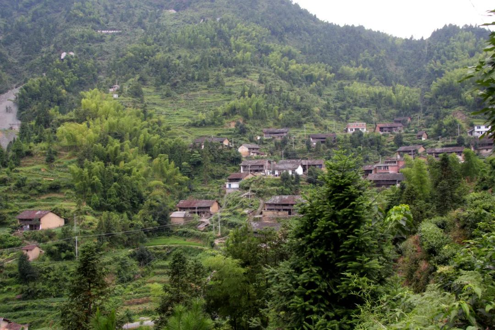 S01-01 | 敕木山 · 村落环境 敕木山山地聚落远景；可观察建筑与山势的关系 | 发布：2022-07-11 拍摄：未注明；网页发布日期不是拍摄日期 1080×721 只能对应村落／组团或未具名单体 | [S01来源页](https://www.lishui.gov.cn/art/2022/7/11/art_1229268129_57336308.html) · [原图](https://www.lishui.gov.cn/cms_files/jcms1/web3657/site/picture/0/77dd96ef1266440bb21595b09cc500a4.jpg) 摄影：未署名 |
| 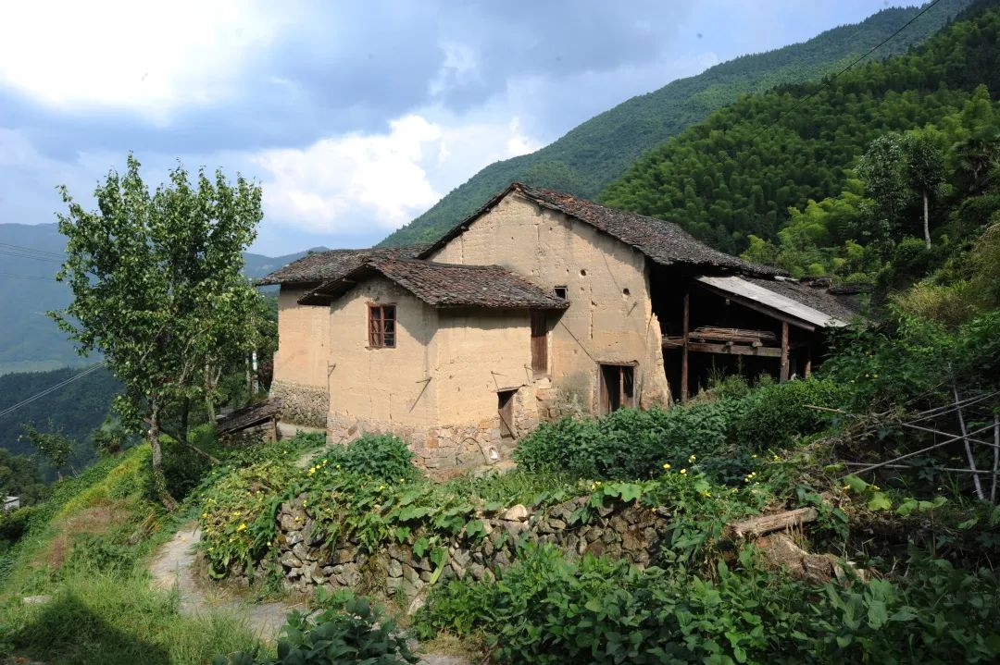 S01-02 | 敕木山 · 民居与构件 官方图注“畲族民居”；土墙、瓦顶及外廊，单体名称未载 | 发布：2022-07-11 拍摄：未注明；网页发布日期不是拍摄日期 1080×719 只能对应村落／组团或未具名单体 | [S01来源页](https://www.lishui.gov.cn/art/2022/7/11/art_1229268129_57336308.html) · [原图](https://www.lishui.gov.cn/cms_files/jcms1/web3657/site/picture/0/2977d60b779c45e69007ad76f47389ce.jpg) 摄影：未署名 |
| 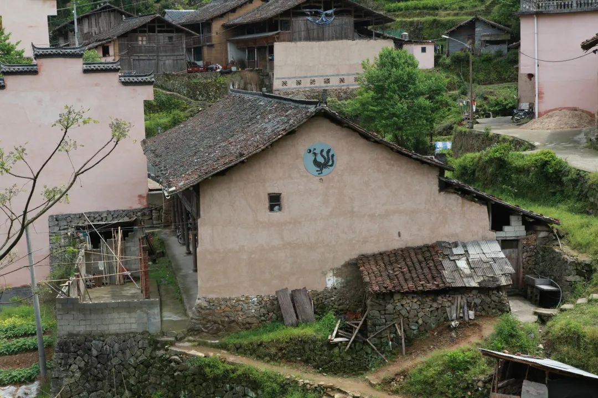 S01-03 | 敕木山 · 民居与构件 官方图注“敕木山村近景”；近处民居山墙及附屋，单体未具名 | 发布：2022-07-11 拍摄：未注明；网页发布日期不是拍摄日期 1080×720 只能对应村落／组团或未具名单体 | [S01来源页](https://www.lishui.gov.cn/art/2022/7/11/art_1229268129_57336308.html) · [原图](https://www.lishui.gov.cn/cms_files/jcms1/web3657/site/picture/0/06e00db3adcf44a886951c91e711df44.jpg) 摄影：未署名 |
| 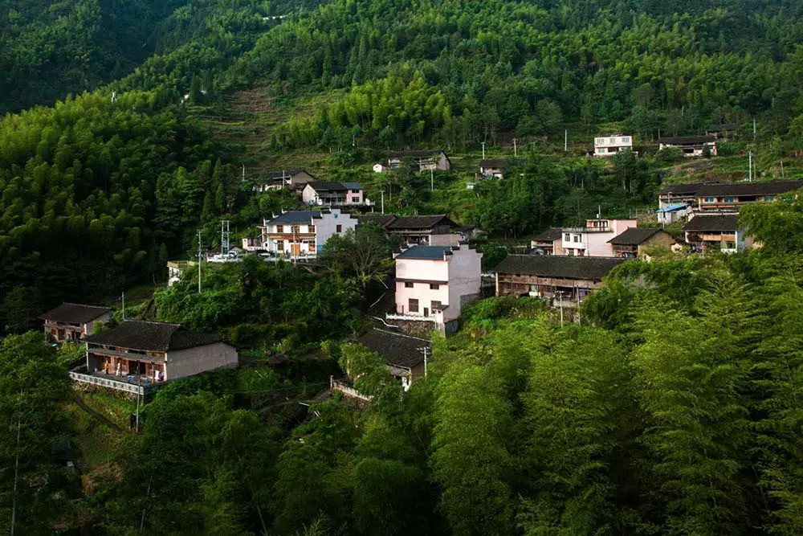 S02-01 | 敕木山 · 村落环境 敕木山房屋随山势分布；单体未具名 | 发布：2018-10-02 拍摄：未注明；网页发布日期不是拍摄日期 1000×667 只能对应村落／组团或未具名单体 | [S02来源页](https://www.sohu.com/a/257397347_100188381) · [原图](http://5b0988e595225.cdn.sohucs.com/images/20181002/f527eb862e924e63b4bd42f88a4f414c.jpeg) 摄影：光林；撰文静珏 |
| 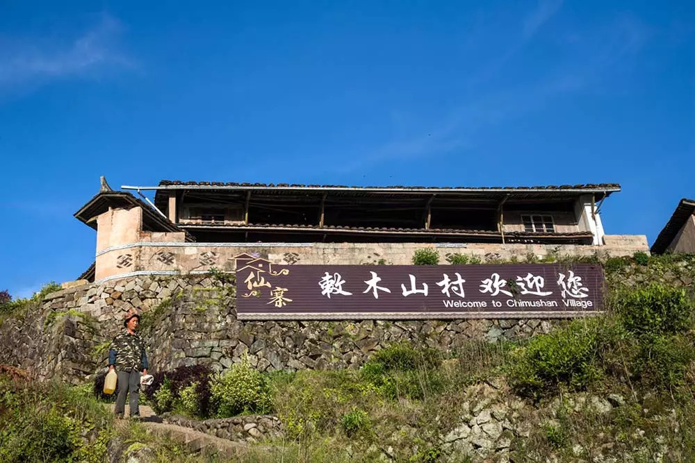 S02-02 | 敕木山 · 民居与构件 带村名欢迎标识的夯土民居外观；不能仅凭标识认定为四幢之一 | 发布：2018-10-02 拍摄：未注明；网页发布日期不是拍摄日期 1000×667 只能对应村落／组团或未具名单体 | [S02来源页](https://www.sohu.com/a/257397347_100188381) · [原图](http://5b0988e595225.cdn.sohucs.com/images/20181002/6ea61402ed434ead8e92974b99a9611b.jpeg) 摄影：光林；撰文静珏 |
| 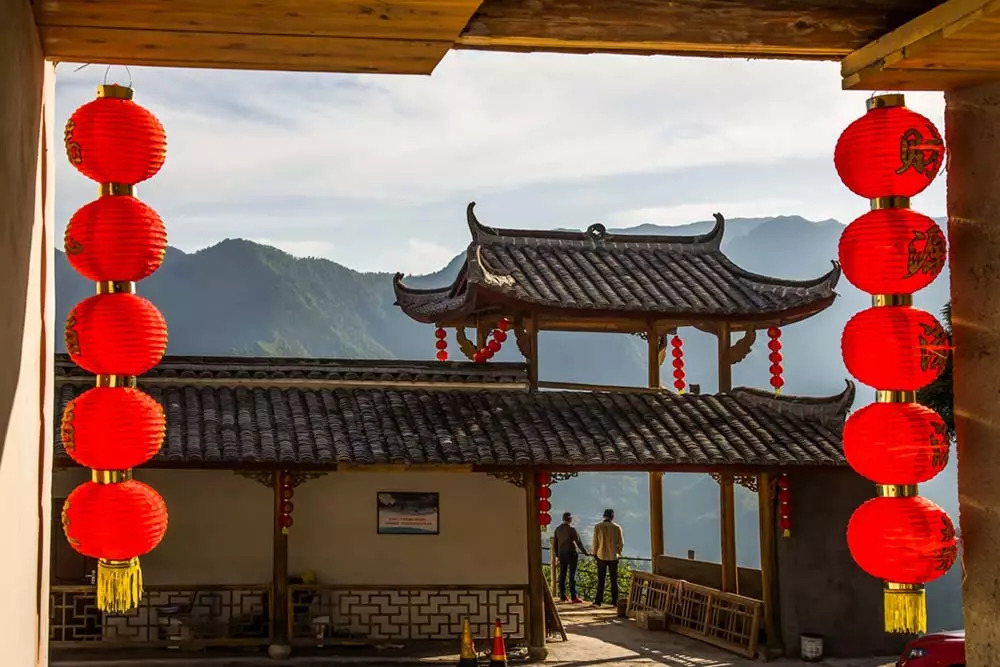 S02-03 | 敕木山 · 待定位 门楼与檐廊相对关系；无单体图注，修建年代待核 | 发布：2018-10-02 拍摄：未注明；网页发布日期不是拍摄日期 1000×667 只能对应村落／组团或未具名单体 | [S02来源页](https://www.sohu.com/a/257397347_100188381) · [原图](http://5b0988e595225.cdn.sohucs.com/images/20181002/809501c61f7b4c999cc65c742465f2ad.jpeg) 摄影：光林；撰文静珏 |
| 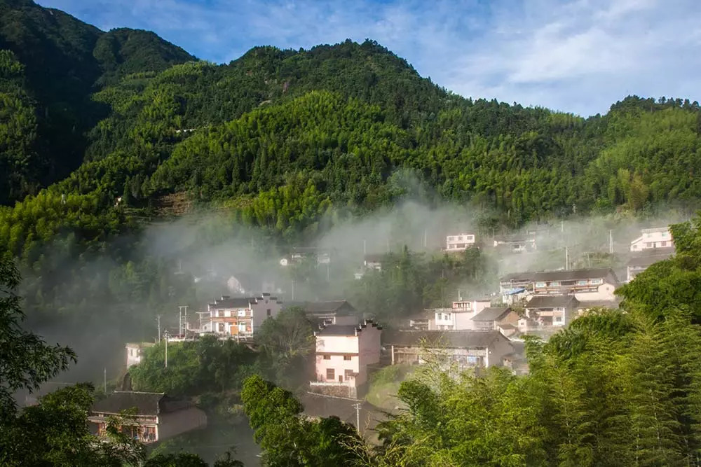 S02-04 | 敕木山 · 村落环境 敕木山房屋随山势分布；单体未具名 | 发布：2018-10-02 拍摄：未注明；网页发布日期不是拍摄日期 1000×667 只能对应村落／组团或未具名单体 | [S02来源页](https://www.sohu.com/a/257397347_100188381) · [原图](http://5b0988e595225.cdn.sohucs.com/images/20181002/175445d3bb8746a79a9401a30a744022.jpeg) 摄影：光林；撰文静珏 |
| 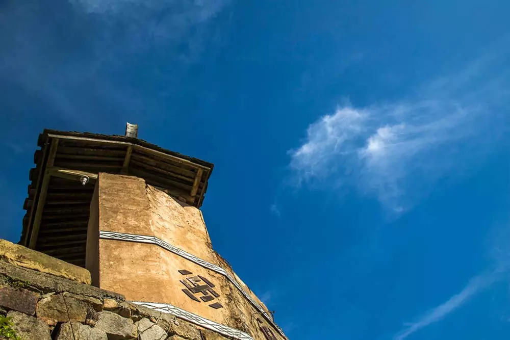 S02-05 | 敕木山 · 民居与构件 土墙转角、屋檐与高差；单体名称未载 | 发布：2018-10-02 拍摄：未注明；网页发布日期不是拍摄日期 1000×667 只能对应村落／组团或未具名单体 | [S02来源页](https://www.sohu.com/a/257397347_100188381) · [原图](http://5b0988e595225.cdn.sohucs.com/images/20181002/bd7c540b8ada424ea40d2ff87cf1ba7a.jpeg) 摄影：光林；撰文静珏 |
| 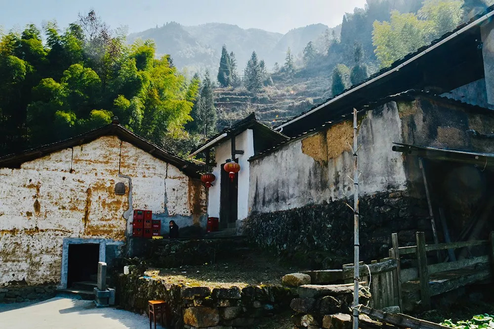 S02-06 | 敕木山 · 村落环境 石阶与老宅院墙；位于史图博旧宅叙述附近，单体身份待核 | 发布：2018-10-02 拍摄：未注明；网页发布日期不是拍摄日期 1000×667 只能对应村落／组团或未具名单体 | [S02来源页](https://www.sohu.com/a/257397347_100188381) · [原图](http://5b0988e595225.cdn.sohucs.com/images/20181002/df82939288b14630a730a8e47e2649cd.jpeg) 摄影：光林；撰文静珏 |
| 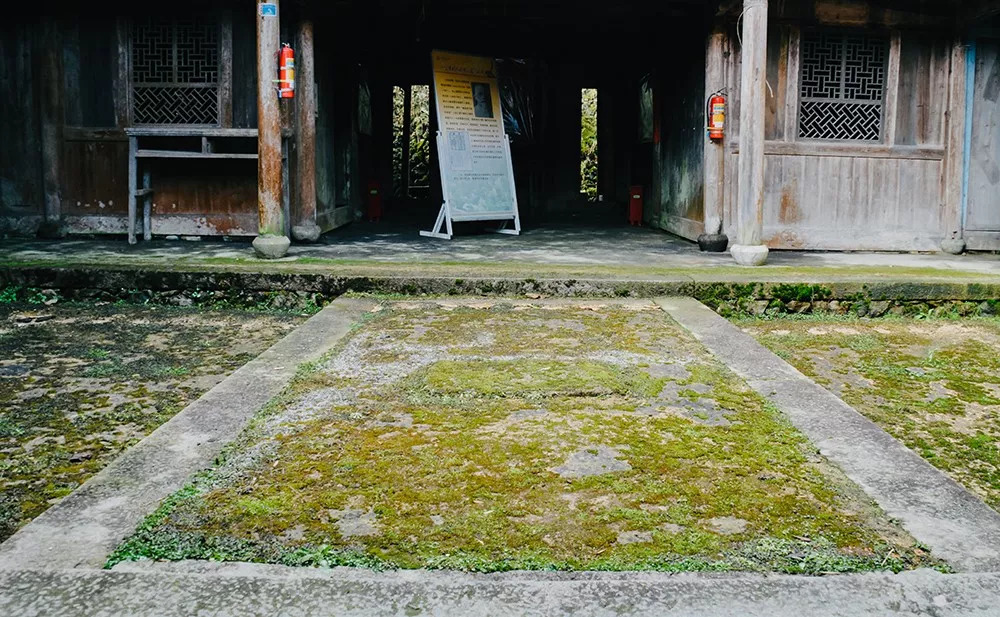 S02-07 | 敕木山 · 旧宅改用 史图博展览馆语境中的木构正屋、格扇与院落；不能自动对应28号 | 发布：2018-10-02 拍摄：未注明；网页发布日期不是拍摄日期 1000×617 相邻段落指向史图博展览馆；与旧宅门牌及蓝文成家关系待档案核实 | [S02来源页](https://www.sohu.com/a/257397347_100188381) · [原图](http://5b0988e595225.cdn.sohucs.com/images/20181002/b2f5cb3a84ab4d2884da9d75e42ec5ef.jpeg) 摄影：光林；撰文静珏 |
| 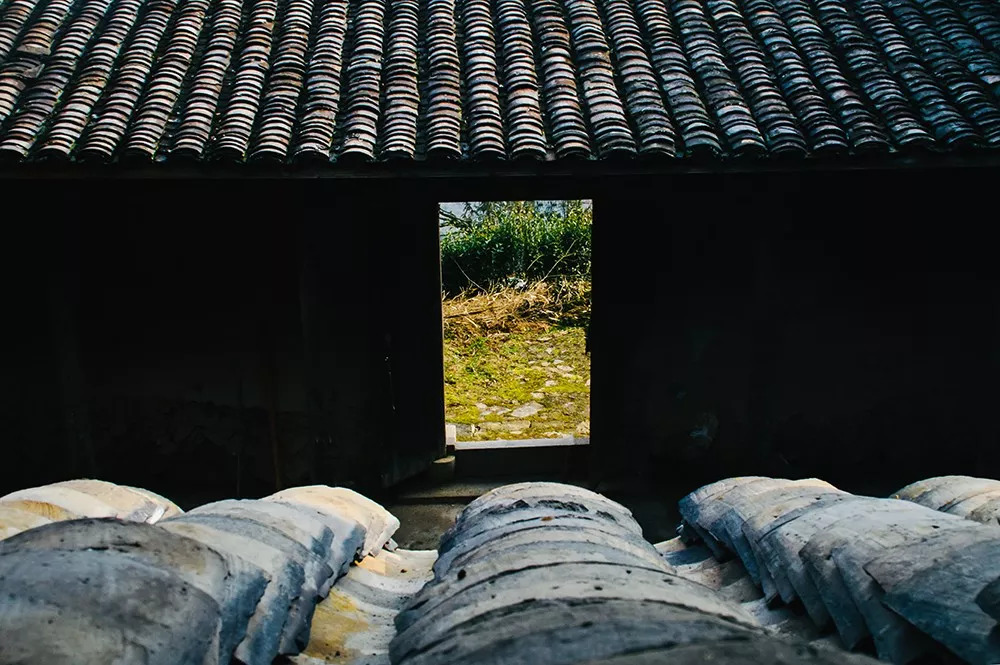 S02-08 | 敕木山 · 民居与构件 从瓦顶望向院墙门洞；据相邻旧宅段落，具体宅名待核 | 发布：2018-10-02 拍摄：未注明；网页发布日期不是拍摄日期 1000×665 只能对应村落／组团或未具名单体 | [S02来源页](https://www.sohu.com/a/257397347_100188381) · [原图](http://5b0988e595225.cdn.sohucs.com/images/20181002/c77827cef7a24377bf5820a9e2196e5d.jpeg) 摄影：光林；撰文静珏 |
| 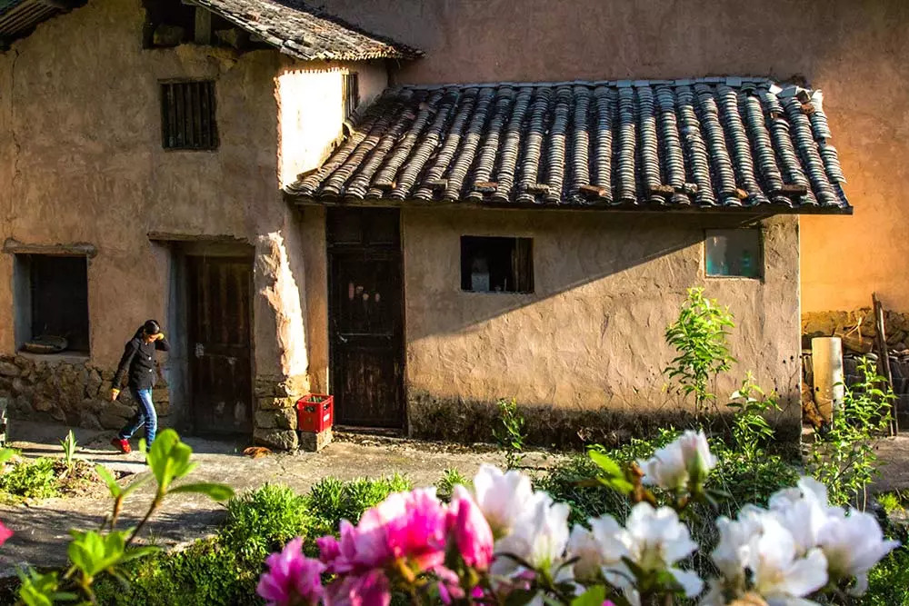 S02-12 | 敕木山 · 民居与构件 土墙小青瓦民居正侧面；可与S01-02作外观比对，尚未实体合并 | 发布：2018-10-02 拍摄：未注明；网页发布日期不是拍摄日期 1000×667 只能对应村落／组团或未具名单体 | [S02来源页](https://www.sohu.com/a/257397347_100188381) · [原图](http://5b0988e595225.cdn.sohucs.com/images/20181002/e44a20012cc9444f89770a6bb2c47a73.jpeg) 摄影：光林；撰文静珏 |
| 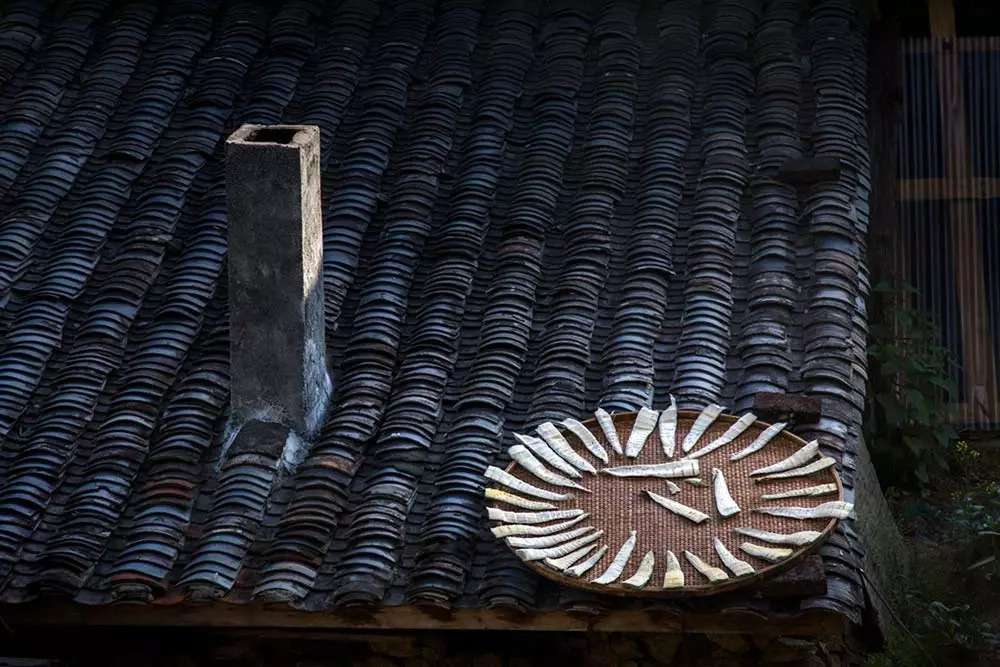 S02-15 | 敕木山 · 民居与构件 瓦屋面及墙面圆形装饰；不据图案认定建造年代 | 发布：2018-10-02 拍摄：未注明；网页发布日期不是拍摄日期 1000×667 只能对应村落／组团或未具名单体 | [S02来源页](https://www.sohu.com/a/257397347_100188381) · [原图](http://5b0988e595225.cdn.sohucs.com/images/20181002/a6ba597509a34f299b9722d5eb21c18d.jpeg) 摄影：光林；撰文静珏 |
| 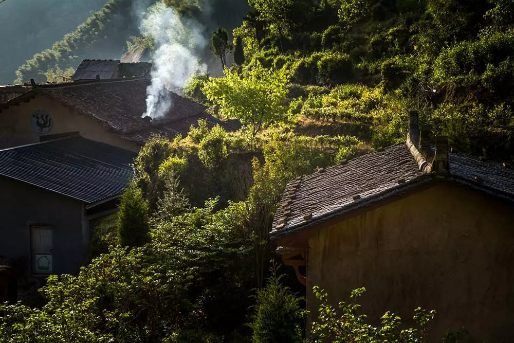 S02-17 | 敕木山 · 村落环境 敕木山房屋随山势分布；单体未具名 | 发布：2018-10-02 拍摄：未注明；网页发布日期不是拍摄日期 1000×667 只能对应村落／组团或未具名单体 | [S02来源页](https://www.sohu.com/a/257397347_100188381) · [原图](http://5b0988e595225.cdn.sohucs.com/images/20181002/d429212833bc4839bd5d0d93261ab8fb.jpeg) 摄影：光林；撰文静珏 |
| 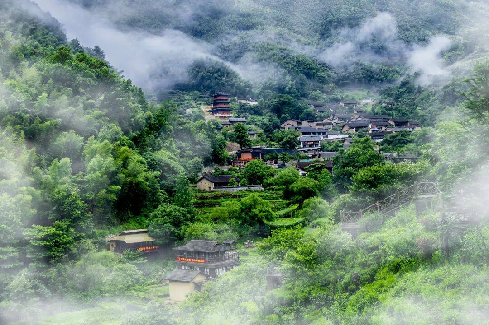 S03-01 | 东弄 · 村落环境 东弄全景：传统聚落与近年旅游建筑同框；不能把画面建筑全部算作遗存 | 发布：2026-02-06 拍摄：未注明；网页发布日期不是拍摄日期 1080×720 只能对应村落／组团或未具名单体 | [S03来源页](https://www.sohu.com/a/984593291_121106994) · [原图](https://q7.itc.cn/q_70/images03/20260206/7f569e6d5d1f4405a06221923444e9cd.jpeg) 摄影：未署名 |
| 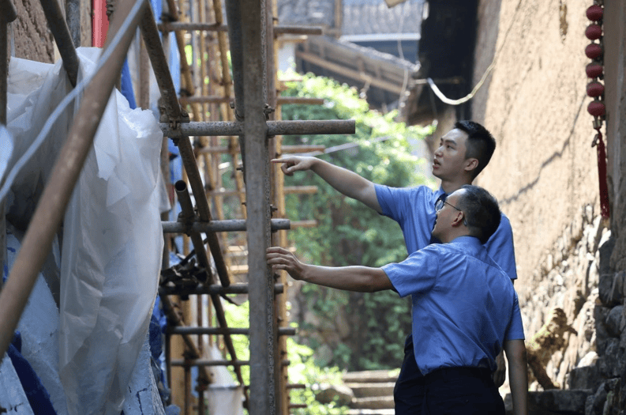 S03-04 | 景宁（具体村落未标） · 待定位 检察人员察看老墙、木构或支撑；报道未逐图标明具体村落／房屋 | 发布：2026-02-06 拍摄：未注明；网页发布日期不是拍摄日期 793×525 仅能对应报道的老屋检查场景，不指定为东弄或敕木山 | [S03来源页](https://www.sohu.com/a/984593291_121106994) · [原图](https://q5.itc.cn/q_70/images03/20260206/370f6f4fd28540e7b7de05acdbdf4515.png) 摄影：未署名 |
| 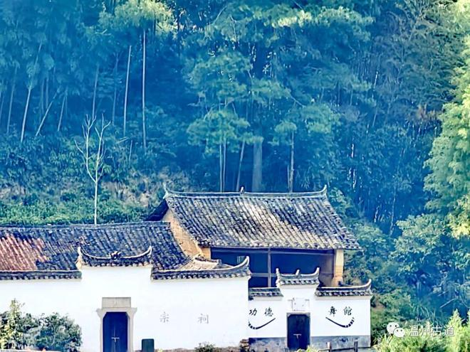 S04-03 | 东弄 · 公共建筑 蓝氏宗祠外观候选：紧接正文宗祠段落，画面可见宗祠／功德寿院字样；并列保留对应待核 | 发布：2023-11-27 拍摄：未注明；网页发布日期不是拍摄日期 660×495 宗祠段落与画面文字支持候选对应；仍待门牌／档案核对 | [S04来源页](https://www.163.com/dy/article/IKID55FB0544AW5X.html) · [原图](https://nimg.ws.126.net/?url=http%3A%2F%2Fdingyue.ws.126.net%2F2023%2F1127%2F964e6cc1j00s4rsdw004wd200u000mig00it00e3.jpg&thumbnail=660x2147483647&quality=80&type=jpg) 摄影：叶望庆 |
| 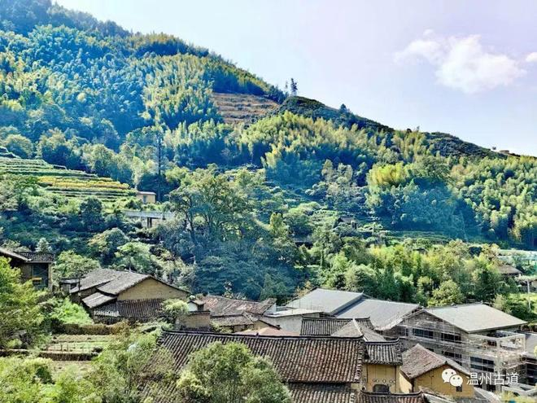 S04-04 | 东弄 · 村落环境 东弄传统民居成组外观；没有逐栋名称或编号 | 发布：2023-11-27 拍摄：未注明；网页发布日期不是拍摄日期 660×495 只能对应村落／组团或未具名单体 | [S04来源页](https://www.163.com/dy/article/IKID55FB0544AW5X.html) · [原图](https://nimg.ws.126.net/?url=http%3A%2F%2Fdingyue.ws.126.net%2F2023%2F1127%2Fa4fc48a0j00s4rsdw006hd200u000mig00it00e3.jpg&thumbnail=660x2147483647&quality=80&type=jpg) 摄影：叶望庆 |
| 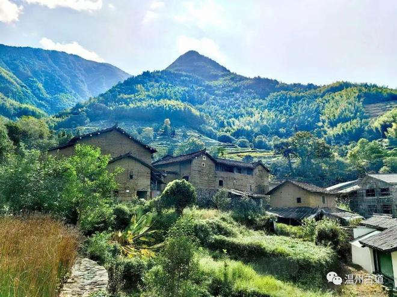 S04-05 | 东弄 · 村落环境 东弄传统民居成组外观；没有逐栋名称或编号 | 发布：2023-11-27 拍摄：未注明；网页发布日期不是拍摄日期 660×495 只能对应村落／组团或未具名单体 | [S04来源页](https://www.163.com/dy/article/IKID55FB0544AW5X.html) · [原图](https://nimg.ws.126.net/?url=http%3A%2F%2Fdingyue.ws.126.net%2F2023%2F1127%2F2b584a1ej00s4rsdx005ud200u000mig00it00e3.jpg&thumbnail=660x2147483647&quality=80&type=jpg) 摄影：叶望庆 |
| 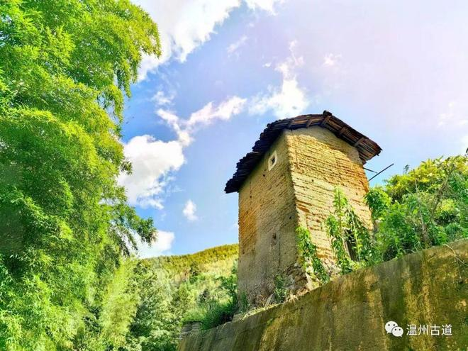 S04-07 | 东弄 · 民居与构件 夯土建筑山墙、石墙及屋檐；单体未具名 | 发布：2023-11-27 拍摄：未注明；网页发布日期不是拍摄日期 660×495 只能对应村落／组团或未具名单体 | [S04来源页](https://www.163.com/dy/article/IKID55FB0544AW5X.html) · [原图](https://nimg.ws.126.net/?url=http%3A%2F%2Fdingyue.ws.126.net%2F2023%2F1127%2F87d3f4a6j00s4rsdy005fd200u000mig00it00e3.jpg&thumbnail=660x2147483647&quality=80&type=jpg) 摄影：叶望庆 |
| 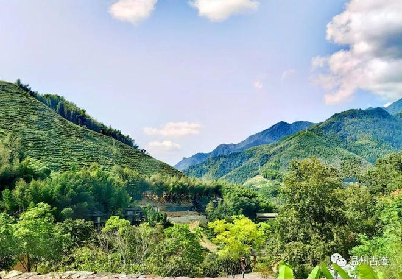 S04-08 | 东弄 · 村落环境 东弄传统民居成组外观；没有逐栋名称或编号 | 发布：2023-11-27 拍摄：未注明；网页发布日期不是拍摄日期 660×458 只能对应村落／组团或未具名单体 | [S04来源页](https://www.163.com/dy/article/IKID55FB0544AW5X.html) · [原图](https://nimg.ws.126.net/?url=http%3A%2F%2Fdingyue.ws.126.net%2F2023%2F1127%2F5966de34j00s4rsdy0056d200u000ktg00g200b4.jpg&thumbnail=660x2147483647&quality=80&type=jpg) 摄影：叶望庆 |
| 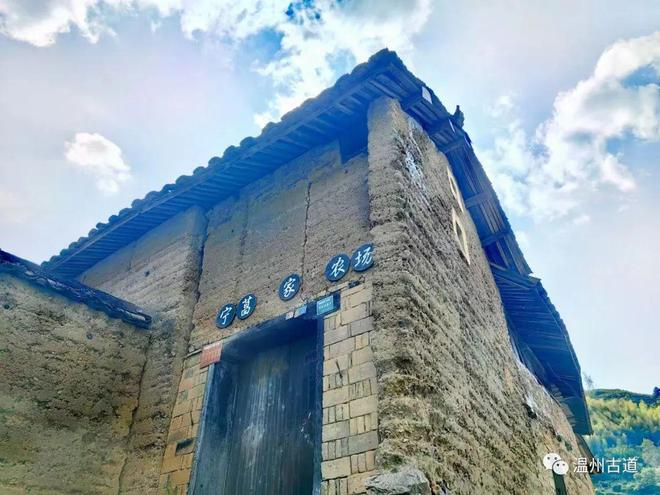 S04-09 | 东弄 · 旧宅改用 彩带相关展示空间的外墙、入口；未与蓝坤宝寮对应 | 发布：2023-11-27 拍摄：未注明；网页发布日期不是拍摄日期 660×495 只能对应村落／组团或未具名单体 | [S04来源页](https://www.163.com/dy/article/IKID55FB0544AW5X.html) · [原图](https://nimg.ws.126.net/?url=http%3A%2F%2Fdingyue.ws.126.net%2F2023%2F1127%2F5775c334j00s4rsdz003zd200u000mig00it00e3.jpg&thumbnail=660x2147483647&quality=80&type=jpg) 摄影：叶望庆 |
| 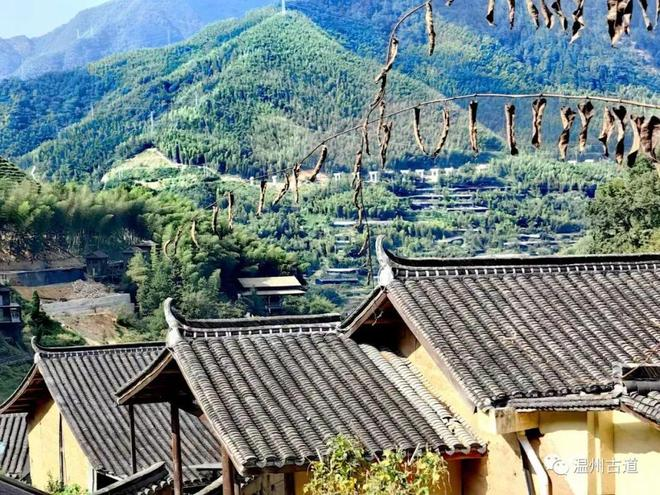 S04-11 | 东弄 · 民居与构件 连续瓦屋面及檐口；无法据画面确定独立建筑栋数 | 发布：2023-11-27 拍摄：未注明；网页发布日期不是拍摄日期 660×495 只能对应村落／组团或未具名单体 | [S04来源页](https://www.163.com/dy/article/IKID55FB0544AW5X.html) · [原图](https://nimg.ws.126.net/?url=http%3A%2F%2Fdingyue.ws.126.net%2F2023%2F1127%2Fee4fdf42j00s4rse0006xd200u000mig00g200c1.jpg&thumbnail=660x2147483647&quality=80&type=jpg) 摄影：叶望庆 |
| 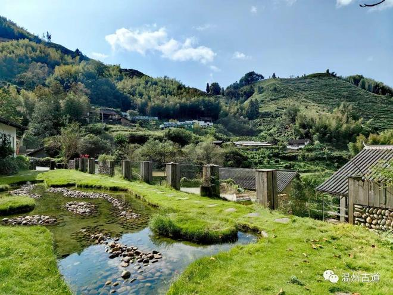 S04-12 | 东弄 · 村落环境 水体、坡地和建筑边界；作为聚落环境辅助 | 发布：2023-11-27 拍摄：未注明；网页发布日期不是拍摄日期 660×495 只能对应村落／组团或未具名单体 | [S04来源页](https://www.163.com/dy/article/IKID55FB0544AW5X.html) · [原图](https://nimg.ws.126.net/?url=http%3A%2F%2Fdingyue.ws.126.net%2F2023%2F1127%2F02deaa74j00s4rse1005wd200u000mig00it00e3.jpg&thumbnail=660x2147483647&quality=80&type=jpg) 摄影：叶望庆 |
| 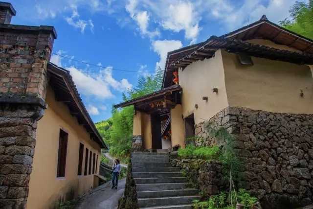 S05-03 | 大张坑 · 民居与构件 大张坑民居与石阶巷道；原文无单体名称 | 发布：2026-06-29 拍摄：未注明；网页发布日期不是拍摄日期 640×427 只能对应村落／组团或未具名单体 | [S05来源页](https://news.qq.com/rain/a/20260629A025AT00) · [原图](https://inews.gtimg.com/news_bt/OxdVDLhTcfbZy2rLM0WMEHlQ2IsrCVpj3n-webAq1mr2kAA/641) 摄影：未署名；文章作者严慧荣 |
| 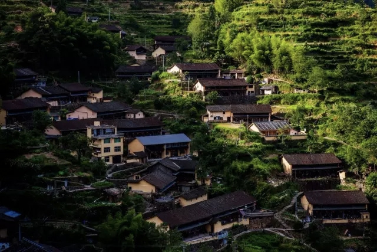 S05-06 | 大张坑 · 村落环境 大张坑村落及民居组团；发布于2026年，照片拍摄日未注明 | 发布：2026-06-29 拍摄：未注明；网页发布日期不是拍摄日期 640×427 只能对应村落／组团或未具名单体 | [S05来源页](https://news.qq.com/rain/a/20260629A025AT00) · [原图](https://inews.gtimg.com/news_bt/OZl_Ck3EznrYrKoXoVvLYb2CnXrP4SGZ99KSnu8vYAv4cAA/641) 摄影：未署名；文章作者严慧荣 |
| 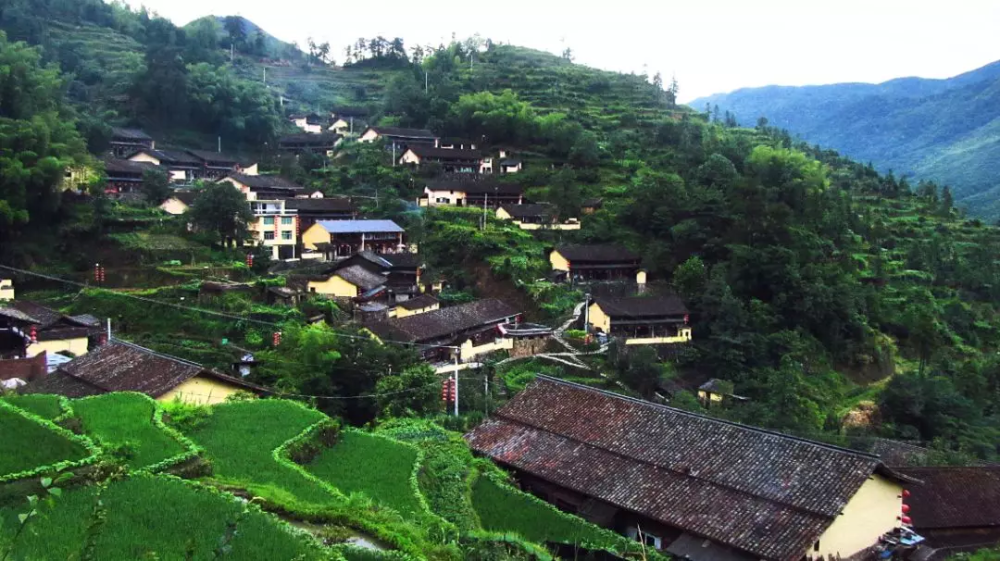 S05-07 | 大张坑 · 村落环境 大张坑村落及民居组团；发布于2026年，照片拍摄日未注明 | 发布：2026-06-29 拍摄：未注明；网页发布日期不是拍摄日期 1000×561 只能对应村落／组团或未具名单体 | [S05来源页](https://news.qq.com/rain/a/20260629A025AT00) · [原图](https://inews.gtimg.com/news_bt/O964szibR2v3hvLYSXHbpXSAOa-LFQaAr5VHjUiADNQ6cAA/1000) 摄影：未署名；文章作者严慧荣 |
| 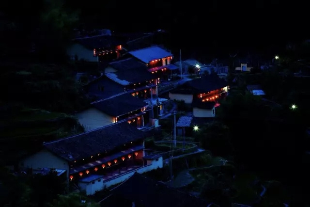 S05-08 | 大张坑 · 村落环境 大张坑村落及民居组团；发布于2026年，照片拍摄日未注明 | 发布：2026-06-29 拍摄：未注明；网页发布日期不是拍摄日期 640×427 只能对应村落／组团或未具名单体 | [S05来源页](https://news.qq.com/rain/a/20260629A025AT00) · [原图](https://inews.gtimg.com/news_bt/O559l1sCs-4ZZgaEjin3fY2ucUt_1YjINIevJp4UEb7-cAA/641) 摄影：未署名；文章作者严慧荣 |
| 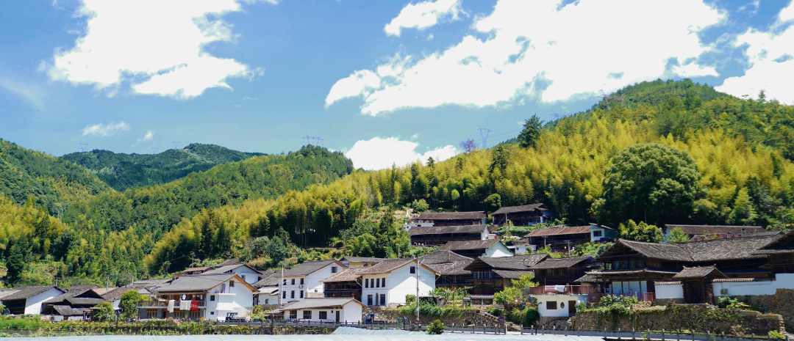 S06-03 | 桃源 · 村落环境 桃源沿溪聚落全景；新旧建筑同框 | 发布：2026-07-10 拍摄：未注明；网页发布日期不是拍摄日期 1080×465 只能对应村落／组团或未具名单体 | [S06来源页](http://www.jnnews.zj.cn/syzx/202607/t20260710_7546909.shtml) · [原图](https://jnpubmeizi.tmuyun.com/17380647290948.jpg) 摄影：页面合署：小红书用户游尙一、汪亚奇、木音、我可以是亚哈，记者陈文浩、蓝婷婷；未逐图对应 |
| 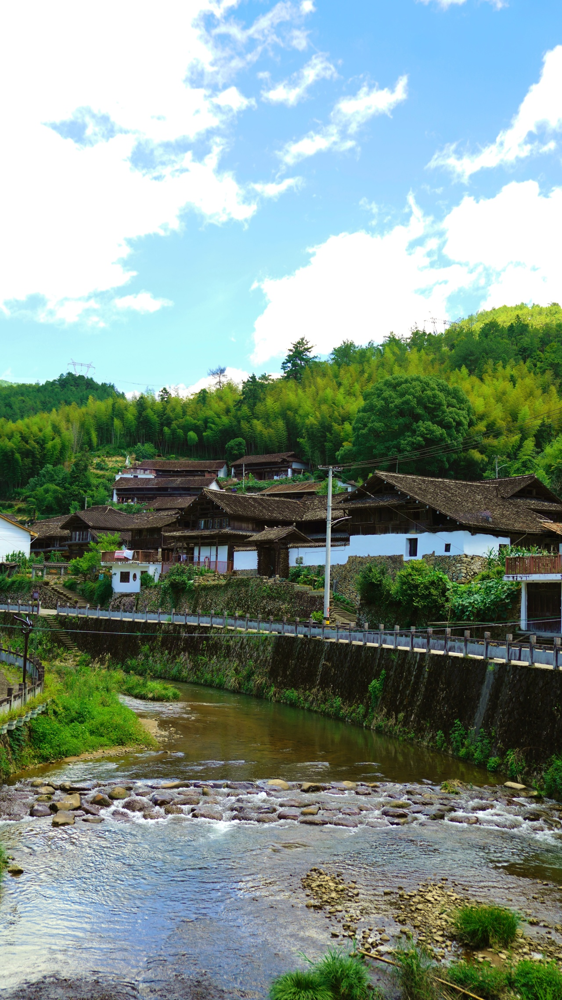 S06-04 | 桃源 · 村落环境 桃源沿溪聚落全景；新旧建筑同框 | 发布：2026-07-10 拍摄：未注明；网页发布日期不是拍摄日期 1280×2275 只能对应村落／组团或未具名单体 | [S06来源页](http://www.jnnews.zj.cn/syzx/202607/t20260710_7546909.shtml) · [原图](https://jnpubmeizi.tmuyun.com/17380647290501.jpg) 摄影：页面合署：小红书用户游尙一、汪亚奇、木音、我可以是亚哈，记者陈文浩、蓝婷婷；未逐图对应 |
| 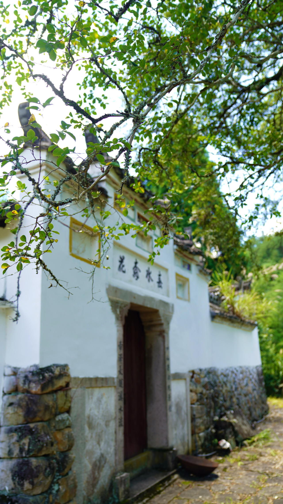 S06-12 | 桃源 · 公共建筑 五显爷殿段落配图：门楼、院墙、盘龙柱或彩绘；非住宅，逐构件修缮年代未明 | 发布：2026-07-10 拍摄：未注明；网页发布日期不是拍摄日期 1280×2275 只能对应村落／组团或未具名单体 | [S06来源页](http://www.jnnews.zj.cn/syzx/202607/t20260710_7546909.shtml) · [原图](https://jnpubmeizi.tmuyun.com/17380647308100.jpg) 摄影：页面合署：小红书用户游尙一、汪亚奇、木音、我可以是亚哈，记者陈文浩、蓝婷婷；未逐图对应 |
| 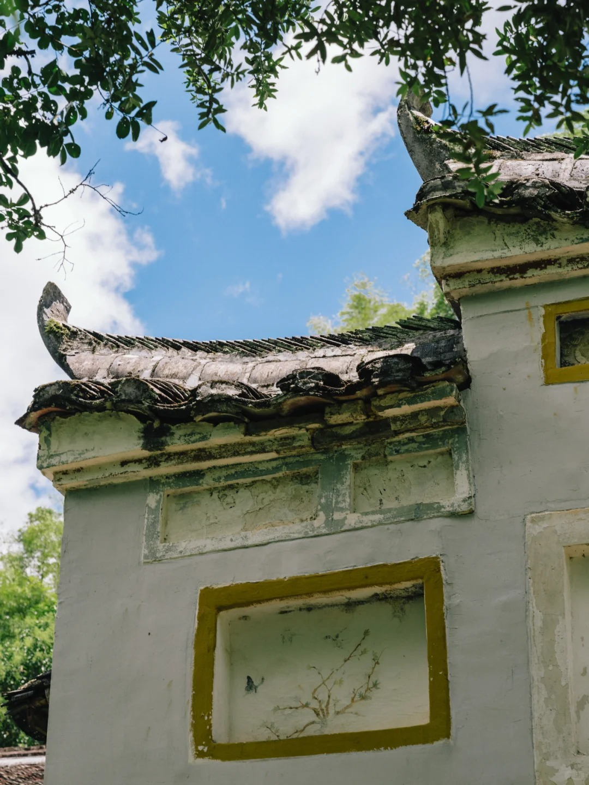 S06-13 | 桃源 · 公共建筑 五显爷殿段落配图：门楼、院墙、盘龙柱或彩绘；非住宅，逐构件修缮年代未明 | 发布：2026-07-10 拍摄：未注明；网页发布日期不是拍摄日期 1080×1439 只能对应村落／组团或未具名单体 | [S06来源页](http://www.jnnews.zj.cn/syzx/202607/t20260710_7546909.shtml) · [原图](https://jnpubmeizi.tmuyun.com/17380647290628.jpg) 摄影：页面合署：小红书用户游尙一、汪亚奇、木音、我可以是亚哈，记者陈文浩、蓝婷婷；未逐图对应 |
| 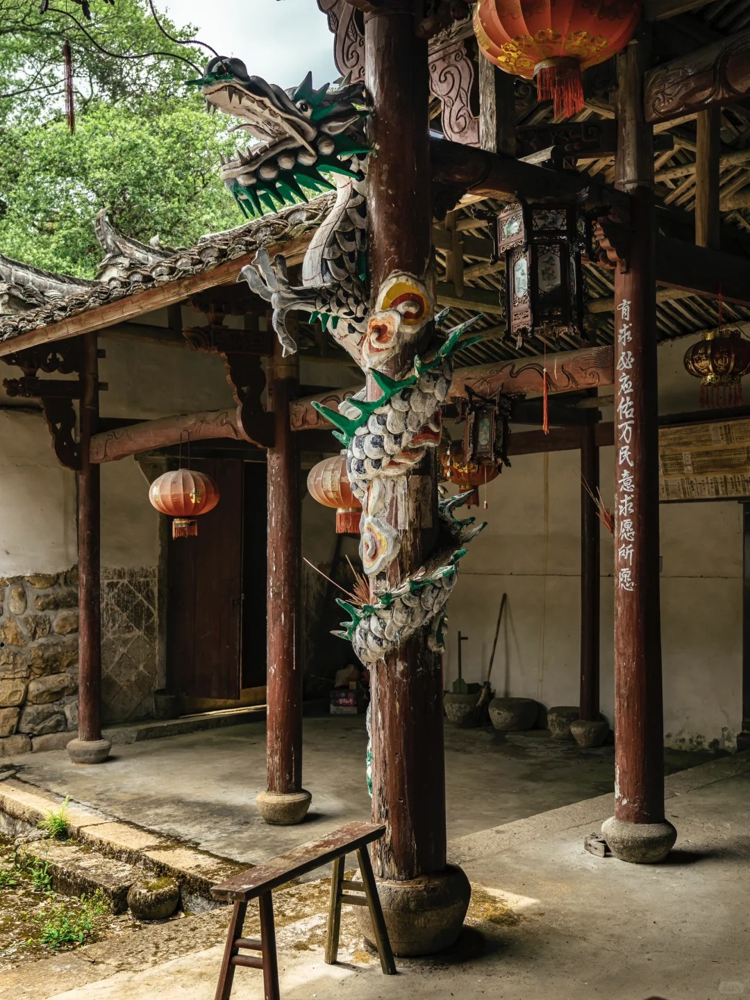 S06-14 | 桃源 · 公共建筑 五显爷殿段落配图：门楼、院墙、盘龙柱或彩绘；非住宅，逐构件修缮年代未明 | 发布：2026-07-10 拍摄：未注明；网页发布日期不是拍摄日期 1080×1440 只能对应村落／组团或未具名单体 | [S06来源页](http://www.jnnews.zj.cn/syzx/202607/t20260710_7546909.shtml) · [原图](https://jnpubmeizi.tmuyun.com/17380647338244.jpg) 摄影：页面合署：小红书用户游尙一、汪亚奇、木音、我可以是亚哈，记者陈文浩、蓝婷婷；未逐图对应 |
| 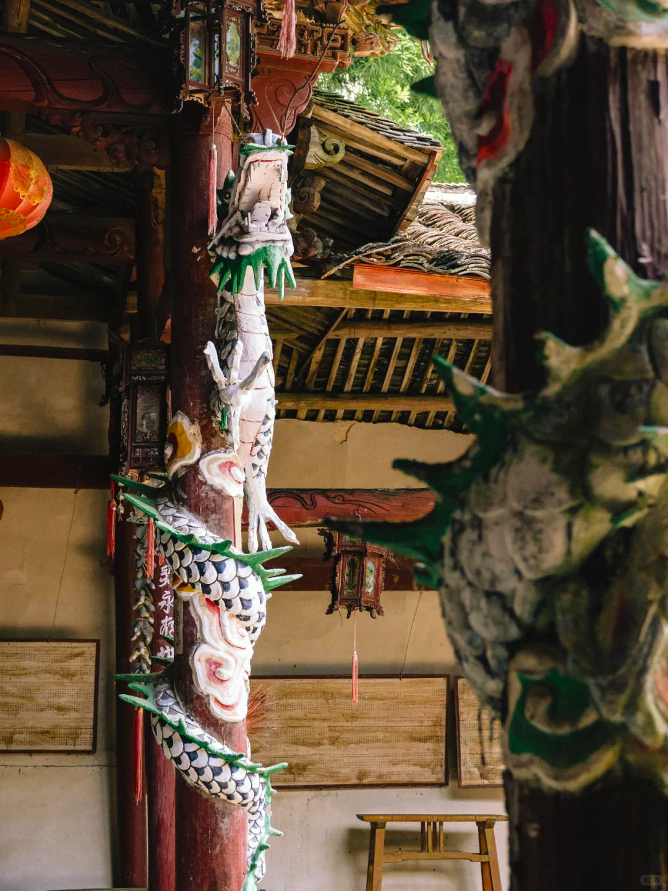 S06-15 | 桃源 · 公共建筑 五显爷殿段落配图：门楼、院墙、盘龙柱或彩绘；非住宅，逐构件修缮年代未明 | 发布：2026-07-10 拍摄：未注明；网页发布日期不是拍摄日期 1080×1439 只能对应村落／组团或未具名单体 | [S06来源页](http://www.jnnews.zj.cn/syzx/202607/t20260710_7546909.shtml) · [原图](https://jnpubmeizi.tmuyun.com/17380647329156.jpg) 摄影：页面合署：小红书用户游尙一、汪亚奇、木音、我可以是亚哈，记者陈文浩、蓝婷婷；未逐图对应 |
| 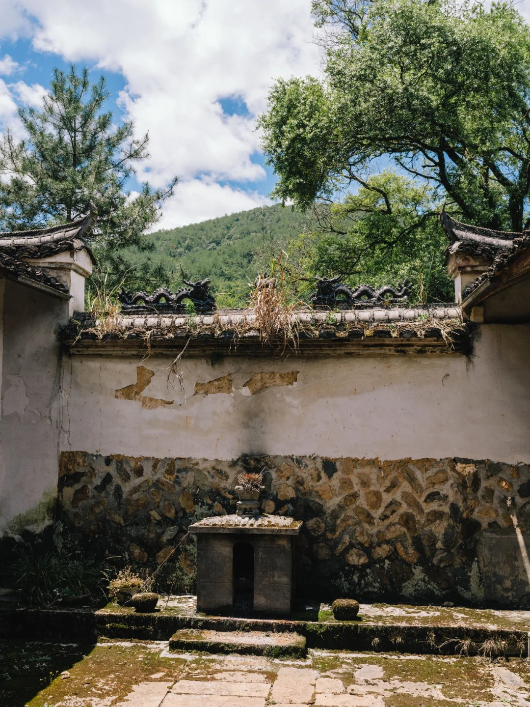 S06-16 | 桃源 · 公共建筑 五显爷殿段落配图：门楼、院墙、盘龙柱或彩绘；非住宅，逐构件修缮年代未明 | 发布：2026-07-10 拍摄：未注明；网页发布日期不是拍摄日期 1080×1439 只能对应村落／组团或未具名单体 | [S06来源页](http://www.jnnews.zj.cn/syzx/202607/t20260710_7546909.shtml) · [原图](https://jnpubmeizi.tmuyun.com/17380647307204.jpg) 摄影：页面合署：小红书用户游尙一、汪亚奇、木音、我可以是亚哈，记者陈文浩、蓝婷婷；未逐图对应 |
| 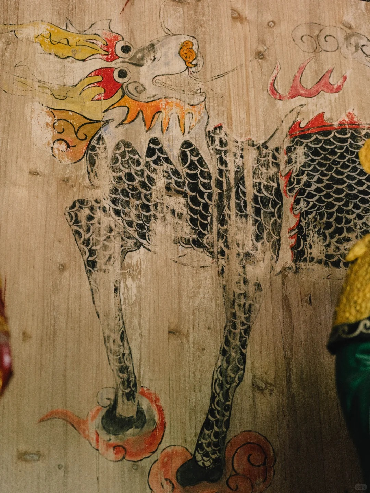 S06-17 | 桃源 · 公共建筑 五显爷殿段落配图：门楼、院墙、盘龙柱或彩绘；非住宅，逐构件修缮年代未明 | 发布：2026-07-10 拍摄：未注明；网页发布日期不是拍摄日期 1080×1439 只能对应村落／组团或未具名单体 | [S06来源页](http://www.jnnews.zj.cn/syzx/202607/t20260710_7546909.shtml) · [原图](https://jnpubmeizi.tmuyun.com/17380647328004.jpg) 摄影：页面合署：小红书用户游尙一、汪亚奇、木音、我可以是亚哈，记者陈文浩、蓝婷婷；未逐图对应 |
| 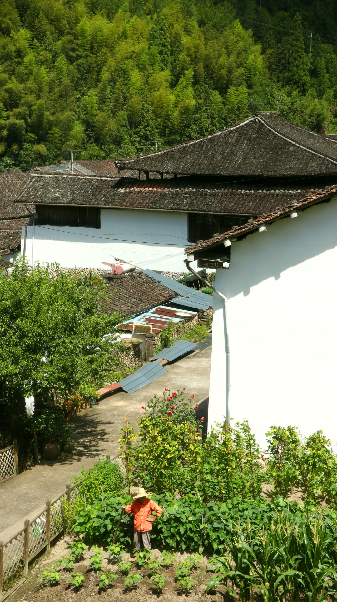 S06-19 | 桃源 · 民居与构件 桃源民居屋面与侧墙；单体年代待核 | 发布：2026-07-10 拍摄：未注明；网页发布日期不是拍摄日期 1280×2280 只能对应村落／组团或未具名单体 | [S06来源页](http://www.jnnews.zj.cn/syzx/202607/t20260710_7546909.shtml) · [原图](https://jnpubmeizi.tmuyun.com/17380647327812.jpg) 摄影：页面合署：小红书用户游尙一、汪亚奇、木音、我可以是亚哈，记者陈文浩、蓝婷婷；未逐图对应 |
| 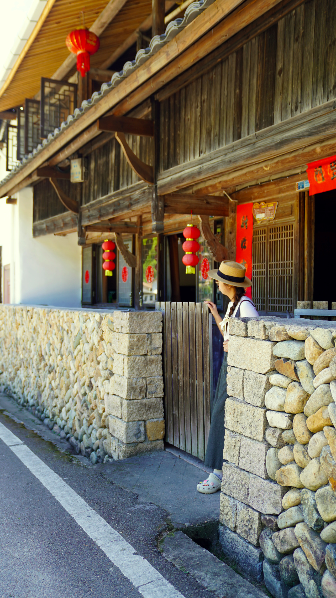 S06-20 | 桃源 · 民居与构件 沿街民居木构檐廊、木板壁与石砌矮墙；未具名 | 发布：2026-07-10 拍摄：未注明；网页发布日期不是拍摄日期 1280×2275 只能对应村落／组团或未具名单体 | [S06来源页](http://www.jnnews.zj.cn/syzx/202607/t20260710_7546909.shtml) · [原图](https://jnpubmeizi.tmuyun.com/17380647306372.jpg) 摄影：页面合署：小红书用户游尙一、汪亚奇、木音、我可以是亚哈，记者陈文浩、蓝婷婷；未逐图对应 |
| 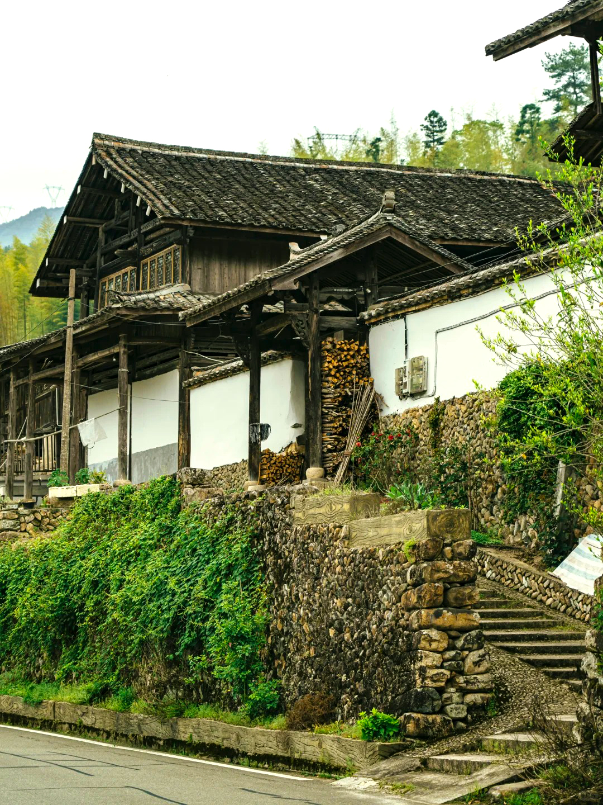 S06-21 | 桃源 · 民居与构件 坡地民居整体：石台基、木构上层及瓦屋顶；未具名 | 发布：2026-07-10 拍摄：未注明；网页发布日期不是拍摄日期 1080×1440 只能对应村落／组团或未具名单体 | [S06来源页](http://www.jnnews.zj.cn/syzx/202607/t20260710_7546909.shtml) · [原图](https://jnpubmeizi.tmuyun.com/17380647290693.jpg) 摄影：页面合署：小红书用户游尙一、汪亚奇、木音、我可以是亚哈，记者陈文浩、蓝婷婷；未逐图对应 |
| 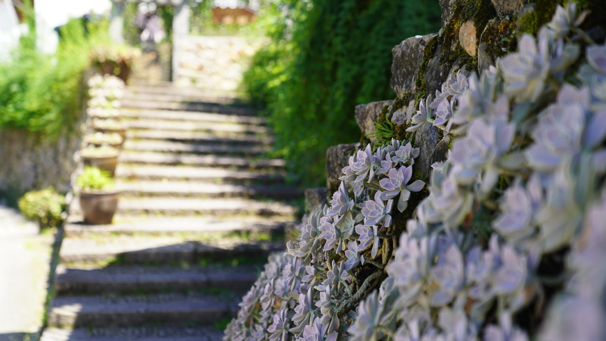 S06-22 | 桃源 · 村落环境 石阶巷道与石砌围墙；与单体身份未对应 | 发布：2026-07-10 拍摄：未注明；网页发布日期不是拍摄日期 1280×720 只能对应村落／组团或未具名单体 | [S06来源页](http://www.jnnews.zj.cn/syzx/202607/t20260710_7546909.shtml) · [原图](https://jnpubmeizi.tmuyun.com/17380647325188.jpg) 摄影：页面合署：小红书用户游尙一、汪亚奇、木音、我可以是亚哈，记者陈文浩、蓝婷婷；未逐图对应 |
| 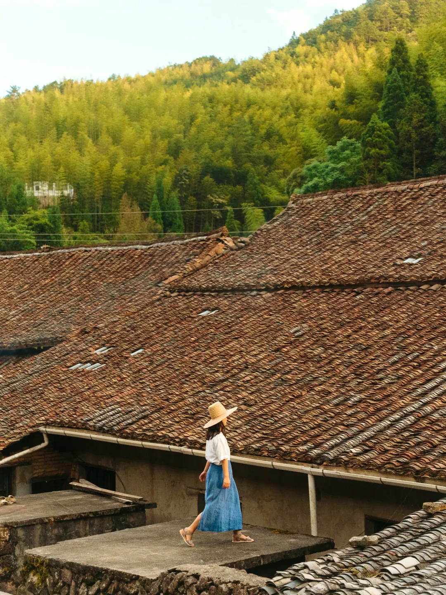 S06-23 | 桃源 · 民居与构件 民居瓦屋面及檐口；照片含游人，不据人物推定建筑规模 | 发布：2026-07-10 拍摄：未注明；网页发布日期不是拍摄日期 1080×1440 只能对应村落／组团或未具名单体 | [S06来源页](http://www.jnnews.zj.cn/syzx/202607/t20260710_7546909.shtml) · [原图](https://jnpubmeizi.tmuyun.com/17380647290820.jpg) 摄影：页面合署：小红书用户游尙一、汪亚奇、木音、我可以是亚哈，记者陈文浩、蓝婷婷；未逐图对应 |
| 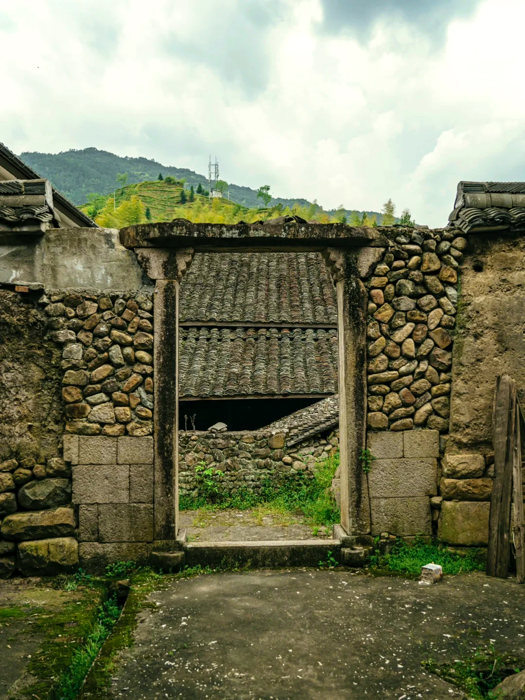 S06-24 | 桃源 · 民居与构件 石砌围墙门洞与后方瓦顶；住宅名称待核 | 发布：2026-07-10 拍摄：未注明；网页发布日期不是拍摄日期 1080×1440 只能对应村落／组团或未具名单体 | [S06来源页](http://www.jnnews.zj.cn/syzx/202607/t20260710_7546909.shtml) · [原图](https://jnpubmeizi.tmuyun.com/17380647324100.jpg) 摄影：页面合署：小红书用户游尙一、汪亚奇、木音、我可以是亚哈，记者陈文浩、蓝婷婷；未逐图对应 |
| 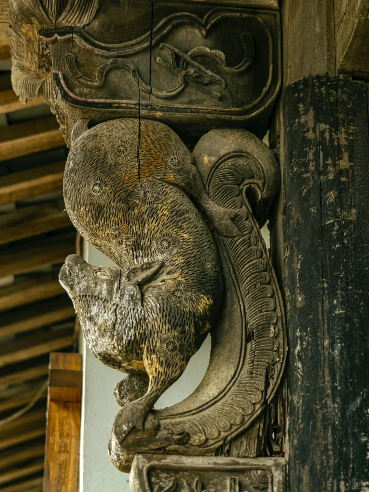 S06-25 | 桃源 · 民居与构件 雕花牛腿构件特写；所在住宅未具名，不作独立建筑计数 | 发布：2026-07-10 拍摄：未注明；网页发布日期不是拍摄日期 1080×1440 只能对应村落／组团或未具名单体 | [S06来源页](http://www.jnnews.zj.cn/syzx/202607/t20260710_7546909.shtml) · [原图](https://jnpubmeizi.tmuyun.com/17380647323780.jpg) 摄影：页面合署：小红书用户游尙一、汪亚奇、木音、我可以是亚哈，记者陈文浩、蓝婷婷；未逐图对应 |
| 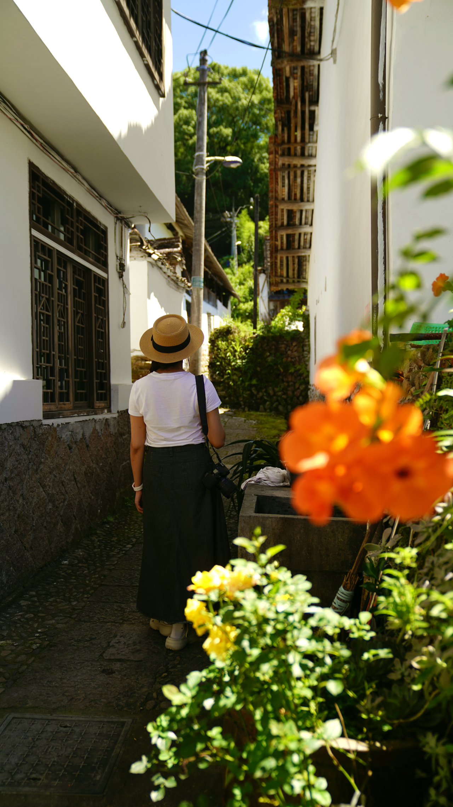 S06-26 | 桃源 · 村落环境 民居街巷、墙体和屋檐关系；画面存在修缮／新建部分 | 发布：2026-07-10 拍摄：未注明；网页发布日期不是拍摄日期 1280×2275 只能对应村落／组团或未具名单体 | [S06来源页](http://www.jnnews.zj.cn/syzx/202607/t20260710_7546909.shtml) · [原图](https://jnpubmeizi.tmuyun.com/17380647290629.jpg) 摄影：页面合署：小红书用户游尙一、汪亚奇、木音、我可以是亚哈，记者陈文浩、蓝婷婷；未逐图对应 |
| 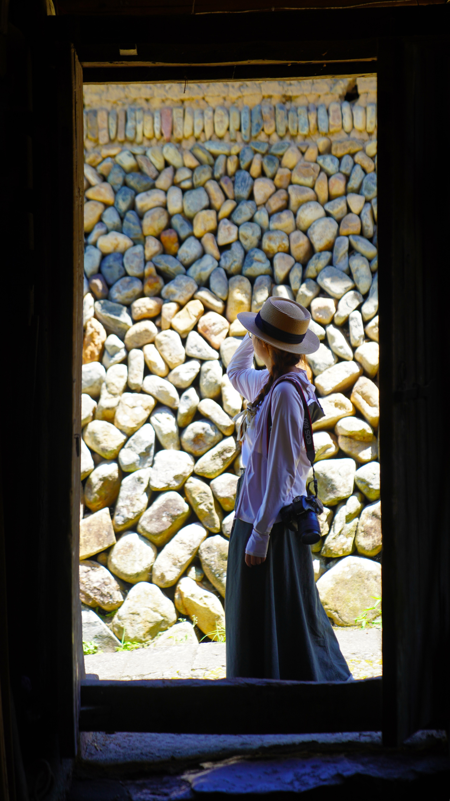 S06-27 | 桃源 · 民居与构件 由木窗向外看石墙的空间关系；未具名 | 发布：2026-07-10 拍摄：未注明；网页发布日期不是拍摄日期 1280×2275 只能对应村落／组团或未具名单体 | [S06来源页](http://www.jnnews.zj.cn/syzx/202607/t20260710_7546909.shtml) · [原图](https://jnpubmeizi.tmuyun.com/17380647290692.jpg) 摄影：页面合署：小红书用户游尙一、汪亚奇、木音、我可以是亚哈，记者陈文浩、蓝婷婷；未逐图对应 |
| 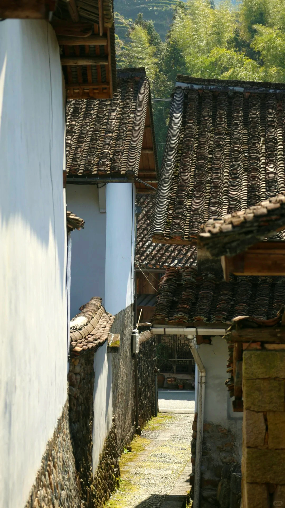 S06-28 | 桃源 · 村落环境 民居街巷、墙体和屋檐关系；画面存在修缮／新建部分 | 发布：2026-07-10 拍摄：未注明；网页发布日期不是拍摄日期 1080×1923 只能对应村落／组团或未具名单体 | [S06来源页](http://www.jnnews.zj.cn/syzx/202607/t20260710_7546909.shtml) · [原图](https://jnpubmeizi.tmuyun.com/17380647326340.jpg) 摄影：页面合署：小红书用户游尙一、汪亚奇、木音、我可以是亚哈，记者陈文浩、蓝婷婷；未逐图对应 |
| 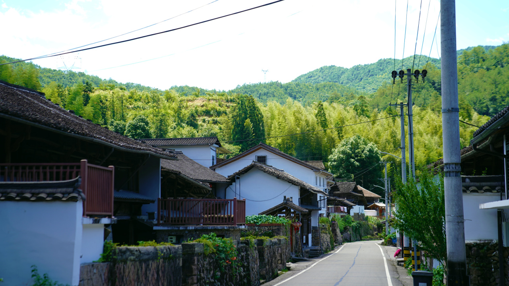 S06-29 | 桃源 · 村落环境 民居街巷、墙体和屋檐关系；画面存在修缮／新建部分 | 发布：2026-07-10 拍摄：未注明；网页发布日期不是拍摄日期 1280×720 只能对应村落／组团或未具名单体 | [S06来源页](http://www.jnnews.zj.cn/syzx/202607/t20260710_7546909.shtml) · [原图](https://jnpubmeizi.tmuyun.com/17380647290500.jpg) 摄影：页面合署：小红书用户游尙一、汪亚奇、木音、我可以是亚哈，记者陈文浩、蓝婷婷；未逐图对应 |
| 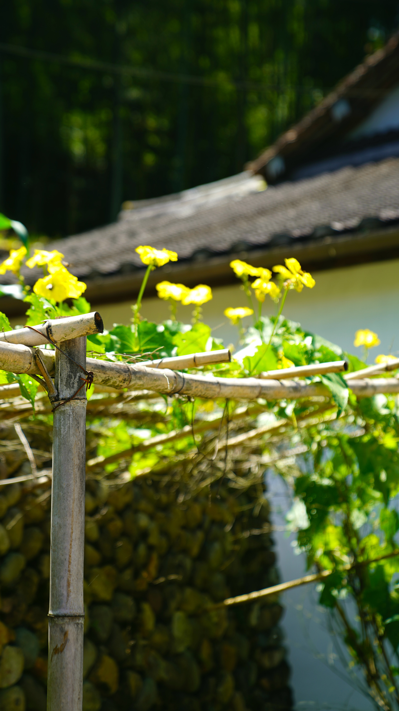 S06-30 | 桃源 · 民居与构件 瓦檐与围墙局部；未具名 | 发布：2026-07-10 拍摄：未注明；网页发布日期不是拍摄日期 1280×2275 只能对应村落／组团或未具名单体 | [S06来源页](http://www.jnnews.zj.cn/syzx/202607/t20260710_7546909.shtml) · [原图](https://jnpubmeizi.tmuyun.com/17380647290756.jpg) 摄影：页面合署：小红书用户游尙一、汪亚奇、木音、我可以是亚哈，记者陈文浩、蓝婷婷；未逐图对应 |
| 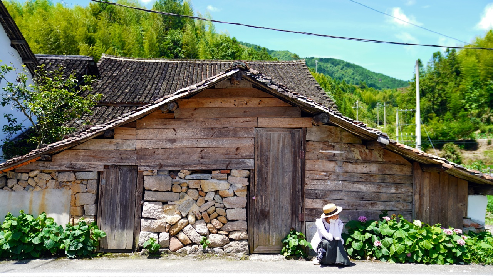 S06-31 | 桃源 · 民居与构件 石墙、木板山墙、双门及瓦顶的附属建筑；是否独立住宅待核 | 发布：2026-07-10 拍摄：未注明；网页发布日期不是拍摄日期 1280×720 只能对应村落／组团或未具名单体 | [S06来源页](http://www.jnnews.zj.cn/syzx/202607/t20260710_7546909.shtml) · [原图](https://jnpubmeizi.tmuyun.com/17380647329220.jpg) 摄影：页面合署：小红书用户游尙一、汪亚奇、木音、我可以是亚哈，记者陈文浩、蓝婷婷；未逐图对应 |
| 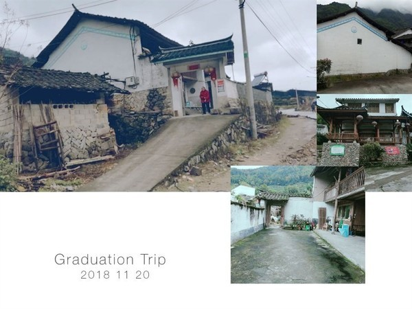 S07-01 | 周湖 · 民居与构件 周湖老村门楼／街巷照片拼版；画面文字标示2018-11-20，不能对应8号 | 发布：2019-02-20 拍摄：拼版文字标示2018-11-20；非EXIF独立验证 600×450 只能对应村落／组团或未具名单体 | [S07来源页](https://ishare.ifeng.com/c/s/7kRaaJeh3MJ) · [原图](http://e0.ifengimg.com/04/2019/0220/41DEECE70D93471DCF053D29B54903DBC62F98B8_size67_w600_h450.jpeg) 摄影：未独立署名；账号乐柚游 |
|  S07-03 | 周湖 · 民居与构件 周湖院墙、木门楼与坡地道路；不能对应论文8号 | 发布：2019-02-20 拍摄：未注明；网页发布日期不是拍摄日期 600×450 只能对应村落／组团或未具名单体 | [S07来源页](https://ishare.ifeng.com/c/s/7kRaaJeh3MJ) · [原图](http://e0.ifengimg.com/02/2019/0220/9DDA550E988A97857B7276981BD0AD47DB5DD914_size75_w600_h450.jpeg) 摄影：未独立署名；账号乐柚游 |
|  S07-04 | 周湖 · 民居与构件 周湖老村门楼／街巷照片拼版；画面文字标示2018-11-20，不能对应8号 | 发布：2019-02-20 拍摄：拼版文字标示2018-11-20；非EXIF独立验证 600×800 只能对应村落／组团或未具名单体 | [S07来源页](https://ishare.ifeng.com/c/s/7kRaaJeh3MJ) · [原图](http://e0.ifengimg.com/10/2019/0220/856089A6A1591DAFA2CC1B90E8EB3D5BAF23A8D2_size104_w600_h800.jpeg) 摄影：未独立署名；账号乐柚游 |
|  S07-06 | 周湖 · 村落环境 周湖巷道、屋面与新旧民居关系；不等于8号民居 | 发布：2019-02-20 拍摄：未注明；网页发布日期不是拍摄日期 600×450 只能对应村落／组团或未具名单体 | [S07来源页](https://ishare.ifeng.com/c/s/7kRaaJeh3MJ) · [原图](http://e0.ifengimg.com/09/2019/0220/EB553E395CEF4B211DDFEF510B5B49B1B0041E70_size72_w600_h450.jpeg) 摄影：未独立署名；账号乐柚游 |
|  S08-05 | 深垟 · 民居与构件 深垟石墙、院落门楼与民居外观；未与陈璧大宅对应 | 发布：2025-10-09 拍摄：未注明；网页发布日期不是拍摄日期 640×427 只能对应村落／组团或未具名单体 | [S08来源页](https://www.sohu.com/a/942250774_121627717) · [原图](https://q9.itc.cn/q_70/images03/20251009/7d73788171bf47fdbcd20ca9fd041d0f.jpeg) 摄影：未署名；文章作者严慧荣 |
|  S08-06 | 深垟 · 民居与构件 深垟石墙、院落门楼与民居外观；未与陈璧大宅对应 | 发布：2025-10-09 拍摄：未注明；网页发布日期不是拍摄日期 1280×854 只能对应村落／组团或未具名单体 | [S08来源页](https://www.sohu.com/a/942250774_121627717) · [原图](https://q1.itc.cn/q_70/images03/20251009/a811c55a66fe483696b5df711636ebff.jpeg) 摄影：未署名；文章作者严慧荣 |
|  S08-07 | 深垟 · 民居与构件 深垟石墙、院落门楼与民居外观；未与陈璧大宅对应 | 发布：2025-10-09 拍摄：未注明；网页发布日期不是拍摄日期 1152×1728 只能对应村落／组团或未具名单体 | [S08来源页](https://www.sohu.com/a/942250774_121627717) · [原图](https://q7.itc.cn/q_70/images03/20251009/aa62fa1cdbd24f43849211f1d0ca580e.png) 摄影：未署名；文章作者严慧荣 |
|  S08-09 | 深垟 · 旧宅改用 清泉石上居段落相邻院落图片；具体建筑身份／年代仍待独立核证 | 发布：2025-10-09 拍摄：未注明；网页发布日期不是拍摄日期 1280×853 只能对应村落／组团或未具名单体 | [S08来源页](https://www.sohu.com/a/942250774_121627717) · [原图](https://q4.itc.cn/q_70/images03/20251009/d28dfd2e94bd4e64ba258fa40b59bad9.jpeg) 摄影：未署名；文章作者严慧荣 |
|  S08-10 | 深垟 · 旧宅改用 畲医畲药展示馆门面，匾额可辨；正文称民国老宅改建，未核原宅名与改造范围 | 发布：2025-10-09 拍摄：未注明；网页发布日期不是拍摄日期 667×359 只能对应村落／组团或未具名单体 | [S08来源页](https://www.sohu.com/a/942250774_121627717) · [原图](https://q6.itc.cn/q_70/images03/20251009/6ff906ea844a4f3abf8e0759f8e03e3c.jpeg) 摄影：未署名；文章作者严慧荣 |
