# 畲族文献可复用图表资料索引（第一批）

本索引把原文中已提取并可直接复用的图、表、分布图和附录页集中管理。图片保持原文页面形态，文件名使用 Zotero item key + PDF页码；页码定位仍以原文PDF为准。图片用于研究资料整理，不代表对2026年现状的确认。

## A类：对象与现状证据

### 东弄村建筑编号分布与现状表

来源：BUUUUWRW（L17），赵圣洁，《浙江省景宁县东弄村畲族民居初探》。调查时间为2012年11月至2013年4月；图中1—52为该文调查编号，包含民房、村庙、祠堂、商店和服务建筑，不能直接当作52幢传统民居。

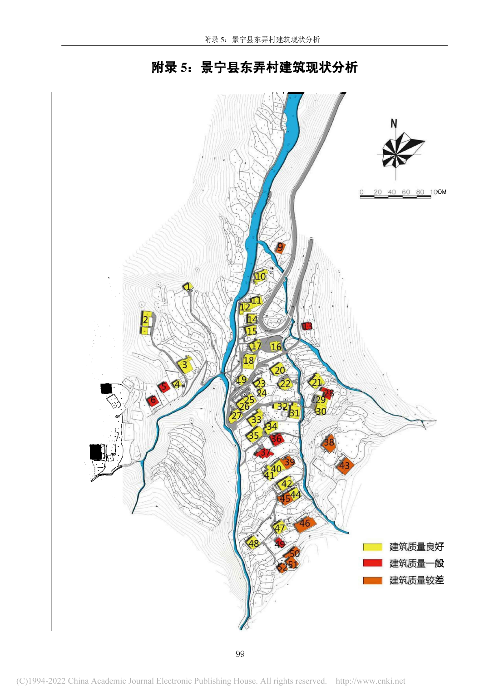

*PDF第115页，印刷第99页，附录5建筑分布图。*

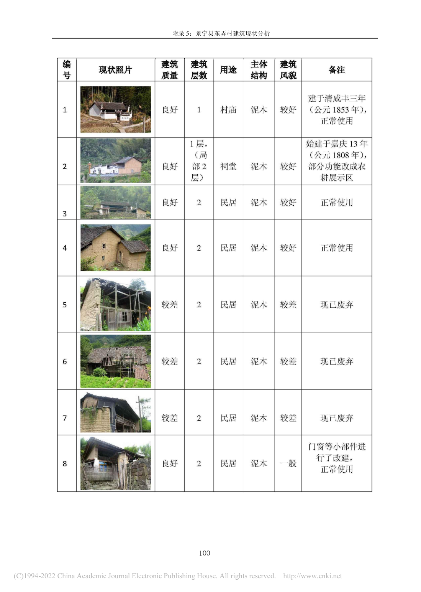

*PDF第116页，印刷第100页，附录5建筑现状表。*

### 大张坑研究对象范围与村级民居数量

来源：ETTYATRB（L09），王文辉、陈华文，《浙江景宁传统畲族民居及其保护与更新——以大张坑村为中心》。PDF第16页／印刷第8页用于确认“大张坑”范围；PDF第20页／印刷第12页记录全村37幢民居及1幢钢筋水泥结构建筑。原文没有把其余36幢全部认定为传统民居。

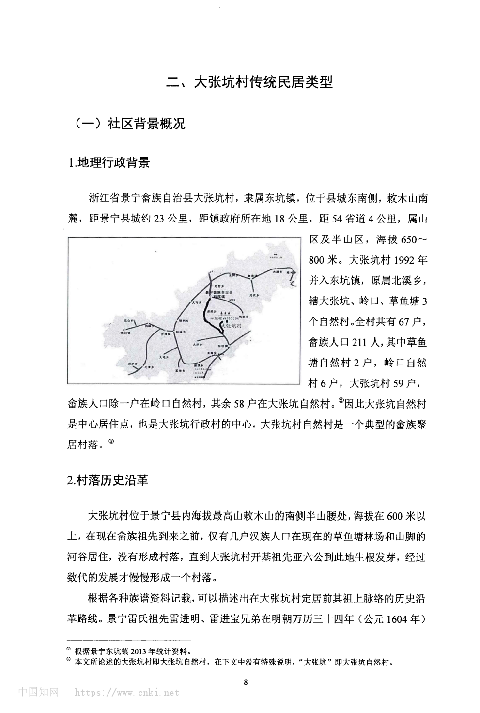

*PDF第16页，印刷第8页。*

*PDF第20页，印刷第12页。*

## B类：范围与统计图表

### 景宁传统村落附录调查表

来源：ZWDJJE99（L08），赵潇诺，《景宁畲族传统民居营造技艺研究》。附录A记录多个村落的遗存数量、保存状态及具名建筑。下图为连续页面，不能把附录中的所有条目直接合计为景宁畲族民居总量。

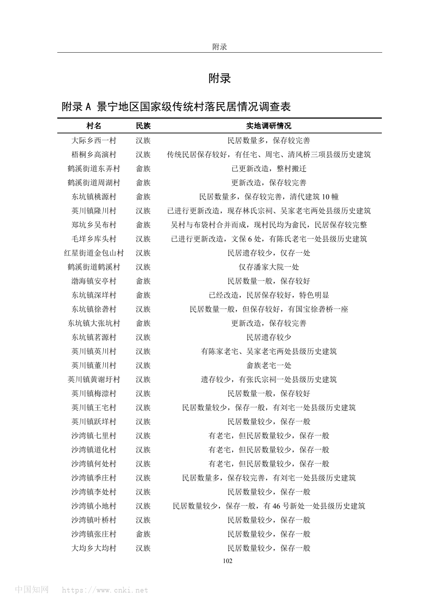

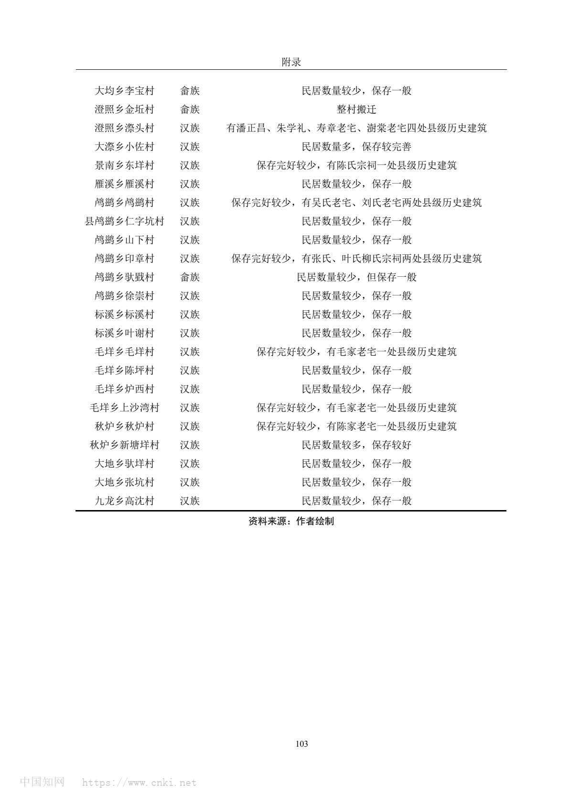

### 村落研究对象清单

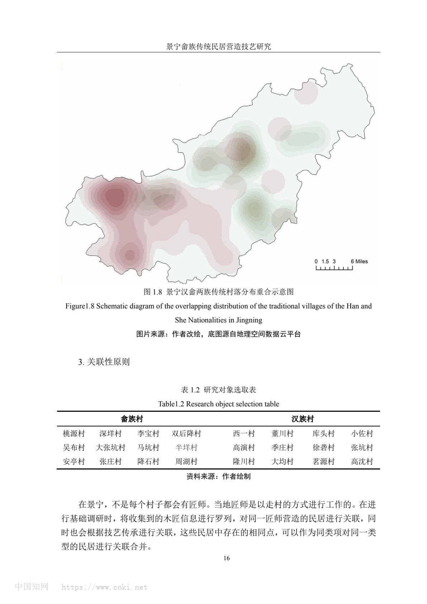

*PDF第27页，印刷第16页。表内畲族村、汉族村分组与论文其他章节存在需要复核的个别矛盾（例如季庄）。*

### 三篇村落侧样表

来源：ZWDJJE99（L08），表3.7—表3.9。表中周湖、张庄、季庄的编号是侧样／调查记录，分别为15、8、10行，不等于各村建筑总量；对应分布图仍需与单体对象逐一核对。

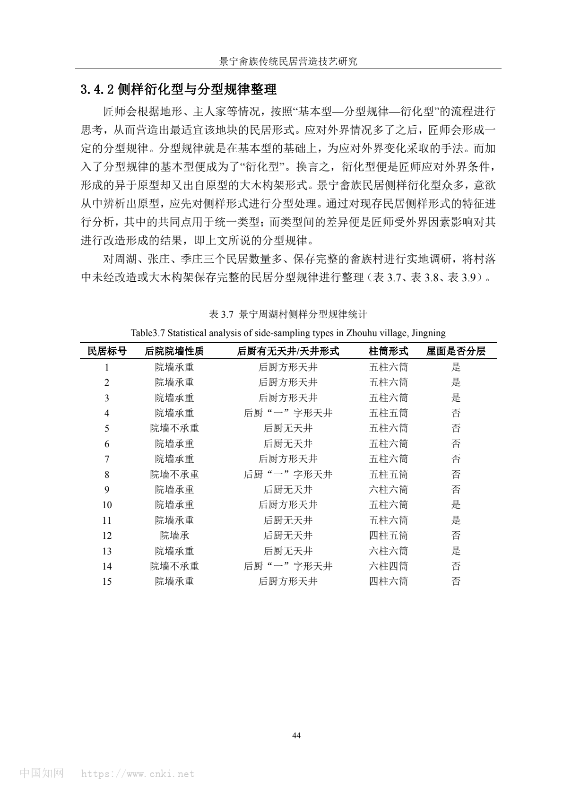

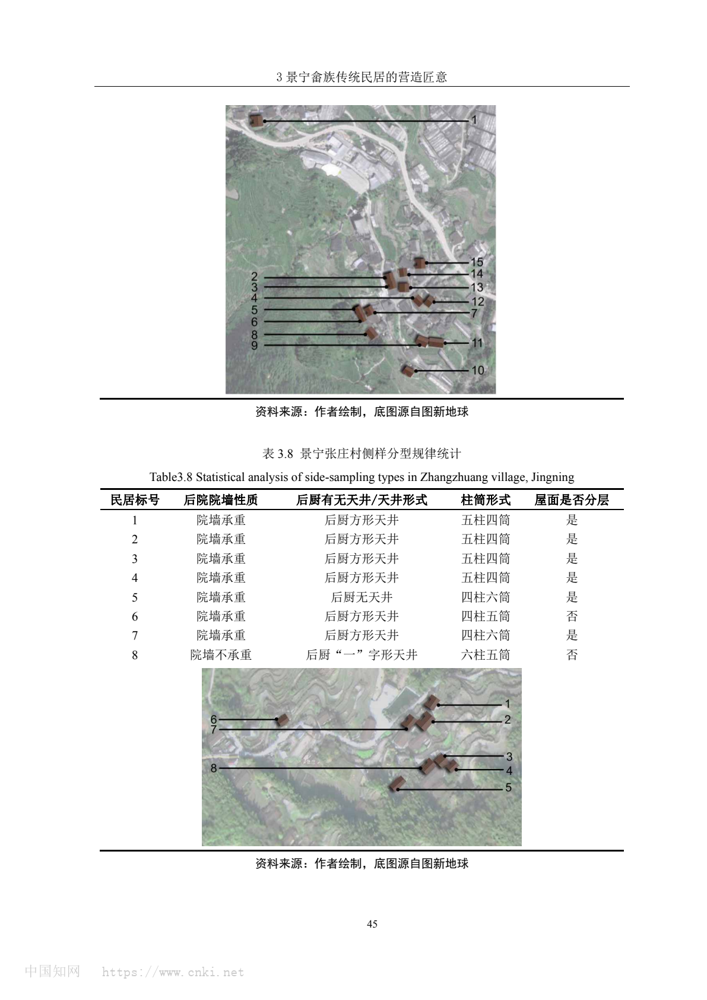

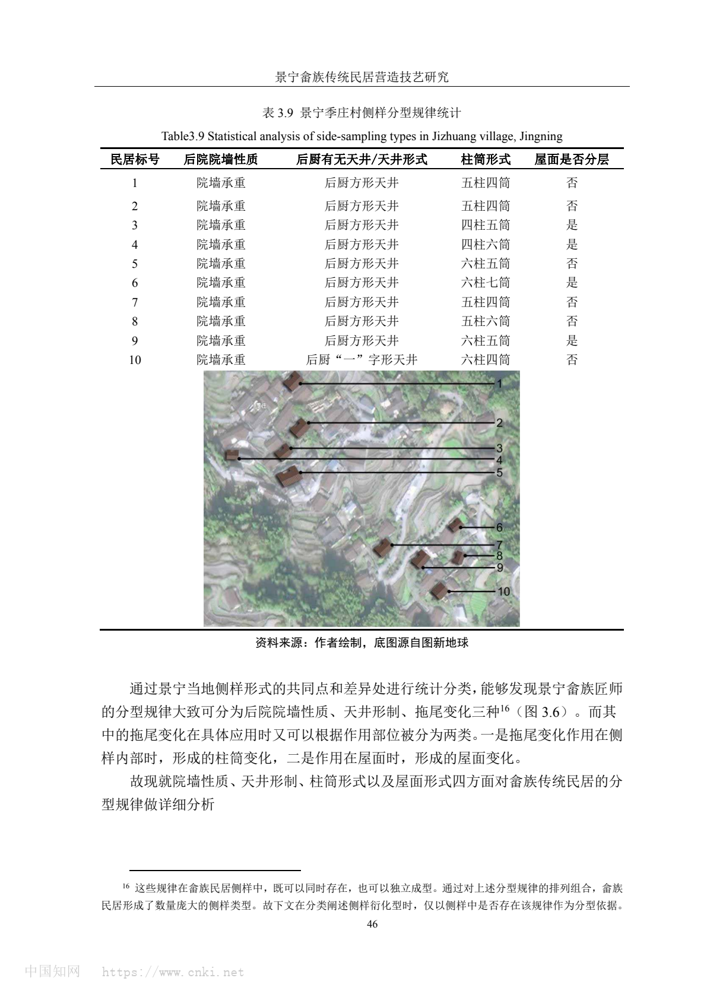

### 三篇论文列举的村落框架对照

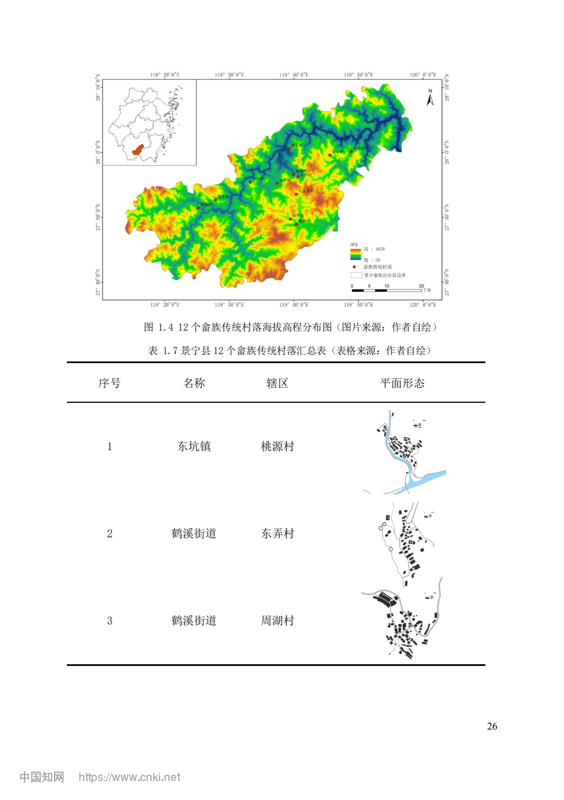

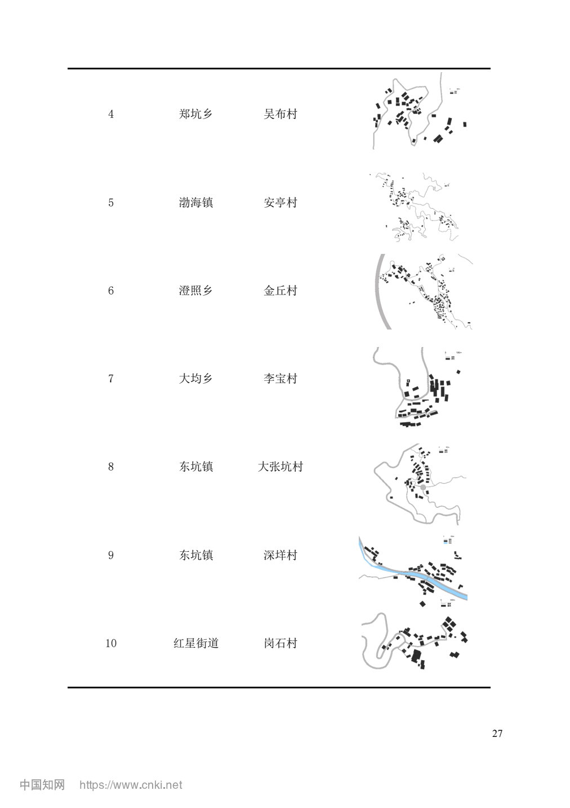

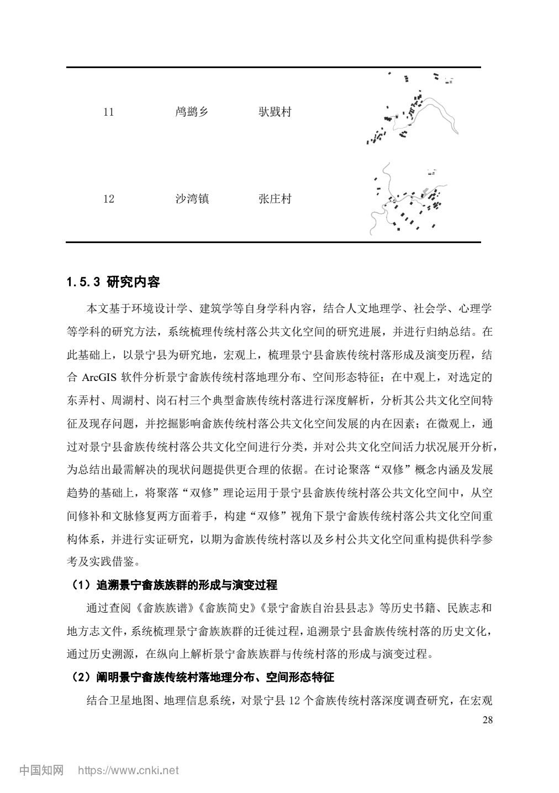

*3IJX2PUQ（L12），PDF第40—42页，印刷第26—28页。该表与ZWDJJE99表1.2并非完全相同的“12村”清单，不能直接拼接。*

## C类：建筑特征参考图

本批先收录与对象定位直接相关的图表。建筑照片、门楼、凤凰纹、侧样和木构节点图将在确定候选研究对象后按建筑编号继续补入，避免把无法定位的特征图片误归到具体遗存。

## 二轮图像资料

已将核心文献中现有的112份关键页渲染图和图像截取复制到[[研究资料/来源证据/2026-10-06-畲族文献图像资料库二轮索引.md]]。其中一部分仍需逐图核对图号、建筑名称和对象对应关系，暂不作为已确认的单体现状证据。

## 与主表的关系

- [景宁畲族建筑遗存文献现状列表](2026-10-06-景宁畲族建筑遗存文献现状列表.md)：逐条记录中已在“原文图像”列嵌入本批对应图片。
- [畲族建筑文献地点与建筑证据表](2026-10-06-畲族建筑文献地点与建筑证据表.md)：保留全部23篇文献的地点、建筑、数量和页码证据。
- 原始PDF仍保存在 Zotero；本目录中的PNG是从原始PDF页面渲染的工作副本，不替代原始文献。
