# 景宁重点民居：逐项调研与网络照片

**本轮已核查12个条目，保存8个来源页面的113个图像文件，逐张筛选出58份建筑、构件、村落环境及相关公共建筑图像。** 12项包含单体、建筑群及补充的公共建筑／残存构件，并非12栋独立住宅；58也不是建筑栋数。原文件保留，网页排版图、现代新建景观、人物与风物等另列，未混入精选资料。

直接浏览：[可筛选照片图册](2026-10-06-景宁民居网络照片图册.html) · [[研究资料/来源证据/2026-10-06-民居网络照片索引.md|全部58份入选图像及出处]] · [完整下载与筛选记录](assets/she-web-2026-10-06/manifest.json)

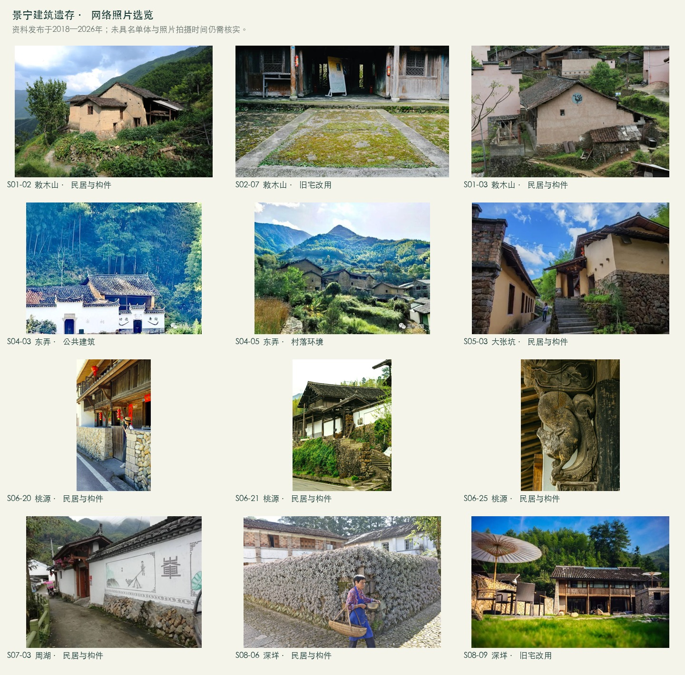

## 对象范围与本轮结果

本轮沿用前一轮的具名／具编号候选，并补查东弄、大张坑、桃源村级对象及新发现的史图博旧居线索。“高价值”在这里分别落实为官方保护身份、历史人物关联、传统构造与装饰资料、聚落完整性等证据，不给所有候选统一套上文保级别。照片中出现一栋老房子，不足以认定它就是论文中的某一幢。

| 编号 | 对象 | 已有价值或研究依据 | 本轮网络结果 | 照片对应状态 |
| --- | --- | --- | --- | --- |
| R01 | 敕木山四幢典型大户畲族民居组 | 官方数量与形态介绍；2026省级文保在册 | 官方图片与摄影图文均可读 | 有民居整体、墙体、屋面等照片，但未逐栋具名 |
| R02 | 史图博曾住老宅／展览馆线索（新增） | 1929年调查史；老宅改用展馆 | 地方报纸明确历史住户为蓝文成；旅游图文有旧宅／展馆语境照片 | 展馆照片为强候选；旧宅门牌及其与四幢、28号的关系未核 |
| R03 | 敕木山28号蓝姓畲族寮 | 论文明确编号的凤凰纹实例 | 未找到可对应“28号”的新增网络图片 | 现有论文纹样示意／构件资料保留；村景不代替单体 |
| R04 | 东弄蓝坤宝寮 | 有平面、剖面与访谈记录 | 网络百科提及该宅，未发现可独立核实的新照片或现状 | 保留既有图纸；新增东弄图片均不冒认该宅 |
| R05 | 周湖村8号民居 | 论文典型民居模型与立面图 | 找到周湖老村游记照片 | 4份村景／门楼／巷道资料可用，但8号仍未对应 |
| R06 | 沙湾镇张坑村蓝凤新寮 | 木雕营造者与五间两出手住宅线索 | 具名检索未发现有效新增单体资料 | 论文明确照片仍是主要凭据；不与东坑镇大张坑混合 |
| R07 | 东弄传统民居群 | 73幢文献基线，另有编号调查 | 2023照片较丰富；2025官方答复说明部分老屋失修；2026有保护报道 | 9份定位到东弄的精选图像，含1份宗祠候选，不全是住宅 |
| R08 | 大张坑传统民居群 | 37幢文献基线及畲族聚落、革命历史 | 找到2026图文和近期运营调研 | 4份建筑／聚落照片；未对应37幢或16间的具体清单 |
| R09 | 桃源清代建筑及民居群 | 文献10幢／处清代建筑线索 | 找到2026县融媒体成组图像 | 21份精选，含6份五显爷殿公共建筑图，不能全部当民居 |
| A01 | 东弄蓝氏宗祠建筑群 | 宗族与村落公共空间，论文具名 | 2023图文相邻段落与建筑外观支持候选对应 | 1份整体外观候选；不是新增1栋住宅 |
| A02 | 大张坑雷氏祠堂 | 既有论文具名照片 | 未找到可靠、明确点名的新增单体照片 | 沿用历史论文图，2026状态未核 |
| A03 | 深垟陈璧大宅遗址／门头 | 论文记主体已毁、门头留存 | 找到2025深垟老宅、院落和展馆图片；没有明确陈璧宅对应 | 5份村域建筑图像；不能作为陈璧宅现存证明 |

## R01　敕木山四幢典型大户畲族民居组

**地点和保护身份。** 位于景宁县鹤溪街道敕木山村。“敕木山村畲族民居”列在[2026年度文保单位名录](https://www.jingning.gov.cn/col/col1229631018/art/2026/art_e28476d814684e38843b01cad4474107.html)的省级栏；是一个保护单位名称，不是四份独立保护单位。

**价值依据。** [2022年市文广旅体局介绍（S01）](https://www.lishui.gov.cn/art/2022/7/11/art_1229268129_57336308.html)记典型大户古民居四幢，清代及民国时期、二层楼屋，有一字排开和合院两种形式。碎石基础、泥墙／木板壁、内部木构、小青瓦、悬山顶等描述与图像可以相互参照。文章还评价村落形态与格局保存较完整、具有一定代表性；这是2022年发布内容，确切调查日期未载。

**照片所得。** S01保存3张官方照片，S02另选11张建筑及村落照片，共14张敕木山图像。其中可以观察民居整体、前檐、土墙、瓦屋面、门洞与山地高差。S02有摄影者“光林”署名，发布于2018年，不能称为2026照片。

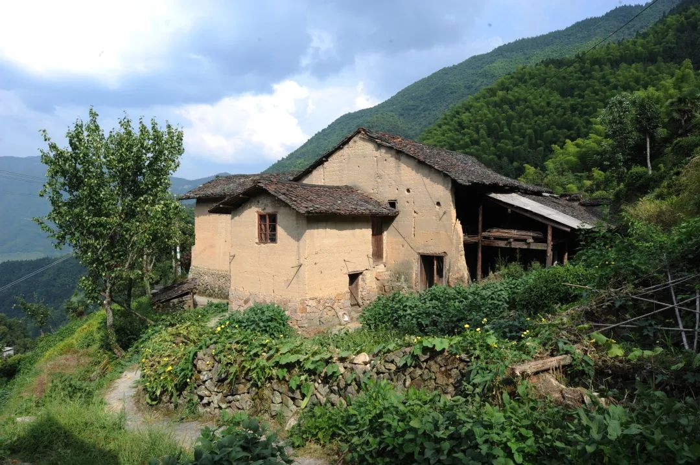

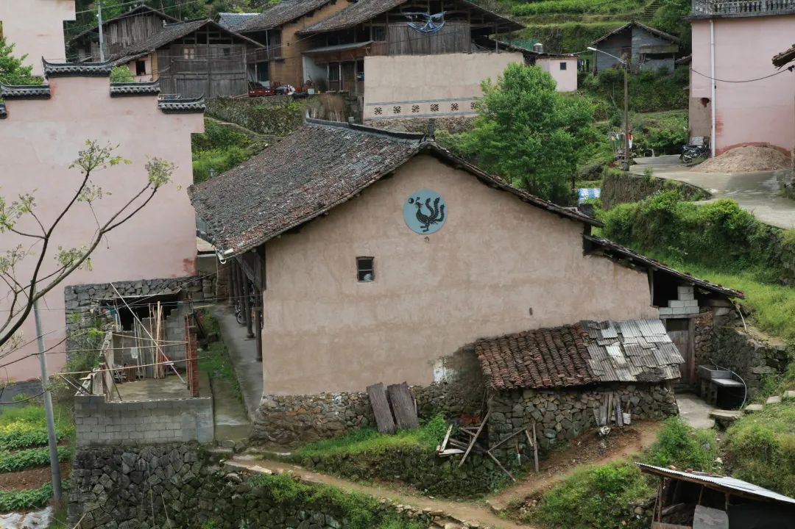

**尚缺。** 四幢的正式组成单体表、名称／门牌、年代分配和近期修缮记录。现有照片不能直接拆成“四幢各一张”，也不能证明全部四幢当前完好。进一步优先查省级文保单位档案和保护范围图。

## R02　史图博曾住老宅与展览馆线索

**新增的具名证据。** [《畲乡报》2023年3月23日第04版《史图博的敕木情缘》](http://epaper.jnnews.zj.cn/html/2023-03/23/content_4685_15932222.htm)，叶小忠搜集整理，明确写道：

> 史图博住在了村长蓝文成家的小阁楼。

该文叙述1929年的调查经历，属于地方历史叙事，支持“蓝文成家”这一历史身份线索，未提供如今的门牌或建筑测绘。

[2018年《畲寨行》图文（S02）](https://www.sohu.com/a/257397347_100188381)称史图博居住过的小院已修缮，并介绍哈·史图博展览馆。紧邻展览馆段落的照片S02-07呈现木构正屋、格扇、石铺院落及说明展板，适合研究老宅展示利用和空间构成。

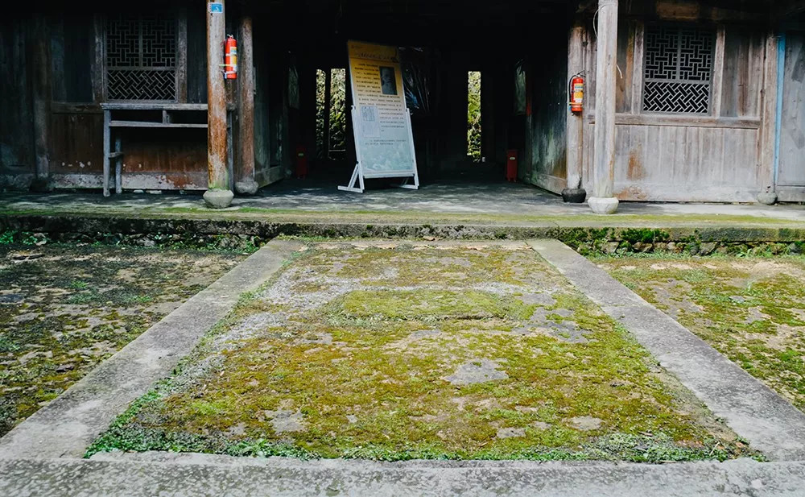

**可以写到的程度。** “蓝文成家”为1929年居住地点的具名线索；“史图博旧宅／展览馆”已有图像线索。两篇资料之间尚缺房屋地址、展馆说明牌清晰文字或保护档案的直接对应，暂不将它与28号蓝姓寮、论文中的“蓝村长家门楼”或四幢中的某一幢自动合并。也不将旅游报道中的“文物保护单位”表述独立升级为该单体的保护级别。

## R03　敕木山28号蓝姓畲族寮

**已有实证。** L18《浙江景宁畲族传统民居卷草凤凰纹装饰研究》（2013）PDF第2页／刊页95图1，图注明确“景宁县敕木山村28号蓝姓畲族寮”，是卷草凤凰纹的分段示意。第3页另有“敕木山村蓝村长家”的门楼装饰照片，但该图没有明确标28号，两个称呼不能直接合并。

**本轮结果。** 检索“景宁 敕木山 28号”未获得指认该单体的新网页；敕木山图集照片未见可确认的28号标记。本轮没有新增其整体外观照片。

**研究价值与缺口。** 适合做有明确原文编号的装饰案例；目前不足以单独支撑整栋形态分析或2026存续判断。应将纹样、门牌、宅名及整体照片串联后再确定样本身份。

[既有论文原页与图1](assets/she-image-bank/7KCJR9EB-002.png) · [蓝村长家门楼装饰所在原页](assets/she-image-bank/7KCJR9EB-003.png)

## R04　东弄蓝坤宝寮

**已有实证。** L17《浙江省景宁县东弄村畲族民居初探》提供平面、剖透视、剖面等图纸和访谈。2013-04-11访谈称该宅无人居住、用于放杂物；这只描述访谈时点。其价值在于空间与构造资料较完整、具名对象可追查。

**本轮结果。** “蓝坤宝”具名检索找到[百度百科“畲族民居”词条](https://baike.baidu.com/item/%E7%95%B2%E6%97%8F%E6%B0%91%E5%B1%85/5898812)中的学术案例介绍，没有提供能对应宅名的新照片、现址或更新状态。该提及不是独立的2026现状证据。本轮新增东弄照片没有任何一张足以认定为蓝坤宝寮。

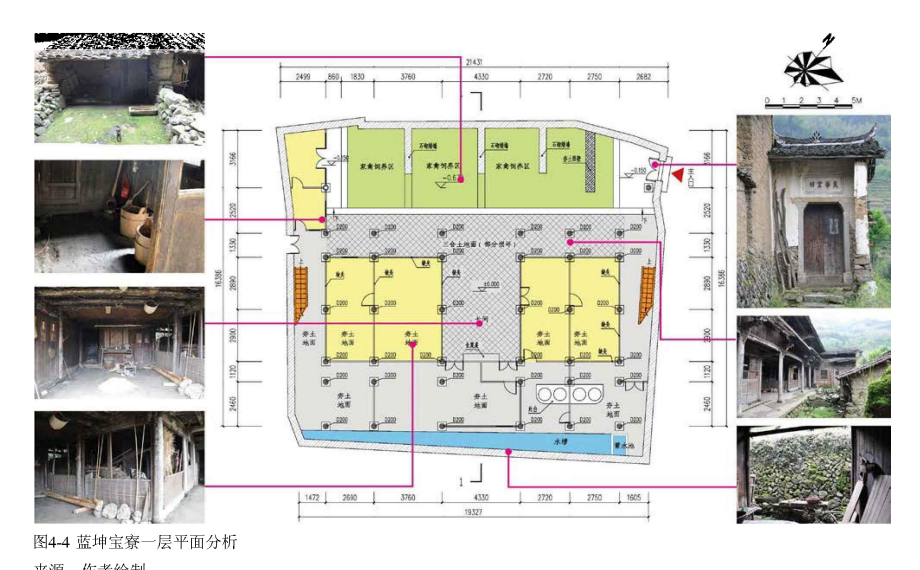

**后续核对点。** 以L17编号分布图和访谈信息定位宅址，匹配屋面轮廓、间数、出入口及邻近建筑。不能仅凭夯土墙或瓦顶相似认定为同一栋。

## R05　周湖村8号民居

**已有实证。** L22《浙江景宁畲族自治县县城建筑有机更新研究》（2012）PDF第40页／正文31，图3.20—3.21，为典型民居形态资料。“8号”首先是论文标识，尚未证明等于今天的门牌8号。

**本轮图片。** [凤凰网“乐柚游”2019年游记（S07）](https://ishare.ifeng.com/c/s/7kRaaJeh3MJ)的周湖段落有门楼、院墙、街巷照片；选取4份，未收其后大漈段落照片。部分拼版自带2018-11-20文字，作为画面标示日期记录，不冒充经核实的EXIF日期。

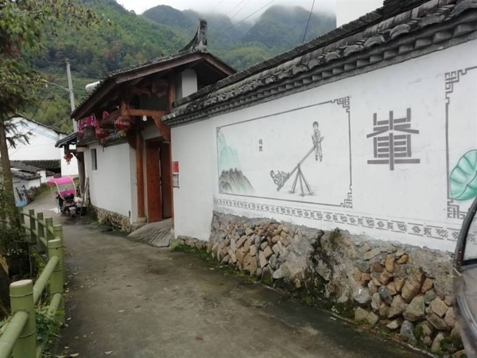

**当前判断。** 已补到村落层面的可用照片，但仍无8号的可靠单体对应。[保留论文图3.20作后续比对](assets/she-crops/VSES7L3M-p040-fig320.png)。检索结果中出现瑞安等地的同名周湖内容，未混入本组。

## R06　沙湾镇张坑村蓝凤新寮

**已有实证。** L18的PDF第2页／刊页95记木雕匠人蓝凤新返乡“盖了一幢5间两出手的寮”；第3页／刊页96图3点名“景宁县沙湾镇张坑村蓝凤新寮”，展示前檐梁卷草凤凰纹。原文还讨论前檐凤凰、后部龙纹的排列及匠人传承信息。

**价值依据。** 它把具体住宅、营造者和装饰工艺关联起来，比泛称“畲族民居”更适合建筑技艺个案研究。论文同时谈到畲、汉住宅的装饰交流，不能将相似纹样一律认定为畲族独有。

**本轮结果。** “蓝凤新 民居”具名检索未返回可以核实的新增单体图文。目前可用照片仍是论文构件图；本轮新增网络照片数为0。地址保留论文“沙湾镇张坑村”，绝不以东坑镇大张坑照片替代。

[查看具名装饰照片图3及原文](assets/she-image-bank/7KCJR9EB-003.png)。下一步最需要的是原宅门牌、整体形制及当代保存照片，而非继续收集无名凤凰纹。

## R07　东弄传统民居群

**已有数量。** L14记107幢民居，其中73幢传统民居、73幢中16幢空置，论文2022年提交，实际调查日未载。另有L17编号表，可用于逐栋定位，但不能与73相加。

**网络状态。** [县文广旅体局2025年答复](https://www.jingning.gov.cn/art/2025/7/21/art_1229847974_88006.html)称二期古村内20多幢老房子年久失修、部分已无法维修；[2026年保护报道S03](https://www.sohu.com/a/984593291_121106994)有检查、整改和回访叙述。两者未公开逐栋名单，无法据此更新73幢为当前确数。

**图像成果。** [叶望庆文图、2023年发布的S04](https://www.163.com/dy/article/IKID55FB0544AW5X.html)有组团、土墙、屋顶和宗祠外观；连同S03选入9份明确指向东弄的图像。另留1张S03老屋检查照片为“景宁、具体村落未标”，不强行归入东弄。

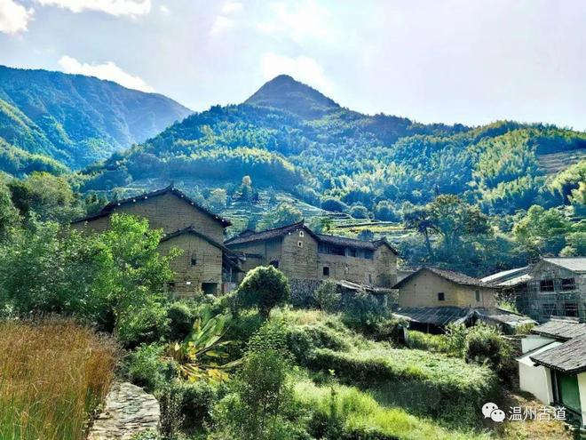

**已排除的混淆。** S04正文明确文昌阁于2020年10月新建，相关11份建筑／景观图片放入图册“未入选与对照”，不作为古民居遗存。S03还混有岗石活动和祠堂图片，已标“范围外”，不冒认东弄蓝氏宗祠。

## R08　大张坑传统民居群

**地点与基线。** 东坑镇大张坑自然村；L09（2015年提交）记37幢民居、其中1幢钢筋水泥结构，不反推其余36幢全部是传统畲族民居。

**本轮图片。** [潮新闻2026年报道S05](https://news.qq.com/rain/a/20260629A025AT00)选出4张，分别呈现石阶巷道与土墙民居、山地聚落、屋顶及夜景。图片发布于2026年，拍摄年月未单列。不能将新闻中的“保存完好”文学描述当逐栋鉴定结论。

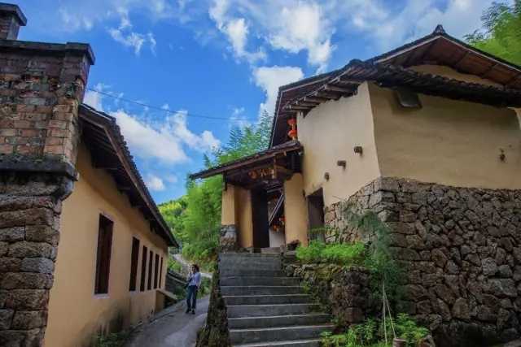

**需要区分的新建筑。** [2019年澎湃政务号转载《丽水日报》](https://www.thepaper.cn/newsDetail_forward_4317527)记畲族革命历史展览馆2018年启动建设、2019-03-29开放。故S05的展馆室内图不能仅因木装修而当作传统老宅内部。

**近期资料入口。** [浙江旅游职业学院2026年转载报道](https://tourzj.edu.cn/info/1019/24690.htm)提及16间待盘活民居及《忠勇红寨・康养药谷》运营方案；单位为“间”，具体对象与37幢基线的关系仍需查表。

## R09　桃源清代建筑与民居群

**已有基线。** L08、L12记10幢／处清代建筑。没有逐栋清单，且并未证明全部为畲族住宅。

**新增资料。** [景宁县融媒体中心2026-07-10《这里没有桃花，却藏着真正的“世外桃源”》（S06）](http://www.jnnews.zj.cn/syzx/202607/t20260710_7546909.shtml)提供成组清晰照片：坡地住宅整体、木构檐廊、石墙门洞、格窗、雕花牛腿、瓦屋面与街巷。入选21份，其中15份为民居／构件及村落环境，6份为五显爷殿公共建筑。

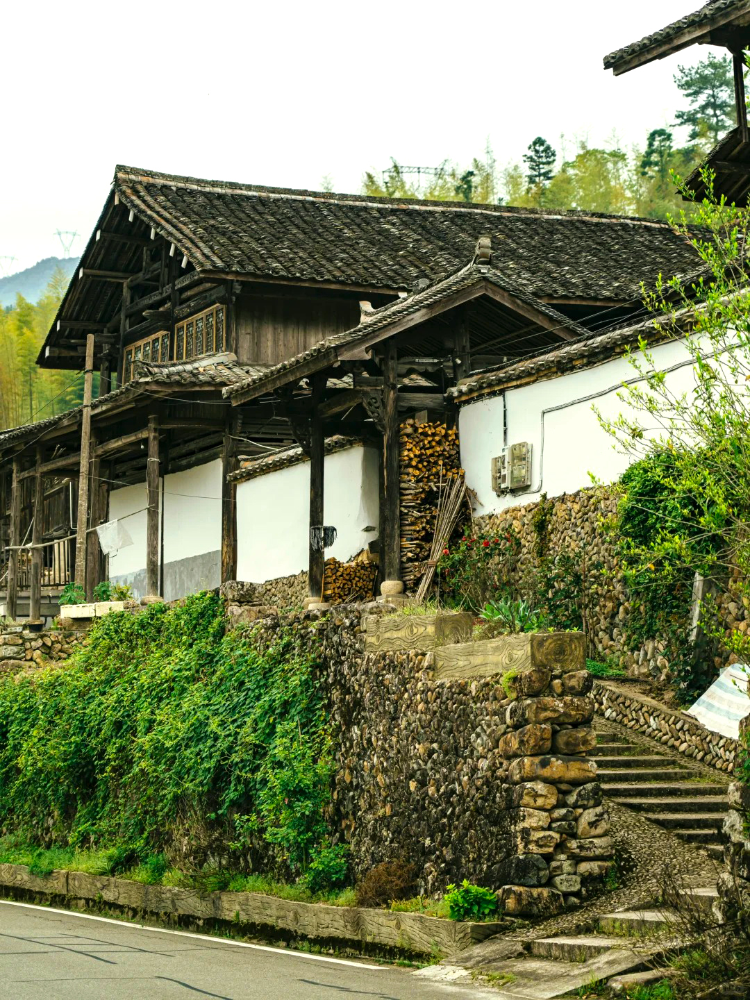

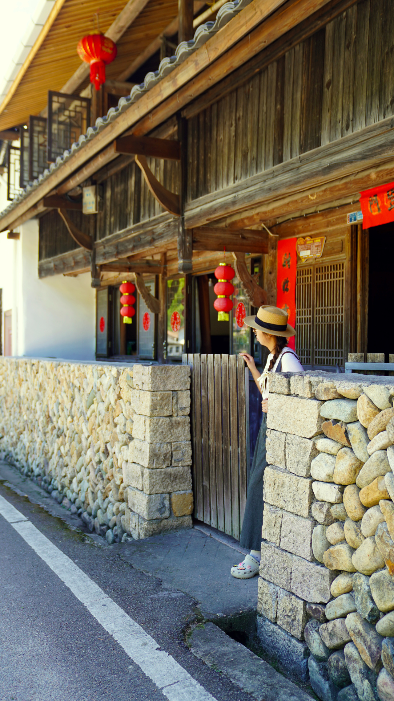

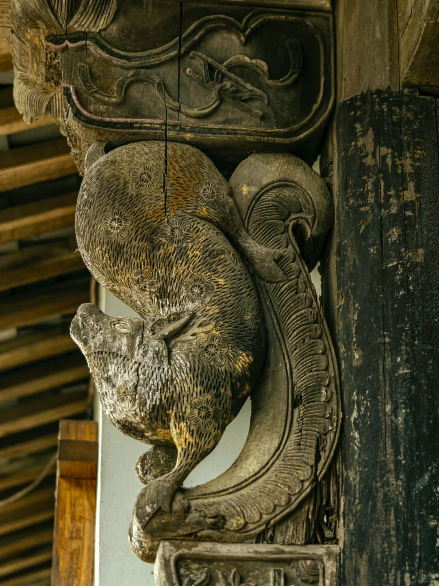

**图像署名。** 原网页合署小红书用户游尙一、汪亚奇、木音、我可以是亚哈，以及记者陈文浩、蓝婷婷，未逐图对应；索引保留合署，不给某一张擅配摄影者。

**边界。** 文昌亭在正文中明确为“新亭”，其4份图列为现代景观对照；五显爷殿为宗教建筑，不计民居。15份民居／环境图也不能被认定为“10处清代建筑”的完整照片清单。部分图片带旅游人物、现代修缮墙面，需要后续确认建筑年代与修缮层次。

## A01　东弄蓝氏宗祠建筑群（公共建筑补充）

L12记主楼与左右附楼共3幢，L22有历史照片。S04正文谈到蓝氏祠堂后紧接一张整体照片，图中院墙可辨“宗祠”及“功德寿院”等文字，支持作为对应候选，尚缺完整门额和档案比对。

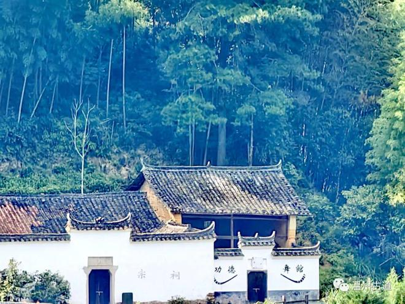

S04称其为清道光年间，但这是自媒体图文中的年代叙述，本轮未查族谱或保护档案，暂不作为定年结论。可以研究宗族公共空间及后续使用变化，不将1组3幢计入民居总量，也不把S03提到的未具名省级文保民居指认为该宗祠。

## A02　大张坑雷氏祠堂（公共建筑补充）

L22的PDF第37页／正文28图3.16有具名照片。本轮对“大张坑 雷氏祠堂 古民居 照片”的检索未找到能确认单体的新照片，S05的村景、革命展览馆也没有与该祠堂建立同一建筑关系。

搜索摘要中出现商业古建筑网站将景宁雷氏宗祠称为省级文保的说法，与已读的2026县文保单位名录缺乏对应，未采为保护级别事实。当前主要依据仍为[论文原页](assets/she-image-bank/VSES7L3M-pdf37.png)，保护身份、现址、改造及留存均待补证。

## A03　深垟陈璧大宅遗址／门头（残存构件补充）

L22的PDF第37页／正文28图3.17记大宅主体已毁、门头较完整。对“深垟 陈璧 大宅”的具名检索没有找到可以对应的当代图片；检索出现的福建陈璧故居不是同一对象，未采入。

[2025年潮新闻图文S08](https://www.sohu.com/a/942250774_121627717)补得5张深垟院落、石墙、木门楼及老宅改用场景。报道另提“清泉石上居”及民国老宅改建的畲医畲药展示馆；这些是新的可追查对象，不能与陈璧大宅门头自动合并。报道中“30多幢老宅”的说法亦未附清单，不作为正式存量结论。

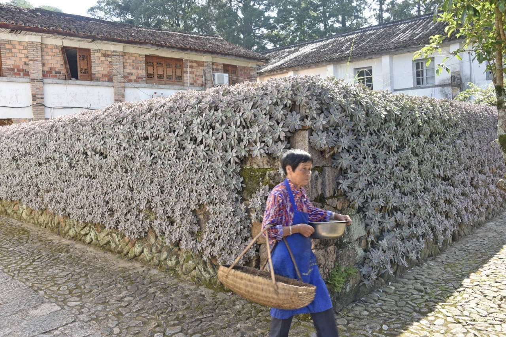

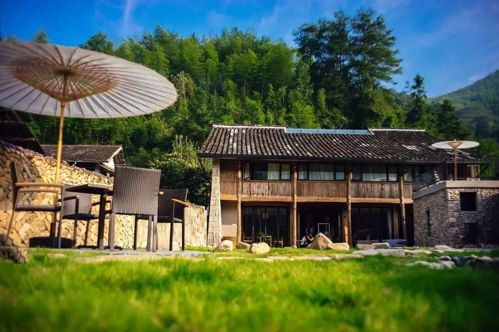

[陈璧大宅门头的既有论文原图所在页](assets/she-image-bank/VSES7L3M-pdf37.png)仍应作为后续现场寻找的对照。仅有门头的对象应记录为局部遗存，而非完整住宅。

## 本轮没有填平的缺口

1. **敕木山四幢仍缺逐栋名单。** 新增了蓝文成家／史图博旧居的历史身份线索，但未得到四幢的门牌、保护档案或相互对应关系。
2. **四个原有具名／具编号住宅没有新增可靠单体照片。** 蓝坤宝寮、周湖8号、敕木山28号、蓝凤新寮仍主要依赖论文；村落图集只能辅助定位。
3. **照片发布时间不能直接更新现存数。** 2026网页可能采用旧照片，且多数没有拍摄日、坐标或门牌；照片不能证明村内未被拍到的房屋仍在。
4. **新发现学术线索尚未获得原刊。** [文档站摘要](https://www.51wendang.com/doc/a282ae843147d30a3c221c9c77cc3805c04b6fd0)显示张云、都铭《浙江省丽水市景宁县敕木山村——国家历史文化名城研究中心历史街区调研》，《城市规划》2025年第2期、133—134页，摘要称约50栋建筑、多为传统风貌民居。本轮仅读到第三方摘要，原刊及配图未取得；书目信息和数字须另核，未并入数量基线。另一数据库页面需访问验证，本轮未继续该页面。

下一步最有价值的补证，是将敕木山文保组成清单、东弄逐栋调查表与本图册匹配。现阶段可据此选择“资料充足、身份可核”的重点对象，尚不能据照片数量宣布样本栋数或全县存量已经确定。

## 资料组织与可复查性

- 照片原文件：`研究资料/来源证据/assets/she-web-2026-10-06/S01`至`S08`，文件名采用来源编号与页内顺序，不把无名照片擅命名为某宅。
- [来源页与原图地址](2026-10-06-民居网络照片来源.json)保留发布日期、发布者、摄影署名及原图注；[完整清单](assets/she-web-2026-10-06/manifest.json)另含像素、文件哈希、目视说明、对应程度、入选／排除理由。
- 113份原文件的精确哈希均不同；这只是文件去重检查，不是建筑实体去重。不同角度、裁切或压缩版本可能来自同一建筑／照片。
- 58份入选中：民居及构件25份、村落环境20份、旧宅改用线索4份、公共建筑7份、待定位2份。未入选文件仍留存供对照。
- 论文图片继续保留在原资料库，不计入113份网络新收集图像。原网页水印、署名未移除；正式发表或转载前需另核图片使用许可。
