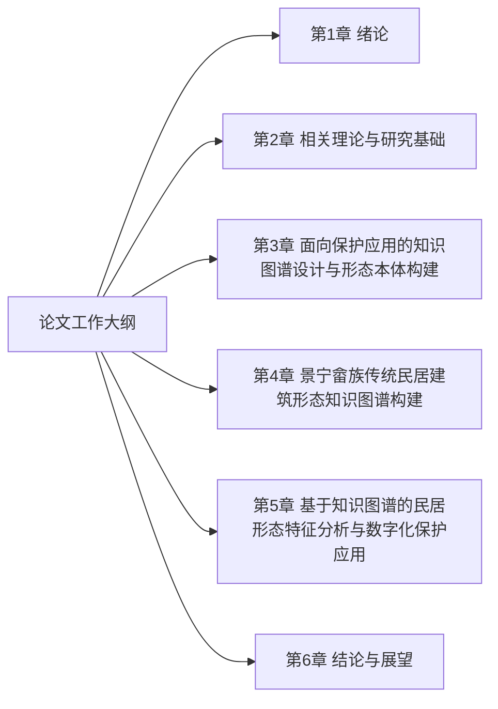

# 现行工作大纲

**这是可调整的工作大纲，不是定稿目录，也不是正文自动改写结果。**

结构维护：[[论文章节/大纲结构.yaml]]；研究目标：[[context/PROJECT_CONTEXT.md]]；工作路线：[[研究成果/〔研究路线〕论文研究路径/研究路径工作图.md]]。

按2026-11-19 Notion V4.0阶段结构组织：第一章提出问题，第二章建立相关理论与研究基础，第三章完成图谱功能设计与形态本体构建，第四章按数据准备—知识抽取—知识融合—存储评估构建景宁实例图谱，第五章开展形态特征分析与数字化保护应用验证，第六章总结；第二至第五章已细化到三级标题。结构修订不代表样本、规则、有效性或论文结论已验证；旧正文与原稿锚点继续保留。

## 章节总览

| 当前章节 | 论证任务 | 结构状态 |
|---|---|---|
| [第1章 绪论](%E7%AB%A0%E8%8A%82%E5%AF%BC%E8%88%AA/01-%E7%BB%AA%E8%AE%BA.md) | 提出传统民居建筑形态知识组织的研究问题，交代研究目的、研究现状、对象与概念、研究内容与方法及技术路线。 | V4.0工作结构；1.1—1.5三级标题已对齐；1.3及部分正文待写 |
| [第2章 相关理论与研究基础](%E7%AB%A0%E8%8A%82%E5%AF%BC%E8%88%AA/02-%E7%90%86%E8%AE%BA%E5%9F%BA%E7%A1%80.md) | 梳理景宁畲族传统建筑营建背景、建筑形态学与类型学理论、领域本体与知识图谱理论，为第三至五章提供概念与方法依据。 | V4.0工作结构；第二至第六章已细化到三级；正文、文献与样本核验待完成 |
| [第3章 面向保护应用的知识图谱设计与形态本体构建](%E7%AB%A0%E8%8A%82%E5%AF%BC%E8%88%AA/03-%E4%BD%93%E7%B3%BB%E4%B8%8E%E6%A8%A1%E5%9E%8B.md) | 从存量资料与保护需求出发，完成图谱功能设计、形态本体构建及规则与一致性检验，形成第4章可实施的模型。 | V4.0工作结构；本体、规则与检验待开展，尚无已核模型 |
| [第4章 景宁畲族传统民居建筑形态知识图谱构建](%E7%AB%A0%E8%8A%82%E5%AF%BC%E8%88%AA/04-%E6%99%AF%E5%AE%81%E5%AE%9E%E4%BE%8B.md) | 按“数据准备—知识抽取—知识融合—存储评估”主线，完成景宁样本的图谱实例化与构建评估。 | V4.0工作结构；真实样本、数据与图谱实例待建，不表示已完成 |
| [第5章 基于知识图谱的民居形态特征分析与数字化保护应用](%E7%AB%A0%E8%8A%82%E5%AF%BC%E8%88%AA/05-%E9%A3%8E%E8%B2%8C%E5%88%86%E6%9E%90.md) | 基于实例图谱分析民居类型、构造与山地组团关联特征，验证保护前期应用并与二维台账及纯文本问答对照。 | V4.0工作结构；分析与验证任务待实施，不预写发现 |
| [第6章 结论与展望](%E7%AB%A0%E8%8A%82%E5%AF%BC%E8%88%AA/06-%E7%BB%93%E8%AE%BA.md) | 总结研究结论、主要贡献、局限与后续展望。 | V4.0工作结构；结论待前文完成后撰写 |

## 当前整理重点

按V4.0收敛章际论证：第二章提供营建背景与理论工具，第三章完成功能设计与形态本体，第四章形成可回查的景宁实例图谱，第五章分析形态特征并验证保护应用；结构确认不等于正文、样本、本体实现或实证完成。

**全文逻辑：** 问题与对象 → 理论与研究基础 → 图谱设计与形态本体 → 景宁实例图谱构建 → 形态特征分析与保护应用验证 → 结论及适用范围。

## 标题总览（二级与已展开的三级）

### 第1章 绪论

**章内逻辑：** 研究背景 → 目的与意义 → 研究现状 → 对象与概念 → 内容、方法与技术路线。

- [1.1 研究背景与问题提出](%E7%AB%A0%E8%8A%82%E5%AF%BC%E8%88%AA/01-%E7%BB%AA%E8%AE%BA.md#section-1-1)
  - [1.1.1 传统民居保护认知需求](%E7%AB%A0%E8%8A%82%E5%AF%BC%E8%88%AA/01-%E7%BB%AA%E8%AE%BA.md#sub-1-1-1)
  - [1.1.2 县域民居保护困境](%E7%AB%A0%E8%8A%82%E5%AF%BC%E8%88%AA/01-%E7%BB%AA%E8%AE%BA.md#sub-1-1-2)
  - [1.1.3 知识图谱提供方法契机](%E7%AB%A0%E8%8A%82%E5%AF%BC%E8%88%AA/01-%E7%BB%AA%E8%AE%BA.md#sub-1-1-3)
  - [1.1.4 景宁畲族传统民居的实证价值](%E7%AB%A0%E8%8A%82%E5%AF%BC%E8%88%AA/01-%E7%BB%AA%E8%AE%BA.md#sub-1-1-4)
- [1.2 研究目的与意义](%E7%AB%A0%E8%8A%82%E5%AF%BC%E8%88%AA/01-%E7%BB%AA%E8%AE%BA.md#section-1-2)
  - [1.2.1 研究目的](%E7%AB%A0%E8%8A%82%E5%AF%BC%E8%88%AA/01-%E7%BB%AA%E8%AE%BA.md#sub-1-2-1)
  - [1.2.2 研究意义](%E7%AB%A0%E8%8A%82%E5%AF%BC%E8%88%AA/01-%E7%BB%AA%E8%AE%BA.md#sub-1-2-2)
- [1.3 国内外研究现状与评述](%E7%AB%A0%E8%8A%82%E5%AF%BC%E8%88%AA/01-%E7%BB%AA%E8%AE%BA.md#section-1-4)
  - [1.3.1 建筑形态学与传统民居形态研究](%E7%AB%A0%E8%8A%82%E5%AF%BC%E8%88%AA/01-%E7%BB%AA%E8%AE%BA.md#sub-1-3-1)
  - [1.3.2 景宁畲族传统民居建筑研究](%E7%AB%A0%E8%8A%82%E5%AF%BC%E8%88%AA/01-%E7%BB%AA%E8%AE%BA.md#sub-1-3-2)
  - [1.3.3 建筑遗产数字化与知识组织研究](%E7%AB%A0%E8%8A%82%E5%AF%BC%E8%88%AA/01-%E7%BB%AA%E8%AE%BA.md#sub-1-3-3)
  - [1.3.4 研究现状评述与本研究切入点](%E7%AB%A0%E8%8A%82%E5%AF%BC%E8%88%AA/01-%E7%BB%AA%E8%AE%BA.md#sub-1-3-4)
- [1.4 研究对象与核心概念界定](%E7%AB%A0%E8%8A%82%E5%AF%BC%E8%88%AA/01-%E7%BB%AA%E8%AE%BA.md#section-1-3)
  - [1.4.1 研究对象与地域样本界定](%E7%AB%A0%E8%8A%82%E5%AF%BC%E8%88%AA/01-%E7%BB%AA%E8%AE%BA.md#sub-1-4-1)
  - [1.4.2 核心概念界定](%E7%AB%A0%E8%8A%82%E5%AF%BC%E8%88%AA/01-%E7%BB%AA%E8%AE%BA.md#sub-1-4-2)
- [1.5 研究内容、方法与技术路线](%E7%AB%A0%E8%8A%82%E5%AF%BC%E8%88%AA/01-%E7%BB%AA%E8%AE%BA.md#section-1-5)
  - [1.5.1 研究问题](%E7%AB%A0%E8%8A%82%E5%AF%BC%E8%88%AA/01-%E7%BB%AA%E8%AE%BA.md#sub-1-5-1)
  - [1.5.2 研究内容](%E7%AB%A0%E8%8A%82%E5%AF%BC%E8%88%AA/01-%E7%BB%AA%E8%AE%BA.md#sub-1-5-2)
  - [1.5.3 研究方法](%E7%AB%A0%E8%8A%82%E5%AF%BC%E8%88%AA/01-%E7%BB%AA%E8%AE%BA.md#sub-1-5-3)
  - [1.5.4 技术路线与论文结构](%E7%AB%A0%E8%8A%82%E5%AF%BC%E8%88%AA/01-%E7%BB%AA%E8%AE%BA.md#sub-1-5-4)

**向后接续：** 输出研究对象、概念边界与待收敛的研究问题，交第二章建立相关理论与研究基础。。

### 第2章 相关理论与研究基础

**章内逻辑：** 营建背景 → 建筑形态学与类型学 → 领域本体与知识图谱理论 → 小结。

- [2.1 景宁畲族传统建筑营建背景](%E7%AB%A0%E8%8A%82%E5%AF%BC%E8%88%AA/02-%E7%90%86%E8%AE%BA%E5%9F%BA%E7%A1%80.md#section-2-region)
  - [2.1.1 浙南山地环境与传统聚落选址](%E7%AB%A0%E8%8A%82%E5%AF%BC%E8%88%AA/02-%E7%90%86%E8%AE%BA%E5%9F%BA%E7%A1%80.md#sub-2-1-1)
  - [2.1.2 历史村寨演进与汉畲营造交融](%E7%AB%A0%E8%8A%82%E5%AF%BC%E8%88%AA/02-%E7%90%86%E8%AE%BA%E5%9F%BA%E7%A1%80.md#sub-2-1-2)
  - [2.1.3 景宁传统民居基本形制与构造概览](%E7%AB%A0%E8%8A%82%E5%AF%BC%E8%88%AA/02-%E7%90%86%E8%AE%BA%E5%9F%BA%E7%A1%80.md#sub-2-1-3)
- [2.2 建筑形态学与类型学理论基础](%E7%AB%A0%E8%8A%82%E5%AF%BC%E8%88%AA/02-%E7%90%86%E8%AE%BA%E5%9F%BA%E7%A1%80.md#section-2-type-space)
  - [2.2.1 建筑类型转化与空间组构理论](%E7%AB%A0%E8%8A%82%E5%AF%BC%E8%88%AA/02-%E7%90%86%E8%AE%BA%E5%9F%BA%E7%A1%80.md#sub-2-2-1)
  - [2.2.2 传统民居“类型—实例—部位”分层认知逻辑](%E7%AB%A0%E8%8A%82%E5%AF%BC%E8%88%AA/02-%E7%90%86%E8%AE%BA%E5%9F%BA%E7%A1%80.md#sub-2-2-2)
- [2.3 领域本体与知识图谱理论基础](%E7%AB%A0%E8%8A%82%E5%AF%BC%E8%88%AA/02-%E7%90%86%E8%AE%BA%E5%9F%BA%E7%A1%80.md#section-2-3-kg-theory)
  - [2.3.1 领域本体与文化遗产知识标准](%E7%AB%A0%E8%8A%82%E5%AF%BC%E8%88%AA/02-%E7%90%86%E8%AE%BA%E5%9F%BA%E7%A1%80.md#sub-2-3-1)
  - [2.3.2 知识图谱关联表达与证据溯源原理](%E7%AB%A0%E8%8A%82%E5%AF%BC%E8%88%AA/02-%E7%90%86%E8%AE%BA%E5%9F%BA%E7%A1%80.md#sub-2-3-2)
- [2.4 本章小结](%E7%AB%A0%E8%8A%82%E5%AF%BC%E8%88%AA/02-%E7%90%86%E8%AE%BA%E5%9F%BA%E7%A1%80.md#section-2-summary)

**向后接续：** 向第三章交付营建背景、理论工具与知识组织基础，不提前完成本体设计。

### 第3章 面向保护应用的知识图谱设计与形态本体构建

**章内逻辑：** 现状与需求 → 功能设计 → 本体构建 → 规则与一致性检验 → 小结。

- [3.1 存量资料现状与保护应用需求分析](%E7%AB%A0%E8%8A%82%E5%AF%BC%E8%88%AA/03-%E4%BD%93%E7%B3%BB%E4%B8%8E%E6%A8%A1%E5%9E%8B.md#section-3-1-status-needs)
  - [3.1.1 传统民居保护与研究资料现状分析](%E7%AB%A0%E8%8A%82%E5%AF%BC%E8%88%AA/03-%E4%BD%93%E7%B3%BB%E4%B8%8E%E6%A8%A1%E5%9E%8B.md#sub-3-1-1)
  - [3.1.2 传统民居形态研究与保护需求分析](%E7%AB%A0%E8%8A%82%E5%AF%BC%E8%88%AA/03-%E4%BD%93%E7%B3%BB%E4%B8%8E%E6%A8%A1%E5%9E%8B.md#sub-3-1-2)
- [3.2 知识图谱功能设计](%E7%AB%A0%E8%8A%82%E5%AF%BC%E8%88%AA/03-%E4%BD%93%E7%B3%BB%E4%B8%8E%E6%A8%A1%E5%9E%8B.md#section-3-2-function-design)
  - [3.2.1 多源信息检索与证据追溯](%E7%AB%A0%E8%8A%82%E5%AF%BC%E8%88%AA/03-%E4%BD%93%E7%B3%BB%E4%B8%8E%E6%A8%A1%E5%9E%8B.md#sub-3-2-1)
  - [3.2.2 形态关联查询与知识发现](%E7%AB%A0%E8%8A%82%E5%AF%BC%E8%88%AA/03-%E4%BD%93%E7%B3%BB%E4%B8%8E%E6%A8%A1%E5%9E%8B.md#sub-3-2-2)
  - [3.2.3 保护规则匹配与智能问答](%E7%AB%A0%E8%8A%82%E5%AF%BC%E8%88%AA/03-%E4%BD%93%E7%B3%BB%E4%B8%8E%E6%A8%A1%E5%9E%8B.md#sub-3-2-3)
- [3.3 传统民居建筑形态本体构建](%E7%AB%A0%E8%8A%82%E5%AF%BC%E8%88%AA/03-%E4%BD%93%E7%B3%BB%E4%B8%8E%E6%A8%A1%E5%9E%8B.md#section-3-ontology)
  - [3.3.1 本体构建流程与通用标准复用](%E7%AB%A0%E8%8A%82%E5%AF%BC%E8%88%AA/03-%E4%BD%93%E7%B3%BB%E4%B8%8E%E6%A8%A1%E5%9E%8B.md#sub-3-3-1)
  - [3.3.2 核心类与层级体系定义](%E7%AB%A0%E8%8A%82%E5%AF%BC%E8%88%AA/03-%E4%BD%93%E7%B3%BB%E4%B8%8E%E6%A8%A1%E5%9E%8B.md#sub-3-3-2)
  - [3.3.3 对象属性与空间语义关系定义](%E7%AB%A0%E8%8A%82%E5%AF%BC%E8%88%AA/03-%E4%BD%93%E7%B3%BB%E4%B8%8E%E6%A8%A1%E5%9E%8B.md#sub-3-3-3)
  - [3.3.4 数据属性与取值规范定义](%E7%AB%A0%E8%8A%82%E5%AF%BC%E8%88%AA/03-%E4%BD%93%E7%B3%BB%E4%B8%8E%E6%A8%A1%E5%9E%8B.md#sub-3-3-4)
- [3.4 本体规则设计与模型一致性检验](%E7%AB%A0%E8%8A%82%E5%AF%BC%E8%88%AA/03-%E4%BD%93%E7%B3%BB%E4%B8%8E%E6%A8%A1%E5%9E%8B.md#section-3-schema-rules)
  - [3.4.1 部位保护规则映射与证据状态表达](%E7%AB%A0%E8%8A%82%E5%AF%BC%E8%88%AA/03-%E4%BD%93%E7%B3%BB%E4%B8%8E%E6%A8%A1%E5%9E%8B.md#sub-3-4-1)
  - [3.4.2 本体形式化实现与逻辑一致性检验](%E7%AB%A0%E8%8A%82%E5%AF%BC%E8%88%AA/03-%E4%BD%93%E7%B3%BB%E4%B8%8E%E6%A8%A1%E5%9E%8B.md#sub-3-4-2)
- [3.5 本章小结](%E7%AB%A0%E8%8A%82%E5%AF%BC%E8%88%AA/03-%E4%BD%93%E7%B3%BB%E4%B8%8E%E6%A8%A1%E5%9E%8B.md#section-3-5)

**向后接续：** 向第四章交付功能设计、本体定义、部位规则与检验边界；规则不等于真实实例或发现。

### 第4章 景宁畲族传统民居建筑形态知识图谱构建

**章内逻辑：** 样本与数据准备 → 知识抽取 → 知识融合与证据标注 → 存储展示与构建评估 → 小结。

- [4.1 实证样本与多源数据准备](%E7%AB%A0%E8%8A%82%E5%AF%BC%E8%88%AA/04-%E6%99%AF%E5%AE%81%E5%AE%9E%E4%BE%8B.md#section-4-sampling)
  - [4.1.1 代表性样本村与典型民居筛选结果](%E7%AB%A0%E8%8A%82%E5%AF%BC%E8%88%AA/04-%E6%99%AF%E5%AE%81%E5%AE%9E%E4%BE%8B.md#sub-4-1-1)
  - [4.1.2 多源异构资料汇总与数据预处理](%E7%AB%A0%E8%8A%82%E5%AF%BC%E8%88%AA/04-%E6%99%AF%E5%AE%81%E5%AE%9E%E4%BE%8B.md#sub-4-1-2)
- [4.2 本体约束下的多源知识抽取](%E7%AB%A0%E8%8A%82%E5%AF%BC%E8%88%AA/04-%E6%99%AF%E5%AE%81%E5%AE%9E%E4%BE%8B.md#section-4-knowledge-extraction)
  - [4.2.1 规划条文与史志文献的结构化抽取](%E7%AB%A0%E8%8A%82%E5%AF%BC%E8%88%AA/04-%E6%99%AF%E5%AE%81%E5%AE%9E%E4%BE%8B.md#sub-4-2-1)
  - [4.2.2 航测轮廓与测绘图纸的形态信息提取](%E7%AB%A0%E8%8A%82%E5%AF%BC%E8%88%AA/04-%E6%99%AF%E5%AE%81%E5%AE%9E%E4%BE%8B.md#sub-4-2-2)
- [4.3 多源知识融合与证据状态标注](%E7%AB%A0%E8%8A%82%E5%AF%BC%E8%88%AA/04-%E6%99%AF%E5%AE%81%E5%AE%9E%E4%BE%8B.md#section-4-3-fusion)
  - [4.3.1 地方营造术语统一与并村异名消歧](%E7%AB%A0%E8%8A%82%E5%AF%BC%E8%88%AA/04-%E6%99%AF%E5%AE%81%E5%AE%9E%E4%BE%8B.md#sub-4-3-1)
  - [4.3.2 跨源实体对齐与四类证据状态标注](%E7%AB%A0%E8%8A%82%E5%AF%BC%E8%88%AA/04-%E6%99%AF%E5%AE%81%E5%AE%9E%E4%BE%8B.md#sub-4-3-2)
- [4.4 知识图谱存储展示与构建评估](%E7%AB%A0%E8%8A%82%E5%AF%BC%E8%88%AA/04-%E6%99%AF%E5%AE%81%E5%AE%9E%E4%BE%8B.md#section-4-4)
  - [4.4.1 知识图谱数据库存储与结构展示](%E7%AB%A0%E8%8A%82%E5%AF%BC%E8%88%AA/04-%E6%99%AF%E5%AE%81%E5%AE%9E%E4%BE%8B.md#sub-4-4-1)
  - [4.4.2 抽取准确率核验与样本扩充工时评估](%E7%AB%A0%E8%8A%82%E5%AF%BC%E8%88%AA/04-%E6%99%AF%E5%AE%81%E5%AE%9E%E4%BE%8B.md#sub-4-4-2)
- [4.5 本章小结](%E7%AB%A0%E8%8A%82%E5%AF%BC%E8%88%AA/04-%E6%99%AF%E5%AE%81%E5%AE%9E%E4%BE%8B.md#section-4-5)

**向后接续：** 向第五章交付可回查的实例事实、证据状态与资料边界；不以图谱规模或导入成功替代质量判断。

### 第5章 基于知识图谱的民居形态特征分析与数字化保护应用

**章内逻辑：** 类型与构造特征 → 山地地形与组团关联 → 保护前期应用 → 验证与适用边界 → 小结。

- [5.1 景宁畲族传统民居类型与构造特征](%E7%AB%A0%E8%8A%82%E5%AF%BC%E8%88%AA/05-%E9%A3%8E%E8%B2%8C%E5%88%86%E6%9E%90.md#section-5-type-discovery)
  - [5.1.1 山地合院、廊屋与地方“寮”制类型辨析](%E7%AB%A0%E8%8A%82%E5%AF%BC%E8%88%AA/05-%E9%A3%8E%E8%B2%8C%E5%88%86%E6%9E%90.md#sub-5-1-1)
  - [5.1.2 堂屋空间序列、穿斗“侧样”与围护材料组合](%E7%AB%A0%E8%8A%82%E5%AF%BC%E8%88%AA/05-%E9%A3%8E%E8%B2%8C%E5%88%86%E6%9E%90.md#sub-5-1-2)
- [5.2 山地地形与民居组团形态关联特征](%E7%AB%A0%E8%8A%82%E5%AF%BC%E8%88%AA/05-%E9%A3%8E%E8%B2%8C%E5%88%86%E6%9E%90.md#section-5-combination)
  - [5.2.1 微地形约束下的台基接地与院落围合模式](%E7%AB%A0%E8%8A%82%E5%AF%BC%E8%88%AA/05-%E9%A3%8E%E8%B2%8C%E5%88%86%E6%9E%90.md#sub-5-2-1)
  - [5.2.2 多源互证下的地域营造共性与片区分异](%E7%AB%A0%E8%8A%82%E5%AF%BC%E8%88%AA/05-%E9%A3%8E%E8%B2%8C%E5%88%86%E6%9E%90.md#sub-5-2-2)
- [5.3 知识图谱在民居保护前期工作中的应用](%E7%AB%A0%E8%8A%82%E5%AF%BC%E8%88%AA/05-%E9%A3%8E%E8%B2%8C%E5%88%86%E6%9E%90.md#section-5-application)
  - [5.3.1 跨期资料比对与账实冲突核查](%E7%AB%A0%E8%8A%82%E5%AF%BC%E8%88%AA/05-%E9%A3%8E%E8%B2%8C%E5%88%86%E6%9E%90.md#sub-5-3-1)
  - [5.3.2 建筑部位保护要求检索与智能问答](%E7%AB%A0%E8%8A%82%E5%AF%BC%E8%88%AA/05-%E9%A3%8E%E8%B2%8C%E5%88%86%E6%9E%90.md#sub-5-3-2)
  - [5.3.3 弱资料村残损民居的同类营造实例参照](%E7%AB%A0%E8%8A%82%E5%AF%BC%E8%88%AA/05-%E9%A3%8E%E8%B2%8C%E5%88%86%E6%9E%90.md#sub-5-3-3)
- [5.4 保护应用验证与方法适用边界评价](%E7%AB%A0%E8%8A%82%E5%AF%BC%E8%88%AA/05-%E9%A3%8E%E8%B2%8C%E5%88%86%E6%9E%90.md#section-5-4-validation)
  - [5.4.1 二维属性台账与纯文本问答对照基准构建](%E7%AB%A0%E8%8A%82%E5%AF%BC%E8%88%AA/05-%E9%A3%8E%E8%B2%8C%E5%88%86%E6%9E%90.md#sub-5-4-1)
  - [5.4.2 不同复杂度任务的查准率、耗时与回溯表现对比](%E7%AB%A0%E8%8A%82%E5%AF%BC%E8%88%AA/05-%E9%A3%8E%E8%B2%8C%E5%88%86%E6%9E%90.md#sub-5-4-2)
  - [5.4.3 知识图谱在民居保护中的优势区间与适用边界](%E7%AB%A0%E8%8A%82%E5%AF%BC%E8%88%AA/05-%E9%A3%8E%E8%B2%8C%E5%88%86%E6%9E%90.md#sub-5-4-3)
- [5.5 本章小结](%E7%AB%A0%E8%8A%82%E5%AF%BC%E8%88%AA/05-%E9%A3%8E%E8%B2%8C%E5%88%86%E6%9E%90.md#section-5-summary)

**向后接续：** 向第六章交付有证据的建筑形态学认识、应用验证结果与适用边界；不以查询演示或图谱规模替代发现。

### 第6章 结论与展望

**章内逻辑：** 主要研究结论 → 主要研究贡献 → 研究局限与后续展望。

- [6.1 主要研究结论](%E7%AB%A0%E8%8A%82%E5%AF%BC%E8%88%AA/06-%E7%BB%93%E8%AE%BA.md#section-6-1)
- [6.2 主要研究贡献](%E7%AB%A0%E8%8A%82%E5%AF%BC%E8%88%AA/06-%E7%BB%93%E8%AE%BA.md#section-6-2)
- [6.3 研究局限与后续展望](%E7%AB%A0%E8%8A%82%E5%AF%BC%E8%88%AA/06-%E7%BB%93%E8%AE%BA.md#section-6-3)

**向后接续：** 回应第一章研究问题，不在结论新增未在前文建立的证据或主张。

## 后续证据任务（不作为本轮标题梳理的完成门槛）

### 第1章 绪论

- **[1.1 研究背景与问题提出](%E7%AB%A0%E8%8A%82%E5%AF%BC%E8%88%AA/01-%E7%BB%AA%E8%AE%BA.md#section-1-1)**：从传统民居保护认知需求、县域保护困境、知识图谱方法契机与景宁实证价值四方面提出研究问题；研究缺口由1.3综述验证。
  - 所需证据：已核政策、地方实践与建筑学研究来源；多源资料与知识组织方法的原文依据；研究缺口的1.3综述验证。
- **[1.2 研究目的与意义](%E7%AB%A0%E8%8A%82%E5%AF%BC%E8%88%AA/01-%E7%BB%AA%E8%AE%BA.md#section-1-2)**：说明四个递进研究目的及其与六章的对应，界定研究意义与适用边界。
  - 所需证据：建筑形态学与知识组织的既有研究；研究问题—目的—意义对应关系。
- **[1.3 国内外研究现状与评述](%E7%AB%A0%E8%8A%82%E5%AF%BC%E8%88%AA/01-%E7%BB%AA%E8%AE%BA.md#section-1-4)**：梳理建筑形态学与传统民居形态、景宁畲族传统民居、建筑遗产数字化与知识组织三条文献脉络，形成评述与本研究切入点。
  - 所需证据：原文作者、题名、Zotero条目与页码；三方向研究的对象、方法与证据对照；可继承成果、明确限制与本研究的待核推断。
- **[1.4 研究对象与核心概念界定](%E7%AB%A0%E8%8A%82%E5%AF%BC%E8%88%AA/01-%E7%BB%AA%E8%AE%BA.md#section-1-3)**：界定传统民居建筑形态、研究对象、地域样本与核心概念，明确纳入与排除边界。
  - 所需证据：景宁区域、L0—L3候选池与规划边界资料；对象纳入排除依据；概念来源、定义对照与术语边界。
- **[1.5 研究内容、方法与技术路线](%E7%AB%A0%E8%8A%82%E5%AF%BC%E8%88%AA/01-%E7%BB%AA%E8%AE%BA.md#section-1-5)**：说明研究问题、研究内容、研究方法、技术路线与论文结构。
  - 所需证据：1.3综述结论与文献缺口；研究问题—内容—方法—证据对应关系；研究路径与章节任务。
### 第2章 相关理论与研究基础

- **[2.1 景宁畲族传统建筑营建背景](%E7%AB%A0%E8%8A%82%E5%AF%BC%E8%88%AA/02-%E7%90%86%E8%AE%BA%E5%9F%BA%E7%A1%80.md#section-2-region)**：从浙南山地环境、历史村寨演进与汉畲营造交融、基本形制与构造三方面建立地域营建背景。
  - 所需证据：地域、聚落与民居研究原文；对象—环境关系的可核证据；L0—L3候选池与规划边界资料（待核）。
- **[2.2 建筑形态学与类型学理论基础](%E7%AB%A0%E8%8A%82%E5%AF%BC%E8%88%AA/02-%E7%90%86%E8%AE%BA%E5%9F%BA%E7%A1%80.md#section-2-type-space)**：说明建筑类型转化、空间组构及“类型—实例—部位”分层认知逻辑，明确本研究采用的理论工具与适用条件。
  - 所需证据：类型与空间研究原文及页码；平面、院落、测绘与调查证据；分类口径对照与未知项。
- **[2.3 领域本体与知识图谱理论基础](%E7%AB%A0%E8%8A%82%E5%AF%BC%E8%88%AA/02-%E7%90%86%E8%AE%BA%E5%9F%BA%E7%A1%80.md#section-2-3-kg-theory)**：说明领域本体、文化遗产知识标准、知识图谱关联表达与证据溯源原理，为第3章本体设计提供依据。
  - 所需证据：本体与知识图谱理论原文；文化遗产知识标准来源；证据溯源方法依据。
- **[2.4 本章小结](%E7%AB%A0%E8%8A%82%E5%AF%BC%E8%88%AA/02-%E7%90%86%E8%AE%BA%E5%9F%BA%E7%A1%80.md#section-2-summary)**：概括本章营建背景、理论工具与知识组织基础，指出对第3章的接口。
  - 所需证据：前四节结论与来源；待补证据清单。
### 第3章 面向保护应用的知识图谱设计与形态本体构建

- **[3.1 存量资料现状与保护应用需求分析](%E7%AB%A0%E8%8A%82%E5%AF%BC%E8%88%AA/03-%E4%BD%93%E7%B3%BB%E4%B8%8E%E6%A8%A1%E5%9E%8B.md#section-3-1-status-needs)**：分析规划、史志、测绘与航测资料的粒度、缺口与保护应用需求，明确图谱要解决的问题。
  - 所需证据：四类资料现状与粒度记录；保护应用需求来源；资料缺口清单。
- **[3.2 知识图谱功能设计](%E7%AB%A0%E8%8A%82%E5%AF%BC%E8%88%AA/03-%E4%BD%93%E7%B3%BB%E4%B8%8E%E6%A8%A1%E5%9E%8B.md#section-3-2-function-design)**：设计多源信息检索与证据追溯、形态关联查询与知识发现、保护规则匹配与智能问答三类功能。
  - 所需证据：功能需求来源；能力问题集；现有资料可支持性判断。
- **[3.3 传统民居建筑形态本体构建](%E7%AB%A0%E8%8A%82%E5%AF%BC%E8%88%AA/03-%E4%BD%93%E7%B3%BB%E4%B8%8E%E6%A8%A1%E5%9E%8B.md#section-3-ontology)**：按构建流程复用BOT等标准，定义核心类、对象属性与数据属性，形成传统民居建筑形态本体。
  - 所需证据：本体构建方法与工具来源；类、属性、约束定义；复用/扩展差异与版本记录。
- **[3.4 本体规则设计与模型一致性检验](%E7%AB%A0%E8%8A%82%E5%AF%BC%E8%88%AA/03-%E4%BD%93%E7%B3%BB%E4%B8%8E%E6%A8%A1%E5%9E%8B.md#section-3-schema-rules)**：设计部位保护规则映射与证据状态表达，完成本体形式化实现与逻辑一致性检验。
  - 所需证据：图谱模式与本体映射；推理规则及适用条件；与普通数据库/查询任务的边界说明。
- **[3.5 本章小结](%E7%AB%A0%E8%8A%82%E5%AF%BC%E8%88%AA/03-%E4%BD%93%E7%B3%BB%E4%B8%8E%E6%A8%A1%E5%9E%8B.md#section-3-5)**：概括本章功能设计、本体与规则检验结果，说明其向第4章实例化的接口。
  - 所需证据：本章各节成果汇总；适用范围与待验证问题。
### 第4章 景宁畲族传统民居建筑形态知识图谱构建

- **[4.1 实证样本与多源数据准备](%E7%AB%A0%E8%8A%82%E5%AF%BC%E8%88%AA/04-%E6%99%AF%E5%AE%81%E5%AE%9E%E4%BE%8B.md#section-4-sampling)**：说明代表性样本村与典型民居筛选结果，以及多源异构资料的汇总与数据预处理。
  - 所需证据：区域规划、名录与L0—L3候选池核验；样本清单、纳入排除标准与去重记录；资料来源、时点与授权状态。
- **[4.2 本体约束下的多源知识抽取](%E7%AB%A0%E8%8A%82%E5%AF%BC%E8%88%AA/04-%E6%99%AF%E5%AE%81%E5%AE%9E%E4%BE%8B.md#section-4-knowledge-extraction)**：在本体约束下抽取规划条文、史志文献、航测轮廓与测绘图纸中的形态信息。
  - 所需证据：特征提取与分类记录；原文、原图、模型定位；复核、争议与缺失记录。
- **[4.3 多源知识融合与证据状态标注](%E7%AB%A0%E8%8A%82%E5%AF%BC%E8%88%AA/04-%E6%99%AF%E5%AE%81%E5%AE%9E%E4%BE%8B.md#section-4-3-fusion)**：统一地方营造术语、消歧并村异名，完成跨源实体对齐与四类证据状态标注。
  - 所需证据：术语与异名词表；并村与地名来源；四态证据标注样例。
- **[4.4 知识图谱存储展示与构建评估](%E7%AB%A0%E8%8A%82%E5%AF%BC%E8%88%AA/04-%E6%99%AF%E5%AE%81%E5%AE%9E%E4%BE%8B.md#section-4-4)**：说明图谱数据库存储与结构展示，核验抽取准确率并评估样本扩充工时。
  - 所需证据：覆盖与完整性统计；抽样复核、错配与缺失记录；查询可运行性与维护记录。
- **[4.5 本章小结](%E7%AB%A0%E8%8A%82%E5%AF%BC%E8%88%AA/04-%E6%99%AF%E5%AE%81%E5%AE%9E%E4%BE%8B.md#section-4-5)**：概括本章数据、抽取、融合与评估结果，说明图谱可用范围与缺口。
  - 所需证据：可分析数据版本与来源；排除项、缺失项与资料限制。
### 第5章 基于知识图谱的民居形态特征分析与数字化保护应用

- **[5.1 景宁畲族传统民居类型与构造特征](%E7%AB%A0%E8%8A%82%E5%AF%BC%E8%88%AA/05-%E9%A3%8E%E8%B2%8C%E5%88%86%E6%9E%90.md#section-5-type-discovery)**：辨析山地合院、廊屋与地方“寮”制类型，分析堂屋空间序列、穿斗“侧样”与围护材料组合。
  - 所需证据：类型判定与特征记录；共现/关联分析与对照；反例、边界案例与解释限制。
- **[5.2 山地地形与民居组团形态关联特征](%E7%AB%A0%E8%8A%82%E5%AF%BC%E8%88%AA/05-%E9%A3%8E%E8%B2%8C%E5%88%86%E6%9E%90.md#section-5-combination)**：分析微地形约束下的台基接地与院落围合模式，以及多源互证的地域共性与片区分异。
  - 所需证据：跨尺度关系与比较结果；空间分析/统计结果；原始证据回查与反例。
- **[5.3 知识图谱在民居保护前期工作中的应用](%E7%AB%A0%E8%8A%82%E5%AF%BC%E8%88%AA/05-%E9%A3%8E%E8%B2%8C%E5%88%86%E6%9E%90.md#section-5-application)**：开展跨期资料比对与账实冲突核查、部位保护要求检索与智能问答、弱资料村同类实例参照三类应用。
  - 所需证据：任务、参与者与对照方案；检索/比较/追溯过程与结果；时间、完整性、可用性评价及失败记录。
- **[5.4 保护应用验证与方法适用边界评价](%E7%AB%A0%E8%8A%82%E5%AF%BC%E8%88%AA/05-%E9%A3%8E%E8%B2%8C%E5%88%86%E6%9E%90.md#section-5-4-validation)**：构建二维属性台账与纯文本问答对照基准，比较不同复杂度任务的查准率、耗时与回溯表现，划定优势区间与适用边界。
  - 所需证据：同批清洗样本；任务集与真值；查准率、耗时、回溯步数与缺口误判记录。
- **[5.5 本章小结](%E7%AB%A0%E8%8A%82%E5%AF%BC%E8%88%AA/05-%E9%A3%8E%E8%B2%8C%E5%88%86%E6%9E%90.md#section-5-summary)**：概括本章形态特征发现、应用验证结果与方法边界，不重复前文。
  - 所需证据：结论—分析结果—原始来源对应；限度与反例。
### 第6章 结论与展望

- **[6.1 主要研究结论](%E7%AB%A0%E8%8A%82%E5%AF%BC%E8%88%AA/06-%E7%BB%93%E8%AE%BA.md#section-6-1)**：归纳建筑形态知识模型、图谱构建与保护应用验证的主要结论。
  - 所需证据：第三至第五章实际成果与证据；研究问题—结论对应表。
- **[6.2 主要研究贡献](%E7%AB%A0%E8%8A%82%E5%AF%BC%E8%88%AA/06-%E7%BB%93%E8%AE%BA.md#section-6-2)**：归纳知识模型、构建方法与应用验证的贡献，限定证据支持范围。
  - 所需证据：模型及构建方法与既有研究的对照；真实实例成果与建筑学分析证据。
- **[6.3 研究局限与后续展望](%E7%AB%A0%E8%8A%82%E5%AF%BC%E8%88%AA/06-%E7%BB%93%E8%AE%BA.md#section-6-3)**：说明资料、样本、方法与验证局限，提出后续工作方向。
  - 所需证据：样本和资料限制；失败及未解决问题记录。

## 调整方式

在大纲结构中调整顺序即调整展示编号；稳定ID不变。`included: false`表示停用而非删除证据。章节路径保留历史编号；主题角色或成果类型改名须显式迁移并同步引用，生成器只检查、不自行移动。标题、论证任务、采用状态与证据要求均由同一主源生成。

[设计与日常维护说明](../%E9%A1%B9%E7%9B%AE%E7%AE%A1%E7%90%86/%E5%8A%A8%E6%80%81%E7%A0%94%E7%A9%B6%E4%BD%93%E7%B3%BB.md) · [本轮逐项修订及旧稿接续](../%E9%A1%B9%E7%9B%AE%E7%AE%A1%E7%90%86/%E5%AD%A6%E6%9C%AF%E5%A4%A7%E7%BA%B2%E4%B8%8E%E8%A7%92%E8%89%B2%E5%91%BD%E5%90%8D%E4%BF%AE%E8%AE%A2%E8%AF%B4%E6%98%8E.md)。
