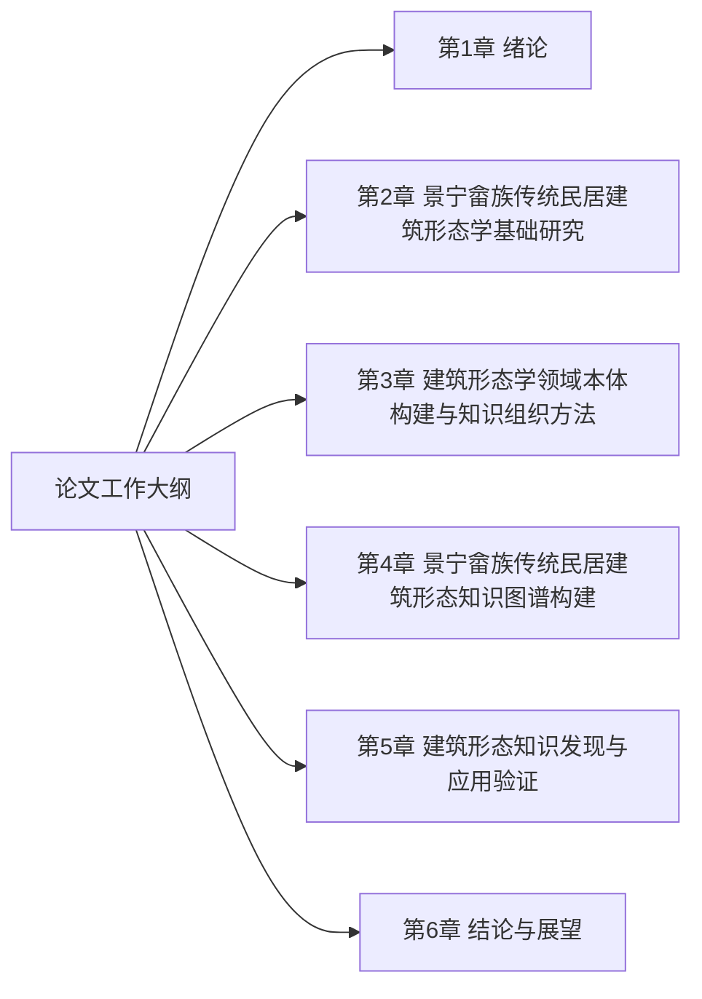

# 现行工作大纲

**这是可调整的工作大纲，不是定稿目录，也不是正文自动改写结果。**

结构维护：[[论文章节/大纲结构.yaml]]；研究目标：[[context/PROJECT_CONTEXT.md]]；工作路线：[[研究成果/〔研究路线〕论文研究路径/研究路径工作图.md]]。

按2026-11-16 Notion V3.3阶段结构组织：第一章提出问题，第二章建立景宁建筑形态学认知基础，第三章将建筑学认识转化为领域本体与知识组织模型，第四章构建真实知识图谱，第五章开展知识发现、推理与应用验证，第六章总结；第二至第六章暂细化到二级标题。结构修订不代表样本、规则、有效性或论文结论已验证；旧正文与原稿锚点继续保留。

## 章节总览

| 当前章节 | 论证任务 | 结构状态 |
|---|---|---|
| [第1章 绪论](%E7%AB%A0%E8%8A%82%E5%AF%BC%E8%88%AA/01-%E7%BB%AA%E8%AE%BA.md) | 提出传统民居建筑形态知识组织的研究问题，交代研究目的、研究现状、对象与概念、研究内容与方法及技术路线。 | V3.3工作结构；1.1 V0.9、1.2 V0.3、1.4 V0.1、1.5 V0.1已同步；1.3待写 |
| [第2章 景宁畲族传统民居建筑形态学基础研究](%E7%AB%A0%E8%8A%82%E5%AF%BC%E8%88%AA/02-%E7%90%86%E8%AE%BA%E5%9F%BA%E7%A1%80.md) | 以传统建筑形态学的研究内容和方法为基础，梳理景宁畲族传统民居的地域环境、建筑类型与空间组织、形态构成与特征，形成后续本体与知识图谱的建筑学依据。 | V3.3工作结构；第二至第六章仅细化到二级，正文、文献与样本核验待完成 |
| [第3章 建筑形态学领域本体构建与知识组织方法](%E7%AB%A0%E8%8A%82%E5%AF%BC%E8%88%AA/03-%E4%BD%93%E7%B3%BB%E4%B8%8E%E6%A8%A1%E5%9E%8B.md) | 将第二章的建筑学认识转化为可观察、可描述、可分类、可关联的领域概念、关系、本体与证据模型，并规定图谱模式与推理规则；不预写景宁实例结果。 | V3.3工作结构；本体、概念关系、证据模型与规则待建，尚无已核模型 |
| [第4章 景宁畲族传统民居建筑形态知识图谱构建](%E7%AB%A0%E8%8A%82%E5%AF%BC%E8%88%AA/04-%E6%99%AF%E5%AE%81%E5%AE%9E%E4%BE%8B.md) | 将第三章本体与模式应用于景宁真实样本，完成多源数据整理、形态知识提取与核验、图谱实例化及质量评价，形成可回查的实例图谱。 | V3.3工作结构；真实样本、数据与图谱实例待建，不表示已完成 |
| [第5章 建筑形态知识发现与应用验证](%E7%AB%A0%E8%8A%82%E5%AF%BC%E8%88%AA/05-%E9%A3%8E%E8%B2%8C%E5%88%86%E6%9E%90.md) | 以实例图谱及原始证据为基础，开展形态知识查询、类型识别、组合与规律分析、有限推理，并面向保护更新任务验证知识组织与应用价值。 | V3.3工作结构；分析与验证任务待实施，不预写发现 |
| [第6章 结论与展望](%E7%AB%A0%E8%8A%82%E5%AF%BC%E8%88%AA/06-%E7%BB%93%E8%AE%BA.md) | 总结建筑形态学认识、本体与知识组织方法、实例图谱及知识发现与应用验证的贡献，限定适用范围与局限。 | V3.3工作结构；结论待前文完成后撰写 |

## 当前整理重点

按V3.3收敛章际论证：第二章提供建筑学依据，第三章提供知识组织方法，第四章形成具体图谱，第五章验证建筑学认识与应用价值；结构确认不等于正文、样本或实证完成。

**全文逻辑：** 问题与对象 → 建筑形态学认知基础 → 领域本体与知识组织方法 → 真实知识图谱构建 → 知识发现、推理与应用验证 → 结论及适用范围。

## 标题总览（二级与已展开的三级）

### 第1章 绪论

**章内逻辑：** 研究背景 → 目的与意义 → 研究现状 → 对象与概念 → 内容、方法与技术路线。

- [1.1 研究背景与问题提出](%E7%AB%A0%E8%8A%82%E5%AF%BC%E8%88%AA/01-%E7%BB%AA%E8%AE%BA.md#section-1-1)
  - [1.1.1 传统民居保护更新的形态认知需求](%E7%AB%A0%E8%8A%82%E5%AF%BC%E8%88%AA/01-%E7%BB%AA%E8%AE%BA.md#sub-1-1-1)
  - [1.1.2 传统建筑研究的多源资料基础](%E7%AB%A0%E8%8A%82%E5%AF%BC%E8%88%AA/01-%E7%BB%AA%E8%AE%BA.md#sub-1-1-2)
  - [1.1.3 人工智能与知识图谱的发展及应用](%E7%AB%A0%E8%8A%82%E5%AF%BC%E8%88%AA/01-%E7%BB%AA%E8%AE%BA.md#sub-1-1-3)
  - [1.1.4 研究对象选择与问题提出](%E7%AB%A0%E8%8A%82%E5%AF%BC%E8%88%AA/01-%E7%BB%AA%E8%AE%BA.md#sub-1-1-4)
- [1.2 研究目的与意义](%E7%AB%A0%E8%8A%82%E5%AF%BC%E8%88%AA/01-%E7%BB%AA%E8%AE%BA.md#section-1-2)
  - [1.2.1 研究目的](%E7%AB%A0%E8%8A%82%E5%AF%BC%E8%88%AA/01-%E7%BB%AA%E8%AE%BA.md#sub-1-2-1)
  - [1.2.2 研究意义](%E7%AB%A0%E8%8A%82%E5%AF%BC%E8%88%AA/01-%E7%BB%AA%E8%AE%BA.md#sub-1-2-2)
- [1.3 国内外研究现状与评述](%E7%AB%A0%E8%8A%82%E5%AF%BC%E8%88%AA/01-%E7%BB%AA%E8%AE%BA.md#section-1-4)
  - [1.3.1 建筑形态学与传统民居建筑形态研究](%E7%AB%A0%E8%8A%82%E5%AF%BC%E8%88%AA/01-%E7%BB%AA%E8%AE%BA.md#sub-1-3-1)
  - [1.3.2 景宁畲族传统民居建筑研究](%E7%AB%A0%E8%8A%82%E5%AF%BC%E8%88%AA/01-%E7%BB%AA%E8%AE%BA.md#sub-1-3-2)
  - [1.3.3 建筑遗产数字化与领域知识组织技术研究](%E7%AB%A0%E8%8A%82%E5%AF%BC%E8%88%AA/01-%E7%BB%AA%E8%AE%BA.md#sub-1-3-3)
  - [1.3.4 研究现状评述与本研究切入点](%E7%AB%A0%E8%8A%82%E5%AF%BC%E8%88%AA/01-%E7%BB%AA%E8%AE%BA.md#sub-1-3-4)
- [1.4 研究对象与核心概念界定](%E7%AB%A0%E8%8A%82%E5%AF%BC%E8%88%AA/01-%E7%BB%AA%E8%AE%BA.md#section-1-3)
  - [1.4.1 研究对象与范围](%E7%AB%A0%E8%8A%82%E5%AF%BC%E8%88%AA/01-%E7%BB%AA%E8%AE%BA.md#sub-1-4-1)
  - [1.4.2 核心概念界定](%E7%AB%A0%E8%8A%82%E5%AF%BC%E8%88%AA/01-%E7%BB%AA%E8%AE%BA.md#sub-1-4-2)
- [1.5 研究内容、方法与技术路线](%E7%AB%A0%E8%8A%82%E5%AF%BC%E8%88%AA/01-%E7%BB%AA%E8%AE%BA.md#section-1-5)
  - [1.5.1 研究问题](%E7%AB%A0%E8%8A%82%E5%AF%BC%E8%88%AA/01-%E7%BB%AA%E8%AE%BA.md#sub-1-5-1)
  - [1.5.2 研究内容](%E7%AB%A0%E8%8A%82%E5%AF%BC%E8%88%AA/01-%E7%BB%AA%E8%AE%BA.md#sub-1-5-2)
  - [1.5.3 研究方法](%E7%AB%A0%E8%8A%82%E5%AF%BC%E8%88%AA/01-%E7%BB%AA%E8%AE%BA.md#sub-1-5-3)
  - [1.5.4 技术路线与论文结构](%E7%AB%A0%E8%8A%82%E5%AF%BC%E8%88%AA/01-%E7%BB%AA%E8%AE%BA.md#sub-1-5-4)

**向后接续：** 输出研究对象、概念边界与待收敛的研究问题，交第二章建立建筑形态学认知基础。

### 第2章 景宁畲族传统民居建筑形态学基础研究

**章内逻辑：** 地域环境 → 类型与空间 → 形态构成 → 综合认识 → 小结。

- [2.1 地域环境与民居形态背景](%E7%AB%A0%E8%8A%82%E5%AF%BC%E8%88%AA/02-%E7%90%86%E8%AE%BA%E5%9F%BA%E7%A1%80.md#section-2-region)
- [2.2 建筑类型与空间组织](%E7%AB%A0%E8%8A%82%E5%AF%BC%E8%88%AA/02-%E7%90%86%E8%AE%BA%E5%9F%BA%E7%A1%80.md#section-2-type-space)
- [2.3 建筑形态构成与特征](%E7%AB%A0%E8%8A%82%E5%AF%BC%E8%88%AA/02-%E7%90%86%E8%AE%BA%E5%9F%BA%E7%A1%80.md#section-2-form-composition)
- [2.4 形态关系、类型与形成因素的综合认识](%E7%AB%A0%E8%8A%82%E5%AF%BC%E8%88%AA/02-%E7%90%86%E8%AE%BA%E5%9F%BA%E7%A1%80.md#section-2-synthesis)
- [2.5 本章小结](%E7%AB%A0%E8%8A%82%E5%AF%BC%E8%88%AA/02-%E7%90%86%E8%AE%BA%E5%9F%BA%E7%A1%80.md#section-2-summary)

**向后接续：** 向第三章交付建筑学概念、形态维度与分析依据，不提前完成本体设计。

### 第3章 建筑形态学领域本体构建与知识组织方法

**章内逻辑：** 知识范围与原则 → 概念与关系模型 → 本体构建 → 多模态证据关联 → 图谱模式与推理 → 小结。

- [3.1 建筑形态学领域知识范围与组织原则](%E7%AB%A0%E8%8A%82%E5%AF%BC%E8%88%AA/03-%E4%BD%93%E7%B3%BB%E4%B8%8E%E6%A8%A1%E5%9E%8B.md#section-3-knowledge-scope)
- [3.2 建筑形态学领域概念体系与关系模型](%E7%AB%A0%E8%8A%82%E5%AF%BC%E8%88%AA/03-%E4%BD%93%E7%B3%BB%E4%B8%8E%E6%A8%A1%E5%9E%8B.md#section-3-concept-model)
- [3.3 建筑形态学领域本体构建](%E7%AB%A0%E8%8A%82%E5%AF%BC%E8%88%AA/03-%E4%BD%93%E7%B3%BB%E4%B8%8E%E6%A8%A1%E5%9E%8B.md#section-3-ontology)
- [3.4 多模态异构知识与证据关联模型](%E7%AB%A0%E8%8A%82%E5%AF%BC%E8%88%AA/03-%E4%BD%93%E7%B3%BB%E4%B8%8E%E6%A8%A1%E5%9E%8B.md#section-3-multimodal-evidence)
- [3.5 知识图谱模式设计与推理规则](%E7%AB%A0%E8%8A%82%E5%AF%BC%E8%88%AA/03-%E4%BD%93%E7%B3%BB%E4%B8%8E%E6%A8%A1%E5%9E%8B.md#section-3-schema-rules)
- [3.6 本章小结](%E7%AB%A0%E8%8A%82%E5%AF%BC%E8%88%AA/03-%E4%BD%93%E7%B3%BB%E4%B8%8E%E6%A8%A1%E5%9E%8B.md#section-3-5)

**向后接续：** 向第四章交付本体、图谱模式、证据关联与推理规则；规则不等于真实实例或发现。

### 第4章 景宁畲族传统民居建筑形态知识图谱构建

**章内逻辑：** 区域样本与来源 → 数据整理 → 知识提取核验 → 图谱实例化 → 质量评价 → 小结。

- [4.1 研究区域、样本与数据来源](%E7%AB%A0%E8%8A%82%E5%AF%BC%E8%88%AA/04-%E6%99%AF%E5%AE%81%E5%AE%9E%E4%BE%8B.md#section-4-sampling)
- [4.2 多模态异构数据整理与处理](%E7%AB%A0%E8%8A%82%E5%AF%BC%E8%88%AA/04-%E6%99%AF%E5%AE%81%E5%AE%9E%E4%BE%8B.md#section-4-data-production)
- [4.3 建筑形态知识提取、分类与核验](%E7%AB%A0%E8%8A%82%E5%AF%BC%E8%88%AA/04-%E6%99%AF%E5%AE%81%E5%AE%9E%E4%BE%8B.md#section-4-knowledge-extraction)
- [4.4 建筑形态知识图谱构建与实例化](%E7%AB%A0%E8%8A%82%E5%AF%BC%E8%88%AA/04-%E6%99%AF%E5%AE%81%E5%AE%9E%E4%BE%8B.md#section-4-instance-construction)
- [4.5 知识图谱质量评价](%E7%AB%A0%E8%8A%82%E5%AF%BC%E8%88%AA/04-%E6%99%AF%E5%AE%81%E5%AE%9E%E4%BE%8B.md#section-4-4)
- [4.6 本章小结](%E7%AB%A0%E8%8A%82%E5%AF%BC%E8%88%AA/04-%E6%99%AF%E5%AE%81%E5%AE%9E%E4%BE%8B.md#section-4-5)

**向后接续：** 向第五章交付可回查的实例事实、证据与资料边界；不以图谱规模或导入成功替代质量判断。

### 第5章 建筑形态知识发现与应用验证

**章内逻辑：** 查询检索 → 类型与特征发现 → 组合规律 → 推理深化 → 应用验证 → 小结。

- [5.1 建筑形态知识查询与关联检索](%E7%AB%A0%E8%8A%82%E5%AF%BC%E8%88%AA/05-%E9%A3%8E%E8%B2%8C%E5%88%86%E6%9E%90.md#section-5-knowledge-query)
- [5.2 建筑形态类型识别与特征关联发现](%E7%AB%A0%E8%8A%82%E5%AF%BC%E8%88%AA/05-%E9%A3%8E%E8%B2%8C%E5%88%86%E6%9E%90.md#section-5-type-discovery)
- [5.3 建筑形态组合与规律分析](%E7%AB%A0%E8%8A%82%E5%AF%BC%E8%88%AA/05-%E9%A3%8E%E8%B2%8C%E5%88%86%E6%9E%90.md#section-5-combination)
- [5.4 建筑形态知识推理与认知深化](%E7%AB%A0%E8%8A%82%E5%AF%BC%E8%88%AA/05-%E9%A3%8E%E8%B2%8C%E5%88%86%E6%9E%90.md#section-5-reasoning)
- [5.5 面向保护更新的知识应用与决策支持验证](%E7%AB%A0%E8%8A%82%E5%AF%BC%E8%88%AA/05-%E9%A3%8E%E8%B2%8C%E5%88%86%E6%9E%90.md#section-5-application)
- [5.6 本章小结](%E7%AB%A0%E8%8A%82%E5%AF%BC%E8%88%AA/05-%E9%A3%8E%E8%B2%8C%E5%88%86%E6%9E%90.md#section-5-summary)

**向后接续：** 向第六章交付有证据的建筑形态学认识、方法与应用判断；不以查询演示或图谱规模替代发现。

### 第6章 结论与展望

**章内逻辑：** 主要结论 → 研究贡献与创新 → 局限与展望。

- [6.1 主要研究结论](%E7%AB%A0%E8%8A%82%E5%AF%BC%E8%88%AA/06-%E7%BB%93%E8%AE%BA.md#section-6-1)
- [6.2 研究贡献与创新](%E7%AB%A0%E8%8A%82%E5%AF%BC%E8%88%AA/06-%E7%BB%93%E8%AE%BA.md#section-6-2)
- [6.3 研究局限与展望](%E7%AB%A0%E8%8A%82%E5%AF%BC%E8%88%AA/06-%E7%BB%93%E8%AE%BA.md#section-6-3)

**向后接续：** 回应第一章研究问题，不在结论新增未在前文建立的证据或主张。

## 后续证据任务（不作为本轮标题梳理的完成门槛）

### 第1章 绪论

- **[1.1 研究背景与问题提出](%E7%AB%A0%E8%8A%82%E5%AF%BC%E8%88%AA/01-%E7%BB%AA%E8%AE%BA.md#section-1-1)**：从传统民居保护更新的形态认知需求、既有建筑学研究与数字化资料基础、本体与知识图谱的方法条件出发，提出建筑形态知识组织、知识发现与应用的研究空间；研究缺口由1.3综述验证。
  - 所需证据：已核政策、地方实践与建筑学研究来源；多源资料与知识组织方法的原文依据；研究缺口的1.3综述验证。
- **[1.2 研究目的与意义](%E7%AB%A0%E8%8A%82%E5%AF%BC%E8%88%AA/01-%E7%BB%AA%E8%AE%BA.md#section-1-2)**：说明研究目的、建筑学意义、方法意义与应用意义；设计决策支持作为应用价值，不主导研究目的。
  - 所需证据：建筑形态学与知识组织的既有研究；研究问题—目的—意义对应关系。
- **[1.3 国内外研究现状与评述](%E7%AB%A0%E8%8A%82%E5%AF%BC%E8%88%AA/01-%E7%BB%AA%E8%AE%BA.md#section-1-4)**：按建筑形态学与传统民居形态研究、景宁畲族民居研究、建筑遗产数字化与领域知识组织技术三条线索评述，并以综合评述收敛本研究切入点。
  - 所需证据：原文作者、题名、Zotero条目与页码；三方向研究的对象、方法与证据对照；可继承成果、明确限制与本研究的待核推断。
- **[1.4 研究对象与核心概念界定](%E7%AB%A0%E8%8A%82%E5%AF%BC%E8%88%AA/01-%E7%BB%AA%E8%AE%BA.md#section-1-3)**：界定传统民居建筑、建筑形态、建筑形态学、建筑类型与空间组织、领域本体、知识图谱及多模态异构知识等概念，并明确景宁研究对象与范围。
  - 所需证据：景宁区域、L0—L3候选池与规划边界资料；对象纳入排除依据；概念来源、定义对照与术语边界。
- **[1.5 研究内容、方法与技术路线](%E7%AB%A0%E8%8A%82%E5%AF%BC%E8%88%AA/01-%E7%BB%AA%E8%AE%BA.md#section-1-5)**：在研究现状评述后收敛研究问题，分解研究内容，交代方法、技术路线与章节结构。
  - 所需证据：1.3综述结论与文献缺口；研究问题—内容—方法—证据对应关系；研究路径与章节任务。
### 第2章 景宁畲族传统民居建筑形态学基础研究

- **[2.1 地域环境与民居形态背景](%E7%AB%A0%E8%8A%82%E5%AF%BC%E8%88%AA/02-%E7%90%86%E8%AE%BA%E5%9F%BA%E7%A1%80.md#section-2-region)**：交代景宁山地环境、村落分布与民居形态的地域背景，说明环境条件与建筑形态的有据联系，不把背景描述当形态分析结论。
  - 所需证据：地域、聚落与民居研究原文；对象—环境关系的可核证据；L0—L3候选池与规划边界资料（待核）。
- **[2.2 建筑类型与空间组织](%E7%AB%A0%E8%8A%82%E5%AF%BC%E8%88%AA/02-%E7%90%86%E8%AE%BA%E5%9F%BA%E7%A1%80.md#section-2-type-space)**：梳理已有研究对景宁民居类型、平面形制、院落与空间组织的认识，区分文献原类型、样本类型与候选类型。
  - 所需证据：类型与空间研究原文及页码；平面、院落、测绘与调查证据；分类口径对照与未知项。
- **[2.3 建筑形态构成与特征](%E7%AB%A0%E8%8A%82%E5%AF%BC%E8%88%AA/02-%E7%90%86%E8%AE%BA%E5%9F%BA%E7%A1%80.md#section-2-form-composition)**：归纳体量、屋顶、立面、构件、材料等形态构成及其特征，说明可观察内容与资料条件；内部构架等不可见内容不因本章恢复。
  - 所需证据：形态构成与构件研究原文；照片、测绘、三维等资料条件；可见性与不可判定项记录。
- **[2.4 形态关系、类型与形成因素的综合认识](%E7%AB%A0%E8%8A%82%E5%AF%BC%E8%88%AA/02-%E7%90%86%E8%AE%BA%E5%9F%BA%E7%A1%80.md#section-2-synthesis)**：综合类型、空间组织、形态构成及营造、环境、历史文化等形成因素，形成进入本体设计的建筑学问题清单；关系与解释须有证据，不预设因果。
  - 所需证据：前三节核对结果；营造、环境、历史文化来源；反例、缺失与竞争解释。
- **[2.5 本章小结](%E7%AB%A0%E8%8A%82%E5%AF%BC%E8%88%AA/02-%E7%90%86%E8%AE%BA%E5%9F%BA%E7%A1%80.md#section-2-summary)**：归纳景宁建筑形态学认识、资料边界与进入第三章的知识需求，不重复本章各节细节。
  - 所需证据：前四节结论与来源；待补证据清单。
### 第3章 建筑形态学领域本体构建与知识组织方法

- **[3.1 建筑形态学领域知识范围与组织原则](%E7%AB%A0%E8%8A%82%E5%AF%BC%E8%88%AA/03-%E4%BD%93%E7%B3%BB%E4%B8%8E%E6%A8%A1%E5%9E%8B.md#section-3-knowledge-scope)**：界定进入本体的建筑形态知识范围、知识层次与组织原则，说明形态构成、关系、形成因素、类型规律及证据来源的边界。
  - 所需证据：传统建筑形态学与类型学研究内容；第二章建筑学问题清单；范围排除项与理由。
- **[3.2 建筑形态学领域概念体系与关系模型](%E7%AB%A0%E8%8A%82%E5%AF%BC%E8%88%AA/03-%E4%BD%93%E7%B3%BB%E4%B8%8E%E6%A8%A1%E5%9E%8B.md#section-3-concept-model)**：建立概念、类别、属性、关系与实例的层次，区分建筑对象、形态特征、类型、空间关系与证据；吸收BOT等既有本体时标明沿用与扩展。
  - 所需证据：概念来源与定义对照；BOT及既有本体原文；关系清单与语义约束。
- **[3.3 建筑形态学领域本体构建](%E7%AB%A0%E8%8A%82%E5%AF%BC%E8%88%AA/03-%E4%BD%93%E7%B3%BB%E4%B8%8E%E6%A8%A1%E5%9E%8B.md#section-3-ontology)**：说明本体构建方法、复用与扩展策略、类与属性定义、约束及版本管理，形成可复用的领域本体。
  - 所需证据：本体构建方法与工具来源；类、属性、约束定义；复用/扩展差异与版本记录。
- **[3.4 多模态异构知识与证据关联模型](%E7%AB%A0%E8%8A%82%E5%AF%BC%E8%88%AA/03-%E4%BD%93%E7%B3%BB%E4%B8%8E%E6%A8%A1%E5%9E%8B.md#section-3-multimodal-evidence)**：规定文本、照片、测绘、三维模型、调查记录等资料如何关联到建筑对象、形态特征与判断，保留来源、时点、定位与适用条件。
  - 所需证据：资料类型与元数据方案；对象—证据关联规则；来源、时点、定位与不确定性记录。
- **[3.5 知识图谱模式设计与推理规则](%E7%AB%A0%E8%8A%82%E5%AF%BC%E8%88%AA/03-%E4%BD%93%E7%B3%BB%E4%B8%8E%E6%A8%A1%E5%9E%8B.md#section-3-schema-rules)**：将本体转化为图谱模式，规定实体、关系、属性、约束及有限推理规则；区分事实、统计关联、规则推导与专业解释。
  - 所需证据：图谱模式与本体映射；推理规则及适用条件；与普通数据库/查询任务的边界说明。
- **[3.6 本章小结](%E7%AB%A0%E8%8A%82%E5%AF%BC%E8%88%AA/03-%E4%BD%93%E7%B3%BB%E4%B8%8E%E6%A8%A1%E5%9E%8B.md#section-3-5)**：总结知识范围、概念关系、本体、证据模型、图谱模式与推理规则，说明适用条件和待验证内容。
  - 所需证据：本章各节成果汇总；适用范围与待验证问题。
### 第4章 景宁畲族传统民居建筑形态知识图谱构建

- **[4.1 研究区域、样本与数据来源](%E7%AB%A0%E8%8A%82%E5%AF%BC%E8%88%AA/04-%E6%99%AF%E5%AE%81%E5%AE%9E%E4%BE%8B.md#section-4-sampling)**：交代研究区域、L0—L3分层候选池、建筑对象纳入与多源数据来源；样本数量开放，不预设固定十村或5+5配额，边界与代表性以已核资料为准。
  - 所需证据：区域规划、名录与L0—L3候选池核验；样本清单、纳入排除标准与去重记录；资料来源、时点与授权状态。
- **[4.2 多模态异构数据整理与处理](%E7%AB%A0%E8%8A%82%E5%AF%BC%E8%88%AA/04-%E6%99%AF%E5%AE%81%E5%AE%9E%E4%BE%8B.md#section-4-data-production)**：说明影像、测绘、三维、文献与调查资料的整理、配准、质量评估和处理，记录来源—对象—时点对应及不可用项。
  - 所需证据：资料清单与元数据；质量、遮挡、精度与配准记录；缺失、不可判定与未采集项。
- **[4.3 建筑形态知识提取、分类与核验](%E7%AB%A0%E8%8A%82%E5%AF%BC%E8%88%AA/04-%E6%99%AF%E5%AE%81%E5%AE%9E%E4%BE%8B.md#section-4-knowledge-extraction)**：按第三章概念与判据，从资料中提取形态特征、类型与关系，记录判断依据、疑难、缺失与复核；本节只做记录性判定，类型分布与规律留第五章。
  - 所需证据：特征提取与分类记录；原文、原图、模型定位；复核、争议与缺失记录。
- **[4.4 建筑形态知识图谱构建与实例化](%E7%AB%A0%E8%8A%82%E5%AF%BC%E8%88%AA/04-%E6%99%AF%E5%AE%81%E5%AE%9E%E4%BE%8B.md#section-4-instance-construction)**：应用第三章模式，将已核记录组织为对象、特征、类型、关系与证据相联的景宁实例图谱，并记录复用规则与必要适配。
  - 所需证据：实例记录与来源对应；构建、导入与一致性校核记录；模式适配及版本说明。
- **[4.5 知识图谱质量评价](%E7%AB%A0%E8%8A%82%E5%AF%BC%E8%88%AA/04-%E6%99%AF%E5%AE%81%E5%AE%9E%E4%BE%8B.md#section-4-4)**：评价图谱的对象覆盖、语义正确性、关系与证据完整性、空间对应及可维护性，说明可进入分析的数据与限制。
  - 所需证据：覆盖与完整性统计；抽样复核、错配与缺失记录；查询可运行性与维护记录。
- **[4.6 本章小结](%E7%AB%A0%E8%8A%82%E5%AF%BC%E8%88%AA/04-%E6%99%AF%E5%AE%81%E5%AE%9E%E4%BE%8B.md#section-4-5)**：归纳景宁实例图谱的构成、质量、证据与使用边界，限定第五章可分析范围。
  - 所需证据：可分析数据版本与来源；排除项、缺失项与资料限制。
### 第5章 建筑形态知识发现与应用验证

- **[5.1 建筑形态知识查询与关联检索](%E7%AB%A0%E8%8A%82%E5%AF%BC%E8%88%AA/05-%E9%A3%8E%E8%B2%8C%E5%88%86%E6%9E%90.md#section-5-knowledge-query)**：说明面向建筑形态问题的查询、关联检索与证据回查任务，比较图谱查询与文档/数据库检索的适用条件。
  - 所需证据：查询任务与基准问题集；图谱查询、文档/数据库对照；结果准确性与证据完整性记录。
- **[5.2 建筑形态类型识别与特征关联发现](%E7%AB%A0%E8%8A%82%E5%AF%BC%E8%88%AA/05-%E9%A3%8E%E8%B2%8C%E5%88%86%E6%9E%90.md#section-5-type-discovery)**：基于实例特征与关系识别类型、特征共现与关联，区分分类规则、实例归类与统计关联。
  - 所需证据：类型判定与特征记录；共现/关联分析与对照；反例、边界案例与解释限制。
- **[5.3 建筑形态组合与规律分析](%E7%AB%A0%E8%8A%82%E5%AF%BC%E8%88%AA/05-%E9%A3%8E%E8%B2%8C%E5%88%86%E6%9E%90.md#section-5-combination)**：分析建筑组合、空间组织与跨尺度形态关系，识别重复模式与差异；关系与共现须有统计/空间分析与建筑学解释。
  - 所需证据：跨尺度关系与比较结果；空间分析/统计结果；原始证据回查与反例。
- **[5.4 建筑形态知识推理与认知深化](%E7%AB%A0%E8%8A%82%E5%AF%BC%E8%88%AA/05-%E9%A3%8E%E8%B2%8C%E5%88%86%E6%9E%90.md#section-5-reasoning)**：在明确规则与证据下开展有限推理，形成类型、组合与形成因素的解释性认识；区分事实、规则推导与专业判断。
  - 所需证据：推理规则与输入事实；推理结果及人工复核；与文献解释的对照。
- **[5.5 面向保护更新的知识应用与决策支持验证](%E7%AB%A0%E8%8A%82%E5%AF%BC%E8%88%AA/05-%E9%A3%8E%E8%B2%8C%E5%88%86%E6%9E%90.md#section-5-application)**：选取明确保护更新任务，验证知识检索、案例比较、证据追溯与决策参考的支持能力；输出辅助信息，不替代专业决策。
  - 所需证据：任务、参与者与对照方案；检索/比较/追溯过程与结果；时间、完整性、可用性评价及失败记录。
- **[5.6 本章小结](%E7%AB%A0%E8%8A%82%E5%AF%BC%E8%88%AA/05-%E9%A3%8E%E8%B2%8C%E5%88%86%E6%9E%90.md#section-5-summary)**：归纳可进入结论的形态学发现、知识组织能力和应用验证结果及适用范围。
  - 所需证据：结论—分析结果—原始来源对应；限度与反例。
### 第6章 结论与展望

- **[6.1 主要研究结论](%E7%AB%A0%E8%8A%82%E5%AF%BC%E8%88%AA/06-%E7%BB%93%E8%AE%BA.md#section-6-1)**：回应研究问题，总结建筑形态学发现、知识组织方法与图谱构建结果；只写跨章结论，不重复第五章章内归纳。
  - 所需证据：第三至第五章实际成果与证据；研究问题—结论对应表。
- **[6.2 研究贡献与创新](%E7%AB%A0%E8%8A%82%E5%AF%BC%E8%88%AA/06-%E7%BB%93%E8%AE%BA.md#section-6-2)**：区分建筑学认识、本体与知识组织方法、实例图谱与应用验证的贡献，依据前文限定证据与适用范围；不把建库、软件使用或图示生成自动认定为创新。
  - 所需证据：模型及构建方法与既有研究的对照；真实实例成果与建筑学分析证据。
- **[6.3 研究局限与展望](%E7%AB%A0%E8%8A%82%E5%AF%BC%E8%88%AA/06-%E7%BB%93%E8%AE%BA.md#section-6-3)**：围绕样本、资料、规则、验证深度与实际未解决问题提出后续研究，不增加未经论证的成果声明。
  - 所需证据：样本和资料限制；失败及未解决问题记录。

## 调整方式

在大纲结构中调整顺序即调整展示编号；稳定ID不变。`included: false`表示停用而非删除证据。章节路径保留历史编号；主题角色或成果类型改名须显式迁移并同步引用，生成器只检查、不自行移动。标题、论证任务、采用状态与证据要求均由同一主源生成。

[设计与日常维护说明](../%E9%A1%B9%E7%9B%AE%E7%AE%A1%E7%90%86/%E5%8A%A8%E6%80%81%E7%A0%94%E7%A9%B6%E4%BD%93%E7%B3%BB.md) · [本轮逐项修订及旧稿接续](../%E9%A1%B9%E7%9B%AE%E7%AE%A1%E7%90%86/%E5%AD%A6%E6%9C%AF%E5%A4%A7%E7%BA%B2%E4%B8%8E%E8%A7%92%E8%89%B2%E5%91%BD%E5%90%8D%E4%BF%AE%E8%AE%A2%E8%AF%B4%E6%98%8E.md)。
