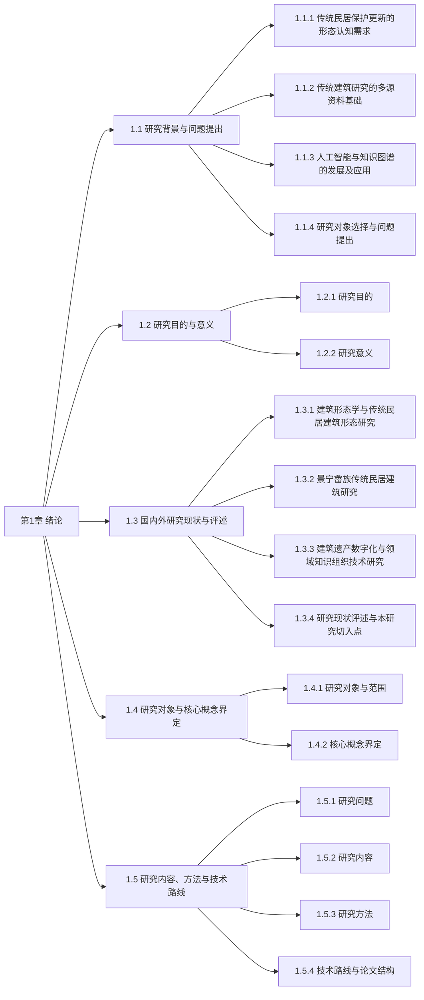

# 第1章 绪论

<!-- dynamic-chapter:start -->
## 当前工作安排

> 由[[论文章节/大纲结构.yaml|大纲结构]]生成。修改主源后运行同步；文件夹编号仅为历史路径，不决定当前章节顺序。

**本章任务：** 提出传统民居建筑形态知识组织的研究问题，交代研究目的、研究现状、对象与概念、研究内容与方法及技术路线。

**结构状态：** V3.3工作结构；1.1 V0.9、1.2 V0.3、1.4 V0.1、1.5 V0.1已同步；1.3待写

[打开既有正文对应章](../%E5%85%A8%E6%96%87%E5%B7%A5%E4%BD%9C%E7%A8%BF/%E6%99%AF%E5%AE%81%E7%95%B2%E6%97%8F%E4%BC%A0%E7%BB%9F%E6%B0%91%E5%B1%85%E5%BB%BA%E7%AD%91%E5%BD%A2%E6%80%81%E7%9F%A5%E8%AF%86%E7%BB%84%E7%BB%87%E4%B8%8E%E5%BA%94%E7%94%A8%E7%A0%94%E7%A9%B6v0.1.md)。正文未随结构自动改写。

**章内逻辑：** 研究背景 → 目的与意义 → 研究现状 → 对象与概念 → 内容、方法与技术路线。

**向后接续：** 输出研究对象、概念边界与待收敛的研究问题，交第二章建立建筑形态学认知基础。

## 小节与主题成果采用表

| 小节 | 主题及成果入口 | 本节用途 | 采用状态与证据缺口 |
|---|---|---|---|
| 1.1 研究背景与问题提出 | [〔理论与文献依据〕畲族民居研究与理论依据](../../%E4%B8%BB%E9%A2%98%E7%A0%94%E7%A9%B6/%E3%80%94%E7%90%86%E8%AE%BA%E4%B8%8E%E6%96%87%E7%8C%AE%E4%BE%9D%E6%8D%AE%E3%80%95%E7%95%B2%E6%97%8F%E6%B0%91%E5%B1%85%E7%A0%94%E7%A9%B6%E4%B8%8E%E7%90%86%E8%AE%BA%E4%BE%9D%E6%8D%AE/%E3%80%94%E7%90%86%E8%AE%BA%E4%B8%8E%E6%96%87%E7%8C%AE%E4%BE%9D%E6%8D%AE%E3%80%95%E7%95%B2%E6%97%8F%E6%B0%91%E5%B1%85%E7%A0%94%E7%A9%B6%E4%B8%8E%E7%90%86%E8%AE%BA%E4%BE%9D%E6%8D%AE.md)、[〔检验与评价〕图谱试建、查询与有效性](../../%E4%B8%BB%E9%A2%98%E7%A0%94%E7%A9%B6/%E3%80%94%E6%A3%80%E9%AA%8C%E4%B8%8E%E8%AF%84%E4%BB%B7%E3%80%95%E5%9B%BE%E8%B0%B1%E8%AF%95%E5%BB%BA%E3%80%81%E6%9F%A5%E8%AF%A2%E4%B8%8E%E6%9C%89%E6%95%88%E6%80%A7/%E3%80%94%E6%A3%80%E9%AA%8C%E4%B8%8E%E8%AF%84%E4%BB%B7%E3%80%95%E5%9B%BE%E8%B0%B1%E8%AF%95%E5%BB%BA%E3%80%81%E6%9F%A5%E8%AF%A2%E4%B8%8E%E6%9C%89%E6%95%88%E6%80%A7.md) | 从传统民居保护更新的形态认知需求、既有建筑学研究与数字化资料基础、本体与知识图谱的方法条件出发，提出建筑形态知识组织、知识发现与应用的研究空间；研究缺口由1.3综述验证。 | 1.1 V0.9已同步为导师讨论稿；待补文献、引文页码及1.3缺口验证 |
| 1.2 研究目的与意义 | [〔理论与文献依据〕畲族民居研究与理论依据](../../%E4%B8%BB%E9%A2%98%E7%A0%94%E7%A9%B6/%E3%80%94%E7%90%86%E8%AE%BA%E4%B8%8E%E6%96%87%E7%8C%AE%E4%BE%9D%E6%8D%AE%E3%80%95%E7%95%B2%E6%97%8F%E6%B0%91%E5%B1%85%E7%A0%94%E7%A9%B6%E4%B8%8E%E7%90%86%E8%AE%BA%E4%BE%9D%E6%8D%AE/%E3%80%94%E7%90%86%E8%AE%BA%E4%B8%8E%E6%96%87%E7%8C%AE%E4%BE%9D%E6%8D%AE%E3%80%95%E7%95%B2%E6%97%8F%E6%B0%91%E5%B1%85%E7%A0%94%E7%A9%B6%E4%B8%8E%E7%90%86%E8%AE%BA%E4%BE%9D%E6%8D%AE.md)、[〔检验与评价〕图谱试建、查询与有效性](../../%E4%B8%BB%E9%A2%98%E7%A0%94%E7%A9%B6/%E3%80%94%E6%A3%80%E9%AA%8C%E4%B8%8E%E8%AF%84%E4%BB%B7%E3%80%95%E5%9B%BE%E8%B0%B1%E8%AF%95%E5%BB%BA%E3%80%81%E6%9F%A5%E8%AF%A2%E4%B8%8E%E6%9C%89%E6%95%88%E6%80%A7/%E3%80%94%E6%A3%80%E9%AA%8C%E4%B8%8E%E8%AF%84%E4%BB%B7%E3%80%95%E5%9B%BE%E8%B0%B1%E8%AF%95%E5%BB%BA%E3%80%81%E6%9F%A5%E8%AF%A2%E4%B8%8E%E6%9C%89%E6%95%88%E6%80%A7.md) | 说明研究目的、建筑学意义、方法意义与应用意义；设计决策支持作为应用价值，不主导研究目的。 | 1.2 V0.3已同步为导师讨论稿；引文、页码与1.3衔接待核 |
| 1.3 国内外研究现状与评述 | [〔理论与文献依据〕畲族民居研究与理论依据](../../%E4%B8%BB%E9%A2%98%E7%A0%94%E7%A9%B6/%E3%80%94%E7%90%86%E8%AE%BA%E4%B8%8E%E6%96%87%E7%8C%AE%E4%BE%9D%E6%8D%AE%E3%80%95%E7%95%B2%E6%97%8F%E6%B0%91%E5%B1%85%E7%A0%94%E7%A9%B6%E4%B8%8E%E7%90%86%E8%AE%BA%E4%BE%9D%E6%8D%AE/%E3%80%94%E7%90%86%E8%AE%BA%E4%B8%8E%E6%96%87%E7%8C%AE%E4%BE%9D%E6%8D%AE%E3%80%95%E7%95%B2%E6%97%8F%E6%B0%91%E5%B1%85%E7%A0%94%E7%A9%B6%E4%B8%8E%E7%90%86%E8%AE%BA%E4%BE%9D%E6%8D%AE.md)、[〔研究方法〕类型识别与比较](../../%E4%B8%BB%E9%A2%98%E7%A0%94%E7%A9%B6/%E3%80%94%E7%A0%94%E7%A9%B6%E6%96%B9%E6%B3%95%E3%80%95%E7%B1%BB%E5%9E%8B%E8%AF%86%E5%88%AB%E4%B8%8E%E6%AF%94%E8%BE%83/%E3%80%94%E7%A0%94%E7%A9%B6%E6%96%B9%E6%B3%95%E3%80%95%E7%B1%BB%E5%9E%8B%E8%AF%86%E5%88%AB%E4%B8%8E%E6%AF%94%E8%BE%83.md) | 按建筑形态学与传统民居形态研究、景宁畲族民居研究、建筑遗产数字化与领域知识组织技术三条线索评述，并以综合评述收敛本研究切入点。 | 四节结构已按V3.3确认；文献范围、逐项对照与评述待完成 |
| 1.4 研究对象与核心概念界定 | [〔研究界定〕研究对象与样本边界](../../%E4%B8%BB%E9%A2%98%E7%A0%94%E7%A9%B6/%E3%80%94%E7%A0%94%E7%A9%B6%E7%95%8C%E5%AE%9A%E3%80%95%E7%A0%94%E7%A9%B6%E5%AF%B9%E8%B1%A1%E4%B8%8E%E6%A0%B7%E6%9C%AC%E8%BE%B9%E7%95%8C/%E3%80%94%E7%A0%94%E7%A9%B6%E7%95%8C%E5%AE%9A%E3%80%95%E7%A0%94%E7%A9%B6%E5%AF%B9%E8%B1%A1%E4%B8%8E%E6%A0%B7%E6%9C%AC%E8%BE%B9%E7%95%8C.md)、[〔体系设计〕多尺度语义模型与建模依据](../../%E4%B8%BB%E9%A2%98%E7%A0%94%E7%A9%B6/%E3%80%94%E4%BD%93%E7%B3%BB%E8%AE%BE%E8%AE%A1%E3%80%95%E5%A4%9A%E5%B0%BA%E5%BA%A6%E8%AF%AD%E4%B9%89%E6%A8%A1%E5%9E%8B%E4%B8%8E%E5%BB%BA%E6%A8%A1%E4%BE%9D%E6%8D%AE/%E3%80%94%E4%BD%93%E7%B3%BB%E8%AE%BE%E8%AE%A1%E3%80%95%E5%A4%9A%E5%B0%BA%E5%BA%A6%E8%AF%AD%E4%B9%89%E6%A8%A1%E5%9E%8B%E4%B8%8E%E5%BB%BA%E6%A8%A1%E4%BE%9D%E6%8D%AE.md)、[〔理论与文献依据〕畲族民居研究与理论依据](../../%E4%B8%BB%E9%A2%98%E7%A0%94%E7%A9%B6/%E3%80%94%E7%90%86%E8%AE%BA%E4%B8%8E%E6%96%87%E7%8C%AE%E4%BE%9D%E6%8D%AE%E3%80%95%E7%95%B2%E6%97%8F%E6%B0%91%E5%B1%85%E7%A0%94%E7%A9%B6%E4%B8%8E%E7%90%86%E8%AE%BA%E4%BE%9D%E6%8D%AE/%E3%80%94%E7%90%86%E8%AE%BA%E4%B8%8E%E6%96%87%E7%8C%AE%E4%BE%9D%E6%8D%AE%E3%80%95%E7%95%B2%E6%97%8F%E6%B0%91%E5%B1%85%E7%A0%94%E7%A9%B6%E4%B8%8E%E7%90%86%E8%AE%BA%E4%BE%9D%E6%8D%AE.md) | 界定传统民居建筑、建筑形态、建筑形态学、建筑类型与空间组织、领域本体、知识图谱及多模态异构知识等概念，并明确景宁研究对象与范围。 | 1.4 V0.1已同步为导师讨论稿；L0—L3候选池、引文与样本边界待核 |
| 1.5 研究内容、方法与技术路线 | [〔体系设计〕多尺度语义模型与建模依据](../../%E4%B8%BB%E9%A2%98%E7%A0%94%E7%A9%B6/%E3%80%94%E4%BD%93%E7%B3%BB%E8%AE%BE%E8%AE%A1%E3%80%95%E5%A4%9A%E5%B0%BA%E5%BA%A6%E8%AF%AD%E4%B9%89%E6%A8%A1%E5%9E%8B%E4%B8%8E%E5%BB%BA%E6%A8%A1%E4%BE%9D%E6%8D%AE/%E3%80%94%E4%BD%93%E7%B3%BB%E8%AE%BE%E8%AE%A1%E3%80%95%E5%A4%9A%E5%B0%BA%E5%BA%A6%E8%AF%AD%E4%B9%89%E6%A8%A1%E5%9E%8B%E4%B8%8E%E5%BB%BA%E6%A8%A1%E4%BE%9D%E6%8D%AE.md)、[〔体系设计〕风貌特征筛选与数据记录](../../%E4%B8%BB%E9%A2%98%E7%A0%94%E7%A9%B6/%E3%80%94%E4%BD%93%E7%B3%BB%E8%AE%BE%E8%AE%A1%E3%80%95%E9%A3%8E%E8%B2%8C%E7%89%B9%E5%BE%81%E7%AD%9B%E9%80%89%E4%B8%8E%E6%95%B0%E6%8D%AE%E8%AE%B0%E5%BD%95/%E3%80%94%E4%BD%93%E7%B3%BB%E8%AE%BE%E8%AE%A1%E3%80%95%E9%A3%8E%E8%B2%8C%E7%89%B9%E5%BE%81%E7%AD%9B%E9%80%89%E4%B8%8E%E6%95%B0%E6%8D%AE%E8%AE%B0%E5%BD%95.md)、[〔检验与评价〕图谱试建、查询与有效性](../../%E4%B8%BB%E9%A2%98%E7%A0%94%E7%A9%B6/%E3%80%94%E6%A3%80%E9%AA%8C%E4%B8%8E%E8%AF%84%E4%BB%B7%E3%80%95%E5%9B%BE%E8%B0%B1%E8%AF%95%E5%BB%BA%E3%80%81%E6%9F%A5%E8%AF%A2%E4%B8%8E%E6%9C%89%E6%95%88%E6%80%A7/%E3%80%94%E6%A3%80%E9%AA%8C%E4%B8%8E%E8%AF%84%E4%BB%B7%E3%80%95%E5%9B%BE%E8%B0%B1%E8%AF%95%E5%BB%BA%E3%80%81%E6%9F%A5%E8%AF%A2%E4%B8%8E%E6%9C%89%E6%95%88%E6%80%A7.md) | 在研究现状评述后收敛研究问题，分解研究内容，交代方法、技术路线与章节结构。 | 1.5 V0.1已同步为导师讨论稿；研究问题待1.3综述后收口 |

## 三级标题与论证分工

三级标题用于思路梳理；理论及分析视角是比较对象，不表示全部采用。成果入口和采用关系沿用父节，不重复计数。

| 三级标题 | 论证任务 | 状态 |
|---|---|---|
| 1.1.1 传统民居保护更新的形态认知需求 | 从政策、地方实践与保护更新任务说明系统的建筑形态认知需求，不把一般数字化趋势当作研究必要性。 | V3.3工作结构；正文与核验待完成 |
| 1.1.2 传统建筑研究的多源资料基础 | 说明既有建筑学研究、测绘、照片、档案与数字模型构成的多源知识基础及其表达差异。 | V3.3工作结构；正文与核验待完成 |
| 1.1.3 人工智能与知识图谱的发展及应用 | 说明本体与知识图谱可为形态知识组织、关联查询和有限推理提供方法条件，同时区分图谱、HBIM与数字化平台的能力。 | V3.3工作结构；正文与核验待完成 |
| 1.1.4 研究对象选择与问题提出 | 以综合段收束前文，说明景宁畲族传统民居作为实证对象的理由与待补证据，并提出研究问题；研究缺口比较留待1.3。 | V3.3工作结构；正文与核验待完成 |
| 1.2.1 研究目的 | 说明以建筑形态学为基础、以本体与图谱组织知识并开展知识发现与应用验证的研究目的。 | 1.2 V0.3已同步；引文与页码待核 |
| 1.2.2 研究意义 | 分建筑学意义、方法意义与应用意义，说明知识资产与决策支持的价值边界。 | 1.2 V0.3已同步；引文与页码待核 |
| 1.3.1 建筑形态学与传统民居建筑形态研究 | 合并形态学、类型学与传统民居形态研究，按“理论与方法—研究实践”评述形态构成、类型划分、空间关系、比较及形成演变解释。 | V3.3工作结构；正文与核验待完成 |
| 1.3.2 景宁畲族传统民居建筑研究 | 评述已有研究的对象范围、建筑类型、空间形制、构造材料、营造技艺及文化解释，检查样本、图纸和调查证据，区分景宁直接证据与外地参照。 | V3.3工作结构；正文与核验待完成 |
| 1.3.3 建筑遗产数字化与领域知识组织技术研究 | 对照数字测绘、三维、GIS、BIM/HBIM、数字档案与本体、知识图谱、多源融合、查询推理，比较能力、边界和协同，不混同信息管理与知识组织。 | V3.3工作结构；正文与核验待完成 |
| 1.3.4 研究现状评述与本研究切入点 | 形成“建筑学基础—实证对象基础—技术方法基础”的交汇分析，区分可继承成果、文献限制、本研究推断与景宁待核问题，再提炼切入点。 | V3.3工作结构；正文与核验待完成 |
| 1.4.1 研究对象与范围 | 交代景宁畲族传统民居对象、L0—L3四级候选池与开放样本范围；不预设固定十村或5+5配额，具体村落、建筑与代表性待核。 | 1.4 V0.1已同步；候选池与范围待核 |
| 1.4.2 核心概念界定 | 界定传统民居建筑、建筑形态、建筑形态学、建筑类型与空间组织、领域本体、知识图谱、多模态异构知识；技术概念按任务需要纳入。 | 1.4 V0.1已同步；概念定义与引文待核 |
| 1.5.1 研究问题 | 依据1.3评述收口核心问题与四个子问题；1.5 V0.1已提出知识范围与分类、领域建模与图谱构建、知识发现与有限推理、应用验证与适用边界四问。 | 1.5.1 V0.1已同步；待1.3综述定稿后作最终语义收口 |
| 1.5.2 研究内容 | 分解建筑形态学基础、领域本体与知识组织、知识图谱构建、知识发现与应用验证四组内容。 | 1.5 V0.1已同步；正文与核验待完成 |
| 1.5.3 研究方法 | 交代文献与理论梳理、田野调查与多源数据采集、形态特征提取与分类编码、本体设计与关系建模、图谱构建、查询分析与验证。 | 1.5 V0.1已同步；正文与核验待完成 |
| 1.5.4 技术路线与论文结构 | 说明章节递进与技术路线，区分研究依赖、迭代过程与论文呈现；合成试建不进入正文。 | 1.5 V0.1已同步；配图与核验待完成 |

## 逐节研究问题与证据要求

以下是待执行的研究要求，不是已完成或已验证声明；采用状态仍以上表为准。

### 研究背景与问题提出

- **问题**：为什么需要系统的建筑形态认知，既有知识与技术条件能支持什么，仍缺什么？
- **所需证据／待核材料**：已核政策、地方实践与建筑学研究来源；多源资料与知识组织方法的原文依据；研究缺口的1.3综述验证。
- **完成判据**：四个论点均有来源与适用边界；研究空间表述为待验证缺口，不写成既定事实。

### 研究目的与意义

- **问题**：研究要回答什么，预期在建筑学认识、知识组织方法和保护更新应用上形成什么价值？
- **所需证据／待核材料**：建筑形态学与知识组织的既有研究；研究问题—目的—意义对应关系。
- **完成判据**：研究目的回到建筑形态学知识组织、发现与推理；不以数字化趋势或技术采用替代建筑学问题。

### 国内外研究现状与评述

- **问题**：已有研究分别提供了什么建筑学认识、对象证据和技术方法，哪些限制有原文支持？
- **所需证据／待核材料**：原文作者、题名、Zotero条目与页码；三方向研究的对象、方法与证据对照；可继承成果、明确限制与本研究的待核推断。
- **完成判据**：区分原文结论、本研究判断与待查文献；不预设技术线性发展，不把图谱应用本身认定为创新。

### 研究对象与核心概念界定

- **问题**：研究哪些建筑与形态知识，核心概念之间怎样区分，样本范围如何限定？
- **所需证据／待核材料**：景宁区域、L0—L3候选池与规划边界资料；对象纳入排除依据；概念来源、定义对照与术语边界。
- **完成判据**：对象与尺度不混同；概念界定有来源和适用范围；L0—L3候选池与样本数量开放，不把名录并集或项目名称当作代表性已证。

### 研究内容、方法与技术路线

- **问题**：研究问题如何由综述收敛，内容、方法与技术路线怎样对应？
- **所需证据／待核材料**：1.3综述结论与文献缺口；研究问题—内容—方法—证据对应关系；研究路径与章节任务。
- **完成判据**：研究问题由综述与对象边界收敛；不以技术路线倒推问题，不把合成试建列为正文成果。

## 本章结构图

## 稳定节点与原稿接续

- `section-1-1`：研究背景与问题提出；纳入当前工作大纲。原稿编号：1.1；变更说明：2026-11-17按Notion 1.1 V0.9同步本节标题与四个论点；V3.3原建议的三级标题保留在变更说明中，正文以工作稿为准。

- `section-1-2`：研究目的与意义；纳入当前工作大纲。原稿编号：1.2；变更说明：2026-11-17按V3.3拆分：研究问题移至1.5.1，本节只保留目的与意义；同日按1.2 V0.3同步正文，历史V0.1/V0.2未并入。

- `section-1-4`：国内外研究现状与评述；纳入当前工作大纲。原稿编号：1.3；变更说明：2026-11-17按V3.3将原六节综述压缩为“三个研究方向＋一个综合评述”，替代V3.2分节；节内不再增设编号子节。

- `section-1-3`：研究对象与核心概念界定；纳入当前工作大纲。原稿编号：1.4；变更说明：2026-11-17按V3.3由“研究对象与研究范围”扩为“研究对象与核心概念界定”；同日按1.4 V0.1同步正文，采用L0—L3开放样本口径，不预设固定十村或5+5配额。

- `section-1-5`：研究内容、方法与技术路线；纳入当前工作大纲。原稿编号：1.5；变更说明：2026-11-17按V3.3把技术路线并入本节，原1.6停用；同日按1.5 V0.1同步正文，1.5.1已提出核心问题与四个子问题，待1.3定稿后收口。

- `section-1-6`：技术路线与论文结构；停用、保留追溯。原稿编号：1.6；变更说明：2026-10-29用户确认体系—实例图谱—风貌分析分工；由“研究路径与论文论证安排”调整，保留稳定ID及原稿接续；正文未改写；2026-10-29标题与逻辑梳理：由“研究路径与论文论证安排”接续，仍为工作大纲，正文不改；2026-11-17按V3.3技术路线并入1.5.4，本节停用并保留追溯。

## 三级稳定节点

- `sub-1-1-1`：传统民居保护更新的形态认知需求；纳入当前工作大纲；2026-11-17按1.1 V0.9新增；V3.3原建议标题为“传统民居保护更新对系统性建筑形态认知的需求”。

- `sub-1-1-2`：传统建筑研究的多源资料基础；纳入当前工作大纲；2026-11-17按1.1 V0.9新增；V3.3原建议标题为“传统建筑形态研究与数字化资料积累提供了知识基础”。

- `sub-1-1-3`：人工智能与知识图谱的发展及应用；纳入当前工作大纲；2026-11-17按1.1 V0.9新增；V3.3原建议标题为“本体与知识图谱为建筑形态知识组织和关联推理提供了新的方法条件”。

- `sub-1-1-4`：研究对象选择与问题提出；纳入当前工作大纲；2026-11-17按1.1 V0.9新增；V3.3原建议标题为“建筑形态知识的系统组织、知识发现与应用仍有进一步研究空间”。

- `sub-1-2-1`：研究目的；纳入当前工作大纲；2026-11-17按V3.3新增；1.2 V0.3同步；原1.2.1“研究目的”保留接续。

- `sub-1-2-2`：研究意义；纳入当前工作大纲；2026-11-17按V3.3新增；1.2 V0.3已按建筑学、方法、应用三层重写；原1.2.2、1.2.3意义内容保留追溯。

- `sub-1-3-1`：建筑形态学与传统民居建筑形态研究；纳入当前工作大纲；2026-11-17按V3.3新增；原1.3多节综述内容待重新组织。

- `sub-1-3-2`：景宁畲族传统民居建筑研究；纳入当前工作大纲；2026-11-17按V3.3新增；原1.3景宁研究内容待重新组织。

- `sub-1-3-3`：建筑遗产数字化与领域知识组织技术研究；纳入当前工作大纲；2026-11-17按V3.3新增；原1.3技术综述内容待重新组织。

- `sub-1-3-4`：研究现状评述与本研究切入点；纳入当前工作大纲；2026-11-17按V3.3新增；替代原“研究现状评述与本研究切入点”分节。

- `sub-1-4-1`：研究对象与范围；纳入当前工作大纲；2026-11-17按V3.3新增；1.4 V0.1已按L0—L3候选池与开放样本重写；原1.3研究对象内容保留追溯。

- `sub-1-4-2`：核心概念界定；纳入当前工作大纲；2026-11-17按V3.3新增；1.4 V0.1已界定传统民居、建筑形态、类型与空间组织、本体与图谱、多模态知识与证据追溯；原1.3.2、1.3.3概念内容保留追溯。

- `sub-1-5-1`：研究问题；纳入当前工作大纲；2026-11-17新增；1.5 V0.1已提出核心问题与四个子问题，待1.3定稿后收口；研究问题主源同日同步到路径JSON，旧四问保留历史。

- `sub-1-5-2`：研究内容；纳入当前工作大纲；2026-11-17按V3.3新增；1.5 V0.1已分解为形态学基础、本体与知识组织、图谱构建、发现与应用验证四组内容。

- `sub-1-5-3`：研究方法；纳入当前工作大纲；2026-11-17按V3.3新增；1.5 V0.1已列文献与史料互证、类型学与形态学分析、田野与多模态采集、本体与图谱构建、图查询与案例对照五类方法。

- `sub-1-5-4`：技术路线与论文结构；纳入当前工作大纲；2026-11-17按V3.3新增；1.5 V0.1已列四阶段技术路线与六章结构，技术路线图、章节逻辑图待配。

## 调整与反馈

需要调整题名、顺序、节的归属或采用状态时，修改大纲结构；稳定ID不随编号改变。新增、停用、拆分合并必须保留理由及原稿接续，不能由文件数自动认定研究完成。
<!-- dynamic-chapter:end -->
