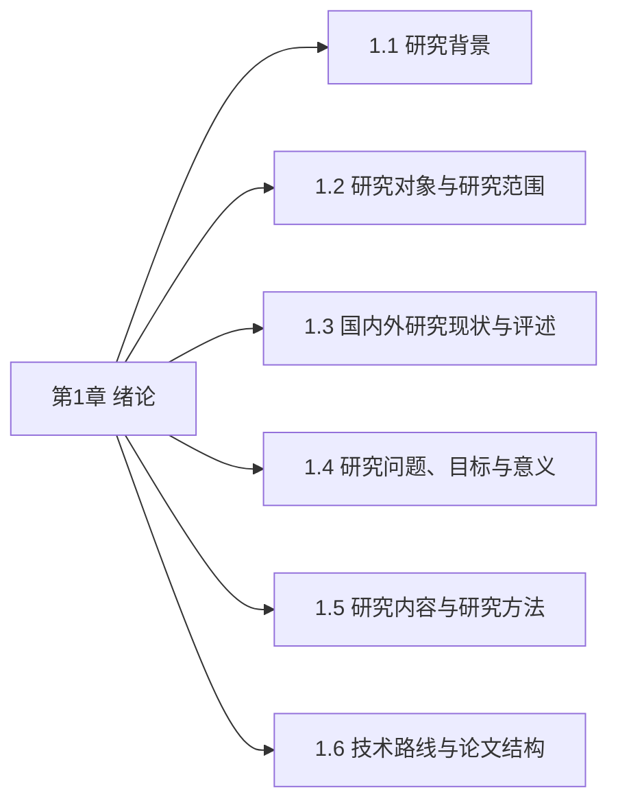

# 第1章 绪论

<!-- dynamic-chapter:start -->
## 当前工作安排

> 由[[论文章节/大纲结构.yaml|大纲结构]]生成。修改主源后运行同步；文件夹编号仅为历史路径，不决定当前章节顺序。

**本章任务：** 提出景宁畲族传统民居风貌研究问题，交代体系构建、实例图谱构建和建筑学分析的目标及证据要求。

**结构状态：** 按已确认分工调整的工作结构；正文与研究证据待补，不表示已完成应用或验证

[打开既有正文对应章](../%E5%85%A8%E6%96%87%E5%B7%A5%E4%BD%9C%E7%A8%BF/%E6%99%AF%E5%AE%81%E7%95%B2%E6%97%8F%E4%BC%A0%E7%BB%9F%E6%B0%91%E5%B1%85%E9%A3%8E%E8%B2%8C%E7%89%B9%E5%BE%81%E6%8F%90%E5%8F%96%E4%B8%8E%E7%9F%A5%E8%AF%86%E5%9B%BE%E8%B0%B1%E6%9E%84%E5%BB%BA%E7%A0%94%E7%A9%B6v0.6.md#%E7%AC%AC%E4%B8%80%E7%AB%A0%20%E7%BB%AA%E8%AE%BA)。正文未随结构自动改写。

**章内逻辑：** 背景 → 对象范围 → 研究现状 → 问题目标 → 内容方法 → 技术路线。

**向后接续：** 输出研究问题和范围，交第二章论证概念、分析依据及结合方式。

## 小节与主题成果采用表

| 小节             | 主题及成果入口                                                                                                                                                                                                                                                                                                                                                                                                                                                                                                                                                                                                                                                                                                                                                                                                                                                                                                                                                                                                                                                                                                                                                                                                                                          | 本节用途                                                                  | 采用状态与证据缺口                           |
| -------------- | ------------------------------------------------------------------------------------------------------------------------------------------------------------------------------------------------------------------------------------------------------------------------------------------------------------------------------------------------------------------------------------------------------------------------------------------------------------------------------------------------------------------------------------------------------------------------------------------------------------------------------------------------------------------------------------------------------------------------------------------------------------------------------------------------------------------------------------------------------------------------------------------------------------------------------------------------------------------------------------------------------------------------------------------------------------------------------------------------------------------------------------------------------------------------------------------------------------------------------------------------ | --------------------------------------------------------------------- | ----------------------------------- |
| 1.1 研究背景       | [〔理论与文献依据〕畲族民居研究与理论依据](../../%E4%B8%BB%E9%A2%98%E7%A0%94%E7%A9%B6/%E3%80%94%E7%90%86%E8%AE%BA%E4%B8%8E%E6%96%87%E7%8C%AE%E4%BE%9D%E6%8D%AE%E3%80%95%E7%95%B2%E6%97%8F%E6%B0%91%E5%B1%85%E7%A0%94%E7%A9%B6%E4%B8%8E%E7%90%86%E8%AE%BA%E4%BE%9D%E6%8D%AE/%E3%80%94%E7%90%86%E8%AE%BA%E4%B8%8E%E6%96%87%E7%8C%AE%E4%BE%9D%E6%8D%AE%E3%80%95%E7%95%B2%E6%97%8F%E6%B0%91%E5%B1%85%E7%A0%94%E7%A9%B6%E4%B8%8E%E7%90%86%E8%AE%BA%E4%BE%9D%E6%8D%AE.md)                                                                                                                                                                                                                                                                                                                                                                                                                                                                                                                                                                                                                                                                                                                                                                                                  | 从传统民居风貌研究和资料利用的实际问题引出研究必要性，不从软件工具倒推研究对象；本节只交代问题缘起，正式研究问题在1.4提出        | 计划采用；结构任务已调整，证据与正文仍待补               |
| 1.2 研究对象与研究范围  | [〔研究界定〕研究对象与样本边界](../../%E4%B8%BB%E9%A2%98%E7%A0%94%E7%A9%B6/%E3%80%94%E7%A0%94%E7%A9%B6%E7%95%8C%E5%AE%9A%E3%80%95%E7%A0%94%E7%A9%B6%E5%AF%B9%E8%B1%A1%E4%B8%8E%E6%A0%B7%E6%9C%AC%E8%BE%B9%E7%95%8C/%E3%80%94%E7%A0%94%E7%A9%B6%E7%95%8C%E5%AE%9A%E3%80%95%E7%A0%94%E7%A9%B6%E5%AF%B9%E8%B1%A1%E4%B8%8E%E6%A0%B7%E6%9C%AC%E8%BE%B9%E7%95%8C.md)、[〔体系设计〕多尺度语义模型与建模依据](../../%E4%B8%BB%E9%A2%98%E7%A0%94%E7%A9%B6/%E3%80%94%E4%BD%93%E7%B3%BB%E8%AE%BE%E8%AE%A1%E3%80%95%E5%A4%9A%E5%B0%BA%E5%BA%A6%E8%AF%AD%E4%B9%89%E6%A8%A1%E5%9E%8B%E4%B8%8E%E5%BB%BA%E6%A8%A1%E4%BE%9D%E6%8D%AE/%E3%80%94%E4%BD%93%E7%B3%BB%E8%AE%BE%E8%AE%A1%E3%80%95%E5%A4%9A%E5%B0%BA%E5%BA%A6%E8%AF%AD%E4%B9%89%E6%A8%A1%E5%9E%8B%E4%B8%8E%E5%BB%BA%E6%A8%A1%E4%BE%9D%E6%8D%AE.md)                                                                                                                                                                                                                                                                                                                                                                                                                                                                                       | 交代传统民居对象、地域范围与观察尺度；区分对象纳入依据、样本共同特征与畲族特有特征三个层次，概念深化留第二章，正式样本落实留第四章     | 计划采用；结构任务已调整，证据与正文仍待补               |
| 1.3 国内外研究现状与评述 | [〔理论与文献依据〕畲族民居研究与理论依据](../../%E4%B8%BB%E9%A2%98%E7%A0%94%E7%A9%B6/%E3%80%94%E7%90%86%E8%AE%BA%E4%B8%8E%E6%96%87%E7%8C%AE%E4%BE%9D%E6%8D%AE%E3%80%95%E7%95%B2%E6%97%8F%E6%B0%91%E5%B1%85%E7%A0%94%E7%A9%B6%E4%B8%8E%E7%90%86%E8%AE%BA%E4%BE%9D%E6%8D%AE/%E3%80%94%E7%90%86%E8%AE%BA%E4%B8%8E%E6%96%87%E7%8C%AE%E4%BE%9D%E6%8D%AE%E3%80%95%E7%95%B2%E6%97%8F%E6%B0%91%E5%B1%85%E7%A0%94%E7%A9%B6%E4%B8%8E%E7%90%86%E8%AE%BA%E4%BE%9D%E6%8D%AE.md)、[〔研究方法〕类型识别与比较](../../%E4%B8%BB%E9%A2%98%E7%A0%94%E7%A9%B6/%E3%80%94%E7%A0%94%E7%A9%B6%E6%96%B9%E6%B3%95%E3%80%95%E7%B1%BB%E5%9E%8B%E8%AF%86%E5%88%AB%E4%B8%8E%E6%AF%94%E8%BE%83/%E3%80%94%E7%A0%94%E7%A9%B6%E6%96%B9%E6%B3%95%E3%80%95%E7%B1%BB%E5%9E%8B%E8%AF%86%E5%88%AB%E4%B8%8E%E6%AF%94%E8%BE%83.md)                                                                                                                                                                                                                                                                                                                                                                                                                                                                                       | 梳理传统民居风貌、景宁畲族民居、知识图谱及三维关联研究，评述已有贡献与有据不足；综述须保留景宁畲族民居的建筑学积累，理论比较与取舍留2.2 | 综述1.4.2已在旧稿引用；新增主题映射不代表其他段落已采用      |
| 1.4 研究问题、目标与意义 | [〔理论与文献依据〕畲族民居研究与理论依据](../../%E4%B8%BB%E9%A2%98%E7%A0%94%E7%A9%B6/%E3%80%94%E7%90%86%E8%AE%BA%E4%B8%8E%E6%96%87%E7%8C%AE%E4%BE%9D%E6%8D%AE%E3%80%95%E7%95%B2%E6%97%8F%E6%B0%91%E5%B1%85%E7%A0%94%E7%A9%B6%E4%B8%8E%E7%90%86%E8%AE%BA%E4%BE%9D%E6%8D%AE/%E3%80%94%E7%90%86%E8%AE%BA%E4%B8%8E%E6%96%87%E7%8C%AE%E4%BE%9D%E6%8D%AE%E3%80%95%E7%95%B2%E6%97%8F%E6%B0%91%E5%B1%85%E7%A0%94%E7%A9%B6%E4%B8%8E%E7%90%86%E8%AE%BA%E4%BE%9D%E6%8D%AE.md)、[〔检验与评价〕图谱试建、查询与有效性](../../%E4%B8%BB%E9%A2%98%E7%A0%94%E7%A9%B6/%E3%80%94%E6%A3%80%E9%AA%8C%E4%B8%8E%E8%AF%84%E4%BB%B7%E3%80%95%E5%9B%BE%E8%B0%B1%E8%AF%95%E5%BB%BA%E3%80%81%E6%9F%A5%E8%AF%A2%E4%B8%8E%E6%9C%89%E6%95%88%E6%80%A7/%E3%80%94%E6%A3%80%E9%AA%8C%E4%B8%8E%E8%AF%84%E4%BB%B7%E3%80%95%E5%9B%BE%E8%B0%B1%E8%AF%95%E5%BB%BA%E3%80%81%E6%9F%A5%E8%AF%A2%E4%B8%8E%E6%9C%89%E6%95%88%E6%80%A7.md)                                                                                                                                                                                                                                                                                                                                                                                        | 在研究现状评述后，提出体系构建、实例图谱与风貌认识相互衔接的问题、目标及意义                                | 按已确认分工调整的工作结构；正文与研究证据待补，不表示已完成应用或验证 |
| 1.5 研究内容与研究方法  | [〔体系设计〕多尺度语义模型与建模依据](../../%E4%B8%BB%E9%A2%98%E7%A0%94%E7%A9%B6/%E3%80%94%E4%BD%93%E7%B3%BB%E8%AE%BE%E8%AE%A1%E3%80%95%E5%A4%9A%E5%B0%BA%E5%BA%A6%E8%AF%AD%E4%B9%89%E6%A8%A1%E5%9E%8B%E4%B8%8E%E5%BB%BA%E6%A8%A1%E4%BE%9D%E6%8D%AE/%E3%80%94%E4%BD%93%E7%B3%BB%E8%AE%BE%E8%AE%A1%E3%80%95%E5%A4%9A%E5%B0%BA%E5%BA%A6%E8%AF%AD%E4%B9%89%E6%A8%A1%E5%9E%8B%E4%B8%8E%E5%BB%BA%E6%A8%A1%E4%BE%9D%E6%8D%AE.md)、[〔体系设计〕风貌特征筛选与数据记录](../../%E4%B8%BB%E9%A2%98%E7%A0%94%E7%A9%B6/%E3%80%94%E4%BD%93%E7%B3%BB%E8%AE%BE%E8%AE%A1%E3%80%95%E9%A3%8E%E8%B2%8C%E7%89%B9%E5%BE%81%E7%AD%9B%E9%80%89%E4%B8%8E%E6%95%B0%E6%8D%AE%E8%AE%B0%E5%BD%95/%E3%80%94%E4%BD%93%E7%B3%BB%E8%AE%BE%E8%AE%A1%E3%80%95%E9%A3%8E%E8%B2%8C%E7%89%B9%E5%BE%81%E7%AD%9B%E9%80%89%E4%B8%8E%E6%95%B0%E6%8D%AE%E8%AE%B0%E5%BD%95.md)、[〔检验与评价〕图谱试建、查询与有效性](../../%E4%B8%BB%E9%A2%98%E7%A0%94%E7%A9%B6/%E3%80%94%E6%A3%80%E9%AA%8C%E4%B8%8E%E8%AF%84%E4%BB%B7%E3%80%95%E5%9B%BE%E8%B0%B1%E8%AF%95%E5%BB%BA%E3%80%81%E6%9F%A5%E8%AF%A2%E4%B8%8E%E6%9C%89%E6%95%88%E6%80%A7/%E3%80%94%E6%A3%80%E9%AA%8C%E4%B8%8E%E8%AF%84%E4%BB%B7%E3%80%95%E5%9B%BE%E8%B0%B1%E8%AF%95%E5%BB%BA%E3%80%81%E6%9F%A5%E8%AF%A2%E4%B8%8E%E6%9C%89%E6%95%88%E6%80%A7.md)                                       | 将研究目标分解为体系设计、景宁实例构建和风貌分析，交代各项内容所用的方法                                  | 按已确认分工调整的工作结构；正文与研究证据待补，不表示已完成应用或验证 |
| 1.6 技术路线与论文结构  | [〔体系设计〕多尺度语义模型与建模依据](../../%E4%B8%BB%E9%A2%98%E7%A0%94%E7%A9%B6/%E3%80%94%E4%BD%93%E7%B3%BB%E8%AE%BE%E8%AE%A1%E3%80%95%E5%A4%9A%E5%B0%BA%E5%BA%A6%E8%AF%AD%E4%B9%89%E6%A8%A1%E5%9E%8B%E4%B8%8E%E5%BB%BA%E6%A8%A1%E4%BE%9D%E6%8D%AE/%E3%80%94%E4%BD%93%E7%B3%BB%E8%AE%BE%E8%AE%A1%E3%80%95%E5%A4%9A%E5%B0%BA%E5%BA%A6%E8%AF%AD%E4%B9%89%E6%A8%A1%E5%9E%8B%E4%B8%8E%E5%BB%BA%E6%A8%A1%E4%BE%9D%E6%8D%AE.md)、[〔研究方法〕三维资料质量与空间区域关联](../../%E4%B8%BB%E9%A2%98%E7%A0%94%E7%A9%B6/%E3%80%94%E7%A0%94%E7%A9%B6%E6%96%B9%E6%B3%95%E3%80%95%E4%B8%89%E7%BB%B4%E8%B5%84%E6%96%99%E8%B4%A8%E9%87%8F%E4%B8%8E%E7%A9%BA%E9%97%B4%E5%8C%BA%E5%9F%9F%E5%85%B3%E8%81%94/%E3%80%94%E7%A0%94%E7%A9%B6%E6%96%B9%E6%B3%95%E3%80%95%E4%B8%89%E7%BB%B4%E8%B5%84%E6%96%99%E8%B4%A8%E9%87%8F%E4%B8%8E%E7%A9%BA%E9%97%B4%E5%8C%BA%E5%9F%9F%E5%85%B3%E8%81%94.md)、[〔检验与评价〕图谱试建、查询与有效性](../../%E4%B8%BB%E9%A2%98%E7%A0%94%E7%A9%B6/%E3%80%94%E6%A3%80%E9%AA%8C%E4%B8%8E%E8%AF%84%E4%BB%B7%E3%80%95%E5%9B%BE%E8%B0%B1%E8%AF%95%E5%BB%BA%E3%80%81%E6%9F%A5%E8%AF%A2%E4%B8%8E%E6%9C%89%E6%95%88%E6%80%A7/%E3%80%94%E6%A3%80%E9%AA%8C%E4%B8%8E%E8%AF%84%E4%BB%B7%E3%80%95%E5%9B%BE%E8%B0%B1%E8%AF%95%E5%BB%BA%E3%80%81%E6%9F%A5%E8%AF%A2%E4%B8%8E%E6%9C%89%E6%95%88%E6%80%A7.md) | 说明研究步骤与章节论证的关系，区分研究依赖、迭代过程和论文呈现                                       | 按已确认分工调整的工作结构；正文与研究证据待补，不表示已完成应用或验证 |

## 逐节研究问题与证据要求

以下是待执行的研究要求，不是已完成或已验证声明；采用状态仍以上表为准。

### 研究背景

- **问题**：现有资料如何支持或限制对民居特征及组合的理解？
- **所需证据／待核材料**：已核文献与资料实例；问题发生的具体场景及来源定位。
- **完成判据**：背景陈述可追溯，不以一般数字化趋势替代具体研究问题。

### 研究对象与研究范围

- **问题**：研究哪些民居及特征，村落和组团尺度承担什么作用？
- **所需证据／待核材料**：当前对象边界；术语及尺度职责对照。
- **完成判据**：对象与尺度不混同，关联对象不自动成为同等深度研究对象。

### 国内外研究现状与评述

- **问题**：已有研究解决了什么，哪些缺口有原文证据支持？
- **所需证据／待核材料**：原文作者、题名、Zotero条目与PDF页码；景宁畲族民居研究谱系及建筑学认识积累；方法及适用范围对照。
- **完成判据**：区分原文结论、本研究判断与待查文献；不把图谱应用本身认定为创新。

### 研究问题、目标与意义

- **问题**：体系与图谱构建怎样支持对民居类型、组合及风貌关系的认识？
- **所需证据／待核材料**：文献缺口及资料实例；研究问题—体系—应用—认识的对应关系。
- **完成判据**：不以数字化趋势替代建筑学问题，不把研究目标写成已实现优势。

### 研究内容与研究方法

- **问题**：体系成果、图谱成果与建筑学认识分别回答什么问题？
- **所需证据／待核材料**：目标—内容—方法—证据对应关系。
- **完成判据**：模型与构建可构成研究成果，但软件平台使用本身不证明创新或有效性。

### 技术路线与论文结构

- **问题**：各章如何递进，研究过程反馈与正文成果呈现怎样分开？
- **所需证据／待核材料**：现行研究路径结构；章节任务及证据缺口。
- **完成判据**：研究路径与大纲相互对应；合成调试不列为正文或默认附录。

## 本章结构图

## 稳定节点与原稿接续

- `section-1-1`：研究背景；纳入当前工作大纲。原稿编号：1.1；变更说明：保留稳定ID与原稿入口，由“研究背景”调整论证任务；本次仅修订结构和证据要求；2026-10-29标题与逻辑梳理：由“研究背景与民居风貌信息组织问题”接续，仍为工作大纲，正文不改。

- `section-1-3`：研究对象与研究范围；纳入当前工作大纲。原稿编号：1.3；变更说明：保留稳定ID与原稿入口，由“相关概念界定”调整论证任务；本次仅修订结构和证据要求；2026-10-29标题与逻辑梳理：由“研究对象、尺度与核心概念”接续，仍为工作大纲，正文不改。

- `section-1-4`：国内外研究现状与评述；纳入当前工作大纲。原稿编号：1.4；变更说明：保留稳定ID与原稿入口，由“国内外相关研究现状”调整论证任务；本次仅修订结构和证据要求；2026-10-29标题与逻辑梳理：由“相关研究进展与方法缺口”接续，仍为工作大纲，正文不改。

- `section-1-2`：研究问题、目标与意义；纳入当前工作大纲。原稿编号：1.2；变更说明：2026-10-29用户确认体系—实例图谱—风貌分析分工；由“研究问题与研究意义”调整，保留稳定ID及原稿接续；正文未改写；2026-10-29标题与逻辑梳理：由“研究问题与研究意义”接续，仍为工作大纲，正文不改。

- `section-1-5`：研究内容与研究方法；纳入当前工作大纲。原稿编号：1.5；变更说明：2026-10-29用户确认体系—实例图谱—风貌分析分工；由“研究目标、内容与方法分工”调整，保留稳定ID及原稿接续；正文未改写；2026-10-29标题与逻辑梳理：由“研究目标、内容与方法分工”接续，仍为工作大纲，正文不改。

- `section-1-6`：技术路线与论文结构；纳入当前工作大纲。原稿编号：1.6；变更说明：2026-10-29用户确认体系—实例图谱—风貌分析分工；由“研究路径与论文论证安排”调整，保留稳定ID及原稿接续；正文未改写；2026-10-29标题与逻辑梳理：由“研究路径与论文论证安排”接续，仍为工作大纲，正文不改。

## 调整与反馈

需要调整题名、顺序、节的归属或采用状态时，修改大纲结构；稳定ID不随编号改变。新增、停用、拆分合并必须保留理由及原稿接续，不能由文件数自动认定研究完成。
<!-- dynamic-chapter:end -->
