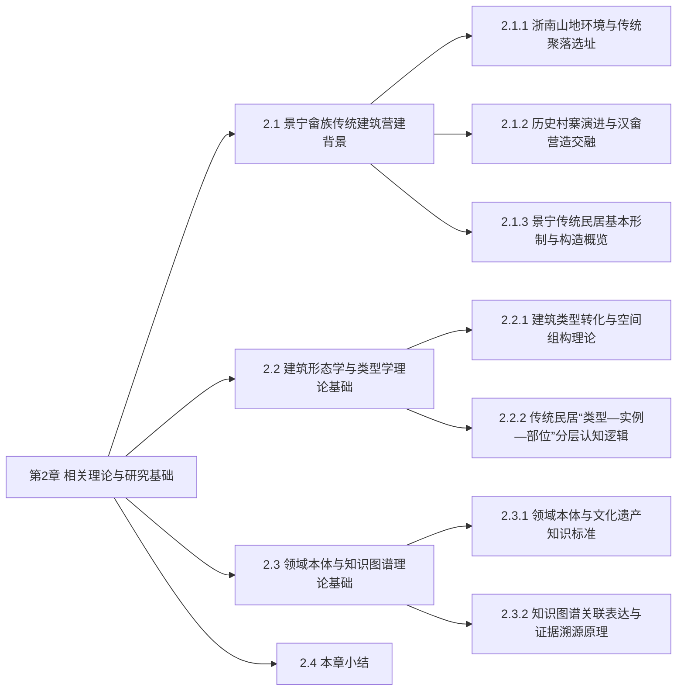

# 第2章 相关理论与研究基础

<!-- dynamic-chapter:start -->
## 当前工作安排

> 由[[论文章节/大纲结构.yaml|大纲结构]]生成。修改主源后运行同步；文件夹编号仅为历史路径，不决定当前章节顺序。

**本章任务：** 梳理景宁畲族传统建筑营建背景、建筑形态学与类型学理论、领域本体与知识图谱理论，为第三至五章提供概念与方法依据。

**结构状态：** V4.0工作结构；第二至第六章已细化到三级；正文、文献与样本核验待完成

**正文接续：** 旧稿第二章为“研究对象与多尺度资料基础”，不能直接充当本章；需按V4.0理论章节重写。

**章内逻辑：** 营建背景 → 建筑形态学与类型学 → 领域本体与知识图谱理论 → 小结。

**向后接续：** 向第三章交付营建背景、理论工具与知识组织基础，不提前完成本体设计。

## 小节与主题成果采用表

| 小节 | 主题及成果入口 | 本节用途 | 采用状态与证据缺口 |
|---|---|---|---|
| 2.1 景宁畲族传统建筑营建背景 | [〔理论与文献依据〕畲族民居研究与理论依据](../../%E4%B8%BB%E9%A2%98%E7%A0%94%E7%A9%B6/%E3%80%94%E7%90%86%E8%AE%BA%E4%B8%8E%E6%96%87%E7%8C%AE%E4%BE%9D%E6%8D%AE%E3%80%95%E7%95%B2%E6%97%8F%E6%B0%91%E5%B1%85%E7%A0%94%E7%A9%B6%E4%B8%8E%E7%90%86%E8%AE%BA%E4%BE%9D%E6%8D%AE/%E3%80%94%E7%90%86%E8%AE%BA%E4%B8%8E%E6%96%87%E7%8C%AE%E4%BE%9D%E6%8D%AE%E3%80%95%E7%95%B2%E6%97%8F%E6%B0%91%E5%B1%85%E7%A0%94%E7%A9%B6%E4%B8%8E%E7%90%86%E8%AE%BA%E4%BE%9D%E6%8D%AE.md)、[〔研究界定〕研究对象与样本边界](../../%E4%B8%BB%E9%A2%98%E7%A0%94%E7%A9%B6/%E3%80%94%E7%A0%94%E7%A9%B6%E7%95%8C%E5%AE%9A%E3%80%95%E7%A0%94%E7%A9%B6%E5%AF%B9%E8%B1%A1%E4%B8%8E%E6%A0%B7%E6%9C%AC%E8%BE%B9%E7%95%8C/%E3%80%94%E7%A0%94%E7%A9%B6%E7%95%8C%E5%AE%9A%E3%80%95%E7%A0%94%E7%A9%B6%E5%AF%B9%E8%B1%A1%E4%B8%8E%E6%A0%B7%E6%9C%AC%E8%BE%B9%E7%95%8C.md) | 从浙南山地环境、历史村寨演进与汉畲营造交融、基本形制与构造三方面建立地域营建背景。 | V4.0工作结构；背景文献与地方史料待核 |
| 2.2 建筑形态学与类型学理论基础 | [〔理论与文献依据〕畲族民居研究与理论依据](../../%E4%B8%BB%E9%A2%98%E7%A0%94%E7%A9%B6/%E3%80%94%E7%90%86%E8%AE%BA%E4%B8%8E%E6%96%87%E7%8C%AE%E4%BE%9D%E6%8D%AE%E3%80%95%E7%95%B2%E6%97%8F%E6%B0%91%E5%B1%85%E7%A0%94%E7%A9%B6%E4%B8%8E%E7%90%86%E8%AE%BA%E4%BE%9D%E6%8D%AE/%E3%80%94%E7%90%86%E8%AE%BA%E4%B8%8E%E6%96%87%E7%8C%AE%E4%BE%9D%E6%8D%AE%E3%80%95%E7%95%B2%E6%97%8F%E6%B0%91%E5%B1%85%E7%A0%94%E7%A9%B6%E4%B8%8E%E7%90%86%E8%AE%BA%E4%BE%9D%E6%8D%AE.md)、[〔研究方法〕类型识别与比较](../../%E4%B8%BB%E9%A2%98%E7%A0%94%E7%A9%B6/%E3%80%94%E7%A0%94%E7%A9%B6%E6%96%B9%E6%B3%95%E3%80%95%E7%B1%BB%E5%9E%8B%E8%AF%86%E5%88%AB%E4%B8%8E%E6%AF%94%E8%BE%83/%E3%80%94%E7%A0%94%E7%A9%B6%E6%96%B9%E6%B3%95%E3%80%95%E7%B1%BB%E5%9E%8B%E8%AF%86%E5%88%AB%E4%B8%8E%E6%AF%94%E8%BE%83.md)、[〔体系设计〕风貌特征筛选与数据记录](../../%E4%B8%BB%E9%A2%98%E7%A0%94%E7%A9%B6/%E3%80%94%E4%BD%93%E7%B3%BB%E8%AE%BE%E8%AE%A1%E3%80%95%E9%A3%8E%E8%B2%8C%E7%89%B9%E5%BE%81%E7%AD%9B%E9%80%89%E4%B8%8E%E6%95%B0%E6%8D%AE%E8%AE%B0%E5%BD%95/%E3%80%94%E4%BD%93%E7%B3%BB%E8%AE%BE%E8%AE%A1%E3%80%95%E9%A3%8E%E8%B2%8C%E7%89%B9%E5%BE%81%E7%AD%9B%E9%80%89%E4%B8%8E%E6%95%B0%E6%8D%AE%E8%AE%B0%E5%BD%95.md) | 说明建筑类型转化、空间组构及“类型—实例—部位”分层认知逻辑，明确本研究采用的理论工具与适用条件。 | V4.0工作结构；理论来源、采用理由与边界待论证 |
| 2.3 领域本体与知识图谱理论基础 | [〔体系设计〕多尺度语义模型与建模依据](../../%E4%B8%BB%E9%A2%98%E7%A0%94%E7%A9%B6/%E3%80%94%E4%BD%93%E7%B3%BB%E8%AE%BE%E8%AE%A1%E3%80%95%E5%A4%9A%E5%B0%BA%E5%BA%A6%E8%AF%AD%E4%B9%89%E6%A8%A1%E5%9E%8B%E4%B8%8E%E5%BB%BA%E6%A8%A1%E4%BE%9D%E6%8D%AE/%E3%80%94%E4%BD%93%E7%B3%BB%E8%AE%BE%E8%AE%A1%E3%80%95%E5%A4%9A%E5%B0%BA%E5%BA%A6%E8%AF%AD%E4%B9%89%E6%A8%A1%E5%9E%8B%E4%B8%8E%E5%BB%BA%E6%A8%A1%E4%BE%9D%E6%8D%AE.md)、[〔理论与文献依据〕畲族民居研究与理论依据](../../%E4%B8%BB%E9%A2%98%E7%A0%94%E7%A9%B6/%E3%80%94%E7%90%86%E8%AE%BA%E4%B8%8E%E6%96%87%E7%8C%AE%E4%BE%9D%E6%8D%AE%E3%80%95%E7%95%B2%E6%97%8F%E6%B0%91%E5%B1%85%E7%A0%94%E7%A9%B6%E4%B8%8E%E7%90%86%E8%AE%BA%E4%BE%9D%E6%8D%AE/%E3%80%94%E7%90%86%E8%AE%BA%E4%B8%8E%E6%96%87%E7%8C%AE%E4%BE%9D%E6%8D%AE%E3%80%95%E7%95%B2%E6%97%8F%E6%B0%91%E5%B1%85%E7%A0%94%E7%A9%B6%E4%B8%8E%E7%90%86%E8%AE%BA%E4%BE%9D%E6%8D%AE.md) | 说明领域本体、文化遗产知识标准、知识图谱关联表达与证据溯源原理，为第3章本体设计提供依据。 | V4.0工作结构；理论来源与标准版本待核 |
| 2.4 本章小结 | [〔理论与文献依据〕畲族民居研究与理论依据](../../%E4%B8%BB%E9%A2%98%E7%A0%94%E7%A9%B6/%E3%80%94%E7%90%86%E8%AE%BA%E4%B8%8E%E6%96%87%E7%8C%AE%E4%BE%9D%E6%8D%AE%E3%80%95%E7%95%B2%E6%97%8F%E6%B0%91%E5%B1%85%E7%A0%94%E7%A9%B6%E4%B8%8E%E7%90%86%E8%AE%BA%E4%BE%9D%E6%8D%AE/%E3%80%94%E7%90%86%E8%AE%BA%E4%B8%8E%E6%96%87%E7%8C%AE%E4%BE%9D%E6%8D%AE%E3%80%95%E7%95%B2%E6%97%8F%E6%B0%91%E5%B1%85%E7%A0%94%E7%A9%B6%E4%B8%8E%E7%90%86%E8%AE%BA%E4%BE%9D%E6%8D%AE.md)、[〔研究方法〕类型识别与比较](../../%E4%B8%BB%E9%A2%98%E7%A0%94%E7%A9%B6/%E3%80%94%E7%A0%94%E7%A9%B6%E6%96%B9%E6%B3%95%E3%80%95%E7%B1%BB%E5%9E%8B%E8%AF%86%E5%88%AB%E4%B8%8E%E6%AF%94%E8%BE%83/%E3%80%94%E7%A0%94%E7%A9%B6%E6%96%B9%E6%B3%95%E3%80%95%E7%B1%BB%E5%9E%8B%E8%AF%86%E5%88%AB%E4%B8%8E%E6%AF%94%E8%BE%83.md) | 概括本章营建背景、理论工具与知识组织基础，指出对第3章的接口。 | V4.0工作结构；待前三节完成后撰写 |

## 三级标题与论证分工

三级标题用于思路梳理；理论及分析视角是比较对象，不表示全部采用。成果入口和采用关系沿用父节，不重复计数。

| 三级标题 | 论证任务 | 状态 |
|---|---|---|
| 2.1.1 浙南山地环境与传统聚落选址 | 说明浙南山地地形、水系与小气候对传统聚落选址和民居分布的影响。 | V4.0工作结构；正文与证据待写 |
| 2.1.2 历史村寨演进与汉畲营造交融 | 梳理历史村寨形成、迁徙与汉畲营造技艺交融的文献线索，区分史实与推断。 | V4.0工作结构；正文与证据待写 |
| 2.1.3 景宁传统民居基本形制与构造概览 | 概述景宁传统民居的基本形制、结构体系与材料做法，为后续本体类目提供建筑学背景。 | V4.0工作结构；正文与证据待写 |
| 2.2.1 建筑类型转化与空间组构理论 | 梳理建筑类型学与空间组构理论的核心概念，说明其对民居形态比较的适用性。 | V4.0工作结构；正文与证据待写 |
| 2.2.2 传统民居“类型—实例—部位”分层认知逻辑 | 说明类型、实例与部位三层认知的关系，为第3章核心类与层级体系提供依据。 | V4.0工作结构；正文与证据待写 |
| 2.3.1 领域本体与文化遗产知识标准 | 梳理领域本体方法及文化遗产知识标准，明确可复用概念与版本边界。 | V4.0工作结构；正文与证据待写 |
| 2.3.2 知识图谱关联表达与证据溯源原理 | 说明知识图谱的关联表达、查询与证据溯源原理，为后续功能设计与证据状态字段提供依据。 | V4.0工作结构；正文与证据待写 |

## 逐节研究问题与证据要求

以下是待执行的研究要求，不是已完成或已验证声明；采用状态仍以上表为准。

### 景宁畲族传统建筑营建背景

- **问题**：地域环境与聚居条件如何参与景宁畲族传统民居形态的形成与差异？
- **所需证据／待核材料**：地域、聚落与民居研究原文；对象—环境关系的可核证据；L0—L3候选池与规划边界资料（待核）。
- **完成判据**：背景服务于形态解释；不以民族名称或环境描述直接推定建筑特征。

### 建筑形态学与类型学理论基础

- **问题**：已有研究识别了哪些建筑类型与空间组织方式，其分类口径和证据是什么？
- **所需证据／待核材料**：类型与空间研究原文及页码；平面、院落、测绘与调查证据；分类口径对照与未知项。
- **完成判据**：类型名称、分类判据与实例证据分开；不把文献类型直接当作本研究已验证类型。

### 领域本体与知识图谱理论基础

- **问题**：领域本体与知识图谱如何为传统民居形态知识提供概念、关系与证据表达？
- **所需证据／待核材料**：本体与知识图谱理论原文；文化遗产知识标准来源；证据溯源方法依据。
- **完成判据**：概念、标准版本与适用边界有来源；不把本文扩展写成标准原有规定。

### 本章小结

- **问题**：哪些建筑学认识可进入知识组织，哪些仍待补证？
- **所需证据／待核材料**：前四节结论与来源；待补证据清单。
- **完成判据**：只总结已核内容，未完成部分明确保留。

## 本章结构图

## 稳定节点与原稿接续

- `section-2-region`：景宁畲族传统建筑营建背景；纳入当前工作大纲。原稿编号：新节点；变更说明：2026-11-23按V4.0第2.1节更名并补三级标题；正文待写。。

- `section-2-type-space`：建筑形态学与类型学理论基础；纳入当前工作大纲。原稿编号：新节点；变更说明：2026-11-23按V4.0第2.2节更名并补三级标题；正文待写。。

- `section-2-form-composition`：建筑形态构成与特征；停用、保留追溯。原稿编号：新节点；变更说明：2026-11-17按V3.3新增第二章2.3；接续旧风貌概念与形态构成内容，内部构架暂停边界不变；V4.0将形态构成内容拆入2.1.3与2.2.2；原节点保留稳定ID。。

- `section-2-synthesis`：形态关系、类型与形成因素的综合认识；停用、保留追溯。原稿编号：新节点；变更说明：2026-11-17按V3.3新增第二章2.4；接续旧“综合认识”任务，不写景宁真实类型结论；V4.0不设独立综合认识节，综合判断后移第5章；原节点保留稳定ID。。

- `section-2-3-kg-theory`：领域本体与知识图谱理论基础；纳入当前工作大纲。原稿编号：新节点；变更说明：2026-11-23按Notion V4.0六章三级目录对齐；结构更新不代表正文、样本或实证完成。。

- `section-2-summary`：本章小结；纳入当前工作大纲。原稿编号：新节点；变更说明：2026-10-29随四问题重组小结职责；稳定ID保留，正文未改写；2026-10-29标题与逻辑梳理：由“本章小结：理论依据与研究框架”接续，仍为工作大纲，正文不改；2026-11-17按V3.3保留2.5本章小结，论证任务改为服务本体与图谱的知识需求。

- `section-2-style-concept`：传统民居风貌的概念与研究内涵；停用、保留追溯。原稿编号：新节点；变更说明：2026-10-29据用户确认的第二章四问题新增；重组原理论任务，旧节点保留追溯；无对应的新正文；2026-11-17按V3.3第二至第六章暂只细化到二级，旧理论章节点停用并保留追溯。

- `section-2-analysis-foundations`：传统民居风貌分析的理论方法及其适用性；停用、保留追溯。原稿编号：新节点；变更说明：2026-10-29据用户确认的第二章四问题新增；重组原理论任务，旧节点保留追溯；无对应的新正文；2026-11-17按V3.3第二至第六章暂只细化到二级，旧理论章节点停用并保留追溯。

- `section-2-kg-foundations`：知识图谱与领域本体的建模基础；停用、保留追溯。原稿编号：新节点；变更说明：2026-10-29据用户确认的第二章四问题新增；重组原理论任务，旧节点保留追溯；无对应的新正文；2026-11-17按V3.3第二至第六章暂只细化到二级，旧理论章节点停用并保留追溯。

- `section-2-integration-framework`：风貌分析与知识图谱结合的研究框架；停用、保留追溯。原稿编号：新节点；变更说明：2026-10-29据用户确认的第二章四问题新增；重组原理论任务，旧节点保留追溯；无对应的新正文；2026-11-17按V3.3第二至第六章暂只细化到二级，旧理论章节点停用并保留追溯。

- `section-2-architecture-theory`：传统民居风貌研究的多尺度观察与分类依据；停用、保留追溯。原稿编号：新节点；变更说明：2026-10-29按用户四问题重组第二章；原技术环节式安排停用，相关任务接续至风貌概念、分析理论、知识图谱基础及结合框架四节；保留稳定ID和原稿入口；2026-11-17按V3.3第二至第六章暂只细化到二级，旧理论章节点停用并保留追溯。

- `section-2-semantic-theory`：风貌知识组织与语义关系表达基础；停用、保留追溯。原稿编号：新节点；变更说明：2026-10-29按用户四问题重组第二章；原技术环节式安排停用，相关任务接续至风貌概念、分析理论、知识图谱基础及结合框架四节；保留稳定ID和原稿入口；2026-11-17按V3.3第二至第六章暂只细化到二级，旧理论章节点停用并保留追溯。

- `section-2-spatial-theory`：语义描述与三维空间关联的研究依据；停用、保留追溯。原稿编号：新节点；变更说明：2026-10-29按用户四问题重组第二章；原技术环节式安排停用，相关任务接续至风貌概念、分析理论、知识图谱基础及结合框架四节；保留稳定ID和原稿入口；2026-11-17按V3.3第二至第六章暂只细化到二级，旧理论章节点停用并保留追溯。

- `section-3-1`：研究框架与体系、图谱及分析的衔接；停用、保留追溯。原稿编号：3.1；变更说明：2026-10-29按用户四问题重组第二章；原技术环节式安排停用，相关任务接续至风貌概念、分析理论、知识图谱基础及结合框架四节；保留稳定ID和原稿入口；2026-11-17按V3.3第二至第六章暂只细化到二级，旧理论章节点停用并保留追溯。

## 三级稳定节点

- `sub-2-1-1`：浙南山地环境与传统聚落选址；纳入当前工作大纲；2026-11-23按Notion V4.0六章三级目录对齐；结构更新不代表正文、样本或实证完成。。

- `sub-2-1-2`：历史村寨演进与汉畲营造交融；纳入当前工作大纲；2026-11-23按Notion V4.0六章三级目录对齐；结构更新不代表正文、样本或实证完成。。

- `sub-2-1-3`：景宁传统民居基本形制与构造概览；纳入当前工作大纲；2026-11-23按Notion V4.0六章三级目录对齐；结构更新不代表正文、样本或实证完成。。

- `sub-2-2-1`：建筑类型转化与空间组构理论；纳入当前工作大纲；2026-11-23按Notion V4.0六章三级目录对齐；结构更新不代表正文、样本或实证完成。。

- `sub-2-2-2`：传统民居“类型—实例—部位”分层认知逻辑；纳入当前工作大纲；2026-11-23按Notion V4.0六章三级目录对齐；结构更新不代表正文、样本或实证完成。。

- `sub-2-3-1`：领域本体与文化遗产知识标准；纳入当前工作大纲；2026-11-23按Notion V4.0六章三级目录对齐；结构更新不代表正文、样本或实证完成。。

- `sub-2-3-2`：知识图谱关联表达与证据溯源原理；纳入当前工作大纲；2026-11-23按Notion V4.0六章三级目录对齐；结构更新不代表正文、样本或实证完成。。

- `sub-concept-definition`：传统民居风貌的内涵与相关概念；停用、保留追溯；2026-10-29依用户要求展开第二章三级标题，沿用父节成果入口和研究状态；2026-11-17随父节停用，保留锚点与证据入口。

- `sub-concept-physical`：民居风貌的物质构成与空间组织；停用、保留追溯；2026-10-29依用户要求展开第二章三级标题，沿用父节成果入口和研究状态；2026-11-17随父节停用，保留锚点与证据入口。

- `sub-concept-cultural`：民居风貌的地域文化内涵与形成背景；停用、保留追溯；2026-10-29依用户要求展开第二章三级标题，沿用父节成果入口和研究状态；2026-11-17随父节停用，保留锚点与证据入口。

- `sub-concept-scope`：本研究的风貌分析范围与内容；停用、保留追溯；2026-10-29依用户要求展开第二章三级标题，沿用父节成果入口和研究状态；2026-11-17随父节停用，保留锚点与证据入口。

- `sub-analysis-typology`：建筑类型学与民居类型比较；停用、保留追溯；2026-10-29依用户要求展开第二章三级标题，沿用父节成果入口和研究状态；2026-11-17随父节停用，保留锚点与证据入口。

- `sub-analysis-morphology`：形态分析与多尺度空间组织研究；停用、保留追溯；2026-10-29依用户要求展开第二章三级标题，沿用父节成果入口和研究状态；2026-11-17随父节停用，保留锚点与证据入口。

- `sub-analysis-perception`：环境感知与风貌认知研究；停用、保留追溯；2026-10-29依用户要求展开第二章三级标题，沿用父节成果入口和研究状态；2026-11-17随父节停用，保留锚点与证据入口。

- `sub-analysis-culture`：地域文化与生活方式的关联解释；停用、保留追溯；2026-10-29依用户要求展开第二章三级标题，沿用父节成果入口和研究状态；2026-11-17随父节停用，保留锚点与证据入口。

- `sub-analysis-selection`：理论方法比较与本研究的选择；停用、保留追溯；2026-10-29依用户要求展开第二章三级标题，沿用父节成果入口和研究状态；2026-11-17随父节停用，保留锚点与证据入口。

- `sub-kg-concepts`：知识图谱的概念与基本构成；停用、保留追溯；2026-10-29依用户要求展开第二章三级标题，沿用父节成果入口和研究状态；2026-11-17随父节停用，保留锚点与证据入口。

- `sub-kg-representation`：知识表示与模式—实例结构；停用、保留追溯；2026-10-29依用户要求展开第二章三级标题，沿用父节成果入口和研究状态；2026-11-17随父节停用，保留锚点与证据入口。

- `sub-kg-ontology`：领域本体复用与建筑知识建模；停用、保留追溯；2026-10-29依用户要求展开第二章三级标题，沿用父节成果入口和研究状态；2026-11-17随父节停用，保留锚点与证据入口。

- `sub-kg-workflow`：知识图谱构建与查询分析的基本过程；停用、保留追溯；2026-10-29依用户要求展开第二章三级标题，沿用父节成果入口和研究状态；2026-11-17随父节停用，保留锚点与证据入口。

- `sub-integration-needs`：风貌分析任务与知识组织需求的对应；停用、保留追溯；2026-10-29依用户要求展开第二章三级标题，沿用父节成果入口和研究状态；2026-11-17随父节停用，保留锚点与证据入口。

- `sub-integration-methods`：风貌分析与知识图谱结合的方法依据；停用、保留追溯；2026-10-29依用户要求展开第二章三级标题，沿用父节成果入口和研究状态；2026-11-17随父节停用，保留锚点与证据入口。

- `sub-integration-technology`：知识图谱与三维空间关联的技术支撑；停用、保留追溯；2026-10-29依用户要求展开第二章三级标题，沿用父节成果入口和研究状态；2026-11-17随父节停用，保留锚点与证据入口。

- `sub-integration-framework`：本研究的总体框架与章节衔接；停用、保留追溯；2026-10-29依用户要求展开第二章三级标题，沿用父节成果入口和研究状态；2026-11-17随父节停用，保留锚点与证据入口。

## 已移往其他章节的三级节点

- [研究区域与传统民居概况](04-%E6%99%AF%E5%AE%81%E5%AE%9E%E4%BE%8B.md#section-2-2)：三级稳定ID不变，原入口转接。

- [样本选择与多尺度分析单元确定](04-%E6%99%AF%E5%AE%81%E5%AE%9E%E4%BE%8B.md#section-2-1)：三级稳定ID不变，原入口转接。

- [多源资料采集、整理与质量评估](04-%E6%99%AF%E5%AE%81%E5%AE%9E%E4%BE%8B.md#section-2-4)：三级稳定ID不变，原入口转接。

## 已移往其他章节的原节点

- [候选民居核查与样本纳入依据](04-%E6%99%AF%E5%AE%81%E5%AE%9E%E4%BE%8B.md#section-2-3)：稳定ID不变，原入口转接。

- [资料质量、对象对应与证据记录](04-%E6%99%AF%E5%AE%81%E5%AE%9E%E4%BE%8B.md#section-2-5)：稳定ID不变，原入口转接。

- [本章小结：可用输入与研究限制](04-%E6%99%AF%E5%AE%81%E5%AE%9E%E4%BE%8B.md#section-2-6)：稳定ID不变，原入口转接。

## 调整与反馈

需要调整题名、顺序、节的归属或采用状态时，修改大纲结构；稳定ID不随编号改变。新增、停用、拆分合并必须保留理由及原稿接续，不能由文件数自动认定研究完成。
<!-- dynamic-chapter:end -->
