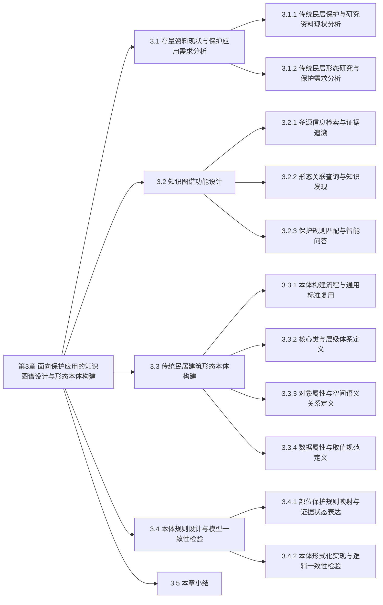

# 第3章 面向保护应用的知识图谱设计与形态本体构建

<!-- dynamic-chapter:start -->
## 当前工作安排

> 由[[论文章节/大纲结构.yaml|大纲结构]]生成。修改主源后运行同步；文件夹编号仅为历史路径，不决定当前章节顺序。

**本章任务：** 从存量资料与保护需求出发，完成图谱功能设计、形态本体构建及规则与一致性检验，形成第4章可实施的模型。

**结构状态：** V4.0工作结构；本体、规则与检验待开展，尚无已核模型

**正文接续：** 旧稿第三章为风貌特征体系与图谱模型，不能直接充当本章；需按V4.0“现状需求—功能设计—本体构建—规则检验”重写。

**章内逻辑：** 现状与需求 → 功能设计 → 本体构建 → 规则与一致性检验 → 小结。

**向后接续：** 向第四章交付功能设计、本体定义、部位规则与检验边界；规则不等于真实实例或发现。

## 小节与主题成果采用表

| 小节 | 主题及成果入口 | 本节用途 | 采用状态与证据缺口 |
|---|---|---|---|
| 3.1 存量资料现状与保护应用需求分析 | [〔研究界定〕研究对象与样本边界](../../%E4%B8%BB%E9%A2%98%E7%A0%94%E7%A9%B6/%E3%80%94%E7%A0%94%E7%A9%B6%E7%95%8C%E5%AE%9A%E3%80%95%E7%A0%94%E7%A9%B6%E5%AF%B9%E8%B1%A1%E4%B8%8E%E6%A0%B7%E6%9C%AC%E8%BE%B9%E7%95%8C/%E3%80%94%E7%A0%94%E7%A9%B6%E7%95%8C%E5%AE%9A%E3%80%95%E7%A0%94%E7%A9%B6%E5%AF%B9%E8%B1%A1%E4%B8%8E%E6%A0%B7%E6%9C%AC%E8%BE%B9%E7%95%8C.md)、[〔理论与文献依据〕畲族民居研究与理论依据](../../%E4%B8%BB%E9%A2%98%E7%A0%94%E7%A9%B6/%E3%80%94%E7%90%86%E8%AE%BA%E4%B8%8E%E6%96%87%E7%8C%AE%E4%BE%9D%E6%8D%AE%E3%80%95%E7%95%B2%E6%97%8F%E6%B0%91%E5%B1%85%E7%A0%94%E7%A9%B6%E4%B8%8E%E7%90%86%E8%AE%BA%E4%BE%9D%E6%8D%AE/%E3%80%94%E7%90%86%E8%AE%BA%E4%B8%8E%E6%96%87%E7%8C%AE%E4%BE%9D%E6%8D%AE%E3%80%95%E7%95%B2%E6%97%8F%E6%B0%91%E5%B1%85%E7%A0%94%E7%A9%B6%E4%B8%8E%E7%90%86%E8%AE%BA%E4%BE%9D%E6%8D%AE.md) | 分析规划、史志、测绘与航测资料的粒度、缺口与保护应用需求，明确图谱要解决的问题。 | V4.0工作结构；资料盘点与需求证据待补 |
| 3.2 知识图谱功能设计 | [〔体系设计〕多尺度语义模型与建模依据](../../%E4%B8%BB%E9%A2%98%E7%A0%94%E7%A9%B6/%E3%80%94%E4%BD%93%E7%B3%BB%E8%AE%BE%E8%AE%A1%E3%80%95%E5%A4%9A%E5%B0%BA%E5%BA%A6%E8%AF%AD%E4%B9%89%E6%A8%A1%E5%9E%8B%E4%B8%8E%E5%BB%BA%E6%A8%A1%E4%BE%9D%E6%8D%AE/%E3%80%94%E4%BD%93%E7%B3%BB%E8%AE%BE%E8%AE%A1%E3%80%95%E5%A4%9A%E5%B0%BA%E5%BA%A6%E8%AF%AD%E4%B9%89%E6%A8%A1%E5%9E%8B%E4%B8%8E%E5%BB%BA%E6%A8%A1%E4%BE%9D%E6%8D%AE.md)、[〔检验与评价〕图谱试建、查询与有效性](../../%E4%B8%BB%E9%A2%98%E7%A0%94%E7%A9%B6/%E3%80%94%E6%A3%80%E9%AA%8C%E4%B8%8E%E8%AF%84%E4%BB%B7%E3%80%95%E5%9B%BE%E8%B0%B1%E8%AF%95%E5%BB%BA%E3%80%81%E6%9F%A5%E8%AF%A2%E4%B8%8E%E6%9C%89%E6%95%88%E6%80%A7/%E3%80%94%E6%A3%80%E9%AA%8C%E4%B8%8E%E8%AF%84%E4%BB%B7%E3%80%95%E5%9B%BE%E8%B0%B1%E8%AF%95%E5%BB%BA%E3%80%81%E6%9F%A5%E8%AF%A2%E4%B8%8E%E6%9C%89%E6%95%88%E6%80%A7.md) | 设计多源信息检索与证据追溯、形态关联查询与知识发现、保护规则匹配与智能问答三类功能。 | V4.0工作结构；功能需求与能力问题待细化 |
| 3.3 传统民居建筑形态本体构建 | [〔体系设计〕多尺度语义模型与建模依据](../../%E4%B8%BB%E9%A2%98%E7%A0%94%E7%A9%B6/%E3%80%94%E4%BD%93%E7%B3%BB%E8%AE%BE%E8%AE%A1%E3%80%95%E5%A4%9A%E5%B0%BA%E5%BA%A6%E8%AF%AD%E4%B9%89%E6%A8%A1%E5%9E%8B%E4%B8%8E%E5%BB%BA%E6%A8%A1%E4%BE%9D%E6%8D%AE/%E3%80%94%E4%BD%93%E7%B3%BB%E8%AE%BE%E8%AE%A1%E3%80%95%E5%A4%9A%E5%B0%BA%E5%BA%A6%E8%AF%AD%E4%B9%89%E6%A8%A1%E5%9E%8B%E4%B8%8E%E5%BB%BA%E6%A8%A1%E4%BE%9D%E6%8D%AE.md)、[〔理论与文献依据〕畲族民居研究与理论依据](../../%E4%B8%BB%E9%A2%98%E7%A0%94%E7%A9%B6/%E3%80%94%E7%90%86%E8%AE%BA%E4%B8%8E%E6%96%87%E7%8C%AE%E4%BE%9D%E6%8D%AE%E3%80%95%E7%95%B2%E6%97%8F%E6%B0%91%E5%B1%85%E7%A0%94%E7%A9%B6%E4%B8%8E%E7%90%86%E8%AE%BA%E4%BE%9D%E6%8D%AE/%E3%80%94%E7%90%86%E8%AE%BA%E4%B8%8E%E6%96%87%E7%8C%AE%E4%BE%9D%E6%8D%AE%E3%80%95%E7%95%B2%E6%97%8F%E6%B0%91%E5%B1%85%E7%A0%94%E7%A9%B6%E4%B8%8E%E7%90%86%E8%AE%BA%E4%BE%9D%E6%8D%AE.md) | 按构建流程复用BOT等标准，定义核心类、对象属性与数据属性，形成传统民居建筑形态本体。 | V4.0工作结构；本体定义总表已形成候选，形式化与审核待完成 |
| 3.4 本体规则设计与模型一致性检验 | [〔体系设计〕多尺度语义模型与建模依据](../../%E4%B8%BB%E9%A2%98%E7%A0%94%E7%A9%B6/%E3%80%94%E4%BD%93%E7%B3%BB%E8%AE%BE%E8%AE%A1%E3%80%95%E5%A4%9A%E5%B0%BA%E5%BA%A6%E8%AF%AD%E4%B9%89%E6%A8%A1%E5%9E%8B%E4%B8%8E%E5%BB%BA%E6%A8%A1%E4%BE%9D%E6%8D%AE/%E3%80%94%E4%BD%93%E7%B3%BB%E8%AE%BE%E8%AE%A1%E3%80%95%E5%A4%9A%E5%B0%BA%E5%BA%A6%E8%AF%AD%E4%B9%89%E6%A8%A1%E5%9E%8B%E4%B8%8E%E5%BB%BA%E6%A8%A1%E4%BE%9D%E6%8D%AE.md)、[〔检验与评价〕图谱试建、查询与有效性](../../%E4%B8%BB%E9%A2%98%E7%A0%94%E7%A9%B6/%E3%80%94%E6%A3%80%E9%AA%8C%E4%B8%8E%E8%AF%84%E4%BB%B7%E3%80%95%E5%9B%BE%E8%B0%B1%E8%AF%95%E5%BB%BA%E3%80%81%E6%9F%A5%E8%AF%A2%E4%B8%8E%E6%9C%89%E6%95%88%E6%80%A7/%E3%80%94%E6%A3%80%E9%AA%8C%E4%B8%8E%E8%AF%84%E4%BB%B7%E3%80%95%E5%9B%BE%E8%B0%B1%E8%AF%95%E5%BB%BA%E3%80%81%E6%9F%A5%E8%AF%A2%E4%B8%8E%E6%9C%89%E6%95%88%E6%80%A7.md) | 设计部位保护规则映射与证据状态表达，完成本体形式化实现与逻辑一致性检验。 | V4.0工作结构；规则与Protégé/能力问题检验待实施 |
| 3.5 本章小结 | [〔体系设计〕多尺度语义模型与建模依据](../../%E4%B8%BB%E9%A2%98%E7%A0%94%E7%A9%B6/%E3%80%94%E4%BD%93%E7%B3%BB%E8%AE%BE%E8%AE%A1%E3%80%95%E5%A4%9A%E5%B0%BA%E5%BA%A6%E8%AF%AD%E4%B9%89%E6%A8%A1%E5%9E%8B%E4%B8%8E%E5%BB%BA%E6%A8%A1%E4%BE%9D%E6%8D%AE/%E3%80%94%E4%BD%93%E7%B3%BB%E8%AE%BE%E8%AE%A1%E3%80%95%E5%A4%9A%E5%B0%BA%E5%BA%A6%E8%AF%AD%E4%B9%89%E6%A8%A1%E5%9E%8B%E4%B8%8E%E5%BB%BA%E6%A8%A1%E4%BE%9D%E6%8D%AE.md)、[〔检验与评价〕图谱试建、查询与有效性](../../%E4%B8%BB%E9%A2%98%E7%A0%94%E7%A9%B6/%E3%80%94%E6%A3%80%E9%AA%8C%E4%B8%8E%E8%AF%84%E4%BB%B7%E3%80%95%E5%9B%BE%E8%B0%B1%E8%AF%95%E5%BB%BA%E3%80%81%E6%9F%A5%E8%AF%A2%E4%B8%8E%E6%9C%89%E6%95%88%E6%80%A7/%E3%80%94%E6%A3%80%E9%AA%8C%E4%B8%8E%E8%AF%84%E4%BB%B7%E3%80%95%E5%9B%BE%E8%B0%B1%E8%AF%95%E5%BB%BA%E3%80%81%E6%9F%A5%E8%AF%A2%E4%B8%8E%E6%9C%89%E6%95%88%E6%80%A7.md) | 概括本章功能设计、本体与规则检验结果，说明其向第4章实例化的接口。 | V4.0工作结构；待本章各节完成后撰写 |

## 三级标题与论证分工

三级标题用于思路梳理；理论及分析视角是比较对象，不表示全部采用。成果入口和采用关系沿用父节，不重复计数。

| 三级标题 | 论证任务 | 状态 |
|---|---|---|
| 3.1.1 传统民居保护与研究资料现状分析 | 梳理规划文本、史志谱牒、学术测绘与航测资料的媒介、粒度与覆盖现状。 | V4.0工作结构；正文与证据待写 |
| 3.1.2 传统民居形态研究与保护需求分析 | 从保护前期工作提炼形态信息需求与现有资料的错位，形成图谱功能需求依据。 | V4.0工作结构；正文与证据待写 |
| 3.2.1 多源信息检索与证据追溯 | 设计按对象、部位、村落与来源检索并回溯证据的功能需求。 | V4.0工作结构；正文与证据待写 |
| 3.2.2 形态关联查询与知识发现 | 设计类型、部位、材料与组团等形态关联查询及知识发现任务。 | V4.0工作结构；正文与证据待写 |
| 3.2.3 保护规则匹配与智能问答 | 设计部位保护条款匹配与基于证据的问答功能，限定回答边界。 | V4.0工作结构；正文与证据待写 |
| 3.3.1 本体构建流程与通用标准复用 | 说明本体构建流程、BOT等标准的复用方式与版本边界。 | V4.0工作结构；正文与证据待写 |
| 3.3.2 核心类与层级体系定义 | 界定村落、院落、民居、空间、构架、围护、分类方案、保护条款与证据源等核心类及层级。 | V4.0工作结构；正文与证据待写 |
| 3.3.3 对象属性与空间语义关系定义 | 定义区域包含、成员归属、边界参与、界面、通行、分类、条款与来源等对象属性。 | V4.0工作结构；正文与证据待写 |
| 3.3.4 数据属性与取值规范定义 | 定义身份、保护等级、尺度、材料、构架与证据等数据属性、单位与义务等级。 | V4.0工作结构；正文与证据待写 |
| 3.4.1 部位保护规则映射与证据状态表达 | 将保护条款按部位映射到本体，并定义证据状态、认知状态与缺口表达。 | V4.0工作结构；正文与证据待写 |
| 3.4.2 本体形式化实现与逻辑一致性检验 | 说明Protégé实现、推理机检验与能力问题覆盖检查的方法和结果边界。 | V4.0工作结构；正文与证据待写 |

## 逐节研究问题与证据要求

以下是待执行的研究要求，不是已完成或已验证声明；采用状态仍以上表为准。

### 存量资料现状与保护应用需求分析

- **问题**：现有资料能支持什么形态认识，保护应用又缺什么信息？
- **所需证据／待核材料**：四类资料现状与粒度记录；保护应用需求来源；资料缺口清单。
- **完成判据**：资料现状与需求均有来源；缺口不写成已解决。

### 知识图谱功能设计

- **问题**：图谱应支持哪些保护前期的查询、关联与问答任务？
- **所需证据／待核材料**：功能需求来源；能力问题集；现有资料可支持性判断。
- **完成判据**：功能与能力问题对应；不预写实现效果。

### 传统民居建筑形态本体构建

- **问题**：怎样构建、复用和扩展建筑形态学领域本体，如何保证一致性与可维护性？
- **所需证据／待核材料**：本体构建方法与工具来源；类、属性、约束定义；复用/扩展差异与版本记录。
- **完成判据**：本体设计与平台实现分开；不以导入成功证明本体适用。

### 本体规则设计与模型一致性检验

- **问题**：图谱模式如何承载本体，哪些推理有明确规则和证据边界？
- **所需证据／待核材料**：图谱模式与本体映射；推理规则及适用条件；与普通数据库/查询任务的边界说明。
- **完成判据**：模式、规则与实例数据分开；不把图查询结果自动当因果或建筑学结论。

### 本章小结

- **问题**：形成了哪些可复用知识组织成果，在何种对象与资料条件下适用？
- **所需证据／待核材料**：本章各节成果汇总；适用范围与待验证问题。
- **完成判据**：本体与规则是可复用设计，不冒称已验证的普适模型。

## 本章结构图

## 稳定节点与原稿接续

- `section-3-knowledge-scope`：建筑形态学领域知识范围与组织原则；停用、保留追溯。原稿编号：新节点；变更说明：2026-11-17按V3.3新增第三章3.1；接续旧3.1体系构建依据，但改为本体知识范围；V4.0以3.1现状与需求分析替代知识范围节；原节点保留稳定ID。。

- `section-3-concept-model`：建筑形态学领域概念体系与关系模型；停用、保留追溯。原稿编号：新节点；变更说明：2026-11-17按V3.3新增第三章3.2；接续旧多尺度特征体系与BOT比较任务，但不预写景宁类型；V4.0将概念体系拆入3.3.2核心类与3.3.3对象属性；原节点保留稳定ID。。

- `section-3-1-status-needs`：存量资料现状与保护应用需求分析；纳入当前工作大纲。原稿编号：新节点；变更说明：2026-11-23按Notion V4.0六章三级目录对齐；结构更新不代表正文、样本或实证完成。。

- `section-3-2-function-design`：知识图谱功能设计；纳入当前工作大纲。原稿编号：新节点；变更说明：2026-11-23按Notion V4.0六章三级目录对齐；结构更新不代表正文、样本或实证完成。。

- `section-3-ontology`：传统民居建筑形态本体构建；纳入当前工作大纲。原稿编号：新节点；变更说明：2026-11-23按V4.0第3.3节更名并补三级标题；本体定义表为候选，未写库。。

- `section-3-multimodal-evidence`：多模态异构知识与证据关联模型；停用、保留追溯。原稿编号：新节点；变更说明：2026-11-17按V3.3新增第三章3.4；接续旧三维关联与资料质量任务，但改为证据关联模型；V4.0将证据关联并入3.4.1部位规则与证据状态表达；原节点保留稳定ID。。

- `section-3-schema-rules`：本体规则设计与模型一致性检验；纳入当前工作大纲。原稿编号：新节点；变更说明：2026-11-23按V4.0第3.4节更名并补三级标题；未开展形式化检验。。

- `section-3-5`：本章小结；纳入当前工作大纲。原稿编号：3.5；变更说明：2026-10-29用户确认体系—实例图谱—风貌分析分工；由“本章小结：待检验规则与评价任务”调整，保留稳定ID及原稿接续；正文未改写；2026-10-29标题与逻辑梳理：由“本章小结：特征体系、图谱模型及适用范围”接续，仍为工作大纲，正文不改；2026-11-17按V3.3保留为3.6本章小结。

- `section-3-2`：风貌特征体系的构建依据与原则；停用、保留追溯。原稿编号：3.2；变更说明：2026-10-29用户确认体系—实例图谱—风貌分析分工；由“风貌特征筛选与规范记录体系”调整，保留稳定ID及原稿接续；正文未改写；2026-10-29标题与逻辑梳理：由“多尺度风貌特征体系的构建原则与分类依据”接续，仍为工作大纲，正文不改；2026-11-17按V3.3第三至第六章暂只细化到二级，旧节点停用并保留追溯。

- `section-3-multiscale`：多尺度风貌特征体系及其知识表达；停用、保留追溯。原稿编号：新节点；变更说明：2026-11-04按用户确认将原3.2—3.4三个并列二级节收束为3.2多尺度风貌特征体系；三个三级节保留原稳定ID和内容，只调整层级与显示编号。；2026-11-17按V3.3第三至第六章暂只细化到二级，旧节点停用并保留追溯。

- `section-3-graph-methods`：知识图谱模型与构建方法；停用、保留追溯。原稿编号：新节点；变更说明：2026-11-05依据用户提供的目录讨论末轮方案新增论证层级；不是实证成果或已完成正文；2026-11-17按V3.3第三至第六章暂只细化到二级，旧节点停用并保留追溯。

- `section-3-type-methods`：风貌类型识别与比较分析方法；停用、保留追溯。原稿编号：新节点；变更说明：2026-11-05依据用户提供的目录讨论末轮方案新增论证层级；不是实证成果或已完成正文；2026-11-05用户同意最小修订：吸收研究框架审阅意见并保留主会话限定；不增加章目，不改正文或实证状态。来源：研究资料/来源证据/2026-11-05-研究框架审阅意见.md；2026-11-17按V3.3第三至第六章暂只细化到二级，旧节点停用并保留追溯。

## 三级稳定节点

- `sub-3-1-1`：传统民居保护与研究资料现状分析；纳入当前工作大纲；2026-11-23按Notion V4.0六章三级目录对齐；结构更新不代表正文、样本或实证完成。。

- `sub-3-1-2`：传统民居形态研究与保护需求分析；纳入当前工作大纲；2026-11-23按Notion V4.0六章三级目录对齐；结构更新不代表正文、样本或实证完成。。

- `sub-3-2-1`：多源信息检索与证据追溯；纳入当前工作大纲；2026-11-23按Notion V4.0六章三级目录对齐；结构更新不代表正文、样本或实证完成。。

- `sub-3-2-2`：形态关联查询与知识发现；纳入当前工作大纲；2026-11-23按Notion V4.0六章三级目录对齐；结构更新不代表正文、样本或实证完成。。

- `sub-3-2-3`：保护规则匹配与智能问答；纳入当前工作大纲；2026-11-23按Notion V4.0六章三级目录对齐；结构更新不代表正文、样本或实证完成。。

- `sub-3-3-1`：本体构建流程与通用标准复用；纳入当前工作大纲；2026-11-23按Notion V4.0六章三级目录对齐；结构更新不代表正文、样本或实证完成。。

- `sub-3-3-2`：核心类与层级体系定义；纳入当前工作大纲；2026-11-23按Notion V4.0六章三级目录对齐；结构更新不代表正文、样本或实证完成。。

- `sub-3-3-3`：对象属性与空间语义关系定义；纳入当前工作大纲；2026-11-23按Notion V4.0六章三级目录对齐；结构更新不代表正文、样本或实证完成。。

- `sub-3-3-4`：数据属性与取值规范定义；纳入当前工作大纲；2026-11-23按Notion V4.0六章三级目录对齐；结构更新不代表正文、样本或实证完成。。

- `sub-3-4-1`：部位保护规则映射与证据状态表达；纳入当前工作大纲；2026-11-23按Notion V4.0六章三级目录对齐；结构更新不代表正文、样本或实证完成。。

- `sub-3-4-2`：本体形式化实现与逻辑一致性检验；纳入当前工作大纲；2026-11-23按Notion V4.0六章三级目录对齐；结构更新不代表正文、样本或实证完成。。

- `section-3-village`：村落尺度的民居聚居特征；停用、保留追溯；2026-10-29按用户确认分工新增研究任务；无旧正文对应，不表示研究完成；2026-10-29标题与逻辑梳理：由“村落尺度的民居聚居特征分类与模型表达”接续，仍为工作大纲，正文不改；2026-11-17随父节停用，保留锚点与证据入口。

- `section-3-group`：组团尺度的民居组合特征；停用、保留追溯；2026-10-29按用户确认分工新增研究任务；无旧正文对应，不表示研究完成；2026-10-29标题与逻辑梳理：由“组团尺度的民居组合特征分类与模型表达”接续，仍为工作大纲，正文不改；2026-11-17随父节停用，保留锚点与证据入口。

- `section-3-building`：单体尺度的民居建筑特征；停用、保留追溯；2026-10-29按用户确认分工新增研究任务；无旧正文对应，不表示研究完成；2026-10-29标题与逻辑梳理：由“单体尺度的民居风貌特征分类与模型表达”接续，仍为工作大纲，正文不改；2026-11-17随父节停用，保留锚点与证据入口。

- `section-3-3`：图谱总体结构与跨尺度知识关联；停用、保留追溯；2026-10-29用户确认体系—实例图谱—风貌分析分工；由“对象、类型与语义关系的描述模型”调整，保留稳定ID及原稿接续；正文未改写；2026-10-29标题与逻辑梳理：由“跨尺度关系与知识图谱模型整合”接续，仍为工作大纲，正文不改；2026-11-05按用户提供的最终归并方案下移层级，保留稳定ID、原稿入口和证据任务。；2026-11-17随父节停用，保留锚点与证据入口。

- `section-3-spatial-association`：语义对象与三维空间区域关联；停用、保留追溯；2026-10-29用户确认体系—实例图谱—风貌分析分工；由“语义对象与三维空间区域关联方法”调整，保留稳定ID及原稿接续；正文未改写；2026-10-29标题与逻辑梳理：由“语义对象与三维空间区域关联规则”接续，仍为工作大纲，正文不改；2026-11-05按用户提供的最终归并方案下移层级，保留稳定ID、原稿入口和证据任务。；2026-11-17随父节停用，保留锚点与证据入口。

- `section-3-4`：图谱实例化规则与质量控制方法；停用、保留追溯；2026-10-29用户确认体系—实例图谱—风貌分析分工；由“记录、图谱实现与查询的操作流程”调整，保留稳定ID及原稿接续；正文未改写；2026-10-29标题与逻辑梳理：由“知识图谱构建与查询分析的通用规则”接续，仍为工作大纲，正文不改；2026-11-05按用户提供的最终归并方案下移层级，保留稳定ID、原稿入口和证据任务；2026-11-05用户同意最小修订：吸收研究框架审阅意见并保留主会话限定；不增加章目，不改正文或实证状态。来源：研究资料/来源证据/2026-11-05-研究框架审阅意见.md；2026-11-17随父节停用，保留锚点与证据入口。

- `sub-type-classification`：类型识别与归类规则；停用、保留追溯；2026-11-05依据用户提供的目录讨论末轮方案新增论证层级；不是实证成果或已完成正文；2026-11-17随父节停用，保留锚点与证据入口。

- `sub-type-comparison`：类型组合与跨尺度比较；停用、保留追溯；2026-11-05依据用户提供的目录讨论末轮方案新增论证层级；不是实证成果或已完成正文；2026-11-17随父节停用，保留锚点与证据入口。

## 已移往其他章节的原节点

- [研究框架与体系、图谱及分析的衔接](02-%E7%90%86%E8%AE%BA%E5%9F%BA%E7%A1%80.md#section-3-1)：稳定ID不变，原入口转接。

## 调整与反馈

需要调整题名、顺序、节的归属或采用状态时，修改大纲结构；稳定ID不随编号改变。新增、停用、拆分合并必须保留理由及原稿接续，不能由文件数自动认定研究完成。
<!-- dynamic-chapter:end -->
