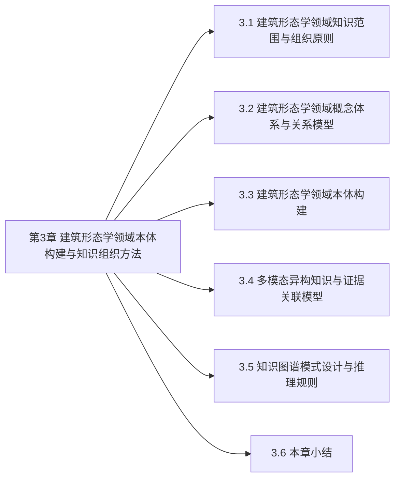

# 第3章 建筑形态学领域本体构建与知识组织方法

<!-- dynamic-chapter:start -->
## 当前工作安排

> 由[[论文章节/大纲结构.yaml|大纲结构]]生成。修改主源后运行同步；文件夹编号仅为历史路径，不决定当前章节顺序。

**本章任务：** 将第二章的建筑学认识转化为可观察、可描述、可分类、可关联的领域概念、关系、本体与证据模型，并规定图谱模式与推理规则；不预写景宁实例结果。

**结构状态：** V3.3工作结构；本体、概念关系、证据模型与规则待建，尚无已核模型

**正文接续：** 旧稿第三章为风貌特征体系与图谱模型，不能直接充当本章；需按领域本体与知识组织重写。

**章内逻辑：** 知识范围与原则 → 概念与关系模型 → 本体构建 → 多模态证据关联 → 图谱模式与推理 → 小结。

**向后接续：** 向第四章交付本体、图谱模式、证据关联与推理规则；规则不等于真实实例或发现。

## 小节与主题成果采用表

| 小节 | 主题及成果入口 | 本节用途 | 采用状态与证据缺口 |
|---|---|---|---|
| 3.1 建筑形态学领域知识范围与组织原则 | [〔理论与文献依据〕畲族民居研究与理论依据](../../%E4%B8%BB%E9%A2%98%E7%A0%94%E7%A9%B6/%E3%80%94%E7%90%86%E8%AE%BA%E4%B8%8E%E6%96%87%E7%8C%AE%E4%BE%9D%E6%8D%AE%E3%80%95%E7%95%B2%E6%97%8F%E6%B0%91%E5%B1%85%E7%A0%94%E7%A9%B6%E4%B8%8E%E7%90%86%E8%AE%BA%E4%BE%9D%E6%8D%AE/%E3%80%94%E7%90%86%E8%AE%BA%E4%B8%8E%E6%96%87%E7%8C%AE%E4%BE%9D%E6%8D%AE%E3%80%95%E7%95%B2%E6%97%8F%E6%B0%91%E5%B1%85%E7%A0%94%E7%A9%B6%E4%B8%8E%E7%90%86%E8%AE%BA%E4%BE%9D%E6%8D%AE.md)、[〔体系设计〕多尺度语义模型与建模依据](../../%E4%B8%BB%E9%A2%98%E7%A0%94%E7%A9%B6/%E3%80%94%E4%BD%93%E7%B3%BB%E8%AE%BE%E8%AE%A1%E3%80%95%E5%A4%9A%E5%B0%BA%E5%BA%A6%E8%AF%AD%E4%B9%89%E6%A8%A1%E5%9E%8B%E4%B8%8E%E5%BB%BA%E6%A8%A1%E4%BE%9D%E6%8D%AE/%E3%80%94%E4%BD%93%E7%B3%BB%E8%AE%BE%E8%AE%A1%E3%80%95%E5%A4%9A%E5%B0%BA%E5%BA%A6%E8%AF%AD%E4%B9%89%E6%A8%A1%E5%9E%8B%E4%B8%8E%E5%BB%BA%E6%A8%A1%E4%BE%9D%E6%8D%AE.md)、[〔体系设计〕风貌特征筛选与数据记录](../../%E4%B8%BB%E9%A2%98%E7%A0%94%E7%A9%B6/%E3%80%94%E4%BD%93%E7%B3%BB%E8%AE%BE%E8%AE%A1%E3%80%95%E9%A3%8E%E8%B2%8C%E7%89%B9%E5%BE%81%E7%AD%9B%E9%80%89%E4%B8%8E%E6%95%B0%E6%8D%AE%E8%AE%B0%E5%BD%95/%E3%80%94%E4%BD%93%E7%B3%BB%E8%AE%BE%E8%AE%A1%E3%80%95%E9%A3%8E%E8%B2%8C%E7%89%B9%E5%BE%81%E7%AD%9B%E9%80%89%E4%B8%8E%E6%95%B0%E6%8D%AE%E8%AE%B0%E5%BD%95.md) | 界定进入本体的建筑形态知识范围、知识层次与组织原则，说明形态构成、关系、形成因素、类型规律及证据来源的边界。 | V3.3工作结构；知识范围与排除项待论证 |
| 3.2 建筑形态学领域概念体系与关系模型 | [〔体系设计〕多尺度语义模型与建模依据](../../%E4%B8%BB%E9%A2%98%E7%A0%94%E7%A9%B6/%E3%80%94%E4%BD%93%E7%B3%BB%E8%AE%BE%E8%AE%A1%E3%80%95%E5%A4%9A%E5%B0%BA%E5%BA%A6%E8%AF%AD%E4%B9%89%E6%A8%A1%E5%9E%8B%E4%B8%8E%E5%BB%BA%E6%A8%A1%E4%BE%9D%E6%8D%AE/%E3%80%94%E4%BD%93%E7%B3%BB%E8%AE%BE%E8%AE%A1%E3%80%95%E5%A4%9A%E5%B0%BA%E5%BA%A6%E8%AF%AD%E4%B9%89%E6%A8%A1%E5%9E%8B%E4%B8%8E%E5%BB%BA%E6%A8%A1%E4%BE%9D%E6%8D%AE.md)、[〔研究方法〕类型识别与比较](../../%E4%B8%BB%E9%A2%98%E7%A0%94%E7%A9%B6/%E3%80%94%E7%A0%94%E7%A9%B6%E6%96%B9%E6%B3%95%E3%80%95%E7%B1%BB%E5%9E%8B%E8%AF%86%E5%88%AB%E4%B8%8E%E6%AF%94%E8%BE%83/%E3%80%94%E7%A0%94%E7%A9%B6%E6%96%B9%E6%B3%95%E3%80%95%E7%B1%BB%E5%9E%8B%E8%AF%86%E5%88%AB%E4%B8%8E%E6%AF%94%E8%BE%83.md)、[〔理论与文献依据〕畲族民居研究与理论依据](../../%E4%B8%BB%E9%A2%98%E7%A0%94%E7%A9%B6/%E3%80%94%E7%90%86%E8%AE%BA%E4%B8%8E%E6%96%87%E7%8C%AE%E4%BE%9D%E6%8D%AE%E3%80%95%E7%95%B2%E6%97%8F%E6%B0%91%E5%B1%85%E7%A0%94%E7%A9%B6%E4%B8%8E%E7%90%86%E8%AE%BA%E4%BE%9D%E6%8D%AE/%E3%80%94%E7%90%86%E8%AE%BA%E4%B8%8E%E6%96%87%E7%8C%AE%E4%BE%9D%E6%8D%AE%E3%80%95%E7%95%B2%E6%97%8F%E6%B0%91%E5%B1%85%E7%A0%94%E7%A9%B6%E4%B8%8E%E7%90%86%E8%AE%BA%E4%BE%9D%E6%8D%AE.md) | 建立概念、类别、属性、关系与实例的层次，区分建筑对象、形态特征、类型、空间关系与证据；吸收BOT等既有本体时标明沿用与扩展。 | V3.3工作结构；概念与关系模型待建 |
| 3.3 建筑形态学领域本体构建 | [〔体系设计〕多尺度语义模型与建模依据](../../%E4%B8%BB%E9%A2%98%E7%A0%94%E7%A9%B6/%E3%80%94%E4%BD%93%E7%B3%BB%E8%AE%BE%E8%AE%A1%E3%80%95%E5%A4%9A%E5%B0%BA%E5%BA%A6%E8%AF%AD%E4%B9%89%E6%A8%A1%E5%9E%8B%E4%B8%8E%E5%BB%BA%E6%A8%A1%E4%BE%9D%E6%8D%AE/%E3%80%94%E4%BD%93%E7%B3%BB%E8%AE%BE%E8%AE%A1%E3%80%95%E5%A4%9A%E5%B0%BA%E5%BA%A6%E8%AF%AD%E4%B9%89%E6%A8%A1%E5%9E%8B%E4%B8%8E%E5%BB%BA%E6%A8%A1%E4%BE%9D%E6%8D%AE.md)、[〔理论与文献依据〕畲族民居研究与理论依据](../../%E4%B8%BB%E9%A2%98%E7%A0%94%E7%A9%B6/%E3%80%94%E7%90%86%E8%AE%BA%E4%B8%8E%E6%96%87%E7%8C%AE%E4%BE%9D%E6%8D%AE%E3%80%95%E7%95%B2%E6%97%8F%E6%B0%91%E5%B1%85%E7%A0%94%E7%A9%B6%E4%B8%8E%E7%90%86%E8%AE%BA%E4%BE%9D%E6%8D%AE/%E3%80%94%E7%90%86%E8%AE%BA%E4%B8%8E%E6%96%87%E7%8C%AE%E4%BE%9D%E6%8D%AE%E3%80%95%E7%95%B2%E6%97%8F%E6%B0%91%E5%B1%85%E7%A0%94%E7%A9%B6%E4%B8%8E%E7%90%86%E8%AE%BA%E4%BE%9D%E6%8D%AE.md) | 说明本体构建方法、复用与扩展策略、类与属性定义、约束及版本管理，形成可复用的领域本体。 | V3.3工作结构；本体设计待开展 |
| 3.4 多模态异构知识与证据关联模型 | [〔体系设计〕多尺度语义模型与建模依据](../../%E4%B8%BB%E9%A2%98%E7%A0%94%E7%A9%B6/%E3%80%94%E4%BD%93%E7%B3%BB%E8%AE%BE%E8%AE%A1%E3%80%95%E5%A4%9A%E5%B0%BA%E5%BA%A6%E8%AF%AD%E4%B9%89%E6%A8%A1%E5%9E%8B%E4%B8%8E%E5%BB%BA%E6%A8%A1%E4%BE%9D%E6%8D%AE/%E3%80%94%E4%BD%93%E7%B3%BB%E8%AE%BE%E8%AE%A1%E3%80%95%E5%A4%9A%E5%B0%BA%E5%BA%A6%E8%AF%AD%E4%B9%89%E6%A8%A1%E5%9E%8B%E4%B8%8E%E5%BB%BA%E6%A8%A1%E4%BE%9D%E6%8D%AE.md)、[〔研究方法〕三维资料质量与空间区域关联](../../%E4%B8%BB%E9%A2%98%E7%A0%94%E7%A9%B6/%E3%80%94%E7%A0%94%E7%A9%B6%E6%96%B9%E6%B3%95%E3%80%95%E4%B8%89%E7%BB%B4%E8%B5%84%E6%96%99%E8%B4%A8%E9%87%8F%E4%B8%8E%E7%A9%BA%E9%97%B4%E5%8C%BA%E5%9F%9F%E5%85%B3%E8%81%94/%E3%80%94%E7%A0%94%E7%A9%B6%E6%96%B9%E6%B3%95%E3%80%95%E4%B8%89%E7%BB%B4%E8%B5%84%E6%96%99%E8%B4%A8%E9%87%8F%E4%B8%8E%E7%A9%BA%E9%97%B4%E5%8C%BA%E5%9F%9F%E5%85%B3%E8%81%94.md)、[〔体系设计〕风貌特征筛选与数据记录](../../%E4%B8%BB%E9%A2%98%E7%A0%94%E7%A9%B6/%E3%80%94%E4%BD%93%E7%B3%BB%E8%AE%BE%E8%AE%A1%E3%80%95%E9%A3%8E%E8%B2%8C%E7%89%B9%E5%BE%81%E7%AD%9B%E9%80%89%E4%B8%8E%E6%95%B0%E6%8D%AE%E8%AE%B0%E5%BD%95/%E3%80%94%E4%BD%93%E7%B3%BB%E8%AE%BE%E8%AE%A1%E3%80%95%E9%A3%8E%E8%B2%8C%E7%89%B9%E5%BE%81%E7%AD%9B%E9%80%89%E4%B8%8E%E6%95%B0%E6%8D%AE%E8%AE%B0%E5%BD%95.md) | 规定文本、照片、测绘、三维模型、调查记录等资料如何关联到建筑对象、形态特征与判断，保留来源、时点、定位与适用条件。 | V3.3工作结构；证据模型待设计 |
| 3.5 知识图谱模式设计与推理规则 | [〔体系设计〕多尺度语义模型与建模依据](../../%E4%B8%BB%E9%A2%98%E7%A0%94%E7%A9%B6/%E3%80%94%E4%BD%93%E7%B3%BB%E8%AE%BE%E8%AE%A1%E3%80%95%E5%A4%9A%E5%B0%BA%E5%BA%A6%E8%AF%AD%E4%B9%89%E6%A8%A1%E5%9E%8B%E4%B8%8E%E5%BB%BA%E6%A8%A1%E4%BE%9D%E6%8D%AE/%E3%80%94%E4%BD%93%E7%B3%BB%E8%AE%BE%E8%AE%A1%E3%80%95%E5%A4%9A%E5%B0%BA%E5%BA%A6%E8%AF%AD%E4%B9%89%E6%A8%A1%E5%9E%8B%E4%B8%8E%E5%BB%BA%E6%A8%A1%E4%BE%9D%E6%8D%AE.md)、[〔检验与评价〕图谱试建、查询与有效性](../../%E4%B8%BB%E9%A2%98%E7%A0%94%E7%A9%B6/%E3%80%94%E6%A3%80%E9%AA%8C%E4%B8%8E%E8%AF%84%E4%BB%B7%E3%80%95%E5%9B%BE%E8%B0%B1%E8%AF%95%E5%BB%BA%E3%80%81%E6%9F%A5%E8%AF%A2%E4%B8%8E%E6%9C%89%E6%95%88%E6%80%A7/%E3%80%94%E6%A3%80%E9%AA%8C%E4%B8%8E%E8%AF%84%E4%BB%B7%E3%80%95%E5%9B%BE%E8%B0%B1%E8%AF%95%E5%BB%BA%E3%80%81%E6%9F%A5%E8%AF%A2%E4%B8%8E%E6%9C%89%E6%95%88%E6%80%A7.md) | 将本体转化为图谱模式，规定实体、关系、属性、约束及有限推理规则；区分事实、统计关联、规则推导与专业解释。 | V3.3工作结构；模式与规则待设计 |
| 3.6 本章小结 | [〔体系设计〕多尺度语义模型与建模依据](../../%E4%B8%BB%E9%A2%98%E7%A0%94%E7%A9%B6/%E3%80%94%E4%BD%93%E7%B3%BB%E8%AE%BE%E8%AE%A1%E3%80%95%E5%A4%9A%E5%B0%BA%E5%BA%A6%E8%AF%AD%E4%B9%89%E6%A8%A1%E5%9E%8B%E4%B8%8E%E5%BB%BA%E6%A8%A1%E4%BE%9D%E6%8D%AE/%E3%80%94%E4%BD%93%E7%B3%BB%E8%AE%BE%E8%AE%A1%E3%80%95%E5%A4%9A%E5%B0%BA%E5%BA%A6%E8%AF%AD%E4%B9%89%E6%A8%A1%E5%9E%8B%E4%B8%8E%E5%BB%BA%E6%A8%A1%E4%BE%9D%E6%8D%AE.md)、[〔检验与评价〕图谱试建、查询与有效性](../../%E4%B8%BB%E9%A2%98%E7%A0%94%E7%A9%B6/%E3%80%94%E6%A3%80%E9%AA%8C%E4%B8%8E%E8%AF%84%E4%BB%B7%E3%80%95%E5%9B%BE%E8%B0%B1%E8%AF%95%E5%BB%BA%E3%80%81%E6%9F%A5%E8%AF%A2%E4%B8%8E%E6%9C%89%E6%95%88%E6%80%A7/%E3%80%94%E6%A3%80%E9%AA%8C%E4%B8%8E%E8%AF%84%E4%BB%B7%E3%80%95%E5%9B%BE%E8%B0%B1%E8%AF%95%E5%BB%BA%E3%80%81%E6%9F%A5%E8%AF%A2%E4%B8%8E%E6%9C%89%E6%95%88%E6%80%A7.md) | 总结知识范围、概念关系、本体、证据模型、图谱模式与推理规则，说明适用条件和待验证内容。 | 待本章各节完成后撰写；当前为工作结构 |

## 逐节研究问题与证据要求

以下是待执行的研究要求，不是已完成或已验证声明；采用状态仍以上表为准。

### 建筑形态学领域知识范围与组织原则

- **问题**：哪些建筑形态知识进入领域本体，按什么原则组织，哪些暂不纳入？
- **所需证据／待核材料**：传统建筑形态学与类型学研究内容；第二章建筑学问题清单；范围排除项与理由。
- **完成判据**：知识范围有建筑学依据；不把技术可用性或软件结构当作分类原则。

### 建筑形态学领域概念体系与关系模型

- **问题**：领域概念如何分层，核心关系有哪些，概念与实例怎样区分？
- **所需证据／待核材料**：概念来源与定义对照；BOT及既有本体原文；关系清单与语义约束。
- **完成判据**：概念、类型、实例、属性、关系职责清楚；本地词汇不冒称外部本体原规定。

### 建筑形态学领域本体构建

- **问题**：怎样构建、复用和扩展建筑形态学领域本体，如何保证一致性与可维护性？
- **所需证据／待核材料**：本体构建方法与工具来源；类、属性、约束定义；复用/扩展差异与版本记录。
- **完成判据**：本体设计与平台实现分开；不以导入成功证明本体适用。

### 多模态异构知识与证据关联模型

- **问题**：多模态资料如何与形态知识建立可追溯关联，证据强度和不确定性怎样表达？
- **所需证据／待核材料**：资料类型与元数据方案；对象—证据关联规则；来源、时点、定位与不确定性记录。
- **完成判据**：证据关联可回查；不以模型或图像存在替代证据判断。

### 知识图谱模式设计与推理规则

- **问题**：图谱模式如何承载本体，哪些推理有明确规则和证据边界？
- **所需证据／待核材料**：图谱模式与本体映射；推理规则及适用条件；与普通数据库/查询任务的边界说明。
- **完成判据**：模式、规则与实例数据分开；不把图查询结果自动当因果或建筑学结论。

### 本章小结

- **问题**：形成了哪些可复用知识组织成果，在何种对象与资料条件下适用？
- **所需证据／待核材料**：本章各节成果汇总；适用范围与待验证问题。
- **完成判据**：本体与规则是可复用设计，不冒称已验证的普适模型。

## 本章结构图

## 稳定节点与原稿接续

- `section-3-knowledge-scope`：建筑形态学领域知识范围与组织原则；纳入当前工作大纲。原稿编号：新节点；变更说明：2026-11-17按V3.3新增第三章3.1；接续旧3.1体系构建依据，但改为本体知识范围。

- `section-3-concept-model`：建筑形态学领域概念体系与关系模型；纳入当前工作大纲。原稿编号：新节点；变更说明：2026-11-17按V3.3新增第三章3.2；接续旧多尺度特征体系与BOT比较任务，但不预写景宁类型。

- `section-3-ontology`：建筑形态学领域本体构建；纳入当前工作大纲。原稿编号：新节点；变更说明：2026-11-17按V3.3新增第三章3.3；旧3.3图谱模式节点停用，本体任务独立成节。

- `section-3-multimodal-evidence`：多模态异构知识与证据关联模型；纳入当前工作大纲。原稿编号：新节点；变更说明：2026-11-17按V3.3新增第三章3.4；接续旧三维关联与资料质量任务，但改为证据关联模型。

- `section-3-schema-rules`：知识图谱模式设计与推理规则；纳入当前工作大纲。原稿编号：新节点；变更说明：2026-11-17按V3.3新增第三章3.5；接续旧3.3、3.4图谱方法任务，并吸收推理规则要求。

- `section-3-5`：本章小结；纳入当前工作大纲。原稿编号：3.5；变更说明：2026-10-29用户确认体系—实例图谱—风貌分析分工；由“本章小结：待检验规则与评价任务”调整，保留稳定ID及原稿接续；正文未改写；2026-10-29标题与逻辑梳理：由“本章小结：特征体系、图谱模型及适用范围”接续，仍为工作大纲，正文不改；2026-11-17按V3.3保留为3.6本章小结。

- `section-3-2`：风貌特征体系的构建依据与原则；停用、保留追溯。原稿编号：3.2；变更说明：2026-10-29用户确认体系—实例图谱—风貌分析分工；由“风貌特征筛选与规范记录体系”调整，保留稳定ID及原稿接续；正文未改写；2026-10-29标题与逻辑梳理：由“多尺度风貌特征体系的构建原则与分类依据”接续，仍为工作大纲，正文不改；2026-11-17按V3.3第三至第六章暂只细化到二级，旧节点停用并保留追溯。

- `section-3-multiscale`：多尺度风貌特征体系及其知识表达；停用、保留追溯。原稿编号：新节点；变更说明：2026-11-04按用户确认将原3.2—3.4三个并列二级节收束为3.2多尺度风貌特征体系；三个三级节保留原稳定ID和内容，只调整层级与显示编号。；2026-11-17按V3.3第三至第六章暂只细化到二级，旧节点停用并保留追溯。

- `section-3-graph-methods`：知识图谱模型与构建方法；停用、保留追溯。原稿编号：新节点；变更说明：2026-11-05依据用户提供的目录讨论末轮方案新增论证层级；不是实证成果或已完成正文；2026-11-17按V3.3第三至第六章暂只细化到二级，旧节点停用并保留追溯。

- `section-3-type-methods`：风貌类型识别与比较分析方法；停用、保留追溯。原稿编号：新节点；变更说明：2026-11-05依据用户提供的目录讨论末轮方案新增论证层级；不是实证成果或已完成正文；2026-11-05用户同意最小修订：吸收研究框架审阅意见并保留主会话限定；不增加章目，不改正文或实证状态。来源：研究资料/来源证据/2026-11-05-研究框架审阅意见.md；2026-11-17按V3.3第三至第六章暂只细化到二级，旧节点停用并保留追溯。

## 三级稳定节点

- `section-3-village`：村落尺度的民居聚居特征；停用、保留追溯；2026-10-29按用户确认分工新增研究任务；无旧正文对应，不表示研究完成；2026-10-29标题与逻辑梳理：由“村落尺度的民居聚居特征分类与模型表达”接续，仍为工作大纲，正文不改；2026-11-17随父节停用，保留锚点与证据入口。

- `section-3-group`：组团尺度的民居组合特征；停用、保留追溯；2026-10-29按用户确认分工新增研究任务；无旧正文对应，不表示研究完成；2026-10-29标题与逻辑梳理：由“组团尺度的民居组合特征分类与模型表达”接续，仍为工作大纲，正文不改；2026-11-17随父节停用，保留锚点与证据入口。

- `section-3-building`：单体尺度的民居建筑特征；停用、保留追溯；2026-10-29按用户确认分工新增研究任务；无旧正文对应，不表示研究完成；2026-10-29标题与逻辑梳理：由“单体尺度的民居风貌特征分类与模型表达”接续，仍为工作大纲，正文不改；2026-11-17随父节停用，保留锚点与证据入口。

- `section-3-3`：图谱总体结构与跨尺度知识关联；停用、保留追溯；2026-10-29用户确认体系—实例图谱—风貌分析分工；由“对象、类型与语义关系的描述模型”调整，保留稳定ID及原稿接续；正文未改写；2026-10-29标题与逻辑梳理：由“跨尺度关系与知识图谱模型整合”接续，仍为工作大纲，正文不改；2026-11-05按用户提供的最终归并方案下移层级，保留稳定ID、原稿入口和证据任务。；2026-11-17随父节停用，保留锚点与证据入口。

- `section-3-spatial-association`：语义对象与三维空间区域关联；停用、保留追溯；2026-10-29用户确认体系—实例图谱—风貌分析分工；由“语义对象与三维空间区域关联方法”调整，保留稳定ID及原稿接续；正文未改写；2026-10-29标题与逻辑梳理：由“语义对象与三维空间区域关联规则”接续，仍为工作大纲，正文不改；2026-11-05按用户提供的最终归并方案下移层级，保留稳定ID、原稿入口和证据任务。；2026-11-17随父节停用，保留锚点与证据入口。

- `section-3-4`：图谱实例化规则与质量控制方法；停用、保留追溯；2026-10-29用户确认体系—实例图谱—风貌分析分工；由“记录、图谱实现与查询的操作流程”调整，保留稳定ID及原稿接续；正文未改写；2026-10-29标题与逻辑梳理：由“知识图谱构建与查询分析的通用规则”接续，仍为工作大纲，正文不改；2026-11-05按用户提供的最终归并方案下移层级，保留稳定ID、原稿入口和证据任务；2026-11-05用户同意最小修订：吸收研究框架审阅意见并保留主会话限定；不增加章目，不改正文或实证状态。来源：研究资料/来源证据/2026-11-05-研究框架审阅意见.md；2026-11-17随父节停用，保留锚点与证据入口。

- `sub-type-classification`：类型识别与归类规则；停用、保留追溯；2026-11-05依据用户提供的目录讨论末轮方案新增论证层级；不是实证成果或已完成正文；2026-11-17随父节停用，保留锚点与证据入口。

- `sub-type-comparison`：类型组合与跨尺度比较；停用、保留追溯；2026-11-05依据用户提供的目录讨论末轮方案新增论证层级；不是实证成果或已完成正文；2026-11-17随父节停用，保留锚点与证据入口。

## 已移往其他章节的原节点

- [研究框架与体系、图谱及分析的衔接](02-%E7%90%86%E8%AE%BA%E5%9F%BA%E7%A1%80.md#section-3-1)：稳定ID不变，原入口转接。

## 调整与反馈

需要调整题名、顺序、节的归属或采用状态时，修改大纲结构；稳定ID不随编号改变。新增、停用、拆分合并必须保留理由及原稿接续，不能由文件数自动认定研究完成。
<!-- dynamic-chapter:end -->
