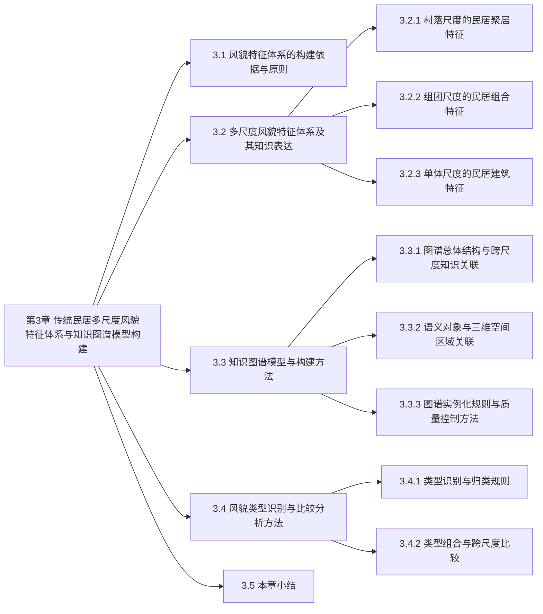

# 第3章 传统民居多尺度风貌特征体系与知识图谱模型构建

<!-- dynamic-chapter:start -->
## 当前工作安排

> 由[[论文章节/大纲结构.yaml|大纲结构]]生成。修改主源后运行同步；文件夹编号仅为历史路径，不决定当前章节顺序。

**本章任务：** 将各尺度的建筑特征分类与语义表达共同展开，形成适用范围明确的可复用特征体系、图谱模型、关联规则与类型比较方法；不预写景宁风貌结论。

**结构状态：** 按已确认分工调整的工作结构；正文与研究证据待补，不表示已完成应用或验证

[打开既有正文对应章](../%E5%85%A8%E6%96%87%E5%B7%A5%E4%BD%9C%E7%A8%BF/%E6%99%AF%E5%AE%81%E7%95%B2%E6%97%8F%E4%BC%A0%E7%BB%9F%E6%B0%91%E5%B1%85%E9%A3%8E%E8%B2%8C%E7%89%B9%E5%BE%81%E6%8F%90%E5%8F%96%E4%B8%8E%E7%9F%A5%E8%AF%86%E5%9B%BE%E8%B0%B1%E6%9E%84%E5%BB%BA%E7%A0%94%E7%A9%B6v0.6.md#%E7%AC%AC%E4%B8%89%E7%AB%A0%20%E4%BC%A0%E7%BB%9F%E6%B0%91%E5%B1%85%E5%A4%9A%E5%B0%BA%E5%BA%A6%E9%A3%8E%E8%B2%8C%E7%89%B9%E5%BE%81%E6%8F%90%E5%8F%96%E4%B8%8E%E7%9F%A5%E8%AF%86%E5%9B%BE%E8%B0%B1%E7%BB%84%E7%BB%87%E4%BD%93%E7%B3%BB%E8%AE%BE%E8%AE%A1)。正文未随结构自动改写。

**章内逻辑：** 构建依据 → 特征内容及分尺度表达 → 统一知识组织与构建 → 类型识别与比较方法。

**向后接续：** 向第四章交付记录、实例化、质量与三维关联规则；向第五章交付类型识别与比较程序。规则不等于真实类型发现。

## 小节与主题成果采用表

| 小节 | 主题及成果入口 | 本节用途 | 采用状态与证据缺口 |
|---|---|---|---|
| 3.1 风貌特征体系的构建依据与原则 | [〔体系设计〕风貌特征筛选与数据记录](../../%E4%B8%BB%E9%A2%98%E7%A0%94%E7%A9%B6/%E3%80%94%E4%BD%93%E7%B3%BB%E8%AE%BE%E8%AE%A1%E3%80%95%E9%A3%8E%E8%B2%8C%E7%89%B9%E5%BE%81%E7%AD%9B%E9%80%89%E4%B8%8E%E6%95%B0%E6%8D%AE%E8%AE%B0%E5%BD%95/%E3%80%94%E4%BD%93%E7%B3%BB%E8%AE%BE%E8%AE%A1%E3%80%95%E9%A3%8E%E8%B2%8C%E7%89%B9%E5%BE%81%E7%AD%9B%E9%80%89%E4%B8%8E%E6%95%B0%E6%8D%AE%E8%AE%B0%E5%BD%95.md)、[〔研究方法〕类型识别与比较](../../%E4%B8%BB%E9%A2%98%E7%A0%94%E7%A9%B6/%E3%80%94%E7%A0%94%E7%A9%B6%E6%96%B9%E6%B3%95%E3%80%95%E7%B1%BB%E5%9E%8B%E8%AF%86%E5%88%AB%E4%B8%8E%E6%AF%94%E8%BE%83/%E3%80%94%E7%A0%94%E7%A9%B6%E6%96%B9%E6%B3%95%E3%80%95%E7%B1%BB%E5%9E%8B%E8%AF%86%E5%88%AB%E4%B8%8E%E6%AF%94%E8%BE%83.md)、[〔研究界定〕研究对象与样本边界](../../%E4%B8%BB%E9%A2%98%E7%A0%94%E7%A9%B6/%E3%80%94%E7%A0%94%E7%A9%B6%E7%95%8C%E5%AE%9A%E3%80%95%E7%A0%94%E7%A9%B6%E5%AF%B9%E8%B1%A1%E4%B8%8E%E6%A0%B7%E6%9C%AC%E8%BE%B9%E7%95%8C/%E3%80%94%E7%A0%94%E7%A9%B6%E7%95%8C%E5%AE%9A%E3%80%95%E7%A0%94%E7%A9%B6%E5%AF%B9%E8%B1%A1%E4%B8%8E%E6%A0%B7%E6%9C%AC%E8%BE%B9%E7%95%8C.md) | 把第二章概念及分析依据转为特征筛选、可观察判据、提取与记录原则，说明体系适用范围；具体类型识别与归类程序在本章类型分析方法节展开。内部构架暂停，演变暂缓，人的感知本阶段不纳入。 | 按已确认分工调整的工作结构；正文与研究证据待补，不表示已完成应用或验证 |
| 3.2 多尺度风貌特征体系及其知识表达 | [〔体系设计〕风貌特征筛选与数据记录](../../%E4%B8%BB%E9%A2%98%E7%A0%94%E7%A9%B6/%E3%80%94%E4%BD%93%E7%B3%BB%E8%AE%BE%E8%AE%A1%E3%80%95%E9%A3%8E%E8%B2%8C%E7%89%B9%E5%BE%81%E7%AD%9B%E9%80%89%E4%B8%8E%E6%95%B0%E6%8D%AE%E8%AE%B0%E5%BD%95/%E3%80%94%E4%BD%93%E7%B3%BB%E8%AE%BE%E8%AE%A1%E3%80%95%E9%A3%8E%E8%B2%8C%E7%89%B9%E5%BE%81%E7%AD%9B%E9%80%89%E4%B8%8E%E6%95%B0%E6%8D%AE%E8%AE%B0%E5%BD%95.md)、[〔体系设计〕多尺度语义模型与建模依据](../../%E4%B8%BB%E9%A2%98%E7%A0%94%E7%A9%B6/%E3%80%94%E4%BD%93%E7%B3%BB%E8%AE%BE%E8%AE%A1%E3%80%95%E5%A4%9A%E5%B0%BA%E5%BA%A6%E8%AF%AD%E4%B9%89%E6%A8%A1%E5%9E%8B%E4%B8%8E%E5%BB%BA%E6%A8%A1%E4%BE%9D%E6%8D%AE/%E3%80%94%E4%BD%93%E7%B3%BB%E8%AE%BE%E8%AE%A1%E3%80%95%E5%A4%9A%E5%B0%BA%E5%BA%A6%E8%AF%AD%E4%B9%89%E6%A8%A1%E5%9E%8B%E4%B8%8E%E5%BB%BA%E6%A8%A1%E4%BE%9D%E6%8D%AE.md)、[〔研究界定〕研究对象与样本边界](../../%E4%B8%BB%E9%A2%98%E7%A0%94%E7%A9%B6/%E3%80%94%E7%A0%94%E7%A9%B6%E7%95%8C%E5%AE%9A%E3%80%95%E7%A0%94%E7%A9%B6%E5%AF%B9%E8%B1%A1%E4%B8%8E%E6%A0%B7%E6%9C%AC%E8%BE%B9%E7%95%8C/%E3%80%94%E7%A0%94%E7%A9%B6%E7%95%8C%E5%AE%9A%E3%80%95%E7%A0%94%E7%A9%B6%E5%AF%B9%E8%B1%A1%E4%B8%8E%E6%A0%B7%E6%9C%AC%E8%BE%B9%E7%95%8C.md) | 说明村落、组团、单体三个尺度如何共同构成同一多尺度风貌特征体系；三个尺度分别展开分类与表达，跨尺度关系留3.3。 | 按2026-11-04用户确认的3.2父节结构；三级节展开，正文与证据待补 |
| 3.3 知识图谱模型与构建方法 | [〔体系设计〕多尺度语义模型与建模依据](../../%E4%B8%BB%E9%A2%98%E7%A0%94%E7%A9%B6/%E3%80%94%E4%BD%93%E7%B3%BB%E8%AE%BE%E8%AE%A1%E3%80%95%E5%A4%9A%E5%B0%BA%E5%BA%A6%E8%AF%AD%E4%B9%89%E6%A8%A1%E5%9E%8B%E4%B8%8E%E5%BB%BA%E6%A8%A1%E4%BE%9D%E6%8D%AE/%E3%80%94%E4%BD%93%E7%B3%BB%E8%AE%BE%E8%AE%A1%E3%80%95%E5%A4%9A%E5%B0%BA%E5%BA%A6%E8%AF%AD%E4%B9%89%E6%A8%A1%E5%9E%8B%E4%B8%8E%E5%BB%BA%E6%A8%A1%E4%BE%9D%E6%8D%AE.md)、[〔研究方法〕类型识别与比较](../../%E4%B8%BB%E9%A2%98%E7%A0%94%E7%A9%B6/%E3%80%94%E7%A0%94%E7%A9%B6%E6%96%B9%E6%B3%95%E3%80%95%E7%B1%BB%E5%9E%8B%E8%AF%86%E5%88%AB%E4%B8%8E%E6%AF%94%E8%BE%83/%E3%80%94%E7%A0%94%E7%A9%B6%E6%96%B9%E6%B3%95%E3%80%95%E7%B1%BB%E5%9E%8B%E8%AF%86%E5%88%AB%E4%B8%8E%E6%AF%94%E8%BE%83.md)、[〔研究方法〕三维资料质量与空间区域关联](../../%E4%B8%BB%E9%A2%98%E7%A0%94%E7%A9%B6/%E3%80%94%E7%A0%94%E7%A9%B6%E6%96%B9%E6%B3%95%E3%80%95%E4%B8%89%E7%BB%B4%E8%B5%84%E6%96%99%E8%B4%A8%E9%87%8F%E4%B8%8E%E7%A9%BA%E9%97%B4%E5%8C%BA%E5%9F%9F%E5%85%B3%E8%81%94/%E3%80%94%E7%A0%94%E7%A9%B6%E6%96%B9%E6%B3%95%E3%80%95%E4%B8%89%E7%BB%B4%E8%B5%84%E6%96%99%E8%B4%A8%E9%87%8F%E4%B8%8E%E7%A9%BA%E9%97%B4%E5%8C%BA%E5%9F%9F%E5%85%B3%E8%81%94.md)、[〔体系设计〕风貌特征筛选与数据记录](../../%E4%B8%BB%E9%A2%98%E7%A0%94%E7%A9%B6/%E3%80%94%E4%BD%93%E7%B3%BB%E8%AE%BE%E8%AE%A1%E3%80%95%E9%A3%8E%E8%B2%8C%E7%89%B9%E5%BE%81%E7%AD%9B%E9%80%89%E4%B8%8E%E6%95%B0%E6%8D%AE%E8%AE%B0%E5%BD%95/%E3%80%94%E4%BD%93%E7%B3%BB%E8%AE%BE%E8%AE%A1%E3%80%95%E9%A3%8E%E8%B2%8C%E7%89%B9%E5%BE%81%E7%AD%9B%E9%80%89%E4%B8%8E%E6%95%B0%E6%8D%AE%E8%AE%B0%E5%BD%95.md)、[〔检验与评价〕图谱试建、查询与有效性](../../%E4%B8%BB%E9%A2%98%E7%A0%94%E7%A9%B6/%E3%80%94%E6%A3%80%E9%AA%8C%E4%B8%8E%E8%AF%84%E4%BB%B7%E3%80%95%E5%9B%BE%E8%B0%B1%E8%AF%95%E5%BB%BA%E3%80%81%E6%9F%A5%E8%AF%A2%E4%B8%8E%E6%9C%89%E6%95%88%E6%80%A7/%E3%80%94%E6%A3%80%E9%AA%8C%E4%B8%8E%E8%AF%84%E4%BB%B7%E3%80%95%E5%9B%BE%E8%B0%B1%E8%AF%95%E5%BB%BA%E3%80%81%E6%9F%A5%E8%AF%A2%E4%B8%8E%E6%9C%89%E6%95%88%E6%80%A7.md) | 整合分尺度表达为统一图谱模型，依次交代跨尺度组织、三维关联及实例化与质量控制；不重复逐字段定义，不将类型比较混同入库流程。 | 2026-11-05用户授权的工作结构；正文、真实样本与方法验证待完成 |
| 3.4 风貌类型识别与比较分析方法 | [〔检验与评价〕图谱试建、查询与有效性](../../%E4%B8%BB%E9%A2%98%E7%A0%94%E7%A9%B6/%E3%80%94%E6%A3%80%E9%AA%8C%E4%B8%8E%E8%AF%84%E4%BB%B7%E3%80%95%E5%9B%BE%E8%B0%B1%E8%AF%95%E5%BB%BA%E3%80%81%E6%9F%A5%E8%AF%A2%E4%B8%8E%E6%9C%89%E6%95%88%E6%80%A7/%E3%80%94%E6%A3%80%E9%AA%8C%E4%B8%8E%E8%AF%84%E4%BB%B7%E3%80%95%E5%9B%BE%E8%B0%B1%E8%AF%95%E5%BB%BA%E3%80%81%E6%9F%A5%E8%AF%A2%E4%B8%8E%E6%9C%89%E6%95%88%E6%80%A7.md)、[〔研究界定〕研究对象与样本边界](../../%E4%B8%BB%E9%A2%98%E7%A0%94%E7%A9%B6/%E3%80%94%E7%A0%94%E7%A9%B6%E7%95%8C%E5%AE%9A%E3%80%95%E7%A0%94%E7%A9%B6%E5%AF%B9%E8%B1%A1%E4%B8%8E%E6%A0%B7%E6%9C%AC%E8%BE%B9%E7%95%8C/%E3%80%94%E7%A0%94%E7%A9%B6%E7%95%8C%E5%AE%9A%E3%80%95%E7%A0%94%E7%A9%B6%E5%AF%B9%E8%B1%A1%E4%B8%8E%E6%A0%B7%E6%9C%AC%E8%BE%B9%E7%95%8C.md)、[〔研究方法〕类型识别与比较](../../%E4%B8%BB%E9%A2%98%E7%A0%94%E7%A9%B6/%E3%80%94%E7%A0%94%E7%A9%B6%E6%96%B9%E6%B3%95%E3%80%95%E7%B1%BB%E5%9E%8B%E8%AF%86%E5%88%AB%E4%B8%8E%E6%AF%94%E8%BE%83/%E3%80%94%E7%A0%94%E7%A9%B6%E6%96%B9%E6%B3%95%E3%80%95%E7%B1%BB%E5%9E%8B%E8%AF%86%E5%88%AB%E4%B8%8E%E6%AF%94%E8%BE%83.md)、[〔体系设计〕风貌特征筛选与数据记录](../../%E4%B8%BB%E9%A2%98%E7%A0%94%E7%A9%B6/%E3%80%94%E4%BD%93%E7%B3%BB%E8%AE%BE%E8%AE%A1%E3%80%95%E9%A3%8E%E8%B2%8C%E7%89%B9%E5%BE%81%E7%AD%9B%E9%80%89%E4%B8%8E%E6%95%B0%E6%8D%AE%E8%AE%B0%E5%BD%95/%E3%80%94%E4%BD%93%E7%B3%BB%E8%AE%BE%E8%AE%A1%E3%80%95%E9%A3%8E%E8%B2%8C%E7%89%B9%E5%BE%81%E7%AD%9B%E9%80%89%E4%B8%8E%E6%95%B0%E6%8D%AE%E8%AE%B0%E5%BD%95.md) | 以3.2的特征判据及3.3中对象、特征与关系的统一定义为结构化基础，规定由记录及关系形成局部类型、组合变体、空间差异和有据解释的程序；与建库流程分开，不以数据库导入或全部三维关联完成作为普遍前提，规则允许依据真实比较中的变体与反例迭代。 | 2026-11-05用户授权的工作结构；正文、真实样本与方法验证待完成 |
| 3.5 本章小结 | [〔体系设计〕多尺度语义模型与建模依据](../../%E4%B8%BB%E9%A2%98%E7%A0%94%E7%A9%B6/%E3%80%94%E4%BD%93%E7%B3%BB%E8%AE%BE%E8%AE%A1%E3%80%95%E5%A4%9A%E5%B0%BA%E5%BA%A6%E8%AF%AD%E4%B9%89%E6%A8%A1%E5%9E%8B%E4%B8%8E%E5%BB%BA%E6%A8%A1%E4%BE%9D%E6%8D%AE/%E3%80%94%E4%BD%93%E7%B3%BB%E8%AE%BE%E8%AE%A1%E3%80%95%E5%A4%9A%E5%B0%BA%E5%BA%A6%E8%AF%AD%E4%B9%89%E6%A8%A1%E5%9E%8B%E4%B8%8E%E5%BB%BA%E6%A8%A1%E4%BE%9D%E6%8D%AE.md)、[〔体系设计〕风貌特征筛选与数据记录](../../%E4%B8%BB%E9%A2%98%E7%A0%94%E7%A9%B6/%E3%80%94%E4%BD%93%E7%B3%BB%E8%AE%BE%E8%AE%A1%E3%80%95%E9%A3%8E%E8%B2%8C%E7%89%B9%E5%BE%81%E7%AD%9B%E9%80%89%E4%B8%8E%E6%95%B0%E6%8D%AE%E8%AE%B0%E5%BD%95/%E3%80%94%E4%BD%93%E7%B3%BB%E8%AE%BE%E8%AE%A1%E3%80%95%E9%A3%8E%E8%B2%8C%E7%89%B9%E5%BE%81%E7%AD%9B%E9%80%89%E4%B8%8E%E6%95%B0%E6%8D%AE%E8%AE%B0%E5%BD%95.md)、[〔研究方法〕三维资料质量与空间区域关联](../../%E4%B8%BB%E9%A2%98%E7%A0%94%E7%A9%B6/%E3%80%94%E7%A0%94%E7%A9%B6%E6%96%B9%E6%B3%95%E3%80%95%E4%B8%89%E7%BB%B4%E8%B5%84%E6%96%99%E8%B4%A8%E9%87%8F%E4%B8%8E%E7%A9%BA%E9%97%B4%E5%8C%BA%E5%9F%9F%E5%85%B3%E8%81%94/%E3%80%94%E7%A0%94%E7%A9%B6%E6%96%B9%E6%B3%95%E3%80%95%E4%B8%89%E7%BB%B4%E8%B5%84%E6%96%99%E8%B4%A8%E9%87%8F%E4%B8%8E%E7%A9%BA%E9%97%B4%E5%8C%BA%E5%9F%9F%E5%85%B3%E8%81%94.md) | 总结特征体系、图谱模型、记录与三维关联规则及类型比较方法，明确适用条件和待验证内容。 | 按已确认分工调整的工作结构；正文与研究证据待补，不表示已完成应用或验证 |

## 三级标题与论证分工

三级标题用于思路梳理；理论及分析视角是比较对象，不表示全部采用。成果入口和采用关系沿用父节，不重复计数。

| 三级标题 | 论证任务 | 状态 |
|---|---|---|
| 3.2.1 村落尺度的民居聚居特征 | 围绕民居分布、聚居形态与环境关联，构建村落尺度的特征分类和表达方式 | 按已确认分工调整的工作结构；正文与研究证据待补，不表示已完成应用或验证 |
| 3.2.2 组团尺度的民居组合特征 | 围绕组团界定、排列、邻接、围合及界面组合，构建组团尺度的特征分类和表达方式 | 按已确认分工调整的工作结构；正文与研究证据待补，不表示已完成应用或验证 |
| 3.2.3 单体尺度的民居建筑特征 | 围绕当前可取证的外部体量、屋顶、院落、立面及条件可识别的材料与装饰展开特征与知识表达；完整室内平面、内部构架及其依赖分析不作为当前必采任务，不由外观推断内部信息。 | 按已确认分工调整的工作结构；正文与研究证据待补，不表示已完成应用或验证 |
| 3.3.1 图谱总体结构与跨尺度知识关联 | 整合各尺度的对象、类型、属性、关系及证据组织，形成共同模型并说明扩展边界 | 按已确认分工调整的工作结构；正文与研究证据待补，不表示已完成应用或验证 |
| 3.3.2 语义对象与三维空间区域关联 | 规定对象与空间区域的指认、对应、记录和不确定性处理；不把三维关联设为全部图谱构建的必要条件 | 按已确认分工调整的工作结构；正文与研究证据待补，不表示已完成应用或验证 |
| 3.3.3 图谱实例化规则与质量控制方法 | 规定从规范记录到图谱实例的转换、对象一致性、来源追溯及质量控制方法，为第四章实施提供规则 | 按已确认分工调整的工作结构；正文与研究证据待补，不表示已完成应用或验证 |
| 3.4.1 类型识别与归类规则 | 明确分类单位、决定归类的特征、类内差异、未知和边界案例，保留文献原名与规则版本。 | 2026-11-05用户授权的工作结构；正文、真实样本与方法验证待完成 |
| 3.4.2 类型组合与跨尺度比较 | 明确局部类型如何形成组合与变体以及同条件比较；区分关系、共现和成因，保留反例与不可比项，不预设跨村比较。 | 2026-11-05用户授权的工作结构；正文、真实样本与方法验证待完成 |

## 逐节研究问题与证据要求

以下是待执行的研究要求，不是已完成或已验证声明；采用状态仍以上表为准。

### 风貌特征体系的构建依据与原则

- **问题**：哪些内容属于风貌特征、关联解释或基础证据信息？
- **所需证据／待核材料**：候选项来源及筛选理由；可观察判据、提取方式与记录规范；分类规则、实例归类及缺失/歧义/复核的处理。
- **完成判据**：说明纳入、条件记录与排除依据；可复用设计不等于跨村或跨地区有效性已验证，不预设全尺度全对象覆盖。。

### 多尺度风貌特征体系及其知识表达

- **问题**：三个尺度各自观察什么、如何表达，如何共同构成一个体系而不是三套并列方法？
- **所需证据／待核材料**：三个尺度的特征分类与表达规则；尺度间对象、特征与关系的一致性；各尺度边界及缺失/歧义处理。
- **完成判据**：三个尺度在同一体系内定义；不把尺度并列写成互不相干的方法；跨尺度关系不在本节提前完成。。

### 知识图谱模型与构建方法

- **问题**：整合分尺度表达为统一图谱模型，依次交代跨尺度组织、三维关联及实例化与质量控制；不重复逐字段定义，不将类型比较混同入库流程。
- **所需证据／待核材料**：各尺度表达与统一模型对应；BOT与研究扩展的来源及状态；区域关联及实例化质量规则。
- **完成判据**：沿用与扩展分开；模型设计、三维关联、质量控制形成共同方法，真实应用结果留第四章。。

### 风貌类型识别与比较分析方法

- **问题**：如何依据统一表达的特征与关系制定类型识别和比较程序，并保留未知、反例与规则修订，而不将其混同为数据库导入步骤？
- **所需证据／待核材料**：D06及类型识别主题的候选工作路径；归类对象、判别条件、规则来源与版本；未知、边界案例、反例与修订依据。
- **完成判据**：区分对象类别、文献原类型、候选类型和样本支持类型；不预设唯一总类型、不强制聚类、不把候选规则写成已验证方法。 对象、特征与关系的统一表达支撑比较，不将建库或全部三维关联设为所有类型分析的必经步骤；反例与适配可反馈修订规则，并保留版本与依据。。

### 本章小结

- **问题**：形成了哪些体系成果，它们在何种资料与对象条件下适用？
- **所需证据／待核材料**：分类体系、模型及关联规则的汇总；适用范围与尚待检验问题。
- **完成判据**：体系是可复用研究设计，不冒称适用所有传统民居的普适本体或已验证成果。

## 本章结构图

## 稳定节点与原稿接续

- `section-3-2`：风貌特征体系的构建依据与原则；纳入当前工作大纲。原稿编号：3.2；变更说明：2026-10-29用户确认体系—实例图谱—风貌分析分工；由“风貌特征筛选与规范记录体系”调整，保留稳定ID及原稿接续；正文未改写；2026-10-29标题与逻辑梳理：由“多尺度风貌特征体系的构建原则与分类依据”接续，仍为工作大纲，正文不改。

- `section-3-multiscale`：多尺度风貌特征体系及其知识表达；纳入当前工作大纲。原稿编号：新节点；变更说明：2026-11-04按用户确认将原3.2—3.4三个并列二级节收束为3.2多尺度风貌特征体系；三个三级节保留原稳定ID和内容，只调整层级与显示编号。。

- `section-3-graph-methods`：知识图谱模型与构建方法；纳入当前工作大纲。原稿编号：新节点；变更说明：2026-11-05依据用户提供的目录讨论末轮方案新增论证层级；不是实证成果或已完成正文。

- `section-3-type-methods`：风貌类型识别与比较分析方法；纳入当前工作大纲。原稿编号：新节点；变更说明：2026-11-05依据用户提供的目录讨论末轮方案新增论证层级；不是实证成果或已完成正文；2026-11-05用户同意最小修订：吸收研究框架审阅意见并保留主会话限定；不增加章目，不改正文或实证状态。来源：研究资料/来源证据/2026-11-05-研究框架审阅意见.md。

- `section-3-5`：本章小结；纳入当前工作大纲。原稿编号：3.5；变更说明：2026-10-29用户确认体系—实例图谱—风貌分析分工；由“本章小结：待检验规则与评价任务”调整，保留稳定ID及原稿接续；正文未改写；2026-10-29标题与逻辑梳理：由“本章小结：特征体系、图谱模型及适用范围”接续，仍为工作大纲，正文不改。

## 三级稳定节点

- `section-3-village`：村落尺度的民居聚居特征；纳入当前工作大纲；2026-10-29按用户确认分工新增研究任务；无旧正文对应，不表示研究完成；2026-10-29标题与逻辑梳理：由“村落尺度的民居聚居特征分类与模型表达”接续，仍为工作大纲，正文不改。

- `section-3-group`：组团尺度的民居组合特征；纳入当前工作大纲；2026-10-29按用户确认分工新增研究任务；无旧正文对应，不表示研究完成；2026-10-29标题与逻辑梳理：由“组团尺度的民居组合特征分类与模型表达”接续，仍为工作大纲，正文不改。

- `section-3-building`：单体尺度的民居建筑特征；纳入当前工作大纲；2026-10-29按用户确认分工新增研究任务；无旧正文对应，不表示研究完成；2026-10-29标题与逻辑梳理：由“单体尺度的民居风貌特征分类与模型表达”接续，仍为工作大纲，正文不改。

- `section-3-3`：图谱总体结构与跨尺度知识关联；纳入当前工作大纲；2026-10-29用户确认体系—实例图谱—风貌分析分工；由“对象、类型与语义关系的描述模型”调整，保留稳定ID及原稿接续；正文未改写；2026-10-29标题与逻辑梳理：由“跨尺度关系与知识图谱模型整合”接续，仍为工作大纲，正文不改；2026-11-05按用户提供的最终归并方案下移层级，保留稳定ID、原稿入口和证据任务。。

- `section-3-spatial-association`：语义对象与三维空间区域关联；纳入当前工作大纲；2026-10-29用户确认体系—实例图谱—风貌分析分工；由“语义对象与三维空间区域关联方法”调整，保留稳定ID及原稿接续；正文未改写；2026-10-29标题与逻辑梳理：由“语义对象与三维空间区域关联规则”接续，仍为工作大纲，正文不改；2026-11-05按用户提供的最终归并方案下移层级，保留稳定ID、原稿入口和证据任务。。

- `section-3-4`：图谱实例化规则与质量控制方法；纳入当前工作大纲；2026-10-29用户确认体系—实例图谱—风貌分析分工；由“记录、图谱实现与查询的操作流程”调整，保留稳定ID及原稿接续；正文未改写；2026-10-29标题与逻辑梳理：由“知识图谱构建与查询分析的通用规则”接续，仍为工作大纲，正文不改；2026-11-05按用户提供的最终归并方案下移层级，保留稳定ID、原稿入口和证据任务；2026-11-05用户同意最小修订：吸收研究框架审阅意见并保留主会话限定；不增加章目，不改正文或实证状态。来源：研究资料/来源证据/2026-11-05-研究框架审阅意见.md。

- `sub-type-classification`：类型识别与归类规则；纳入当前工作大纲；2026-11-05依据用户提供的目录讨论末轮方案新增论证层级；不是实证成果或已完成正文。

- `sub-type-comparison`：类型组合与跨尺度比较；纳入当前工作大纲；2026-11-05依据用户提供的目录讨论末轮方案新增论证层级；不是实证成果或已完成正文。

## 已移往其他章节的原节点

- [研究框架与体系、图谱及分析的衔接](02-%E7%90%86%E8%AE%BA%E5%9F%BA%E7%A1%80.md#section-3-1)：稳定ID不变，原入口转接。

## 调整与反馈

需要调整题名、顺序、节的归属或采用状态时，修改大纲结构；稳定ID不随编号改变。新增、停用、拆分合并必须保留理由及原稿接续，不能由文件数自动认定研究完成。
<!-- dynamic-chapter:end -->
