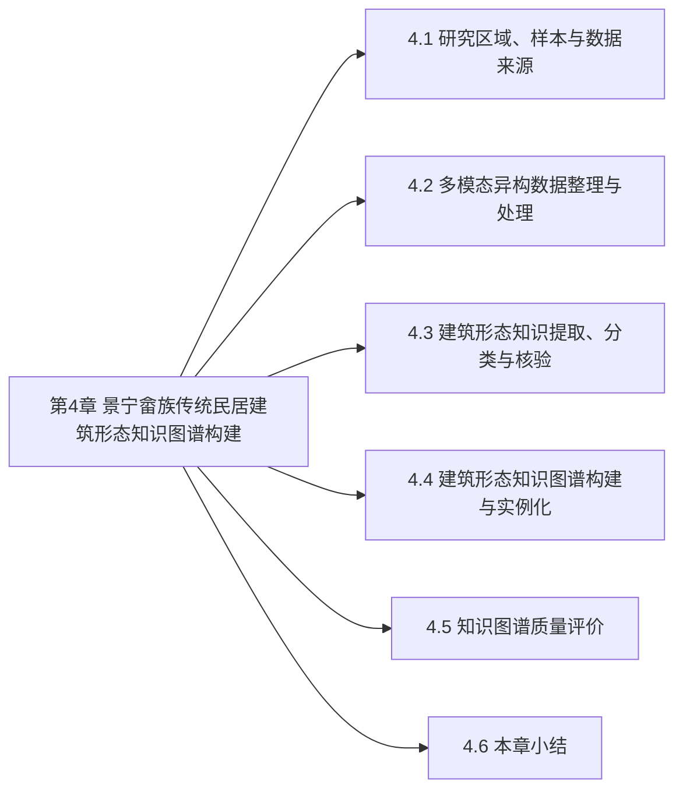

# 第4章 景宁畲族传统民居建筑形态知识图谱构建

<!-- dynamic-chapter:start -->
## 当前工作安排

> 由[[论文章节/大纲结构.yaml|大纲结构]]生成。修改主源后运行同步；文件夹编号仅为历史路径，不决定当前章节顺序。

**本章任务：** 将第三章本体与模式应用于景宁真实样本，完成多源数据整理、形态知识提取与核验、图谱实例化及质量评价，形成可回查的实例图谱。

**结构状态：** V3.3工作结构；真实样本、数据与图谱实例待建，不表示已完成

**正文接续：** 旧稿第四章为风貌特征提取与图谱构建，可提供部分实施经验，但需按形态知识、样本与证据重写，不得直接沿用其结论。

**章内逻辑：** 区域样本与来源 → 数据整理 → 知识提取核验 → 图谱实例化 → 质量评价 → 小结。

**向后接续：** 向第五章交付可回查的实例事实、证据与资料边界；不以图谱规模或导入成功替代质量判断。

## 小节与主题成果采用表

| 小节 | 主题及成果入口 | 本节用途 | 采用状态与证据缺口 |
|---|---|---|---|
| 4.1 研究区域、样本与数据来源 | [〔研究界定〕研究对象与样本边界](../../%E4%B8%BB%E9%A2%98%E7%A0%94%E7%A9%B6/%E3%80%94%E7%A0%94%E7%A9%B6%E7%95%8C%E5%AE%9A%E3%80%95%E7%A0%94%E7%A9%B6%E5%AF%B9%E8%B1%A1%E4%B8%8E%E6%A0%B7%E6%9C%AC%E8%BE%B9%E7%95%8C/%E3%80%94%E7%A0%94%E7%A9%B6%E7%95%8C%E5%AE%9A%E3%80%95%E7%A0%94%E7%A9%B6%E5%AF%B9%E8%B1%A1%E4%B8%8E%E6%A0%B7%E6%9C%AC%E8%BE%B9%E7%95%8C.md)、[〔理论与文献依据〕畲族民居研究与理论依据](../../%E4%B8%BB%E9%A2%98%E7%A0%94%E7%A9%B6/%E3%80%94%E7%90%86%E8%AE%BA%E4%B8%8E%E6%96%87%E7%8C%AE%E4%BE%9D%E6%8D%AE%E3%80%95%E7%95%B2%E6%97%8F%E6%B0%91%E5%B1%85%E7%A0%94%E7%A9%B6%E4%B8%8E%E7%90%86%E8%AE%BA%E4%BE%9D%E6%8D%AE/%E3%80%94%E7%90%86%E8%AE%BA%E4%B8%8E%E6%96%87%E7%8C%AE%E4%BE%9D%E6%8D%AE%E3%80%95%E7%95%B2%E6%97%8F%E6%B0%91%E5%B1%85%E7%A0%94%E7%A9%B6%E4%B8%8E%E7%90%86%E8%AE%BA%E4%BE%9D%E6%8D%AE.md)、[〔研究方法〕三维资料质量与空间区域关联](../../%E4%B8%BB%E9%A2%98%E7%A0%94%E7%A9%B6/%E3%80%94%E7%A0%94%E7%A9%B6%E6%96%B9%E6%B3%95%E3%80%95%E4%B8%89%E7%BB%B4%E8%B5%84%E6%96%99%E8%B4%A8%E9%87%8F%E4%B8%8E%E7%A9%BA%E9%97%B4%E5%8C%BA%E5%9F%9F%E5%85%B3%E8%81%94/%E3%80%94%E7%A0%94%E7%A9%B6%E6%96%B9%E6%B3%95%E3%80%95%E4%B8%89%E7%BB%B4%E8%B5%84%E6%96%99%E8%B4%A8%E9%87%8F%E4%B8%8E%E7%A9%BA%E9%97%B4%E5%8C%BA%E5%9F%9F%E5%85%B3%E8%81%94.md) | 交代研究区域、L0—L3分层候选池、建筑对象纳入与多源数据来源；样本数量开放，不预设固定十村或5+5配额，边界与代表性以已核资料为准。 | V3.3工作结构；L0—L3候选池、规划边界与样本分层待核 |
| 4.2 多模态异构数据整理与处理 | [〔研究方法〕三维资料质量与空间区域关联](../../%E4%B8%BB%E9%A2%98%E7%A0%94%E7%A9%B6/%E3%80%94%E7%A0%94%E7%A9%B6%E6%96%B9%E6%B3%95%E3%80%95%E4%B8%89%E7%BB%B4%E8%B5%84%E6%96%99%E8%B4%A8%E9%87%8F%E4%B8%8E%E7%A9%BA%E9%97%B4%E5%8C%BA%E5%9F%9F%E5%85%B3%E8%81%94/%E3%80%94%E7%A0%94%E7%A9%B6%E6%96%B9%E6%B3%95%E3%80%95%E4%B8%89%E7%BB%B4%E8%B5%84%E6%96%99%E8%B4%A8%E9%87%8F%E4%B8%8E%E7%A9%BA%E9%97%B4%E5%8C%BA%E5%9F%9F%E5%85%B3%E8%81%94.md)、[〔体系设计〕风貌特征筛选与数据记录](../../%E4%B8%BB%E9%A2%98%E7%A0%94%E7%A9%B6/%E3%80%94%E4%BD%93%E7%B3%BB%E8%AE%BE%E8%AE%A1%E3%80%95%E9%A3%8E%E8%B2%8C%E7%89%B9%E5%BE%81%E7%AD%9B%E9%80%89%E4%B8%8E%E6%95%B0%E6%8D%AE%E8%AE%B0%E5%BD%95/%E3%80%94%E4%BD%93%E7%B3%BB%E8%AE%BE%E8%AE%A1%E3%80%95%E9%A3%8E%E8%B2%8C%E7%89%B9%E5%BE%81%E7%AD%9B%E9%80%89%E4%B8%8E%E6%95%B0%E6%8D%AE%E8%AE%B0%E5%BD%95.md) | 说明影像、测绘、三维、文献与调查资料的整理、配准、质量评估和处理，记录来源—对象—时点对应及不可用项。 | V3.3工作结构；资料清单、质量与处理记录待形成 |
| 4.3 建筑形态知识提取、分类与核验 | [〔体系设计〕风貌特征筛选与数据记录](../../%E4%B8%BB%E9%A2%98%E7%A0%94%E7%A9%B6/%E3%80%94%E4%BD%93%E7%B3%BB%E8%AE%BE%E8%AE%A1%E3%80%95%E9%A3%8E%E8%B2%8C%E7%89%B9%E5%BE%81%E7%AD%9B%E9%80%89%E4%B8%8E%E6%95%B0%E6%8D%AE%E8%AE%B0%E5%BD%95/%E3%80%94%E4%BD%93%E7%B3%BB%E8%AE%BE%E8%AE%A1%E3%80%95%E9%A3%8E%E8%B2%8C%E7%89%B9%E5%BE%81%E7%AD%9B%E9%80%89%E4%B8%8E%E6%95%B0%E6%8D%AE%E8%AE%B0%E5%BD%95.md)、[〔研究方法〕类型识别与比较](../../%E4%B8%BB%E9%A2%98%E7%A0%94%E7%A9%B6/%E3%80%94%E7%A0%94%E7%A9%B6%E6%96%B9%E6%B3%95%E3%80%95%E7%B1%BB%E5%9E%8B%E8%AF%86%E5%88%AB%E4%B8%8E%E6%AF%94%E8%BE%83/%E3%80%94%E7%A0%94%E7%A9%B6%E6%96%B9%E6%B3%95%E3%80%95%E7%B1%BB%E5%9E%8B%E8%AF%86%E5%88%AB%E4%B8%8E%E6%AF%94%E8%BE%83.md) | 按第三章概念与判据，从资料中提取形态特征、类型与关系，记录判断依据、疑难、缺失与复核；本节只做记录性判定，类型分布与规律留第五章。 | V3.3工作结构；提取、分类与核验待实施 |
| 4.4 建筑形态知识图谱构建与实例化 | [〔体系设计〕多尺度语义模型与建模依据](../../%E4%B8%BB%E9%A2%98%E7%A0%94%E7%A9%B6/%E3%80%94%E4%BD%93%E7%B3%BB%E8%AE%BE%E8%AE%A1%E3%80%95%E5%A4%9A%E5%B0%BA%E5%BA%A6%E8%AF%AD%E4%B9%89%E6%A8%A1%E5%9E%8B%E4%B8%8E%E5%BB%BA%E6%A8%A1%E4%BE%9D%E6%8D%AE/%E3%80%94%E4%BD%93%E7%B3%BB%E8%AE%BE%E8%AE%A1%E3%80%95%E5%A4%9A%E5%B0%BA%E5%BA%A6%E8%AF%AD%E4%B9%89%E6%A8%A1%E5%9E%8B%E4%B8%8E%E5%BB%BA%E6%A8%A1%E4%BE%9D%E6%8D%AE.md)、[〔体系设计〕风貌特征筛选与数据记录](../../%E4%B8%BB%E9%A2%98%E7%A0%94%E7%A9%B6/%E3%80%94%E4%BD%93%E7%B3%BB%E8%AE%BE%E8%AE%A1%E3%80%95%E9%A3%8E%E8%B2%8C%E7%89%B9%E5%BE%81%E7%AD%9B%E9%80%89%E4%B8%8E%E6%95%B0%E6%8D%AE%E8%AE%B0%E5%BD%95/%E3%80%94%E4%BD%93%E7%B3%BB%E8%AE%BE%E8%AE%A1%E3%80%95%E9%A3%8E%E8%B2%8C%E7%89%B9%E5%BE%81%E7%AD%9B%E9%80%89%E4%B8%8E%E6%95%B0%E6%8D%AE%E8%AE%B0%E5%BD%95.md) | 应用第三章模式，将已核记录组织为对象、特征、类型、关系与证据相联的景宁实例图谱，并记录复用规则与必要适配。 | V3.3工作结构；实例图谱尚未构建 |
| 4.5 知识图谱质量评价 | [〔检验与评价〕图谱试建、查询与有效性](../../%E4%B8%BB%E9%A2%98%E7%A0%94%E7%A9%B6/%E3%80%94%E6%A3%80%E9%AA%8C%E4%B8%8E%E8%AF%84%E4%BB%B7%E3%80%95%E5%9B%BE%E8%B0%B1%E8%AF%95%E5%BB%BA%E3%80%81%E6%9F%A5%E8%AF%A2%E4%B8%8E%E6%9C%89%E6%95%88%E6%80%A7/%E3%80%94%E6%A3%80%E9%AA%8C%E4%B8%8E%E8%AF%84%E4%BB%B7%E3%80%95%E5%9B%BE%E8%B0%B1%E8%AF%95%E5%BB%BA%E3%80%81%E6%9F%A5%E8%AF%A2%E4%B8%8E%E6%9C%89%E6%95%88%E6%80%A7.md)、[〔体系设计〕多尺度语义模型与建模依据](../../%E4%B8%BB%E9%A2%98%E7%A0%94%E7%A9%B6/%E3%80%94%E4%BD%93%E7%B3%BB%E8%AE%BE%E8%AE%A1%E3%80%95%E5%A4%9A%E5%B0%BA%E5%BA%A6%E8%AF%AD%E4%B9%89%E6%A8%A1%E5%9E%8B%E4%B8%8E%E5%BB%BA%E6%A8%A1%E4%BE%9D%E6%8D%AE/%E3%80%94%E4%BD%93%E7%B3%BB%E8%AE%BE%E8%AE%A1%E3%80%95%E5%A4%9A%E5%B0%BA%E5%BA%A6%E8%AF%AD%E4%B9%89%E6%A8%A1%E5%9E%8B%E4%B8%8E%E5%BB%BA%E6%A8%A1%E4%BE%9D%E6%8D%AE.md)、[〔研究方法〕三维资料质量与空间区域关联](../../%E4%B8%BB%E9%A2%98%E7%A0%94%E7%A9%B6/%E3%80%94%E7%A0%94%E7%A9%B6%E6%96%B9%E6%B3%95%E3%80%95%E4%B8%89%E7%BB%B4%E8%B5%84%E6%96%99%E8%B4%A8%E9%87%8F%E4%B8%8E%E7%A9%BA%E9%97%B4%E5%8C%BA%E5%9F%9F%E5%85%B3%E8%81%94/%E3%80%94%E7%A0%94%E7%A9%B6%E6%96%B9%E6%B3%95%E3%80%95%E4%B8%89%E7%BB%B4%E8%B5%84%E6%96%99%E8%B4%A8%E9%87%8F%E4%B8%8E%E7%A9%BA%E9%97%B4%E5%8C%BA%E5%9F%9F%E5%85%B3%E8%81%94.md) | 评价图谱的对象覆盖、语义正确性、关系与证据完整性、空间对应及可维护性，说明可进入分析的数据与限制。 | V3.3工作结构；质量评价待图谱建成后实施 |
| 4.6 本章小结 | [〔检验与评价〕图谱试建、查询与有效性](../../%E4%B8%BB%E9%A2%98%E7%A0%94%E7%A9%B6/%E3%80%94%E6%A3%80%E9%AA%8C%E4%B8%8E%E8%AF%84%E4%BB%B7%E3%80%95%E5%9B%BE%E8%B0%B1%E8%AF%95%E5%BB%BA%E3%80%81%E6%9F%A5%E8%AF%A2%E4%B8%8E%E6%9C%89%E6%95%88%E6%80%A7/%E3%80%94%E6%A3%80%E9%AA%8C%E4%B8%8E%E8%AF%84%E4%BB%B7%E3%80%95%E5%9B%BE%E8%B0%B1%E8%AF%95%E5%BB%BA%E3%80%81%E6%9F%A5%E8%AF%A2%E4%B8%8E%E6%9C%89%E6%95%88%E6%80%A7.md)、[〔研究界定〕研究对象与样本边界](../../%E4%B8%BB%E9%A2%98%E7%A0%94%E7%A9%B6/%E3%80%94%E7%A0%94%E7%A9%B6%E7%95%8C%E5%AE%9A%E3%80%95%E7%A0%94%E7%A9%B6%E5%AF%B9%E8%B1%A1%E4%B8%8E%E6%A0%B7%E6%9C%AC%E8%BE%B9%E7%95%8C/%E3%80%94%E7%A0%94%E7%A9%B6%E7%95%8C%E5%AE%9A%E3%80%95%E7%A0%94%E7%A9%B6%E5%AF%B9%E8%B1%A1%E4%B8%8E%E6%A0%B7%E6%9C%AC%E8%BE%B9%E7%95%8C.md) | 归纳景宁实例图谱的构成、质量、证据与使用边界，限定第五章可分析范围。 | 待本章构建与评价完成后撰写；当前为工作结构 |

## 逐节研究问题与证据要求

以下是待执行的研究要求，不是已完成或已验证声明；采用状态仍以上表为准。

### 研究区域、样本与数据来源

- **问题**：哪些村落、建筑与资料进入研究，纳入依据与覆盖边界是什么？
- **所需证据／待核材料**：区域规划、名录与L0—L3候选池核验；样本清单、纳入排除标准与去重记录；资料来源、时点与授权状态。
- **完成判据**：样本与分析单元可复核；不把候选名单、文献条目数或无人机覆盖当作代表性已证。

### 多模态异构数据整理与处理

- **问题**：各类资料能支持哪些形态知识提取，质量与覆盖限制是什么？
- **所需证据／待核材料**：资料清单与元数据；质量、遮挡、精度与配准记录；缺失、不可判定与未采集项。
- **完成判据**：输入质量与后续标注判断分开；不以技术处理完成替代资料可用性验证。

### 建筑形态知识提取、分类与核验

- **问题**：如何把景宁资料转化为可追溯的形态知识记录，并核验其可靠性？
- **所需证据／待核材料**：特征提取与分类记录；原文、原图、模型定位；复核、争议与缺失记录。
- **完成判据**：事实、判断与推断分开；不为入库强填未知项，不提前给出类型规律。

### 建筑形态知识图谱构建与实例化

- **问题**：本体与模式如何承载真实样本，哪些内容需要适配，实例化是否保持一致？
- **所需证据／待核材料**：实例记录与来源对应；构建、导入与一致性校核记录；模式适配及版本说明。
- **完成判据**：图谱构建作为研究成果呈现；不以导入成功证明建筑学有效，不混入合成实例。

### 知识图谱质量评价

- **问题**：建成的图谱在覆盖、语义、证据和可用性上达到什么程度，哪些内容不能进入分析？
- **所需证据／待核材料**：覆盖与完整性统计；抽样复核、错配与缺失记录；查询可运行性与维护记录。
- **完成判据**：区分记录正确性、语义表达、证据追溯与查询可运行；不以规模或演示替代质量结论。

### 本章小结

- **问题**：图谱为哪些知识发现提供了可靠材料，仍有哪些限制？
- **所需证据／待核材料**：可分析数据版本与来源；排除项、缺失项与资料限制。
- **完成判据**：形成实例事实与可分析范围，不提前给出规律或应用成效。

## 本章结构图

## 稳定节点与原稿接续

- `section-4-sampling`：研究区域、样本与数据来源；纳入当前工作大纲。原稿编号：新节点；变更说明：2026-11-05依据用户提供的目录讨论末轮方案新增论证层级；不是实证成果或已完成正文；2026-11-17按V3.3改为4.1研究区域、样本与数据来源，三级节点暂不展示。

- `section-4-data-production`：多模态异构数据整理与处理；纳入当前工作大纲。原稿编号：新节点；变更说明：2026-11-05依据用户提供的目录讨论末轮方案新增论证层级；不是实证成果或已完成正文；2026-11-17按V3.3改为4.2多模态异构数据整理与处理，三级节点暂不展示。

- `section-4-knowledge-extraction`：建筑形态知识提取、分类与核验；纳入当前工作大纲。原稿编号：新节点；变更说明：2026-11-17按V3.3新增4.3；原4.2“风貌特征提取与语义标注”停用，任务由本节接续。

- `section-4-instance-construction`：建筑形态知识图谱构建与实例化；纳入当前工作大纲。原稿编号：新节点；变更说明：2026-11-05依据用户提供的目录讨论末轮方案新增论证层级；不是实证成果或已完成正文；2026-11-17按V3.3改为4.4建筑形态知识图谱构建与实例化，三级节点暂不展示。

- `section-4-4`：知识图谱质量评价；纳入当前工作大纲。原稿编号：4.4；变更说明：2026-10-29用户确认体系—实例图谱—风貌分析分工；由“实施质量校核、问题定位与规则反馈”调整，保留稳定ID及原稿接续；正文未改写；2026-10-29标题与逻辑梳理：由“知识图谱构建结果与质量校核”接续，仍为工作大纲，正文不改；2026-11-17按V3.3改为4.5知识图谱质量评价，三级节点暂不展示。

- `section-4-5`：本章小结；纳入当前工作大纲。原稿编号：4.5；变更说明：2026-10-29用户确认体系—实例图谱—风貌分析分工；由“本章小结：可用于分析的数据及限制”调整，保留稳定ID及原稿接续；正文未改写；2026-10-29标题与逻辑梳理：由“本章小结：实例图谱成果与分析条件”接续，仍为工作大纲，正文不改；2026-11-17按V3.3保留为4.6本章小结。

- `section-2-3`：候选民居核查与样本纳入依据；停用、保留追溯。原稿编号：2.3；变更说明：2026-10-29：样本纳入任务并入第四章“研究范围、民居样本与纳入依据”；2026-11-17按V3.3第四章改为建筑形态知识图谱构建，旧节点停用并保留追溯。

- `section-2-5`：资料质量、对象对应与证据记录；停用、保留追溯。原稿编号：2.5；变更说明：2026-10-29：资料质量任务并入第四章资料核查及图谱质量校核；2026-11-17按V3.3第四章改为建筑形态知识图谱构建，旧节点停用并保留追溯。

- `section-2-6`：本章小结：可用输入与研究限制；停用、保留追溯。原稿编号：2.6；变更说明：2026-10-29：原资料章小结由第四章实例图谱成果与分析条件接续；2026-11-17按V3.3第四章改为建筑形态知识图谱构建，旧节点停用并保留追溯。

- `section-4-1`：真实民居样本与实施数据准备；停用、保留追溯。原稿编号：4.1；变更说明：2026-10-29：数据准备任务并入第四章样本依据与多源资料整理，避免重复；2026-11-17按V3.3第四章改为建筑形态知识图谱构建，旧节点停用并保留追溯。

- `section-4-synthetic`：合成试建与规则检查的实施边界；停用、保留追溯。原稿编号：新节点；变更说明：2026-10-29：用户明确合成试建不进入正文，也不默认转入附录；V01、D01及规则试验继续在原过程材料主源维护；2026-11-17按V3.3第四章改为建筑形态知识图谱构建，旧节点停用并保留追溯。

## 三级稳定节点

- `section-2-2`：研究区域与传统民居概况；停用、保留追溯；2026-10-29用户确认体系—实例图谱—风貌分析分工；由“服务民居解释的聚居与环境背景”调整，保留稳定ID及原稿接续；正文未改写；2026-10-29标题与逻辑梳理：由“景宁畲族传统民居的地域与聚居背景”接续，仍为工作大纲，正文不改；2026-11-05按用户提供的最终归并方案下移层级，保留稳定ID、原稿入口和证据任务。；2026-11-17按V3.3第二至第六章暂只细化到二级，任务并入4.1，锚点保留。

- `section-2-1`：样本选择与多尺度分析单元确定；停用、保留追溯；2026-10-29用户确认体系—实例图谱—风貌分析分工；由“研究范围与传统民居对象边界”调整，保留稳定ID及原稿接续；正文未改写；2026-10-29标题与逻辑梳理：由“研究范围、民居样本与纳入依据”接续，仍为工作大纲，正文不改；2026-11-05按用户提供的最终归并方案下移层级，保留稳定ID、原稿入口和证据任务。；2026-11-17按V3.3第二至第六章暂只细化到二级，任务并入4.1，锚点保留。

- `section-2-4`：多源资料采集、整理与质量评估；停用、保留追溯；2026-10-29用户确认体系—实例图谱—风貌分析分工；由“多源资料组成与三维数据条件”调整，保留稳定ID及原稿接续；正文未改写；2026-10-29标题与逻辑梳理：由“多源资料整理、对象对应与质量核查”接续，仍为工作大纲，正文不改；2026-11-05按用户提供的最终归并方案下移层级，保留稳定ID、原稿入口和证据任务。；2026-11-17按V3.3第二至第六章暂只细化到二级，任务并入4.2或4.3，锚点保留。

- `section-4-2`：风貌特征提取与语义标注；停用、保留追溯；2026-10-29用户确认体系—实例图谱—风貌分析分工；由“多尺度特征记录与语义标注”调整，保留稳定ID及原稿接续；正文未改写；2026-10-29标题与逻辑梳理：由“多尺度风貌特征提取与语义标注”接续，仍为工作大纲，正文不改；2026-11-05按用户提供的最终归并方案下移层级，保留稳定ID、原稿入口和证据任务。；2026-11-17按V3.3第二至第六章暂只细化到二级，任务并入4.2或4.3，锚点保留。

- `section-4-3`：实例数据组织与图谱构建；停用、保留追溯；2026-10-29用户确认体系—实例图谱—风貌分析分工；由“语义模型实例化与图谱组织”调整，保留稳定ID及原稿接续；正文未改写；2026-10-29标题与逻辑梳理：由“景宁畲族传统民居知识图谱实例化构建”接续，仍为工作大纲，正文不改；2026-11-05按用户提供的最终归并方案下移层级，保留稳定ID、原稿入口和证据任务。；2026-11-17按V3.3第二至第六章暂只细化到二级，任务并入4.4，锚点保留。

- `section-4-spatial-association`：民居对象与三维空间区域关联；停用、保留追溯；2026-10-29用户确认体系—实例图谱—风貌分析分工；由“三维区域关联实施与对应核查”调整，保留稳定ID及原稿接续；正文未改写；2026-10-29标题与逻辑梳理：由“三维空间区域关联与对应核查”接续，仍为工作大纲，正文不改；2026-11-05按用户提供的最终归并方案下移层级，保留稳定ID、原稿入口和证据任务。；2026-11-17按V3.3第二至第六章暂只细化到二级，任务并入4.4，锚点保留。

- `sub-case-coverage`：图谱成果及其覆盖范围；停用、保留追溯；2026-11-05依据用户提供的目录讨论末轮方案新增论证层级；不是实证成果或已完成正文；2026-11-17按V3.3第二至第六章暂只细化到二级，任务并入4.5，锚点保留。

- `sub-case-quality`：数据质量检验与使用边界；停用、保留追溯；2026-11-05依据用户提供的目录讨论末轮方案新增论证层级；不是实证成果或已完成正文；2026-11-17按V3.3第二至第六章暂只细化到二级，任务并入4.5，锚点保留。

## 调整与反馈

需要调整题名、顺序、节的归属或采用状态时，修改大纲结构；稳定ID不随编号改变。新增、停用、拆分合并必须保留理由及原稿接续，不能由文件数自动认定研究完成。
<!-- dynamic-chapter:end -->
