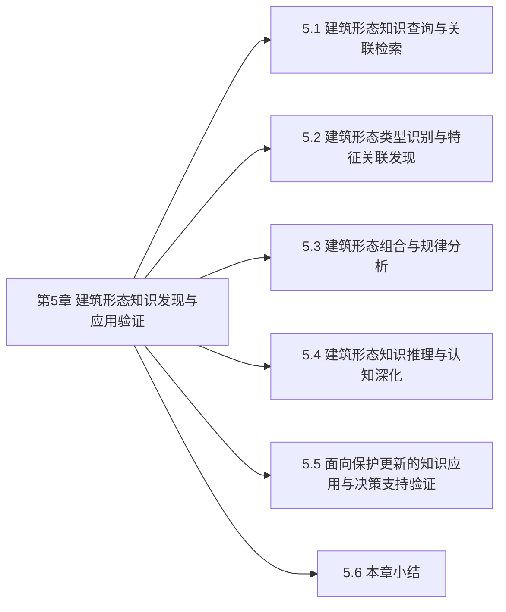

# 第5章 建筑形态知识发现与应用验证

<!-- dynamic-chapter:start -->
## 当前工作安排

> 由[[论文章节/大纲结构.yaml|大纲结构]]生成。修改主源后运行同步；文件夹编号仅为历史路径，不决定当前章节顺序。

**本章任务：** 以实例图谱及原始证据为基础，开展形态知识查询、类型识别、组合与规律分析、有限推理，并面向保护更新任务验证知识组织与应用价值。

**结构状态：** V3.3工作结构；分析与验证任务待实施，不预写发现

**正文接续：** 旧稿第五章为风貌特征分析，可提供部分分析经验，但需按建筑形态知识发现与应用验证重写。

**章内逻辑：** 查询检索 → 类型与特征发现 → 组合规律 → 推理深化 → 应用验证 → 小结。

**向后接续：** 向第六章交付有证据的建筑形态学认识、方法与应用判断；不以查询演示或图谱规模替代发现。

## 小节与主题成果采用表

| 小节 | 主题及成果入口 | 本节用途 | 采用状态与证据缺口 |
|---|---|---|---|
| 5.1 建筑形态知识查询与关联检索 | [〔检验与评价〕图谱试建、查询与有效性](../../%E4%B8%BB%E9%A2%98%E7%A0%94%E7%A9%B6/%E3%80%94%E6%A3%80%E9%AA%8C%E4%B8%8E%E8%AF%84%E4%BB%B7%E3%80%95%E5%9B%BE%E8%B0%B1%E8%AF%95%E5%BB%BA%E3%80%81%E6%9F%A5%E8%AF%A2%E4%B8%8E%E6%9C%89%E6%95%88%E6%80%A7/%E3%80%94%E6%A3%80%E9%AA%8C%E4%B8%8E%E8%AF%84%E4%BB%B7%E3%80%95%E5%9B%BE%E8%B0%B1%E8%AF%95%E5%BB%BA%E3%80%81%E6%9F%A5%E8%AF%A2%E4%B8%8E%E6%9C%89%E6%95%88%E6%80%A7.md)、[〔体系设计〕多尺度语义模型与建模依据](../../%E4%B8%BB%E9%A2%98%E7%A0%94%E7%A9%B6/%E3%80%94%E4%BD%93%E7%B3%BB%E8%AE%BE%E8%AE%A1%E3%80%95%E5%A4%9A%E5%B0%BA%E5%BA%A6%E8%AF%AD%E4%B9%89%E6%A8%A1%E5%9E%8B%E4%B8%8E%E5%BB%BA%E6%A8%A1%E4%BE%9D%E6%8D%AE/%E3%80%94%E4%BD%93%E7%B3%BB%E8%AE%BE%E8%AE%A1%E3%80%95%E5%A4%9A%E5%B0%BA%E5%BA%A6%E8%AF%AD%E4%B9%89%E6%A8%A1%E5%9E%8B%E4%B8%8E%E5%BB%BA%E6%A8%A1%E4%BE%9D%E6%8D%AE.md) | 说明面向建筑形态问题的查询、关联检索与证据回查任务，比较图谱查询与文档/数据库检索的适用条件。 | V3.3工作结构；查询任务与对照方案待设计 |
| 5.2 建筑形态类型识别与特征关联发现 | [〔研究方法〕类型识别与比较](../../%E4%B8%BB%E9%A2%98%E7%A0%94%E7%A9%B6/%E3%80%94%E7%A0%94%E7%A9%B6%E6%96%B9%E6%B3%95%E3%80%95%E7%B1%BB%E5%9E%8B%E8%AF%86%E5%88%AB%E4%B8%8E%E6%AF%94%E8%BE%83/%E3%80%94%E7%A0%94%E7%A9%B6%E6%96%B9%E6%B3%95%E3%80%95%E7%B1%BB%E5%9E%8B%E8%AF%86%E5%88%AB%E4%B8%8E%E6%AF%94%E8%BE%83.md)、[〔检验与评价〕图谱试建、查询与有效性](../../%E4%B8%BB%E9%A2%98%E7%A0%94%E7%A9%B6/%E3%80%94%E6%A3%80%E9%AA%8C%E4%B8%8E%E8%AF%84%E4%BB%B7%E3%80%95%E5%9B%BE%E8%B0%B1%E8%AF%95%E5%BB%BA%E3%80%81%E6%9F%A5%E8%AF%A2%E4%B8%8E%E6%9C%89%E6%95%88%E6%80%A7/%E3%80%94%E6%A3%80%E9%AA%8C%E4%B8%8E%E8%AF%84%E4%BB%B7%E3%80%95%E5%9B%BE%E8%B0%B1%E8%AF%95%E5%BB%BA%E3%80%81%E6%9F%A5%E8%AF%A2%E4%B8%8E%E6%9C%89%E6%95%88%E6%80%A7.md)、[〔体系设计〕风貌特征筛选与数据记录](../../%E4%B8%BB%E9%A2%98%E7%A0%94%E7%A9%B6/%E3%80%94%E4%BD%93%E7%B3%BB%E8%AE%BE%E8%AE%A1%E3%80%95%E9%A3%8E%E8%B2%8C%E7%89%B9%E5%BE%81%E7%AD%9B%E9%80%89%E4%B8%8E%E6%95%B0%E6%8D%AE%E8%AE%B0%E5%BD%95/%E3%80%94%E4%BD%93%E7%B3%BB%E8%AE%BE%E8%AE%A1%E3%80%95%E9%A3%8E%E8%B2%8C%E7%89%B9%E5%BE%81%E7%AD%9B%E9%80%89%E4%B8%8E%E6%95%B0%E6%8D%AE%E8%AE%B0%E5%BD%95.md) | 基于实例特征与关系识别类型、特征共现与关联，区分分类规则、实例归类与统计关联。 | V3.3工作结构；类型识别与关联发现待实施 |
| 5.3 建筑形态组合与规律分析 | [〔研究方法〕类型识别与比较](../../%E4%B8%BB%E9%A2%98%E7%A0%94%E7%A9%B6/%E3%80%94%E7%A0%94%E7%A9%B6%E6%96%B9%E6%B3%95%E3%80%95%E7%B1%BB%E5%9E%8B%E8%AF%86%E5%88%AB%E4%B8%8E%E6%AF%94%E8%BE%83/%E3%80%94%E7%A0%94%E7%A9%B6%E6%96%B9%E6%B3%95%E3%80%95%E7%B1%BB%E5%9E%8B%E8%AF%86%E5%88%AB%E4%B8%8E%E6%AF%94%E8%BE%83.md)、[〔检验与评价〕图谱试建、查询与有效性](../../%E4%B8%BB%E9%A2%98%E7%A0%94%E7%A9%B6/%E3%80%94%E6%A3%80%E9%AA%8C%E4%B8%8E%E8%AF%84%E4%BB%B7%E3%80%95%E5%9B%BE%E8%B0%B1%E8%AF%95%E5%BB%BA%E3%80%81%E6%9F%A5%E8%AF%A2%E4%B8%8E%E6%9C%89%E6%95%88%E6%80%A7/%E3%80%94%E6%A3%80%E9%AA%8C%E4%B8%8E%E8%AF%84%E4%BB%B7%E3%80%95%E5%9B%BE%E8%B0%B1%E8%AF%95%E5%BB%BA%E3%80%81%E6%9F%A5%E8%AF%A2%E4%B8%8E%E6%9C%89%E6%95%88%E6%80%A7.md)、[〔研究方法〕三维资料质量与空间区域关联](../../%E4%B8%BB%E9%A2%98%E7%A0%94%E7%A9%B6/%E3%80%94%E7%A0%94%E7%A9%B6%E6%96%B9%E6%B3%95%E3%80%95%E4%B8%89%E7%BB%B4%E8%B5%84%E6%96%99%E8%B4%A8%E9%87%8F%E4%B8%8E%E7%A9%BA%E9%97%B4%E5%8C%BA%E5%9F%9F%E5%85%B3%E8%81%94/%E3%80%94%E7%A0%94%E7%A9%B6%E6%96%B9%E6%B3%95%E3%80%95%E4%B8%89%E7%BB%B4%E8%B5%84%E6%96%99%E8%B4%A8%E9%87%8F%E4%B8%8E%E7%A9%BA%E9%97%B4%E5%8C%BA%E5%9F%9F%E5%85%B3%E8%81%94.md) | 分析建筑组合、空间组织与跨尺度形态关系，识别重复模式与差异；关系与共现须有统计/空间分析与建筑学解释。 | V3.3工作结构；组合与规律分析待实施 |
| 5.4 建筑形态知识推理与认知深化 | [〔检验与评价〕图谱试建、查询与有效性](../../%E4%B8%BB%E9%A2%98%E7%A0%94%E7%A9%B6/%E3%80%94%E6%A3%80%E9%AA%8C%E4%B8%8E%E8%AF%84%E4%BB%B7%E3%80%95%E5%9B%BE%E8%B0%B1%E8%AF%95%E5%BB%BA%E3%80%81%E6%9F%A5%E8%AF%A2%E4%B8%8E%E6%9C%89%E6%95%88%E6%80%A7/%E3%80%94%E6%A3%80%E9%AA%8C%E4%B8%8E%E8%AF%84%E4%BB%B7%E3%80%95%E5%9B%BE%E8%B0%B1%E8%AF%95%E5%BB%BA%E3%80%81%E6%9F%A5%E8%AF%A2%E4%B8%8E%E6%9C%89%E6%95%88%E6%80%A7.md)、[〔体系设计〕多尺度语义模型与建模依据](../../%E4%B8%BB%E9%A2%98%E7%A0%94%E7%A9%B6/%E3%80%94%E4%BD%93%E7%B3%BB%E8%AE%BE%E8%AE%A1%E3%80%95%E5%A4%9A%E5%B0%BA%E5%BA%A6%E8%AF%AD%E4%B9%89%E6%A8%A1%E5%9E%8B%E4%B8%8E%E5%BB%BA%E6%A8%A1%E4%BE%9D%E6%8D%AE/%E3%80%94%E4%BD%93%E7%B3%BB%E8%AE%BE%E8%AE%A1%E3%80%95%E5%A4%9A%E5%B0%BA%E5%BA%A6%E8%AF%AD%E4%B9%89%E6%A8%A1%E5%9E%8B%E4%B8%8E%E5%BB%BA%E6%A8%A1%E4%BE%9D%E6%8D%AE.md)、[〔理论与文献依据〕畲族民居研究与理论依据](../../%E4%B8%BB%E9%A2%98%E7%A0%94%E7%A9%B6/%E3%80%94%E7%90%86%E8%AE%BA%E4%B8%8E%E6%96%87%E7%8C%AE%E4%BE%9D%E6%8D%AE%E3%80%95%E7%95%B2%E6%97%8F%E6%B0%91%E5%B1%85%E7%A0%94%E7%A9%B6%E4%B8%8E%E7%90%86%E8%AE%BA%E4%BE%9D%E6%8D%AE/%E3%80%94%E7%90%86%E8%AE%BA%E4%B8%8E%E6%96%87%E7%8C%AE%E4%BE%9D%E6%8D%AE%E3%80%95%E7%95%B2%E6%97%8F%E6%B0%91%E5%B1%85%E7%A0%94%E7%A9%B6%E4%B8%8E%E7%90%86%E8%AE%BA%E4%BE%9D%E6%8D%AE.md) | 在明确规则与证据下开展有限推理，形成类型、组合与形成因素的解释性认识；区分事实、规则推导与专业判断。 | V3.3工作结构；推理任务与规则待设计 |
| 5.5 面向保护更新的知识应用与决策支持验证 | [〔检验与评价〕图谱试建、查询与有效性](../../%E4%B8%BB%E9%A2%98%E7%A0%94%E7%A9%B6/%E3%80%94%E6%A3%80%E9%AA%8C%E4%B8%8E%E8%AF%84%E4%BB%B7%E3%80%95%E5%9B%BE%E8%B0%B1%E8%AF%95%E5%BB%BA%E3%80%81%E6%9F%A5%E8%AF%A2%E4%B8%8E%E6%9C%89%E6%95%88%E6%80%A7/%E3%80%94%E6%A3%80%E9%AA%8C%E4%B8%8E%E8%AF%84%E4%BB%B7%E3%80%95%E5%9B%BE%E8%B0%B1%E8%AF%95%E5%BB%BA%E3%80%81%E6%9F%A5%E8%AF%A2%E4%B8%8E%E6%9C%89%E6%95%88%E6%80%A7.md)、[〔理论与文献依据〕畲族民居研究与理论依据](../../%E4%B8%BB%E9%A2%98%E7%A0%94%E7%A9%B6/%E3%80%94%E7%90%86%E8%AE%BA%E4%B8%8E%E6%96%87%E7%8C%AE%E4%BE%9D%E6%8D%AE%E3%80%95%E7%95%B2%E6%97%8F%E6%B0%91%E5%B1%85%E7%A0%94%E7%A9%B6%E4%B8%8E%E7%90%86%E8%AE%BA%E4%BE%9D%E6%8D%AE/%E3%80%94%E7%90%86%E8%AE%BA%E4%B8%8E%E6%96%87%E7%8C%AE%E4%BE%9D%E6%8D%AE%E3%80%95%E7%95%B2%E6%97%8F%E6%B0%91%E5%B1%85%E7%A0%94%E7%A9%B6%E4%B8%8E%E7%90%86%E8%AE%BA%E4%BE%9D%E6%8D%AE.md)、[〔研究界定〕研究对象与样本边界](../../%E4%B8%BB%E9%A2%98%E7%A0%94%E7%A9%B6/%E3%80%94%E7%A0%94%E7%A9%B6%E7%95%8C%E5%AE%9A%E3%80%95%E7%A0%94%E7%A9%B6%E5%AF%B9%E8%B1%A1%E4%B8%8E%E6%A0%B7%E6%9C%AC%E8%BE%B9%E7%95%8C/%E3%80%94%E7%A0%94%E7%A9%B6%E7%95%8C%E5%AE%9A%E3%80%95%E7%A0%94%E7%A9%B6%E5%AF%B9%E8%B1%A1%E4%B8%8E%E6%A0%B7%E6%9C%AC%E8%BE%B9%E7%95%8C.md) | 选取明确保护更新任务，验证知识检索、案例比较、证据追溯与决策参考的支持能力；输出辅助信息，不替代专业决策。 | V3.3工作结构；应用验证任务待设计 |
| 5.6 本章小结 | [〔检验与评价〕图谱试建、查询与有效性](../../%E4%B8%BB%E9%A2%98%E7%A0%94%E7%A9%B6/%E3%80%94%E6%A3%80%E9%AA%8C%E4%B8%8E%E8%AF%84%E4%BB%B7%E3%80%95%E5%9B%BE%E8%B0%B1%E8%AF%95%E5%BB%BA%E3%80%81%E6%9F%A5%E8%AF%A2%E4%B8%8E%E6%9C%89%E6%95%88%E6%80%A7/%E3%80%94%E6%A3%80%E9%AA%8C%E4%B8%8E%E8%AF%84%E4%BB%B7%E3%80%95%E5%9B%BE%E8%B0%B1%E8%AF%95%E5%BB%BA%E3%80%81%E6%9F%A5%E8%AF%A2%E4%B8%8E%E6%9C%89%E6%95%88%E6%80%A7.md) | 归纳可进入结论的形态学发现、知识组织能力和应用验证结果及适用范围。 | V3.3工作结构；待本章分析完成后撰写 |

## 逐节研究问题与证据要求

以下是待执行的研究要求，不是已完成或已验证声明；采用状态仍以上表为准。

### 建筑形态知识查询与关联检索

- **问题**：哪些形态知识查询需要图谱关系，查询结果如何回到实例与证据？
- **所需证据／待核材料**：查询任务与基准问题集；图谱查询、文档/数据库对照；结果准确性与证据完整性记录。
- **完成判据**：查询任务来自建筑学问题；不以演示查询代替系统评价。。

### 建筑形态类型识别与特征关联发现

- **问题**：样本中可识别哪些形态类型与特征关联，其证据和适用条件是什么？
- **所需证据／待核材料**：类型判定与特征记录；共现/关联分析与对照；反例、边界案例与解释限制。
- **完成判据**：共同特征、类型差异与个案变体分开；关联不推为因果或民族专属性。。

### 建筑形态组合与规律分析

- **问题**：单体、组团与村落尺度之间存在哪些可复核的形态组合与规律？
- **所需证据／待核材料**：跨尺度关系与比较结果；空间分析/统计结果；原始证据回查与反例。
- **完成判据**：区分描述、统计关联与成因解释；不把跨尺度关联写成已证因果。。

### 建筑形态知识推理与认知深化

- **问题**：基于图谱与规则可以推出哪些形态学认识，哪些仍需专业解释或补证？
- **所需证据／待核材料**：推理规则与输入事实；推理结果及人工复核；与文献解释的对照。
- **完成判据**：不把推理输出当新事实；专业解释须有建筑学依据。。

### 面向保护更新的知识应用与决策支持验证

- **问题**：知识图谱能否在具体保护更新任务中提供可追溯、可用的知识支持，边界是什么？
- **所需证据／待核材料**：任务、参与者与对照方案；检索/比较/追溯过程与结果；时间、完整性、可用性评价及失败记录。
- **完成判据**：验证对象是知识资产能力，不是某套设计策略的正确性；不以单个演示宣称普遍有效。。

### 本章小结

- **问题**：哪些发现与能力有直接证据，哪些仍是解释或待验证推断？
- **所需证据／待核材料**：结论—分析结果—原始来源对应；限度与反例。
- **完成判据**：事实、解释与推断分列，不超出样本与资料范围。。

## 本章结构图

## 稳定节点与原稿接续

- `section-5-knowledge-query`：建筑形态知识查询与关联检索；纳入当前工作大纲。原稿编号：新节点；变更说明：2026-11-17按V3.3新增5.1；旧5.1—5.7节点停用并保留追溯，新任务不复用旧ID。。

- `section-5-type-discovery`：建筑形态类型识别与特征关联发现；纳入当前工作大纲。原稿编号：新节点；变更说明：2026-11-17按V3.3新增5.2；旧5.4单体尺度节点与旧3.4类型方法停用，任务在此接续。。

- `section-5-combination`：建筑形态组合与规律分析；纳入当前工作大纲。原稿编号：新节点；变更说明：2026-11-17按V3.3新增5.3；旧5.2、5.3、5.5的尺度分析内容停用，任务在此重新组织。。

- `section-5-reasoning`：建筑形态知识推理与认知深化；纳入当前工作大纲。原稿编号：新节点；变更说明：2026-11-17按V3.3新增5.4；旧5.5跨尺度综合节点停用，推理与解释任务在此接续。。

- `section-5-application`：面向保护更新的知识应用与决策支持验证；纳入当前工作大纲。原稿编号：新节点；变更说明：2026-11-17按V3.3新增5.5；旧5.6方法评价节点停用，应用验证任务在此接续。。

- `section-5-summary`：本章小结；纳入当前工作大纲。原稿编号：新节点；变更说明：2026-11-17按V3.3新增5.6；旧5.7本章小结停用，新节点不复用旧ID。。

- `section-5-1`：风貌分析任务与比较方法；停用、保留追溯。原稿编号：5.1；变更说明：2026-10-29用户确认体系—实例图谱—风貌分析分工；由“分析任务、比较条件与评价方案”调整，保留稳定ID及原稿接续；正文未改写；2026-10-29标题与逻辑梳理：由“风貌分析问题、样本范围与比较方法”接续，仍为工作大纲，正文不改；2026-11-05用户明确取消准备性二级节；通用方法归第三章，样本与单元及输入边界归第四章，具体有效样本、缺失值和分母在第五章各分析段落／图表交代；2026-11-17按V3.3第五章改为建筑形态知识发现与应用验证，旧节点停用并保留追溯，任务由新ID接续。

- `section-5-2`：村落尺度的民居分布与环境关系；停用、保留追溯。原稿编号：5.2；变更说明：2026-10-29用户确认体系—实例图谱—风貌分析分工；由“村落尺度的民居分布与聚居差异”调整，保留稳定ID及原稿接续；正文未改写；2026-10-29标题与逻辑梳理：由“村落尺度的民居分布与聚居特征”接续，仍为工作大纲，正文不改；2026-11-17按V3.3第五章改为建筑形态知识发现与应用验证，旧节点停用并保留追溯，任务由新ID接续。

- `section-5-3`：组团尺度的民居组合与街巷空间；停用、保留追溯。原稿编号：5.3；变更说明：2026-10-29用户确认体系—实例图谱—风貌分析分工；由“组团尺度的民居组合与空间关系”调整，保留稳定ID及原稿接续；正文未改写；2026-10-29标题与逻辑梳理：由“组团尺度的民居组合与空间关系”接续，仍为工作大纲，正文不改；2026-11-17按V3.3第五章改为建筑形态知识发现与应用验证，旧节点停用并保留追溯，任务由新ID接续。

- `section-5-4`：单体尺度的民居类型与建筑特征；停用、保留追溯。原稿编号：5.4；变更说明：2026-10-29用户确认体系—实例图谱—风貌分析分工；由“单体尺度的风貌类型与特征组合”调整，保留稳定ID及原稿接续；正文未改写；2026-10-29标题与逻辑梳理：由“单体尺度的风貌类型与特征组合”接续，仍为工作大纲，正文不改；2026-11-17按V3.3第五章改为建筑形态知识发现与应用验证，旧节点停用并保留追溯，任务由新ID接续。

- `section-5-5`：跨尺度风貌关联与综合特征分析；停用、保留追溯。原稿编号：5.5；变更说明：2026-10-29用户确认体系—实例图谱—风貌分析分工；由“跨尺度查询与三维关联支持的风貌比较”调整，保留稳定ID及原稿接续；正文未改写；2026-10-29标题与逻辑梳理：由“跨尺度风貌关联与样本综合比较”接续，仍为工作大纲，正文不改；2026-11-05用户同意最小修订：吸收研究框架审阅意见并保留主会话限定；不增加章目，不改正文或实证状态。来源：研究资料/来源证据/2026-11-05-研究框架审阅意见.md；2026-11-17按V3.3第五章改为建筑形态知识发现与应用验证，旧节点停用并保留追溯，任务由新ID接续。

- `section-5-6`：知识图谱与三维关联方法的应用评价；停用、保留追溯。原稿编号：5.6；变更说明：2026-10-29用户确认体系—实例图谱—风貌分析分工；由“方法有效性、适用条件与局限讨论”调整，保留稳定ID及原稿接续；正文未改写；2026-10-29标题与逻辑梳理：由“风貌认识的综合归纳与体系应用讨论”接续，仍为工作大纲，正文不改；2026-11-17按V3.3第五章改为建筑形态知识发现与应用验证，旧节点停用并保留追溯，任务由新ID接续。

- `section-5-7`：本章小结；停用、保留追溯。原稿编号：5.7；变更说明：2026-10-29用户确认体系—实例图谱—风貌分析分工；由“本章小结：建筑认识与方法证据”调整，保留稳定ID及原稿接续；正文未改写；2026-10-29标题与逻辑梳理：由“本章小结：风貌特征与建筑学认识”接续，仍为工作大纲，正文不改；2026-11-17按V3.3第五章改为建筑形态知识发现与应用验证，旧节点停用并保留追溯，任务由新ID接续。

## 调整与反馈

需要调整题名、顺序、节的归属或采用状态时，修改大纲结构；稳定ID不随编号改变。新增、停用、拆分合并必须保留理由及原稿接续，不能由文件数自动认定研究完成。
<!-- dynamic-chapter:end -->
