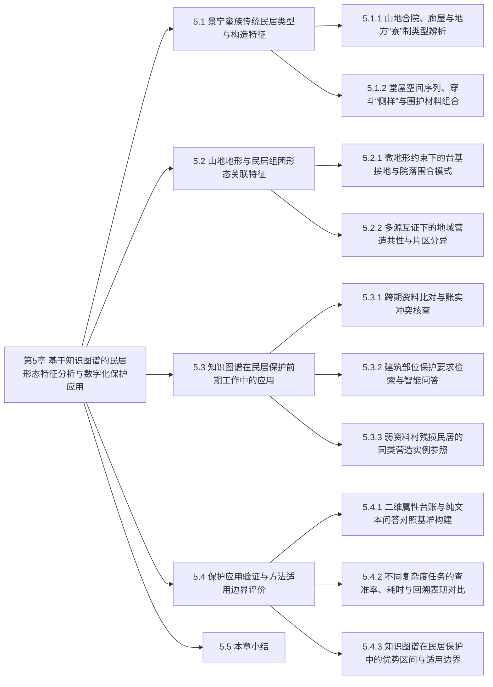

# 第5章 基于知识图谱的民居形态特征分析与数字化保护应用

<!-- dynamic-chapter:start -->
## 当前工作安排

> 由[[论文章节/大纲结构.yaml|大纲结构]]生成。修改主源后运行同步；文件夹编号仅为历史路径，不决定当前章节顺序。

**本章任务：** 基于实例图谱分析民居类型、构造与山地组团关联特征，验证保护前期应用并与二维台账及纯文本问答对照。

**结构状态：** V4.0工作结构；分析与验证任务待实施，不预写发现

**正文接续：** 旧稿第五章为风貌特征分析，可提供部分分析经验；需按V4.0“类型构造—山地组团—保护应用—验证边界”重写。

**章内逻辑：** 类型与构造特征 → 山地地形与组团关联 → 保护前期应用 → 验证与适用边界 → 小结。

**向后接续：** 向第六章交付有证据的建筑形态学认识、应用验证结果与适用边界；不以查询演示或图谱规模替代发现。

## 小节与主题成果采用表

| 小节 | 主题及成果入口 | 本节用途 | 采用状态与证据缺口 |
|---|---|---|---|
| 5.1 景宁畲族传统民居类型与构造特征 | [〔研究方法〕类型识别与比较](../../%E4%B8%BB%E9%A2%98%E7%A0%94%E7%A9%B6/%E3%80%94%E7%A0%94%E7%A9%B6%E6%96%B9%E6%B3%95%E3%80%95%E7%B1%BB%E5%9E%8B%E8%AF%86%E5%88%AB%E4%B8%8E%E6%AF%94%E8%BE%83/%E3%80%94%E7%A0%94%E7%A9%B6%E6%96%B9%E6%B3%95%E3%80%95%E7%B1%BB%E5%9E%8B%E8%AF%86%E5%88%AB%E4%B8%8E%E6%AF%94%E8%BE%83.md)、[〔检验与评价〕图谱试建、查询与有效性](../../%E4%B8%BB%E9%A2%98%E7%A0%94%E7%A9%B6/%E3%80%94%E6%A3%80%E9%AA%8C%E4%B8%8E%E8%AF%84%E4%BB%B7%E3%80%95%E5%9B%BE%E8%B0%B1%E8%AF%95%E5%BB%BA%E3%80%81%E6%9F%A5%E8%AF%A2%E4%B8%8E%E6%9C%89%E6%95%88%E6%80%A7/%E3%80%94%E6%A3%80%E9%AA%8C%E4%B8%8E%E8%AF%84%E4%BB%B7%E3%80%95%E5%9B%BE%E8%B0%B1%E8%AF%95%E5%BB%BA%E3%80%81%E6%9F%A5%E8%AF%A2%E4%B8%8E%E6%9C%89%E6%95%88%E6%80%A7.md)、[〔体系设计〕风貌特征筛选与数据记录](../../%E4%B8%BB%E9%A2%98%E7%A0%94%E7%A9%B6/%E3%80%94%E4%BD%93%E7%B3%BB%E8%AE%BE%E8%AE%A1%E3%80%95%E9%A3%8E%E8%B2%8C%E7%89%B9%E5%BE%81%E7%AD%9B%E9%80%89%E4%B8%8E%E6%95%B0%E6%8D%AE%E8%AE%B0%E5%BD%95/%E3%80%94%E4%BD%93%E7%B3%BB%E8%AE%BE%E8%AE%A1%E3%80%95%E9%A3%8E%E8%B2%8C%E7%89%B9%E5%BE%81%E7%AD%9B%E9%80%89%E4%B8%8E%E6%95%B0%E6%8D%AE%E8%AE%B0%E5%BD%95.md) | 辨析山地合院、廊屋与地方“寮”制类型，分析堂屋空间序列、穿斗“侧样”与围护材料组合。 | V4.0工作结构；类型判据与样本证据待核 |
| 5.2 山地地形与民居组团形态关联特征 | [〔研究方法〕类型识别与比较](../../%E4%B8%BB%E9%A2%98%E7%A0%94%E7%A9%B6/%E3%80%94%E7%A0%94%E7%A9%B6%E6%96%B9%E6%B3%95%E3%80%95%E7%B1%BB%E5%9E%8B%E8%AF%86%E5%88%AB%E4%B8%8E%E6%AF%94%E8%BE%83/%E3%80%94%E7%A0%94%E7%A9%B6%E6%96%B9%E6%B3%95%E3%80%95%E7%B1%BB%E5%9E%8B%E8%AF%86%E5%88%AB%E4%B8%8E%E6%AF%94%E8%BE%83.md)、[〔检验与评价〕图谱试建、查询与有效性](../../%E4%B8%BB%E9%A2%98%E7%A0%94%E7%A9%B6/%E3%80%94%E6%A3%80%E9%AA%8C%E4%B8%8E%E8%AF%84%E4%BB%B7%E3%80%95%E5%9B%BE%E8%B0%B1%E8%AF%95%E5%BB%BA%E3%80%81%E6%9F%A5%E8%AF%A2%E4%B8%8E%E6%9C%89%E6%95%88%E6%80%A7/%E3%80%94%E6%A3%80%E9%AA%8C%E4%B8%8E%E8%AF%84%E4%BB%B7%E3%80%95%E5%9B%BE%E8%B0%B1%E8%AF%95%E5%BB%BA%E3%80%81%E6%9F%A5%E8%AF%A2%E4%B8%8E%E6%9C%89%E6%95%88%E6%80%A7.md)、[〔研究方法〕三维资料质量与空间区域关联](../../%E4%B8%BB%E9%A2%98%E7%A0%94%E7%A9%B6/%E3%80%94%E7%A0%94%E7%A9%B6%E6%96%B9%E6%B3%95%E3%80%95%E4%B8%89%E7%BB%B4%E8%B5%84%E6%96%99%E8%B4%A8%E9%87%8F%E4%B8%8E%E7%A9%BA%E9%97%B4%E5%8C%BA%E5%9F%9F%E5%85%B3%E8%81%94/%E3%80%94%E7%A0%94%E7%A9%B6%E6%96%B9%E6%B3%95%E3%80%95%E4%B8%89%E7%BB%B4%E8%B5%84%E6%96%99%E8%B4%A8%E9%87%8F%E4%B8%8E%E7%A9%BA%E9%97%B4%E5%8C%BA%E5%9F%9F%E5%85%B3%E8%81%94.md) | 分析微地形约束下的台基接地与院落围合模式，以及多源互证的地域共性与片区分异。 | V4.0工作结构；地形与组团证据待核 |
| 5.3 知识图谱在民居保护前期工作中的应用 | [〔检验与评价〕图谱试建、查询与有效性](../../%E4%B8%BB%E9%A2%98%E7%A0%94%E7%A9%B6/%E3%80%94%E6%A3%80%E9%AA%8C%E4%B8%8E%E8%AF%84%E4%BB%B7%E3%80%95%E5%9B%BE%E8%B0%B1%E8%AF%95%E5%BB%BA%E3%80%81%E6%9F%A5%E8%AF%A2%E4%B8%8E%E6%9C%89%E6%95%88%E6%80%A7/%E3%80%94%E6%A3%80%E9%AA%8C%E4%B8%8E%E8%AF%84%E4%BB%B7%E3%80%95%E5%9B%BE%E8%B0%B1%E8%AF%95%E5%BB%BA%E3%80%81%E6%9F%A5%E8%AF%A2%E4%B8%8E%E6%9C%89%E6%95%88%E6%80%A7.md)、[〔理论与文献依据〕畲族民居研究与理论依据](../../%E4%B8%BB%E9%A2%98%E7%A0%94%E7%A9%B6/%E3%80%94%E7%90%86%E8%AE%BA%E4%B8%8E%E6%96%87%E7%8C%AE%E4%BE%9D%E6%8D%AE%E3%80%95%E7%95%B2%E6%97%8F%E6%B0%91%E5%B1%85%E7%A0%94%E7%A9%B6%E4%B8%8E%E7%90%86%E8%AE%BA%E4%BE%9D%E6%8D%AE/%E3%80%94%E7%90%86%E8%AE%BA%E4%B8%8E%E6%96%87%E7%8C%AE%E4%BE%9D%E6%8D%AE%E3%80%95%E7%95%B2%E6%97%8F%E6%B0%91%E5%B1%85%E7%A0%94%E7%A9%B6%E4%B8%8E%E7%90%86%E8%AE%BA%E4%BE%9D%E6%8D%AE.md)、[〔研究界定〕研究对象与样本边界](../../%E4%B8%BB%E9%A2%98%E7%A0%94%E7%A9%B6/%E3%80%94%E7%A0%94%E7%A9%B6%E7%95%8C%E5%AE%9A%E3%80%95%E7%A0%94%E7%A9%B6%E5%AF%B9%E8%B1%A1%E4%B8%8E%E6%A0%B7%E6%9C%AC%E8%BE%B9%E7%95%8C/%E3%80%94%E7%A0%94%E7%A9%B6%E7%95%8C%E5%AE%9A%E3%80%95%E7%A0%94%E7%A9%B6%E5%AF%B9%E8%B1%A1%E4%B8%8E%E6%A0%B7%E6%9C%AC%E8%BE%B9%E7%95%8C.md) | 开展跨期资料比对与账实冲突核查、部位保护要求检索与智能问答、弱资料村同类实例参照三类应用。 | V4.0工作结构；应用场景与样本待实施 |
| 5.4 保护应用验证与方法适用边界评价 | [〔检验与评价〕图谱试建、查询与有效性](../../%E4%B8%BB%E9%A2%98%E7%A0%94%E7%A9%B6/%E3%80%94%E6%A3%80%E9%AA%8C%E4%B8%8E%E8%AF%84%E4%BB%B7%E3%80%95%E5%9B%BE%E8%B0%B1%E8%AF%95%E5%BB%BA%E3%80%81%E6%9F%A5%E8%AF%A2%E4%B8%8E%E6%9C%89%E6%95%88%E6%80%A7/%E3%80%94%E6%A3%80%E9%AA%8C%E4%B8%8E%E8%AF%84%E4%BB%B7%E3%80%95%E5%9B%BE%E8%B0%B1%E8%AF%95%E5%BB%BA%E3%80%81%E6%9F%A5%E8%AF%A2%E4%B8%8E%E6%9C%89%E6%95%88%E6%80%A7.md)、[〔研究方法〕类型识别与比较](../../%E4%B8%BB%E9%A2%98%E7%A0%94%E7%A9%B6/%E3%80%94%E7%A0%94%E7%A9%B6%E6%96%B9%E6%B3%95%E3%80%95%E7%B1%BB%E5%9E%8B%E8%AF%86%E5%88%AB%E4%B8%8E%E6%AF%94%E8%BE%83/%E3%80%94%E7%A0%94%E7%A9%B6%E6%96%B9%E6%B3%95%E3%80%95%E7%B1%BB%E5%9E%8B%E8%AF%86%E5%88%AB%E4%B8%8E%E6%AF%94%E8%BE%83.md) | 构建二维属性台账与纯文本问答对照基准，比较不同复杂度任务的查准率、耗时与回溯表现，划定优势区间与适用边界。 | V4.0工作结构；对照基准与评价指标待实施 |
| 5.5 本章小结 | [〔检验与评价〕图谱试建、查询与有效性](../../%E4%B8%BB%E9%A2%98%E7%A0%94%E7%A9%B6/%E3%80%94%E6%A3%80%E9%AA%8C%E4%B8%8E%E8%AF%84%E4%BB%B7%E3%80%95%E5%9B%BE%E8%B0%B1%E8%AF%95%E5%BB%BA%E3%80%81%E6%9F%A5%E8%AF%A2%E4%B8%8E%E6%9C%89%E6%95%88%E6%80%A7/%E3%80%94%E6%A3%80%E9%AA%8C%E4%B8%8E%E8%AF%84%E4%BB%B7%E3%80%95%E5%9B%BE%E8%B0%B1%E8%AF%95%E5%BB%BA%E3%80%81%E6%9F%A5%E8%AF%A2%E4%B8%8E%E6%9C%89%E6%95%88%E6%80%A7.md) | 概括本章形态特征发现、应用验证结果与方法边界，不重复前文。 | V4.0工作结构；待本章分析与验证完成后撰写 |

## 三级标题与论证分工

三级标题用于思路梳理；理论及分析视角是比较对象，不表示全部采用。成果入口和采用关系沿用父节，不重复计数。

| 三级标题 | 论证任务 | 状态 |
|---|---|---|
| 5.1.1 山地合院、廊屋与地方“寮”制类型辨析 | 基于样本与文献辨析山地合院、一字形廊屋与“寮”制民居的类型判据及变体。 | V4.0工作结构；正文与证据待写 |
| 5.1.2 堂屋空间序列、穿斗“侧样”与围护材料组合 | 分析堂屋中轴序列、穿斗侧样与屋面围护材料的组合关系，限定L3证据条件。 | V4.0工作结构；正文与证据待写 |
| 5.2.1 微地形约束下的台基接地与院落围合模式 | 分析五类微地形、接地方式与院落围合边界的关系，说明样本覆盖与缺口。 | V4.0工作结构；正文与证据待写 |
| 5.2.2 多源互证下的地域营造共性与片区分异 | 以史志、测绘与航测多源互证识别地域共性与片区分异，区分样本内观察与地域结论。 | V4.0工作结构；正文与证据待写 |
| 5.3.1 跨期资料比对与账实冲突核查 | 说明规划记载与现势航测/测绘之间的跨期比对与冲突检出流程。 | V4.0工作结构；正文与证据待写 |
| 5.3.2 建筑部位保护要求检索与智能问答 | 说明按建筑部位检索保护条款并进行有证据约束的问答。 | V4.0工作结构；正文与证据待写 |
| 5.3.3 弱资料村残损民居的同类营造实例参照 | 说明弱资料村通过跨村同构实例匹配获得修缮参照的流程与限制。 | V4.0工作结构；正文与证据待写 |
| 5.4.1 二维属性台账与纯文本问答对照基准构建 | 说明三种对照方案的同一数据、任务集与评价指标构建。 | V4.0工作结构；正文与证据待写 |
| 5.4.2 不同复杂度任务的查准率、耗时与回溯表现对比 | 报告单跳统计、双跳冲突与条款问答、三跳同类实例匹配的对比结果。 | V4.0工作结构；正文与证据待写 |
| 5.4.3 知识图谱在民居保护中的优势区间与适用边界 | 归纳图谱服务的优势区间、失败情形与适用边界，不泛化为普遍优越性。 | V4.0工作结构；正文与证据待写 |

## 逐节研究问题与证据要求

以下是待执行的研究要求，不是已完成或已验证声明；采用状态仍以上表为准。

### 景宁畲族传统民居类型与构造特征

- **问题**：样本中可识别哪些形态类型与特征关联，其证据和适用条件是什么？
- **所需证据／待核材料**：类型判定与特征记录；共现/关联分析与对照；反例、边界案例与解释限制。
- **完成判据**：共同特征、类型差异与个案变体分开；关联不推为因果或民族专属性。。

### 山地地形与民居组团形态关联特征

- **问题**：单体、组团与村落尺度之间存在哪些可复核的形态组合与规律？
- **所需证据／待核材料**：跨尺度关系与比较结果；空间分析/统计结果；原始证据回查与反例。
- **完成判据**：区分描述、统计关联与成因解释；不把跨尺度关联写成已证因果。。

### 知识图谱在民居保护前期工作中的应用

- **问题**：知识图谱能否在具体保护更新任务中提供可追溯、可用的知识支持，边界是什么？
- **所需证据／待核材料**：任务、参与者与对照方案；检索/比较/追溯过程与结果；时间、完整性、可用性评价及失败记录。
- **完成判据**：验证对象是知识资产能力，不是某套设计策略的正确性；不以单个演示宣称普遍有效。。

### 保护应用验证与方法适用边界评价

- **问题**：相较二维台账与纯文本问答，图谱服务在哪些任务上确有优势，边界何在？
- **所需证据／待核材料**：同批清洗样本；任务集与真值；查准率、耗时、回溯步数与缺口误判记录。
- **完成判据**：对照同数据同任务；如实报告优势与不适用情形。

### 本章小结

- **问题**：哪些发现与能力有直接证据，哪些仍是解释或待验证推断？
- **所需证据／待核材料**：结论—分析结果—原始来源对应；限度与反例。
- **完成判据**：事实、解释与推断分列，不超出样本与资料范围。。

## 本章结构图

## 稳定节点与原稿接续

- `section-5-knowledge-query`：建筑形态知识查询与关联检索；停用、保留追溯。原稿编号：新节点；变更说明：2026-11-17按V3.3新增5.1；旧5.1—5.7节点停用并保留追溯，新任务不复用旧ID。；V4.0将查询能力并入3.2功能设计与5.3应用验证；原节点保留稳定ID。。

- `section-5-type-discovery`：景宁畲族传统民居类型与构造特征；纳入当前工作大纲。原稿编号：新节点；变更说明：2026-11-23按V4.0第5.1节更名并补三级标题；不预写类型结论。。

- `section-5-combination`：山地地形与民居组团形态关联特征；纳入当前工作大纲。原稿编号：新节点；变更说明：2026-11-23按V4.0第5.2节更名并补三级标题；不预写分异结论。。

- `section-5-reasoning`：建筑形态知识推理与认知深化；停用、保留追溯。原稿编号：新节点；变更说明：2026-11-17按V3.3新增5.4；旧5.5跨尺度综合节点停用，推理与解释任务在此接续。；V4.0不设独立推理节，推理与查询并入5.3应用与5.4验证；原节点保留稳定ID。。

- `section-5-application`：知识图谱在民居保护前期工作中的应用；纳入当前工作大纲。原稿编号：新节点；变更说明：2026-11-23按V4.0第5.3节更名并补三级标题；未开展应用验证。。

- `section-5-4-validation`：保护应用验证与方法适用边界评价；纳入当前工作大纲。原稿编号：新节点；变更说明：2026-11-23按Notion V4.0六章三级目录对齐；结构更新不代表正文、样本或实证完成。。

- `section-5-summary`：本章小结；纳入当前工作大纲。原稿编号：新节点；变更说明：2026-11-17按V3.3新增5.6；旧5.7本章小结停用，新节点不复用旧ID。。

- `section-5-1`：风貌分析任务与比较方法；停用、保留追溯。原稿编号：5.1；变更说明：2026-10-29用户确认体系—实例图谱—风貌分析分工；由“分析任务、比较条件与评价方案”调整，保留稳定ID及原稿接续；正文未改写；2026-10-29标题与逻辑梳理：由“风貌分析问题、样本范围与比较方法”接续，仍为工作大纲，正文不改；2026-11-05用户明确取消准备性二级节；通用方法归第三章，样本与单元及输入边界归第四章，具体有效样本、缺失值和分母在第五章各分析段落／图表交代；2026-11-17按V3.3第五章改为建筑形态知识发现与应用验证，旧节点停用并保留追溯，任务由新ID接续。

- `section-5-2`：村落尺度的民居分布与环境关系；停用、保留追溯。原稿编号：5.2；变更说明：2026-10-29用户确认体系—实例图谱—风貌分析分工；由“村落尺度的民居分布与聚居差异”调整，保留稳定ID及原稿接续；正文未改写；2026-10-29标题与逻辑梳理：由“村落尺度的民居分布与聚居特征”接续，仍为工作大纲，正文不改；2026-11-17按V3.3第五章改为建筑形态知识发现与应用验证，旧节点停用并保留追溯，任务由新ID接续。

- `section-5-3`：组团尺度的民居组合与街巷空间；停用、保留追溯。原稿编号：5.3；变更说明：2026-10-29用户确认体系—实例图谱—风貌分析分工；由“组团尺度的民居组合与空间关系”调整，保留稳定ID及原稿接续；正文未改写；2026-10-29标题与逻辑梳理：由“组团尺度的民居组合与空间关系”接续，仍为工作大纲，正文不改；2026-11-17按V3.3第五章改为建筑形态知识发现与应用验证，旧节点停用并保留追溯，任务由新ID接续。

- `section-5-4`：单体尺度的民居类型与建筑特征；停用、保留追溯。原稿编号：5.4；变更说明：2026-10-29用户确认体系—实例图谱—风貌分析分工；由“单体尺度的风貌类型与特征组合”调整，保留稳定ID及原稿接续；正文未改写；2026-10-29标题与逻辑梳理：由“单体尺度的风貌类型与特征组合”接续，仍为工作大纲，正文不改；2026-11-17按V3.3第五章改为建筑形态知识发现与应用验证，旧节点停用并保留追溯，任务由新ID接续。

- `section-5-5`：跨尺度风貌关联与综合特征分析；停用、保留追溯。原稿编号：5.5；变更说明：2026-10-29用户确认体系—实例图谱—风貌分析分工；由“跨尺度查询与三维关联支持的风貌比较”调整，保留稳定ID及原稿接续；正文未改写；2026-10-29标题与逻辑梳理：由“跨尺度风貌关联与样本综合比较”接续，仍为工作大纲，正文不改；2026-11-05用户同意最小修订：吸收研究框架审阅意见并保留主会话限定；不增加章目，不改正文或实证状态。来源：研究资料/来源证据/2026-11-05-研究框架审阅意见.md；2026-11-17按V3.3第五章改为建筑形态知识发现与应用验证，旧节点停用并保留追溯，任务由新ID接续。

- `section-5-6`：知识图谱与三维关联方法的应用评价；停用、保留追溯。原稿编号：5.6；变更说明：2026-10-29用户确认体系—实例图谱—风貌分析分工；由“方法有效性、适用条件与局限讨论”调整，保留稳定ID及原稿接续；正文未改写；2026-10-29标题与逻辑梳理：由“风貌认识的综合归纳与体系应用讨论”接续，仍为工作大纲，正文不改；2026-11-17按V3.3第五章改为建筑形态知识发现与应用验证，旧节点停用并保留追溯，任务由新ID接续。

- `section-5-7`：本章小结；停用、保留追溯。原稿编号：5.7；变更说明：2026-10-29用户确认体系—实例图谱—风貌分析分工；由“本章小结：建筑认识与方法证据”调整，保留稳定ID及原稿接续；正文未改写；2026-10-29标题与逻辑梳理：由“本章小结：风貌特征与建筑学认识”接续，仍为工作大纲，正文不改；2026-11-17按V3.3第五章改为建筑形态知识发现与应用验证，旧节点停用并保留追溯，任务由新ID接续。

## 三级稳定节点

- `sub-5-1-1`：山地合院、廊屋与地方“寮”制类型辨析；纳入当前工作大纲；2026-11-23按Notion V4.0六章三级目录对齐；结构更新不代表正文、样本或实证完成。。

- `sub-5-1-2`：堂屋空间序列、穿斗“侧样”与围护材料组合；纳入当前工作大纲；2026-11-23按Notion V4.0六章三级目录对齐；结构更新不代表正文、样本或实证完成。。

- `sub-5-2-1`：微地形约束下的台基接地与院落围合模式；纳入当前工作大纲；2026-11-23按Notion V4.0六章三级目录对齐；结构更新不代表正文、样本或实证完成。。

- `sub-5-2-2`：多源互证下的地域营造共性与片区分异；纳入当前工作大纲；2026-11-23按Notion V4.0六章三级目录对齐；结构更新不代表正文、样本或实证完成。。

- `sub-5-3-1`：跨期资料比对与账实冲突核查；纳入当前工作大纲；2026-11-23按Notion V4.0六章三级目录对齐；结构更新不代表正文、样本或实证完成。。

- `sub-5-3-2`：建筑部位保护要求检索与智能问答；纳入当前工作大纲；2026-11-23按Notion V4.0六章三级目录对齐；结构更新不代表正文、样本或实证完成。。

- `sub-5-3-3`：弱资料村残损民居的同类营造实例参照；纳入当前工作大纲；2026-11-23按Notion V4.0六章三级目录对齐；结构更新不代表正文、样本或实证完成。。

- `sub-5-4-1`：二维属性台账与纯文本问答对照基准构建；纳入当前工作大纲；2026-11-23按Notion V4.0六章三级目录对齐；结构更新不代表正文、样本或实证完成。。

- `sub-5-4-2`：不同复杂度任务的查准率、耗时与回溯表现对比；纳入当前工作大纲；2026-11-23按Notion V4.0六章三级目录对齐；结构更新不代表正文、样本或实证完成。。

- `sub-5-4-3`：知识图谱在民居保护中的优势区间与适用边界；纳入当前工作大纲；2026-11-23按Notion V4.0六章三级目录对齐；结构更新不代表正文、样本或实证完成。。

## 调整与反馈

需要调整题名、顺序、节的归属或采用状态时，修改大纲结构；稳定ID不随编号改变。新增、停用、拆分合并必须保留理由及原稿接续，不能由文件数自动认定研究完成。
<!-- dynamic-chapter:end -->
