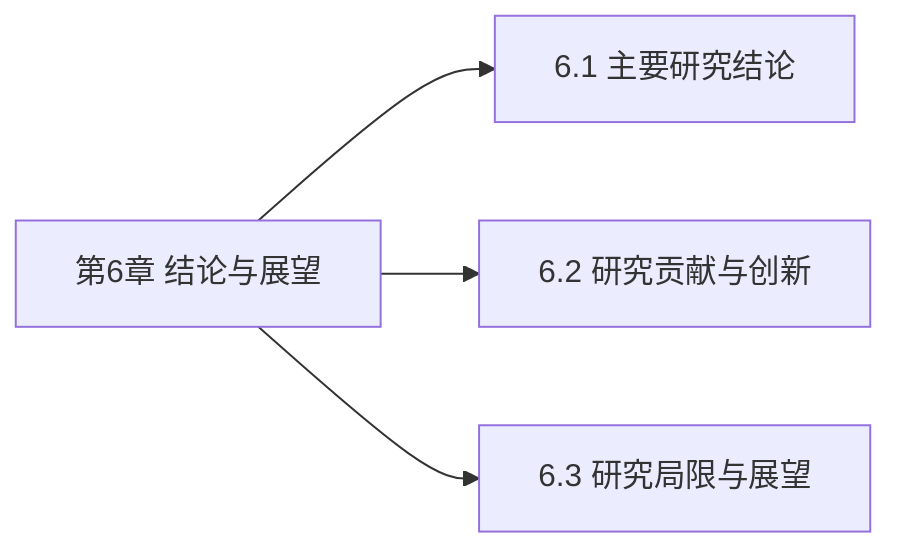

# 第6章 结论与展望

<!-- dynamic-chapter:start -->
## 当前工作安排

> 由[[论文章节/大纲结构.yaml|大纲结构]]生成。修改主源后运行同步；文件夹编号仅为历史路径，不决定当前章节顺序。

**本章任务：** 总结建筑形态学认识、本体与知识组织方法、实例图谱及知识发现与应用验证的贡献，限定适用范围与局限。

**结构状态：** V3.3工作结构；结论待前文完成后撰写

**正文接续：** 旧稿第六章为风貌版结论，不能直接沿用；待前文完成后重写。

**章内逻辑：** 主要结论 → 研究贡献与创新 → 局限与展望。

**向后接续：** 回应第一章研究问题，不在结论新增未在前文建立的证据或主张。

## 小节与主题成果采用表

| 小节 | 主题及成果入口 | 本节用途 | 采用状态与证据缺口 |
|---|---|---|---|
| 6.1 主要研究结论 | [〔体系设计〕多尺度语义模型与建模依据](../../%E4%B8%BB%E9%A2%98%E7%A0%94%E7%A9%B6/%E3%80%94%E4%BD%93%E7%B3%BB%E8%AE%BE%E8%AE%A1%E3%80%95%E5%A4%9A%E5%B0%BA%E5%BA%A6%E8%AF%AD%E4%B9%89%E6%A8%A1%E5%9E%8B%E4%B8%8E%E5%BB%BA%E6%A8%A1%E4%BE%9D%E6%8D%AE/%E3%80%94%E4%BD%93%E7%B3%BB%E8%AE%BE%E8%AE%A1%E3%80%95%E5%A4%9A%E5%B0%BA%E5%BA%A6%E8%AF%AD%E4%B9%89%E6%A8%A1%E5%9E%8B%E4%B8%8E%E5%BB%BA%E6%A8%A1%E4%BE%9D%E6%8D%AE.md)、[〔检验与评价〕图谱试建、查询与有效性](../../%E4%B8%BB%E9%A2%98%E7%A0%94%E7%A9%B6/%E3%80%94%E6%A3%80%E9%AA%8C%E4%B8%8E%E8%AF%84%E4%BB%B7%E3%80%95%E5%9B%BE%E8%B0%B1%E8%AF%95%E5%BB%BA%E3%80%81%E6%9F%A5%E8%AF%A2%E4%B8%8E%E6%9C%89%E6%95%88%E6%80%A7/%E3%80%94%E6%A3%80%E9%AA%8C%E4%B8%8E%E8%AF%84%E4%BB%B7%E3%80%95%E5%9B%BE%E8%B0%B1%E8%AF%95%E5%BB%BA%E3%80%81%E6%9F%A5%E8%AF%A2%E4%B8%8E%E6%9C%89%E6%95%88%E6%80%A7.md)、[〔研究方法〕类型识别与比较](../../%E4%B8%BB%E9%A2%98%E7%A0%94%E7%A9%B6/%E3%80%94%E7%A0%94%E7%A9%B6%E6%96%B9%E6%B3%95%E3%80%95%E7%B1%BB%E5%9E%8B%E8%AF%86%E5%88%AB%E4%B8%8E%E6%AF%94%E8%BE%83/%E3%80%94%E7%A0%94%E7%A9%B6%E6%96%B9%E6%B3%95%E3%80%95%E7%B1%BB%E5%9E%8B%E8%AF%86%E5%88%AB%E4%B8%8E%E6%AF%94%E8%BE%83.md) | 回应研究问题，总结建筑形态学发现、知识组织方法与图谱构建结果；只写跨章结论，不重复第五章章内归纳。 | V3.3工作结构；结论待前文完成后撰写 |
| 6.2 研究贡献与创新 | [〔体系设计〕多尺度语义模型与建模依据](../../%E4%B8%BB%E9%A2%98%E7%A0%94%E7%A9%B6/%E3%80%94%E4%BD%93%E7%B3%BB%E8%AE%BE%E8%AE%A1%E3%80%95%E5%A4%9A%E5%B0%BA%E5%BA%A6%E8%AF%AD%E4%B9%89%E6%A8%A1%E5%9E%8B%E4%B8%8E%E5%BB%BA%E6%A8%A1%E4%BE%9D%E6%8D%AE/%E3%80%94%E4%BD%93%E7%B3%BB%E8%AE%BE%E8%AE%A1%E3%80%95%E5%A4%9A%E5%B0%BA%E5%BA%A6%E8%AF%AD%E4%B9%89%E6%A8%A1%E5%9E%8B%E4%B8%8E%E5%BB%BA%E6%A8%A1%E4%BE%9D%E6%8D%AE.md)、[〔检验与评价〕图谱试建、查询与有效性](../../%E4%B8%BB%E9%A2%98%E7%A0%94%E7%A9%B6/%E3%80%94%E6%A3%80%E9%AA%8C%E4%B8%8E%E8%AF%84%E4%BB%B7%E3%80%95%E5%9B%BE%E8%B0%B1%E8%AF%95%E5%BB%BA%E3%80%81%E6%9F%A5%E8%AF%A2%E4%B8%8E%E6%9C%89%E6%95%88%E6%80%A7/%E3%80%94%E6%A3%80%E9%AA%8C%E4%B8%8E%E8%AF%84%E4%BB%B7%E3%80%95%E5%9B%BE%E8%B0%B1%E8%AF%95%E5%BB%BA%E3%80%81%E6%9F%A5%E8%AF%A2%E4%B8%8E%E6%9C%89%E6%95%88%E6%80%A7.md) | 区分建筑学认识、本体与知识组织方法、实例图谱与应用验证的贡献，依据前文限定证据与适用范围；不把建库、软件使用或图示生成自动认定为创新。 | V3.3工作结构；贡献待前文证据支持 |
| 6.3 研究局限与展望 | [〔检验与评价〕图谱试建、查询与有效性](../../%E4%B8%BB%E9%A2%98%E7%A0%94%E7%A9%B6/%E3%80%94%E6%A3%80%E9%AA%8C%E4%B8%8E%E8%AF%84%E4%BB%B7%E3%80%95%E5%9B%BE%E8%B0%B1%E8%AF%95%E5%BB%BA%E3%80%81%E6%9F%A5%E8%AF%A2%E4%B8%8E%E6%9C%89%E6%95%88%E6%80%A7/%E3%80%94%E6%A3%80%E9%AA%8C%E4%B8%8E%E8%AF%84%E4%BB%B7%E3%80%95%E5%9B%BE%E8%B0%B1%E8%AF%95%E5%BB%BA%E3%80%81%E6%9F%A5%E8%AF%A2%E4%B8%8E%E6%9C%89%E6%95%88%E6%80%A7.md)、[〔研究界定〕研究对象与样本边界](../../%E4%B8%BB%E9%A2%98%E7%A0%94%E7%A9%B6/%E3%80%94%E7%A0%94%E7%A9%B6%E7%95%8C%E5%AE%9A%E3%80%95%E7%A0%94%E7%A9%B6%E5%AF%B9%E8%B1%A1%E4%B8%8E%E6%A0%B7%E6%9C%AC%E8%BE%B9%E7%95%8C/%E3%80%94%E7%A0%94%E7%A9%B6%E7%95%8C%E5%AE%9A%E3%80%95%E7%A0%94%E7%A9%B6%E5%AF%B9%E8%B1%A1%E4%B8%8E%E6%A0%B7%E6%9C%AC%E8%BE%B9%E7%95%8C.md) | 围绕样本、资料、规则、验证深度与实际未解决问题提出后续研究，不增加未经论证的成果声明。 | V3.3工作结构；待实证与验证结果 |

## 逐节研究问题与证据要求

以下是待执行的研究要求，不是已完成或已验证声明；采用状态仍以上表为准。

### 主要研究结论

- **问题**：研究形成了哪些建筑形态学认识、知识组织成果与图谱构建结果？
- **所需证据／待核材料**：第三至第五章实际成果与证据；研究问题—结论对应表。
- **完成判据**：每项结论有证据和适用范围，当前不预写结论。

### 研究贡献与创新

- **问题**：哪些工作形成了可支持的新增知识或方法贡献？
- **所需证据／待核材料**：模型及构建方法与既有研究的对照；真实实例成果与建筑学分析证据。
- **完成判据**：不以建库、使用软件或生成图示自动认定创新；创新表述须有对照证据。

### 研究局限与展望

- **问题**：哪些不确定性影响结论，后续怎样补足？
- **所需证据／待核材料**：样本和资料限制；失败及未解决问题记录。
- **完成判据**：局限对应具体结论与证据，不用通用展望掩盖未验证环节。

## 本章结构图

## 稳定节点与原稿接续

- `section-6-1`：主要研究结论；纳入当前工作大纲。原稿编号：6.1；变更说明：2026-10-29用户确认体系—实例图谱—风貌分析分工；由“主要研究结论”调整，保留稳定ID及原稿接续；正文未改写；2026-11-17按V3.3将结论对象改为建筑形态学认识、本体与图谱成果。

- `section-6-2`：研究贡献与创新；纳入当前工作大纲。原稿编号：6.2；变更说明：2026-10-29用户确认体系—实例图谱—风貌分析分工；由“研究贡献及其证据边界”调整，保留稳定ID及原稿接续；正文未改写；2026-10-29标题与逻辑梳理：由“研究贡献及其证据边界”接续，仍为工作大纲，正文不改；2026-11-17按V3.3将贡献对象改为形态学认识、本体与知识组织、图谱与应用验证。

- `section-6-3`：研究局限与展望；纳入当前工作大纲。原稿编号：6.3；变更说明：保留稳定ID与原稿入口，由“研究不足与展望”调整论证任务；本次仅修订结构和证据要求；2026-10-29标题与逻辑梳理：由“研究局限与后续工作”接续，仍为工作大纲，正文不改；2026-11-17按V3.3保留6.3研究局限与展望。

## 调整与反馈

需要调整题名、顺序、节的归属或采用状态时，修改大纲结构；稳定ID不随编号改变。新增、停用、拆分合并必须保留理由及原稿接续，不能由文件数自动认定研究完成。
<!-- dynamic-chapter:end -->
